## 3
数据准备和转换

你可能听说过数据科学家花费大部分时间在与数据准备相关的工作上。现在是时候解释为什么会发生这种情况以及我们谈论的是哪些类型的活动了。

在本章中，您将学习如何处理分类和数值特征，以及如何应用不同的技术来转换您的数据，例如独热编码、二进制编码器、序数编码、分箱和文本转换。您还将学习如何处理数据中的缺失值和异常值，这是在构建良好的机器学习模型时可以实施的两个重要任务。

在本章中，我们将涵盖以下主题：
- 识别特征类型
- 处理分类特征
- 处理数值特征
- 理解数据分布
- 处理缺失值
- 处理异常值
- 处理不平衡数据集
- 处理文本数据

这是一个冗长的章节，所以请耐心！详细了解这些主题肯定会让您在 AWS 机器学习专业考试中处于有利位置。

### 识别特征类型

我们*不能*在不知道*特征*是什么以及它可能存储哪种类型的信息的情况下开始建模。您已经阅读过处理特征的不同流程。例如，您知道特征工程与构建和准备模型特征的任务相关；您还知道特征选择与选择最佳特征集以供特定算法使用的任务相关。这两个任务有一个共同的行为：它们可能会根据它们处理的特征类型而变化。

理解这种行为（特征类型与适用转换）非常重要，因为它将帮助您在考试中排除无效答案（更重要的是，您将成为更好的数据科学家）。

当我们提到特征类型时，我们指的是特定特征 supposed to 存储的数据类型。以下图表显示了我们如何可能描述模型的各种特征类型：

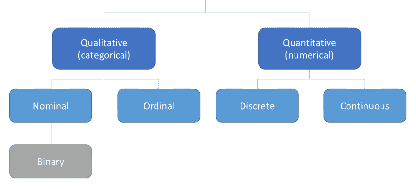

图 3.1 – 特征类型

在第 1 章《机器学习基础》中，您已经了解了前一图表中显示的特征分类。现在，让我们看一些实际示例以消除您可能仍有的任何疑问：

| 特征类型 | 特征子类型 | 定义 | 示例 |
|---|---|---|---|
| 分类 | 名义 | 具有无定量值的标记变量 | 云提供商：AWS、MS、Google |
| 分类 | 序数 | 为标记变量添加顺序感 | 职位：初级数据科学家、高级数据科学家、首席数据科学家 |
| 分类 | 二进制 | 仅允许两个值的变量 | 欺诈分类：欺诈，非欺诈 |
| 数值 | 离散 | 单个且可计数的项目 | 学生人数：1000 |
| 数值 | 连续 | 可能的测量值无限且通常带有小数点 | 总金额：$150.35 |

图 3.2 – 特征值的真实示例

虽然查看变量的值可能会帮助您找到其类型，但您绝不应仅依赖这一点。变量的性质对于做出此类决定也非常重要。例如，有人可能会将云提供商变量（上表所示）编码如下：1（AWS）、2（MS）、3（Google）。在这种情况下，变量仍然是一个名义特征，即使它现在由离散数字表示。

如果您正在构建 ML 模型并且没有告诉您的算法该变量不是离散数字，而是名义变量，算法会将其视为数字，模型将不再可解释。

> **重要提示**
> 在将任何数据提供给 ML 算法之前，请确保您的特征类型已被正确识别。

理论上，如果您对特征感到满意并且已正确分类每个特征，您应该准备好进入 CRISP-DM 方法论的建模阶段，对吧？也许不是。即使您已正确分类特征，您也可能想在数据准备上花费更多时间，原因有很多：
- 一些算法实现，例如 `scikit-learn`，可能不接受分类特征上的字符串值。
- 变量的数据分布可能不是算法最优的分布。
- 您的 ML 算法可能会受到您数据规模的影响。
- 变量的一些观察值（行）可能缺少信息，您将不得不修复它。这些也称为缺失值。
- 您可能会发现变量的异常值，这可能会给您的模型带来偏差。
- 您的变量可能存储不同类型的信息，而您可能只对其中一些感兴趣（例如，日期变量可以存储一周中的某天或月份中的某周）。
- 您可能希望为文本变量找到数学表示。
- 相信我，这个列表永远不会结束。

在以下各节中，我们将了解如何解决所有这些问题，从分类特征开始。

### 处理分类特征

分类特征的<|message|> 数据转换方法将根据变量的子类型而变化。在接下来的各节中，我们将了解如何转换名义和序数特征。

### 转换名义特征

您可能需要在将 ML 算法应用于它们之前创建分类特征的数值表示。一些库可能具有嵌入逻辑来为您处理该转换，但大多数没有。

我们将要介绍的第一个转换称为 **标签编码**。标签编码器适用于分类/名义变量，它只会为变量的每个不同标签关联一个数字。以下表格显示了标签编码器的工作方式：


| Country | Label encoding |
|---|---|
| India | 1 |
| Canada | 2 |
| Brazil | 3 |
| Australia | 4 |
| India | 1 |

Figure 3.3 – Label encoder in action

标签编码器将始终确保为每个不同的标签关联一个唯一的数字。在前面的表格中，尽管 "India" 出现了两次，但分配给它的数字是相同的。

你现在有了每个国家的数值表示，但这并不意味着你可以在模型中使用该数值表示！在这种特定情况下，我们正在转换一个名义特征，它没有顺序。

根据前面的表格，如果我们将国家变量的编码版本传递给模型，它会做出诸如 "Brazil (3) 大于 Canada (2)" 这样的假设，这没有任何意义。

针对该场景的一种可能解决方案是在 "country" 之上应用另一种类型的转换：独热编码。该转换会将原始特征中的所有类别表示为单独的特征（也称为哑变量），这些特征将存储每个类别的“存在或不存在”。下面的表格转换了我们在前一个表格中查看的相同信息，但这次它应用了独热编码：

| Country | India | Canada | Brazil | Australia |
|---|---|---|---|---|
| India | 1 | 0 | 0 | 0 |
| Canada | 0 | 1 | 0 | 0 |
| Brazil | 0 | 0 | 1 | 0 |
| Australia | 0 | 0 | 0 | 1 |
| India | 1 | 0 | 0 | 0 |

Figure 3.4 – One-hot encoding in action

我们现在可以将国家变量的独热编码版本用作 ML 模型的特征。然而，作为一名怀疑论的数据科学家，你的工作永远不会结束，你的批判性思维能力将在 AWS Machine Learning Specialty 考试中得到考验。

假设你的数据集中有 150 个不同的国家。你会得到多少个哑变量？150 个，对吧？在这里，我们发现了一个潜在问题：除了给模型增加复杂性（这绝不是任何模型的期望特征）之外，哑变量还会给你的数据增加**稀疏性**。

稀疏数据集有很多变量填充了零。通常，很难将这种类型的数据结构装入内存（你很容易耗尽内存），并且 ML 算法处理稀疏结构非常耗时。

你可以通过对原始数据进行分组并减少类别数量来解决稀疏性问题，你甚至可以使用压缩稀疏数据的自定义库，使其更易于操作（例如 `scipy.sparse.csr_matrix`，来自 Python）。

因此，在考试期间，请记住，当你需要将分类/名义数据转换为供 ML 模型使用时，独热编码绝对是正确的方法；然而，请考虑原始特征唯一类别的数量，并思考为它们全部创建哑变量是否合理（如果唯一类别数量非常大，可能就不合理）。

### Applying binary encoding

对于具有更高数量唯一类别的此类变量，创建一个数值表示的一种潜在方法是应用**二进制编码**。在此方法中，目标是将分类列转换为多个二进制列，但最小化新列的数量。

该过程包含三个基本步骤：

+   1. 分类数据在经过序数编码器后被转换为数值数据。
+   2. 结果数字然后被转换为二进制值。
+   3. 二进制值被拆分为不同的列。

让我们重用 *Figure 3.3* 中的数据，看看在这种特定情况下我们如何使用二进制编码：

| Country | Label encoder | Binary | Col1 | Col2 | Col3 |
|---|---|---|---|---|---|
| India | 1 | 001 | 0 | 0 | 1 |
| Canada | 2 | 010 | 0 | 1 | 0 |
| Brazil | 3 | 011 | 1 | 1 | 1 |
| Australia | 4 | 100 | 1 | 0 | 0 |
| India | 1 | 001 | 0 | 0 | 1 |

Figure 3.5 – Binary encoding in action

正如我们所见，我们现在有三列（Col1、Col2 和 Col3）而不是四列。

### Transforming ordinal features

序数特征具有非常特定的特征：它们有顺序。因为它们具有这种质量，所以对它们应用独热编码是没有意义的；如果你这样做，你将失去特征的顺序幅度。

这种类型变量最常见的转换被称为序数编码。序数编码器会为变量的每个不同标签关联一个数字，就像标签编码器一样，但这次它会尊重每个类别的顺序。下面的表格展示了序数编码器的工作方式：

| Education | Ordinal encoding |
|---|---|
| Trainee | 1 |
| Jr. Data Analyst | 2 |
| Sr Data Analyst | 3 |
| Chief Data Scientist | 4 |

Figure 3.6 – Ordinal encoding in action

我们现在可以将编码后的变量传递给 ML 模型，它们将能够正确处理该变量，无需应用独热编码转换。这次，“Sr Data Analyst 大于 Jr. Data Analyst” 之类的比较完全有意义。

### Avoiding confusion in our train and test datasets

不要忘记以下陈述：编码器在训练数据上拟合，并在测试和生产数据上转换。这就是你的 ML 管道应该工作的方式。

假设你创建了一个独热编码器，它拟合 Figure 3.3 的数据并返回 Figure 3.4 的数据。在此示例中，我们假设这是我们的训练数据。一旦你完成了训练过程，你可能希望将相同的独热编码转换应用于你的测试数据以检查模型的结果。

在我们刚刚描述的场景中（这是建模管道中非常常见的情况），你不能在测试数据上重新训练编码器！你应该只重用你在训练数据上创建的先前编码器对象。技术上，我们说你不应该再次使用 fit 方法，而应使用 transform 方法。

你可能已经知道为什么应该遵循此规则，但让我们回顾一下：测试数据用于提取模型的性能指标，因此你不应该用它来提取任何其他知识。如果你这样做，你的性能指标将被测试数据偏差，并且你无法推断相同的性能（在测试数据中显示）可能在生产中发生（当新数据到来时）。

到目前为止，一切都很好。然而，如果我们的测试集包含训练集中不存在的新类别，我们该如何转换这些数据？让我们逐步了解这个特定场景。

回到我们之前在 Figure 3.3（输入数据）和 Figure 3.4（输出数据）中查看的独热编码示例，我们的编码器知道如何转换以下国家：Australia、Brazil、Canada 和 India。如果测试集中有不同的国家，编码器将不知道如何转换它，这就是为什么我们需要定义它在存在异常情况时的行为。

大多数 ML 库为这些情况提供了特定的参数。在我们的示例中，我们可以编程编码器以在遇到异常时引发错误或将哑变量全部设为零，如下表所示：

| Country | India | Canada | Brazil | Australia |
|---|---|---|---|---|
| India | 1 | 0 | 0 | 0 |
| Canada | 0 | 1 | 0 | 0 |
| Brazil | 0 | 0 | 1 | 0 |
| Australia | 0 | 0 | 0 | 1 |
| India | 1 | 0 | 0 | 0 |
| Portugal | 0 | 0 | 0 | 0 |

Figure 3.7 – Handling unknown values on one-hot encoding transformations

正如我们所见，Portugal 在训练集中不存在（Figure 3.3），因此在转换期间，我们保持已知的国家列表不变，并表示 Portugal 不是其中任何一个（全为零）。

作为我们知道你正在成为的非常好、怀疑论的数据科学家，你是否应该担心存在一个在训练期间未使用过的特定类别？也许吧。这种类型的分析真的取决于你的问题领域。

处理未知值非常常见，是你在 ML 管道中应该预期要做的事情。然而，你也应该问自己，由于你没有在训练过程中使用该特定类别，你的模型是否可以外推和泛化。

记住，你的测试数据必须遵循与训练数据相同的分布，你很可能会在训练或测试集中找到所有（或至少大部分）分类特征的类别。此外，如果你遇到过拟合问题（在训练中表现良好，但在测试集中表现不佳），并且同时意识到你的分类编码器在测试集中转换了大量未知值，你猜怎么着？很可能你的训练和测试样本没有遵循相同的分布，从而使你的模型完全无效。

正如你所见，我们正在慢慢接近。我们正在以精细的细节讨论偏差和调查策略！现在，让我们继续并查看对数值特征执行转换。 是的，每种类型的数据都很重要，并驱动你的决策！

### Dealing with numerical features

就数值特征（离散和连续）而言，我们可以考虑依赖训练数据的转换，以及纯粹依赖正在转换的观测值的转换。

那些依赖训练数据的转换将使用训练集在 fit 期间学习必要的参数，然后使用它们来转换任何测试或新数据。逻辑与我们刚才回顾的分类特征基本相同；然而，这次，编码器将学习不同的参数。

另一方面，那些纯粹依赖观测值的转换不关心训练集或测试集。它们只会对单个值执行数学计算。例如，我们可以通过对某个变量的值进行平方来应用指数转换。没有任何地方学习参数的依赖——只需获取值并将其平方即可。


此时，你可能会想到数值特征可用的数十种转换！确实，选项如此之多，我们无法在此全部描述，而且你也不必为 AWS Machine Learning Specialty 考试知道所有内容。我们将在此介绍最重要的几种（针对考试），但我不想限制你的建模技能：花点时间思考一下，通过根据你的使用案例创建自定义转换，你拥有的无限选项。

### 数据归一化

应用数据 **归一化** 意味着改变数据的尺度。例如，你的特征可能存储员工薪资，范围在每年 20,000 到 200,000 美元之间，而你希望将此数据放在 0 到 1 的范围内，其中 20,000（观察到的最小值）将被转换为 0，而 200,000（观察到的最大值）将被转换为 1。

这种技术在你希望将训练数据拟合到某些受底层数据尺度/幅度影响的算法之上时尤其重要。例如，我们可以考虑那些使用输入变量点积的算法（例如神经网络或线性回归），以及那些依赖距离度量的算法（例如 **k-最近邻 (KNN)** 或 **k-means**）。

另一方面，应用数据归一化不会对基于规则的算法（如决策树）产生性能改进，因为它们能够检查特征的预测能力（通过 **熵** 或 **信息增益** 分析），而不管数据的尺度如何。

> **重要说明**
> 我们将在本书后面的章节中学习这些算法以及适当的细节。例如，你可以将熵和信息增益视为决策树用来检查特征重要性的两种指标。了解每个特征的预测能力有助于算法定义树的最佳根节点、中间节点和叶节点。

让我们花点时间理解为什么数据归一化会对这些类型的算法有所帮助。我们已经知道聚类算法的目标是在你的数据中找到组或簇，而其中最常用的聚类算法之一被称为 k-means。我们将使用 k-means 来实际观察这个问题，因为它受数据缩放的影响。

下图显示了变量的不同尺度如何改变超平面的投影：

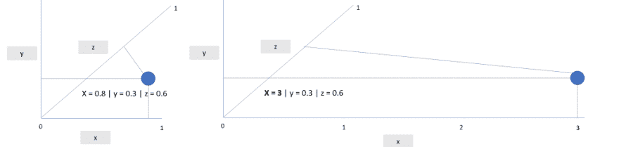

图 3.8 – 在超平面中绘制不同尺度的数据

在前一图像的左侧，我们可以看到一个数据点被绘制在具有三个维度（x、y 和 z）的超平面中。所有三个维度（也称为特征）都已归一化到 0 到 1 的尺度。在右侧，我们可以看到同一个数据点，但这次“x”维度未归一化。我们可以清楚地看到超平面发生了变化。

在实际场景中，我们会有更多维度和数据点。数据尺度的差异会改变每个簇的质心，并可能改变某些点的分配簇。同样的问题也会发生在依赖距离计算的其他算法上，例如 KNN。

其他算法，例如神经网络和线性回归，将使用你的输入数据计算加权和。通常，这些类型的算法会执行诸如 W1*X1 + W2*X2 + Wi*Xi 的操作，其中 Xi 和 Wi 分别指特定特征值及其权重。同样，我们将在后面介绍神经网络和线性模型的细节，但仅通过我们刚刚描述的计算，你能否看出数据缩放问题？如果 X（特征）和 W（权重）都是大数，我们很容易得到非常大的值。这将使算法的优化变得更加复杂。

我希望你现在对应该应用数据归一化的原因（以及何时不应应用）有非常好的理解。数据归一化通常在 ML 库中作为 Min Max Scaler 实现。如果你考试中遇到这个术语，请记住它与数据归一化相同。

此外，数据归一化不一定需要将你的特征转换为 0 到 1 之间的范围。实际上，我们可以将特征转换为我们想要的任何范围。以下是归一化的正式定义：

X_normalized = (X - X_min) / (X_max - X_min)

图 3.9 – 归一化公式

这里，X_min 和 X_max 是范围的下限和上限值；X 是特征的值。除了数据归一化之外，还有另一种关于数值转换的非常重要技术，你必须了解，不仅为了考试，也为了你的数据科学职业。我们将在下一节中讨论它。

### 数据标准化

数据标准化是另一种缩放方法，它转换数据的分布，使均值变为零，标准差变为一。下图正式描述了这种缩放技术，其中 X 表示要转换的值，μ 指 X 的均值，σ 是 X 的标准差：

X' = (X - μ) / σ

图 3.10 – 标准化公式

与归一化不同，数据标准化不会产生预定义的值范围。相反，它会将你的数据转换为标准高斯分布，其中转换后的值将表示每个值相对于分布均值的标准差数。

重要说明
高斯分布，也称为正态分布，是统计模型中最常用的分布之一。这是一个连续分布，具有两个主要控制参数：μ（均值）和 σ（标准差）。正态分布围绕均值对称。换句话说，大多数值将接近分布的均值。

数据标准化通常被称为 zscore，并被广泛用于识别变量中的异常值，我们将在本章后面看到。为了演示目的，下表模拟了小数据集的数据标准化。输入值出现在“Age”列中，而缩放值出现在“Zscore”列中：

| Age | Mean | Standard Deviation | Zscore |
| --- | --- | --- | --- |
| 5 | 31,83 | 25,47 | -1,05 |
| 20 | 31,83 | 25,47 | -0,46 |
| 24 | 31,83 | 25,47 | -0,31 |
| 32 | 31,83 | 25,47 | 0,01 |
| 30 | 31,83 | 25,47 | -0,07 |
| 80 | 31,83 | 25,47 | 1,89 |

图 3.11 – 数据标准化实战

确保你在 AWS Machine Learning Specialty 考试中手动应用归一化和标准化时充满信心。他们可能会提供一组值，以及均值和标准差，并要求你计算列表中每个元素的缩放值。

### 应用分箱和离散化

**分箱** 是一种技术，你可以将一组值分组到桶或箱中；例如，将 0 到 14 岁之间的人分组到名为“儿童”的桶中，将 15 到 18 岁之间的人分组到名为“青少年”的桶中，依此类推。

**离散化** 是将连续变量转换为离散或名义属性的过程。这些连续值可以通过多种策略进行离散化，例如 **等宽** 和 **等频**。

等宽策略会将你的数据划分为多个宽度相同的箱。等频会将你的数据划分为频率相同数量的多个箱。

让我们看一个例子。假设我们有以下包含 16 个数字的列表：10、11、12、13、14、15、16、17、18、19、20、21、22、23、24、90。正如我们所见，这个列表的范围在 10 到 90 之间。假设我们想使用等宽策略创建四个箱，我们会得到以下箱：

- Bin >= 10 <= 30 > 10, 11, 12, 13, 14, 15, 16, 17, 18, 19, 20, 21, 22, 23, 24
- Bin > 30 <= 50 >
- Bin > 50 <= 70 >
- Bin > 71 <= 90 > 90

在这种情况下，每个箱的宽度相同（20 个单位），但观测值分布不均。现在，让我们模拟等频策略：

- Bin >= 10 <= 13 > 10, 11, 12, 13
- Bin > 13 <= 17 > 14, 15, 16, 17
- Bin > 17 <= 21 > 18, 19, 20, 21
- Bin > 21 <= 90 > 22, 23, 24, 90

在这种情况下，所有箱的观测频率相同，尽管它们是用不同的箱宽度构建的以使其成为可能。

一旦你计算了你的箱，你可能会想知道下一步是什么，对吧？这里，你有一些选择：

- 你可以为你的箱命名并将它们用作模型上的名义特征！当然，作为名义变量，你应该考虑在将数据输入 ML 模型之前应用独热编码。
- 你可能想要对你的箱进行排序并将它们用作序数特征。
- 也许你想通过对每个箱的最小值和最大值取平均值并使用该值作为转换后的特征来从你的特征中去除一些噪声。


请查看下表，了解我们使用等频示例时的这些方法：

| 原始值 | Bin | 转换为名义特征 | 转换为序数特征 | 去除噪声 |
|---|---|---|---|---|
| 10 | Bin >= 10 <= 13 | Bin A | 1 | 11,5 |
| 11 | Bin > 10 <= 13 | Bin A | 1 | 11,5 |
| 12 | Bin > 10 <= 13 | Bin A | 1 | 11,5 |
| 13 | Bin > 10 <= 13 | Bin A | 1 | 11,5 |
| 14 | Bin > 13 <= 17 | Bin B | 2 | 15,5 |
| 15 | Bin > 13 <= 17 | Bin B | 2 | 15,5 |
| 16 | Bin > 13 <= 17 | Bin B | 2 | 15,5 |
| 17 | Bin > 13 <= 17 | Bin B | 2 | 15,5 |
| 18 | Bin > 17 <= 21 | Bin C | 3 | 19,5 |
| 19 | Bin > 17 <= 21 | Bin C | 3 | 19,5 |
| 20 | Bin > 17 <= 21 | Bin C | 3 | 19,5 |
| 21 | Bin > 17 <= 21 | Bin C | 3 | 19,5 |
| 22 | Bin > 21 <= 90 | Bin D | 4 | 55,5 |
| 23 | Bin > 21 <= 90 | Bin D | 4 | 55,5 |
| 24 | Bin > 21 <= 90 | Bin D | 4 | 55,5 |
| 90 | Bin > 21 <= 90 | Bin D | 4 | 55,5 |

图 3.12 – 处理分箱和离散化的不同方法

再次，使用不同的分箱策略会得到不同的结果，你应该分析/测试对你的数据集最佳的方法。这里没有标准答案——一切都关于数据探索！

### 应用其他类型的数值转换

归一化和标准化依赖于训练数据来拟合其参数：在归一化的情况下为最小值和最大值，在标准缩放的情况下为均值和标准差。这也意味着你必须仅使用训练数据拟合这些参数，而永远不要使用测试数据。

然而，还有其他类型的数值转换不需要从训练数据中获取参数即可应用。这些类型的转换纯粹依赖于数学计算。例如，其中一种转换被称为**对数转换**。这是在机器学习模型中非常常见的一种转换类型，尤其对**偏斜**特征有益。如果你不知道什么是偏斜分布，请看下面的图表：

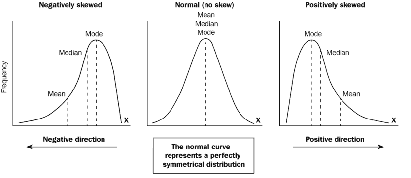

图 3.13 – 偏斜分布

中间我们有一个正态分布（或高斯分布）。在左右两侧，我们有偏斜分布。就偏斜特征而言，会有一些值在某一方向上远离均值（向左或向右）。这种行为会将该分布的中位数和均值都推向我们可以在前图中看到的长尾的同一方向。

一个非常明显的偏斜数据的例子是特定地区某一职业群体的年薪，例如在美国佛罗里达州工作的资深数据科学家。这类变量通常其大部分值都接近彼此（因为人们通常赚取平均薪水），并且只有少数非常高的值（因为一小部分人赚的钱比其他人多得多）。

希望你现在能很容易理解为什么均值和中位数会向尾部方向移动，对吧？高薪会将它们推向那个方向。

好吧，但为什么对数转换对这种类型的特征有益呢？这个问题的答案可以用其背后的数学来解释：

```
log(x^n) = n log(x)
```

图 3.14 – 对数性质

计算一个数的对数是指数函数的逆运算。对数转换随后会根据给定的底数（如底数 2、底数 10 或自然对数的底数 e）按比例缩小你的数字。看我们之前的薪资分布示例，我们会将那些数字全部降低，使得数字越高，降低幅度越大；然而，我们会以对数尺度而不是线性方式进行。这种行为会消除该分布的异常值（使其更接近正态分布），这对许多机器学习算法（如线性回归）是有益的。下表显示了将数字在线性尺度与对数尺度下转换时的一些差异：

| 原始值 | 线性尺度（归一化） | 对数尺度（底数 10） |
|---|---|---|
| 10 | 0.0001 | 1 |
| 1,000 | 0.01 | 3 |
| 10,000 | 0.1 | 4 |
| 100,000 | 1 | 5 |

图 3.15 – 线性转换与对数转换之间的差异

我希望你能看出线性转换保留了数据的原始量级（我们仍然可以看到异常值，但是在另一个尺度下），而对数转换去除了量级的差异并仍然保持了值的顺序。

你能想到另一种遵循与对数相同行为的数学转换吗（使分布更接近高斯）？好吧，我可以再给你一个：平方根。取上表中所示数字的平方根，自己看看！

现在，注意这一点：对数和平方根都属于一组称为幂转换的转换，其中有一种非常流行的方法，很可能在你的 AWS 考试中提到，可以执行我们所见过的那些幂转换的范围。这种方法由 George Box 和 David Cox 提出，其名称是 Box-Cox。

### 重要说明

在你的考试中，如果你看到关于 Box-Cox 转换的问题，请记住它是一种可以根据 lambda 参数执行多种幂转换的方法，其最终目标是使原始分布更接近正态分布（不要忘记这一点）。

为了总结我们关于为什么数学转换可以真正对机器学习模型产生差异的讨论，我将给你一个关于**指数转换**的直观例子。

假设你有一组数据点，例如图 3.16 左侧所示。你的目标是画一条线来完美分割蓝色和红色点。仅通过查看原始数据（再次在左侧），我们知道执行此线性任务的最佳猜测就是同一图像中可以看到的那条线。然而，科学（不是魔法）在图像右侧发生！通过对这些数字进行平方并在另一个超平面中绘制它们，我们可以完美地分离每个点群：

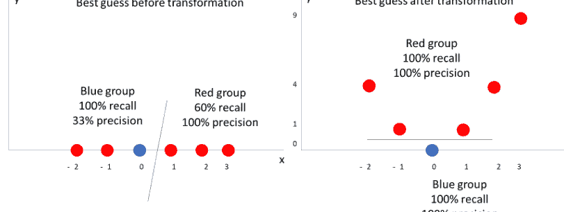

图 3.16 – 指数转换的实际应用

我知道你可能在想处理数据的无限种方式。虽然这是真的，但你应该始终考虑到你正在工作的业务场景并相应地规划你的工作。记住模型改进或探索始终是可能的，但你必须定义你的目标（记住 CRISP-DM 方法论）并继续前进。

顺便说一下，数据转换很重要，但只是你作为数据科学家工作的一部分。你的建模之旅仍需转向其他重要主题，例如缺失值和异常值处理，我们接下来会讨论。然而，在此之前，你可能已经注意到你在本节中被介绍到了高斯分布，所以让我们花点时间更详细地讨论它们。

### 理解数据分布

尽管高斯分布可能是统计和机器学习模型中最常见的分布，但你应该意识到它不是唯一一种。还有其他类型的数据分布，例如**伯努利**、**二项式**和**泊松**分布。

伯努利分布非常简单，因为只有两种可能事件：成功或失败。成功事件发生的概率为“p”，而失败事件的概率为“1-p”。

遵循伯努利分布的一些例子是掷六面骰子或抛硬币。在这两种情况下，你必须定义成功事件和失败事件。例如，假设我们在骰子示例中的成功和失败事件如下：

- 成功：得到数字 6
- 失败：得到任何其他数字

我们就可以说我们有 p 的成功概率（1/6 = 0.16 = 16%）和 1-p 的失败概率（1 - 0.16 = 0.84 = 84%）。

二项式分布推广了伯努利分布。伯努利分布只有一次事件重复，而二项式分布允许事件重复多次，并且我们必须计算成功次数。让我们继续之前的例子；即在 10 次掷骰中我们得到 6 的次数。由于这个例子的性质，二项式分布有两个参数，n 和 p，其中 n 是重复次数，p 是每次重复中成功的概率。

最后，泊松分布允许我们在给定某个区间内事件发生的次数的情况下，找到一个时间段内的事件数量。它有三个参数：lambda、e 和 k，其中 lambda 是每个区间的平均事件数，e 是欧拉数，k 是某个区间内事件发生的次数。


有了这些分布，包括高斯分布，我们可以根据其参数计算期望均值和方差。这些信息通常用于假设检验，以检查某些样本数据是否遵循给定分布，通过将样本的均值和方差与分布的期望均值和方差进行比较。

我希望你现在对数据分布总体上更加熟悉，而不仅仅是高斯分布。我们将在整本书中持续讨论数据分布。现在，让我们继续讨论缺失值和异常值检测。

### 处理缺失值

顾名思义，缺失值是指数据的缺失。这种缺失通常由标记表示，这些标记可能以标准方式实现，也可能不是。

尽管使用标记是标准做法，但这些标记的显示方式在不同平台之间可能有所不同。例如，关系数据库用 NULL 表示缺失数据，核心 Python 代码会使用 None，而某些 Python 库会将缺失数字表示为 (Not a Number (NaN))。

> **重要说明**
> 对于数值字段，不要用零替换这些标准缺失标记。默认情况下，零不是缺失值，而是另一个数字。我说“默认情况下”，因为在数据科学中，我们可能会遇到一些数据质量问题，我们将在下一部分介绍。

然而，在真实的业务场景中，你可能找不到这些标准标记。例如，一个软件工程团队可能设计系统自动用特定标记填充缺失数据，例如字符串用 "unknown" 或数字用 "-1"。在这种情况下，你必须通过这两个标记来搜索以找到缺失数据。人们可以设置任何东西。

在前面的例子中，软件工程团队仍然足够友好地给了我们标准标记。然而，在许多情况下，遗留系统在用户面前没有添加任何数据质量层，你可能会发现地址字段填有 "I don't want to share" 或电话号码字段填有 "Don't call me"。这显然是缺失数据，但不如前一个例子标准。

关于缺失数据，你将学到更多细微差别，我们将在本节中全部介绍，但请注意：在你开始对缺失值做出决定之前，你应该做好数据探索，并确保找到这些值。你可以计算数据频率或使用缺失值图，但请做点什么。切勿假设你的缺失数据仅由那些方便的标准标记表示。

为什么我们应该关心这种类型的数据？首先，因为大多数算法（除了在非常特定的 ML 库上实现的决策树）会在遇到缺失值时引发错误。其次（也许最重要的是），通过将所有缺失数据归入同一个桶，你假设它们都相同，但实际上你并不知道。

这样的决定不仅会给你的模型带来偏差——它还会降低其可解释性，因为你无法解释缺失数据。一旦我们知道为什么要处理缺失值，我们就可以看看我们的选项。

从理论上讲，我们可以将缺失值分为两大类：**MCAR** 或 **MNAR**。MCAR 代表 **Missing Completely at Random**，表示缺失数据没有关联的模式。另一方面，MNAR 代表 **Missing Not at Random**，意味着生成数据的底层过程与缺失值严格相关。

让我给你一个 MNAR 缺失值的例子。假设你正在收集用户对某产品的反馈，通过在线调查。你的提问过程是动态的，取决于用户回答。当用户指定年龄低于 18 岁时，你永远不会询问他的/她的婚姻状况。在这种情况下，婚姻状况的缺失值与用户的年龄相关（MNAR）。

了解你处理的缺失值的类别将帮助你理解是否对生成数据的底层过程有任何控制权。有时，你可以回到源过程，并以某种方式补全你的缺失数据。

> **重要说明**
> 虽然在实际场景中，我们通常必须通过排除或插补来处理缺失数据，但永远不要忘记你可以随时查看源过程并检查是否可以检索（或至少更好地理解）缺失数据。你可能在考试中遇到这个选项。

如果你没有机会从某个地方恢复你的缺失数据，那么你应该转向其他方法，例如 **listwise deletion** 和 **imputation**。

Listwise deletion 指丢弃数据的过程，这是这种选择的缺点。这可能发生在行级别或列级别。例如，假设你有一个包含四列的 DataFrame，其中一列有 90% 的数据缺失。在这种情况下，通常更有意义的是丢弃整个特征（列），因为你对大多数观测值（行）都没有该信息。

从行角度来看，你可能有一个包含少量观测值（行）的 DataFrame，其中一个特征（列）中存在缺失数据。在这种情况下，与其删除整个特征，不如只删除那几个观测值更有意义。

使用此方法的优点是删除行或列的简单性。同样，缺点是丢失信息。如果你不想在处理缺失数据时丢失信息，那么你应该采用插补策略。

插补也称为替换，你将通过替换一个值来替换缺失值。插补最常见的方法是用该特征的均值替换缺失值。请注意这个方法，因为它很可能出现在你的考试中：

| Age |
| --- |
| 35 |
| 30 |
|  |
| 25 |
| 80 |
| 75 |

Figure 3.17 – Replacing missing values with the mean or median

前面的表格显示了一个非常简单的数据集，只有一个特征和五个观测值，其中第三个观测值缺失。如果我们决定用该特征的均值替换该缺失数据，我们将得到 49。有时，当数据中存在异常值时，中位数可能更合适（在这种情况下，中位数为 35）：

| Age | Job status |
| --- | ---------- |
| 35 | Employee |
| 30 | Employee |
|  | Retired |
| 25 | Employee |
| 80 | Retired |
| 75 | Retired |

Figure 3.18 – Replacing missing values with the mean or median of the group

如果你想更深入，你可以根据给定的特征组找到均值或中位数。例如，在前面的表格中，我们通过添加 Job status 列扩展了之前的数据集。现在，我们有线索让我们怀疑最初用总体中位数（35 岁）更改缺失值的方法可能是不正确的（因为那个人已退休）。

你现在可以做的就是用属于同一工作状态的其他观测值的均值或中位数替换缺失值。使用这种新方法，我们可以将缺失信息更改为 77.5。考虑到那个人已退休，77.5 比 35 岁更有意义。

Important note
对于分类变量，你可以用在数据集中出现次数最多的值替换缺失数据。按照特定特征对数据集进行分组的相同逻辑仍然适用。

你也可以使用更复杂的插补方法，包括构建 ML 模型来预测缺失数据的值。这些插补方法的缺点（无论是通过平均还是预测值）是你对数据做出了推断，这些推断不一定正确，并且会给数据集带来偏差。

总之，处理缺失数据的权衡是在丢失数据和给数据集带来偏差之间取得平衡。不幸的是，没有科学手册可供你遵循，无论你的问题是什么。要决定你要做什么，你必须查看你的成功标准，探索你的数据，运行实验，然后做出决定。

我们现在将转向另一个让许多 ML 算法头疼的问题，也称为异常值。


### 处理异常值

我们进行这项学习之旅不仅仅是为了通过 AWS Machine Learning Specialty 考试，也是为了成为更好的数据科学家。从纯数学角度来看，异常值问题有许多不同的看法；然而，我们使用的数据集源自底层业务流程，因此在进行异常值分析时必须纳入业务视角。

**异常值**是数据集中不典型的点。例如，下图显示了一些在二维平面上绘制的数据点；即 x 和 y。红色点是一个异常值，因为它在该系列数据上是一个不典型的值：

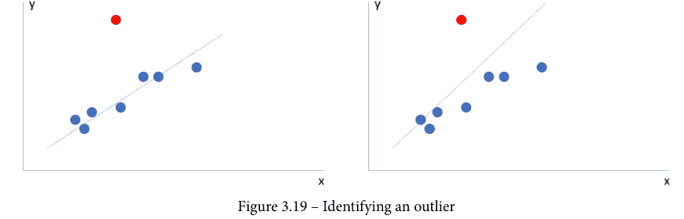

图 3.19 – 识别异常值

我们需要处理异常值，因为某些统计方法会受到它们的影响。尽管如此，在前面的图表中，我们可以看到这种行为正在发生。在左侧，我们画出了一条最佳拟合线，忽略了红色点。在右侧，我们也画出了最佳拟合线，但包含了红色点。

我们可以直观地得出结论，通过忽略异常点，我们将在前一图表左侧的平面上得到更好的解决方案，因为它能够更接近大多数值。我们也可以通过计算每条线的相关误差来证明这一点（我们将在本书后面讨论）。

值得提醒你的是，你在本书的另一个情境中也见过异常值问题：具体来说，在图 3.17 中，当我们需要处理缺失值时。在那个例子中，我们使用了中位数（而不是均值）来解决这个问题。欢迎你回去再读一遍，但到目前为止应该非常清楚，中位数比平均值受异常值的影响更小。

你现在知道了什么是异常值以及为什么应该处理它们。在处理异常值时，你始终应考虑业务视角，但也有数学方法可以找到它们。现在，让我们来看这些异常值检测方法。

你已经学过最常见的方法：zscore。在图 3.11 中，我们看到一个包含一组年龄的表格。再次参考它以刷新记忆。在该表格的最后一列中，我们根据图 3.10 所示的方程计算每个年龄的 zscore。

这些 zscore 值没有明确的范围；然而，在没有异常值的正态分布中，它们将在 -3 到 3 之间。记住：zscore 会给出相对于分布均值的标准差数量。以下图表显示了正态分布的一些属性：

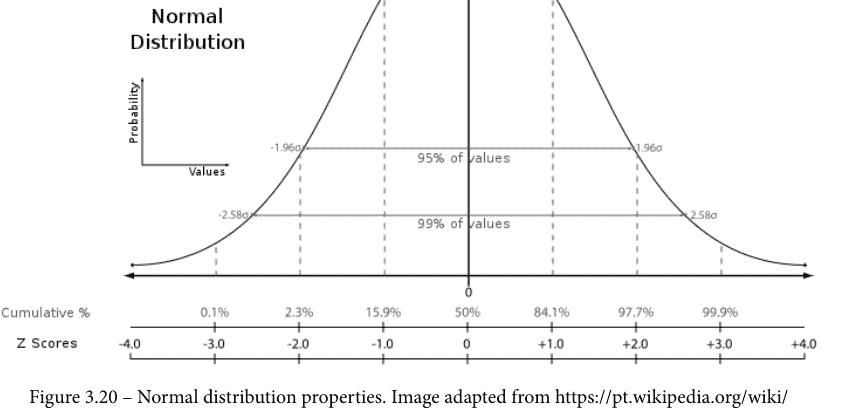

图 3.20 – 正态分布属性。图片改编自 https://pt.wikipedia.org/wiki/Ficheiro:The_Normal_Distribution.svg

根据正态分布属性，95% 的值将属于距均值 -2 到 2 个标准差的范围，而 99% 的值将属于距均值 -3 到 3 的范围。回到异常值检测的背景，我们可以在这些 zscore 值之上设置阈值，以指定数据点是否为异常值！

没有标准阈值可用于分类异常值。理想情况下，你应该查看自己的数据，看看什么对你更有意义……通常（这不是规则），你会使用距均值 2 到 3 个标准差之间的某个数值来设定异常值，因为超过 95% 的数据将超出该范围。你可能记得，异常值既存在于分布均值以下，也存在于均值以上，如下表中所示，我们将绝对 zscore 大于 3 的异常值标记出来（为演示目的，value 列被隐藏）：

| Value | Zscore | Is outlier? |
| --- | --- | --- |
| ... | 1.3 | NO |
| ... | 0.8 | NO |
| ... | 3.1 | YES |
| ... | -2.9 | NO |
| ... | -3.5 | YES |
| ... | 1.0 | NO |
| ... | 1.1 | NO |

图 3.21 – 根据 zscore 值标记异常值

我们在前面的表格中找到了两个异常值：第三行和第五行。另一种在数据中查找异常值的方法是应用箱线图的逻辑。你将在本书下一章更详细地了解箱线图。现在，让我们专注于使用这种方法来查找异常值。

当我们查看数值变量时，可以从中提取许多描述性统计信息，而不仅仅是之前看到的均值、中位数、最小值和最大值。数据分布中存在的另一个属性称为分位数。

分位数是根据随机变量的累积分布函数在规则间隔内建立的截断点。这些规则间隔也称为 q-分位数，在某些情况下会获得特殊名称；例如：

- 4-分位数称为四分位数。
- 10-分位数称为十分位数。
- 100-分位数称为百分位数。

例如，第 20 百分位数（100-分位数规则间隔）指定 20% 的数据低于该点。在箱线图中，我们使用 4-分位数的规则间隔（也称为四分位数）来展示数据的分布（Q1 和 Q3），如下图所示：

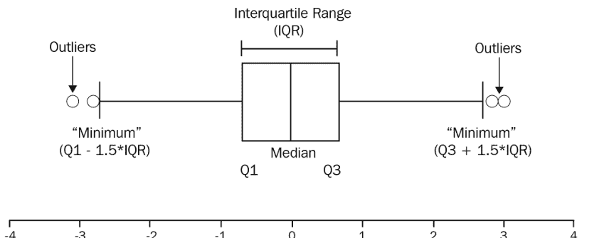

图 3.22 – 箱线图定义

Q1 也称为下四分位数或第 25 四分位数，这意味着分布中有 25% 的数据低于该点。Q3 也称为上四分位数或第 75 四分位数，这意味着分布中有 75% 的数据低于该点。

计算 Q1 和 Q3 之间的差值将给出四分位距（IQR）值，然后你可以用它来计算箱线图的限制，由前一图中“最小值”和“最大值”标签所示。

毕竟，我们可以推断，任何低于箱线图“最小值”或高于“最大值”的值都将被标记为异常值。

你现在已经了解了两种可以在数据上标记异常值的方法：zscore 和箱线图。你可以决定是否要从数据集中删除这些点，或创建另一个变量来指定它们确实是异常值（如我们在图 3.21 中所做的）。

让我们继续数据准备之旅，看看在现实生活中我们还会遇到哪些其他类型的问题。接下来，你将了解到许多用例都有一种称为稀有事件的情况，这会使 ML 算法关注问题的错误一侧并提出糟糕的解决方案。幸运的是，我们将学习如何调整它们或准备数据以使其更智能。

### 处理不平衡数据集

到目前为止，我希望你已经意识到为什么数据准备可能是我们工作中最长的一部分。我们已经学习了数据转换、缺失数据值和异常值，但问题清单还在继续。别担心——坚持下去，让我们一起掌握这个主题！

ML 模型，特别是二元分类问题，另一个众所周知的问题是不平衡的类别。在二元分类模型中，当数据集的大多数观测值属于同一类别（目标变量）时，我们说该数据集是不平衡的。

这在欺诈识别系统中很常见，例如，其中大多数事件属于常规操作，而非常少量的事件属于欺诈操作。在这种情况下，我们也可以说欺诈是一种稀有事件。

定义数据集是否不平衡没有严格的规则，意思是是否有必要担心它。大多数挑战性问题会呈现超过 99% 的观测值属于多数类别。

不平衡数据集的问题非常简单：ML 算法会尝试在训练数据中找到最佳拟合以最大化其准确性。在 99% 的案例都属于单一类别的数据集中，如果不进行调整，算法很可能会优先考虑多数类别的准确性。在最坏的情况下，它会将所有观测值都分类为多数类别，而忽略通常是我们建模时感兴趣的少数类别。

为了处理不平衡数据集，我们可以遵循两个主要方向：调整算法以处理该问题，或对数据进行重采样以使其更平衡。

通过调整算法，你必须指定每个类别在分类下的权重。这种类别权重配置属于算法，而不是训练数据，因此是超参数设置。需要记住的是，并非所有算法都有这种类型的配置，而且并非所有 ML 框架都会暴露它。作为快速参考，我们可以提到 scikit-learn ML 库中的 DecisionTreeClassifier 类，它是一个很好的实现了类别权重超参数的例子。

另一种解决不平衡问题的方法是改变训练数据集，通过应用欠采样或过采样。如果你决定应用欠采样，你所要做的就是从多数类别中删除一些观测值，直到获得更平衡的数据集。当然，这种方法的缺点是，你可能会丢失有关你正在删除观测值的多数类别的重要信息。

欠采样的最常见方法是随机欠采样，这是一种天真的重采样方法，我们在其中随机删除一些训练集中的观测值。


另一方面，你可以选择进行过采样，即为少数类创建新的观测值/样本。最简单的方法是朴素的方法，即从训练集中随机选择观测值（有放回）进行复制。这种方法的缺点是可能导致过拟合，因为你会复制/突出少数类的观测模式。

为了避免模型欠拟合或过拟合，你应该始终在测试集上测试拟合好的模型。

> **重要说明**
> 测试集不能进行欠采样/过采样：只有训练集应通过这些重采样技术。

你也可以通过应用合成采样技术来对训练集进行过采样。随机过采样不会为训练集添加任何新信息：它只是复制现有的样本。通过创建合成样本，你是从现有样本中推导出这些新观测值（而不是简单地复制它们）。这是一种称为**合成少数类过采样技术 (SMOTE)**的数据增强技术。

从技术上讲，SMOTE 所做的是在少数类的特征空间中绘制一条线，并提取靠近该线的点。

> **重要说明**
> 你可能会在考试中遇到使用 SMOTE 术语的问题。如果出现这种情况，请记住该术语应用的上下文：过采样。

现在，让我们继续下一个关于数据准备的话题，我们将学习如何为机器学习模型准备文本数据。

### 处理文本数据

我们已经学习了如何将分类特征转换为数值表示，无论是使用标签编码器、有序编码器还是独热编码。然而，如果我们的数据集中有包含长文本的字段呢？我们应该如何为它们提供数学表示，以便正确地输入到 ML 算法中？这是**自然语言处理 (NLP)**中常见的问题，NLP 是 AI 的一个子领域。

NLP 模型旨在从文本中提取知识；例如，在语言之间翻译文本、在文本语料库中识别实体（也称为**命名实体识别 (NER)**）、从用户评论中分类情感，以及许多其他应用。

**重要说明**
在*第 2 章，AWS AI/ML 应用服务*中，你学习了一些应用 NLP 的 AWS 应用服务，例如 Amazon Translate 和 Amazon Comprehend。在考试期间，你可能会被要求思考构建某些类型 NLP 应用的最快或最简单方式（开发工作量最少）。最快或最简单的方式通常是使用这些开箱即用的 AWS 服务，因为它们为某些用例提供了预训练模型（尤其是机器翻译、情感分析、主题建模、文档分类和实体识别）。

在接下来的几章中，你还将学习一些用于 NLP 应用的内置 AWS 算法，例如 BlazingText、**潜在狄利克雷分配 (LDA)**、**神经主题建模**和序列到序列算法。这些算法也让你创建与这些开箱即用服务创建的相同 NLP 解决方案；然而，你必须在 SageMaker 上使用它们并编写自己的解决方案。换句话说，它们提供了更大的灵活性，但需要更多的开发工作。

请记住这一点以备考试！

尽管 AWS 提供了许多开箱即用服务和内置算法来创建 NLP 应用，但我们现在不会查看这些 AWS 产品功能（正如我们在*第 2 章，AWS AI/ML 应用服务*中所做的那样，并在*第 7 章，应用机器学习算法*中再次这样做）。我们将通过查看一些数据准备技术来结束本章，这些技术对于为 NLP 准备数据至关重要。

### 词袋

我们将要介绍的第一个是称为**词袋 (BoW)**。这是一种非常常见且简单的技术，应用于文本数据，用于创建描述文本中单词数量的矩阵表示。BoW 包含两个主要步骤：创建词汇表和创建文本中来自词汇表的已知单词存在的表示。这些步骤可以在以下图表中看到：

This movie is really good, although really old production

- Data cleansing
- Lower case
- Tokenization
- Remove punctuation
- Remove non-alphabetical tokens
- Remove stop words

[this, movie, really, good, although, really, old, production]

Vocabulary
{
(this, 1),
(movie, 1),
(really, 2),
(good, 1),
(although, 1),
(old, 1),
(production, 1),
}

| this | movie | really | good | although | old | production |
|---|---|---|---|---|---|---|
| Binary | 1 | 1 | 1 | 1 | 1 | 1 | 1 |
| Frequency | 0.14 | 0.14 | 0.28 | 0.14 | 0.14 | 0.14 | 0.14 |
| Count | 1 | 1 | 2 | 1 | 1 | 1 | 1 |

Figure 3.23 – BoW in action

首先，我们通常不能使用原始文本来准备词袋表示。有一个数据清洗步骤，我们将文本转为小写；将每个单词拆分为标记；删除标点符号、非字母和停用词；并且在必要时应用任何你想要的其他自定义清洗技术。

一旦你清洗了原始文本，你就可以将每个单词添加到全局词汇表中。从技术上讲，这通常是一个元组字典，形式为 (单词, 出现次数)；例如，{(apple, 10), (watermelon, 20)}。正如我之前提到的，这是一个全局字典，你应该考虑你正在分析的所有文本。

现在，有了清洗后的文本和更新的词汇表，我们就可以以矩阵形式构建文本表示，其中每一列代表全局词汇表中的一个单词，每一行代表你分析过的一段文本。你在每一行中表示这些文本的方式可能会根据不同的策略而有所不同，例如二元、频率和计数。让我们更深入地了解一下这些策略。

在前面的图表中，我们正在处理单个文本，但尝试了词袋的三种不同策略。这就是为什么你可以在该表中看到三行，而不是只有一行（在真实场景中，你必须选择其中一种进行实现）。

在第一行，我们使用了二元策略，如果单词存在于全局词汇表中则分配 1，如果不存在则分配 0。因为我们的词汇表是基于单个文本构建的，所以该文本中的所有单词都属于词汇表（这就是为什么在二元策略中你只能看到 1）。

在第二行，我们使用了频率策略，它会检查文本中每个单词的出现次数并除以文本中的总单词数。例如，单词 "this" 只出现一次 (1)，文本中共有七个其他单词 (7)，所以 1/7 等于 0.14。

最后，在第三行，我们使用了计数策略，即文本中每个单词出现的简单计数。

**重要说明**
此说明非常重要——你很可能在考试中会遇到它。你可能已经注意到我们的 BoW 矩阵包含*列*中的**唯一单词**和*行*中的**每段文本**表示。如果你有 100 段长文本，其中只有 50 个唯一单词，你的 BoW 矩阵将有 50 列和 100 行。在考试期间，你很可能会收到一段文本列表，并被要求准备 BoW 矩阵。

还有一个关于 BoW 的极其重要的概念你应该知道，那就是**n-gram**配置。n-gram 术语用于描述你希望如何查看词汇表的方式，无论是单个单词（uni-gram）、两组单词（bi-gram）、三组单词（tri-gram），甚至是 n 个单词组（n-gram）。到目前为止，我们看到的 BoW 表示使用的是 uni-gram 方法，但更复杂的 BoW 表示可能使用 bi-grams、tri-grams 或 n-grams。

主要逻辑本身并没有改变，但你需要知道如何在 BoW 中表示 n-grams。仍然使用我们前面图表中的示例，bi-gram 方法会以以下方式组合这些单词：[this movie, movie really, really good, good although, although old, old production]。请确保在考试前理解这一点。

**重要说明**
BoW 的强大和简单之处在于，你可以轻松地为算法准备训练集，甚至创建基线模型。如果你查看*图 3.23*，你能否看出如果有更多数据并仅向该表添加一个分类列，例如好或坏评论，就能训练一个二元分类模型来预测情感？


Alright – 你可能已经注意到，我为你介绍的许多很棒的技术都伴随着一些缺点。BoW 的问题在于维护其词汇表的挑战。我们可以很容易地看到，在庞大的文本语料中，词汇量往往变得越来越大，而矩阵的表示往往变得稀疏（我知道——又是稀疏性问题）。

解决词汇量问题的一种可能方法是使用词哈希（在 ML 中也称为 **hashing trick**）。哈希函数将任意大小的数据映射到固定大小的数据。这意味着你可以使用哈希技巧用固定数量的特征来表示每段文本（无论词汇量的大小）。技术上讲，这种哈希空间允许冲突（不同文本由相同的特征表示），因此在实现特征哈希时需要考虑这一点。

### TF-IDF

另一个伴随 BoW 的问题，尤其是在我们使用频率策略构建特征空间时，是更频繁的词会因文档中出现次数高而大幅提升其分数。事实证明，经常出现次数高的词往往不是文档的关键词，而只是 *也* 在许多其他文档中多次出现的其他词。

**词频-逆文档频率（TF-IDF）** 通过检查它们在其他文档中的出现频率并使用该信息来重新调整文档内词频的方式，来惩罚这类词。

在整个过程结束时，TF-IDF 倾向于给文档独有的词（文档特定词）赋予更多重要性。让我们看一个具体的例子，以便你能深入理解它。

假设我们有一个包含 100 个词的文本语料，词 "Amazon" 出现了三次。该词的 **词频（TF）** 为 3/100，等于 0.03。现在，假设我们有另外 1,000 个文档，并且词 "Amazon" 出现在其中 50 个文档中。在这种情况下，**逆文档频率（IDF）** 将由 log 给出，为 1,000/50，等于 1.30。词 "Amazon" 在该特定分析文档中的 TF-IDF 得分将是 TF * IDF 的乘积，即 0.03 * 1.30（0.039）。

假设与 50 个文档相比，词 "Amazon" 还出现在另外 750 个文档中——也就是说，比之前的场景频繁得多。在这种情况下，我们不会改变该方程的 TF 部分——它仍然是 0.03。然而，IDF 部分会略有变化，因为这次它将是 log 1,000/750，等于 *0.0036*。正如你所见，这次词 "Amazon" 的重要性比前一个例子要低得多。

### Word embedding

与传统的 BoW 和 TF-IDF 等方法不同，现代文本表示方法会兼顾信息的上下文以及词的出现或频率。一种非常流行且强大的遵循这一概念的方法被称为 **word embedding**。词嵌入创建了一个固定长度的稠密向量，可以存储有关文档上下文和含义的信息。

每个词都由多维超平面中的一个数据点表示，我们称之为嵌入空间。该嵌入空间将有 "n" 个维度，其中每个维度都指该稠密向量的特定位置。

尽管听起来可能令人困惑，但概念实际上非常简单。假设我们有一个包含四个词的列表，我们想在五维嵌入空间中绘制它们。词为 king、queen、live 和 castle。下面的表格展示了如何做到这一点：

|  | Dim 1 | Dim 2 | Dim 3 | Dim 4 | Dim 5 |
|---|---|---|---|---|---|
| **King** | 0.22 | 0.76 | 0.77 | 0.44 | 0.33 |
| **Queen** | 0.98 | 0.09 | 0.67 | 0.89 | 0.56 |
| **Live** | 0.13 | 0.99 | 0.88 | 0.01 | 0.55 |
| **Castle** | 0.01 | 0.89 | 0.34 | 0.02 | 0.90 |

Figure 3.24 – An embedding space representation

忘记前面表格中的假设数字，专注于数据结构；你会看到每个词现在都由嵌入空间中的 "n" 个维度表示。将词转换为向量的过程可以通过许多不同方法完成，但最流行的是 **word2vec** 和 **GloVe**。

一旦你将每个词表示为固定长度的向量，你就可以应用许多其他技术来完成所需的工作。非常常见的任务之一是将这些“词”（实际上是它们的维度）在超平面中绘制出来，并直观地检查它们彼此之间的接近程度！

技术上，我们不会直接这样绘制，因为人脑无法解释超过三个维度。然后，我们通常会应用降维技术（例如主成分分析，你稍后会学习），将维度数减少到两个，最后在笛卡尔平面上绘制词。这就是为什么你可能会看到像下面图表底部那样的图片。你有没有想过如何能在图表上绘制词？

|  | Dim 1 | Dim 2 | Dim 3 | Dim 4 | Dim 5 |
|---|---|---|---|---|---|
| King | 0.22 | 0.76 | 0.77 | 0.44 | 0.33 |
| Queen | 0.98 | 0.09 | 0.67 | 0.89 | 0.56 |
| Live | 0.13 | 0.99 | 0.88 | 0.01 | 0.55 |
| Castle | 0.01 | 0.89 | 0.34 | 0.02 | 0.90 |


|  | PC 1 | PC2 |
|---|---|---|
| King | 0.9 | 0.3 |
| Queen | 0.8 | 0.5 |
| Live | 0.33 | 0.7 |
| Castle | 0.28 | 0.7 |


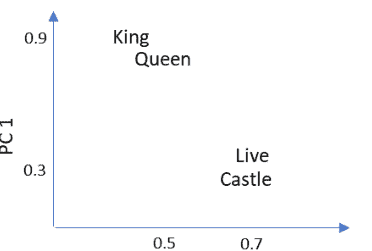

Figure 3.25 – Plotting words

如果你想知道我们是如何得出图 3.24 中显示的维度的，让我们深入探讨一下。同样，有不同的方法可以做到这一点，但让我们看一个最流行的方法，它使用固定上下文窗口的共现矩阵。

首先，我们必须想出一些逻辑来表示每个词，同时考虑到它们的上下文。为了解决上下文需求，我们将定义一个固定上下文窗口，它将负责指定为上下文学习而分组在一起的词数。例如，让我们将此固定上下文窗口设置为 2。

接下来，我们将创建一个共现矩阵，它会根据预定义的上下文窗口统计每对词出现的次数。让我们实际看看。考虑以下文本："I will pass this exam, you will see. I will pass it"。

第一个词 "pass" 的上下文窗口将是加粗的部分："I will pass this exam, you will see. I will pass it"。考虑到这种逻辑，让我们看看在上下文窗口中每对词出现了多少次：

| | I | Will | Pass | This | Exam | You | See | It |
|---|---|---|---|---|---|---|---|---|
| I | 0 | 3 | ... | ... | ... | ... | ... | ... |
| Will | 3 | 0 | ... | ... | ... | ... | ... | ... |
| Pass | ... | ... | 0 | ... | ... | ... | ... | ... |
| This | ... | ... | ... | 0 | ... | ... | ... | ... |
| Exam | ... | ... | ... | ... | 0 | ... | ... | ... |
| You | ... | ... | ... | ... | ... | 0 | ... | ... |
| See | ... | ... | ... | ... | ... | ... | 0 | ... |
| It | ... | ... | ... | ... | ... | ... | ... | 0 |

Figure 3.26 – Co-occurrence matrix

正如你所见，词对 "I will" 在使用大小为 2 的上下文窗口时出现了三次：

- 1. *I will* pass this exam, you will see. I will pass it.
- 2. I will pass this exam, you *will* see. I will pass it.
- 3. I will pass this exam, you will see. *I will* pass it.

查看前面的表格，同样的逻辑应应用于所有其他词对，用相应的出现次数替换“...”。你现在有了每个词的数值表示！

**Important note**
你应该意识到，使用固定上下文窗口的共现矩阵有许多替代方案，例如使用 TF-IDF 向量化或甚至更简单的按文档计数词。这里最重要的信息是，无论如何，你必须为每个词想出一个数值表示。

最后一步是最终找到图 3.24 中显示的那些维度。你可以通过创建一个多层模型，通常基于神经网络，其中隐藏层将代表你的嵌入空间来实现。下面的图表显示了一个简化示例，我们可以在其中将前面表格中显示的词压缩到五维的嵌入空间中：

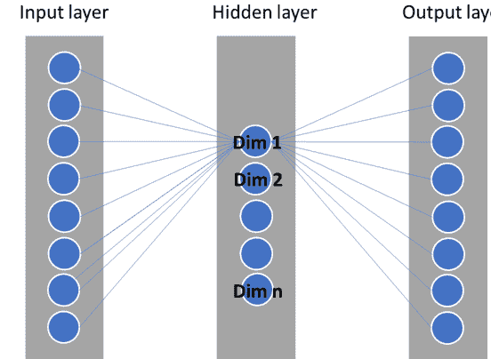

Figure 3.27 – Building embedding spaces with neural networks

我们将在本书后面更详细地讨论神经网络。现在，理解嵌入向量来自何处已经是一个很棒的成就！

在建模自然语言问题时，你还应该记住的一件重要事情是，你可以在模型中重用预训练的嵌入空间。一些公司创建了在数十亿文档上训练的现代神经网络架构，这已成为该领域的最新技术。为你的参考，请看一下 **Bidirectional Encoder Representations from Transformers (BERT)**，它由 Google 提出，并已被数据科学社区和行业广泛使用。


我们现在已经到达了关于数据准备和转换的这个漫长——但非常重要——章节的结尾。让我们借此机会快速回顾一下我们所学到的精彩内容。

### Summary

首先，你被介绍了你可能需要处理的不同类型的特征。识别你将要处理的变量类型对于定义可以应用于每种情况的转换类型和技术非常重要。

然后，我们学习了如何处理分类特征。我们看到，有时分类变量确实有顺序（例如有序变量），而有时则没有（例如名义变量）。你了解到独热编码（或哑变量）可能是名义特征最常见的转换类型；然而，根据唯一类别的数量，应用独热编码后，你的数据可能会出现稀疏性问题。关于有序特征，你不应该在其上创建哑变量，因为你会丢失已纳入变量中的顺序信息。在这些情况下，有序编码是最合适的转换。

我们继续旅程，查看数值特征，在那里我们学习了如何处理连续和离散数据。我们介绍了最重要的转换类型，例如归一化、标准化、分箱和离散化。你看到某些类型的转换依赖于底层数据来找到其参数，因此避免使用测试集从数据中学习任何东西非常重要（它必须严格用于测试）。

你还看到我们甚至可以对数据应用纯数学进行转换；例如，你了解到幂变换可用于减少特征的偏度，使其更接近正态。

接下来，我们研究了缺失数据，并对该任务的重要性有了认识。当你在建模时，你不能将缺失值视为一个简单的计算问题，即只需用 y 替换 x。这是一个更大的问题，你需要通过探索数据开始解决，然后检查你的缺失数据是否随机生成。

当你做出删除或替换缺失数据的决定时，你必须意识到你是在丢失信息还是在给数据添加偏差，分别而言。请记住回顾我们给你的所有重要说明，因为它们很可能在某种程度上出现在你的考试中。

接下来，你学习了异常值检测。你查看了寻找异常值的不同方法，例如 zscore 和箱线图方法。最重要的是，你学习了你可以对其进行标记或平滑处理。

在开始时，我告诉你这一章将是一次漫长但值得的数据准备之旅，这就是为什么我需要让你很好地了解如何处理罕见事件，因为这是 ML 上最具挑战性的问题之一。你了解到，有时你的数据可能不平衡，你必须欺骗你的算法（通过改变类别权重）或对数据进行重采样（应用欠采样和过采样）。

最后，你学习了如何处理 NLP 的文本数据。你现在应该能够手动计算词袋和 TF-IDF 矩阵！我们更深入地学习了词嵌入的工作原理。在这一小节中，我们了解到我们可以创建自己的嵌入空间（使用许多不同的方法）或重用预训练的嵌入，例如 BERT。

我们完成了！我很高兴你坚持到了这里，我相信这一章对你在考试中的成功至关重要。最后，我们为你准备了一些练习题；我希望你喜欢它们。

在下一章中，我们将深入数据可视化技术。

### Questions

1. 你作为一家医疗保健公司的数据科学家，正在创建机器学习模型来预测公司索赔中的欺诈、浪费和滥用。该模型的一个特征是特定药物在 2 年期间内对索赔的同一患者开出的次数。哪种类型的特征是这种特征？

- a) Discrete
- b) Continuous
- c) Nominal
- d) Ordinal

**Answer**
a, The feature is counting the number of times that a particular drug has been prescribed. Individual and countable items are classified as discrete data.

2. 你正在为一家在全球拥有学校和大学的教育集团构建 ML 模型。你的模型旨在预测特定学生辍学的可能性。许多因素可能导致辍学，但你的一个特征是每个学生的当前学术阶段：学前班，小学，初中或高中。哪种类型的特征是这种特征？

- a) Discrete
- b) Continuous
- c) Nominal
- d) Ordinal

Answer
d, The feature has an implicit order and should be considered a categorical/ ordinal variable.

3. 你正在为一家汽车保险公司构建机器学习模型。该公司希望创建一个二元分类模型，旨在预测其投保车辆被盗的可能性。你考虑了许多特征，包括车辆类型（经济型、紧凑型、高端型、豪华型、厢式车、运动型和敞篷车）。你将如何转换车辆类型以便在模型中使用？

- a) Applying ordinal encoding
- b) Applying one-hot encoding
- c) No transformation is needed
- d) Options A and B are valid transformations for this problem

Answer
b, In this case, we have a categorical/nominal variable (there is no order among each category). Additionally, the number of unique categories looks pretty manageable; furthermore, one-hot encoding would fit very well for this type of data.

4. 你作为一家金融公司的数据科学家。该公司希望创建一个模型来分类不当付款。你决定使用“交易类型”作为你的特征之一（本地、国际、预批准等）。在对该变量应用独热编码后，你意识到你的数据集有更多变量，你的模型训练时间很长。你如何可能解决这个问题？

- a) By applying ordinal encoding instead of one-hot encoding. In this case, we would be creating just one feature.
- b) By applying label encoding.
- c) By analyzing which types of transactions have the most impact on improper/proper payments. Only apply one-hot encoding to the reduced types of transactions.
- d) By porting your model to another programming language that can handle sparse data in a better way.

Answer
c, Your transformation resulted in more features due to the excessive number of categories in the original variable. Although the one-hot encoding approach looks right, since the variable is a nominal feature, the number of levels (unique values) for that feature is probably too high.

In this case, you could do exploratory data analysis to understand the most important types of transactions for your problem. Once you know that information, you can then restrict the transformation to just those specific types (reducing the sparsity of your data). It is worth adding that you would be missing some information during this process because now, your dummy variables would only be focusing only on a subset of categories, but it is a valid approach.

5. 你作为一家营销公司的数据科学家。你的公司正在构建一个聚类模型，用于细分客户。你决定对“年收入”变量进行归一化，其范围在 50,000 到 300,000 之间。

应用归一化后，收入为 50,000、125,000 和 300,000 的客户组的归一化值是多少？

- a) 1, 2, and 3
- b) 0, 0.5, and 1
- c) 0, 0.25, and 1
- d) 5, 12, and 30

Answer
b. Applying the normalization formula and assuming the expected range would be 0 and 1, the correct answer is b.

6. 考虑一个数据集，其中存储员工薪水的列。该列薪水的平均值是 $2,000，而标准差等于 $300。某人赚 $3,000 的标准化值是多少？

- a) 3.33
- b) 6.66
- c) 10
- d) 1

Answer
a, Remember the standard scale formula: (X - μ) / σ, which is (3,000 – 2,000) / 300.

7. 我们可以应用哪种类型的数据转换将连续变量转换为二元变量？

- a) Binning and one-hot encoding
- b) Standardization and binning
- c) Normalization and one-hot encoding
- d) Standardization and one-hot encoding

Answer
a, In this case, we could discretize a continuous variable by applying binning and then getting the dummy variables.


8. 你是一家金融公司的数据科学家，你被分配了创建二元分类模型的任务，以预测客户是否会离开公司（也称为流失）。在探索性工作中，你发现某个特定特征（信用利用额度）存在一些缺失值。该变量以实数表示；例如 $1,000。在不希望丢失信息的前提下，处理这些缺失值的最快方法是什么？

+   a) 删除任何缺失值。
+   b) 创建一个分类模型来预测信用利用额度并用它来预测缺失数据。
+   c) 创建一个回归模型来预测信用利用额度并用它来预测缺失数据。
+   d) 用该变量的均值或中位数替换缺失数据。

Answer
d, 在这种情况下，几乎所有选项都是处理此问题缺失数据的有效方法，除了选项 b，因为预测缺失数据需要你创建一个回归模型，而不是分类模型。选项 a 是处理缺失数据的有效方法，但不适用于我们不想丢失信息的问题。选项 c 也是有效的方法，但不是最快的方法。选项 d 是此问题的最合适答案。

9. 你需要为特定客户创建一个机器学习模型，但你发现大多数特征的缺失数据超过 50%。在这种关键情况下，我们的最佳选择是什么？

+   a) 删除缺失数据超过 50% 的整个列
+   b) 删除包含至少一个缺失信息的行
+   c) 与数据集所有者核实是否可以从其他地方检索缺失数据
+   d) 用特征的均值或中位数替换缺失信息

### Answer

c, 这是一个非常关键的情况，你的大部分信息实际上都缺失了。你应该与数据集所有者合作，了解为什么会出现这个问题并检查生成此数据的流程。如果你决定删除缺失值，你将丢失大量信息。另一方面，如果你决定替换缺失值，你将给数据带来大量偏差。

10. 你作为一家人力资源公司的高级数据科学家在工作。你正在创建一个特定机器学习模型，该模型使用的算法对偏斜特征表现不佳，例如以下图像中的特征：

# 

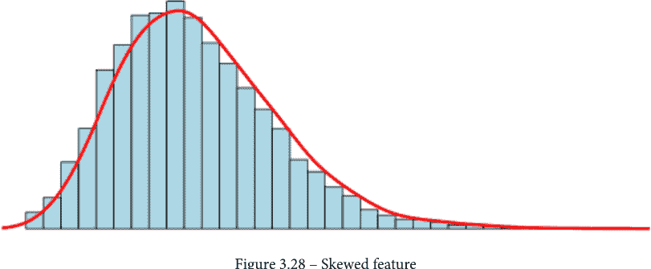

Figure 3.28 – Skewed feature

你可以用哪些转换来减少该特征的偏斜度（选择所有正确答案）？

+   a) 归一化
+   b) 对数转换
+   c) 指数转换
+   d) Box-Cox 转换

Answer
b, d, 为了减少偏斜，幂转换是最合适的。特别是，你可以应用对数转换或 Box-Cox 转换，使该分布更接近高斯分布。

11. 你正在处理欺诈识别问题，其中大多数标记数据属于单一类别（非欺诈）。只有 0.1% 的数据涉及欺诈案例。你会提出使用哪些建模技术来处理此用例（选择所有正确答案）？

+   a) 应用随机过采样来创建欺诈案例的副本。
+   b) 应用随机欠采样来从非欺诈案例中删除观测值。
+   c) 我们无法在如此不平衡的数据集上创建分类模型。最好的做法是向数据集所有者索取更多欺诈案例。
+   d) 应用合成过采样来创建非欺诈案例的副本。

Answer
a, b, 不平衡数据集在 ML 中非常常见，有很多不同的方法来处理这个问题。选项 c 绝对不是正确的。注意选项 d；你应该能够对数据应用合成过采样，但要创建少数类的更多观测值，而不是多数类。选项 a 和 b 是正确的。

12. 你正在为机器学习准备文本数据。这次，你想基于以下文本创建二元词袋矩阵：
"I will master this certification exam"
"I will pass this certification exam"
你的词袋矩阵表示会有多少行和列？

+   a) 7 行和 2 列
+   b) 2 行和 7 列
+   c) 14 行和 4 列
+   d) 4 列和 14 行

### Answer

b, 让我们一起在下面的表格中计算矩阵。
正如你所见，诀窍在于知道哪些词元对两段文本是共同的。我们只有两段文本；行数也将为两行——每段文本一行：

| I will | Will master | Master this | This certification | Certification exam | Will pass | Pass this |
|---|---|---|---|---|---|---|
| 1 | 1 | 1 | 1 | 1 | 0 | 0 |
| 1 | 0 | 0 | 1 | 1 | 1 | 1 |

Figure 3.29 – Resulting bag of words

13. 你正在进行调查，以了解一组人对特定开发工具的经验年限。你得出了以下分布：

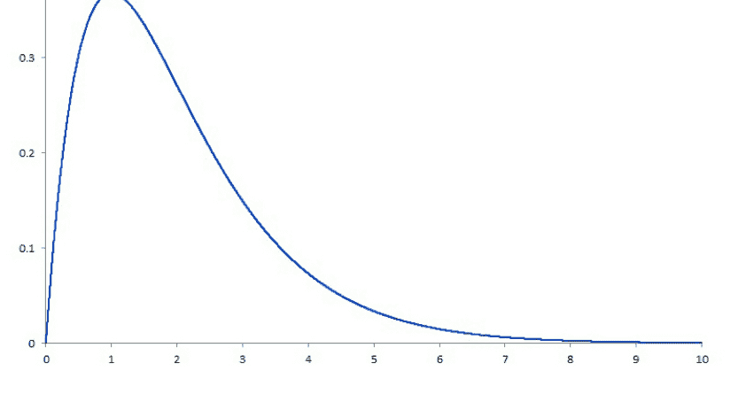

Figure 3.30 – Skewed data distribution

关于该分布的众数、均值和中位数，你能说什么（选择所有正确答案）？

+   a) 均值大于中位数
+   b) 均值小于中位数
+   c) 中位数大于众数
+   d) 中位数小于众数

**Answer**
a, c, 这是一个偏斜分布（向右侧）。这意味着你的均值会被推向尾部的同一侧，其次是中位数。因此，我们将有众数 < 中位数 < 均值。

14. 你作为一家零售公司的数据科学家在工作。你正在为分类目的构建基于决策树的模型。在评估过程中，你意识到模型的准确率不可接受。以下哪些任务不是提高决策树模型准确率的有效方法？

+   a) 调整模型的超参数。
+   b) 缩放数值特征。
+   c) 尝试对分类特征进行转换的不同方法，例如二进制编码、独热编码和序数编码（在适用时）。
+   d) 如果数据集不平衡，尝试不同类型的重采样技术（欠采样和过采样）是值得的。

**Answer**
b, 缩放数值特征是机器学习模型中的重要任务，但并非总是需要。特别是在基于决策树的模型中，改变数据的尺度不会导致模型性能更好，因为这种类型的模型不受数据尺度的影响。

15. 你正在进行一个数据科学项目，其中必须创建一个 NLP 模型。你决定在模型开发期间测试 Word2vec 和 GloVe，以尝试提高模型准确率。Word2vec 和 GloVe 是哪种类型的？

+   a) 预训练词嵌入
+   b) 预训练 TF-IDF 向量
+   c) 独热编码技术
+   d) 以上都不是

**Answer**
a, 一些 NPL 架构可能包含嵌入层。如果你面临这种类型的项目，你可以训练一个特定模型为此目的创建自己的嵌入空间（使用你自己的语料数据），也可以使用任何预训练的词嵌入模型，例如由 Google 预训练的 Word2vec 模型。
