## 4
## 理解和可视化数据

数据可视化是一门艺术！无论你和你的团队在建模的数据准备和初步分析上投入了多少努力，如果你不知道如何有效地展示你的发现，你的受众可能无法理解你试图传达的要点。

通常，当你处理决策者时，这种情况甚至会更糟。例如，如果你选择了错误的一组图表来讲述某个特定故事，人们可能会误解你的分析并做出错误的决定。

了解不同类型的数据可视化以及它们如何与每种类型的分析相匹配，将使你在吸引受众和传达你想要的信息方面处于非常有利的位置。

在本章中，你将学习一些数据可视化技术。我们将涵盖以下主题：

- 在数据中可视化关系
- 在数据中可视化比较
- 在数据中可视化构成
- 在数据中可视化分布

- 构建关键绩效指标
- 引入 Quick Sight

我们已经知道为什么需要掌握这些主题，让我们开始吧。

### 在数据中可视化关系

当我们需要在数据中展示关系时，通常是指在图表中绘制两个或多个变量，以可视化它们之间的依赖程度。**散点图**可能是展示**两个**变量之间关系的最常见类型的图表。以下是两个变量**x**和**y**的散点图：

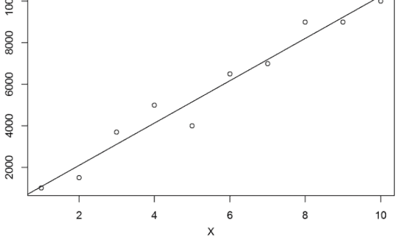

图 4.1 – 使用散点图绘制关系

前面的图表显示了**x**和**y**之间清晰的关系。随着**x**的增加，**y**也增加。在这种特定情况下，我们可以说两个变量之间存在线性关系。请记住，散点图也可能捕捉到其他类型的关系，而不仅仅是线性关系。例如，两个变量之间也可能存在指数关系。

另一种用于比较的图表被称为**气泡图**。与散点图一样，它也会显示变量之间的关系；然而，这里你可以使用第三个维度，它将由点的大小表示。

以下是一个解释投资方案的气泡图，其中**x**为年利率，**y**为投资期限，气泡的大小为每个投资选项的规模：

### 投资选项

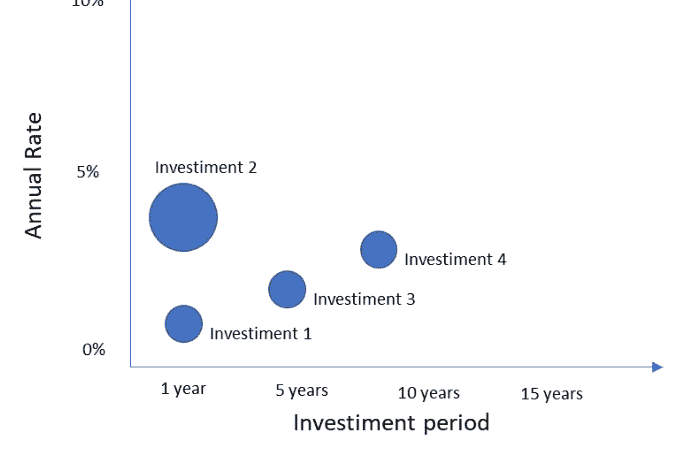

图 4.2 – 使用气泡图绘制关系

从前面的图表中，我们可以看到两种关系：投资期限越长，年利率越高；投入金额越高，年利率越高。正如我们所见，这是一种非常有效地呈现此类分析的方式。接下来，我们将学习如何比较我们的数据。

### 在数据中可视化比较

比较在数据分析中非常常见，我们有不同的方式来呈现它们。让我们从**条形图**开始。我相信你已经看过许多使用这种可视化类型的报告。

条形图可用于比较不同类别中的一个变量；例如，不同车型的汽车价格或各国的人口规模。在下面的图表中，我们使用条形图展示了截至 2020 年 6 月印度各州的 Covid-19 病例数：

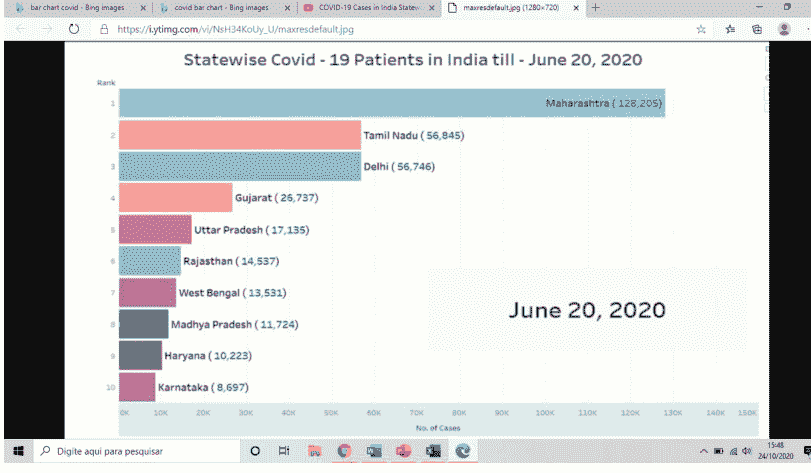

图 4.3 – 使用条形图绘制比较

有时，我们也可以使用**堆叠柱状图**为正在分析的数据添加另一个维度。例如，在下面的图表中，我们使用堆叠条形图显示泰坦尼克号上每性别的人数。此外，我们还将幸存者人数（正类）和未幸存者人数（负类）进行了细分：

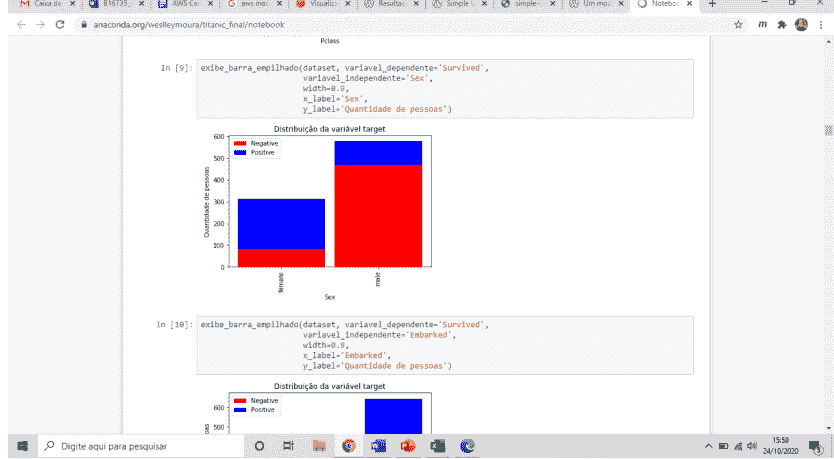

图 4.4 – 使用堆叠条形图分析泰坦尼克号灾难数据集

正如我们所见，大多数女性幸存了灾难，而大多数男性没有。堆叠条形图帮助我们可视化性别之间的差异。最后，你应该知道，我们也可以在这些堆叠条形图上显示百分比，而不是绝对数字。

**柱状图**也很实用，如果你需要在不同时期比较一个或两个变量。例如，在下面的图表中，我们可以看到加拿大各省的年度电动汽车销量：

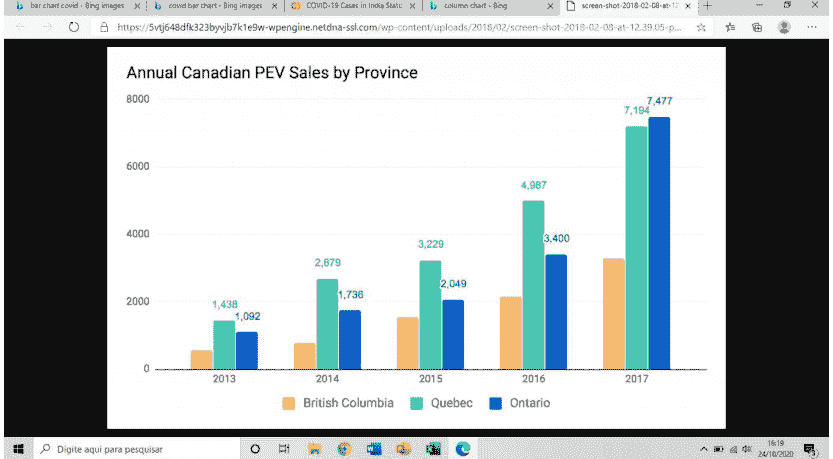

图 4.5 – 使用柱状图绘制比较

另一种在不同时期进行比较非常有效的方法是使用**折线图**。在下面的图表中，我们展示了一个相当有趣的例子，说明了如何比较特定项目中不同算法在不同发布日期的性能。

> **重要说明**
> 折线图通常非常有助于显示分析期间数据是否存在趋势。折线图的一个非常常见的用例是**预测**，在这种情况下，我们通常必须分析时间序列数据中的趋势和季节性。

例如，我们可以看到**分类与回归树（CART）**模型曾经是与**AdaBoost（ADA）**、**梯度提升（GB）**、**随机森林（RF）**和**逻辑回归（LOGIT）**等其他算法相比表现最差的模型。

然而，在七月，CART 模型被更改，结果成为所有其他模型中表现第三好的模型。每个时期最佳模型的整个故事可以在下面的图表中轻松看到：

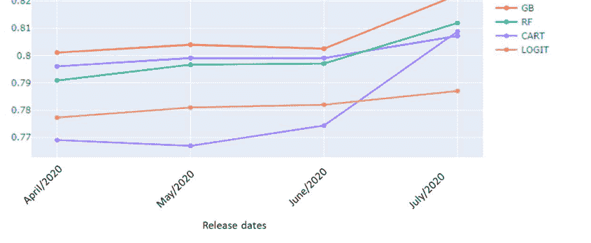

图 4.6 – 使用折线图绘制比较

最后，你也可以使用**表格**来展示数据的比较。表格在我们有多个维度（通常放在表格的行中）以及一个或多个用于比较的指标（通常放在表格的列中）时更有用。

在下一节中，我们将学习另一组图表，旨在显示变量的分布。这组图表对于建模任务尤其重要，因为你必须了解特征的分布才能考虑对其进行潜在的数据转换。让我们来看看！

### 在数据中可视化分布

探索特征的分布对于理解其一些关键特征非常重要，例如其偏度、均值、中位数和分位数。你可以通过绘制**直方图**轻松可视化偏度。这种类型的图表将你的数据分组到**箱**或**桶**中，并在其上进行计数。例如，下面的图表显示了*年龄*变量的直方图：

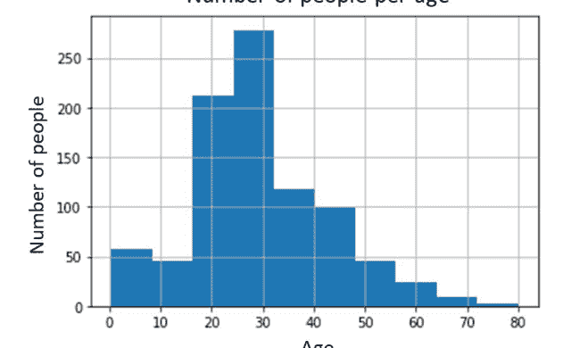

图 4.7 – 使用直方图绘制分布

从直方图来看，我们可以得出结论，大多数人年龄在 20 到 50 岁之间。我们还可以看到一些超过 60 岁的人。另一个直方图示例显示在下面的图表中，我们绘制了来自某个活动的不同票价的付款分布。我们想看看人们每张票支付多少钱：

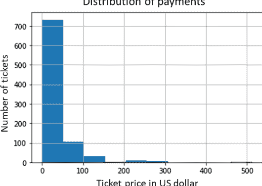

图 4.8 – 使用直方图检查偏度

在这里，我们可以看到大多数人每张票支付的金额最多为 100 美元。这就是为什么我们可以看到向右手侧（尾部）偏斜的分布的原因。

如果你想查看分布的其他特征，例如中位数、分位数和异常值，那么你应该使用**箱线图**。在下面的图表中，我们再次比较给定数据集中不同算法的性能。

这些算法在交叉验证过程中被多次执行，这导致同一算法产生多个输出；例如，每个算法在每个折上的每次执行都有一个准确率指标。

由于我们为每个算法有多个准确率指标，我们可以使用箱线图来检查每个算法在交叉验证过程中的表现：

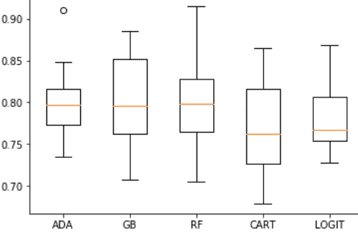

图 4.9 – 使用箱线图绘制分布

在这里，我们可以看到箱线图可以呈现有关数据分布的一些信息，例如其中位数、下四分位数、上四分位数和异常值。要完整了解箱线图的每个元素，请查看以下图表：

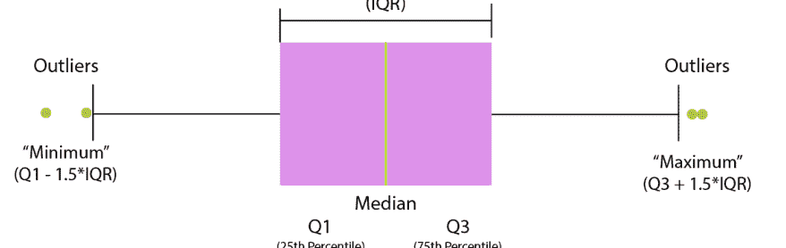

图 4.10 – 箱线图元素

通过分析图 4.9 所示的箱线图，我们可以得出结论，ADA 算法在交叉验证过程中出现了一些异常值，因为其中一次执行产生了非常好的模型（约 92% 准确率）。AdaBoost 的所有其他执行结果都低于 85% 的准确率，中位数约为 80%。

在分析图 4.9 后得出的另一个结论是，CART 算法在交叉验证过程中表现最差（中位数和下四分位数最低）。

在结束本节之前，请注意，当你有多个变量时，你也可以使用散点图来分析数据分布。现在，让我们看看另一组用于显示数据构成的图表。

### 在数据中可视化构成

有时，你想分析构成特征的各个元素；例如，各地区的销售额百分比或各渠道的查询百分比。在这两个示例中，我们都没有考虑时间维度；相反，我们只是将数据作为一个整体来看待。对于这些没有时间维度的构成，你可以使用饼图、100% 堆叠条形图和树形图来展示你的数据。

以下是某公司在预定义时间段内按客户渠道划分的查询数量的饼图：

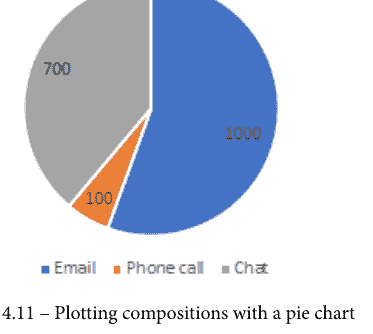

图 4.11 – 使用饼图绘制构成

如果你想在考虑时间维度时展示构成，那么最常见的选项就是**堆叠面积图**、**堆叠 100% 面积图**、**堆叠柱状图**或**堆叠 100% 柱状图**。作为参考，请看下面的图表，它显示了 2016 年至 2020 年各地区的销售额：

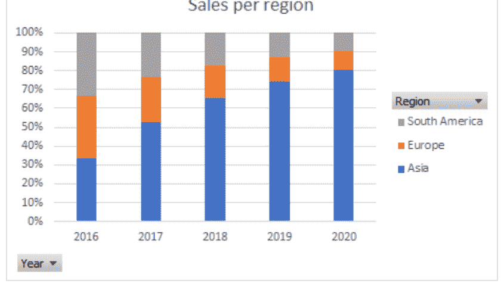

图 4.12 – 使用堆叠 100% 柱状图绘制构成

正如我们所见，堆叠 100% 柱状图有助于我们理解不同时期之间的构成。

### 构建关键绩效指标

在结束这些数据可视化部分之前，我想介绍**关键绩效指标**，简称**KPI**。

KPI 通常是一个单一数值，用来描述业务指标的结果，例如流失率、**净推荐值 (NPS)**、**投资回报率 (ROI)** 等。虽然不同行业之间有一些常用的指标，但你可以根据公司需求自行制定一个数值。

说实话，与指标相关的最复杂挑战并不在于其可视化本身，而在于它们是如何构建的（所使用的规则）以及它们将在公司不同层级中如何传达和使用。

从可视化角度来看，就像任何其他单一数值一样，你可以根据需要使用我们所学过的图表来分析你的指标。然而，如果你只是想展示你的 KPI，且没有时间维度，你可以使用一个**小部件**。

好吧，关于 AWS 机器学习专业考试的数据可视化技术，我就讲到这里。现在，让我们来看看 Quick Sight，这是一个 AWS 服务，你可以在其中实现刚才学到的所有可视化技术。

### 介绍 Quick Sight

Amazon Quick Sight 是一种基于云的分析服务，允许你构建数据可视化和临时分析。Quick Sight 支持多种数据源，例如 Redshift、Aurora、Athena、RDS 以及你的本地数据库解决方案。

其他数据源包括 S3，你可以在其中从 Excel、CSV 或日志文件检索数据，以及**软件即服务 (SaaS)** 解决方案，你可以在其中从 Salesforce 实体检索数据。

Amazon Quick Sight 有两个版本：

- Standard Edition
- Enterprise Edition

这两个版本之间最重要的区别是与 Microsoft **Active Directory (AD)** 集成以及静态加密的可能性。这两个功能仅在企业版中提供。

> **重要提示**
> 请记住，AWS 服务不断发展，因此标准版和企业版之间的差异未来可能会增加。
> 你应始终查阅 AWS 服务的最新文档以了解新内容。

就访问管理而言，Quick Sight 提供了一个非常简单的界面，可用于控制用户访问。在标准版中，邀请用户加入你的 Quick Sight 账户主要有两个选项：

- 你可以邀请一个 IAM 用户。
- 你可以向一个电子邮件地址发送邀请。

如果你邀请了一个 IAM 用户，那么他们可以自动登录你的账户并查看或编辑你的可视化，具体取决于你在创建 Quick Sight 用户时提供的权限类型。如果你邀请了一个电子邮件地址，那么电子邮件所有者必须访问其邮箱来完成此操作。

删除用户也非常简单。删除用户时唯一需要提供的额外信息是，你是否想将孤立资源转移给账户中的另一用户，还是想删除该用户的所有资源。

如果你使用的是企业版，那么授权用户的过程会有些不同，因为你可以使用 AD。在这种情况下，你可以向 AD 组授予访问权限，该组中的所有用户都将被授予对 Quick Sight 账户的访问权限。

另外，请记住，在两个版本中，所有数据传输都是加密的；然而，你只能在企业版中找到静态加密。

当你将数据导入 Quick Sight 时，你实际上是在创建我们所说的**数据集**。数据集反过来会以优化的结构导入 Quick Sight，称为**超快并行内存计算引擎 (SPICE)**。这就是为什么 Quick Sight 能够对大数据进行数据可视化。

我们知道 Quick Sight 具有高可用性和持久性，因为导入其中的数据会被复制。

你还应该知道的是，Quick Sight 不仅允许你绘制数据，还可以执行一些小型数据准备任务，例如重命名字段、计算新字段、更改数据类型、准备从源检索数据的查询，以及连接来自同一源的表。

让我们总结一下使用 Quick Sight 的主要步骤：

- 1. 用户创建和授权。
- 2. 连接到**数据源**。
- 3. 将数据导入**数据集**。
- 4. 你的数据集将被导入到 **SPICE**。
- 5. 从数据集，你可以创建一个**分析**。
- 6. 最后，在你的分析中，你可以添加**视觉对象**。
- 7. 如果你想更进一步，你可以创建分析的快照并将其放在**仪表板**中。或者，你可以将分析分组到**故事**中。

这就结束了本章关于数据可视化的内容！现在，让我们来看看我们学到了什么。

### 总结

我们已经结束了本章关于数据可视化的内容。让我们借此机会快速回顾一下我们学到的内容。我们首先向你展示了如何可视化数据中的关系。散点图和气泡图是此类中最重要的图表，分别用于显示两个或三个变量之间的关系。

然后，我们转向了数据可视化的另一类，旨在对数据进行比较。最常用的用于显示比较的图表是条形图、柱状图和折线图。表格也很有用，可以显示比较。

我们涵盖的下一个用例是可视化数据分布。最常用的用于显示分布的图表类型是直方图和箱线图。

然后，我们转向了构成。我们使用这组图表来展示构成数据的不同元素。在展示构成时，你必须注意你是要呈现静态数据还是随时间变化的数据。对于静态数据，你应该使用饼图、堆叠 100% 条形图或树形图。对于随时间变化的数据，你应该使用堆叠面积图、堆叠 100% 面积图、堆叠柱状图或堆叠 100% 柱状图。

本章的最后一部分是 Quick Sight，这是一个 AWS 服务，你可以用它来可视化数据。你了解了该服务的不同版本和功能，然后介绍了 SPICE。

做得好！在下一章，你将学习 AWS 的数据存储服务，例如 S3、EBS、EFS 等等。这对你的认证之旅来说将是一个非常重要的章节，所以请确保你做好准备！不过，在进入新章节之前，让我们再练习一下考试！

### 问题

1. 你正在一家金融科技公司担任数据科学家。目前，你正在开发一个回归模型来预测客户下个月信用卡交易的消费金额。你认为你创建了一个不错的模型；然而，你想完成残差分析以确认模型误差随机分布在零附近。执行此残差分析的最佳图表是什么？

- a) 折线图
- b) 气泡图
- c) 散点图
- d) 堆叠条形图

Answer
C, 在这种情况下，你想展示模型误差的分布。散点图是呈现此类分析的良好方法。模型误差随机分布在零附近只是模型没有过拟合的更多证据。直方图也适用于执行误差分析。

2. 虽然你认为两个特定变量高度相关，但你认为这不是线性相关。了解这两个变量之间的相关类型对于确定你在项目后续阶段将使用哪种算法至关重要。你可以使用哪种类型的图表来显示这两个变量之间的相关性？

- a) 折线图
- b) 气泡图
- c) 直方图
- d) 散点图

Answer
D, 相关性是一种关系。在这种情况下，我们只有两个变量，因此散点图是解决此问题的良好方法。

3. 你在一家呼叫中心公司工作，业务团队希望看到其交互式语音应答设备各渠道的通话百分比。你刚刚获得了按月划分的这些百分比。向用户展示这些月度信息的最佳方式是什么？

+   a) 饼图
+   b) 堆叠 100% 柱状图
+   c) 直方图
+   d) 散点图

Answer
B，在这种情况下，你想展示数据在不同时期间的构成。a 和 b 都可用于展示构成；然而，只有选项 b 适合展示每个月的构成。

4. 你在一家电信公司担任数据科学家。该公司提供与宽带、电视、电话和移动相关的许多不同服务。总共，公司提供超过 50 项服务。你想查看每个客户通常签约的服务数量。准备此可视化时最合适的图表是什么？

+   a) 饼图
+   b) 堆叠 100% 柱状图
+   c) 直方图
+   d) 散点图

Answer
C，由于公司服务众多，而你想查看每个客户的服务数量分布，最合适的图表是直方图。请记住，大多数情况下，当分析目标是展示分布时，你最常见的选项是直方图和箱线图。根据使用场景，散点图也可以使用。

5. 你正在为公司制作销售报告，需要对公司在不同地区的销售进行不同类型的比较。以下哪种类型的图表适合用于呈现数据中的比较（选择所有正确答案）？

+   a) 条形图
+   b) 柱状图
+   c) 折线图
+   d) 直方图

Answer
A, B, C，当使用图表呈现数据比较时，你有多种选择。当你只有一个变量且没有时间维度时，使用条形图；当你有一个或两个变量随时间变化时，使用柱状图；当你有三个或更多变量随时间变化时，使用折线图。最后，请记住，使用表格也可以展示比较。这在你有三个或更多变量时尤其有帮助。

6. 你在一家气象组织担任数据科学家。你的公司正在整个夏季测量某个特定地区的每日温度。夏季已结束，现在是时候对已捕获的数据进行详细报告了。以下哪些选项不是有效的分析类型（选择所有正确答案）？

+   a) 创建箱线图以展示数据的一些统计信息；例如，中位温度、下四分位数和上四分位数以及异常点。
+   b) 创建直方图以展示数据在所有测量温度的不同天数中的分布。
+   c) 创建一个关键绩效指标仅用于呈现夏季在该特定地区测量的平均温度。
+   d) 创建折线图以展示温度一天天的发展变化。这将让你对升温和降温趋势有所了解。

### Answer

所有答案都是针对此特定问题的有效分析类型。箱线图和直方图对于呈现数据的分布非常有用；KPI 将直接回答“平均温度是多少？”这个问题；折线图可用于展示测量期间数据的趋势。对于此问题，你可以使用许多其他类型的分析。举例来说，你可以考虑使用柱状图来展示每个月的平均温度。

7. 你在一家金融公司工作，你的团队负责投资组合。你有多种投资选择，它们的关键特征是年利率、投资期限和投资金额。这三个组成部分之间存在直接关系。你已构建了一个气泡图来展示这些投资选项之间的关系，但现在，你想进行比较并添加更多维度，例如风险水平和逐年表现。最合适的、最紧凑的方式来呈现这些信息是什么？

+   a) 修改你之前创建的当前气泡图，通过添加这些新维度。
+   b) 创建一个表格来呈现这些信息，其中每个投资选项由行表示，每个指标由列表示。
+   c) 保持当前气泡图不变，并创建更多可视化来呈现新指标。
+   d) 保持当前气泡图不变，并以表格结构呈现其余信息。

### Answer

B，你应该意识到，在考试中，你可能会遇到有多個正确答案的问题；然而，会有一个最优的答案。在这种情况下，只有一個选项是错误的，但其余的都是可能的。选项 b 是最准确的答案，因为问题询问的是“最紧凑的方式”呈现信息。在考试中请注意问题中的特定关键词。

8. 你在一家营销公司担任数据科学家。目前，你正在构建一个机器学习模型来预测流失。你在模型中使用的特征之一是年薪。由于该变量的性质，你怀疑对数转换会有所帮助，使该特征更接近正态分布。以下哪种图表将支持你证明对数转换确实是该特征的好主意？

+   a) 直方图
+   b) 散点图
+   c) 折线图
+   d) 堆叠条形图

Answer
A，是否对数转换是个好主意将取决于数据的分布。如果数据分布是偏态的，那么对数转换可能有助于使数据更接近正态分布。根据你用于建模的算法，这种转换可以提高模型的准确性。直方图是此问题的正确答案，因为它将呈现数据分布，从而支持你的决策。

9. 你在一家科技公司担任数据分析师。你的公司希望分析不同服务线的销售情况，并且你决定使用 Quick Sight 作为数据可视化工具。以下关于 Quick Sight 的哪些选项是错误的？

+   a) Quick Sight 将数据集导入 SPICE 以优化数据处理。有了 SPICE，你的分析查询处理速度很快，你无需等待直接查询过程。
+   b) 尽管 Quick Sight 可以加密数据传输，但它不支持静态加密。
+   c) Quick Sight 可以连接 Redshift、Aurora、Athena、RDS、本地数据库、S3 和 SaaS。
+   d) 当授予 Active Directory 组的访问权限时，该组中的用户不会收到通知。

**Answer**
B，所有这些答案都是正确的，除了选项 b。Quick Sight 确实支持静态加密，但仅在企业版中。另一个仅在企业版中支持的重要功能是与 AD 的集成。

10. 你在一家使用 Quick Sight 进行数据可视化的公司工作。Quick Sight 支持以下哪些类型的分析（选择所有正确答案）？

+   a) 分析数据中的关系
+   b) 分析数据中的比较
+   c) 分析数据中的构成
+   d) 分析数据分布

**Answer**
Quick Sight 是一个很棒的工具，支持我们在本章中学到的所有用例。它不仅支持这些用例，还通过使用 SPICE 优化数据处理。
