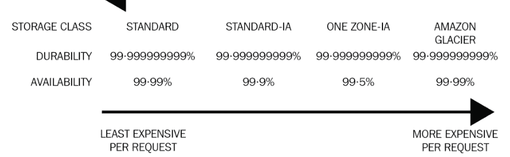
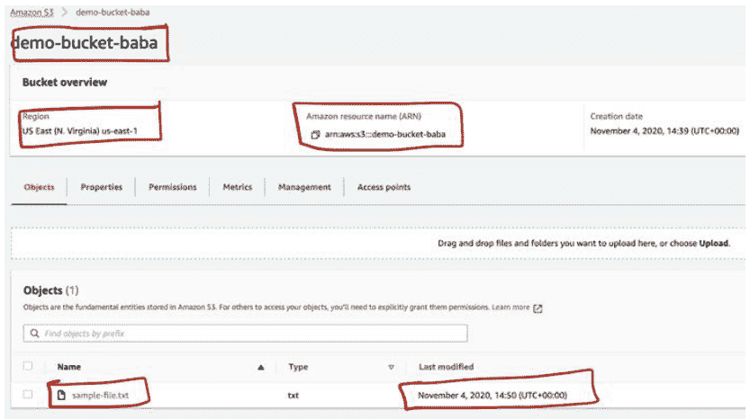

## 5

## AWS 数据存储服务

AWS 提供一系列服务来安全可靠地存储你的数据。AWS 上有各种存储选项，如块存储、文件存储和对象存储。由于硬件投资更高、管理开销和系统升级管理，管理本地数据存储成本高昂。有了 AWS 存储服务，你只需为所用付费，无需管理硬件。我们还将了解 Amazon S3 提供的各种存储类别，以便智能访问数据并降低成本。你可以在考试中遇到关于存储类别的问题。随着本章的继续，我们将掌握 Amazon RDS 的单可用区和多可用区实例，以及 RTO（恢复时间目标）和 RPO（恢复点目标）概念。

在本章中，我们将通过以下部分学习如何安全地存储数据以供进一步分析：

- 在 Amazon S3 上存储数据
- 控制对 S3 存储桶和对象的访问
- 保护 Amazon S3 上的数据
- 在静态和传输中保护 S3 对象
- 使用其他类型的数据存储


- 关系型数据库服务（RDSes）
- Amazon RDS 中的故障转移管理
- 自动备份、RDS 快照、恢复和只读副本
- 使用多主功能向 Amazon Aurora 写入
- 在 Amazon Redshift 上存储列式数据
- 作为服务的 NoSQL 数据库 Amazon DynamoDB

### 技术要求

本章所需的一切只是一个 AWS 账户和已配置的 AWS CLI。有关为您的账户配置 AWS CLI 的步骤，亚马逊在此有详细说明：https://docs.aws.amazon.com/cli/latest/userguide/cli-chap-configure.html。

您可以从 Github 下载代码示例，在此：https://github.com/PacktPublishing/AWS-Certified-Machine-Learning-Specialty-MLS-C01-Certification-Guide/tree/master/Chapter-5/。

### 在 Amazon S3 上存储数据

S3 是 Amazon 的基于云的对象存储服务，可通过互联网从任何地方访问。它是大型数据集的理想存储选项。它是区域性的，因为您的数据存储在特定区域，直到您将数据移动到不同区域。您的数据永远不会离开该区域，除非进行了配置。在特定区域中，数据会在该区域的可用区中复制；这使得 S3 具有区域弹性。如果区域中的任何可用区发生故障，则其他可用区将为您提供服务。它可通过 AWS 控制台 UI、AWS CLI 或 AWS API 请求，或通过标准 HTTP 方法访问。

S3 有两个主要组件：**存储桶**和**对象**。

- 存储桶是在特定的 AWS 区域中创建的。存储桶可以包含对象，但不能包含其他存储桶。
- 对象有两个主要属性。一个是**Key**，另一个是**Value**。Value 是存储的内容，Key 是名称。对象的最大大小可以为 5 TB。根据 Amazon S3 文档中在此提供的说明，https://docs.aws.amazon.com/AmazonS3/latest/dev/UsingObjects.html，对象还具有版本 ID、元数据、访问控制信息和子资源。

**重要说明**
根据 Amazon 的文档，S3 对新对象的 PUT 提供读后写一致性，这意味着如果您放置新对象或创建新对象，然后立即使用其键读取该对象，则会获得刚刚上传的确切数据。然而，对于覆盖和删除操作，它以**最终一致**的方式运行。这意味着如果您在删除或覆盖操作后立即读取对象，则可能读取旧副本或过时的对象版本。需要一些时间将对象的内容复制到三个可用区。

可以通过使用前缀在逻辑上维护文件夹结构。让我们以一个示例为例，其中一张图像上传到存储桶 `bucket-name-example`，前缀为 `folder-name`，对象名为 `my-image.jpg`。整个结构如下所示：`/bucket-name-example/folder-name/my-image.jpg`。

可以通过使用存储桶名称作为 `bucket-name-example` 和键作为 `/folder-name/my-image.jpg` 来读取对象的内容。

Amazon 为存储在 S3 中的对象提供了多种存储类别：

- **标准存储**：这是频繁访问对象和快速访问的存储类别。S3 Standard 具有毫秒级首字节延迟，并且对象可以公开可用。
- **降低冗余（RR）**：此选项提供的冗余比标准存储类别少。非关键且可重现的数据可以存储在此类别中。AWS S3 文档建议不要使用此类别，因为标准存储类别更具成本效益。
- **标准低频访问（IA）**：此选项用于您需要数据快速返回但不频繁访问的情况。对象大小必须至少为 128 KB。最短存储期限为 30 天。如果在 30 天前删除对象，您仍会被收取 30 天的费用。**标准 IA** 对象可抵御可用区丢失。
- **单区域低频访问**：此存储类别的对象仅存储在一个可用区中，这使其比 **标准 IA** 更便宜。最小对象大小和存储期限与 **标准 IA** 相同。此存储类别的对象可用性较低且弹性较差。此存储类别用于您有另一个副本或数据可以重建的情况。**单区域 IA** 存储类别应用于长期存在的非关键且可替换的数据，并且访问不频繁。
- **Glacier：** 此选项用于长期归档和备份。检索此存储类别中的对象可能需要从几分钟到数小时不等。最短存储期限为 90 天。您不能使用 Amazon Glacier API 访问作为对象生命周期管理的一部分从 S3 移动到 Glacier 的对象。
- **Glacier Deep Archive：** 此类别的最低存储期限为 180 天。这是成本最低的存储类别，默认检索时间为 12 小时。
- **智能分层：** 此存储类别旨在降低运营开销。用户支付监控费用，AWS 根据对象的访问模式在标准（频繁访问层）和标准 IA（低成本低频访问层）之间选择存储类别。此选项专为具有未知或不可预测访问模式的长期数据而设计。

通过一组规则，可以轻松管理存储类别之间的转换和对象的删除，并称为 **S3 生命周期配置**。这些规则由操作组成。这些规则可以应用于存储桶或该存储桶中由前缀或标签定义的对象组。操作可以是 **转换操作** 或 **过期操作**。转换操作定义对象在创建 *用户定义* 天数后进行存储类别转换。过期操作配置版本化对象的删除，或删除标记或不完整的多部分上传的删除。这对于管理成本非常有用。

图 5.1 中给出了一个说明。您可以在此处找到更多详细信息：https://docs.aws.amazon.com/AmazonS3/latest/dev/storage-class-intro.html：



图 5.1 – S3 存储类别的比较表

### 创建存储桶以保存数据

现在，让我们看看如何使用 AWS CLI 创建存储桶、上传对象并读取对象。

1. 在第一步中，我们将使用 `aws s3 ls` 命令检查是否已创建任何存储桶：
```
$ pwd
/Users/baba/AWS-Certified-Machine-Learning-Specialty-2020-Certification-Guide/Chapter-5/s3demo/demo-files
$ aws s3 ls
```
2. 此命令在此处未返回任何内容。因此，我们现在将使用 `mb` 参数创建存储桶。假设存储桶名称为 `demo-bucket-baba`，区域为 `us-east-1`：
```
$ aws s3 mb s3://demo-bucket-baba --region us-east-1
make_bucket: demo-bucket-baba
$ aws s3 ls
2020-11-04 14:39:50 demo-bucket-baba
```
3. 由于我们现在已创建存储桶，我们下一步是使用 `cp` 参数将文件复制到我们的存储桶中，如以下代码所示：
```
$ aws s3 cp sample-file.txt s3://demo-bucket-baba/
upload: ./sample-file.txt to s3://demo-bucket-baba/sample-file.txt
```
4. 要通过 AWS 控制台验证文件上传操作，请登录您的 AWS 账户并进入 AWS S3 控制台查看相同内容。AWS S3 控制台列出的结果如图所示 5.2。您阅读本书时，控制台可能已更改！



图 5.2 – AWS S3 屏幕截图以列出您的文件

您也可以从命令行列出 S3 存储桶中的文件，如下所示：

```
$ aws s3 ls s3://demo-bucket-baba/
2020-11-04 14:50:02        99 sample-file.txt
```

- 如果有将文件系统目录和文件上传到 S3 存储桶的场景，则 --recursive 将为您完成此操作：

```
$ aws s3 cp . s3://demo-bucket-baba/ --recursive
upload: folder-1/a.txt to s3://demo-bucket-baba/folder-1/a.txt
upload: folder-2/sample-image.jpg to s3://demo-bucket-baba/folder-2/sample-image.jpg
upload: ./sample-file.txt to s3://demo-bucket-baba/sample-file.txt
$ aws s3 ls s3://demo-bucket-baba/
```


+   - 可以通过 cp 命令和 --recursive 参数将一个存储桶的内容复制/移动到另一个存储桶。为此，你需要创建两个存储桶，demo-bucket-baba-copied 和 demo-bucket-baba-moved。步骤如下：

```
$ aws s3 mb s3://demo-bucket-baba-copied --region us-east-2
```

```
$ aws s3 mb s3://demo-bucket-baba-moved --region us-east-2
```

```
$ aws s3 cp s3://demo-bucket-baba s3://demo-bucket-baba-copied/ --recursive
```

```
$ aws s3 mv s3://demo-bucket-baba s3://demo-bucket-baba-moved/ --recursive
```

```
$ aws s3 ls
```

```
2020-11-04 14:39:50 demo-bucket-baba
```

```
2020-11-04 15:44:28 demo-bucket-baba-copied
```

```
2020-11-04 15:44:37 demo-bucket-baba-moved
```

```
$ aws s3 ls s3://demo-bucket-baba/
```

如果所有命令都成功运行，则原始存储桶最后应为空（因为所有文件都已移动）。

> Note
> 在认证考试中，你不会遇到太多关于存储桶和对象级操作的题目。然而，了解基本操作和所需步骤总是更好的。

5. 手工操作完成后，必须删除存储桶以避免产生费用。在提供 rb 命令之前，存储桶必须为空：

```
$ aws s3 rb s3://demo-bucket-baba
```

```
$ aws s3 rb s3://demo-bucket-baba-moved
```

```
remove_bucket failed: s3://demo-bucket-baba-moved
An error occurred (BucketNotEmpty) when calling the DeleteBucket operation: The bucket you tried to delete is not empty
```

6. `demo-bucket-baba-moved` 存储桶不为空，因此我们无法删除该存储桶。在这种情况下，使用 `--force` 参数删除整个存储桶及其所有内容，如下所示：

```
$ aws s3 rb s3://demo-bucket-baba-moved --force
$ aws s3 rb s3://demo-bucket-baba-copied --force
```

如果你想使用 CLI 删除存储桶中特定前缀下的所有内容，那么使用带有 `--recursive` 参数的 `rm` 命令就很容易。

7. 让我们以一个存储桶 `test-bucket` 为例，该存储桶有一个前缀 `images`。此前缀包含四个图像文件，名为 `animal.jpg`、`draw-house.jpg`、`cat.jpg` 和 `human.jpg`。

8. 现在，要删除 images 中的内容，命令如下：`aws s3 rm s3://test-bucket/images --recursive`

9. 存储桶现在应为空。

在下一节中，我们将学习有关对象标签和对象元数据的内容。

### Distinguishing between object tags and object metadata

让我们比较这两个术语：

+   - **Object Tag:** 对象标签是一个 **key-value** 对。AWS S3 对象标签可以帮助你过滤分析指标、对存储进行分类、根据特定分类保护对象、根据对象的特定分类跟踪成本等等。对象标签可用于创建生命周期规则，将对象移动到更便宜的存储层。你最多可以为一个对象添加 10 个标签，为一个存储桶添加 50 个标签。标签键可以包含 128 个 Unicode 字符，而标签值可以包含 256 个 Unicode 字符。
+   - **Object Metadata:** 对象元数据是描述对象的描述性数据。它由 **name-value** 对组成。对象元数据作为 HTTP 头返回在对象上。它们有两种类型：一种是 **System metadata**，另一种是 **User-defined metadata**。用户定义元数据是由用户添加到对象的自定义 name-value 对。名称必须以 **x-amz-meta** 开头。你可以更改对象上的所有系统元数据，例如存储类别、版本控制和加密属性。更多详细信息请参见此处：https://docs.aws.amazon.com/AmazonS3/latest/dev/UsingMetadata.html。

Important note
元数据名称不区分大小写，而标签名称区分大小写。

在下一节中，我们将学习如何通过不同的策略控制对 Amazon S3 上存储桶和对象的访问，包括资源策略和身份策略。

### Controlling access to buckets and objects on Amazon S3

对象存储在存储桶中后，下一个主要步骤是管理访问。S3 默认是私有的，并且通过多种方法向其他用户或组或资源授予访问权限。这意味着可以通过访问控制列表（ACLs）、公共访问设置、身份策略和存储桶策略来管理对象访问。

让我们详细了解其中一些。

### S3 bucket policy

S3 存储桶策略是一种附加到存储桶的资源策略。资源策略决定谁可以访问该资源。它与身份策略不同，因为身份策略可以附加或分配给账户内的身份，而资源策略可以控制同一账户或不同账户中的身份。资源策略也可以控制匿名主体，这意味着对象可以通过资源策略变为公开。以下示例策略允许全世界每个人读取存储桶，因为 Principal 被渲染为 *：

```
{
  "Version":"2012-10-17"
  "Statement":[
    {
      "Sid":"AnyoneCanRead",
      "Effect":"Allow",
      "Principal":"*",
      "Action":["s3:GetObject"],
      "Resource":["arn:aws:s3:::my-bucket/*"]
    }
  ]
}
```

默认情况下，S3 中的所有内容都对所有者私有。如果我们想将一个前缀公开给全世界，则 Resource 更改为 `arn:aws:s3:::my-bucket/some-prefix/*`，并且如果它 intended for 特定的 IAM 用户或 IAM 组，则这些详细信息进入策略中的 principal 部分。

存储桶策略也可以添加条件。让我们检查一个用例，即组织希望保持存储桶公开并白名单特定 IP 地址。策略看起来会像这样：

```
{
  "Version":"2012-10-17"
  "Statement": [
    {
      "Sid":"ParticularIPRead",
      "Effect":"Allow",
      "Principal":"*",
      "Action":["s3:GetObject"],
      "Resource":["arn:aws:s3:::my-bucket/*"],
      "Condition":{
        "NotIpAddress":{"aws:SourceIp":"2.3.3.6/32"}
      }
    }
  ]
}
```

更多示例可在 AWS S3 开发者指南中找到，可在此处获取：https://docs.aws.amazon.com/AmazonS3/latest/dev/example-bucket-policies.html。

**Block public access** 是为存储桶所有者提供的单独设置，以避免存储桶策略中的任何错误。在现实场景中，存储桶可能因策略错误而被公开；为避免此类错误或数据泄露，AWS 提供了此设置。它提供了进一步的安全级别，不受存储桶策略影响。你可以在创建存储桶时选择此设置，或在创建存储桶后设置。

**Identity policies** 用于 IAM 用户和 IAM 角色。**Identity policies** 在 IAM 身份（用户或角色）请求访问资源时进行验证。默认情况下拒绝所有请求。如果身份打算访问任何服务、资源或操作，则必须通过 **identity policies** 明确提供访问权限。以下示例策略可以附加到 IAM 用户，IAM 用户将被允许在特定区域（本示例中为 us-east-1）内拥有完全的 RDS 访问权限：

```
{
    "Version": "2012-10-17",
    "Statement": [
        {
            "Effect": "Allow",
            "Action": "rds:*",
            "Resource": ["arn:aws:rds:us-east-1:*:*"]
        },
        {
            "Effect": "Allow",
            "Action": ["rds:Describe*"],
            "Resource": ["*"]
        }
    ]
}
```

**ACLs** 用于授予高级权限，通常用于向其他 AWS 账户授予访问权限。ACLs 是存储桶或对象的 **Subresources** 之一。存储桶或对象可通过 ACLs 快速变为公开。AWS 不建议这样做，你也不应期望在测试中看到关于此的问题。了解这一点是好的，但它不如 **S3 bucket policy** 灵活。

现在，让我们在下一节学习保护我们数据的方法。


### 保护 Amazon S3 上的数据

在本节中，我们将学习如何记录对象的每个版本。除了持久性之外，Amazon 还提供了多种保护 S3 中数据的安全技术。其中一些技术涉及启用版本控制并加密对象。

版本控制有助于在更新、删除或 put 操作期间当前对象出现问题时回滚到以前的版本。

通过加密，您可以控制对象的访问权限。您需要适当的密钥来读取和写入对象。我们还将学习删除操作的 **多因素身份验证 (MFA)**。Amazon 还允许 **跨区域复制 (CRR)** 在另一个区域维护对象的副本，可用于在任何灾难期间进行数据备份，以实现进一步的冗余，或增强不同区域的数据访问速度。

### 应用存储桶版本控制

现在让我们借助一些动手示例来了解如何启用存储桶版本控制。存储桶版本控制可以在 AWS S3 控制台创建存储桶时应用：

- 1. 要从命令行在存储桶上启用版本控制，必须先创建存储桶，然后才能启用版本控制，如以下示例所示。在此示例中，我创建了一个存储桶，`version-demo-mlpractice`，并通过 `put-bucket-versioning` 命令启用了版本控制：
- 2. 我们尚未为此存储桶创建任何形式的加密。因此，如果您运行 `aws s3api get-bucket-encryption --bucket version-demo-mlpractice`，则会输出错误，内容如下：

```
$ aws s3 mb s3://version-demo-mlpractice/
$ aws s3api put-bucket-versioning --bucket version-demo-mlpractice --versioning-configuration Status=Enabled
$ aws s3api get-bucket-versioning --bucket version-demo-mlpractice
{
    "Status": "Enabled"
}
```

```
The server side encryption configuration was not found
```

3. **服务器端加密 (SSE)** 可以在 AWS S3 控制台创建存储桶时应用。这称为存储桶默认加密。您也可以通过命令行使用 put-bucket-encryption API 应用 SSE。命令如下所示：

```
$ aws s3api put-bucket-encryption --bucket version-demo-mlpractice --server-side-encryption-configuration '{"Rules":[{"ApplyServerSideEncryptionByDefault":{"SSEAlgorithm":"AES256"}}]}'
```

4. 同样可以使用以下命令进行验证：aws s3api get-bucket-encryption --bucket version-demo-mlpractice。

我们将在下一节中了解更多有关加密的信息。

### 为存储桶应用加密

您还需要了解在存储桶上启用版本控制将如何提供帮助。在某些用例中，文件会定期更新，并且会为同一文件创建版本。为模拟此场景，请尝试以下示例：

- 1. 在此示例中，我们将创建一个文件中写入了版本的文件。我们将覆盖它并检索它以检查该文件中的版本：

```
$ echo "Version-1">version-doc.txt
$ aws s3 cp version-doc.txt s3://version-demo-mlpractice
$ aws s3 cp s3://version-demo-mlpractice/version-doc.txt check.txt
$ cat check.txt
Version-1
$ echo "Version-2">version-doc.txt
$ aws s3 cp version-doc.txt s3://version-demo-mlpractice
$ aws s3 cp s3://version-demo-mlpractice/version-doc.txt check.txt
$ cat check.txt
Version-2
```

2. 检索后，我们获得了文件的最新版本，即本例中的 Version-2。要检查每个版本及其最新版本，S3 提供了 list-object-versions API，如下所示。从 JSON 结果中，您可以推断出最新版本：

```
$ aws s3api list-object-versions
  --bucket version-demo-mlpractice
{
    "Versions": [
        {
            "ETag": "\"b6690f56ca22c410a2782512d24cdc97\"",
            "Size": 10,
            "StorageClass": "STANDARD",
            "Key": "version-doc.txt",
            "VersionId": "70wbLG6BMBEQhCXmwsriDgQoXafFmgGi",
            "IsLatest": true,
            "LastModified": "2020-11-07T15:57:05+00:00",
            "Owner": {
                "DisplayName": "baba",
                "ID": "XXXXXXXXXXXX"
            }
        },
        {
            "ETag": "\"5022e6af0dd3d2ea7092043827lb21a2\"",
            "Size": 10,
            "StorageClass": "STANDARD",
            "Key": "version-doc.txt",
            "VersionId": "fliC.9L.MsP00tIb.sUMnfOEae240sIW",
            "IsLatest": false,
            "LastModified": "2020-11-07T15:56:27+00:00",
            "Owner": {
                "DisplayName": "baba",
                "ID": " XXXXXXXXXXXX"
            }
        }
    ]
}
```

```
}
]
}
```

3. 可能出现需要回滚到当前对象的较早版本的情况。在前面的示例中，最新的是 *Version-2*。您可以通过将 *VersionId* 子资源解析到 `get-object` API 调用并再次上传该对象，使任何期望的版本成为最新或当前版本。另一种方法是删除当前或最新版本，通过在 `delete-object` API 请求中将 `versionId` 传递给 `-version-id` 参数。有关 API 的更多详细信息，请参见此处：https://docs.aws.amazon.com/cli/latest/reference/s3api/delete-object.html。

4. 当您在启用版本控制的存储桶中删除对象时，它不会从存储桶中删除对象。它只是创建了一个称为 **DeleteMarker** 的标记。它看起来像这样：

```
$ aws s3api delete-object --bucket version-demo-mlpractice --key version-doc.txt
{
    "DeleteMarker": true,
    "VersionId": "BKv_Cxix tm7V48MWqBO_KUkKbcOaH5JP"
}
```

5. 这意味着对象未被删除。您可以使用以下命令列出它：

```
aws s3api list-object-versions --bucket version-demo-mlpractice
```

6. 现在存储桶中没有 version-doc.txt 对象，您可以使用 aws s3 ls 命令验证这一点，因为该标记已成为具有新 ID 的对象的当前版本。如果您尝试检索已删除的对象，即删除标记正在提供对象的当前版本，则会收到 404 错误。因此，在启用版本控制的存储桶中永久删除对象只能通过使用其版本 ID 删除每个版本的对象的对象来实现。如果出现需要恢复对象的情况，则可以通过删除删除标记 VersionId 来检索相同的对象，如以下示例命令所示。简单的删除请求（不带版本 ID）不会删除删除标记，而是会创建具有唯一版本 ID 的另一个删除标记。因此，同一个对象可能存在多个删除标记。此时需要注意的是，这将消耗您的存储空间，您将为此付费：

```
$ aws s3 ls s3://version-demo-mlpractice/
```

```
$ aws s3api delete-object --bucket version-demo-mlpractice --key version-doc.txt --version-id BKv_Cxix tm7V48MWqBO_KUkKbcOaH5JP
```

```
{
  "DeleteMarker": true,
  "VersionId": "BKv_Cxix tm7V48MWqBO_KUkKbcOaH5JP"
}
```

7. 现在列出存储桶后，可以看到旧对象：

```
$ aws s3 ls s3://version-demo-mlpractice/
```

```
2020-11-07 15:57:05          10 version-doc.txt
```

由于我们已经涵盖了考试主题并练习了大部分所需概念，我们应该删除存储桶中的对象，然后删除存储桶以节省成本。此步骤删除对象的版本，从而永久删除对象。

8. 在这里，通过为其提供版本 ID 删除最新版本，然后再删除其他版本 ID：

```
$ aws s3api delete-object --bucket version-demo-mlpractice --key version-doc.txt --version-id 70wbLG6BMBEQhCXmwsriDgQoXafFmgGi
```

```
$ aws s3api delete-object --bucket version-demo-mlpractice --key version-doc.txt --version-id fliC.9L.MsP00tIb.sUMnfOEae240sIW
```

```
$ aws s3api list-object-versions --bucket version-demo-mlpractice
```

我们现在可以清楚地看到空存储桶。

> **重要说明**
> AWS 最佳实践建议通过 **MFA 删除** 添加另一层保护。可以防止意外删除存储桶，并确保存储桶中对象的安全性。MFA 删除可以通过控制台和 CLI 启用或禁用。如 AWS 文档所述，MFA 删除需要两种形式的身份验证同时进行：您的安全凭证，以及有效序列号、空格和经批准的身份验证设备上显示的六位数字代码的串联。

CRR 可帮助您在不同地理区域之间分离数据。一个典型的用例是在灾难期间保持业务正常运行。如果一个区域宕机，则如果启用了 CRR，另一个区域可以支持用户。这提高了数据的可用性。另一个用例是减少延迟，如果同一数据被另一个计算资源使用，例如在另一个区域启动的 EC2 或 AWS Lambda。您还可以使用 CRR 将对象复制到属于不同所有者的另一个 AWS 账户。以下是认证考试值得注意的几点：

- 为了使用 CRR，必须在源存储桶和目标存储桶上启用版本控制。
- 通过添加规则在源存储桶上启用复制。作为源，可以复制整个存储桶、或前缀、或标签。
- 通过分配适当的加密密钥，也可以复制加密对象。
- 目标存储桶可以在同一账户中或在另一个账户中。您可以在目标存储桶中更改对象的存储类型和所有权。
- 对于 CRR，可以选择现有角色，也可以创建新的 IAM 角色。
- 源存储桶上可以有多个复制规则，并按优先级排序。优先级较高的规则会覆盖优先级较低的规则。
- 当您添加复制规则时，只有在规则启用后创建的对象的较新版本才会被复制。
- 如果从源存储桶删除版本，则不会从目标存储桶中删除它们。
- 当您从源存储桶删除对象时，它会在源存储桶中创建删除标记。S3 不会将该删除标记复制到目标存储桶。

在下一节中，我们将介绍保护 S3 对象的概念。


### 静态和传输中 S3 对象的保护

在上一节中，我们学习了存储桶默认加密，这与对象级加密完全不同。存储桶本身不会被加密，而对象会被加密。这里可能会产生一个问题：*什么是存储桶默认加密？* 我们将在本节中学习这些概念。传输中的数据可以通过使用 **Secure Socket Layer (SSL)** 或 **Transport Layer Security (TLS)** 来保护 HTTPS 请求的传输。下一步是保护数据，只有授权人员才能编码和解码数据。

同一个存储桶中的不同对象可以具有不同的加密设置。S3 对静态中的对象支持 **Client-Side Encryption (CSE)** 和 **Server-Side Encryption (SSE)**：

- **Client-Side Encryption：** 客户端通过 S3 端点将对象上传到 S3。在 CSE 中，数据在上传到 S3 之前由客户端加密。虽然用户与 S3 端点之间的传输发生在加密通道中，但通道中的数据已经由客户端加密，无法被看到。传输中默认通过 HTTPS 进行加密。因此，AWS S3 存储加密后的对象，并且在任何时间点都无法以任何格式读取数据。在 CSE 中，客户端负责加密对象内容。因此，密钥管理和加密-解密过程的控制权保留在客户端。这会导致大量的 CPU 使用。S3 仅用于存储。

- **Server-Side Encryption：** 客户端通过 S3 端点将对象上传到 S3。即使传输中的数据通过使用 HTTPS 的加密通道，对象本身在通道内并未被加密。一旦数据到达 S3，则由 S3 服务进行加密。在 SSE 中，你信任 S3 执行加密-解密、对象存储和密钥管理。有三种 SSE 技术可用于 S3 对象：

  a) SSE-C
  b) SSE-S3
  c) SSE-KMS

- **Server-Side Encryption with Customer-Provided Keys (SSE-C)：** 使用 SSE-C，用户负责用于加密和解密的密钥。S3 管理加密和解密过程。在 CSE 中，客户端处理加密-解密过程，但在 SSE-C 中，S3 处理加密操作。这可能降低这些过程的 CPU 需求。这里唯一的开销是管理密钥。理想情况下，当用户执行 PUT 操作时，用户必须向 S3 提供密钥和对象。S3 使用提供的密钥加密对象并将哈希值（密文）附加到对象。一旦对象被存储，S3 就会丢弃加密密钥。该生成的哈希值是单向的，不能用于生成新密钥。当用户提供 GET 操作请求以及解密密钥时，哈希值会识别是否使用特定密钥进行加密。然后，S3 解密并丢弃密钥。
- **Server-Side Encryption with Amazon S3-Managed Keys (SSE-S3)：** 使用 SSE-S3，AWS 同时处理密钥管理和加密解密过程。当用户使用 PUT 操作上传对象时，用户只需提供未加密的对象。S3 创建一个用于加密过程的主密钥。没有人可以更改此主密钥，因为它是内部创建、轮换并由 S3 端到端管理的。这是对象的唯一密钥。它默认使用 AES-256 算法。
- **Server-Side Encryption with Customer Master Keys stored in AWS Key Management Service (SSE-KMS)：** AWS Key Management Service (KMS) 管理 Customer Master Key (CMK)。AWS S3 与 AWS KMS 协作并生成 AWS 管理的 CMK。这是用于 SSE-KMS 的默认主密钥。每次上传对象时，S3 使用专用密钥加密该对象，该密钥是数据加密密钥（DEK）。DEK 由 KMS 使用 CMK 生成。S3 同时获得 DEK 的明文版本和加密版本。DEK 的明文版本用于加密对象然后被丢弃。DEK 的加密版本与加密对象一起存储。当你使用 SSE-KMS 时，不必使用 S3 创建的默认 CMK。你可以创建并使用客户管理的 CMK，这意味着你也可以控制其权限以及密钥材料的轮换。因此，如果你的组织中有监管机构关心密钥轮换或加密用户与解密用户之间的角色分离，那么 SSE-KMS 就是解决方案。SSE-KMS 上的日志记录和审计也是可能的，以跟踪针对密钥的 API 调用。
- **Bucket Default Encryption：** 如果我们在创建存储桶时设置 AES-256，或在创建存储桶后启用它，则在执行 PUT 操作时如果在对象级别未设置任何内容，将使用 SSE-S3。

在下一节中，我们将学习与 EC2 实例一起使用的一些数据存储。

### 使用其他类型的数据存储

**Elastic Block Store (EBS)** 用于在可用区中创建卷。卷只能附加到同一可用区中的 EC2 实例。Amazon EBS 提供 **SSD (Solid State Drive)** 和 **HDD (Hard Disk Drive)** 类型卷。对于基于 SSD 的卷，主要性能属性是 **IOPS (Input Output Per Second)**，对于 HDD 则是吞吐量，通常以 MiB/s 衡量。下表所示在 *Figure 5.3* 中提供了不同卷和类型的概述：

| Volume Types | Use cases |
|---|---|
| General Purpose SSD (gp2) | Useful for maintaining balance between price and performance. Good for most workloads, system boot volumes, dev, and test environments. |
| Provisioned IOPS SSD (io2, io1) | Useful for mission-critical, high-throughput or low-latency workloads. For example, I/O intensive database workloads like MongoDB, Cassandra, Oracle |
| Throughput Optimized HDD (st1) | Useful for frequently accessed, throughput-intensive workloads. For example, big data processing, data warehouses, log processing |
| Cold HDD (sc1) | Useful for less frequently accessed workloads. |

Figure 5.3 – Different volumes and their use cases

**EBS** 对可用区（AZ）具有弹性。如果由于某种原因 AZ 失败，则无法访问卷。为了避免这种情况，可以从 EBS 卷创建 **snapshots**，快照存储在 S3 中。一旦快照到达 S3，快照中的数据就变得区域弹性。第一个快照是卷上数据的完整副本，从那时起，快照是增量的。快照可用于克隆卷。由于快照存储在 S3 中，因此可以在该区域的任何 AZ 中克隆卷。快照可以在区域之间共享，并在灾难恢复期间从中克隆卷。

AWS KMS 管理 CMK。AWS KMS 为 EBS 使用 AWS 管理的 CMK，或 AWS KMS 可以使用客户管理的 CMK。CMK 由 EBS 在创建加密卷时使用。CMK 用于创建加密的 DEK，该 DEK 与卷一起存储在物理磁盘上。DEK 只能使用 KMS 解密，前提是实体具有解密权限。当从加密卷创建快照时，快照使用相同的 DEK 进行加密。从此快照创建的任何卷也使用该 DEK。

**Instance Store** 卷是物理连接到 EC2 实例的块存储设备。它们提供最高性能，因为附加到实例的 **ephemeral storage** 来自实例启动的同一主机。EBS 可以在任何时间附加到实例，但 instance store 必须在实例启动时附加到实例；实例启动后无法再附加。如果 EC2 实例的底层主机出现问题，则同一实例将在另一个主机上启动，并使用新的 instance store 卷，之前的 instance store（临时存储）和旧数据将丢失。附加卷的大小和功能取决于实例类型，可在此处找到更详细的信息：https://aws.amazon.com/ec2/instance-types/。

**Elastic File System (EFS)** 提供一种基于网络的文件系统，可以在 Linux EC2 实例中挂载，并可同时被多个实例使用。它是 **NFSv4** 的实现。它可用于通用模式、最大 I/O 性能模式（用于科学分析或并行计算）、突发模式和预配吞吐量模式。

正如我们所知，在 instance store 的情况下，数据是易失的。一旦实例丢失，数据就会从 instance store 中丢失。EFS 并非如此。EFS 与 EC2 实例存储分离。EFS 是一个文件存储，可通过 VPC 内的挂载目标由多个 EC2 实例访问。本地系统可以通过混合网络访问 EFS 存储到 VPC，例如 **VPN** 或 **Direct Connect**。EFS 还支持两种存储类别：Standard 和 Infrequent Access。Standard 用于频繁访问的数据。Infrequent Access 是用于长期保存、较少访问数据的经济型存储类别。生命周期策略可用于在存储类别之间转换数据。

### Important note
An instance store is preferred for max I/O requirements and if the data is replaceable and temporary.

### Relational Database Services (RDSes)

This is one of the most commonly featuring exam topics in AWS exams. You should have sufficient knowledge prior to the exam. In this section, we will learn about Amazon's RDS.


AWS 为其用户提供了几种托管的数据库服务。用户也可以在 EC2 实例上运行所需的数据库。最大的缺点是实例仅在某个区域的一个可用区中可用。EC2 实例必须进行管理和监控以避免任何类型的故障。需要自定义脚本来随时间维护数据备份。任何数据库的主版本或次版本更新都会导致停机。如果数据库负载增加，在 EC2 实例上运行的数据库实例很难扩展，因为复制并不是一件容易的事情。

RDS 提供了托管的数据库实例，这些实例本身可以容纳一个或多个数据库。想象一下运行在 EC2 实例上的数据库服务器，而你无需管理或维护它。你只需要访问该服务器并在其中创建数据库。AWS 将管理其他所有内容，例如实例的安全性、实例上运行的操作系统、数据库版本以及数据库服务器的高可用性。RDS 支持多种引擎，如 MySQL、Microsoft SQL Server、MariaDB、Amazon Aurora、Oracle 和 PostgreSQL。你可以根据自己的需求选择其中任何一种。

Amazon RDS 的基础是一个数据库实例，它可以支持多种引擎，并且用户可以创建多个数据库。只能通过使用主实例的数据库 CNAME（CNAME 是域名系统数据库中规范名称的别名）来访问一个数据库实例。RDS 使用标准的数据库引擎。因此，使用自托管数据库服务器中的某种工具访问数据库，与访问 Amazon RDS 的方式相同。

既然我们已经了解了 Amazon RDS 的需求，让我们来了解 Amazon RDS 中的故障转移过程。我们将介绍如果 RDS 实例出现问题时 Amazon 提供的服务。

### 在 Amazon RDS 中管理故障转移

RDS 实例可以是单可用区或多可用区。在多可用区中，多个实例协同工作，类似于主动-被动故障转移设计。

对于单可用区 RDS 实例，可以为该实例分配存储空间。简而言之，单可用区 RDS 实例有一个附加的块存储（EBS 存储）可用在同一可用区中。这使得 RDS 实例的数据库和存储容易受到可用区故障的影响。可分配给块存储的存储可以是 SSD（gp2 或 io1）或磁性存储。为了保护 RDS 实例，建议使用安全组并根据需求提供访问权限。

多可用区始终是设计架构以避免任何故障并保持应用程序高度可用的最佳方式。有了多可用区功能，备用副本会与主实例**同步**保持同步。备用实例在其分配的可用区中拥有自己的存储。备用副本不能直接访问，因为所有 RDS 访问都是通过单个数据库 CNAME 进行的。除非发生故障转移，否则你无法访问备用实例。备用实例不会带来性能优势，但确实提高了 RDS 实例的可用性。它只能发生在同一区域内、同一区域 VPC 内的另一个可用区的子网中。当多可用区 RDS 实例在线时，你可以从备用副本中获取备份，而不会影响性能。在单可用区实例中，备份操作期间的可用性和性能问题可能非常严重。

为了了解多可用区的工作原理，让我们以一个单可用区实例为例并将其扩展到多可用区。

假设你有一个 RDS 实例运行在 us-east-1 区域的 AZ-A 可用区中，位于名为 db-vpc 的 VPC 内。在 RDS 实例的单可用区设计中，这成为主实例。在这种情况下，将在 AZ-A 可用区为实例分配存储。一旦你在名为 AZ-B 的另一个可用区中选择多可用区部署，AWS 将在 us-east-1 区域的 AZ-B 可用区中、db-vpc VPC 内创建一个备用实例，并为备用实例在 us-east-1 区域的 AZ-B 中分配存储。与此同时，RDS 将从主实例到备用副本启用**同步复制**。正如我们之前所学，访问我们的 RDS 实例的唯一方式是通过数据库 CNAME，因此访问请求会转到 RDS 主实例。一旦写入请求到达端点，它就会写入主实例。然后它将数据写入硬件，即附加到主实例的块存储。同时，主实例将相同的数据复制到备用实例。最后，备用实例将数据提交到其块存储。

主实例将数据写入硬件并并行复制数据到备用实例，因此它们各自硬件中的数据提交操作之间存在最小的时间延迟（几乎为零）。如果主实例出现错误，则 RDS 会检测到这一点并将数据库端点更改为备用实例。访问数据库的客户端可能会经历非常短暂的中断。这种故障转移在 60-120 秒内发生。它不能提供容错系统，因为故障转移操作期间仍会产生一定影响。

你现在应该了解了 Amazon RDS 上的故障转移管理。现在让我们学习在下一节中如何进行自动 RDS 备份、使用快照在发生任何故障时进行恢复以及只读副本。

### 进行自动备份、RDS 快照和恢复以及只读副本

在本节中，我们将了解 RDS 自动备份和手动快照的工作方式。这些功能随 Amazon RDS 提供。

假设有一个数据库每天凌晨 5 点安排备份。如果应用程序在上午 11 点失败，则可以从上午 11 点的备份中重新启动应用程序，数据丢失 6 小时。这称为 6 小时 RPO（恢复点目标）。因此，RPO 定义为最近一次备份与事件发生之间的时间，这决定了数据丢失量。如果要减少这一点，则必须安排更多增量备份，这会增加成本和备份频率。如果你的业务要求更低的 RPO 值，则业务必须在满足技术解决方案上花费更多。

现在，根据我们的示例，一名工程师被分配了此任务，以便在灾难发生后尽快将系统上线。工程师通过为当前系统添加一些额外的硬件组件并安装一些更新的软件版本，于当天中午 2 点成功将数据库上线。这称为 3 小时 RTO（恢复时间目标）。因此，RTO 被确定为灾难恢复和完全恢复之间的时间。可以通过拥有备用硬件和记录恢复过程来减少 RTO 值。如果业务要求更低的 RTO 值，则你的业务必须在备用硬件和有效的系统设置上花费更多资金以执行恢复过程。

在 RDS 中，RPO 和 RTO 在选择自动备份和手动快照时起着重要作用。这两种备份服务都使用 AWS 管理的 S3 存储桶，这意味着它在用户的 AWS S3 控制台中不可见。它是区域弹性，因为备份会复制到 AWS 区域中的多个可用区。对于单可用区 RDS 实例，备份是从单个可用数据存储中进行的，而对于启用了多可用区的 RDS 实例，备份是从备用数据存储中进行的（备份方面主存储保持不变）。

快照是针对 RDS 实例的手动操作，这些快照存储在 AWS 管理的 S3 存储桶中。RDS 实例的第一个快照是数据的完整副本，而后续快照是增量的，反映了数据的变化。就快照过程所需的时间而言，第一次较高，此后增量备份会更快。当任何快照发生时，它可能会影响单可用区 RDS 实例的性能，但不会影响多可用区 RDS 实例的性能，因为这发生在备用数据存储上。手动快照不会过期，必须自动清除，并且它们会在 RDS 实例终止后继续存在。当你删除一个 RDS 实例时，它会建议代表你进行一次最终快照，并且它将包含你 RDS 实例中的所有数据库（RDS 实例中不仅仅只有一个数据库）。当你从手动快照恢复时，你会恢复到一个时间点，这会影响 RPO。

为了自动化整个过程，你可以选择一个时间窗口，在此期间可以拍摄这些快照。这称为自动备份。这些时间窗口可以明智地管理，以实质上降低业务的 RPO 值。自动备份的保留期为 0 到 35 天，0 表示禁用，最大为 35 天。引用 AWS 文档，保留的自动备份包含数据库实例的系统快照和事务日志。它们还包括分配的存储和数据库实例类等数据库实例属性，这些属性是将其恢复为活动实例所必需的。数据库会生成事务日志，其中包含特定数据库中数据的实际更改。这些事务日志也会每 5 分钟由 RDS 写入 S3。事务日志也可以在快照之上重放，以恢复到 5 分钟粒度的某个时间点。理论上，RPO 可以是 5 分钟的时间点。

当你执行恢复时，RDS 会创建一个新的 RDS 实例，这意味着一个新的数据库端点来访问该实例。使用该实例的应用程序必须指向新地址，这会显著影响 RTO。这意味着恢复过程并不非常快，这会影响 RTO。为了在故障期间最小化 RTO，你可以考虑复制数据。有了副本，就有很高的机会复制损坏的数据。克服这一问题的唯一方法是拥有快照，并且 RDS 实例可以恢复到损坏之前的某个时间点。Amazon RDS 只读副本与多可用区副本不同。在多可用区 RDS 实例中，备用副本除非主实例失败，否则不能直接用于任何用途，而只读副本可以直接使用，但仅用于读取操作。只读副本拥有自己的数据库端点，读取密集型应用程序可以直接指向此地址。它们与主实例异步保持同步。只读副本可以在与主实例相同的区域或不同的区域中创建。其他区域中的只读副本称为跨区域只读副本，这可以提高应用程序的全球性能。


根据 AWS 文档，每个数据库实例允许最多五个直接只读副本，这有助于扩展读取性能。只读副本由于异步复制具有非常低的 RPO 值。在主实例故障的情况下，它们可以提升为读写数据库实例。这可以快速完成，并且提供相当低的 RTO 值。

在下一节中，我们将了解亚马逊自己的数据库引擎 Amazon Aurora。

### 使用多主功能向 Amazon Aurora 写入

Amazon Aurora 是亚马逊开发的最可靠的关系型数据库引擎，以简单且经济高效的方式提供速度。Aurora 使用单主实例集群和零个或多个副本。Aurora 的副本可以让你同时获得 RDS 中只读副本和多可用区实例的优势。Aurora 使用共享集群卷进行存储，可供集群的所有计算实例使用（最多 64 TiB）。这使得 Aurora 集群能够更快地配置，并提高可用性和性能。Aurora 使用基于 SSD 的存储，提供高 IOPS 和低延迟。与其他 RDS 实例不同，Aurora 不要求你分配存储；它基于你使用的存储。

Aurora 集群具有多个端点，包括 **Cluster Endpoint** 和 **Reader Endpoint**。如果没有副本，则集群端点与读取器端点相同。如果有副本可用，则读取器端点会在读取器端点之间进行负载均衡。集群端点用于读写，而读取器端点用于从集群读取。如果添加更多副本，则 AWS 会在幕后为新副本管理负载均衡。

当故障转移发生时，副本会被提升为读写模式，这需要一些时间。这可以在 Aurora 集群的 **Multi-Master** 模式下避免。这允许多个实例同时执行读写操作。

### 在 Amazon Redshift 上存储列式数据

Amazon Redshift 不用于实时事务用途，而是用于数据仓库用途。它旨在支持 PB 级的海量数据。它是用于分析目的的基于列的数据库，用于长期处理、趋势分析和聚合。**Redshift Spectrum** 可用于在不将数据加载到 Redshift 集群的情况下查询 S3 上的数据（尽管需要 Redshift 集群）。它不是 OLTP，而是 OLAP。**AWS QuickSight** 可与 Redshift 集成用于可视化，提供类 SQL 接口，允许你使用 JDBC/ODBC 连接查询数据。

Redshift 在 VPC 中的一个可用区使用集群架构，节点之间具有更快的网络连接。它并非按设计具有高可用性，因为它与可用区紧密耦合。Redshift 集群有一个 **Leader Node**，该节点负责客户端与集群计算节点之间的一切通信、查询规划和聚合。**Compute Nodes** 负责运行由 leader 节点提交的查询并存储数据。默认情况下，Redshift 使用公共网络与外部服务或任何 AWS 服务通信。通过 **Enhanced VPC Routing**，可通过自定义网络设置进行控制。

### Amazon DynamoDB 作为 NoSQL 数据库即服务

Amazon DynamoDB 是 AWS 内的 NoSQL 数据库即服务产品。它是完全托管的键值和文档数据库。通过其端点访问 DynamoDB 很简单。输入和输出吞吐量可以手动或自动方式管理或扩展。它还支持数据备份、时间点恢复和数据加密。我们在本章中不会介绍 DynamoDB 表结构或键结构，因为这对认证考试不是必需的。然而，对它们有一个基本的了解是好的。如需更多详细信息，请参阅此处可用的 AWS 文档：https://docs.aws.amazon.com/amazondynamodb/latest/developerguide/SQLtoNoSQL.html。

### 总结

在本章中，我们了解了亚马逊的各种数据存储服务，以及如何通过各种策略保护数据并使用这些服务。如果你正在处理机器学习用例，那么你可能会遇到需要为你的需求选择有效数据存储服务的场景。

在下一章中，我们将学习存储数据的处理。

### Questions

+ 1. 要设置 S3 存储桶存储的区域，你必须先创建存储桶，然后再单独设置区域。
+ A. True
+ B. False

+ 2. 是否必须将源存储桶和目标存储桶都放在同一区域才能复制 S3 存储桶的内容？
+ A. True
+ B. False

+ 3. 默认情况下，存储桶中的对象是私有的。
+ A. True
+ B. False

+ 4. 根据 AWS，S3 对象是不可变的，你只能执行 put 和 delete。重命名是使用不同名称对同一对象进行 GET 和 PUT。
+ A. True
+ B. False

+ 5. 如果用户在同一个存储桶中存储了未版本化和已版本化的对象，那么用户只能删除未版本化的对象。已版本化的对象无法删除。
+ A. True
+ B. False

> **Answer**
> 版本控制适用于整个存储桶而不是对象。如果在存储桶上启用了版本控制，则只能暂停它；无法禁用它。

6. 对删除标记执行简单删除请求将：
A. 删除删除标记
B. 创建删除标记的副本
C. 不删除删除标记，但会创建另一个删除标记
D. 删除对象的原始版本

7. RDS 多可用区实例可通过提高扩展性和性能。
A. True
B. False

Answer
RDS 多可用区与扩展性和性能无关。它用于故障转移。

8. EFS 使用什么协议？
A. SMB
B. NFS
C. EBS
D. HTTP

9. EFS 支持哪些操作系统？
A. 仅 Linux
B. 仅 Windows
C. Windows 和 Linux 均支持
D. Windows 和 Linux 均不支持

10. EFS 是否为私有服务？
A. 是。
B. 否，它是公共服务。
C. 它既是私有服务也是公共服务。
D. 它既不是私有服务也不是公共服务。

11. 以下哪两个是正确的？

- A. Multi-AZ:Same Region::Read Replica:Multiple Region
- B. Multi-AZ:Multiple Region::Read Replica:Same Region
- C. Multi-AZ:Synchronous Replication::Read Replica:Asynchronous Replication
- D. Multi-AZ:ASynchronous Replication::Read Replica:Synchronous Replication

12. 以下哪个是正确的？

- A. 只读副本是只读实例。
- B. 只读副本是读写实例。
- C. 只读副本是仅写实例。
- D. 只读副本是只读实例，直到提升为读写。

13. EFS 可从何处访问？

- A. 仅在 VPC 内部
- B. 通过 AWS 端点
- C. 任何具有公共互联网连接的位置
- D. 在 VPC 内部或通过混合网络连接到该 VPC 的任何本地位置

14. 以下哪三个是正确的？

- A. 实例存储卷是持久存储。
- B. 实例存储卷是临时存储。
- C. 如果发生硬件故障，存储在实例存储卷上的数据可能会丢失。
- D. 当 EC2 实例重启时，存储在实例存储卷上的数据可能会丢失。
- E. 当 EC2 实例停止并启动时，存储在实例存储卷上的数据可能会丢失。

> **Answer**
> 硬件故障可能会更改底层主机。因此，实例存储卷没有保证。当你停止实例并再次启动时，由于主机更改，实例存储卷会丢失。实例重启与停止和启动不同；它意味着操作系统重启。

15. 为了使用 EC2 和 EBS 启用静态加密，你需要…

- A. 在创建 EBS 卷时配置加密。
- B. 使用适当操作系统的文件系统配置加密。
- C. 使用 X.509 证书配置加密。
- D. 将 EBS 卷挂载到 S3，然后使用存储桶策略加密存储桶。

16. 以下哪一项是你在 EBS 快照上无法执行的操作？

- A. 从快照创建镜像。
- B. 从快照创建 EBS 卷。
- C. 与另一个 AWS 账户共享快照。
- D. 对加密快照制作未加密的副本。

17. 使用 EBS，你需要执行以下操作（选择两个）。

- A. 从另一个加密卷的快照创建加密卷。
- B. 从加密快照创建加密卷。
- C. 通过创建未加密快照的加密副本，从未加密快照创建加密快照。
- D. 加密现有卷。

> **Answer**
> 
> 有关 EBS 的更多信息，请访问以下链接：https://docs.aws.amazon.com/AWSEC2/latest/UserGuide/EBSEncryption.html#EBSEncryption_c%20onsiderations。


### 答案

+   1. B
+   2. B
+   3. A
+   4. A
+   5. B
+   6. C
+   7. B
+   8. B
+   9. A
+   10. B
+   11. A, C
+   12. D
+   13. D
+   14. B, C, E
+   15. A
+   16. D
+   17. A, C

## 6