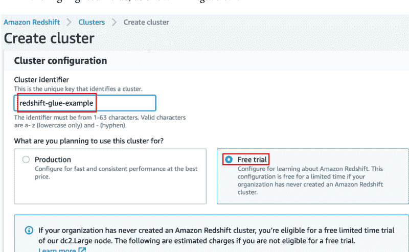
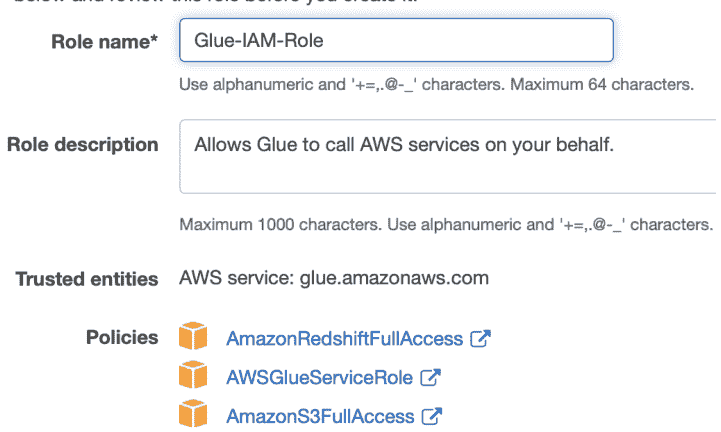
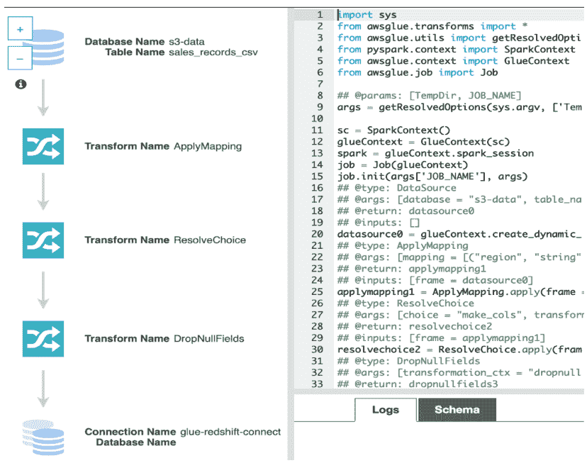
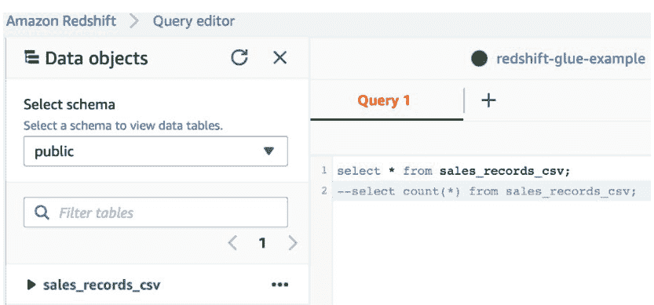
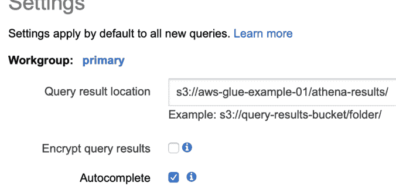

用于数据处理的 AWS 服务

在上一章中，我们学习了在 AWS 中存储数据的几种方式。在本章中，我们将探讨使用这些数据并从中获得洞察的技术。存在需要处理数据或将数据加载到 Hive 数据仓库以便查询和分析数据的用例。如果您使用的是 AWS 且数据存储在 S3 中，那么您需要在 AWS EMR 上创建 Hive 表来查询它们。为了以托管服务的形式提供相同功能，AWS 提供了一个名为 Athena 的产品，您需要在其中创建数据目录并在 S3 上查询您的数据。如果需要转换数据，则 AWS Glue 是转换并将其恢复到 S3 的最佳选择。让我们设想一个用例，我们需要在其中流式传输数据并在此数据上创建分析报告。对于此类场景，我们可以选择 AWS Kinesis Data Streams 来流式传输数据并将其存储在 S3 中。使用 Glue，相同的数据可以复制到 Redshift 以供进一步分析。现在，让我们学习它们，我们将简要介绍以下内容。

- 使用 Glue 设计 ETL 作业
- 使用 Athena 查询 S3 数据
- 通过 AWS Kinesis Data Streams 流式传输数据并使用 Kinesis Firehose 存储数据

- 从本地位置摄取数据到 AWS
- 将数据迁移到 AWS 并将本地数据中心扩展到 AWS
- 在 AWS 上处理数据

### 技术要求

您可以在 GitHub 上下载示例中使用的数据，地址如下：https://github.com/PacktPublishing/AWS-Certified-Machine-Learning-Specialty-MLS-C01-Certification-Guide/tree/master/Chapter-6。

### 在 AWS Glue 上创建 ETL 作业

在现代数据管道中，有多个阶段，例如生成数据、收集数据、存储数据、执行 ETL、分析和可视化。在本节中，我们将从高层次介绍这些内容并深入了解 ETL（提取、转换、加载）部分：

- 数据可以从多种设备生成，包括移动设备或物联网、网络日志、社交媒体、交易数据、在线游戏等。
- 这种海量的生成数据可以通过轮询服务收集，也可以通过与 AWS Lambda 集成的 API 网关收集数据，或通过流式服务如 AWS Kinesis 或 AWS 管理的 Kafka 或 Kinesis Firehose 进行收集。如果您有本地数据库并希望将该数据收集到 AWS，则选择 AWS DMS。您可以通过 AWS DataSync 将本地数据同步到 Amazon S3、Amazon EFS 或 Amazon FSx。AWS Snowball 用于将数据收集/传输到 AWS 以及从 AWS 传输。
- 下一步涉及存储数据，我们在上一章中学习了一些服务，例如 AWS S3、EBS、EFS、Amazon RDS、Amazon Redshift 和 DynamoDB。
- 一旦我们了解了数据存储，就可设计 ETL 作业来提取-转换-加载或提取-加载-转换我们的结构化或非结构化数据到我们期望的格式以供进一步分析。例如，我们可以考虑使用 AWS Lambda 在飞行中转换数据并将转换后的数据存储到 S3，或者在 EMR 集群上运行 Spark 应用程序来转换数据并将其存储到 S3 或 Redshift 或 RDS。
- AWS 中有许多服务可用于对转换后的数据进行分析；例如，Amazon EMR、Amazon Athena、Amazon Redshift、Amazon Redshift Spectrum 和 Kinesis Analytics。

- 一旦数据被分析，您可以使用 AWS Quicksight 可视化数据以了解模式或趋势。数据科学家或机器学习专业人员会喜欢应用统计分析以更好地理解数据分布。业务用户使用它来准备报告。我们已经在 *第 4 章，理解和可视化数据* 中学习了各种呈现和可视化数据的方法。

我们从传统数据管道中了解到，ETL 完全是关于在服务器上编写和维护代码以使其顺利运行。如果数据格式以任何方式发生变化，则需要更改代码，这会导致目标模式发生变化。如果数据源发生变化，则代码也必须能够处理这种情况，这是一个开销。*我们是否需要编写代码来识别数据源中的这些变化？我们是否需要一个系统来适应变化并为我们发现数据？* 答案是 **AWS Glue**。现在，让我们了解为什么 AWS Glue 如此著名。

### AWS Glue 的功能

AWS Glue 是 AWS 上的完全托管的无服务器 ETL 服务。它具有以下功能：

- 它通过连接到数据源自动发现和分类您的数据并生成数据目录。
- Amazon Athena、Amazon Redshift 和 Amazon EMR 等服务可以使用数据目录查询数据。
- AWS Glue 生成 ETL 代码，该代码是 Python 或 Scala 中 Spark 的扩展，也可以进行修改。
- 它会自动扩展以匹配运行 ETL 作业并将数据加载到目标所需的 Spark 应用程序要求。

AWS Glue 具有 **数据目录**，这就是它成功的秘诀。它有助于从数据源中发现数据并让我们对其有所了解：

- 数据目录自动发现新数据并提取模式定义。它检测模式更改并对表进行版本控制。它检测 Amazon S3 上的 Apache Hive 风格分区。
- 数据目录带有流行数据类型的内置分类器。可以使用 **Grok 表达式** 编写自定义分类器。分类器有助于检测模式。

- Glue 爬虫可以按需或按计划运行以更新 Glue 数据目录中的元数据。Glue 爬虫必须与具有足够访问权限以读取数据源的 IAM 角色相关联，例如 Amazon RDS、Amazon Redshift 和 Amazon S3。

既然我们对 AWS Glue 有了初步了解，让我们运行以下示例来动手实践。

### 动手实践 AWS Glue 数据目录组件

在本示例中，我们将创建一个作业，使用 AWS Glue 将数据从 S3 复制到 Redshift。我的所有组件都创建在 us-east-1 区域。让我们开始创建存储桶：

1. 导航到 AWS S3 控制台并创建存储桶。我将存储桶命名为 aws-glue-example-01。
2. 点击 Create Folder 并将其命名为 input-data。
3. 进入文件夹内部并点击 Upload 按钮上传 sales-records.csv 数据集。数据可在以下 GitHub 位置获得：https://github.com/PacktPublishing/AWS-Certified-Machine-Learning-Specialty-MLS-C01-Certification-Guide/tree/master/Chapter-6/AWS-Glue-Demo/input-data。
由于我们已将数据上传到 S3 存储桶，让我们创建一个 VPC，在其中创建我们的 Redshift 集群。
4. 通过访问 https://console.aws.amazon.com/vpc/home?region=us-east-1# URL 导航到 VPC 控制台，并在左侧菜单中点击 Endpoints。点击 Create Endpoint，然后按如下所示填写字段：
   a) Service Category: AWS services
   b) Select a service: com.amazonaws.us-east-1.s3 (Gateway type)
   c) VPC: 选择默认 VPC（我们将使用此默认 VPC，在其中创建我们的 Redshift 集群）
5. 保持其他字段不变并点击 Create Endpoint。

6. 从 VPC 控制台点击 **Security Groups**。为您的安全组命名，例如 `redshift-self`，并选择默认 VPC 下拉菜单。提供 Redshift 安全组的适当描述。点击 **Create security group**。

7. 点击 **Actions** 下拉菜单并选择 **Edit Inbound rules**。点击 Add rule 并按如下所示完成字段：

   a) **Type:** `All traffic`
   b) **Source:** Custom
   c) 在搜索字段中，选择相同的安全组（`redshift-self`）

8. 点击 **Save Rules.**

现在，让我们创建我们的 Redshift 集群。

9. 导航到 Amazon Redshift 控制台。点击 **Create Cluster** 并完成图 6.1 中显示的高亮字段：

图 6.1 – Amazon Redshift 的创建集群截图

10. 向下滚动并填写突出显示的字段，如图 6.2 所示：

### 数据库配置

数据库名称（可选）
指定要创建的附加数据库的名称。
glue-dev
名称必须为 1-64 个字母数字字符（仅小写），且不能是保留字。

数据库端口（可选）
数据库接受入站连接的端口号。集群创建后无法更改端口。
5439
端口必须为数字（1150-65535）。

主用户名
为您的 DB 实例的主用户输入登录 ID。
awsuser
名称必须为 1-128 个字母数字字符，且不能是保留字。

主用户密码
******
显示密码
主密码必须为 8 - 64 个字符。
该值必须包含至少一个大写字母。
该值必须包含至少一个小写字母。
该值必须包含至少一个数字。
主密码只能包含 ASCII 字符（ASCII 代码 33-126），且不能包含 '（单引号）、"（双引号）、/、\ 或 @。

图 6.2 – Amazon Redshift 集群数据库配置部分的屏幕截图

11. 向下滚动并更改“其他配置”字段，如图 6.3 所示：

### 其他配置

这些配置是可选的，已定义默认设置以帮助您开始使用集群。关闭“使用默认值”以立即修改这些设置。

### 网络和安全

虚拟私有云（VPC）

此 VPC 定义此集群的虚拟网络环境。选择具有子网组的 VPC。列表中仅启用有效 VPC。

默认 VPC
vpc-140d146e

集群创建后无法更改与此集群关联的 VPC。了解更多

VPC 安全组

此 VPC 安全组定义集群在 VPC 中可以使用哪些子网和 IP 范围。

选择一个或多个安全组

redshift-self
sg-059c2134eb1a29141

图 6.3 – Amazon Redshift 集群其他配置部分的屏幕截图

12. 同样更改 IAM 权限，如图 6.4 所示：

### 集群权限（可选）

您的集群需要权限代表您访问其他 AWS 服务。为所需的权限添加“redshift.amazonaws.com”。您可以将多达 10 个 IAM 角色与此集群关联。了解更多

可用 IAM 角色

AWSServiceRoleForRedshift

已附加的 IAM 角色
状态

此资源未关联任何 IAM 角色

图 6.4 – Amazon Redshift 集群集群权限部分的屏幕截图

13. 向下滚动并单击 **Create Cluster**。需要一两分钟才能使集群处于可用状态。

接下来，我们将创建一个 IAM 角色。
14. 导航到 AWS IAM 控制台并在屏幕的 **Access Management** 部分选择 **Roles**。
15. 单击 **Create role** 按钮并从服务中选择 **Glue**。单击 **Next: permissions** 按钮导航到下一页。
16. 搜索 **AmazonS3FullAccess** 并选择。然后搜索 **AWSGlueServiceRole** 并选择。由于我们在此示例中将数据写入 Redshift，请选择 **AmazonRedshiftFullAccess**。单击 **Next: Tags**，然后单击 **Next: Review** 按钮。
17. 提供名称，`Glue-IAM-Role`，然后单击 **Create role** 按钮。角色显示如下图 6.5 所示：

图 6.5 – IAM 角色的屏幕截图

现在，我们有了输入数据源和输出数据存储。下一步是从 AWS Glue 控制台创建 Glue 爬虫。

18. 在 **Databases** 下选择 **Connections**。单击 **Add connection** 按钮并按如下所示完成字段：

a) **Connection name:** `glue-redshift-connection`

b) **Connection type:** `Amazon Redshift`

19. 单击 **Next**，然后按如下所示填写字段：

a) **Cluster:** `redshift-glue-example`

b) **Database name:** `glue-dev`

c) **Username:** `awsuser`

d) **Password:** `********`（输入 *步骤 10* 中创建的值）

20. 单击 **Next** 然后 **Finish**。要验证工作是否正常，单击 **Test Connection**，为 IAM 角色部分选择 `Glue-IAM-Role`，然后单击 **Test Connection.**

21. 转到 **Crawler** 并选择 **Add Crawler**。为爬虫提供名称，`s3-glue-crawler`，然后单击 **Next**。在 **Specify crawler source type** 页面，保留所有默认设置，然后单击 **Next。**

22. 在 **Add a data store** 页面，选择 **Include path:** `s3://aws-glue-example-01/input-data/sales-records.csv.`

23. 单击 **Next.**

24. **Add another datastore:** No。单击 **Next.**

25. **Choose an existing IAM Role:** `Glue-IAM-Role`。然后单击 **Next.**

26. **Frequency:** `Run on demand`。单击 **Next.**

27. 没有创建数据库，因此单击 **Add database**，提供名称，`s3-data`，单击 **Next**，然后单击 **Finish。**

28. 选择爬虫，`s3-glue-crawler`，然后单击 **Run Crawler**。运行完成后，您可以看到 **Tables Added** 列中有 1。这意味着已创建数据库，`s3-data`，如上一步所述，并添加了表。单击 **Tables** 并选择新创建的表，`sales_records_csv`。您现在可以看到架构已被发现。您可以根据需要更改数据类型，如果推断的数据类型不符合要求。

在本动手部分，我们学习了数据库表、数据库连接、S3 上的爬虫以及 Redshift 集群的创建。在下一个动手部分，我们将学习使用 Glue 创建 ETL 作业。

### 使用 AWS Glue ETL 组件动手操作

在本节中，我们将使用之前创建的数据目录组件来构建作业。让我们开始创建作业：

- 1. 导航到 AWS Glue 控制台并在 **ETL** 部分下单击 **Jobs**。
- 2. 单击 **Add Job** 按钮并按如下所示完成字段：
  - **Name:** `s3-glue-redshift`
  - **IAM role:** `Glue-IAM-Role`（这是我们在上一节中创建的同一角色）
  - **Type:** `Spark`
  - **Glue version:** `Spark 2.4, Python 3 with improved job start up times (Glue version 2.0)`
- 3. 将其他字段保持原样，然后单击 **Next**。
- 4. 选择 `sales_records_csv` 并单击 **Next**。
- 5. 默认选择 **Change Schema**，然后单击 **Next**（在撰写本书时，机器学习转换不适用于 Glue 2.0）。
- 6. 选择 **Create tables in your data target**。选择 JDBC 作为数据存储，并将 `glue-redshift-connection` 作为连接。提供 `glue-dev` 作为数据库名称（如上一节中创建的），然后单击 **Next**。
- 7. 接下来是 **Output Schema Definition** 页面，您可以在其中选择要从目标架构中删除的所需列。向下滚动并单击 **Save job and edit script**。
- 8. 您现在可以看到屏幕左侧创建的管道和右侧建议的代码，如图 6.6 所示。您可以根据需要修改代码。单击 **Run job** 按钮。会出现一个弹出窗口，询问您是否要编辑任何详细信息。这是可选的。然后，单击 **Run job** 按钮：

图 6.6 – AWS Glue ETL 作业的屏幕截图

9. 作业成功后，导航到 Amazon Redshift 并单击 Query editor。

10. 将数据库名称设置为 glue-dev，然后提供用户名和密码以创建连接。

11. 选择 public schema，现在您可以查询表以查看记录，如图 6.7 所示：

图 6.7 – Amazon Redshift Query editor 的屏幕截图

我们现在了解了如何使用 AWS Glue 创建 ETL 作业，将数据从 S3 存储桶复制到 Amazon Redshift。我们还使用 UI 控制台中的查询编辑器在 Amazon Redshift 中查询了数据。如果您已成功完成步骤，建议删除 Redshift 集群和 AWS Glue 作业。AWS 在您的账户中创建两个存储桶来存储 AWS Glue 脚本和 AWS Glue 临时结果。因此，请一并删除以节省成本。我们将在下一节中使用在 S3 数据上创建的数据目录。

在下一节中，我们将学习如何使用 Athena 查询 S3 数据。

### 使用 Athena 查询 S3 数据

Athena 是一种无服务器服务，专为查询存储在 S3 中的数据而设计。它是无服务器的，因为客户端不需要管理用于计算的服务器：

- Athena 使用架构来根据存储在 S3 中的数据呈现查询结果。您定义数据的显示方式的架构，Athena 从 S3 读取原始数据并根据定义的架构显示结果。

- 输出可被其他服务用于可视化、存储或各种分析目的。S3 中的源数据可以是以下结构化、半结构化和非结构化数据格式中的任意一种，包括 XML、JSON、CSV/TSV、AVRO、Parquet、ORC 等。CloudTrail、ELB 日志和 VPC 流日志也可以存储在 S3 中并由 Athena 分析。
- 这遵循 schema-on-read 技术。与传统技术不同，表是在数据目录中预先定义的，并在读取时进行投影。可以在不转换源数据的情况下对数据执行类似 SQL 的查询。

现在，让我们通过一个示例来理解这一点，我们将在 S3 数据上使用在 AWS Glue 上创建的 AWSDataCatalog 并使用 Athena 查询它们：

- 1. 导航到 AWS Athena 控制台。从数据源中选择 AWSDataCatalog（如果你是第一次操作，则会创建一个名为 sampledB 的数据库，其中在 AWS Glue 数据目录中包含一个表 elb_logs）。
- 2. 选择 s3-data 作为数据库。
- 3. 点击右上角的设置并填写如 Figure 6.8 所示的详细信息（我使用了与前一个示例相同的存储桶和不同的文件夹）：

Figure 6.8 – A screenshot of Amazon Athena's settings

- 4. 下一步是在查询编辑器中编写查询并执行它。执行完成后，请删除你的 S3 存储桶和 AWS Glue 数据目录。这将为你节省费用。

在本节中，我们学习了通过 AWS 数据目录使用 Amazon Athena 查询 S3 数据。你也可以创建自己的架构并从 S3 查询数据。在下一节中，我们将学习 Amazon Kinesis Data Streams。

### Processing real-time data using Kinesis data streams

Kinesis 是 Amazon 的流服务，可以根据需求进行扩展。它在区域内高度可用。它具有持久性，默认保留数据 24 小时，或可选最长保留 365 天。Kinesis 数据流用于大规模数据摄取、分析和监控：

- Kinesis 可以由多个生产者摄取，多个消费者也可以从流中读取数据。让我们通过实时示例来理解这一点。假设你有一个生产者向 Kinesis 流摄取数据，默认保留期为 24 小时，这意味着今天 05:00:00 A.M. 摄取的数据将在明天 04:59:59 A.M. 之前在流中可用。此后数据将不可用，理想情况下应在过期前消费，或如果关键则存储在其他地方。保留期可延长至最长 365 天，需额外付费。
- Kinesis 可用于实时分析或仪表板可视化。生产者可以想象为将数据推送到 Kinesis 流的一段代码，它可以是运行代码的 EC2 实例、Lambda 函数、物联网设备、本地服务器、移动应用程序或设备等。
- 同样，消费者也可以是一段运行在 EC2 实例、Lambda 函数或本地服务器上的代码，它知道如何连接到 kinesis 流、读取数据并对数据执行某些操作。AWS 提供触发器，以便在数据到达 kinesis 流时立即调用 lambda 消费者。
- Kinesis 由于其分片架构而具有可扩展性，分片是 kinesis 流的基本吞吐量单元。什么是分片？分片是一个逻辑结构，根据分区键对数据进行分区。分片支持 1 MB/秒的写入容量和 2 MB/秒的读取容量。单个分片支持每秒 1,000 条 PUT 记录。如果你创建了一个包含 3 个分片的流，则可以实现 3 MB/秒的写入吞吐量和 6 MB/秒的读取吞吐量，这允许 3,000 条 PUT 记录。因此，分片越多，你需要支付额外费用以获得更高性能。

- 分片中的数据通过 Kinesis 数据记录存储，最大可达 1 MB。Kinesis 数据记录根据分区键存储在分片中。它还具有序列号。序列号是在执行 `putRecord` 或 `putRecords` API 操作时由 kinesis 分配的，以便唯一标识一条记录。分区键由生产者在向 Kinesis 数据流添加数据时指定，分区键负责将记录隔离并路由到流中的不同分片以平衡负载。
- 有两种加密 kinesis 流中数据的方式：服务器端加密和客户端加密。客户端加密很难实现和管理密钥，因为客户端必须在将数据放入流之前加密数据，并在从流读取后解密数据。通过启用 **AWS/KMS** 的服务器端加密，数据在你将数据放入流和从流获取数据时会自动加密和解密。

> **Note**
> Amazon Kinesis 不应与 Amazon SQS 混淆。Amazon SQS 支持一个生产组和一个消费组。如果你的用例需要多个用户发送和接收数据，则 Kinesis 是解决方案。
> 
> 对于解耦和异步通信，SQS 是解决方案，因为发送方和接收方不需要相互了解。
> 
> 在 SQS 中，没有持久性概念。一旦消息被读取，下一步就是删除。Amazon SQS 没有保留时间窗口的概念。如果你的用例需要大规模摄取，则应使用 Kinesis。

在下一节中，我们将学习如何存储流数据以供进一步分析。

### Storing and transforming real-time data using Kinesis Data Firehose

有很多用例要求数据被流式传输并存储以供将来分析。为了解决此类问题，你可以编写一个 kinesis 消费者来读取 Kinesis 流并将数据存储在 S3 中。此解决方案需要一个实例或机器来运行代码，并具有从流读取和写入 S3 的所需访问权限。另一个可能的选择是运行一个 Lambda 函数，该函数在对流执行的 `putRecord` 或 `putRecords` API 被调用时触发，并从流中读取数据以存储在 S3 存储桶中：

- 为了让这变得更容易，Amazon 提供了一个名为 Kinesis Data Firehose 的单独服务。它可以轻松地插入到 Kinesis 数据流中，并且需要基本的 IAM 角色来将数据写入 S3。这是一项完全托管的服务，可减少管理服务器和代码的负担。它还支持将流式数据加载到 Amazon Redshift、Amazon Elasticsearch Service 和 Splunk。Kinesis Data Firehose 会自动扩展以匹配数据的吞吐量。
- 数据可以通过 AWS Lambda 函数在存储或交付到目的地之前进行转换。如果你想构建一个包含未转换数据的原始数据湖，则通过启用源记录备份，你可以在转换之前将其存储在另一个 S3 存储桶中。
- 在交付到 S3 存储桶后，可以借助 AWS/KMS 对数据进行加密。它需要在创建交付流时启用。数据也可以压缩为受支持的格式，如 GZIP、ZIP 和 SNAPPY 压缩格式。

在下一节中，我们将学习用于从本地服务器向 AWS 摄取数据的不同 AWS 服务。

### Different ways of ingesting data from on-premises into AWS

随着数据驱动用例需求的增加，目前在本地服务器上管理数据相当困难。当处理大量数据时，备份并不容易。这些数据湖中的数据被用于构建深度神经网络、创建数据仓库以从中提取有意义的信息、运行分析和生成报告。

现在，如果我们看看将数据迁移到 AWS 的可用选项，那么它也伴随着各种挑战。例如，如果你想将数据发送到 S3，则必须编写几行代码将数据发送到 AWS。你必须管理运行代码的代码和服务器。必须确保数据通过 HTTPS 网络传输。你需要验证数据传输是否成功。这增加了复杂性以及时间和精力的挑战。为避免此类情况，AWS 提供服务来匹配或解决你的用例，通过设计混合基础设施，允许本地数据中心与 AWS 之间共享数据。让我们在以下部分学习这些。

### AWS Storage Gateway

Storage Gateway 是一种混合存储虚拟设备。它可以在三种不同模式下运行 – **File Gateway**、**Tape Gateway** 和 **Volume Gateway**。它可用于扩展、迁移和备份本地数据中心到 AWS：

- 在 Tape Gateway 模式下，存储网关在 S3 上存储虚拟磁带，并在弹出并归档时，磁带从 S3 移动到 Glacier。活动磁带存储在 S3 中以便存储和检索。归档或导出的磁带存储在 Glacier 中的 **Virtual Tape Shelf (VTS)**。可以创建虚拟磁带，大小范围从 100 GiB 到 5 TiB。可以本地配置总共 1 PB 的存储，并且可以无限数量的磁带归档到 Glacier。这对于现有的磁带备份系统以及需要将备份数据迁移到 AWS 的情况是理想的。你可以稍后停用物理磁带硬件。
- 在 File Gateway 模式下，存储网关将文件映射到 S3 对象，这些对象可以使用其中一种可用的存储类进行存储。这有助于将数据中心扩展到 AWS。你可以向 File Gateway 加载更多文件，这些文件将作为 S3 对象存储。它可以在你的本地虚拟服务器上运行，该服务器使用 **Server Message Block (SMB)** 或 **Network File System (NFS)** 连接到各种设备。File Gateway 使用 HTTPS 公共端点连接到 AWS 以将数据存储在 S3 对象上。可以对这些 S3 对象应用生命周期策略。你可以轻松地将 **Active Directory (AD)** 与 File Gateway 集成以控制对文件共享上文件的访问。

- 在 Volume Gateway 模式下，存储网关提供块存储。 使用此模式有两种方式，一种是 **Gateway Cached**，另一种是 **Gateway Stored**：
- **Gateway Stored** 是一种在本地运行的卷存储网关，具有本地存储和上传缓冲区。 最多可以创建 32 个卷，每个卷大小可达 16 TB，总容量为 512 TB。 主要数据存储在本地，备份数据会异步复制到 AWS 后台。 卷通过 **Internet Small Computer Systems Interface (iSCSI)** 提供给基于网络的服务器访问。 它通过 HTTPS 公共端点连接到 **Storage Gateway Endpoint**，并从备份数据创建 EBS 快照。 这些快照可用于创建标准 EBS 卷。 此选项非常适合迁移到 AWS 或灾难恢复或业务连续性。 本地系统仍会使用本地卷，但 EBS 快照位于 AWS 中，可用作备份替代。 由于需要大量本地存储，因此这不是数据中心扩展的最佳选择。
- **Gateway Cached** 是一种在本地运行的卷存储网关，具有缓存存储和上传缓冲区。 不同之处在于，添加到存储网关的数据不是本地的，而是上传到 AWS。 主要数据存储在 AWS。 频繁访问的数据会缓存在本地。 这是将本地数据中心扩展到 AWS 的理想选择。 它通过 HTTPS 公共端点连接到 **Storage Gateway Endpoint**，并创建 **S3 Backed Volume (AWS-managed bucket)** 快照，这些快照以标准 EBS 快照形式存储。

### Snowball, Snowball Edge, and Snowmobile

它们属于用于在业务运营地点和 AWS 之间物理传输数据的同一产品系列。 对于将大量数据移入和移出 AWS，您可以使用其中任何一种：

- **Snowball**：可通过在 AWS 上提交作业来订购。 AWS 将设备交付给您加载数据并寄回。 Snowball 中的数据使用 KMS 加密。 它提供两种容量范围，一种为 50 TB，另一种为 80 TB。 对于 10 TB 至 10 PB 之间的数据，订购一个或多个 Snowball 设备具有经济性。 设备可以发送到不同场所。 它没有任何计算能力； 仅提供存储能力。
- **Snowball Edge**：与 Snowball 类似，但它同时具有存储和计算能力。 它的容量大于 Snowball。 它提供快速网络连接，例如通过 RJ45 的 10 Gbps、通过 SFP28 的 10/25 Gb，以及通过 QSFP+ 铜缆的 40/100 Gb+。 这非常适合将 TB 到 PB 级数据安全快速传输到 AWS。
- **Snowmobile:** 这是一个装在卡车上的集装箱式便携数据中心。 这使您可以将 EB 级数据从本地迁移到 AWS。 如果您的数据大小超过 10 PB，则首选 Snowmobile。 本质上，在请求 Snowmobile 后，一辆卡车会开到您的地点，您将数据中心连接到卡车并传输数据。 如果您有多个站点，选择 Snowmobile 进行数据传输并不是理想的选择。

### AWS DataSync

AWS DataSync 旨在将数据从本地存储移动到 AWS，或反之亦然：

- 它是 AWS 用于数据处理传输、归档或经济高效存储、灾难恢复、业务连续性以及数据迁移的理想产品。
- 它具有特殊的数据验证功能，可在数据到达 AWS 后立即验证原始数据与 AWS 中的数据。 换句话说，它检查数据的完整性。
- 让我们通过一个本地数据中心具有 SAN/NAS 存储的示例来深入了解此产品。 当我们在 VMWare 平台上运行 AWS DataSync 代理时，此代理能够通过 NFS/SMB 协议与 NAS/SAN 存储通信。 启动后，它会与 AWS DataSync 端点通信，从那里可以连接到多种类型的存储位置，包括各种 S3 存储类别或基于 VPC 的资源，例如 **Elastic File System (EFS)** 和 FSx for Windows Server。
- 它允许您在特定时段安排数据传输。 通过配置内置带宽限制，您可以限制 DataSync 使用的网络带宽量。

### Processing stored data on AWS

有多个服务可用于处理存储在 AWS 中的数据。 本节我们将介绍 AWS Batch 和 AWS EMR（Elastic MapReduce）。 EMR 是 AWS 提供的一种主要以托管方式运行 MapReduce 作业和 Spark 应用的产品。 AWS Batch 用于长时间运行、计算密集型工作负载。

### AWS EMR

EMR 是 AWS 作为服务提供的 Apache Hadoop 的托管实现。 它包括 Hadoop 生态系统的其他组件，例如 Spark、HBase、Flink、Presto、Hive、Pig 等。 我们不会在认证考试中详细讨论这些内容：

- EMR 集群可以从 AWS 控制台或通过 AWS CLI 启动，具有特定数量的节点。 集群可以是长期集群或临时集群。 如果您有一个长期运行的传统集群，则必须自行配置机器并管理它们。 如果您需要更快地执行作业，则需要手动添加集群。 在 EMR 的情况下，这些管理开销都不复存在。 您可以向 EMR 请求任意数量的节点，它会为您管理和启动节点。 如果在集群上启用了自动扩缩容，则随着需求增加，EMR 会在集群中启动新节点，并在负载降低后停用节点。
- EMR 在后台使用 EC2 实例，并在 VPC 中的一个可用区运行。 这使得节点之间的网络速度更快。 AWS Glue 在后台使用 EMR 集群，用户无需担心 AWS EMR 的运维理解。
- 从用例角度来看，EMR 可用于处理或转换存储在 S3 中的数据，并将输出数据存储回 S3。 EMR 使用节点（EC2 实例）作为数据处理的计算单元。 EMR 节点有不同的变体，包括主节点、核心节点和任务节点。
- EMR 主节点充当 Hadoop namenode 并管理集群及其健康状况。 它负责在其他核心节点和任务节点之间分配作业负载。 如果启用了 SSH，则可以连接到主节点实例并访问集群。
- EMR 集群可以有一个或多个核心节点。 如果您熟悉 Hadoop 生态系统，则核心节点类似于 Hadoop 用于 HDFS 的数据节点，并负责在其中运行任务。
- 任务节点是可选的，它们没有 HDFS 存储。 它们负责运行任务。 如果任务节点因某种原因失败，则不会影响 HDFS 存储，但核心节点故障会导致 HDFS 存储中断。
- EMR 具有名为 EMRFS 的文件系统。 它由 S3 支持，此功能使其具有区域弹性。 如果核心节点失败，数据仍安全存储在 S3 中。 HDFS 在 I/O 方面更高效，比 EMRFS 更快。

在以下部分，我们将学习 AWS Batch，这是一种托管批处理计算服务，可用于长时间运行的服务。

### AWS Batch

这是一种托管批处理产品。 如果您使用 AWS Batch，则作业可以在无需最终用户交互的情况下运行，也可以安排运行：

- 想象一个事件驱动的应用程序，它启动一个 Lambda 函数来处理存储在 S3 中的数据。 如果处理时间超过 15 分钟，则 Lambda 有执行时间限制。 对于此类场景，AWS Batch 是更好的解决方案，可以按计划或通过 API 事件驱动计算密集型工作负载。
- AWS Batch 非常适合需要更长处理时间或更多计算资源的使用案例。
- AWS Batch 运行的作业可以是脚本或可执行文件。 一个作业可以依赖另一个作业。 作业需要定义，例如谁可以运行作业（IAM 权限）、作业可以在哪里运行（使用的资源）、挂载点和其他元数据。
- 作业提交到队列中，在那里等待计算环境容量。 这些队列与一个或多个计算环境相关联。
- 计算环境负责实际执行作业。 这些可以是 ECS 或 EC2 实例，或任何计算资源。 您也可以定义其大小和容量。
- 环境根据优先级从队列接收作业并执行作业。 它们可以是托管或非托管计算环境。
- AWS Batch 可以将元数据存储在 DynamoDB 中以供进一步使用，也可以将输出存储到 S3 存储桶中。

> **Note**
> 如果您在考试中遇到需要灵活计算、更高磁盘空间、无时间限制（超过 15 分钟）或有效资源限制的事件式工作负载问题，则应选择 AWS Batch。

### 摘要

在本章中，我们学习了在 AWS 中处理数据的不同方式。我们还学习了将数据中心扩展到 AWS 的能力、将数据迁移到 AWS 以及摄取过程。我们还学习了使用数据进行处理的各种方式，使其以我们的方式准备好进行分析。我们理解了拥有数据目录的魔力，它帮助我们通过 AWS Glue 和 Athena 查询数据。

在下一章中，我们将学习各种机器学习算法及其用途。

### 问题

- 1. 如果你有大量 IoT 设备向 AWS 发送数据供大量移动设备消费，你应该选择以下哪一项？
  A. SQS 标准队列
  B. SQS FIFO 队列
  C. Kinesis 流

- 2. 如果你有解耦高容量应用的需求，你应该选择以下哪一项？
  A. SQS 标准队列
  B. SQS FIFO 队列
  C. Kinesis 流

- 3. 为了提高 Kinesis 流的性能，以下哪一项需要更改？
  A. 流的读取容量单元
  B. 流的写入容量单元
  C. 流的分片
  D. 流的区域

- 4. 以下哪一项确保数据完整性？
  A. AWS Kinesis
  B. AWS DataSync
  C. AWS EMR
  D. Snowmobile

- 5. 哪种存储网关模式可以用 S3 存储替换磁带驱动器？
  A. Volume Gateway Stored
  B. Volume Gateway Cached
  C. File
  D. VTL

- 6. 哪种存储网关模式可用于通过 SMB 向客户端提供存储？
  A. Volume Gateway Stored
  B. Volume Gateway Cached
  C. File
  D. VTL

- 7. 哪种存储网关模式最适合将数据中心扩展到 AWS？
  A. Volume Gateway Stored
  B. Volume Gateway Cached
  C. File
  D. VTL

- 8. AWS 中哪种存储产品可用于 Windows 环境的共享存储？
  A. S3
  B. FSx
  C. EBS
  D. EFS

- 9. EMR 集群中哪个节点处理操作？
  A. 主节点
  B. 核心节点
  C. 任务节点
  D. 主节点

- 10. EMR 集群中哪些节点适合使用 Spot 实例？
  A. 主节点
  B. 核心节点
  C. 任务节点
  D. 主节点

- 11. 如果你有大量流数据并将其添加到 Redshift，你会使用哪些服务？（选择三项）
  A. Kinesis Data Streams
  B. Kinesis Data Firehose
  C. S3
  D. SQS
  E. Kinesis Analytics

- 12. Kinesis Firehose 支持使用 Lambda 进行数据转换。
  A. 真
  B. 假

- 13. 以下哪些是 Kinesis Data Firehose 的有效目标？（选择五项）
  A. HTTP
  B. Splunk
  C. Redshift
  D. S3
  E. Elastic Search
  F. EC2
  G. SQS

### 答案

- 1. C
- 2. A
- 3. C
- 4. B
- 5. D
- 6. C
- 7. B
- 8. B
- 9. A
- 10. C
- 11. A, B, C
- 12. A
- 13. A, B, C, D, E
