## 应用机器学习算法

在上一章中，我们研究了 AWS 的数据处理服务，包括 Glue、Athena 和 Kinesis！现在是时候进入建模阶段并研究机器学习算法了。我相信，在之前的章节中，你已经意识到构建机器学习模型需要大量关于 AWS 服务、数据工程、数据探索、数据架构等方面的知识。这次，我们将更深入地探讨我们迄今为止讨论过的算法以及其他许多算法。

对不同类型的算法和机器学习方法有良好的认识，将使你在项目中做出决策时处于非常有利的位置。当然，这类知识对于 AWS 机器学习专业考试也至关重要。

请记住，外面有成千上万种算法，而且顺便说一下，你甚至可以为特定问题提出自己的算法。此外，我们将涵盖最相关的算法，希望这些也是你在考试中可能遇到的算法。

本章的主要主题如下：

- 存储训练数据
- 关于集成模型的说明
- 回归模型
- 分类模型
- 预测模型
- Object2Vec
- 聚类
- 异常检测
- 降维
- IP Insights
- 自然语言处理
- 强化学习

好了，开始吧！

### 介绍本章

在本章中，我们将讨论多种算法、建模概念和学习策略。我们认为所有这些主题在考试期间以及你的数据科学家职业生涯中都将对你有益。

我们以一种方式构建了本章，使其不仅涵盖考试的必要主题，还能让你很好地了解目前最重要的学习策略。例如，考试会检查你对 K-means 基本概念的了解；然而，我们将对其进行更深入的介绍，因为这是你作为数据科学家职业生涯中的一个重要主题。

我们将遵循这种方法，对我们认为每个数据科学家都应该掌握的一些模型类型更深入地研究算法的逻辑。因此，请记住这一点：有时，我们可能会比考试预期更深入，但这对你来说将极其重要。

在本章中，我们多次会使用术语 **内置算法**。当我们想指代 AWS 在其 SageMaker SDK 上实现的算法列表时，我们会使用此术语。

让我给你一个具体的例子：你可以使用 scikit-learn 的 KNN 算法（如果你不记得 scikit-learn 是什么，请回到第 1 章《机器学习基础》复习一下）来创建分类模型并将其部署到 SageMaker。然而，AWS 也在其 SDK 上提供了 KNN 算法的自己的实现，该实现针对在 AWS 环境中运行进行了优化。在这里，KNN 是内置算法的一个例子。

正如你所见，AWS 上的可能性是无穷无尽的，因为你既可以利用内置算法，也可以将自己的算法带入 SageMaker 来创建模型。最后，为了非常明确，这里是如何从 AWS SDK 导入内置算法的示例：

```
import sagemaker
knn = sagemaker.estimator.Estimator(get_image_uri(boto3.Session().region_name, "knn"),
    get_execution_role(),
    train_instance_count=1,
    train_instance_type='ml.m5.2xlarge',
    output_path=output_path,
    sagemaker_session=sagemaker.Session())
knn.set_hyperparameters(**hyperparams)
```

你将在第 9 章《Amazon SageMaker 建模》中学习如何在 SageMaker 上创建模型。现在，只需了解 AWS 有自己的库集，其中实现了这些内置算法。

要训练和评估模型，你需要训练数据和测试数据。在实例化你的估计器之后，你应该用这些数据集为其提供数据。我不想剧透第 9 章《Amazon SageMaker 建模》，但你应该提前了解数据通道的概念。

数据通道是与输入数据相关的配置，你可以在创建训练作业时将其传递给 SageMaker。你应该设置这些配置，只是为了告知 SageMaker 你的输入数据的格式。

在第 9 章《Amazon SageMaker 建模》中，你将学习如何创建训练作业以及如何设置数据通道。截至目前，你应该知道，在配置数据通道时，可以设置内容类型（ContentType）和输入模式（TrainingInputMode）。让我们更仔细地看看训练数据应该存储在何处以及如何存储，以便能够正确地与 AWS 的内置算法集成。


### 存储训练数据

首先，你可以使用多个 AWS 服务来为机器学习准备数据，例如 EMR、Redshift、Glue 等。预处理训练数据后，你应该将其存储在 S3 中，采用算法期望的格式。下表显示了每种算法可接受的数据格式列表：

| Data format | Algorithm |
| application/x-image | Object Detection Algorithm, Semantic Segmentation |
| application/x-recordio | Object Detection Algorithm |
| application/x-recordio-protobuf | Factorization Machines, K-means, KNN, Latent Dirichlet Allocation, Linear Learner, NTM, PCA, RCF, Sequence-to-Sequence |
| application/jsonlines | BlazingText, DeepAR |
| image/.jpeg | Object Detection Algorithm, Semantic Segmentation |
| image/.png | Object Detection Algorithm, Semantic Segmentation |
| text/.csv | IP Insights, K-means, KNN, Latent Dirichlet Allocation, Linear Learner, NTM, PCA, RCF, XGBoost |
| text/.libsvm | XGBoost |

Figure 7.1 – Data formats that are acceptable per AWS algorithm

正如我们所见，许多算法都接受 text/.csv 格式。请记住，如果你想使用该格式，应遵循以下规则：

- 你的 CSV 文件不能有标题行。
- 对于监督学习，目标变量必须在第一列。
- 在配置训练管道时，将输入数据通道设置为 content_type 等于 text/csv。
- 对于无监督学习，将 content_type 中的 label_size 设置为 'content_type=text/csv;label_size=0'。

尽管 text/.csv 格式对许多用例来说是可以的，但大多数情况下，AWS 的内置算法使用 recordIO-protobuf 的效果更好。这是一种优化的数据格式，用于训练 AWS 的内置算法，其中 SageMaker 将数据集中的每个观测值转换为一组 4 字节浮点数的二进制表示。

RecordIO-protobuf 接受两种输入模式：pipe 模式和 file 模式。在 pipe 模式下，数据将直接从 S3 流式传输，这有助于优化存储。在 file 模式下，数据从 S3 复制到训练实例的存储卷。

我们几乎准备好了！现在，让我们快速了解一下一些建模定义，这将帮助你理解一些更高级的算法。

### 关于集成模型的一点说明

在开始深入研究算法之前，有一个重要的建模概念你应该了解，称为 **ensemble**。术语 ensemble 用于描述使用多个算法创建模型的方法。

例如，与其创建一个模型来预测欺诈交易，你可以创建多个执行相同任务的模型，并使用一种投票系统来选择预测结果。下表说明了这个简单示例：

| Transaction | Model A | Model B | Model C | Prediction |
|---|---|---|---|---|
| 1 | Fraud | Fraud | Not Fraud | Fraud |
| 2 | Not Fraud | Not Fraud | Not Fraud | Not Fraud |
| 3 | Fraud | Fraud | Fraud | Fraud |
| 4 | Not Fraud | Not Fraud | Fraud | Not Fraud |

Figure 7.2 – An example of a voting system on ensemble methods

同样的方法也适用于回归问题，其中，我们可以对每个模型的结果取平均值，并将其用作最终结果。

投票和平均只是集成方法的两个例子。其他强大的技术包括 **blending** 和 **stacking**，其中你可以创建多个模型，并使用每个模型的结果作为主模型特征。回顾前面的表格，列 "Model A"、"Model B" 和 "Model C" 将用作预测最终结果的特征。

事实证明，许多机器学习算法在训练时以嵌入方式使用集成方法。这些算法可以分为两大类：

- **Bootstrapping Aggregation or Bagging**：采用这种方法，会在数据的不同样本上训练多个模型。然后，通过投票或平均系统进行预测。该类别的主要算法被称为 **Random Forest**。
- **Boosting**：采用这种方法，会在数据的不同样本上训练多个模型。然后，一个模型试图通过惩罚错误预测来纠正下一个模型的错误。该类别的主要算法被称为 **Stochastic Gradient Boosting** 和 **AdaBoost**。

现在你知道了集成模型是什么，让我们继续研究一些可能出现在你考试中的机器学习算法。并非所有算法都使用集成方法，但我相信这会让你更容易识别出来。

我们将根据 AWS 算法类别将接下来的几个部分拆分：

- Supervised learning
- Unsupervised learning
- Textual analysis
- Image processing

最后，我们将提供 AWS 中强化学习的概述。

### Supervised learning

AWS 提供用于通用目的的监督学习算法（回归和分类任务）和用于更特定目的的监督学习算法（预测和向量化）。可在这些子类别中找到的内置算法列表如下：

- Linear learner algorithm
- Factorization machines algorithm
- XGBoost algorithm
- K-Nearest Neighbor algorithm
- Object2Vec algorithm
- DeepAR Forecasting algorithm

让我们从回归模型和线性学习算法开始。

### 使用回归模型

好吧；我知道现实问题通常既不线性也不简单。然而，研究 **linear regression** 模型是了解 **regression models** 总体内部情况的好方法（是的，回归模型可以是线性和非线性的）。这是每个数据科学家必备的知识，也可以帮助你解决实际挑战。我们将在以下小节中更详细地研究这个问题。

### 介绍回归算法

线性回归模型旨在根据一个或多个变量（X）预测数值（Y）。在数学上，我们可以将这种关系定义为 Y = f(X)，其中 Y 被称为因变量，X 被称为自变量。

对于回归模型，我们想要预测的成分（Y）始终是一个连续数字；例如，房屋价格或交易数量。我们在第 1 章《Machine Learning Fundamentals》表 2 中看到过这一点，当时我们在根据目标变量选择合适的监督学习算法类型。我们可以随时回顾一下。

当我们只使用一个变量来预测 Y 时，我们将此问题称为简单线性回归。另一方面，当我们使用多个变量来预测 Y 时，我们说我们有一个多元线性回归问题。

还有另一类回归模型，称为非线性回归。然而，让我们先放下这个问题，理解简单线性回归的含义。

回归模型属于机器学习的监督侧（另一侧是非监督）因为算法试图根据自变量和因变量之间已有的相关性来预测值。

但 Y=f(X) 中的 "f" 是什么意思？"f" 是负责根据 X 预测 Y 的回归函数。换句话说，这就是我们想要弄清楚的函数！当我们开始谈论简单线性回归时，请注意以下三个问题和答案：

1. 线性回归中 "f" 的形状是什么？
   线性的，当然！
2. 我们如何表示线性关系？
   使用一条直线（你将在几分钟内明白原因）。
3. 那么，定义一条线的函数是什么？
   ax + b（只需查看任何数学书籍）。

就是这样！线性回归模型由 y = ax + b 给出。一旦我们试图根据 X 预测 Y，我们只需要找出 "a" 和 "b" 的值。我们可以采用相同的逻辑来弄清楚其他种类回归的内部原理。


而且相信我，找出“a”和“b”的值并不是我们要做的唯一事情。知道“a”也被称为**alpha系数**，或**斜率**，并代表线的倾斜度，而“b”也被称为**beta系数**，或**y截距**，并代表线在由 x 和 y 组成的二维平面中与 y 轴相交的位置，这很有用。你将在下一小节看到这两个术语。

另外值得知道的是，每一个我们无法控制的预测因子都存在一个误差。让我们将其命名为“e”，并正式定义简单线性回归为 **y = a x + b + e**。在数学上，该误差由预测值与真实值之间的差异表示。

好吧，让我们找到 alpha 和 beta 并给本节一个圆满的结局！

### 最小二乘法

有不同的方法可以找到一条线的斜率和 y 截距，但最常用的方法被称为**最小二乘法**。该方法背后的原理很简单：我们必须找到*能减少平方误差之和的最佳直线*。

在下面的图中，我们可以看到一个包含多个点和线的笛卡尔平面。“线 a”代表该数据的最佳拟合——换句话说，这就是这些点的最佳线性回归函数。但我怎么知道呢？很简单：如果我们计算每个点相关的误差，就像我们在下面的图中放大显示的那样，我们会意识到“线 a”包含最小的平方误差之和：

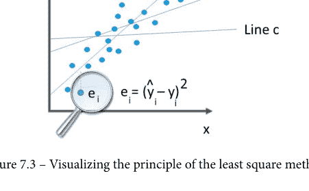

图 7.3 – 可视化最小二乘法的原理

从头开始理解线性回归是有价值的，不仅是为了认证考试，更主要的是为了你作为数据科学家的职业生涯。为了给你一个完整的示例，我们开发了一张包含我们将要逐步看到的所有计算的电子表格！我们鼓励你使用这份支持材料并进行一些模拟。让我们看看实际效果。

### 从头开始创建线性回归模型

我们将使用一个非常简单的数据集，只包含两个变量：

- X：代表个人的工作年限
- Y：代表个人的平均薪资

我们想要了解 X 和 Y 之间的关系，如果可能的话，基于工作年限 X 预测薪资 Y。正如我之前提到的，通常，真实问题有更多独立变量，并且不一定是线性的。然而，我相信这个示例将给你掌握更复杂算法所需的基准知识。

要找出 alpha 和 beta 系数，也就是斜率和 y 截距，如果你愿意的话，我们需要找到与数据集相关的一些统计数据，所以让我们看看这里显示的数据和辅助统计数据：

| X (自变量) | Y (因变量) | X 均值 | Y 均值 | 协方差 (X,Y) | X 方差 | Y 方差 |
|---|---|---|---|---|---|---|
| 1 | 1,000 |  |  | 21,015 | 20 | 21,808,900 |
| 2 | 1,500 |  |  | 14,595 | 12 | 17,388,900 |
| 3 | 3,700 |  |  | 4,925 | 6 | 3,880,900 |
| 4 | 5,000 |  |  | 1,005 | 2 | 448,900 |
| 5 | 4,000 |  |  | 895 | 0 | 2,788,900 |
| 6 | 6,500 |  |  | 145 | 0 | 688,900 |
| 7 | 7,000 |  |  | 1,995 | 2 | 1,768,900 |
| 8 | 9,000 |  |  | 8,325 | 6 | 11,088,900 |
| 9 | 9,000 |  |  | 11,655 | 12 | 11,088,900 |
| 10 | 10,000 |  |  | 19,485 | 20 | 18,748,900 |
| COUNT | 10 | 550 | 567,000 | 842,500 | 825 | 897,010,000 |

图 7.4 – 基于工作年限预测平均薪资的数据集

正如我们所见，X 和 Y 之间存在几乎完美的线性关系。随着工作年限的增加，薪资也随之增加。除了 X 和 Y 之外，我们还需要计算以下统计数据：记录数、X 的均值、Y 的均值、X 和 Y 的协方差、X 的方差以及 Y 的方差。以下公式分别提供了方差和协方差的数学表示，其中 x  bar、y  bar 和 n 分别代表 X 的均值、Y 的均值和记录数：

```
s² = Σ(xᵢ - x̄) / n

Cov(X, Y) = Σᵢ=1ⁿ (xᵢ - x̄)(yᵢ - ȳ) / n
```

如果你想查看表 7.2 中这些辅助统计数据的每个公式的计算细节，请参考随本书提供的支持材料。在那里，你会发现这些公式已经为你实现。

这些统计数据很重要，因为它们将被用来计算我们的 alpha 和 beta 系数。下面的图像解释了我们将如何计算这两个系数，以及相关系数 R 和 R 平方。这最后两个指标将让我们了解模型的优劣，其中模型越接近 1，模型越好：

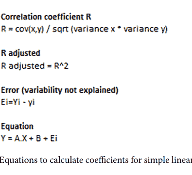

图 7.5 – 计算简单线性回归系数的方程

应用这些公式后，我们将得到以下结果：

| 系数 | 描述 | 值 |
|---|---|---|
| Alpha | 线倾斜度 | 1,021,212,121 |
| Beta | 截距 | 53 |
| R | 相关性 | 0,979,364,354 |
| R^2 | 决定系数 | 0,959,154,538 |

图 7.6 – 寻找回归系数

上表已经包含了我们需要的所有信息，以便对新数据进行预测。如果我们在原始方程 y = ax + b + e 中替换系数，我们将发现回归公式如下：

Y = 1021,212 * X + 53,3

从这一点开始，要进行预测，我们所要做的就是用工作年限的数值替换 X。结果，我们将得到 Y，即预测薪资。我们可以在下面的图中看到模型拟合，以及图 7.8 中的一些模型预测：

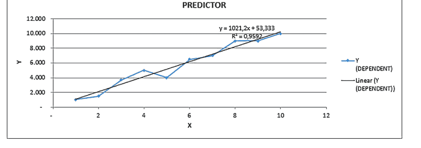

图 7.7 – 将数据拟合到回归方程中

我们在这里看到预测值：

| 输入 | 预测 | 误差 |
|---|---|---|
| 1 | 1,075 | 75 |
| 2 | 2,096 | 596 |
| 3 | 3,117 | - 583 |
| 4 | 4,138 | - 862 |
| 4 | 5,159 | 1,159 |
| 5 | 6,181 | - 319 |
| 6 | 7,202 | 202 |
| 7 | 8,223 | - 777 |
| 8 | 9,244 | 244 |
| 9 | 10,265 | 265 |
| 10 | 11,287 |  |
| 11 | 12,308 |  |
| 12 | 13,329 |  |
| 13 | 14,350 |  |
| 14 | 15,372 |  |
| 15 | 16,393 |  |
| 16 | 17,414 |  |
| 17 | 18,435 |  |
| 18 | 19,456 |  |
| 19 | 20,478 |  |

图 7.8 – 模型预测

当你分析回归模型时，你应该能够理解你的模型质量好坏。我们在第 1 章《机器学习基础》中讨论了许多建模问题，例如过拟合，你已经知道你总是必须检查模型性能。

回归模型的一个良好方法是执行所谓的**残差分析**。在这里，我们将模型的误差绘制在散点图中，并检查它们是否如预期般随机分布，或不是。如果误差*不是*随机分布，这意味着你的模型无法泛化数据。下面的图显示了我们示例的残差分析：

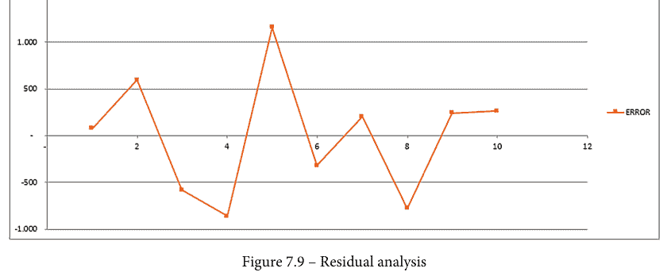

这里的结论是误差是随机分布的。这样的证据，加上较高的 R 平方评级，可以作为支持使用该模型的论据。

**重要说明**
在*第 8 章，评估和优化模型*中，我们将学习关于评估指标的知识。例如，我们将了解到每种类型的模型可能都有其自己的评估指标集。回归模型通常使用**均方误差 (MSE)** 和**均方根误差 (RMSE)** 进行评估。换句话说，除了 R、R 平方和残差分析之外，理想情况下，你将把模型在测试集上执行以提取其他性能指标。你甚至可以使用交叉验证系统来检查模型性能，就像我们在*第 1 章，机器学习基础*中学到的那样。


非常频繁地，当模型残差呈现出模式且并非随机分布时，这通常是因为数据中存在的关联并非线性，而是非线性，因此必须采用另一种建模技术。现在，让我们来看看如何解读模型的結果。

### 解读回归模型

了解如何解读线性回归模型也是很有帮助的。有时，我们使用线性回归并非一定是为了创建预测模型，而是为了进行回归分析，在其中我们可以理解自变量与因变量之间的关系。

回顾我们的回归方程（Y = 1021.2 * X + 53.3），我们可以看到两个项：alpha 或斜率（1021.2）和 beta 或 y 截距（53.3）。我们可以这样解读该模型：每增加一年的工作经验，你的薪水将增加 $1,021.3 美元。此外，请注意，当“工作年限”等于零时，预计薪水将为 $53.3 美元（这是我们直线与 y 轴相交的点）。

从一般角度来看，你的回归分析应回答以下问题：对于自变量（斜率）增加的每个额外单位，因变量的平均变化是多少？请做笔记并确保你知道如何解读简单线性回归模型——作为一名数据科学家，你的日常活动中这是非常重要的一件事！让我们继续，看看关于线性回归的一些最终考虑。

### 检查调整后 R 平方

到目前为止，我希望你对回归模型有了更深入的了解！还有一个非常重要的话题，无论它是否会在考试中出现，你都应该了解，那就是模型的简约性方面。

我们已经在第 1 章《机器学习基础》中谈到过简约性。这是指你优先选择简单模型而非复杂模型的能力。研究回归模型时，你可能需要使用多个特征来预测结果。这也被称为多元回归模型。

在这种情况下，R 和 R 平方系数倾向于奖励具有更多特征的更复杂模型。换句话说，如果你不断向多元回归模型中添加新特征，你将得到更高的 R 和 R 平方系数。这就是为什么你不能仅基于这两个指标来做出决策。

另一个你可以使用的额外指标（除了 R、R 平方、MSE 和 RMSE）被称为 **调整后 R 平方**。当我们向模型中添加不带来任何实际增益的额外特征时，该指标会被惩罚。在下面的表格中，我们举了一个假设的例子，只是为了向你展示何时开始失去简约性：

| 特征数量 | R 平方 | 调整后 R 平方 |
|---|---|---|
| 1 | 81 | 79 |
| 2 | 83 | 82 |
| 3 | 88 | 87 |
| 4 | 90 | 86 |
| 5 | 92 | 85 |

图 7.10 – 比较 R 平方和调整后 R 平方

在这里，我们可以得出结论，保持模型中的三个变量比保持四个或五个变量更好。将四个或五个变量添加到该模型中会增加 R 平方（正如预期的那样），但会降低调整后 R 平方。

好吧；到目前为止，你应该对回归模型有非常好的理解。现在，让我们看看 AWS 在此类模型方面提供的内置算法。这对你的考试很重要，所以让我们来看看。

### AWS 上的回归建模

AWS 有一个内置算法称为 **线性学习器**，我们可以在其中实现线性回归模型。内置的线性学习器使用 **随机梯度下降（SGD）** 来训练模型。

> **重要提示**
> 我们在谈论神经网络时会更深入地学习 SGD。现在，我们可以将 SGD 看作是另一种替代我们刚刚剖析的流行的最小二乘误差方法。

线性学习器内置算法提供了一个可以在训练过程之前对数据进行归一化的超参数。该超参数的名称是 `normalize_data`。这非常有帮助，因为线性模型对数据的尺度很敏感，通常会利用数据归一化。

> **重要提示**
> 我们在 *第 3 章，数据准备和转换* 中谈到了数据归一化。如果需要，请复习该章节。

线性学习器算法的其他重要超参数是 **L1** 和 **wd**，它们分别扮演 **L1 正则化** 和 **L2 正则化** 的角色。

L1 和 L2 正则化有助于线性学习器（或任何其他回归算法实现）避免过拟合。传统上，我们称实现 L1 正则化的回归模型为 **Lasso 回归** 模型，而对于具有 L2 正则化的回归模型，我们称之为 **Ridge 回归** 模型。

虽然听起来可能很复杂，但实际上并非如此！实际上，回归模型方程仍然相同；即 **y = ax + b + e**。变化在于损失函数，该函数用于找到最能最小化误差的系数。如果你回顾图 7.3，你会看到我们已将误差函数定义为 **e = (ŷ - y)2**，其中 **ŷ** 是回归函数值，**y** 是真实值。

L1 和 L2 正则化在损失函数中添加了惩罚项，如下公式所示（请注意我们用 ax + b 替换了 ŷ）：

L₁ = ( a x + b − y )² + λ | a |

L₂ = ( a x + b − y )² + λ a²

λ（lambda）参数必须大于 0 并且需要手动调优。非常高的 lambda 值可能会导致欠拟合问题，而非常低的 lambda 可能不会在最终结果中产生明显的改变（如果你的模型过拟合，它将保持过拟合）。

在实践中，L1 和 L2 正则化之间的主要区别在于 L1 会将不重要的系数收缩为零，从而迫使该特征被丢弃（充当特征选择器）。换句话说，如果你的模型因特征数量过多而过拟合，L1 正则化应该可以帮助你解决这个问题。

> **重要提示**
> 在考试期间，请记住 L1 和 L2 正则化的基础，特别是在它们之间的关键区别，其中 L1 作为特征选择器效果很好。

最后但并非最不重要的一点是，许多内置算法可以用于多种建模目的。线性学习器算法可用于回归、二元分类和多类分类。确保你在考试期间记住这一点（它 *不仅仅* 是关于回归模型）。

继续沿着这个方向，AWS 还有其他内置算法可用于回归和分类问题；即 **因子分解机、K 近邻（KNN）** 和 **XGBoost** 算法。由于这些算法也可以用于分类目的，我们将在关于分类算法的部分中介绍它们。

> **重要提示**
> 你刚刚获得了一个在考试期间需要记住的非常重要的提示：线性学习器、因子分解机、K 近邻和 XGBoost 都适用于回归和分类问题。这些算法通常被称为通用算法。

至此，我们已经完成了本节关于回归模型的介绍。我希望你喜欢它；在参加考试之前，请记得查看我们的支持材料。顺便说一下，你可以在日常活动中也使用该参考资料！现在，让我们继续另一个经典的机器学习问题示例：分类模型。

### 处理分类模型

你在本书中一直在学习分类模型是什么。然而，现在，我们将讨论一些适合分类问题的算法。请记住，外面有数百种分类算法，但由于我们正在为 AWS 机器学习专业考试做准备，我们将介绍 AWS 预先构建的那些。

我们已经知道线性学习器做什么（并且我们知道它适用于回归和分类任务），所以让我们来看看其他通用目的的内置算法（包括分类任务）。

我们将从 **因子分解机** 开始。因子分解机被认为是对线性学习器的扩展，优化用于在高维稀疏数据集中找到特征之间的关系。

> **重要提示**
> 因子分解机的一个非常传统的用例是 *推荐系统*，其中我们通常在数据中具有高水平的稀疏性。在考试期间，如果你面临一个通用问题（回归或二元分类任务），并且底层数据集是稀疏的，那么从算法角度来看，因子分解机可能是最好的答案。


当我们在回归模型中使用 Factorization Machines 时，**均方根误差 (RMSE)** 将用于评估模型。另一方面，在二元分类模式下，算法将使用对数损失、准确率和 F1 分数来评估结果。我们将在 *第 8 章，评估和优化模型* 中对评估指标进行更深入的讨论。

你应该注意，Factorization Machines 仅接受 **recordIO-protobuf** 格式的输入数据。这是因为数据稀疏性问题，recordIO-protobuf 在数据处理方面比 text/.csv 格式做得更好。

下一个适用于分类问题的内置算法被称为 K-最近邻，或简称为 KNN。顾名思义，该算法会尝试找到与输入数据最接近的 K 个点，并返回以下预测之一：

- 如果是分类任务，则为 k 个最近点中最常出现的类别
- 如果是回归任务，则为 k 个最近点标签的平均值

我们说 KNN 是一个 **基于索引的算法**，因为它计算点之间的距离，为这些点分配索引，然后存储排序后的距离及其索引。有了这种类型的数据结构，KNN 可以轻松选择前 K 个最近点来做出最终预测。

请注意，K 是一个 KNN 的超参数，应在建模过程中进行优化。

另一个可用于通用目的的 AWS 内置算法，包括分类，被称为 **eXtreme Gradient Boosting**，或简称为 **XGBoost**。这是一个基于集成决策树的模型。

XGBoost 使用一组 **较弱** 的模型（决策树）来预测目标变量，可以是回归任务、二元分类或多分类。这是一个非常流行的算法，已被顶尖选手在机器学习竞赛中使用。

XGBoost 在添加新树时使用梯度下降算法来最小化损失，使用梯度下降学习策略，即一个模型试图纠正前一个模型的错误。它之所以被称为“gradient”，是因为它使用了梯度下降算法。

> **重要说明**
> 在此上下文中，术语 weaker 用于描述非常简单的决策树。

尽管 XGBoost 比单个决策树更稳健，但在考试中进入时，清楚地了解决策树是什么及其主要配置仍然很重要。顺便说一下，它们是许多集成算法的基础模型，例如 AdaBoost、Random Forest、Gradient Boost 和 XGBoost。

决策树是基于规则的算法，以树的<|message|> 组织决策，如下图所示：

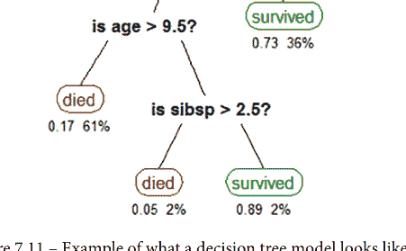

图 7.11 – 决策树模型示例

它们由根节点（树的顶部）、中间或决策节点（树的中间）以及叶节点（底部无分裂的节点）组成。树的深度由根节点与最末叶节点之间的差异给出。例如，在前面的图中，树的深度为 3。

树的深度是此类模型最重要的超参数之一，通常称为 max depth。换句话说，max depth 控制决策树可以达到的最大深度。

决策树模型的另一个非常重要的超参数被称为叶节点中的最小样本/观测数。它也用于控制树的生长。

决策树还有许多其他类型的超参数，但这两种对于控制模型的过拟合尤其重要。深度较高或叶节点中观测数非常少的决策树在外推/预测期间很可能遇到问题。

原因很简单：决策树使用叶节点的数据进行预测，基于属于该节点的每个观测/目标变量的比例（对于分类任务）或平均值（对于回归任务）。因此，节点应有足够的数据以便在训练集之外做出良好预测。

如果你在考试中遇到 **CART** 术语，你应该知道它代表 **Classification and Regression Trees**，因为决策树可用于分类和回归任务。

为了选择最佳变量来分割树中的数据，模型会选择那些最大化目标变量在节点间分离的变量。此任务可以通过不同方法执行，例如 **Gini** 和 **信息增益**。

### 预测模型

**时间序列**，或简称为 **TS**，是指以规律方式收集且具有有序依赖的数据点。时间序列具有度量、事实和时间单位，如下图所示：

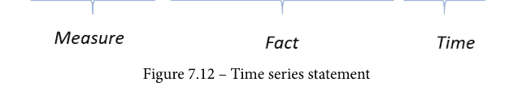

图 7.12 – 时间序列陈述

此外，时间序列可分为 **单变量** 或 **多变量**。单变量时间序列在一段时间内只有一个变量相关，而多变量时间序列在一段时间内有两个或多个变量相关。以下图表显示了我们在前一图像中展示的单变量时间序列：

### 每日批准提案数

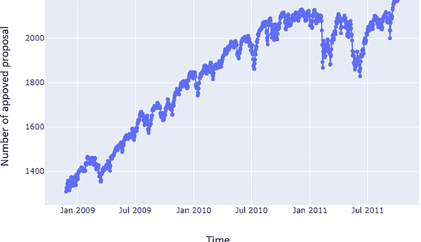

图 7.13 – 时间序列示例

时间序列可分解如下：

- **观测值** 或 **水平**：序列的平均值
- **趋势**：递增、递减模式（有时没有趋势）
- **季节性**：特定时间段的规律性峰值（有时没有季节性）
- **噪声**：我们无法解释的东西

有时，我们还可以在序列中找到孤立的峰值，无法在预测模型中捕捉。在这种情况下，我们可能希望将这些峰值视为异常值。以下是前面图表中显示的时间序列的分解：

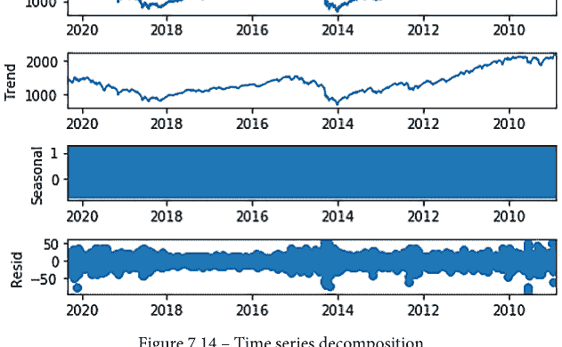

图 7.14 – 时间序列分解

还值得强调的是，我们可以使用 **加法** 或 **乘法** 方法来分解时间序列。加法模型表明你的时间序列 *加上* 每个分量来解释目标变量；即，**y(t) = level + trend + seasonality + noise.**

乘法模型则表明你的时间序列 *乘以* 每个分量来解释目标变量；即，**y(t) = level * trend * seasonality * noise.**

在下一节中，我们将更仔细地查看时间序列分量。

### 检查时间序列的平稳性

分解时间序列并了解其分量如何在加法和乘法模型中相互作用是一项伟大的成就！然而，我们学得越多，就越质疑自己。也许你已经意识到，没有趋势和季节性的时间序列比具有所有这些分量的时间序列更容易预测！

这自然是正确的。如果你不需要理解趋势和季节性，如果你无法控制噪声，你所要做的就是探索观测值并找到它们之间的回归关系。

我们将一段时间内均值和方差恒定的时间序列称为 **平稳**。通常，*具有* 趋势和季节性的时间序列 *不是* 平稳的。可以对序列应用数据转换，将其转换为平稳时间序列，从而使建模任务变得更容易。这种类型的转换称为 **差分**。

当你探索时间序列时，可以通过应用假设检验来检查平稳性，例如 **Dickey-Fuller**、**KPSS** 和 **Philips-Perron**，仅举几例。如果你发现它是非平稳的，那么你可以应用差分使其成为平稳时间序列。一些算法已经内置了这种能力。

### 探索、探索、再探索

到目前为止，我相信我不必提醒你，探索任务在数据科学中无时不在。这里也不例外。当你构建时间序列模型时，你可能想要查看数据并检查它是否适合这种类型的建模。

**自相关图** 是你可用于时间序列分析的工具之一。自相关图允许你检查时间序列中滞后之间的相关性。以下图表显示了这种可视化的示例：

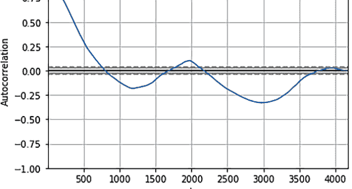

图 7.15 – 自相关图

记住，如果你正在处理单变量时间序列，你的时间序列只有一个变量，因此在你的唯一变量的滞后之间寻找自相关对于理解你是否可以构建一个好的模型至关重要。


而且是的，有时会出现你面前没有时间序列的情况。此外，无论你如何努力，你都无法将此数据建模为时间序列。这种类型的数据通常被称为 **白噪声**。

另一种我们无法预测的序列被称为 **随机游走**。随机游走本质上是随机的，但它们依赖于之前的时间步。例如，随机游走的下一个点可能是一个介于 0 和 1 之间的随机数，并且也是序列的最后一个点。

> **重要说明**
> 如果你在考试中遇到这些术语，请小心并记住将它们与时间序列中的随机性联系起来。

至此，我们已经涵盖了时间序列建模的主要理论。你还应该知道，目前用于处理时间序列的最流行算法被称为 **自回归积分滑动平均 (ARIMA)** 和 **指数平滑 (ETS)**。我们不会查看这两种模型的细节。相反，我们将看看 AWS 在时间序列建模方面能为我们提供什么。

### 理解 DeepAR

**DeepAR** 预测算法是内置于 SageMaker 的算法，用于使用 **循环神经网络 (RNN)** 预测一维时间序列。

传统的时序算法，如 ARIMA 和 ETS，都是为每个时间序列拟合一个模型。例如，如果你想按地区预测销售额，你可能需要为每个地区创建一个模型，因为每个地区的销售行为可能不同。另一方面，DeepAR 允许你在单个模型中操作多个时间序列，这对于更复杂的使用场景来说似乎是一个巨大的优势。

DeepAR 的输入数据，如预期的一样，是一个或多个时间序列。这些时间序列中的每一个都可以与以下内容相关联：

- 由 `cat` 字段控制的静态（与时间无关）分类特征向量
- 由 `dynamic_feat` 控制的动态（与时间相关）时间序列向量

> **重要说明**
> 在多个时间序列上进行训练和预测的能力与静态分类特征向量密切相关。在定义 DeepAR 将训练的时间序列时，你可以设置分类变量来指定每个时间序列所属的组。

DeepAR 的两个主要超参数是 context_length，用于控制模型在训练过程中可以看到的过去范围，以及 prediction_length，用于控制模型将输出预测的未来范围。

DeepAR 还可以处理缺失值，在这种情况下是指时间序列中存在的间隙。DeepAR 的一个非常有趣的功能是它能够从时间序列中创建派生特征。这些派生特征由基本时间频率创建，有助于算法学习时间依赖模式。下表显示了 DeepAR 根据其训练的时间序列类型创建的所有派生特征：

| 时间序列的频率 | 派生特征 |
|---|---|
| Minute | Minute-of-hour, hour-of-day, day-of-week, day-of-month, day-of-year |
| Hour | Hour-of-day, day-of-week, day-of-month, day-of-year |
| Day | Day-of-week, day-of-month, day-of-year |
| Week | Day-of-month, week-of-year |
| Month | Month-of-year |

Figure 7.16 – DeepAR derived features per frequency of time series

我们现在已经完成了关于预测模型的这一部分。接下来，我们将查看关于监督学习的最后一个算法；即 Object2Vec 算法。

### Object2Vec

Object2Vec 是内置于 SageMaker 的算法，它推广了众所周知的 word2vec 算法。Object2Vec 用于为高多维对象创建嵌入空间。这些嵌入空间根据定义是原始对象的压缩表示，可用于多种目的，例如特征工程或对象比较：

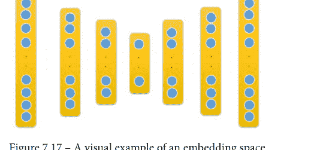

Figure 7.17 – A visual example of an embedding space

上图说明了我们所说的嵌入空间。神经网络模型的第一个和最后一个层只是将输入数据映射到自身（由相同向量大小表示）。

当我们继续进入模型的内部层时，数据会被越来越压缩，直到达到该架构中间的层，即嵌入层。在该特定层中，我们有一个较小的向量，旨在成为第一层中高维原始向量的准确且压缩的表示。

至此，我们刚刚完成了 AWS 中机器学习算法的第一部分。接下来，我们将查看一些无监督算法。

### 无监督学习

AWS 为以下任务提供了几种无监督学习算法：

- 聚类：
  - K-means algorithm
- 降维：
  - **主成分分析 (PCA)**
- 模式识别：
  - IP Insights
- 异常检测：
  - **随机切割森林算法 (RCF)**

让我们从聚类开始谈起，以及最流行的聚类算法是如何工作的：K-means。

### 聚类

聚类算法在数据科学中非常流行。基本上，它们旨在识别给定数据集中的组。从技术上讲，我们称这些发现或组为 **簇**。聚类算法属于非监督学习领域，这意味着它们不需要标签或响应变量进行训练。

这太棒了，因为标记数据曾经稀缺。然而，它也带来了一些限制。主要问题是聚类算法会为你提供簇，但不会提供每个簇的含义。因此，作为领域专家的人必须分析每个簇的属性来定义它们的含义。

有许多类型的聚类方法，例如层次聚类和划分聚类。在每种方法中，我们都会找到几种算法。然而，**K-Means** 可能是最流行的聚类算法，你很可能在考试中遇到它，所以让我们更仔细地看看它。

当我们使用 K-means 时，我们 somehow 必须指定要创建的簇的数量。然后，我们必须将数据点分配到每个簇中，以便每个数据点属于单个簇。这正是我们在聚类过程结束时期望的结果！

你作为用户，必须指定要创建的簇的数量并将其传递给 K-means。然后，算法将随机初始化每个簇的中心点，这也称为 **质心** 初始化。

一旦我们有了每个簇的质心，我们需要做的就是为每个数据点分配一个簇。为此，我们必须使用邻近或距离度量！让我们采用距离度量这个术语。

**距离度量** 负责计算数据点与质心之间的距离。数据点将属于距离度量下更接近的簇质心！

最知名且最常用的距离度量称为 **欧几里得距离**，其背后的数学非常简单：想象你的数据集的点由两个维度 X 和 Y 组成。因此，我们可以将点 a 和 b 视为如下：

- a (X=1, Y=1)
- b (X=2, Y=5)

点 a 和 b 之间的欧几里得距离由以下公式给出，其中 X1 和 Y1 指点 a 的值，X2 和 Y2 指点 b 的值：

Dist = √((x₁ − x₂)² + (y₁ − y₂)²)

相同的函数可以通过以下方程进行概括：√[∑ᵢ₌₁ⁿ (xᵢ − yᵢ)²]

一旦我们完成了此过程并为每个数据点分配了一个簇，我们就必须重新计算簇质心。此过程可以通过不同的方法完成，例如 **单链接**、**平均链接** 和 **完全链接**。


由于这个质心刷新，我们必须不断检查每个数据点最近的簇并不断刷新质心。我们必须**迭代地**重新执行步骤 1 和 2，直到簇质心收敛或达到允许的最大迭代次数。

好的；让我们回顾一下构成 K-means 方法的组件：

- 质心初始化、簇分配、质心刷新，然后重复最后两个步骤直到收敛。
- 算法本身：
- 用于将数据点分配到每个簇的距离度量：
- 我们在这里选择了欧几里得距离。
- 用于重新计算簇质心的链接方法：
- 为了演示的目的，我们将选择平均链接。

有了这些定义，我们就可以逐步走过我们的真实示例。与我们的回归模型一样，一些支持材料也供您参考。

### 逐步计算 K-means

在这个示例中，我们将在一个非常小的数据集上模拟 K-means，只有两列（x 和 y）和六个数据点（A、B、C、D、E、F），如以下表格中定义：

**迭代输入**
| Point | x | y |
|---|---|---|
| A | 1 | 1 |
| B | 2 | 2 |
| C | 5 | 5 |
| D | 5 | 6 |
| E | 1 | 5 |
| F | 2 | 6 |
| Cluster 1 | 1 | 1 |
| Cluster 2 | 2 | 2 |
| Cluster 3 | 5 | 5 |

Figure 7.18 – Input data for K-means

在前面的表格中，我们创建了三个簇，其质心如下：（1,1）、（2,2）、（5,5）。簇的数量（3）在先验中定义，每个簇的质心是随机定义的。以下图表显示了我们现在所在的算法阶段：

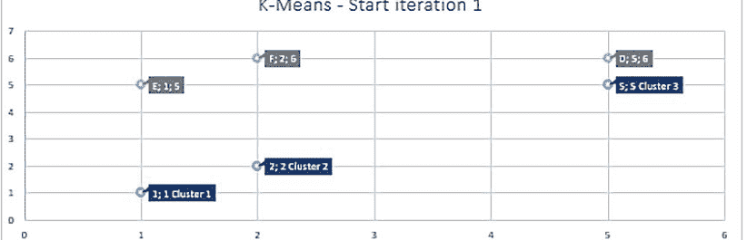

Figure 7.19 – Plotting the K-means results before completing the first iteration

在这里，你看不到点 A、B 和 C，因为它们与簇质心重叠，但不用担心——它们很快就会出现。我们现在要做的是计算每个数据点到每个簇质心的距离。然后，我们需要选择最接近每个点的簇：

| Iteration processing |
| xc1 | yc1 | xc2 | yc2 | xc3 | yc3 | distance-c1 | distance-c2 | distance-c3 | Cluster |
| 1 | 1 | 2 | 2 | 5 | 5 | 0.0 | 1.4 | 5.7 | Cluster 1 |
| 1 | 1 | 2 | 2 | 5 | 5 | 1.4 | 0.0 | 4.2 | Cluster 2 |
| 1 | 1 | 2 | 2 | 5 | 5 | 5.7 | 4.2 | 0.0 | Cluster 3 |
| 1 | 1 | 2 | 2 | 5 | 5 | 6.4 | 5.0 | 1.0 | Cluster 3 |
| 1 | 1 | 2 | 2 | 5 | 5 | 4.0 | 3.2 | 4.0 | Cluster 2 |
| 1 | 1 | 2 | 2 | 5 | 5 | 5.1 | 4.0 | 3.2 | Cluster 3 |
Legend
xc1 = x value of cluster 1
yc1 = y value of cluster 1

Figure 7.20 – Processing iteration 1

在前面的表格中，我们有以下元素：

- 每行代表一个数据点。
- 前六列代表每个簇的质心轴（x 和 y）。
- 接下来的三列代表每个数据点到每个簇质心的距离。
- 最后一列代表最接近每个数据点的簇。

查看数据点 A（第一行），我们可以看到它被分配到簇 1，因为数据点 A 到簇 1 的距离为 0（还记得我告诉你它们重叠了吗？）。对所有其他数据点也进行相同的计算，以为每个数据点定义一个簇。

在继续之前，你可能想看看我们是如何计算簇与数据点之间的这些距离的。如前所述，我们使用了欧几里得距离，所以让我们看看它的实际应用。为了演示目的，让我们看看我们是如何得出数据点 A 与簇 3 之间距离的（图 7.20 中的第一行，列 distance-c3，值为 5.7）。

首先，我们应用了以下公式中的相同方程：

```
Dist = √((x₁ − x₂)² + (y₁ − y₂)²)
```

这里，我们有以下内容：

- X1 = 数据点 A 的 X = 1
- Y1 = 数据点 A 的 Y = 1
- X2 = 簇 3 的 X = 5
- Y2 = 簇 3 的 Y = 5

逐步应用公式，我们将得到以下结果：

```
Dist = √((1 − 5)² + (1 − 5)²)
      √ (4)² + (4)²
      √ 16 + 16
      √ 32
      5.656 or ~5.7
```

Figure 7.21 – Computing the Euclidian distance step by step

这太棒了，不是吗？我们几乎完成了 K-means 的第一次迭代。在迭代 1 的最后一步，我们必须刷新簇质心。记住：最初，我们随机定义了这些质心，但现在，我们已经将一些数据点分配到每个簇，这意味着我们应该能够确定簇的中心点在哪里。

在这个示例中，我们定义了将使用**平均链接**方法来刷新簇质心。这是一个非常简单的步骤，结果如下表所示：

**迭代输出**
| Point | x | y |
|---|---|---|
| A | 1 | 1 |
| B | 2 | 2 |
| C | 5 | 5 |
| D | 5 | 6 |
| E | 1 | 5 |
| F | 2 | 6 |
| Cluster 1 | 1 | 1 |
| Cluster 2 | 1.5 | 3.5 |
| Cluster 3 | 4 | 5.7 |

Figure 7.22 – K-means results after iteration 1

前面的表格显示了我们正在处理相同的那些数据点（顺便说一下，它们永远不会改变），以及簇 1、2 和 3 的质心。这些质心与图 7.18 中最初的质心大不相同。这是因为它们使用平均链接刷新了！该方法获取了每个簇的数据点的所有 x 和 y 值的平均值。例如，让我们看看我们是如何得出簇 2 的质心为 (1.5, 3.5) 的。

如果你查看图 7.20，你会看到簇 2 只有两个数据点分配给它：B 和 E。它们是该图像中的第二行和第五行。如果我们取每个点的 x 轴的平均值，那么我们将得到 (2 + 1) / 2 = 1.5 和 (2 + 5) / 2 = 3.5。

有了这个，我们完成了 K-means 的迭代 1，我们可以查看结果：

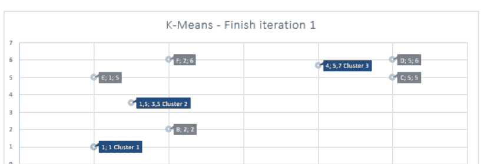

Figure 7.23 – Plotting the K-means results after the first iteration

现在，我们可以看到几乎所有的数据点，除了数据点 A 因为它仍然与簇 1 的质心重叠。继续下去，我们必须重复以下步骤：

- 重新计算每个数据点与每个簇质心之间的距离并重新分配簇（如有需要）
- 重新计算簇质心

我们多次执行这两个任务，直到簇质心收敛并且不再发生变化，或者达到允许的最大迭代次数，该次数可以设置为 K-means 的超参数。为了演示目的，经过四次迭代后，我们的簇将如下所示：

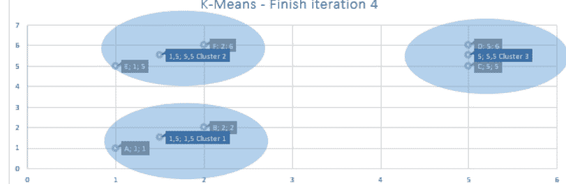

Figure 7.24 – Plotting the K-means results after the fourth iteration

在第四次迭代中，我们的簇质心看起来相当一致，我们可以清楚地看到我们可以根据它们的接近程度对六个数据点进行分组。

> **重要说明**
> 在这个示例中，我们只为每个数据点设置了两个维度（维度 x 和 y）。在实际使用案例中，我们可以看到更多维度，这就是为什么聚类算法在以更自动化的方式识别数据中的组方面发挥着非常重要的作用。

我希望你喜欢从头开始计算 K-means 的过程！我相信这项知识将对你的考试和你作为数据科学家的职业生涯有益。顺便说一下，我已经多次告诉你数据科学家必须持怀疑态度和好奇心，所以你可能会想知道为什么我们在这个示例中定义了三个簇而不是两个或四个。你也可能想知道我们如何衡量簇的质量。

你没想过我不会解释这个，对吧？在下一节中，我们将一起澄清这些问题。

### 定义簇的数量和衡量簇质量

尽管 K-means 是寻找数据中模式的优秀算法，但它不会提供每个簇的含义，也不会提供你需要创建的簇的数量以最大化簇质量。

在聚类中，簇质量意味着我们希望创建同一簇内元素具有高度同质性，而不同簇间元素具有高度异质性的组。换句话说，同一簇的元素应该接近/相似，而不同簇的元素应该很好地分离。

计算簇同质性的一种方法是使用一种称为平方误差和，简称 SSE 的度量。该度量将计算每个数据点与其簇质心之间差异的平方和。例如，当所有数据点都位于簇质心所在的同一点时，SSE 将为 0。换句话说，我们希望最小化 SSE。以下方程正式定义了 SSE：

SSE = Σᵢ₌₁ⁿ (xᵢ - x̄)²

现在我们知道了如何检查簇质量，更容易理解如何为给定的数据集定义适当的簇数量。我们要做的就是找到使 SSE 最小的若干个簇。一个围绕该逻辑工作的非常流行的方法被称为肘部方法。

肘部方法建议多次执行聚类算法。在每次执行中，我们将测试不同的簇数量 k。每次执行后，我们计算与该 k 个簇相关的 SSE。最后，我们可以绘制这些结果并选择 SSE 停止急剧下降的 k 数量。

> Important note
> 添加更多簇自然会降低 SSE。在肘部方法中，我们想要找到该变化变得更平缓的点。


在之前的示例中，我们决定创建三个聚类。下面的图表展示了支持这一决定的肘部分析：

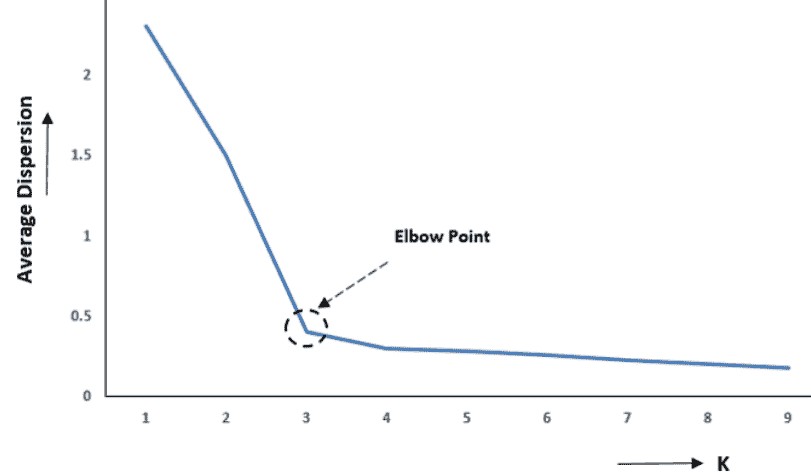

图 7.25 – 肘部方法

我们可以得出结论，添加超过三个或四个聚类会给聚类过程带来不必要的复杂性。

当然，在定义聚类数量时，你始终应考虑业务背景。例如，如果你正在创建客户细分模型，而你的公司已准备好商业团队和业务流程来支持四个客户细分，考虑到前面的图表，将聚类数设为四个而不是三个也无妨。

最后，你应该知道 AWS 已将 K-means 作为其内置算法列表的一部分实现。换句话说，你不必使用外部库或自带算法就能在 AWS 上使用 K-means。

### 结论

这真是一个很棒的成就：你刚刚掌握了聚类算法的基础知识，现在应该能够开展自己的项目并研究这个主题！对于考试，请记住聚类属于机器学习的无监督领域，因此不需要有标签数据。

另外，请确保你了解该领域最流行的算法的工作原理；即 K-means。虽然聚类算法并不能提供每个组的含义，但它们对于在数据中寻找模式非常强大，无论是为了建模特定问题还是只是探索数据。

接下来，我们将继续研究无监督算法，并看看 AWS 如何构建了用于异常检测的最强大算法之一，即 **Random Cut Forest (RCF)**。

### 异常检测

在数据建模和数据探索性分析中查找异常非常常见。有时，你可能只想在拟合回归模型之前先找到数据中的异常并将其移除，而在其他时候，你可能希望创建一个以识别异常为最终目标的模型，例如在欺诈检测系统中。

同样，我们可以使用许多不同的方法在数据中查找异常。有了足够的创造力，可能性是无穷的。然而，有一种特定的算法围绕这个问题展开，你在考试中绝对应该了解它：**Random Cut Forest (RCF)**。

RCF 是一种基于无监督决策树的算法，它使用训练数据的随机子样本创建多个决策树（森林）。从技术上讲，它对数据进行随机化，然后根据树的数量创建样本。最后，这些样本被分配到每棵树中。

这些树集用于为数据点分配异常分数。该异常分数定义为将该点添加到树中后树复杂度的预期变化。

RCF 最重要的超参数是 num_trees 和 num_samples_per_tree，分别表示森林中的树数和每棵树的样本数。

### 降维

AWS 在其内置算法列表中实现的另一种无监督算法被称为 **Principal Component Analysis**，或简称为 **PCA**。PCA 是一种用于减少给定数据集中变量/维度数量的技术。

PCA 背后的主要思想是将数据点绘制到另一组坐标上，称为 **principal components (PC)**，其目的是解释数据中的最大方差。根据定义，第一主成分将捕获比第二主成分更多的方差，然后第二主成分将捕获比第三主成分更多的方差，以此类推。

只要不超过数据集中变量的数量，你就可以设置所需的任意多个主成分。下面的图表显示了这些主成分是如何绘制的：

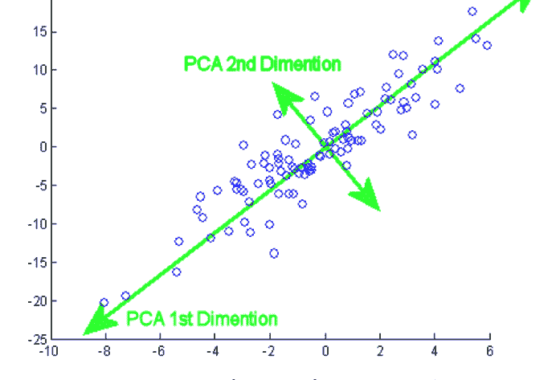

图 7.26 – 在 PCA 中寻找主成分

正如我们之前提到的，第一主成分将被绘制成能够捕获数据中大部分方差的方式。这就是为什么它在前面的图表中会接近大多数数据点。

然后，第二主成分将与第一主成分垂直，因此它将是解释数据方差的第二主成分。如果你想创建更多主成分（从而捕获更多方差），你只需遵循添加垂直分量的相同规则。特征向量和特征值是与 PCA 相关的线性代数概念，用于计算主成分。

那么，这里降维的故事是什么？如果还不清楚，这些主成分可以用来替代你的原始变量。例如，假设你的数据集中有 10 个变量，你想将此数据集减少到三个最能代表其他变量的变量。对此的一种潜在解决方案是应用 PCA 并提取前三个主成分！

这三个分量能解释你数据集的 100% 吗？可能不是，但理想情况下，它们将解释大部分方差。添加更多主成分将解释更多方差，但代价是你增加了额外的维度。

### 使用 AWS 的内置算法进行 PCA

在 AWS 中，PCA 以两种不同的模式工作：
- **Regular：** 用于具有中等数量观测值和特征的数据集
- **Randomized：** 用于具有大量观测值和特征的数据集

区别在于，在随机模式下，使用的是近似算法。

当然，PCA 的主要超参数是你想要提取的分量数，称为 `num_components`。

### IP Insights

IP Insights 是一种用于模式识别的无监督算法。本质上，它学习 IPv4 地址的使用模式。

该算法的操作方式非常直观：它在实体和 IPv4 地址的事件对之上进行训练，以便它能够理解其所训练的每个实体的模式。

> **重要说明**
> 例如，我们可以将“实体”理解为用户 ID 或账号号码。

然后，为了进行预测，它接收具有相同数据结构（实体、IPv4 地址）的事件对，并为该特定 IP 地址相对于输入实体返回一个异常分数。

> **重要说明**
> IP Insight 返回的该异常分数推断出该事件的模式有多异常。

我们可能会遇到许多使用 IP Insights 的应用。例如，你可以创建一个在你的应用程序登录事件之上训练的 IP Insights 模型（这是你的实体）。你应该能够通过 API 端点公开此模型以实时进行预测。

然后，在你的应用程序的身份验证过程中，你可以调用你的端点并传递正在尝试登录的 IP 地址。如果得到高分（意味着这种登录模式看起来异常），你可以在授权访问之前请求额外信息（即使密码正确）。

这只是你可以考虑的 IP Insights 的众多应用之一。接下来，我们将讨论文本分析。

### 文本分析

现代应用程序使用 **Natural Language Processing (NLP)** 用于多个目的，例如 **text translation, document classifications, web search, named entity recognition** (**NER**)，等等。

AWS 为大多数 NLP 用例提供了一套算法。在接下来的几个小节中，我们将查看这些用于文本分析的内置算法。

### Blazing Text 算法

Blazing Text 执行两种不同的任务：文本分类，这是一种扩展了 **fastText** 文本分类器的监督学习方法，以及 **word2vec**，这是一种无监督学习算法。

Blazing Text 对这两种算法的实现都针对大规模数据集进行了优化。例如，你可以在几分钟内在数十亿个词之上训练模型。

Blazing Text 具有这种可扩展性方面的原因如下：
- 其能够使用多核 CPU 和单个 GPU 来加速文本分类
- 其能够使用多核 CPU 或 GPU，并使用自定义 CUDA 内核进行 GPU 加速，在使用 word2vec 算法时

word2vec 选项支持 **batch_skipgram** 模式，这允许 Blazing Text 在多个 CPU 之间进行分布式训练。

> **重要说明**
> Blazing Text 执行的分布式训练使用小批量方法将 **level-1 BLAS** 操作转换为 **level-3 BLAS** 操作。如果你在考试中看到这些术语，你应该知道它们与 Blazing Text 在 word2vec 方面的相关性。

仍在 word2vec 模式下，Blazing Text 同时支持 **skip-gram** 和 **continuous bag of words (CBOW)** 架构。


最后但同样重要的是，请注意 Blazing Text 的以下配置，因为它们很可能出现在你的考试中：

- 在 word2vec 模式下，只有 train 通道可用。
- Blazing Text 预期一个包含空格分隔词元的单个文本文件。文件的每一行必须包含一个句子。这意味着在使用 Blazing Text 之前，你通常需要预处理你的语料库数据。

### 序列到序列算法

这是一种有监督算法，可将输入序列转换为输出序列。此序列可以是文本句子，甚至是音频录音。

序列到序列最常见的用例是机器翻译、文本摘要和语音转文本。任何你认为属于序列到序列问题的问题，都可以通过此算法来解决。

从技术上讲，AWS SageMaker 的 Seq2Seq 使用两种类型的神经网络来创建模型：循环神经网络（RNN）和带注意力机制的卷积神经网络（CNN）。

**潜在狄利克雷分配**，简称 **LDA**，用于主题建模。主题建模是一种文本分析技术，你可以从文本语料库中提取一组主题。LDA 根据文本语料库中词语的概率分布学习这些主题。

由于这是一种无监督算法，因此无需设置目标变量。此外，主题数量必须提前指定，并且你需要分析每个主题以找到其领域含义。

### 神经主题模型（NTM）算法

与 LDA 算法一样，神经主题模型（NTM）也旨在从语料库数据中提取主题。然而，LDA 与 NTM 之间的区别在于它们的学习逻辑。虽然 LDA 从文档中词语的概率分布中学习，但 NTM 建立在神经网络之上。

NTM 网络架构有一个瓶颈层，可创建文档的嵌入表示。此瓶颈层包含预测文档构成所需的所有必要信息，其系数可被视为主题。

至此，我们已完成了关于文本分析的本节内容。在下一节中，我们将学习图像处理算法。

### 图像处理

图像处理是机器学习中非常热门的话题。想法很简单：创建可以分析图像并在其基础上进行推断的模型。通过推断，你可以理解为在图像中检测对象、对图像进行分类等等。

AWS 提供了一套内置算法，可用于训练图像处理模型。在接下来的几节中，我们将查看这些算法。

### 图像分类算法

顾名思义，图像分类算法用于使用有监督学习对图像进行分类。换句话说，它需要在每张图像中包含标签。它支持多标签分类。

其运行方式很简单：在训练期间，它接收图像及其关联标签。在推理期间，它接收图像并返回所有预测标签。图像分类算法使用 CNN（**ResNet**）进行训练。它可以从头开始训练模型，也可以利用迁移学习预加载神经网络的前几层。

根据 AWS 的文档，支持 .jpg 和 .png 文件格式，但推荐的格式是 **MXNet RecordIO**。

### 语义分割算法

语义分割算法为创建计算机视觉应用提供了像素级功能。它为图像的每个像素标记一个类别，这对于自动驾驶和医学图像诊断等复杂应用而言是一个重要特性。

就其实现而言，语义分割算法使用 **MXNet Gluonn 框架**和 **Gluon CV 工具包**。你可以从以下算法中选择任何一种来训练模型：

- **全卷积网络**（FCN）
- **金字塔场景解析**（PSP）
- DeepLabV3

所有这些选项都作为 **编码器-解码器** 神经网络架构工作。网络的输出被称为 **分割掩码**。

### 对象检测算法

与图像分类算法一样，对象检测算法的主要目标也很明显：它检测并对图像中的对象进行分类。它使用有监督方法训练深度神经网络。

在推理过程中，该算法返回已识别的对象以及关于预测的置信度分数。对象检测算法使用单次多框检测器（SSD），并支持两种类型的网络架构：VGG 和 ResNet。

### 总结

这真是一段旅程！让我们花点时间回顾一下我们刚刚学到的内容。我们将本章分为四个主要部分：有监督学习、无监督学习、文本分析和图像处理。我们学到的所有内容都属于机器学习的这些子领域。

我们研究过的有监督学习算法列表如下：

- Linear learner algorithm
- Factorization machines algorithm
- XGBoost algorithm
- K-Nearest Neighbors algorithm
- Object2Vec algorithm
- DeepAR forecasting algorithm

请记住，你可以使用 linear learner、factorization machines、XGBoost 和 KNN 来实现多种目的，包括解决回归和分类问题。其中，linear learner 可能是这四种算法中最简单的；factorization machines 在 linear learner 的基础上扩展，适用于稀疏数据集，XGBoost 使用基于决策树的集成方法，而 KNN 是一种基于索引的算法。

另外两种算法 Object2Vec 和 DeepAR 用于特定目的。Object2Vec 用于创建数据的向量表示，而 DeepAR 用于创建预测模型。

我们研究过的无监督学习算法列表如下：

- K-means algorithm
- **主成分分析（PCA）**
- IP Insights
- **随机切割森林（RCF）**算法

K-means 是一种非常流行的用于聚类的算法。PCA 用于降维，IP Insights 用于模式识别，而 RCF 用于异常检测。

然后，我们更详细地研究了回归模型和 K-means。我们这样做是因为，作为一名数据科学家，我们认为你至少应该掌握这两种非常流行的算法，以便你能够自行深入研究其他算法。

然后，我们进入了本章的后半部分，讨论了文本分析以及以下算法：

- Blazing Text algorithm
- Sequence-to-sequence algorithm
- **潜在狄利克雷分配（LDA）**算法
- **神经主题模型（NTM）**算法

最后，我们谈到了图像处理并查看了以下内容：

- Image classification algorithm
- Semantic segmentation algorithm
- Object detection algorithm

由于这是关于 AWS 机器学习专业考试的一个非常重要的章节，我们鼓励你访问 AWS 网站并搜索机器学习算法。在那里，你将找到我们刚刚介绍的算法的最新信息。

这就结束了本次快速复习和本章的结尾。在下一章中，我们将查看 AWS 提供的现有机制，我们可以使用它们来优化这些算法。

### Questions

1. 你正在一家零售公司担任首席数据科学家。你的团队正在构建一个回归模型，并使用内置的 linear learner 算法来预测特定产品的最佳价格。模型明显对训练数据过拟合，你怀疑这是由于使用变量过多造成的。以下哪种方法最适合解决你的怀疑？

- a) 实施交叉验证过程以在训练过程中减少过拟合。
- b) 应用 L1 正则化并更改 linear learner 算法的 wd 超参数。
- c) 应用 L2 正则化并更改 linear learner 算法的 wd 超参数。
- d) 应用 L1 和 L2 正则化。

Answers
C, 这个问题提示了由于使用特征过多而导致的过拟合问题。L2 正则化，可通过 linear learner 中的 wd 超参数获得，将作为特征选择器发挥作用。一些不太重要的特征将被惩罚，权重变得非常低，这在实际操作中相当于消除了该变量。

2. RecordIO-protobuf 是一种优化的数据格式，用于训练 AWS 内置算法，其中 SageMaker 将数据集中的每个观测值转换为一组 4 字节浮点数的二进制表示。RecordIO-protobuf 可以在两种模式下运行：pipe 模式和 file 模式。它们之间有什么区别？

- a) Pipe 模式接受静态加密，而 file 模式不接受。
- b) 在 pipe 模式下，数据将直接从 S3 流式传输，这有助于优化存储。在 file 模式下，数据从 S3 复制到训练实例的存储卷。
- c) 在 pipe 模式下，数据从 S3 复制到训练实例存储卷。在 file 模式下，数据将直接从 S3 流式传输，这有助于优化存储。
- d) 在 pipe 模式下，数据将直接从 S3 流式传输，这有助于优化存储。在 file 模式下，数据被复制到另一个临时 S3 存储桶。


### 答案

B，记住 RecordIO-protobuf 有管道模式，这使我们能够直接从 S3 流式传输数据。

3. 你是公司的云管理员。你在创建和管理用户访问方面做得很好，并且对云中的日常活动有精细的控制。然而，你想通过识别尝试从异常 IP 地址创建云资源的账户来增加一层安全性。解决此用例的最快解决方案是什么（选择所有正确答案）？

+   a) 创建 IP Insights 模型以识别异常访问。
+   b) 创建聚类模型以识别应用程序连接中的异常。
+   c) 将你的 IP Insights 与 Amazon Guard Duty 的现有规则集成。
+   d) 将你的异常检测模型与 Amazon Guard Duty 的现有规则集成。

### 答案

A,C，记住：你可以提出不同的方法来解决问题。然而，利用 SageMaker 的内置算法通常是最快的做法。

4. 你在一家大型公司担任数据科学家。你的内部客户之一要求你改进他们已在生产中实施的回归模型。你已向模型添加了一些特征，现在你想知道由于这一更改，模型的性能是否有所改善。以下哪个选项最好描述了你应用来评估更改的评估指标？

+   a) 检查新模型的 R 平方是否优于生产中当前模型的 R 平方。
+   b) 检查新模型的调整后 R 平方是否优于生产中当前模型的 R 平方。
+   c) 检查新模型的 R 平方和 RMSE 是否都优于生产中当前模型的 R 平方。
+   d) 检查新模型的调整后 R 平方 RMSE 是否优于生产中当前模型的 R 平方。

### 答案

D，在这种情况下，你接触到了回归模型评估的一种特定行为，即通过添加新特征，R 平方总是会增加。你应该使用调整后 R 平方来了解新特征是否对模型增加了价值。此外，RMSE 将为你提供模型性能的业务视角。虽然选项 b 是正确的，但选项 d 最好描述了你应做出的最佳决策。

5. 以下哪个算法针对稀疏数据进行了优化？

+   a) 分解机
+   b) XGBoost
+   c) 线性学习器
+   d) KNN

### 答案

A，分解机是一种通用算法，针对稀疏数据进行了优化。

6. 以下哪个算法在训练过程中使用基于决策树的集成方法？

+   a) 分解机
+   b) XGBoost
+   c) 线性学习器
+   d) KNN

### 答案

B，XGBoost 是一个非常流行的算法，它使用决策树集成来训练模型。XGBoost 使用提升方法，其中决策树试图纠正先前模型的错误。

7. 以下哪个选项被视为基于索引的算法？

+   a) 分解机
+   b) XGBoost
+   c) 线性学习器
+   d) KNN

### 答案

D，我们说 KNN 是基于索引的算法，因为它必须计算点之间的距离，为这些点分配索引，然后存储排序后的距离及其索引。有了这种类型的数据结构，KNN 就可以轻松选择最接近的 top K 点来进行最终预测。

8. 你是一家大型零售公司的数据科学家，该公司希望按月预测各地区的销售额。你已进行了一些探索性工作，发现各地区的销售模式不同。你的团队已决定将此项目作为时间序列模型来处理，现在，你必须选择创建解决方案的最佳方法。以下哪个选项可能在最少的工作量下为你提供良好的解决方案？

+   a) 使用 ARIMA 算法处理此问题。由于每个地区可能有不同的销售行为，你将不得不为每个地区创建一个独立的模型。
+   b) 使用 RNN 算法处理此问题。由于神经网络很稳健，你可以创建一个单一模型来预测任何地区的销售额。
+   c) 开发一个 DeepAR 模型，并将与每个时间序列关联的地区设置为静态分类特征的向量。你可以使用 cat 字段来设置此选项。
+   d) 开发一个 DeepAR 模型，并将与每个时间序列关联的地区设置为静态分类特征的向量。你可以使用 dynamic_feat 字段来设置此选项。

### 答案

C，选项 a 和 c 都是潜在正确的。然而，问题指出我们希望以最少的工作量获得解决方案。在这种情况下，设置一个 DeepAR 模型并按地区分隔时间序列将是预期的解决方案（选项 c）。我们可以通过将静态分类特征的向量传递到 DeepAR 类模型的 cat 字段来设置这种类型的配置。

9. 你正在处理一个包含九个数值变量的数据集。你想创建一个散点图来查看这些变量是否可能按高相似度聚类分组。你如何实现这一目标？

+   a) 执行 K-means 算法。
+   b) 使用 PCA 计算两个主成分（PCs）。然后，在散点图中绘制 PC1 和 PC2。
+   c) 执行 KNN 算法。
+   d) 使用 PCA 计算三个主成分（PCs）。然后，在散点图中绘制 PC1、PC2 和 PC3。

答案
B，使用 K-means 或 KNN 将无法解决这个问题。你必须应用 PCA 来减少特征数量，然后将结果绘制在散点图中。由于散点图只接受两个变量，选项 b 是正确的。

10. 你应该如何预处理数据以便在 100 个文本文件之上训练一个 Blazing Text 模型？

+   a) 你应该创建一个以空格分隔标记的文本文件。文件的每一行必须包含一个句子。如果你有多个训练文件，你应该将它们全部连接成一个文件。
+   b) 你应该创建一个以空格分隔标记的文本文件。文件的每一行必须包含一个句子。如果你有多个训练文件，你应该对每个文件应用相同的转换。
+   c) 你应该创建一个以逗号分隔标记的文本文件。文件的每一行必须包含一个句子。如果你有多个训练文件，你应该将它们全部连接成一个文件。
+   d) 你应该创建一个以逗号分隔标记的文本文件。文件的每一行必须包含一个句子。如果你有多个训练文件，你应该对每个文件应用相同的转换。

答案
选项 a 是正确的。你应该只向 Blazing Text 提供一个文件，其中包含以空格分隔的标记，并且文件的每一行必须包含一个句子。

## 8
