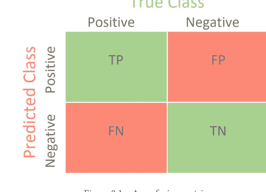
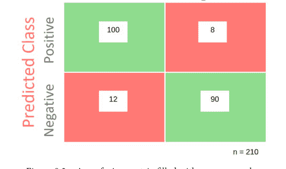
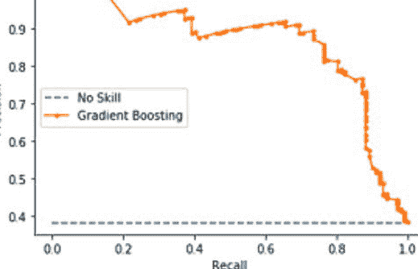
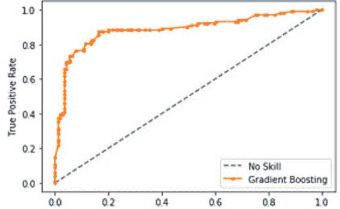
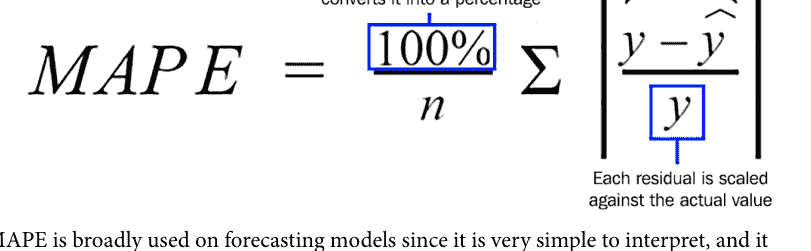

## 评估和优化模型

现在是学习如何评估和优化机器学习模型的时候了。在建模过程中，甚至在模型完成后，你可能想了解你的模型表现如何。每种类型的模型都有自己的一套可用于评估性能的指标，这就是本章要研究的重点。

除了模型评估之外，作为一名数据科学家，你可能还需要通过调整算法的超参数来改进模型的性能。我们将研究此建模任务的一些细微差别。

在本章中，我们将涵盖以下主题：

- 介绍模型评估
- 评估分类模型
- 评估回归模型
- 模型优化

好了，开始吧！

### 介绍模型评估

我们可能想要评估模型性能的场景有多种，其中一些如下。

- 你正在创建模型并测试不同的方法和/或算法。因此，你需要比较这些模型以选择最佳模型。
- 你刚刚完成了模型，需要记录你的工作，其中包括在建模阶段达到的模型性能指标。
- 你的模型正在生产环境中运行，你需要跟踪其性能。如果遇到模型漂移，那么你可能想要重新训练模型。

> **重要说明**
> **模型漂移**一词用于指模型退化的现象。当你构建机器学习模型时，你必须使用数据来训练算法。这组数据被称为训练数据，它反映了特定时间点的业务规则。如果这些业务规则随时间变化，你的模型可能无法适应这种变化。这是因为它是在另一个数据集之上训练的，而该数据集反映了另一个业务场景。为了解决这个问题，你必须重新训练模型，以便它可以考虑新业务场景的规则。强化学习系统可能不会遭受此问题，因为它们可以自行适应新数据。

我们通过设计测试方法来进行模型评估。我们之前学习过留出验证和交叉验证。然而，这两种测试方法都有相同的要求：它们需要一个指标来评估性能。

该指标特定于问题域，例如，回归模型、分类模型、聚类、自然语言处理等都有特定的指标。因此，在设计测试方法时，你必须考虑你正在构建的模型类型，以便定义评估指标。

在以下各节中，我们将查看评估模型时应了解的最重要的指标和概念。


### 评估分类模型

分类模型是你可能会遇到的最传统的模型类型之一，无论是在考试期间还是在你作为数据科学家的旅程中。在评估分类模型时，你可能想要生成的一个非常重要的产物被称为 **混淆矩阵**。

混淆矩阵将你的模型预测与每个被评估类别的真实值进行比较。*图 8.1* 显示了二元分类问题中混淆矩阵的示例：



图 8.1 – 一个混淆矩阵

我们在混淆矩阵中会找到以下组件：

- **TP**：这是 **真正例** 的数量。这里，我们需要统计被预测为真且确实为真的案例数量。例如，在欺诈检测系统中，这将是被正确预测为欺诈的欺诈交易数量。
- **TN**：这是 **真负例** 的数量。这里，我们需要统计被预测为假且确实为假的案例数量。例如，在欺诈检测系统中，这将是被正确预测为非欺诈的非欺诈交易数量。
- **FN**：这是 **假负例** 的数量。这里，我们需要统计被预测为假但实际上为真的案例数量。例如，在欺诈检测系统中，这将是被错误预测为非欺诈的欺诈交易数量。
- **FP**：这是 **假正例** 的数量。这里，我们需要统计被预测为真但实际上为假的案例数量。例如，在欺诈检测系统中，这将是被错误预测为欺诈的非欺诈交易数量。

在完美的场景下，你的混淆矩阵将只有真正例和真负例，这意味着你的模型准确率为 100%。在实际操作中，如果出现这种情况，你应该持怀疑态度而不是高兴，因为可以预期你的模型会包含错误。如果你的模型不包含错误，你很可能正在遭受过拟合问题，所以要小心。

一旦假负例和假正例不可避免，最多你能做的就是优先考虑其中之一。例如，你可以通过增加假正例的数量来减少假负例的数量，反之亦然。这就是所谓的精确率与召回率的权衡。让我们接下来看看这些指标。

### 从混淆矩阵中提取指标

我们可以从混淆矩阵中提取的最简单指标被称为 **准确率**。准确率等于真正例数加上真负例数除以案例总数。在图 8.2 中，我们已为本次演示填入了混淆矩阵的所有组件：



图 8.2 – 填入示例的混淆矩阵

根据图 8.2，准确率将为 (100 + 90) / 210，等于 0.90。
在使用准确率指标时会出现一个常见问题，这与每个类别的平衡性有关。类别高度不平衡的问题，例如 99% 为正例和 1% 为负例，会影响准确率分数并使其失去意义。

例如，如果你的训练数据中有 99% 的正例（多数类），你的模型很可能正确分类大多数正例，但在负例（少数类）的分类上表现很差。准确率会非常高（由于正例分类的正确性），而不管少数类分类的糟糕结果。

重点是，在高度不平衡的问题上，我们通常更关心正确分类少数类，而不是多数类。这在大多数欺诈检测系统中就是这种情况，例如，其中少数类对应于欺诈案例。对于不平衡问题，你应该寻找其他类型的指标，我们将在接下来介绍。

另一个可以从混淆矩阵中提取的重要指标被称为 **召回率**，它等于真正例数除以真正例数加上假负例数。换句话说，召回率由真正例数和总体正例数给出。召回率也被称为 **灵敏度**。

根据图 8.2，召回率为 100 / 112，等于 0.89。**精确率**，另一方面，由真正例数除以真正例数加上假正例数给出。换句话说，精确率由真正例数和总体预测为正的案例数给出。精确率也被称为 **阳性预测值**。

根据图 8.2，精确率为 100 / 108，等于 0.93。一般来说，我们可以通过以降低召回率为代价来提高精确率，反之亦然。还有一个模型评估产物，我们可以在其中调整这种精确率与召回率的权衡。它被称为 **精确率-召回率曲线**。

精确率-召回率曲线通过使用不同的概率阈值来总结精确率与召回率的权衡。例如，默认阈值为 0.5，其中任何预测值高于 0.5 将被视为真；否则为假。你可以根据需要更改默认阈值，以便优先考虑召回率或精确率。图 8.3 显示了精确率-召回率曲线的示例：



图 8.3 – 一个精确率-召回率曲线

正如你在图 8.3 中看到的，提高精确率会降低召回率，反之亦然。图 8.3 显示了梯度提升模型（由橙色线表示）与无技能模型（由蓝色虚线表示）相比，每个阈值的精确率/召回率。完美的模型将曲线逼近点 (1,1)，在图表右上角形成一个方形拐角。

在混淆矩阵之上我们可以做的另一个可视化分析被称为接收者操作特征（ROC）曲线。ROC 曲线总结了根据不同阈值，真正例率与假正例率之间的权衡，就像精确率-召回率曲线一样。

你已经了解真正例率，或灵敏度，这与我们在精确率-召回率曲线中学到的相同。ROC 曲线的另一个维度是假正例率，它等于假正例数除以假正例数加上真负例数。

在文献中，你可能会发现假正例率被称为反向特异性，表示为 1 – 特异性。特异性定义为真负例数除以真负例数加上假正例数。此外，假正例率或反向特异性是相同的。图 8.4 显示了 ROC 曲线是什么样子的：



图 8.4 – 一个 ROC 曲线

完美的模型将曲线逼近点 (0,1)，在图表左上角形成一个方形拐角。橙色线代表梯度提升分类器的真正例率与假正例率之间的权衡。蓝色虚线代表无技能模型，无法正确预测类别。

总而言之，你可以使用 ROC 曲线用于相当平衡的数据集，而使用精确率-召回率曲线用于中等到不平衡的数据集。

### 总结精确率和召回率

有时，我们可能想要使用一个指标来总结精确率和召回率，而不是优先考虑其中一个。可以用来总结精确率和召回率的两个非常流行的指标是 F1 分数和曲线下面积（AUC）。

F1 分数，也称为 F 测度，计算精确率和召回率的调和平均数。AUC 总结了精确率-召回率曲线下面积的近似值。

这就结束了本节关于分类指标的内容。让我们现在来看看回归模型的评估指标。

### 评估回归模型

回归模型与分类模型相当不同，因为模型的输出是一个连续数值。因此，回归模型的指标旨在监控真实值与预测值之间的差异。


最简单的检查预测值（*yhat*）与其实际值（*y*）之间差异的方法是通过简单的减法运算，其中误差等于 *yhat – y* 的绝对值。该指标被称为 **平均绝对误差（MAE）**。

由于我们通常需要评估每个预测 *i* 的误差，因此我们需要取误差的平均值。以下公式展示了该误差的正式定义方式：

```
MAE = (1/N) Σ_{i=1}^{N} |y_i - ŷ_i|
```

有时，你可能希望对较大的误差比较小的误差施加更大的惩罚。为此，你可以使用另一种指标，即 **均方误差（MSE）**。MSE 会对每个误差进行平方并返回平均值。

通过平方误差，MSE 会惩罚较大的误差。以下公式展示了 MSE 的正式定义：

```
MSE = (1/n) Σ_{i=1}^{n} (y_i - ŷ_i)^2
```

MSE 存在一个潜在的解释问题。由于它需要计算平方误差，因此从业务角度解释最终结果可能很困难。**均方根误差（RMSE）** 通过对 MSE 取平方根来解决这一解释问题。以下是 RMSE 方程：

```
RMSE = √[ Σ_{i=1}^{n} (ŷ_i - y_i)^2 / n ]
```

RMSE 可能是回归模型中最常用的指标，因为它既可以惩罚较大的误差，又易于解释。

### 探索其他回归指标

除了我们刚刚学习的内容之外，还有许多其他指标适用于回归问题。我们这里无法涵盖其中的大多数，但有几个指标可能对你很重要。

其中一个指标被称为平均绝对百分比误差（MAPE）。顾名思义，MAPE 会计算每个预测的绝对百分比误差，然后取平均值。以下公式展示了该指标的计算方法：



MAPE 广泛应用于预测模型，因为它非常容易解释，并且能很好地体现预测值与实际值之间的差距（或接近程度，以百分比表示）。

我们现在已完成关于回归指标的本节。接下来，我们将讨论模型优化。

### 模型优化

正如你所知，了解评估指标对于衡量模型性能和记录工作非常重要。同样，当我们想要优化当前模型时，评估指标在定义我们想要挑战的基线性能方面也发挥着非常重要的作用。

模型优化的过程在于为特定数据分布找到机器学习算法的最佳配置（也称为超参数）。我们不希望找到过度拟合训练数据的超参数，就像我们不希望找到欠拟合训练数据的超参数一样。

你在第 1 章《机器学习基础》中学习了过拟合和欠拟合。在同一章中，你还学习了如何避免这两种建模问题。

在本节中，我们将学习一些可以用来为特定算法和数据集找到最佳配置的技术。你可以将这些模型优化技术与其他方法（如交叉验证）结合起来，为你的模型找到最佳的超参数组合并避免拟合问题。

> **重要提示**
> 请始终记住，你不想将算法优化到基础训练数据上，而是要优化到训练数据背后的数据分布上。这样你的模型才能在训练数据以及生产数据（即在训练过程中从未暴露给模型的数据）中都有效。仅在训练数据中有效的机器学习模型是无用的。这就是为什么将模型调优技术（如我们接下来将学习的内容）与采样技术（如交叉验证）相结合，在创建良好模型时会有很大不同。

### 网格搜索

**网格搜索** 可能是模型优化最流行的方法。它包括测试算法的不同组合并选择最佳组合。这里有两个我们需要关注的重要点：

- 如何定义最佳？
- 我们应该测试多少种组合？

最佳模型是基于评估指标定义的。换句话说，你必须首先定义用于评估模型性能的指标。其次，你必须定义如何评估模型。通常，我们使用交叉验证在多个从未用于训练的数据集上评估模型。

就组合数量而言，这是使用网格搜索时最具挑战性的部分。算法的每个超参数可能有多个值，有时甚至有无限多个可能的值。如果考虑到一个算法通常会有多个超参数，这就变成了一个二次成本函数，其中需要测试的唯一组合数量（也称为待测试模型）为 *超参数 a 的取值数量 * 超参数 b 的取值数量 * 超参数 i 的取值数量*。图 8.5 显示了你如何为决策树模型设置网格搜索配置：

| Criterion | Max depth | Min samples leaf |
|---|---|---|
| Gini, Entropy | 2, 5, 10 | 10, 20, 30 |

图 8.5 – 网格搜索配置

在图 8.5 中，有三个超参数：**Criterion**、**Max depth** 和 **Min samples leaf**。这些超参数各自有一个待测试的值列表：2、3 和 3 个值。这意味着，在网格搜索过程结束时，我们将测试 18 个模型（2 * 3 * 3），其中只有最好的一个会被选中。

正如你可能注意到的，所有这些超参数的不同组合都将被测试，例如，考虑以下情况：

- Criterion = Gini, Max depth = 2, Min samples leaf = 10
- Criterion = Gini, Max depth = 5, Min samples leaf = 10
- Criterion = Gini, Max depth = 10, Min samples leaf = 10

你可能会想到的其他问题包括：

- 考虑到特定算法可能有多个超参数，我应该调整哪一个？
- 考虑到特定超参数可能接受无限值，我应该测试哪些值？

这些都是好问题，而网格搜索并不能直接给出答案。相反，这更接近于一个经验过程，你需要测试足够多的内容以达到目标性能。

**重要提示**
当然，网格搜索并不能保证你能达到目标性能。这取决于算法和训练数据。

一种常见做法是使用 **线性空间** 或 **对数空间** 来定义待测试的值，在其中你可以手动设置要测试的超参数的限制以及待测试值的数量。然后，中间值将由线性或对数函数得出。

正如你可能想象的那样，网格搜索运行起来可能需要很长时间。为了解决这个问题，已提出了多种替代方法。**随机搜索** 就是其中之一，其中待测试的值列表是从搜索空间中随机选择的。

另一种在业界迅速普及的方法被称为 **贝叶斯优化**。算法优化，例如 **梯度下降**，试图找到所谓的 **全局最小值**，通过计算成本函数的导数。全局最小值是找到算法配置成本最低的点。

当计算导数不可行时，贝叶斯优化就很有用。因此，我们可以使用 **贝叶斯定理**，一种概率方法，使用最少的步骤找到全局最小值。

在实际操作中，贝叶斯优化将开始测试整个搜索空间以找到最有希望的最优超参数集。然后，它将在全局最小值可能存在的地方进行更多测试。

### 总结

在本章中，你学习了模型评估的主要指标。我们首先从分类问题的指标开始，然后转向回归问题的指标。

就分类指标而言，你已了解了众所周知的混淆矩阵，它可能是对分类模型进行模型评估最重要的产物。

除了知道什么是真正例、真负例、假正例和假负例之外，我们还学习了如何组合这些组件来提取其他指标，例如准确率、精确率、召回率、F1 分数和 AUC。

我们更深入地学习了 ROC 曲线以及精确率-召回率曲线。我们了解到，我们可以使用 ROC 曲线来评估相当平衡的数据集，而使用精确率-召回率曲线来评估中等到不平衡的数据集。

顺便说一下，当你处理不平衡数据集时，请记住使用准确率可能不是一个好主意。

就回归指标而言，我们了解到最受欢迎的指标，也是最有可能出现在 *AWS Machine Learning Specialty* 考试中的指标，是 MAE、MSE、RMSE 和 MAPE。在参加考试之前，请确保你了解它们的基础知识。

最后，你学习了超参数优化的方法，其中网格搜索和贝叶斯优化是主要方法。在下一章中，我们将查看 SageMaker 并学习它如何用于建模。但首先，让我们花点时间练习这些关于模型评估和模型优化的问题。


### 问题

1. 你作为一家制药公司的数据科学家正在工作。你正与其他团队成员协作创建一个机器学习模型，用于对影像检查中的某些疾病类型进行分类。公司希望优先考虑阳性病例的断言率，即使这意味着要错误地返回假阴性。你会使用哪种类型的指标来优化底层模型？

- a. 召回率
- b. 精确率
- c. R-squared
- d. RMSE

答案
在此场景中，公司更倾向于在错误地将一些阳性病例分类为阴性的情况下提高阳性结果正确的概率。技术上，他们更倾向于以降低召回率为代价提高精确率。

2. 你作为一家制药公司的数据科学家正在工作。你正与其他团队成员协作创建一个机器学习模型，用于对影像检查中的某些疾病类型进行分类。公司希望优先捕获阳性病例，即使这意味着要错误地返回假阳性。你会使用哪种类型的指标来优化底层模型？

- a. 召回率
- b. 精确率
- c. R-squared
- d. RMSE

答案
在此场景中，公司更倾向于在错误地将一些阴性病例分类为阳性的情况下找到大部分阳性病例。技术上，他们更倾向于以降低精确率为代价提高召回率。

3. 你正在一个欺诈识别系统中工作，其中一个组件是分类模型。你想检查模型的性能。以下哪个指标可以使用以及为什么？

- a. 准确率。由于欺诈系统数据集天然不平衡，此指标有助于考虑正类和负类两者的断言性。
- b. 精确率。由于欺诈系统数据集天然不平衡，此指标有助于考虑正类和负类两者的断言性。
- c. 召回率。由于欺诈系统数据集天然不平衡，此指标有助于考虑正类和负类两者的断言性。
- d. F1 分数。由于欺诈系统数据集天然不平衡，此指标有助于考虑正类和负类两者的断言性。

答案
选项"d"是唯一与所提议指标的解释相匹配并为该问题提供有效度量的选项。由于不平衡问题，准确率不能在此问题中使用。精确率和召回率可以一起使用以提供对该问题的质量视图，但在答案列表中没有这样的选项。

4. 你正在构建一个机器学习模型来预测房价。你已将该问题作为回归模型来处理。以下哪些指标不适用于回归模型？（选择所有正确答案。）

- a. 召回率
- b. 精确率
- c. MAPE
- d. RMSE

答案
召回率和精确率适用于分类问题；因此它们是正确答案。另一方面，MAPE 和 RMSE 适用于回归模型。

5. 以下哪些指标有助于我们在回归模型中惩罚更大的误差？

- a. 召回率
- b. 精确率
- c. MAPE
- d. RMSE

答案
RMSE 计算每个预测的平方误差。然后，它取 MSE 的平方根。通过计算平方误差，RMSE 会对较大误差比较小误差施加更大惩罚。

6. 你作为一家金融服务公司的数据科学家工作，你创建了一个回归模型来预测信用利用率。如果决定在模型中包含更多特征，R-squared 和 Adjusted R-squared 会发生什么？

- a. Adjusted R-squared 会增加，而 R-squared 可能会增加或减少。
- b. R-squared 会减少，而 Adjusted R-squared 可能会增加或减少。
- c. R-squared 会增加，而 Adjusted R-squared 可能会增加或减少。
- d. Adjusted R-squared 会减少，而 R-squared 可能会增加或减少。

答案
R-squared 会增加，因为额外信息将帮助模型捕捉数据中更多的方差。然而，Adjusted R-squared 可能会增加或减少，这取决于添加额外变量带来的收益。

7. 以下哪些指标会计算百分比误差而不是绝对误差？

- a. 召回率
- b. 精确率
- c. MAPE
- d. RMSE

答案
MAPE 适用于回归模型，它会将误差计算为百分比数值。

8. 你是公司的首席数据科学家。你的团队希望优化一个在生产中不再表现良好的模型。团队决定使用网格搜索来重新训练超参数；然而，该过程花费时间很长且无法完成。你可以采取哪种方法来加快调优过程，同时最大化找到更好模型的几率？

- a) 减少搜索空间以加快训练过程。
- b) 改用贝叶斯优化而不是网格搜索。
- c) 增加搜索空间以加快训练过程。
- d) 以上都不是。

答案
减少网格搜索的搜索空间将有助于加快调优过程，但你将测试更少的模型。这将降低你找到该问题最佳模型的几率。增加搜索空间将增加调优时间。选项"b"是最合理的，因为贝叶斯优化可以专注于最重要的搜索空间，可能减少处理时间并增加找到最佳模型的几率。

9. 你正在使用网格搜索来调优机器学习模型。在调优过程中，你获得了良好的性能指标。然而，当你在生产中执行模型时，模型性能不可接受。你必须排查问题。以下哪些选项是此问题的有效原因？（选择所有正确答案。）

- a) 你在训练数据中调优和评估模型，这导致过拟合。
- b) 生产数据与训练数据的分布不同。
- c) 你在训练过程中未使用交叉验证。
- d) 你没有调优正确的超参数。

答案
你不能在同一数据集中调优和测试模型，否则有过拟合的风险。因此选项"a"正确。如果生产数据不遵循训练数据的相同分布，模型将无法工作，所以选项"b"也正确。选项"c"无效，因为交叉验证不是模型评估的强制要求。选项"d"如果在训练数据中发现不良结果则正确，而不是在生产数据中。

10. 你为一家全球金融公司工作。你的团队创建了一个二元分类模型来识别欺诈交易。该模型已投入生产并自动标记欺诈交易并发送进行进一步审查。运营团队抱怨该模型阻止了太多交易，他们更希望标记更少数量的交易。根据前述场景，运营团队的期望是什么？

- a) 他们希望将模型阈值校准为 0.5。
- b) 他们希望优先考虑精确率而非召回率。
- c) 他们希望优先考虑召回率而非精确率。
- d) 他们希望使用 F-measure。

答案
我们始终必须将模型使用与业务目标和能力相匹配。在此场景中，模型标记了大量潜在欺诈交易，但没有足够的人力来评估所有被阻止的交易。此外，更合理的做法是“校准”模型以适应真实业务场景，其中它将标记更少但更可能欺诈的案例进行进一步审查。


## 9