## Amazon SageMaker 建模

在上一章中，我们学习了多种模型优化和评估技术。我们还学习了存储数据、处理数据以及对数据应用不同统计方法的不同方式。那么，我们现在如何为此构建管道呢？好吧，我们可以读取数据、处理数据，并在处理后的数据上构建机器学习模型。但如果我的第一个机器学习模型表现不佳怎么办？我可以微调我的模型吗？答案是肯定的；你几乎可以使用 Amazon SageMaker 完成所有操作。在本章中，我们将使用 Amazon SageMaker 带你了解以下主题：

- 了解 Amazon SageMaker 的不同实例
- 在 Amazon SageMaker 的 Jupyter Notebook 中清理和准备数据
- 在 Amazon SageMaker 中进行模型训练
- 使用 SageMaker 的内置机器学习算法
- 在 SageMaker 中编写自定义训练和推理代码

### 技术要求

你可以在 GitHub 上下载本章示例中使用的数据，地址为 https://github.com/PacktPublishing/AWS-Certified-Machine-Learning-Specialty-MLS-C01-Certification-Guide/tree/master/Chapter-9。

### 在 Amazon SageMaker 中创建笔记本

如果你从事机器学习工作，那么你需要执行诸如存储数据、处理数据、为模型训练准备数据、模型训练以及部署模型进行推理等操作。它们并不容易，每个阶段都需要一台机器来执行任务。有了 Amazon SageMaker，执行这些步骤时生活会变得轻松得多。

### 什么是 Amazon SageMaker？

SageMaker 提供训练实例，使用数据训练模型，并提供端点实例，使用模型进行推理。它还提供笔记本实例，运行 Jupyter Notebook，以清理和理解数据。如果你对清理过程满意，那么你应该将它们存储在 S3 中作为训练的暂存。你可以启动训练实例来消费此训练数据并生成机器学习模型。机器学习模型可以存储在 S3 中，端点实例可以消费该模型为终端用户生成结果。

如果你将其绘制成块图，那么它将看起来类似于图 9.1：

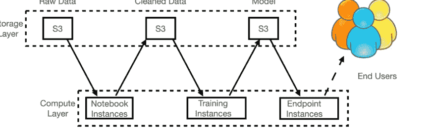

图 9.1 – Amazon SageMaker 实例不同层的图形表示

现在，让我们看看 Amazon SageMaker 控制台，以便更好地了解它。一旦你登录到你的 AWS 账户并进入 Amazon SageMaker，你会看到类似于图 9.2 的内容：

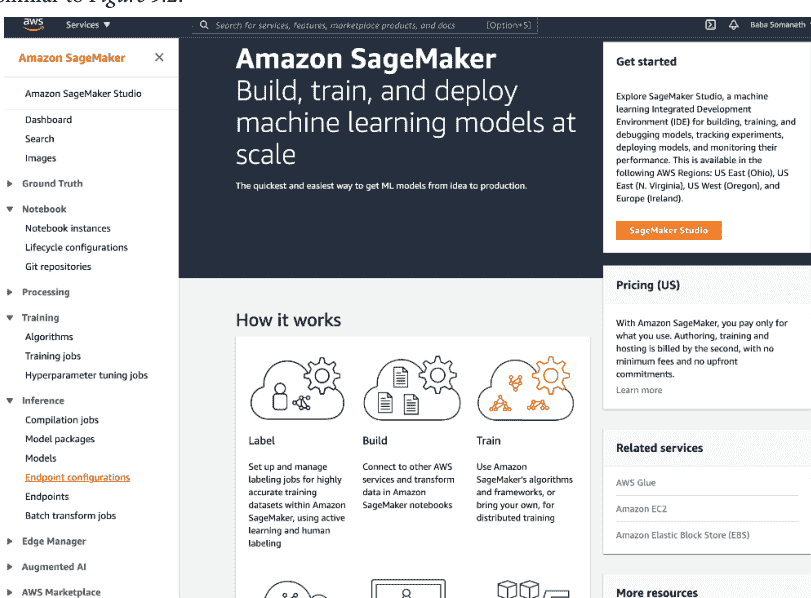

图 9.2 – SageMaker 控制台的快速浏览

有三个不同的部分，包括 Notebook、Training 和 Inference，它们在图 9.2 中已展开，以便我们可以深入了解它们。

Notebook 有三个不同的选项可供使用：

- **Notebook instances**：这有助于我们创建、打开、启动和停止笔记本实例。这些实例负责运行 Jupyter Notebook。它们允许我们根据用例的工作负载选择实例类型。最佳实践是使用笔记本实例来编排处理大型数据集的数据管道。例如，从笔记本实例向 AWS Glue 发出调用以进行 ETL 服务，或向 Amazon EMR 运行 Spark 应用程序。如果你被要求在 AWS 外部创建安全的笔记本实例，那么你需要处理端点安全、网络安全、启动机器、在其上管理存储以及管理实例上运行的 Jupyter Notebook 应用程序。用户无需使用 SageMaker 管理这些内容。

- **Lifecycle configurations**：当存在需要不同库的用例，而该库在笔记本实例中不可用时，这很有用。为了安装库，用户将执行 `pip install` 或 `conda install`。然而，一旦笔记本实例终止，定制就会丢失。为了避免这种情况，你可以通过 **Lifecycle configurations** 提供的脚本来自定义你的笔记本实例。你可以选择 `/home/ec2-user/anaconda3/envs/` 中存在的任何环境，并根据需要自定义特定环境。
- **Git repositories**：AWS CodeCommit、GitHub 或任何其他 Git 服务器可以与笔记本实例关联以实现笔记本的持久化。如果获得访问权限，则同一笔记本可以被其他开发人员使用以协作并以源代码控制的方式保存。Git 仓库可以通过此选项单独添加，也可以在创建时与笔记本实例关联。

正如你在 *图 9.2* 中看到的，**Training** 提供了 **Algorithms**、**Training jobs** 和 **Hyperparameter tuning jobs**。让我们了解它们的使用方法：

- **Algorithms**：这是决定要在清理后的数据上运行的算法的第一步。你可以选择自定义算法或根据用例创建自定义算法。否则，你可以在清理后的数据上运行 SageMaker 算法。
- **Training jobs**：你可以通过 API 调用从笔记本实例创建训练作业。你可以设置实例数量，输入数据源详细信息，执行检查点配置和输出数据配置。Amazon SageMaker 管理训练实例，并将模型工件作为输出存储在指定位置。增量训练（即不时训练模型以获得更好的结果）和托管 Spot 训练（即降低成本）也可以实现。
- **Hyperparameter tuning jobs**：通常，超参数在训练过程之前为算法设置。在训练过程中，我们让算法找出这些参数的最佳值。通过超参数调优，我们获得具有超参数最佳值的最佳模型。这可以通过控制台或通过 API 调用完成。也可以从笔记本实例编排。

**Inference** 提供了许多功能，并且每天都在发展：

- **Compilation jobs**：如果你的模型使用 Keras、MXNet、ONNX、PyTorch、TFLite、TensorFlow 或 XGBoost 等机器学习框架训练，并且你的模型工件可在 S3 存储桶上获得，那么你可以选择 **Target device** 或 **Target platform**。目标设备用于部署你的模型，例如 AWS SageMaker 机器学习实例或 AWS IoT Greengrass 设备。目标平台用于决定你希望模型运行的操作系统、架构和加速器。你还可以将编译后的模块存储在你的 S3 存储桶中以供将来使用。这本质上帮助你在跨平台模型部署。
- **Model packages**：这些用于创建可部署的 SageMaker 模型。你可以创建自己的算法，使用模型包 API 对其进行打包，并将其发布到 AWS Marketplace。
- **Models**：模型是使用模型工件创建的。它们类似于带有变量的数学方程；也就是说，你输入变量的值并得到输出。这些模型存储在 S3 中，并将由端点用于推理。
- **Endpoint configurations**：Amazon SageMaker 允许你将多个加权模型部署到单个端点。这意味着你可以将特定数量的请求路由到一个端点。*这意味着什么？* 嗯，假设你有一个正在使用的模型。你想用更新的模型替换它。然而，你不能简单地移除已经在使用的第一个模型。在这种情况下，你可以使用 `VariantWeight` API 使端点以 80% 的请求使用旧模型，以 20% 的请求使用新模型。这是数据快速变化且模型需要定期训练和调优的最常见生产场景。另一个可能的使用场景是使用实时数据测试模型结果，然后可以将一定比例的请求路由到新模型，并监控结果以证明模型在实时未见数据上的准确性。
- **Endpoints**：这些用于创建模型公开的 URL，可以请求它以响应提供模型结果。
- **Batch transform jobs**：如果用例要求你在数百万条记录上进行推理，那么而不是单独的推理作业，你可以在未见数据上运行批量转换作业。请注意，当你解析数千条未见数据作为一批后从模型接收数千个结果时可能会产生一些混淆。为了克服这种混淆，可以使用 `InputFilter`、`JoinSource`、`OutputFilter` API 将输入记录与输出结果关联。


现在，我们已经对 Amazon SageMaker 有了总体的了解。让我们在下一节中将知识付诸实践。

> **重要提示**
> Amazon SageMaker 控制台一直在变化。当你阅读本书时，控制台的外观可能与本书中显示的不同。

### 动手使用 Amazon SageMaker 笔记本实例

在本节的第一个步骤是创建一个 Jupyter Notebook，这需要一个笔记本实例。让我们按以下步骤创建笔记本实例：

- 1. 登录你的 AWS 账户。
- 2. 导航到 **Services > Amazon SageMaker**。
- 3. 在左侧导航窗格中，单击 **Notebook instances**，然后单击 **Create notebook instance** 按钮。
- 4. 提供一个 **Notebook instance name**，例如 `notebookinstance`，并将 **Notebook instance type** 保持在默认的 `ml.t2.medium` 设置。在 **Permissions and encryption** 部分，在 **IAM role** 中选择 `Create a new role`。系统会要求你指定存储桶名称。为本示例的目的，它被选为任意存储桶。
- 5. 在成功创建角色后，你应该会看到类似 *Figure 9.3* 的内容：

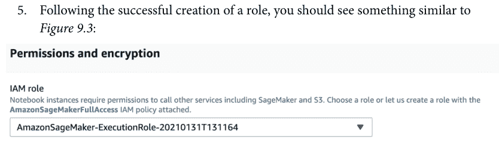

Figure 9.3 – Amazon SageMaker role creation

- 6. 将其他所有内容保持默认设置，然后单击 **Create notebook instance** 按钮。

7. 一旦实例状态变为 InService，选择该实例。单击 Actions 下拉菜单并选择 Open Jupyter。这将打开你的 Jupyter Notebook。

8. 现在，我们已经准备好在新创建的实例上运行 Jupyter Notebook。我们将执行探索性数据分析（EDA）并绘制不同类型的图表来可视化数据。一旦熟悉 Jupyter Notebook，我们将构建一些模型来预测波士顿房价。我们将应用在前几章中学到的算法并进行比较，以找到根据我们的数据提供最佳预测的最佳模型。让我们开始吧。

9. 在 Jupyter Notebook 中，单击 New 并选择 Terminal。在命令提示符中运行以下命令以将代码下载到实例：

```
sh-4.2$ cd ~/SageMaker/
sh-4.2$ git clone https://github.com/PacktPublishing/
AWS-Certified-Machine-Learning-Specialty-MLS-C01-
Certification-Guide.git
```

10. 一旦 Git 仓库克隆到 SageMaker 笔记本实例，在命令提示符中输入 exit 以退出。现在，你的代码已准备好执行。

11. 导航到 Jupyter Notebook 文件部分中的 Chapter-9，如 Figure 9.4 所示：

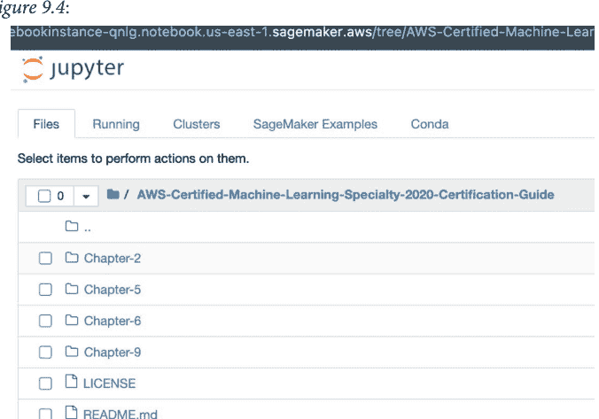

Figure 9.4 – Jupyter Notebook

12. 单击第一个笔记本 1.Boston-House-Price-SageMaker-Notebook-Instance-Example.ipynb。它会提示你为笔记本选择内核。请选择 conda_python3，如 Figure 9.5 所示：

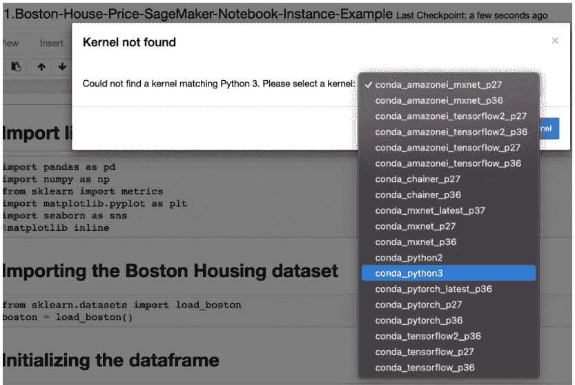

Figure 9.5 – Jupyter Notebook kernel selection

13. 从笔记本中，导航到 Kernel > Restart & Clear Output。单击播放图标逐个运行单元格。请确保你已运行每个单独的单元格并检查每次执行/运行的输出。

14. 你可以通过添加单元格和删除单元格来熟悉 Jupyter Notebook 操作。在其中一段落中，有一个 bash 命令允许你从笔记本中安装 xgboost 库。

15. 最后一个单元格解释了我们如何比较各种建模技术的不同分数以从数学上得出结论。Figure 9.6 清楚地显示，预测波士顿房价的最佳模型是 XGBoost：

```
models = pd.DataFrame({
    'Model': ['Linear Regression', 'Random Forest', 'XGBoost', 'Support Vector Machines'],
    'R-squared Score': [acc_linreg*100, acc_rf*100, acc_xgb*100, acc_svm*100],
    'Adjusted R-squared Score': [adj_R2_linreg*100, adj_R2_rf*100, adj_R2_xgb*100, adj_R2_svm*100],
    'MAE': [mae_linreg, mae_rf, mae_xgb, mae_svm],
    'MSE': [mse_linreg, mse_rf, mse_xgb, mse_svm],
    'RMSE': [rmse_linreg, rmse_rf, rmse_xgb, rmse_svm]})
models.sort_values(by='R-squared Score', ascending=False)
```

|  | Model | R-squared Score | Adjusted R-squared Score | MAE | MSE | RMSE |
|---|---|---|---|---|---|---|
| 2 | XGBoost | 85.799520 | 84.461793 | 2.530958 | 14.828152 | 3.850734 |
| 1 | Random Forest | 82.181317 | 80.502745 | 2.500316 | 18.606282 | 4.313500 |
| 0 | Linear Regression | 71.218184 | 68.506853 | 3.859006 | 30.053993 | 5.482152 |
| 3 | Support Vector Machines | 59.001585 | 55.139415 | 3.756145 | 42.810575 | 6.542979 |

Figure 9.6 – Comparing the models

16. 一旦你完成了此笔记本的执行，请随时关闭内核并从 SageMaker 控制台停止你的笔记本实例。这是节省成本的最佳实践。

在下一个动手部分，我们将熟悉 Amazon SageMaker 的训练和推理实例。我们还将使用 Amazon SageMaker API 使此过程更轻松。我们将使用与前一个示例中相同的笔记本实例。

### 动手使用 Amazon SageMaker 的训练和推理实例

在本节中，我们将学习如何训练模型并托管模型以生成预测结果。让我们通过使用前一个示例中的笔记本实例开始：

- 1. 登录你的 AWS 账户 https://console.aws.amazon.com/sagemaker/home?region=us-east-1#/notebook-instances。

2. 单击我们在前一个示例中创建的实例 notebookinstance 旁边的 Start。一旦状态移动到 InService，在新标签页中打开它，如 Figure 9.7 所示：

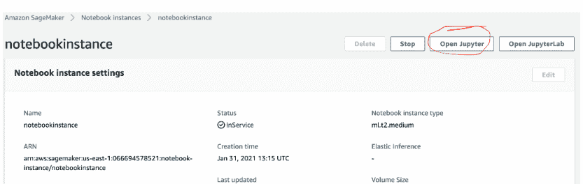

Figure 9.7 – The InService instance

3. 导航到 Jupyter Notebook 主页中名为 SageMaker Examples 的标签。

4. 选择 k_nearest_neighbors_covtype.ipynb 笔记本。单击 Use and create a copy。

5. 当你运行以下段落，如 Figure 9.8 所示时，你也可以在 SageMaker 主页的 Training > Training jobs 中检查训练作业：

```
hyperparams = {"feature_dim": 54, "K": 10, "sample_size": 200000, "predictor_type": "classifier"}
output_path = f"s3://{bucket}/(prefix)/default_example/output"
knn_estimator = trained_estimator_from_hyperparams(
    s3_train_data, hyperparams, output_path, s3_test_data=s3_test_data
)
The method get_image_uri has been renamed in sagemaker>=2.
See: https://sagemaker.readthedocs.io/en/stable/v2.html for details.
Defaulting to the only supported framework/algorithm version: 1. Ignoring framework/algorithm version: 1.
2021-02-03 22:00:05 Starting - Starting the training job...
2021-02-03 22:00:30 Starting - Launching requested ML instancesProfilerReport-1612389605: InProgress
........
2021-02-03 22:01:51 Starting - Preparing the instances for training...
2021-02-03 22:02:32 Downloading - Downloading input data...
2021-02-03 22:02:52 Training - Downloading the training image...
2021-02-03 22:02:33 Training - Training image download completed. Training in progress..Docker entrypoint called with argument(s): train
Running default environment configuration script
[02/03/2021 22:03:35 INFO 140457495148352] Reading default configuration from /opt/amazon/lib/python2.7/site-package s/algorithm/resources/default-conf.json: {'u'index_metric': u'L2', 'u' tuning objective metric': u' ', 'u' num_gpus': u'a uto', 'u'log_level': u'info', 'u'feature_dim': u'auto', 'u'faiss_index_ivf_nlists': u'auto', 'u'epochs': u'1', 'u'index_t ype': u'faiss.Flat', 'u'faiss_index_nprobe': u'5', 'u'kvstore': u'dist_async', 'u'num_kv_servers': u'1', 'u'mini_batch _size': u'5000'}
[02/03/2021 22:03:35 INFO 140457495148352] Merging with provided configuration from /opt/ml/input/config/hyperparamet
```

Figure 9.8 – The SageMaker fit API call

6. 训练作业看起来类似于 Figure 9.9。它在后端启动一个 ECS 容器并使用在前一个示例中创建的 IAM 执行角色来运行此请求的训练作业：

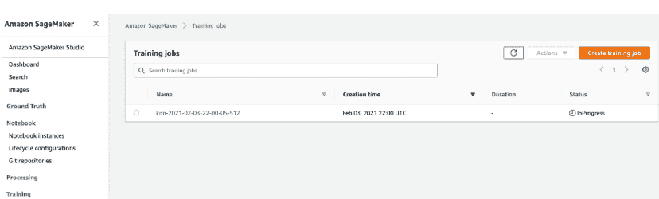

Figure 9.9 – Training jobs

7. 如果你进入并在 CloudWatch 中检查日志，它会为你提供有关容器及其执行步骤的更多详细信息。作为机器学习工程师，值得进入并检查 Algorithm 的 CloudWatch 指标。

8. 现在，如果你在笔记本中运行以下段落，如 Figure 9.10 所示，那么它将创建一个端点配置和一个端点，在该端点上部署来自早期训练作业的模型。

9. 我已将实例类型更改为节省成本。它是托管模型的主机或机器。请明智地选择你的实例。我们将在下一节学习如何选择实例类型。我还更改了 endpoint_name 以便更容易识别：

```
import time

instance_type = "ml.t2.medium"
model_name = "knn_%s" % instance_type
endpoint_name = "knn-baba-test-%s" % (str(time.time()).replace(".", "-"))
print("setting up the endpoint..")
predictor = predictor_from_estimator(
    knn_estimator, model_name, instance_type, endpoint_name=endpoint_name
)
```

setting up the endpoint..
-

Figure 9.10 – Creating the predictor object with endpoint details


10. 导航到 **Inference > Endpoints**。这将显示在上一段执行后创建的端点。该端点具有配置，可以通过 **Inference > Endpoint Configurations** 进行导航和追踪。

11. 如果你在 notebook 中查看 **Inference** 部分，你会注意到它使用测试数据来预测结果。它使用来自 SageMaker API 的 predictor 对象来进行预测。predictor 对象包含端点详情、模型名称和实例类型。

12. 对端点的 API 调用发生在 **Inference** 部分中，并且通过创建 notebook 实例时使用的 IAM 角色进行身份验证。相同的 API 调用可以通过 CloudWatch 调用指标进行追踪。

13. 最后，在 notebook 中运行 `delete_endpoint` 方法将删除端点。要删除端点配置，请导航到 **Inference > Endpoint Configurations** 并在屏幕上选择该配置。点击 **Actions > Delete > Delete**。

14. 现在，请随意关闭内核并从 SageMaker 控制台停止你的 notebook 实例。这是节省成本的最佳实践。

在本节中，我们学习了如何使用 notebook 实例、训练实例、推理端点和端点配置来清理数据、训练模型并从中生成预测结果。在下一节中，我们将学习模型调优。

### Model tuning

在 *Chapter 8, Evaluating and Optimizing Models* 中，你学习了关于模型调优的许多重要概念。现在让我们从实践角度探索这个主题。

为了在 SageMaker 上调优模型，我们必须调用 `create_hyper_parameter_tuning_job` 并传递以下主要参数：

- `HyperParameterTuningJobName`：这是调优作业的名称。它有助于追踪代表你的调优作业而启动的训练作业。
- `HyperParameterTuningJobConfig`：在这里，你可以配置你的调优选项。例如，你想要调优的参数、它们的值范围、优化类型（如随机搜索或贝叶斯搜索）、你想要启动的最大训练作业数等。
- `TrainingJobDefinition`：在这里，你可以配置你的训练作业。例如，数据通道、输出位置、资源配置、评估指标和停止条件。

在 SageMaker 中，我们主要用来评估模型以选择最佳模型的一个指标被称为 **objective metric**。

在下面的示例中，我们正在为基于决策树的算法配置 `HyperParameterTuningJobConfig`。我们想要检查 **max_depth** 超参数的最佳配置，该超参数负责控制树的深度。

在 `IntegerParameterRanges` 中，我们必须指定以下内容：

- 超参数名称
- 我们想要测试的最小值
- 我们想要测试的最大值

**Important note**
每种类型的超参数必须适合于参数范围区段之一，例如分类、连续或整数参数。

在 `ResourceLimits` 中，我们指定了训练作业的数量以及我们想要并行运行的作业数量。请记住，调优过程的目标是以不同的超参数设置执行许多训练作业。这样做是为了选择最佳的一个作为最终模型。因此，我们必须指定这些训练作业执行规则。

我们然后在 `Strategy` 中设置搜索策略，最后在 `HyperParameterTuningJobObjective` 中设置目标函数：

```
tuning_job_config = {
    "ParameterRanges": {
        "CategoricalParameterRanges": [],
        "ContinuousParameterRanges": [],
        "IntegerParameterRanges": [
            {
                "MaxValue": "10",
                "MinValue": "1",
                "Name": "max_depth"
            }
        ]
    }
}
```

```
]
},
"ResourceLimits": {
    "MaxNumberOfTrainingJobs": 10,
    "MaxParallelTrainingJobs": 2
},
"Strategy": "Bayesian",
"HyperparameterTuningJobObjective": {
    "MetricName": "validation:auc",
    "Type": "Maximize"
}
}
```

我们需要设置的第二个重要配置是 TrainingJobDefinition。在这里，我们必须指定将要执行的训练作业的所有细节。其中最重要的设置之一是 TrainingImage 设置，它指的是将启动以执行训练过程的容器。该容器如预期必须实现了你的训练算法。

在这里，我们展示了一个内置算法 eXtreme Gradient Boosting 的示例，以便你可以将训练镜像设置为如下：

```
training_image = sagemaker.image_uris.retrieve('xgboost',
region, '1.0-1')
```

然后，你可以继续设置你的训练定义：

```
training_job_definition = {
    "AlgorithmSpecification": {
        "TrainingImage": training_image,
        "TrainingInputMode": "File"
    },
```

接下来，我们必须指定数据输入配置，也称为数据通道。在以下代码段中，我们设置了两个数据通道 – train 和 validation：

```
"InputDataConfig": [
    {
        "ChannelName": "train",
```

```
"CompressionType": "None",
"ContentType": "csv",
"DataSource": {
"S3DataSource": {
"S3DataDistributionType": "FullyReplicated",
"S3DataType": "S3Prefix",
"S3Uri": s3_input_train
}
}
},
{
"ChannelName": "validation",
"CompressionType": "None",
"ContentType": "csv",
"DataSource": {
"S3DataSource": {
"S3DataDistributionType": "FullyReplicated",
"S3DataType": "S3Prefix",
"S3Uri": s3_input_validation
}
}
}
],
```

我们还需要指定结果将存储的位置：

```
"OutputDataConfig": {
"S3OutputPath": "s3://{}/{}/output".format(bucket,prefix)
},
```

最后，我们设置资源配置、角色、静态参数和停止条件。在以下代码段中，我们想要使用两台类型为 ml.c4.2xlarge 的实例，每台 10 GB 存储：

```
"ResourceConfig": {
"InstanceCount": 2,
```

```
"InstanceType": "ml.c4.2xlarge",
"VolumeSizeInGB": 10
},
"RoleArn": <<your_role_name>>,
"StaticHyperParameters": {
"eval_metric": "auc",
"num_round": "100",
"objective": "binary:logistic",
"rate_drop": "0.3",
"tweedie_variance_power": "1.4"
},
"StoppingCondition": {
"MaxRuntimeInSeconds": 43200
}
}
```

> **Important note**
> 请注意，我们在此配置文件中使用了其他变量 bucket 和 prefix，它们应分别替换为你的存储桶名称和前缀键（如需要）。我们还引用了 s3_input_train 和 s3_input_validation，这两个变量指向 S3 中的训练和验证数据集。

一旦你设置了配置，你就可以启动调优过程：

```
smclient.create_hyper_parameter_tuning_job(
    HyperparameterTuningJobName = "my-tuning-example",
    HyperparameterTuningJobConfig = tuning_job_config,
    TrainingJobDefinition = training_job_definition
)
```

接下来，让我们了解一下如何追踪此过程的执行。

### Tracking your training jobs and selecting the best model

一旦你启动了调优过程，你可能还想检查另外两个步骤：追踪调优过程以及选择获胜模型（即具有最佳超参数集的模型）。

为了找到你的训练作业，你应该进入 SageMaker 控制台并导航到 Hyperparameter training jobs。你将找到已执行的调优作业列表，包括你的作业：

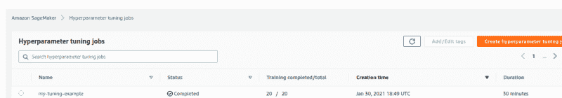

Figure 9.11 – Finding your tuning job

如果你通过点击其名称访问你的调优作业，你将找到一个摘要页面，其中包含有关调优过程的最相关信息。在 Training jobs 选项卡下，你将看到已执行的所有训练作业：

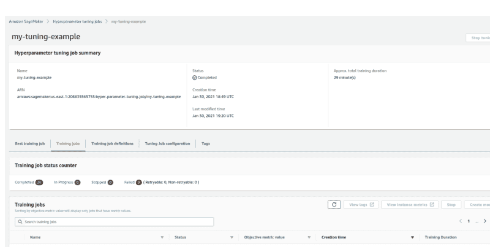

Figure 9.12 – Summary of the training jobs in the tuning process


最后，如果你点击 **Best training job** 选项卡，你将找到模型最佳的超参数集，其中包含一个便捷的按钮，可基于刚刚找到的最佳超参数创建新模型：

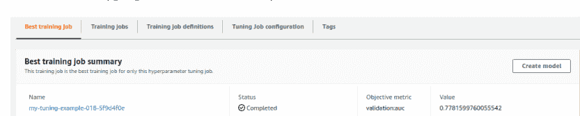

图 9.13 – 查找最佳超参数集

正如你所见，SageMaker 非常直观，一旦你了解模型优化背后的主要概念，使用 SageMaker 就会变得更容易。到目前为止，我们已经了解了如何为特定需求使用 SageMaker。在下一节中，我们将探讨如何为各种用例选择实例类型以及笔记本的安全性。

### 在 Amazon SageMaker 中选择实例类型

SageMaker 采用按使用量付费的模式。它没有最低费用。

当我们思考 SageMaker 上的实例时，一切都始于一个 EC2 实例。该实例负责所有处理。它是一个托管的 EC2 实例。这些实例不会出现在 EC2 控制台中，也无法通过 SSH 访问。实例类型以 m1 开头。

SageMaker 提供以下实例族：

- **t** 族：这是一个可突发 CPU 族。在此族中，你获得正常的 CPU 和内存比例。这意味着，如果你有一个长时间运行的训练作业，随着 CPU 积分的消耗，性能会随时间下降。如果你的作业非常小，则具有成本效益。例如，如果你希望笔记本实例启动训练作业，则此族是最相关且最具成本效益的。

- **m** 族：在前一个族中，我们看到由于其可突发特性，CPU 积分消耗更快。如果你的长时间运行的机器学习作业需要恒定的吞吐量，那么这就是合适的族。它具有与 **t** 族相似的 CPU 和内存比例。

- **r** 族：这是一个内存优化族。*我们什么时候需要这个？* 想象一下这样的用例：你需要将数据加载到内存中并对数据进行数据工程。在这种情况下，你需要更多内存，并且作业将是内存优化的。
- **c** 族：**c** 族实例是计算优化的。这是需要更高计算能力和更少内存来存储数据的作业的要求。如果你参考下表，C5.2x large 具有 8 vCPU 和 16 GiB 内存，这使其成为计算优化且内存较少的实例。例如，用例需要在较少记录上进行测试并且计算敏感，那么此实例族就是获取大量数据框中的一些样本记录并测试算法的最佳选择。
- **p** 族：这是一个 GPU 族，支持加速计算作业，例如训练和推理。值得注意的是，**p** 族实例非常适合处理大型分布式训练作业，这会减少训练所需的时间。因此，这变得具有成本效益。P3/P3dn GPU 计算实例可达每秒 1 petaFLOP 的计算能力，GPU 内存高达 256 GB，网络带宽为 100 Gbps，配备 8x NVIDIA v100 GPU。它们高度优化用于训练，并且不完全用于推理。
- **g** 族：对于具有成本效益的小规模训练作业，**g** 族 GPU 实例是理想选择。G4 具有 GPU 实例最低的每推理成本。它使用 T4 NVIDIA GPU。G4 GPU 计算实例可达 520 TeraFLOPs 的计算时间，配备 8x NVIDIA T4 GPU。此实例族最适合简单的网络。

在下表中，从每个族中取了 2x large 实例类型，以便在 CPU 和内存比例之间进行视觉比较：

| t3.2x large | m5.2x large | r5.2x large | c5.2x large | p3.2x large | g4dn.2x large |
|---|---|---|---|
| 8 vCPU, 32 GiB | 8 vCPU, 32 GiB | 8 vCPU, 64 GiB | 8 vCPU, 16 GiB | 8 vCPU, 61 GiB | 8 vCPU, 32 GiB |

表 9.1 – 显示不同实例类型 CPU 和内存比例的表格

> **重要提示**
> 为了更容易记住，你可以认为 T 代表 Tiny，M 代表 Medium，C 代表 Compute，P 和 G 代表 GPU。CPU 族实例类型为 T、M、R 和 C。GPU 族实例类型为 P 和 G。

### 为训练作业选择合适的实例类型

没有经验法则来决定你需要的实例类型。它会根据数据的大小、网络的复杂性、机器学习算法以及时间和成本等其他因素而变化。提出正确的问题将节省资金并使其具有成本效益。

如果决定因素是 *Instance Size*，那么对 CPU 或 GPU 进行问题分类是正确的步骤。完成之后，再考虑是否可以是多 GPU 或多 CPU。这将解决你关于分布式训练的问题。这也解决了你的 *Instance Count* 因素。如果是计算密集型，那么检查内存要求也是明智的。

下一个决定因素是 *Instance Family*。这里的正确问题是，*它是否针对时间和成本进行了优化*？在上一步中，我们已经确定问题是在 CPU 或 GPU 上解决，这缩小了选择过程。现在，让我们学习有关推理作业的信息。

### 为推理作业选择合适的实例类型

生产中机器学习的大部分成本和复杂性在于推理。通常，推理在实时运行单个输入。它们通常计算/内存密集度较低。它们必须高度可用，因为它们全天候运行并为终端用户请求提供服务或作为应用程序的一部分集成。

你可以根据工作负载选择我们最近了解的任何实例类型。除此之外，AWS 还有用于推理的 **Inf1** 和 **Elastic Inference** 类型实例。弹性推理允许你将 GPU 实例的一部分附加到任何 CPU 实例。

让我们看一个应用程序集成了推理作业的示例，那么应用程序的 CPU 和内存需求与推理作业不同。对于这些用例，你需要选择合适的实例类型和大小。在这种情况下，最好将应用程序舰队与推理舰队分开。这可能需要一些管理。如果这种管理对你的需求来说是个问题，那么选择弹性推理，在其中应用程序和推理作业可以共址。这意味着你可以在同一舰队上托管多个模型，并且可以将所有这些不同模型加载到不同的加速器内存中，并可以同时处理并发请求。

始终建议你在生产环境中确定实例类型和族之前，先在较低环境中运行一些示例。在下一节中，我们将深入探讨并了解保护 Amazon SageMaker 笔记本的不同方法。

### 保护 SageMaker 笔记本

如果你正在阅读本章的这一节，那么你已经了解了如何使用笔记本实例，应该选择哪种类型的训练实例，以及如何配置和使用端点。现在，让我们学习如何保护这些实例。以下方面有助于保护实例：

- **Encryption：** 当我们谈论或思考通过加密进行保护时，这一切都与数据有关。但这意味着什么？这意味着使用加密保护静态数据，使用加密保护传输中数据，并使用 KMS 实现更好的角色分离和通过 TLS 1.2 加密的互联网流量隐私。SageMaker 实例可以使用 AWS 管理的 KMS 密钥启动加密卷。这有助于默认情况下保护 Jupyter Notebook 服务器。
- **Root access：** 当用户从 Jupyter Web UI 打开 shell 终端时，他们将以 ec2-user 登录，这是 Amazon Linux 中的默认用户名。现在用户可以 sudo 到 root 用户。有了 root 访问权限，用户可以访问和编辑文件。在许多用例中，管理员可能不希望数据科学家管理、控制或修改笔记本服务器的系统。这需要对 root 访问进行限制。这可以通过在调用 CreateNotebookInstance 或 UpdateNotebookInstance 时将 RootAccess 字段设置为 Disabled 来完成。数据科学家将可以访问其用户空间并安装 Python 包。然而，他们无法 sudo 到 root 用户并对操作系统进行更改。
- **IAM role：** 在启动笔记本实例期间，有必要为执行创建 IAM 角色或使用现有角色进行执行。这用于使用与该角色关联的实例配置文件启动服务管理的 EC2 实例。此角色将根据附加到此角色的策略限制 API 调用。
- **VPC connection：** 当你启动 SageMaker 笔记本实例时，默认情况下它会在 SageMaker 服务账户中创建，该账户具有服务管理的 VPC，并且默认情况下将通过互联网网关访问互联网，而该网关由服务管理。如果你只处理与 AWS 相关的服务，则建议你在私有子网中在你的 VPC 内启动 SageMaker 笔记本实例，并使用自定义的安全组。AWS 服务可以通过附加到该 VPC 的 VPC 端点从此笔记本实例调用或使用。最佳实践是通过端点策略控制它们以实现更好的 API 控制。这确保了对 VPC 外部的数据出站的限制和安全环境。为了捕获所有网络流量，你可以打开 VPC 流日志，这些日志可以通过 CloudWatch 进行监控和跟踪。


+   - **Internet access**: 你可以在没有直接互联网访问的情况下启动 Jupyter Notebook 服务器。它可以在私有子网中启动，并通过 NAT 或通过虚拟私有网关访问互联网。对于训练和部署推理容器，你可以在调用 `CreateTrainingJob`、`CreateHyperParameterTuningJob` 或 `CreateModel` 时将 `EnableNetworkIsolation` 参数设置为 `True`。网络隔离可以与 VPC 结合使用，确保容器无法进行任何出站网络调用。

+   - **Connecting a private network to your VPC**: 你可以在 VPC 的私有子网中启动 SageMaker 笔记本实例。它可以通过与私有网络通信来访问私有网络的数据，这可以通过使用 Amazon VPN 或 AWS Direct Connect 将私有网络连接到你的 VPC 来实现。

在本节中，我们学习了几种保护 SageMaker 笔记本的方法。在下一节中，我们将学习如何使用 Lambda 函数创建 SageMaker 管道。

### Creating alternative pipelines with Lambda Functions

确实，SageMaker 是一个很棒的平台，你可以用它来创建训练和推理管道。然而，我们总可以与其他服务配合，构建类似的解决方案。我们接下来要学习的一个服务就是 **Lambda Functions**。

AWS Lambda 是一种无服务器计算服务，你可以在其中将函数作为服务运行。换句话说，你只需专注于编写函数。然后，你只需告诉 AWS 如何运行它（即环境和资源配置），这样所有必要的资源将被配置以运行你的代码，并在完成后停止。

在 *Chapter 6, AWS Services for Data Processing* 整个章节中，你探索了 Lambda 函数如何与许多不同的服务集成，例如 Kinesis 和 AWS Batch。确实，AWS 在将 Lambda 与 140 个服务集成方面做得非常出色（并且该列表还在不断增加）。这意味着当你使用特定的 AWS 服务时，你会记得它很可能与 Lambda 集成。

这一点很重要，因为 Lambda 函数确实可以扩展你创建可扩展和集成架构的可能性。例如，当文件上传到 S3 时，你可以触发一个 Lambda 函数，以便在将数据加载到 Redshift 之前预处理数据。或者，你可以创建一个 API，在每个端点执行时触发 Lambda 函数。再次说明，使用这种强大的服务，可能性是无穷无尽的。

另外，有用的是，你可以用不同的编程语言编写函数，例如 Node.js、Python、Go、Java 等。你的函数不一定需要由另一个 AWS 服务触发，也就是说，你可以手动触发它，例如用于你的 Web 或移动应用程序。

在部署方面，你可以将函数作为 ZIP 文件或容器镜像上传。虽然这不适合自动化部署流程，但直接在 AWS Lambda 控制台中编码也是可能的。

与其他服务一样，这个服务也有一些缺点，你应该注意：

+   - Memory allocation for your function: 这是 128 MB 到 10,240 MB（AWS 最近将此限制从 3 GB 增加到 10 GB，如前所述）。
+   - Function timeout: 这是最多 900 秒（15 分钟）。
+   - Function layer: 这是最多 5 层。
+   - Burst concurrency: 这取决于区域，从 500 到 3,000 不等。
+   - Deployment package size: 这是 250 MB 未压缩，包含层。
+   - Container image code package size: 这是 10 GB。
+   - Available space in the /tmp directory: 这是 512 MB。

在选择 Lambda 函数之前，请确保这些限制适合你的用例。将 Lambda 函数更接近 SageMaker 替代管道的范围，Lambda 的一个潜在用途是为我们的模型创建推理管道。

正如你所知，SageMaker 有一个非常方便的 `.deploy()` 方法，它将为模型推理创建端点。这样你就可以调用它来传递输入数据以接收预测结果。在这里，我们可以使用 API 网关和 Lambda 函数创建此推理端点。

如果不需要推理端点，而只是想进行预测并以批处理方式将结果存储在某处，那么我们只需要一个 Lambda 函数即可，它能够获取输入数据、实例化模型对象、进行预测并将结果存储在适当的位置。当然，它会考虑我们之前讨论过的所有限制。

好了，现在我们对 Lambda 有了良好的背景知识以及一些用例，让我们来看看考试中我们应该注意的最重要的配置。

### Creating and configuring a Lambda Function

首先，你应该知道，你可以通过多种方式创建 Lambda 函数，例如通过 AWS CLI（Lambda API reference）、AWS Lambda 控制台，甚至部署框架（例如 serverless framework）。

无服务器框架通常与提供商和编程语言无关。换句话说，它们通常允许你从各种云提供商和编程语言的列表中选择部署无服务器基础设施的位置。

> **Important note**
> 无服务器架构的概念并非 AWS 特有。事实上，许多云提供商都提供与 AWS Lambda 函数类似的其他服务。这就是为什么构建了这些无服务器框架：帮助开发人员和工程师部署他们的服务，无论他们想要在哪里部署，包括 AWS。这不太可能出现在你的考试中，但这绝对是你应该知道的事情，以便你了解作为数据科学家或数据工程师解决挑战的不同方式。

由于我们希望通过 AWS Machine Learning Specialty 考试，这里我们采用了通过 AWS Lambda 控制台逐步操作的方法。这样你将更熟悉他们的界面和最重要的配置选项。

当你导航到 Lambda 控制台并请求新的 Lambda 函数时，AWS 会为你提供一些起始选项：

+   - Author from scratch: 如果你想从头创建函数。
+   - Use a blueprint: 如果你想从示例代码和常见用例的配置预设创建函数。
+   - Container image: 如果你想选择容器镜像来部署你的函数。
+   - Browse serverless app repository: 如果你想从 AWS Serverless Application Repository 部署示例 Lambda 应用程序。

从头开始，下一步是设置你的 Lambda 配置。AWS 将这些配置分为基本和高级设置。在基本配置中，你将设置函数名称、运行时环境和权限。图 9.14 显示了这些配置：

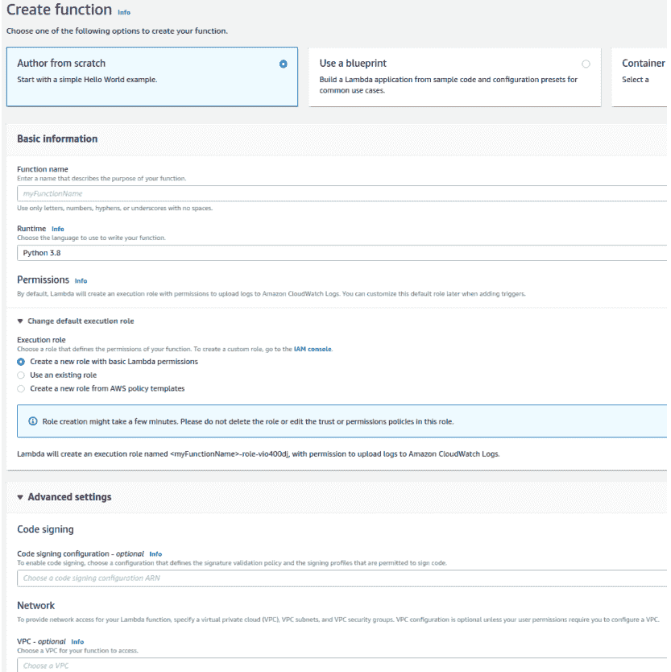

Figure 9.14 – Creating a new Lambda Function from the AWS Lambda console

这里有一个你在考试中应该记住的非常重要配置：**execution role**。你的 Lambda 函数可能需要权限来访问其他 AWS 资源，例如 S3、Redshift 等。执行角色授予你的 Lambda 函数权限，以便按需访问资源。

你必须记住，你的 VPC 和安全组配置也会影响 Lambda 函数的运行方式。例如，如果你想创建一个需要互联网访问来下载某些内容的函数，那么你必须在具有互联网访问的 VPC 中部署此函数。同样适用于其他资源，例如访问关系数据库、Kinesis、Redshift 等。

此外，为了正确配置 Lambda 函数，我们至少需要编写其代码、设置执行角色，并确保 VPC 和安全组配置符合我们的需求。接下来，让我们看看其他配置。

### Completing your configurations and deploying a Lambda Function

一旦你在 AWS 控制台中创建了 Lambda，你就可以在部署函数之前设置其他配置。其中一个配置是事件触发器。正如我们之前提到的，你的 Lambda 函数可以由各种服务触发，甚至可以手动触发。

> **Important note**
> 触发器的一个非常常见的例子是 **Event Bridge**。这是一个 AWS 服务，你可以在其中安排函数的执行。


根据你选择的事件触发器，你的函数将可以访问不同的事件元数据。例如，如果你的函数由 S3 上的 **PUT** 事件触发（例如，有人向某个特定的 S3 存储桶上传文件），那么你的函数将接收与此事件关联的元数据，例如存储桶名称和对象键。其他类型的触发器会给你不同类型的事件元数据！

你可以通过属于你函数入口点签名的 event 参数访问这些元数据。还不够清楚？好的，让我们看看你的函数代码应该如何声明，如下所示：

```
def lambda_handler(event, context):
TODO
```

这里，`lambda_handler` 是代表你函数入口点的方法。当它被触发时，此方法将被调用，并且它将接收与事件触发器关联的事件元数据（通过 `event` 参数）。这就是你能够访问触发你的函数的底层事件相关信息的方式！`event` 参数是一个类似 JSON 的对象。

如果你想测试你的函数，但又不想直接从底层事件触发它，这也没问题；你可以使用 **test events**。它们通过准备一个将传递给你的函数的 JSON 对象来模拟底层事件。

*Figure 9.15* 显示了一个非常直观的例子。假设你创建了一个函数，当用户向 S3 上传文件时触发，现在你想测试你的函数。你可以上传文件到 S3（从而强制触发）或创建一个测试事件。

通过创建测试事件，你可以准备一个模拟 S3-put 事件的 JSON 对象，然后将此对象传递给你的函数：

### Configure test event

一个函数最多可以有 10 个测试事件。事件会被持久化，因此你可以切换到另一台计算机或 Web 浏览器并使用相同的事件测试你的函数。

- Create new test event
- Edit saved test events

Event template

s3-put

Event name

MyEventName

```
{
  "Records": [
    {
      "eventVersion": "2.0",
      "eventSource": "aws:s3",
      "awsRegion": "us-east-1",
      "eventTime": "1970-01-01T00:00:00.000Z",
      "eventName": "ObjectCreated:Put",
      "userIdentity": {
        "principalId": "EXAMPLE"
      },
      "requestParameters": {
        "sourceIPAddress": "127.0.0.1"
      },
      "responseElements": {
        "x-amz-request-id": "EXAMPLE123456789",
        "x-amz-id-2": "EXAMPLE123/5678abcdefghijklambdaisawesome/mnopqrstuvwxyzABCDEFGH"
      },
      "s3": {
        "s3SchemaVersion": "1.0",
        "configurationId": "testConfigRule",
        "bucket": {
          "name": "example-bucket",
          "ownerIdentity": {
            "principalId": "EXAMPLE"
          },
          "arn": "arn:aws:s3:::example-bucket"
        },
        "object": {
          "key": "test/key",
          "size": 1024,
          "eTag": "0123456789abcdef0123456789abcdef",
          "sequencer": "0A1B2C3D4E5F678901"
        }
      }
    }
  ]
}
```

Cancel   Format JSON   Create

Figure 9.15 – Creating a test event from the Lambda console

你还可以设置另一种类型的配置，即 **environment variable**，它将在你的函数上可用。*Figure 9.16* 显示了如何在 Lambda Function 中添加环境变量：

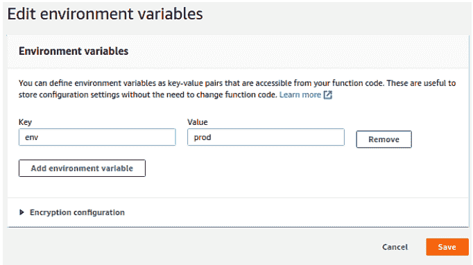

Figure 9.16 – Adding environment variables to a Lambda Function

你始终可以返回这些基本配置以根据需要进行调整。*Figure 9.17* 显示了你在基本配置部分会找到的内容：

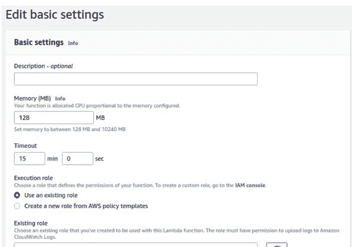

Figure 9.17 – Changing the basic configurations of a Lambda Function

就监控而言，默认情况下，Lambda Functions 会生成一个 **CloudWatch** 日志流和标准指标。你可以通过导航到你的 Lambda Function 监控部分并点击 *View logs in CloudWatch* 来访问日志信息。

在 CloudWatch 中，每个 Lambda Function 都会有一个 **Log group**，并且在该 Log group 内有许多 **Log streams**。Log streams 存储关联函数的执行日志。换句话说，log stream 是共享相同来源的日志序列，在本例中是你的 Lambda Function。log group 是共享相同保留、监控和访问控制设置的 log streams 的组。

我们即将结束本节，但不是 Lambda Functions 这个主题的结束。正如我们之前提到的，这项 AWS 服务有很多用例并且与许多其他服务集成。在下一节中，我们将查看另一项 AWS 服务，它将帮助我们编排 Lambda Functions 的执行。这些被称为 **AWS Step Functions**。

### Working with Step Functions

Step Functions 是一项 AWS 服务，允许你创建工作流以编排 Lambda Functions 的执行。这样你就可以将它们连接成一种事件序列，称为 **steps**。这些步骤被分组在一个 **state machine** 中。

Step Functions 包含重试功能，因此你可以配置你的管道仅在特定步骤成功后才继续。你设置这些重试配置的方式是通过创建 **retry policy**。

> **Important note**
> 就像大多数 AWS 服务一样，AWS Step Functions 也与其他服务集成，而不仅仅是 AWS Lambda。

创建状态机相对简单。你只需导航到 AWS Step Functions 控制台，然后创建一个新的状态机。在 *Create state machine* 页面上，你可以指定是否要从头创建状态机、从模板创建，或者只是运行一个示例项目。

AWS 会帮助你创建此状态机，因此即使你选择从头创建，你也会找到各种任务的代码片段，例如 AWS Lambda 调用、SNS 主题发布、运行 Athena 查询等。

为了演示，我们将创建一个非常简单但仍然有用的示例，说明如何使用 Step Functions 执行 Lambda Function 并激活重试选项：

```
{
  "Comment": "A very handy example of how to call a lambda function with retry option",
  "StartAt": "Invoke Lambda function",
  "States": {
    "Invoke Lambda function": {
      "Type": "Task",
      "Resource": "arn:aws:states:::lambda:invoke",
      "Parameters": {
        "FunctionName": "arn:aws:lambda:your-function-identification",
        "Payload": {
          "Input": {
            "env": "STAGE"
          }
        }
      },
      "Retry": [
        {
          "ErrorEquals": ["States.ALL"],
          "IntervalSeconds": 60,
          "MaxAttempts": 5,
          "BackoffRate": 2.0
        }
      ],
      "Next": "Example"
    },
    "Example": {
      "Type": "Pass",
      "Result": "Just to show you how to configure other steps",
      "End": true
    }
  }
}
```

在前面的示例中，我们创建了一个包含两个步骤的状态机：

- Invoke Lambda function：这将启动你的底层 Lambda 的执行。
- Example：这是一个简单的 pass 任务，只是为了向你展示如何在管道中连接第二个步骤。

在第一个步骤中，我们还设置了重试策略，如果出现任何失败，它将尝试重新执行此任务。我们设置了重试间隔（以秒为单位）以及尝试次数。Figure 9.18 显示了状态机：

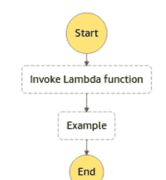

Figure 9.18 – The state machine

我们现在已经到达本节的末尾，也是本章的末尾。接下来，让我们总结一下我们学到的内容。

### Summary

在本章中，我们学习了使用 SageMaker 创建 notebook 实例和训练实例的用法。在学习过程中，我们学习了如何使用 SageMaker 进行超参数调优作业。由于我们在 AWS 中保护资产的安全是至关重要的一部分，我们学习了保护 SageMaker 实例的各种方法。通过实践，我们创建了 Step Functions 并使用 AWS Lambda 编排了我们的管道。

AWS 产品每天都在发展，以帮助我们解决 IT 问题。记住所有产品名称并不容易。学习的唯一方法是通过实践。当你解决问题或构建产品时，然后专注于产品的不同技术领域。这些领域可以是 AWS 服务，例如，调度作业、日志记录、跟踪、监控指标、自动扩展等。


计算时间、存储和网络是基础。建议你为每项服务练习一些示例。参考 AWS 文档以澄清任何疑问也是最佳选择。设计解决方案时始终要以成本效益为重，因此探索以成本效益的方式使用这些服务与构建解决方案同等重要。祝你好运！

### 问题

1. 以下哪些模型是有监督算法？选择两个选项。

- A. 聚类
- B. 分类
- C. 关联规则挖掘
- D. 回归

2. 你希望将 Amazon SageMaker 机器学习模型和端点转变为面向客户的应用程序。你决定将这些部署在单个 Web 服务器上，客户可以通过浏览器访问。然而，你意识到 Web 服务器本身并不是固有的可扩展；如果收到大量流量，它可能会耗尽 CPU 或内存。如何使这种方法更具可扩展性和安全性？选择三个答案。

- A. 创建一个 IAM 角色，以便 Web 服务器可以访问 SageMaker 端点。
- B. 部署负载均衡器并设置自动扩展。
- C. 让所有客户成为 IAM 用户，以便他们可以访问 SageMaker。
- D. 保持 Web 服务器的操作系统和语言运行时补丁安全。

3. 对于前述情况，哪个 AWS 服务更适合自动化服务器和操作系统维护、容量配置和自动扩展？

- A. AWS Lambda
- B. AWS Fargate
- C. AWS ELB

4. Amazon SageMaker 是一项完全托管的服务，可让你快速轻松地将基于机器学习的模型集成到应用程序中。它还提供诸如笔记本、训练和端点实例等服务来帮助你完成工作。
A. 真
B. 假

5. 从以下选项中选择三个正确的陈述：
A. 笔记本实例清理和理解数据。
B. 训练实例使用数据训练模型。
C. 端点实例使用模型产生推理。
D. 笔记本实例清理、理解和构建模型。
E. 训练实例用于预测结果。

6. 创建笔记本的第一步是什么？
A. 给它命名。
B. 选择内核。
C. 以段落格式开始开发代码。

7. 线性学习器和 XGBoost 算法可用于监督学习模型，例如回归和分类。
A. 真
B. 假

8. 关于超参数调优，以下哪个陈述是正确的？
A. 超参数调优是改进模型的保证方法。
B. 超参数调优不需要任何输入值。
C. 超参数调优使用回归来选择要测试的最佳值。
D. 超参数调优是一个无监督的机器学习回归问题。

### 答案

- 1. B 和 D
- 2. A、B 和 D
- 3. A
- 4. A
- 5. A、B 和 C
- 6. B
- 7. A
- 8. C


Packt.com

订阅我们的在线数字图书馆，全面访问超过 7,000 本书籍和视频，以及帮助你规划个人发展和提升职业生涯的行业领先工具。欲了解更多信息，请访问我们的网站。

# 为什么订阅？

- 使用来自 4,000 多名行业专业人士的实用电子书和视频，花更少时间学习，花更多时间编码
- 使用专为你打造的技能计划提升学习效果
- 每月免费获得一本电子书或视频
- 完全可搜索，便于快速访问重要信息
- 复制、粘贴、打印和书签收藏内容

你知道 Packt 提供每本出版书籍的电子书版本，文件格式为 PDF 和 ePub 吗？你可以在 packt.com 升级到电子书版本，作为印刷书籍客户，你有权享受电子书折扣。请通过 customercare@packtpub.com 与我们联系以获取更多详情。

在 www.packt.com，你还可以阅读大量免费技术文章，订阅多种免费通讯，并获得 Packt 书籍和电子书的独家折扣和优惠。

# 你可能喜欢的其他书籍

如果你喜欢这本书，你可能对 Packt 的以下其他书籍感兴趣：

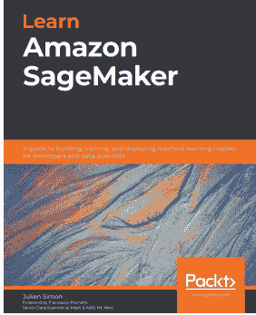

## 学习 Amazon SageMaker

Julien Simon

ISBN: 978-1-80020-891-9

- 在 Amazon Web Services (AWS) 上创建和自动化端到端机器学习工作流
- 熟悉数据标注和准备技术
- 使用真实示例训练计算机视觉和 NLP 模型
- 涵盖扩展、模型优化、模型调试和成本优化的训练技术
- 使用 SDK 和多种自动化工具在多种配置中自动化部署任务

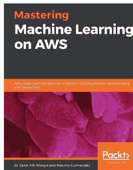

## 在 AWS 上掌握机器学习

Saket Mengle, Maximo Gurmendez

ISBN: 978-1-78934-979-5

- 使用 AWS 云部署为智能数据产品提供动力的服务，通过管理 AI 工作流
- 使用 SageMaker 服务创建推荐模型
- 使用 EMR 上的 Apache Spark 扩展模型训练和部署
- 了解如何通过 EMR 对大数据进行聚类并无缝地将其与 SageMaker 集成
- 使用 TensorFlow 在 AWS 上构建深度学习模型并将其部署为服务
- 通过结合 Apache Spark 和 Amazon SageMaker 增强你的应用

# Packt 正在寻找像你这样的作者

如果你有兴趣成为 Packt 的作者，请访问 authors.packtpub.com 并立即申请。我们已与数千名开发者和技术专业人士合作，帮助他们与全球技术社区分享见解。你可以提交通用申请、申请我们正在招聘作者的特定热门主题，或提交你自己的想法。

# 留下评论 - 让其他读者知道你的想法

请通过你购买书籍的网站与他人分享你对这本书的想法。如果你从 Amazon 购买了本书，请在该书的 Amazon 页面上留下诚实的评论。这对其他潜在读者做出购买决策、我们了解客户对产品的看法以及作者看到他们与 Packt 合作的作品的反馈都至关重要。只需花费你几分钟的时间，但对其他潜在客户、我们的作者和 Packt 都非常有价值。谢谢！
