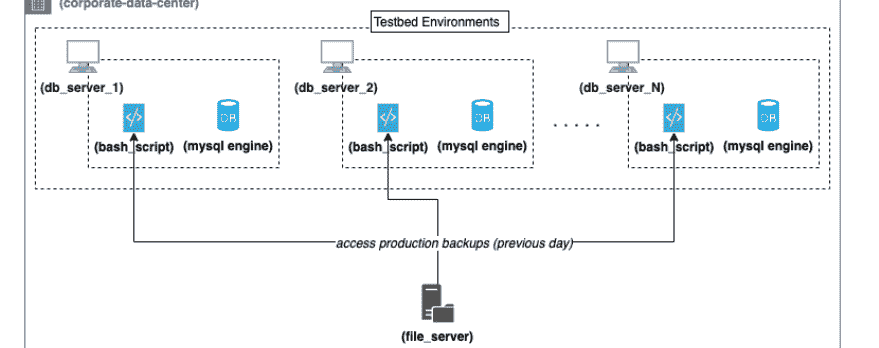

# 第 1 部分

通过 AWS 和 DevOps 推动转型

本部分强调了数字化转型的本质，以及 DevOps 和 AWS 所扮演的关键角色。通过真实案例，你将理解以客户为中心的重要性，以及聚焦业务成果而非技术所带来的成功。你还将了解 AWS 的不同服务层级，以及该云服务提供商如何帮助实现基础设施不可变性的优势。最后，我们将引导你在 AWS 账户中设置 AWS Cloud9 IDE，从而能够部署本书涵盖的所有动手练习。

本部分包含以下章节：

- 第 1 章，使用 AWS 加速你的 DevOps 之旅
- 第 2 章，选择正确的云服务
- 第 3 章，在云中利用不可变基础设施

实例和只读副本。每分钟的停机或系统退化都会直接影响发货、包装和订单开票。在那段时间里，开发人员使用本地 MySQL 实例来开发和测试新功能，之后会将它们交付到预发布环境，随后进行生产部署。

问题陈述明确后，一个很有前景的下一步是让他们在*类生产*环境中进行开发和测试。这将使他们能够看到系统如何响应不断变化的客户使用模式，并在更早阶段更好地理解生产问题。

凭借对 Bash 脚本的扎实理解（……至少我当时是这么认为的）和基本的 MySQL 管理技能，我决定编写 shell 脚本，以准备这些测试环境，并每天用最新的生产数据刷新它们。我们向本地基础设施团队提交了同等数量新 MySQL 服务器的请求。他们在一周内完成了配置，安装了操作系统和 MySQL 所需的库，然后将我的*新获得的负担*移交给我。此后，这些服务器的所有维护和保养都由我负责。后来，我在所有这些服务器上安排了 cron 作业，以运行之前创建的脚本。它们会每天在预配置的时间执行以下步骤：

- 将前一天的生产备份从文件服务器复制到本地文件系统。
- 删除本地 MySQL 数据库中的所有现有数据。
- 将新的备份数据导入本地 MySQL 数据库。
- 执行数据脱敏并移除某些其他机密数据表。

你可以在下图中看到不同实体之间的通信方式：

图 1.1：用于管理数据库操作的 Bash 脚本

该框架在两到三周内运行良好，随后下一波挑战变得显而易见：

- 数据导入时间呈指数级增长。要执行并行 MySQL 线程，我需要更多的计算能力——因此，需要再次向基础设施团队提出请求。
- 高 I/O 操作需要更高性能的磁盘。为了升级这些磁盘，基础设施团队不得不提交新的采购订单并安装新的 SSD。
- 开发人员现在希望能够保留备份的最新 X 个版本。这些备份应该存储在哪里？

你可能已经注意到，该框架已经相当成熟，但它的好坏取决于底层基础设施的可用性、可伸缩性和可靠性。面对性能不足的机器、磁盘容量问题和频繁的网络超时，该框架能做的实在有限。

起初作为一项提高开发速度的举措，很快演变成了一个以技术为中心的框架。*这次实践有技术上的收获吗？* 很多。事实上，收获太多了，之后我写了一篇*Bash 脚本最佳实践*博客，可以在 https://medium.com/p/17229889774d 找到。它解决了开发人员面临的所有问题吗？可能没有。在开始这些冗长的开发周期并陷入解决技术问题的死胡同之前，更好的做法是构建一点、测试一点，并始终用这个问题挑战自己：*这真的是我的客户需要的吗？*

## 了解你的客户（及其未来需求）

了解你工作的最终受益者至关重要。你总会有*客户*——内部、外部，或两者兼有。如果你不确定这一点，我强烈建议你与经理或同事讨论，以了解解决方案是为谁构建的。至关重要的是，要站在客户的角度，从他们的视角来对待问题和解决方案。始终问自己，你所做的事情是否能解决客户的问题并让他们满意。我花了至少两三个月的时间才让 Bash 框架达到理想的性能和实用性水平。然而，Bash 脚本编排器并不是我的客户（开发人员）所需要的。他们需要的是一种简单、可扩展且可靠的机制来复现类生产数据库。事实上，操作这个框架对他们来说是一种额外的负担。这并没有帮助他们在最擅长的事情上发挥——编写代码和交付业务成果。

## 专注于迭代开发和快速失败

交付有影响力的客户解决方案的另一个先决条件是建立迭代工作模式：将工作分解为可管理的部分，监控成功指标，并建立反馈机制来验证进展。将这一点应用于上述情况，意味着开发人员从一开始就能完全了解实现过程。通过共同协作，我们本可以在过程一开始就定义成功标准（预置生产数据库副本的时间）。

## 基础设施即代码（IaC）

使用代码（通过 SDK、API 等）管理 AWS 基础设施组件，使得在大规模环境中可靠管理变得非常方便。与本地使用的静态预置方法不同，这些实践能够通过可编程工作流创建完整的基础设施堆栈。

这还减少了开发团队和运维团队之间的所有权孤岛。开发人员可以自由使用熟悉的编程语言构造，并对基础基础设施元素进行端到端控制。

## 有效的沟通与协作

团队成员之间的协作对于更快的软件交付至关重要。建议组建拥有共同目标的小团队。亚马逊采用了“两个披萨团队”规则的概念，即创建一个不超过两个披萨就能喂饱的团队规模，大约是 8 到 10 人的团队。

此外，这使团队不仅能够交付软件，还能端到端地拥有它。运维、部署、支持和功能开发都由这个团队的成员负责。

现在，既然我们已经对关键的 DevOps 方法论有了很好的理解，让我们深入探讨几个在云中实现这一目标的 AWS 服务。

## 关键的 AWS DevOps 服务

AWS 提供了针对这些原则中每一项的托管服务。根据组织的运营模式，你可以在 AWS 账户中部署这些服务，并赋予所有团队成员自主权，以利用云端的无限潜力。

所有这些 AWS 服务的功能路线图都深受客户反馈的驱动。这增加了开箱即用支持企业级使用模式的可能性。例如，想象一下这样的用例：一旦代码提交到仓库，就自动发送通知并触发部署。让我们深入了解一下在各个关键领域简化 DevOps 采用的各种产品。

### CI

Git 工作流对任何软件团队的成功都至关重要。他们提交代码的方式、使用的注释，以及他们在功能请求上的协作方式，在很大程度上反映了他们的工程实践。高绩效团队还会确保对进入中央仓库的每一次提交提供快速的自动化反馈。AWS 提供了三项关键服务来支持此类需求。

### AWS CodePipeline

CodePipeline 是一个编排器，可与前面讨论过的所有服务协同工作。它管理整体的软件交付流程，并负责按定义的顺序调用特定服务。

使用 YAML 和 JSON 模板，您可以编写一个自动化流程，可可靠地每次都发布软件。该服务在与许多其他服务的原生集成方面表现出色。这抽象了大量内部细节，让您可以专注于应用特定的细节。

### IaC

随着软件应用复杂性的不断增加，基础设施需求呈指数级增长。手动管理所有这些组件容易出错且受制于人为限制。使用标准工具、SDK 和 API，AWS 使管理整个 IaC 变得简单。只需几分钟即可在整个 AWS 区域内启动和拆除基础设施。

AWS 提供不同编程语言的 SDK，例如 Python、Go、Ruby、JavaScript、C++ 等等。使用熟悉的编程语法，您可以使用代码开发和运营整个软件栈。在后面的章节中，我们将学习相关的 AWS 服务，例如 CloudFormation 和 Cloud Development Kit（CDK）。

### AWS CloudFormation

使用 JSON 或 YAML 模板，用户可以定义整个基础设施栈并将其作为代码维护。CloudFormation 允许他们自动构建资源依赖图并按所需顺序配置所有服务。它还支持多区域和多账户发布，这对企业级 AWS 环境很有帮助。

### AWS CDK

这是一个开源的基础设施管理框架，采用构造的概念工作——用于部署集成应用组件的现成抽象。在内部，它使用 CloudFormation 模板，但将这些细节从最终用户那里抽象出来。它提供原生编程语言特性，例如条件、组合和继承，使用户能够将编程方法应用于基础设施管理。这些可重用组件随后可以与公司内的其他团队共享。这不仅加速了整体 DevOps 的采用，还为特定应用模式提供了标准化的基础设施解决方案。

## Summary

在本章中，我们讨论了两个现实生活中的例子，帮助您比较构建解决方案的不同方法并使您的团队受益。虽然这凸显了传统本地基础设施模型中的某些缺点，但您也了解了在云中使用 AWS 服务的实际好处。

在这一过程中，我们还涵盖了一些指导原则，这些原则将使您作为软件专业人士的生活更轻松。您学习了如何将最终用户视为客户，将技术产品与他们的业务成果保持一致，降低他们的认知负担，并专注于迭代开发实践。

在奠定基础之后，我们随后深入探讨了重要的 DevOps 方法论，这些方法论能够可靠且安全地实现大规模软件交付。最后，您了解了可以提升 DevOps 采用并提供企业级可靠性、可用性和安全性的关键 AWS 服务。

在第 2 章《选择合适的云服务》中，我们将学习 AWS 提供的不同服务模型以及一些决定什么最适合您组织的策略。

## Further reading

您可以通过查阅官方白皮书，更深入地了解 AWS 在持续集成、持续交付和持续部署领域的服务提供：https://docs.aws.amazon.com/whitepapers/latest/practicing-continuous-integration-continuous-delivery/welcome.html

## Platform as a Service (PaaS)

在 PaaS 服务模型中，云提供商在基础设施之上额外管理操作系统和应用集成。这进一步将系统内部抽象给软件团队，让他们能够专注于业务成果。借助预构建的集成，基础设施、运营和配置管理等所有方面，即维护硬件和软件处于期望状态的过程，均由提供商负责。这些平台在某种程度上对软件交付流程及其自动化有自己的见解。开发人员仍需编写代码，但 PaaS 会负责运营和部署活动，这与底层 IaaS 实现无缝融合。

开发人员从此类产品中获益匪浅，因为它们帮助他们在短时间内构建概念验证。与 IaaS 相比，这些产品通常对定制和更改的灵活性较低。开发人员需要花费时间来适应框架的具体要求以及代码结构、配置、软件交付流程等方面的期望。然而，一旦他们对所提供的服务有了基础性的理解，新应用的上线时间会大大改善。

## Software as a Service (SaaS)

这是云提供商最全面的服务形式，最终用户只需通过 API 或直接通过互联网上的浏览器消费应用功能即可。最终用户无需负责软件补丁、整体维护和应用正常运行时间。云提供商则需要负责此类产品的安全方面。通常，这些是多租户系统，多个用户共享存储。

以某种形式或其他形式，我们每天都在使用 SaaS 应用。常见示例是电子邮件和基于云的文件存储。在第 1 章中，我们讨论了云服务接管非差异化繁重工作的重要性。SaaS 完美契合这一概念。最终用户可以消费软件应用，而无需担心其他任何事情。

就更改和控制的灵活性而言，该模型是最不灵活的，因为您受制于来自提供商方面的服务边界和限制。您对软件功能的影响力较小。SaaS 对于那些不想拥有可以原样消费的应用、也不想重复造轮子的公司来说非常理想。

让我们尝试将迄今为止的学习成果可视化映射到不同的云服务层级以及它们提供的不同抽象和控制级别。不同层级在表 2.1 中突出显示，其中白色部分表示您需要管理的部分，蓝色部分表示由云提供商管理的部分：

## Monitoring

在生产环境中运行应用需要对应用各层如何运行的可视性。为了了解关键系统行为，软件开发人员可以从 PaaS 提供商支持的指标中获得有价值的见解，例如传入 HTTP 请求的数量、数据库响应时间延迟等等。

Beanstalk 提供基础或增强的报告和监控，直接在控制台中。借助 *目标响应时间*、集群 *CPU 利用率* 和 *总请求* 等基础见解，该平台提供了在本地系统上不可用的应用性能聚合视图。使用 Beanstalk 健康代理，该服务还提供了有关部署时间活动的有趣见解，以及它们如何与应用行为相关联。这在本地基础设施设置中从未出现过。

借助 PaaS 产品，您不仅能满足基本的应用需求，还能从平台获得有趣的功能，这些功能基于提供商运行数千家其他企业客户工作负载的经验而得。在自行管理和从零开始管理工作负载时，建立这种知识和最佳实践需要很长时间。

## Code deployment

为了在云中发布功能，Beanstalk 提供与 Amazon S3 的无缝集成。您将代码包上传到存储服务，Beanstalk 会处理其余工作。此外，它还支持成熟的 DevOps 方法论，在所有服务器上发布之前，先在隔离环境中测试新功能。

团队最终采用了 *流量拆分* 部署策略，使他们能够在服务器子集上测试新功能，而实时请求则由其他服务器使用旧的稳定版应用代码提供服务。

对这些配置设置中的任何一项的修改都与修改 Web 控制台中的属性一样简单，该属性可将部署模式切换为 *滚动* 或 *一次性*。这些部署模式控制更改在服务器间的推出速率：一次一台或一次性全部推出。在自行实现类似的软件交付能力时，需要对各种系统、应用和工具进行大量调整。对于刚开始使用云的团队来说，这绝对不容易。

## Configuration

包括软件、实例、容量规划等在内的任何应用栈组件的修改，都可以通过 Elastic Beanstalk 支持的配置选项实现。一旦开发人员习惯通过控制台操作该服务，他们也开始通过代码推出修改。Elastic Beanstalk 提供了使用其自定义配置文件推出自定义化的可能性。

这种理解和信心为更轻松地采用由代码驱动的自动化和工具铺平了道路。在本地环境中，开发人员几乎没有任何机会来

拥有软件栈的运维权。Beanstalk 为他们打开了大门，使他们不仅能够构建，还能拥有从开发到生产的环境。

## 运维

PaaS 服务成功的一个关键衡量标准是在*第二天运维*方面所提供的简洁程度。如果管理不当，这可能导致软件开发人员将过多时间花在重复、枯燥的任务上，甚至更糟的是，最终用户体验受到影响。

通过 AWS EC2 自动扩展和 ELB，Beanstalk 提供了按需配置容量、跨多个实例负载均衡请求以及根据应用程序使用指标扩展应用程序的能力。

从一组基本功能开始，开发人员可以通过利用自定义配置文件和 CloudFormation 支持等集成点，非常简单地扩展系统以满足未来需求。然而，云平台（即 AWS 账户、底层 VPC 等）仍由云平台团队管理。

接下来，让我们深入探讨一种以增长为导向的运营模式，该模式促进所有权，并赋予应用程序所有者更多控制权。

## 聚焦云端增长

拥有成熟 DevOps 实践的快速发展的组织展示了这种在云端运营的方式。开发人员不仅构建和运行软件栈，还自行管理云平台。这只有在团队自动化大部分任务、频繁测试，并利用 IaaS 云能力将整个基础设施作为代码管理时才能实现。

在这种设置中，云平台团队专注于确保正确的护栏、合规性和整体战略，而不是为各个团队管理基础设施。大规模管理多账户 AWS 环境是我们在本书末尾专门一章中讨论的主题。

重要的是要理解，组织内的所有团队不必遵循相同的运营模式。企业通常会根据各个应用程序的需求和优先级，混合使用这三种模式。

让我们讨论另一个现实生活中的例子：同一个团队在获得相关云技能后，几个月后又推出了另一项云服务。这一次，他们负责整个云基础设施。这是在采用 PaaS 产品、扩展学习视野，随后使用 IaaS 控制整个基础设施的企业中常见的演进路径。这些需求主要是由对 PaaS 环境向最终用户暴露之外的控制和优化需求驱动的。

## 监控

自行管理所有应用程序组件也意味着必须与应用程序本身一起推出广泛的监控功能。基本的 CloudWatch 监控足以满足对基础设施组件行为洞察的需求，但对于应用程序可观测性来说还不够。

通过在 AMI 中注入 CloudWatch 代理并为应用程序日志创建自定义解析器，开发人员能够将相关指标发布到监控仪表板上。一旦指标可用，开发人员就可以轻松地从这些指标中获取信息，剖析系统行为并配置警报。

应用程序要求集群中所有参与系统满足严格的延迟边界。这需要对任何阈值违规进行持续监控和警报。由于对 AMI 的完全控制，团队能够注入自定义实用程序，测量跨多个可用区的延迟，然后将其发布到 CloudWatch 上。

## 代码部署

使用 Terraform CLI，开发人员能够通过一条 `terraform deploy` 命令推出整个基础设施栈。这使他们能够在多个 AWS 区域轻松配置和管理应用程序。

与代码部署实践类似，基础设施栈也像其他软件组件一样被推出。AWS CodeDeploy 和 AWS CodePipeline 为开发人员提供了在整个计算集群中部署应用程序组件的 CI/CD 能力。

## 配置

与 PaaS 不同，IaaS 服务不提供应用程序配置功能。它们根本不会管理网络、计算和存储之上的任何内容。这意味着开发人员必须设计并部署自己的流水线，以针对各个 AWS 区域推出 EC2 IAM 镜像。操作系统内部或应用程序配置中最小的更改，也会以新的 AMI 修订版形式推出。

另一方面，这为开发人员在修改 Linux 内核参数、软件库和磁盘存储配置方面提供了很大的灵活性。AWS 作为云提供商，只提供管理基础设施的 API，其余部分由开发人员使用 AWS 和开源工具及框架的组合来管理。

## 运维

Beanstalk 抽象了许多细节，并默认提供现成的集成和最佳实践。然而，这种架构要求所有内容都由开发人员管理。管理所有应用程序复杂性的过程让开发人员学到了大量 AWS 知识，使他们能够自动化所有他们想要的运维操作。

## 通过平台服务加速软件交付

平台即服务产品允许用户专注于管理自己的应用程序，而不是底层基础设施。有了这种支持，开发人员可以更高效地工作，无需担心容量规划、软件维护或修补。

有两个值得提及的关键服务可以促进应用程序开发。

## AWS Elastic Beanstalk

从快速启动 Web 应用程序到支持移动后端 API，Elastic Beanstalk 帮助用户对基础设施和应用程序组件进行端到端管理。用户将代码提交到中央仓库，该服务负责软件交付、基本网络和监控。这实现了快速扩展和加速的市场进入策略。它支持多种编程语言中的广泛应用程序平台。

## AWS Lambda

AWS Lambda 是一种计算服务，在完全托管的环境中执行代码。借助自动扩展、日志记录和操作系统维护，用户只需编写代码并将 Lambda 函数与其他 AWS 服务连接起来即可构建应用程序。

您将逻辑编写为 Lambda 函数，这些函数可以扩展到每秒数千个请求。您只需为执行时间付费。

## 完全托管的软件服务

最后一层提供完全抽象，仅向用户提供 SDK 和 API 来使用功能。不需要用户在操作、部署或功能开发方面进行干预。这些服务专门用于非常特定的业务用例，在这些用例中，重新发明轮子是不可行的。

## Amazon Chime

这是一种完全托管的通信服务，组织可使用它来托管会议、视频会议和聊天会话。所有企业用例，如托管策略、SSO 访问和持久通信，均开箱即用。希望构建定制化体验的公司也可以利用 SDK 构建创新解决方案。

## Amazon WorkMail

Amazon WorkMail 是一种安全、企业就绪的电子邮件和日历服务，可在 Outlook、Android 和 iOS 应用程序等不同客户端上运行。它还可以与现有的 Active Directory 系统集成。

## 总结

在本章中，我们讨论了云提供商提供的三个重要服务层：IaaS、PaaS 和 SaaS。我们从对这三者的基本理解开始，讨论了它们提供的不同抽象级别，并谈到了它们在特定场景中的适用性。平衡组织的需求、其当前的云技能和业务目标是确保为特定软件栈或团队采用正确服务层的关键。

然后我们继续讨论了可以在任何组织中并存的典型云运营模式。在两个现实场景中，我们讨论了软件开发人员如何在两个不同场合利用 AWS PaaS 和 IaaS 产品。有时，通过利用 SaaS 解决方案来采用现成的解决方案来解决常见问题也是有意义的。这有助于避免无差异的重活，并让开发人员专注于真正的客户问题和业务用例。

在下一章中，我们将讨论关于当今我们如何看待基础设施的思维转变，以及 AWS 如何通过不断发展的应用程序需求来支持这种方法。此外，我们将使用安全最佳实践设置您的 AWS 环境，并进行一些实际的动手练习，这些练习突出了基础设施自动化的优势和可丢弃性的理念。

## 延伸阅读

如果您有兴趣在组织中建立云运营模型，或想了解在 AWS 上托管 SaaS 产品的架构基础，可以在此处了解更多信息：

- https://docs.aws.amazon.com/whitepapers/latest/saas-architecture-fundamentals/saas-architecture-fundamentals.html
- https://docs.aws.amazon.com/whitepapers/latest/building-cloud-operating-model/building-cloud-operating-model.html

