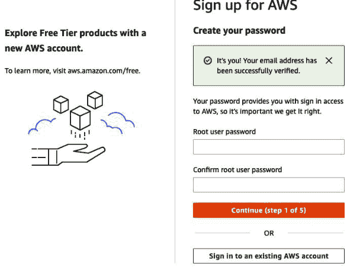
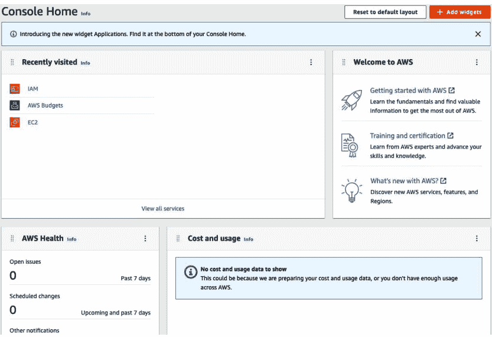
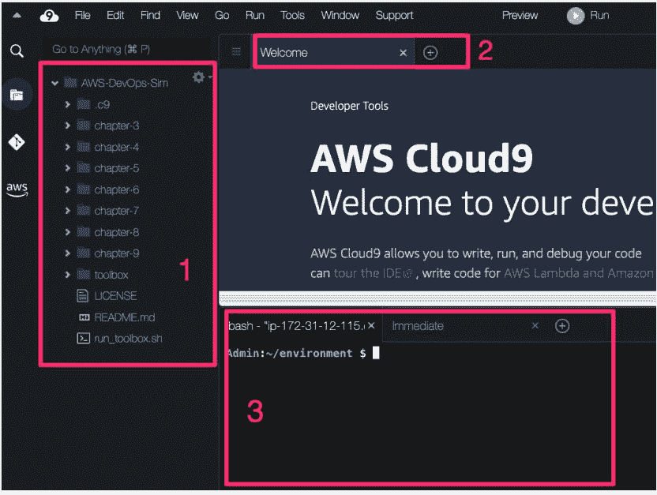

## 在云中利用不可变基础设施

AWS 的众多优势中，有一点尤为突出：在云中轻松配置资源、动态扩展资源，并在不再需要时将其关闭。这与传统本地环境中对 IT 资源的认知和管理方式相比，是一个巨大的思维转变。在此期间，软件应用也在不断演进，而基础设施的进步为这一前所未有的增长提供了有力支撑。

如果你在 IT 行业工作超过十年，你会认同过去资源匮乏时的每一种情况都是通过*纵向扩展*现有服务器来解决的。增加内存、存储或计算能力解决了大部分问题。服务器会闲置数月甚至数年，当应用需要处理更多任务时才进行原地升级。为了让软件应用能够抵御硬件故障，公司开始寻求其他方案，例如横向扩展，也称为*水平扩展*。其理念不是使用大型服务器来支撑应用，而是利用一组成本效益更高的 commodity 硬件。这样可以轻松替换集群中故障组件，使应用对底层硬件故障更具弹性，并提高整体可用性。然而，这带来了一个新的需要解决的问题——**配置管理**。大规模管理这样一组服务器，现在需要额外的工具。向数十台乃至数百台服务器推送配置变更或软件更新，带来了新的挑战。

在云中运营，简化了与配置和管理大规模服务器集群相关的问题，这些问题已超出人工流程所能处理的范围。这将是本章讨论的主题，我们将讨论如何以可靠且自信的方式运营云端工作负载。在章节末尾，我们还将动手实践一些有趣的工具，在 AWS 上部署资源。

我们将涵盖以下主题：

- 宠物与牲畜——一个类比
- 可变与不可变基础设施
- AWS 账户入门
- 了解测试应用与开发工具箱
- 构建 AMI 并部署测试实例

让我们从一个与讨论主题非常契合的类比开始。

### 技术要求

要学习本章内容，你需要具备以下条件：

- 在你的 AWS 账户中部署的 AWS Cloud9 IDE
- 有效的 AWS 账户订阅
- 用于创建 AWS AMI 的 Hashicorp Packer

### 宠物与牲畜

在旧有的运维方式中，服务器总是被精心照看、悉心呵护，并赋予诸如 Atlantis、Raptor、Battlestar 之类的宠物名字。这些是承载关键应用的独立系统，需要 24/7 监控，一旦发现问题，管理员必须立即进行维护。这些系统哪怕出现最微小的问题，都意味着组织中的某个部门将无法运转，或者外部客户会受到影响。人们看待和维护这些系统的方式，与我们对待宠物的方式相似——带着最大的关怀和情感。你不能直接替换它们；相反，你必须修复底层的根本问题，让它们恢复健康。应用程序开发人员在向这些服务器推送变更时，也抱有类似的思维方式。他们会记录所有变更，按特定顺序执行脚本，并为所有预期场景定义运行手册。这种维护关键系统的方法会带来对未知的恐惧、人为错误的可能，以及难以快速向所有系统推送变更的阻力。只有当工作负载规模可控时（例如 5-10 台服务器），这种方法才有效。一旦规模增大，脚本、工具、手动变更，以及最关键的——人的局限性就开始显现。试想，针对目标服务器上可用的系统库的所有可能排列组合，对你的 bash 脚本进行单元测试。如何为数百或数千台服务器构建回滚机制？如果这些脚本由人来执行，就很有可能会出现常见错误，例如在终端中运行错误的命令、无意中操作生产环境、因拼写错误导致数据丢失——不胜枚举。这并不是说 Bash 不完美，只是使用它需要非常高的理解水平和经验。这些脚本的基础必须非常扎实，团队才能可靠地随着时间推移对其进行演进。

另一方面，在云中运营的新方式提倡基础设施的可丢弃性。为什么要修改、修复并无限期维护那些只需点击按钮就能更换为全新服务器的东西？为什么要精心维护现有服务器，并引入额外的运维开销，或者系统配置不匹配的可能性？在这种模式下，组织通常会给服务器集群起功能性的标识名称，例如 web001、web002、web003 等。如果 web002 停止工作，该服务器会从集群中注销，然后被一台健康的新机器替换。云端基础设施的弹性赋予了这种能力。通常，这些流程完全自动化，最终用户或运维工程师几乎察觉不到任何服务中断。不过，这确实需要应用在设计上做出一些调整和架构上的考量，以支持这样的操作流程。例如，对于有状态的应用，被注销的服务器仍应完成正在处理的工作，将所有信息持久化到磁盘，然后准备优雅地关闭。应用需要经过编程来处理这些信号。

正如你所看到的，这一切归根结底是思维方式的转变：基础设施不再被当作宠物对待，而更像是一群牲畜。如果你认为一台服务器可以随时轻松创建和替换，那么它就是牲畜群的一部分。如果你认为一台服务器不可或缺，那么它就是一只宠物。

需要强调的是，在云中维护宠物会让你更加远离弹性基础设施的真正好处。你应该始终在设计中考虑到失败的可能性。更重要的是，要架构一个能够从故障中无缝恢复的应用。一旦确保了这一点，你的应用就能以最佳方式利用云。

用 AWS 首席技术官的话来说：

> “失败是必然的，一切最终都会随时间而失败：从路由器到硬盘，从操作系统到导致 TCP 数据包损坏的内存单元，从瞬时错误到永久性故障。无论你使用的是最高质量的硬件还是最低成本的组件，这都是必然的。”
> 
> —— Werner Vogels，Amazon 首席技术官兼副总裁

在介绍了关于如何认知基础设施的基础性差异之后，让我们来讨论不可变基础设施所提供的好处——它是采用牲畜思维的关键推动因素。

### 可变与不可变基础设施

在本地或云端创建的基础设施资源，既可以在原地修改，也可以完全替换为新的实例。早期，修改服务器通常不是问题，这涉及升级库、推送新的应用代码或更改配置设置。然而，随着工作负载扩展，这些原地升级会危及应用的可靠性，并使测试和运维流程复杂化。在深入探讨不可变基础设施的好处之前，有必要先向你介绍可变基础设施，并解释它们的权衡取舍。让我们结合一个真实示例来讨论，我曾在一个 Tomcat Web 服务器上管理过一个基于 Java 的 Web 应用。


这种*半失败*的场景会导致以下主要问题：

- 无法测试所有可能的排列组合
- 调试过程复杂
- 软件应用不可靠

通过AWS等云服务商提供的API和SDK，云资源的生命周期易于管理和自动化。这为采用不可变基础设施实践铺平了道路——让我们看看它是什么以及它带来的好处。

## 不可变基础设施

不可变基础设施是一种策略，它提倡用IT资源*替换*软件组件，而不是*就地修改*它们。每当需要推出变更时，应用程序或服务都会进行完整的重新部署。栈中的所有组件，从底层操作系统、库、依赖项到应用程序代码，都被打包并作为一个*离散单元*进行部署。

在AWS环境中，采用不可变基础设施概念的一种方式是使用EC2 **Amazon系统映像（AMIs）**。你对包含所有依赖项的整个镜像进行版本控制和发布。不鼓励对运行中的服务器进行修改，因为这会导致配置不匹配等问题，最终影响系统的稳定性和可靠性。你不再需要关心我们在可变基础设施背景下讨论的无数配置组合。用户现在可以测试整个栈（代表应用程序的所有组件和依赖项）是否正常工作。在软件交付过程中，无法正常工作的场景会更早地暴露出来，因此很容易修复潜在问题。此外，不需要直接访问由这些AMI支持的机器，这提高了系统可靠性并促进了安全最佳实践。借助自动化测试流程，该镜像还可以单独测试，然后替换服务器群组中的服务器。

在Java Web技术栈中采用这种方法，使我们摆脱了所有与配置不匹配、安全风险和网络相关的问题。将AMI概念与Amazon EC2的Auto Scaling服务相结合，进一步简化了新变更的推出。通过API调用，用户可以将整个服务器群映射到AMI的新版本，从而自动逐步替换所有服务器。

然而，在采用基础设施不可变性时，你需要考虑应用程序设计的一个重要方面。

> 注意
> 请注意，“创建新的AWS账户”部分列出的步骤也可以在AWS入门页面中找到：https://docs.aws.amazon.com/accounts/latest/reference/manage-acct-creating.html。建议你关注官方文档以获取任何更新的信息和指导。

## 创建新的AWS账户

如果你没有AWS订阅，可以通过选择“创建AWS账户”在 https://aws.amazon.com 创建一个新账户。

初始屏幕会要求你输入电子邮件地址和联系信息。提供这些信息后，网站会要求你创建根用户密码，如图3.1所示：




图3.1：创建AWS账户时的根用户凭据

这是一项极其敏感的凭据，绝不应与任何人共享。在支付详情成功验证后，系统会要求你选择支持计划。对于个人使用，我建议注册基本支持计划，该计划适用于刚接触AWS的开发者或用户。

## 保护你的根用户凭据

账户激活后，你会立即在注册邮箱收到AWS发送的邮件。你可以使用浏览器通过AWS控制台登录页面 https://console.aws.amazon.com/ 登录新建账户：

- 1. 登录成功后，你会看到控制台主页（图3.2）：



图3.2：AWS控制台主页

- 2. 在顶部的搜索栏中输入IAM，然后在“服务”部分选择IAM。这将带你进入IAM仪表板，你可以在其中为根用户启用多因素身份验证（MFA），从而增加一层额外的安全保护。

- 3. 在“安全建议”下，系统会提示你使用MFA保护根用户账户。选择“添加MFA”，然后选择“启用MFA”。你可以选择列出的任何选项（图3.3）作为你的MFA设备。企业公司通常使用硬件令牌，但如今使用虚拟设备或诸如Authenticator之类的移动应用同样普遍：

为了满足我们的需求，我们将创建一个具有AdministratorAccess权限的IAM用户。让我们看看后续步骤：

- 1. 在IAM控制台中，选择导航面板中的“用户”，然后点击“添加用户”。
- 2. 输入你希望用于标识这些凭据的用户名。在接下来的“指定用户详细信息”部分，你可以勾选提供AWS管理控制台访问权限的复选框。接着，将“控制台密码”设置为“自动生成的密码”或输入“自定义密码”属性。
- 3. 点击“下一步”；你将进入“设置权限”部分，在那里可以直接附加现有的AWS策略。根据我们的要求，我们将选择AdministratorAccess并将其分配给正在创建的用户。
- 4. 用户创建过程完成后，你可以保存你的“用户名”和“控制台密码”详细信息，或将登录说明发送到某个电子邮件地址。
- 5. 作为安全最佳实践，让我们继续为该用户分配一个MFA设备。你可以重复“保护你的根用户凭据”部分中所示的MFA步骤，或按照官方AWS文档中提供的步骤操作（推荐）：https://docs.aws.amazon.com/IAM/latest/UserGuide/id_credentials_mfa_enable_virtual.html。

> 提示
> 尽管我们在这里创建了IAM用户，但重要的是要注意，这并非你在实际AWS环境中应遵循的做法。从安全角度来看，你应该始终通过其他身份提供商（IdP）（如Azure AD）联合登录到你的AWS账户，该提供商应充当凭据管理的权威来源。设置IdP超出了本书的范围，因此为了简单起见，我们将继续使用IAM用户。为确保其使用安全，请确保你已按照前述说明设置了MFA访问权限。

为本书中的动手练习创建IAM用户后，让我们设置我已为你准备好的自定义AWS Cloud9集成开发环境（IDE）。

## 在你的AWS账户中设置AWS Cloud9 IDE

AWS Cloud9是一种基于云的IDE，允许开发人员在AWS控制台内编写、编辑和部署代码。我们将使用它在本书的各个章节中部署示例代码。

## 注意

请注意，本书中的所有动手练习已在AWS法兰克福（eu-central-1）区域使用t3.medium类型的Cloud9环境进行了测试。强烈建议你在AWS控制台中使用相同区域。此外，从此刻起的所有活动都将在你的AWS账户中产生费用。例如，每天使用t3.medium计算实例5小时，每月大约花费7.30美元。你可以通过选择低成本实例类型（如t3.small）进一步降低这些费用。此外，强烈建议你在AWS账户中设置账单警报。有关说明，请参阅 https://docs.aws.amazon.com/AmazonCloudWatch/latest/monitoring/monitor_estimated_charges_with_cloudwatch.html。

你将使用CloudFormation模板在你的AWS账户中一次性安装IDE。如果你以前没有使用过CloudFormation，它是一项AWS服务，使你能够可预测且可重复地配置AWS基础设施部署。模板是一种YAML或JSON格式的文件，用于以代码形式定义某些AWS资源，并将它们作为一个组（称为堆栈）进行部署。我们将在第4章“使用AWS CloudFormation将基础设施作为代码进行管理”中深入探讨该服务的细节。让我们继续安装Cloud9 IDE：

- 1. 首先，从本书的GitHub仓库下载模板到你的本地计算机：https://github.com/PacktPublishing/AWS-DevOps-Simplified/blob/main/toolbox/cloud9-ide.yaml。
- 2. 在AWS控制台中，使用我们在上一节创建的IAM用户登录，切换到eu-central-1区域，并在顶部的搜索面板中搜索CloudFormation服务。
- 3. 进入服务页面后，点击“创建堆栈”下拉菜单，并选择“使用新资源（标准）”选项。
- 4. 在“准备模板”部分，选择“模板已就绪”选项。
- 5. 在随后的“指定模板”部分，选择“上传模板文件”，并上传你在步骤1中下载的文件。点击“下一步”。
- 6. 输入你想要的任何堆栈名称。在“参数”部分，你可以配置某些属性。但是，除非你确定要进行哪些更改，否则建议使用默认值。
- 7. 继续点击“下一步”，直到到达最终屏幕，在那里你可以勾选要求确认创建IAM资源的复选框。最后，点击“提交”——你的Cloud9 IDE应在5-10分钟内准备就绪。

一旦CloudFormation堆栈创建完成，你可以转到Cloud9服务页面访问你新创建的环境。


## 导航你的 Cloud9 环境

在 AWS Web 控制台中查找 Cloud9 服务；你应该会在服务页面上看到一个名为 AWS-DevOps-Simplified 的环境，随时可以供你使用。准备好后，你可以点击 Open 链接，IDE 将在浏览器中加载。

如果在访问 Cloud9 环境时遇到任何问题，请查阅故障排除页面上列出的建议：https://docs.aws.amazon.com/cloud9/latest/user-guide/troubleshooting.html。

加载完成后，你的浏览器页面应类似于图 3.4，所有实践练习均已配置好，以便你可以在自己的 AWS 账户中部署它们：



图 3.4：在 AWS 账户中导航 Cloud9 环境

让我们看一下图 3.4 中突出显示的三个部分：

+   1. 左侧的导航面板允许你在阅读相应章节时浏览代码文件，并在需要时进行编辑。
+   2. 从左侧导航面板打开一个代码文件后，你会在顶部导航栏上看到它的专属选项卡。
+   3. Cloud9 为你提供了一个集成的终端，可用于执行从这里开始的实践练习中给出的所有命令。为了确认它能正常工作，你可以使用以下命令，该命令显示 Cloud9 IDE 上安装的 AWS CLI 版本：

```
Admin:~/environment $ aws --version
aws-cli/1.19.112 Python/2.7.18 Linux/4.14.320-243.544.amzn2.x86_64 botocore/1.20.112
```

配置好 AWS 环境访问权限后，我们就可以开始第一个实践练习了。

> 注意
> 如果你熟悉 Docker，并且由于某种原因无法使用 AWS Cloud9，我还准备了一个 Docker 镜像 `aks/kap:awsdevopssimplified-toolbox:latest`，你可以将其下载到本地机器上。所有依赖项都已预装在此镜像中，实践练习的代码位于 /opt/aws-devops-simplified 目录中。但是，需要注意的是，你必须配置一对编程式 IAM 访问密钥，以便在开展实践练习时能够在 Docker 容器内进行身份验证。从安全角度来看，使用 Cloud9 是更可取且推荐的选项。

## 使用测试应用程序

我们要部署的测试应用程序展示了 EC2 AMI 提供的不变性。我们将使用 Hashicorp 的 packer 工具创建一个 AMI，并用它在我们的 AWS 账户的法兰克福区域部署一台测试服务器。所有 EC2 实例都部署在你的 AWS 账户中的私有网络（称为虚拟私有云（VPC））内。让我们运行一个简单命令，列出 AWS 在你新建的账户中为你创建的默认 VPC：

```
aws-devops-simplified:~/environment $ aws ec2 describe-vpcs --filters Name=is-default,Values="true" --region eu-central-1
{
  "Vpcs": [
    {
      "VpcId": "vpc-068adcdab67978302",
      "InstanceTenancy": "default",
      "CidrBlockAssociationSet": [
        {
          "AssociationId": "vpc-cidr-assoc-08c4cf86102517222",
          "CidrBlock": "172.31.0.0/16",
          "CidrBlockState": {
```

```
"State": "associated"
    }
    }
],
"State": "available",
"DhcpOptionsId": "dopt-0f4b0f7b37d374e83",
"OwnerId": "449569851435",
"CidrBlock": "172.31.0.0/16",
"IsDefault": true
    }
]
}
```

这个 VPC ID 很快将用于部署我们的测试 EC2 实例，使用我们在账户中注册的 AMI。请注意，输出中看到的资源标识符（如 vpc-068adcdab67978302）对你来说会有所不同，因为它们反映的是你自己 AWS 账户中的 VPC。

## 测试应用程序

我们的用例中的测试应用程序是一个基于 Python 的简单 Web 服务器实现，它响应 8080 端口上的请求：

```
### Python 3 server example
from http.server import BaseHTTPRequestHandler, HTTPServer
import time

hostName = "0.0.0.0"
serverPort = 8080

class MyServer(BaseHTTPRequestHandler):
    def do_GET(self):
        self.send_response(200)
        self.send_header("Content-type", "text/html")
        self.end_headers()
        self.wfile.write(bytes("<html><head><title>AWS DevOps Simplified</title></head>", "utf-8"))
        self.wfile.write(bytes("<p>Request: %s</p>" % self.path, "utf-8"))
        self.wfile.write(bytes("<body>", "utf-8"))
        self.wfile.write(bytes("<p>AWS DevOps Simplified - Simple HTTP Server</p>", "utf-8"))
        self.wfile.write(bytes("</body></html>", "utf-8"))

if __name__ == "__main__":
    webServer = HTTPServer((hostName, serverPort), MyServer)
```

```
print("Server started http://%s:%s" % (hostName, serverPort))

try:
    webServer.serve_forever()
except KeyboardInterrupt:
    pass

webServer.server_close()
print("Server stopped.")
```

这是一个示例 Web 服务器实现，Python 在 8080 端口监听传入的 GET 请求，并以静态字符串“AWS DevOps Simplified - Simple HTTP Server”作为响应。让我们开始使用一个被广泛采用的自动化工具——Hashicorp 的 Packer 来创建一个新的 AMI。

## 使用 Packer 构建 AMI

Packer 是 Hashicorp 的一个开源工具，可自动化构建系统镜像的过程。它与所有主流云提供商兼容，并帮助你制作黄金镜像——云中虚拟机的模板。它还提供了多云工作流，用于定义跨多个提供商（如 AWS 和 GCP）创建镜像的蓝图。在本章的范围内，我们将专注于创建基于 AWS 的 AMI，并从中启动一个 EC2 实例。

Packer 利用一个 JSON 模板来定义创建 AWS 镜像的所有配置。使用 CLI，你可以定位到特定配置，该配置定义了在 AWS 账户中创建 AMI 的步骤。执行完成后，你可以使用这个标准化模板（其中已内置所有软件依赖项）简单地创建一个 EC2 实例。使用预制的 AMI 可以确保良好的安全态势，并避免在实例创建后进行任何修改的需要。

让我们在之前使用的 Cloud9 IDE 中，用 packer 启动我们的 AMI 构建过程。Packer 配置文件可以在 chapter-3 目录下的 packer/ 文件夹中找到。一个名为 ami_build.json 的配置文件已预先存在于同一目录中。你会注意到，vpc_id 和 subnet_id 属性的值已根据你 AWS 账户中的资源标识符自动更新。在使用 packer 进行 AMI 构建之前，请确认正确的值已就位：

```
aws-devops-simplified:~/environment/chapter-3/packer $ packer build ami_build.json
```

完成构建后，最后会得到一个 AMI ID，稍后可用于预置 EC2 实例。如果你观察本地机器上的输出，packer 会执行以下步骤：

+   1. 从一些预先验证开始，它在 AWS 账户中创建一个临时 SSH 密钥对，以便能够登录到 EC2 实例：

```
==> amazon-ebs: Prevalidating any provided VPC information
==> amazon-ebs: Prevalidating AMI Name: aws-devops-simplified-
```

```
packer-1669369661
    amazon-ebs: Found Image ID: ami-076309742d466ad69
==> amazon-ebs: Creating temporary keypair: packer_63808f3e-c953-c575-6cf6-15543e77f52e
```

2. 它创建一个临时安全组，允许来自任何 IP 地址的 22 端口入站流量：

```
==> amazon-ebs: Creating temporary security group for this instance: packer_63808f40-9532-928d-ce28-d02bedelb7a8
==> amazon-ebs: Authorizing access to port 22 from [0.0.0.0/0] in the temporary security groups...
==> amazon-ebs: Prevalidating any provided VPC information
==> amazon-ebs: Prevalidating AMI Name: aws-devops-simplified-packer-1669369661
    amazon-ebs: Found Image ID: ami-076309742d466ad69
==> amazon-ebs: Creating temporary keypair: packer_63808f3e-c953-c575-6cf6-15543e77f52e
==> amazon-ebs: Creating temporary security group for this instance: packer_63808f40-9532-928d-ce28-d02bedelb7a8
==> amazon-ebs: Authorizing access to port 22 from [0.0.0.0/0] in the temporary security groups...
```

3. 在密钥对和安全组可用后，它开始使用我们在 ami_build.json 文件中提供的源 AMI 创建临时 EC2 实例：

```
==> amazon-ebs: Launching a source AWS instance...
    amazon-ebs: Instance ID: i-06267de9bb837aa15
==> amazon-ebs: Waiting for instance (i-06267de9bb837aa15) to become ready...
==> amazon-ebs: Using SSH communicator to connect: 18.196.17.104
==> amazon-ebs: Waiting for SSH to become available...
==> amazon-ebs: Connected to SSH!
```

4. 它触发预置脚本 server-provision.sh，该脚本在此实例上安装所有相关软件（例如 Python Web 服务器）：

```
==> amazon-ebs: Provisioning with shell script: ./scripts/server-provision.sh
    amazon-ebs: Loaded plugins: extras_suggestions, langpacks, priorities, update-motd
    amazon-ebs: Resolving Dependencies
    amazon-ebs: --> Running transaction check
...
...
    amazon-ebs: Running transaction test
    amazon-ebs: Transaction test succeeded
    amazon-ebs: Running transaction
```


amazon-ebs: Installed:
amazon-ebs: kernel.x86_64 0:5.10.149-133.644.amzn2
amazon-ebs: Complete!
amazon-ebs: Loaded plugins: extras_suggestions, langpacks, priorities, update-motd
amazon-ebs: Package wget-1.14-18.amzn2.1.x86_64 already installed and latest version
amazon-ebs: Running scripts as 'ec2-user'
amazon-ebs: Making scripts executable
amazon-ebs: Configure ADS Sample Server Service Unit File
==> amazon-ebs: Created symlink from /etc/systemd/system/multi-user.target.wants/ads-server.service to /etc/systemd/system/ads-server.service.

5. 它会停止实例，并根据实例状态创建AMI：

```
==> amazon-ebs: Stopping the source instance...
amazon-ebs: Stopping instance
==> amazon-ebs: Waiting for the instance to stop...
==> amazon-ebs: Creating AMI aws-devops-simplified-packer-1669369661 from instance i-06267de9bb837aa15
amazon-ebs: AMI: ami-09d522b72c0ca8128
==> amazon-ebs: Waiting for AMI to become ready...
==> amazon-ebs: Skipping Enable AMI deprecation...
```

6. AMI创建完成后，它会终止测试EC2实例并清理其他临时资源：

```
==> amazon-ebs: Terminating the source AWS instance...
==> amazon-ebs: Cleaning up any extra volumes...
==> amazon-ebs: No volumes to clean up, skipping
==> amazon-ebs: Deleting temporary security group...
==> amazon-ebs: Deleting temporary keypair...
Build 'amazon-ebs' finished after 3 minutes 5 seconds.
==> Wait completed after 3 minutes 5 seconds
==> Builds finished. The artifacts of successful builds are:
--> amazon-ebs: AMIs were created:
eu-central-1: ami-09d522b72c0ca8128
```

这就是如何在AWS中管理不可变基础设施。所有依赖项、软件包以及启动Python Web服务器的脚本都已打包到AMI中。这是一个独立的构件，受版本控制，可用于在AWS中部署EC2实例。一旦实例创建完成，SystemD脚本就会启动Web服务器，随时准备响应传入的HTTP GET请求。

```
{
    "SecurityGroupRuleId": "sgr-0b38ce903b21e47cb",
    "GroupId": "sg-06320d12095603e68",
    "GroupOwnerId": "643998996127",
    "IsEgress": false,
    "IpProtocol": "tcp",
    "FromPort": 8080,
    "ToPort": 8080,
    "CidrIpv4": "95.157.36.247/32"
}
]
```

AMI和安全组都已准备就绪，接下来我们开始创建EC2实例。

## 创建测试EC2实例

+   1. 所有先决条件都已满足，我们可以继续创建实例：

```
aws-devops-simplified:~/environment/chapter-3/packer $ aws ec2 run-instances --instance-type t3.micro --security-group-ids sg-06320d12095603e68 --image-id ami-0834874e33262e665 --region eu-central-1
{
    "Groups": [],
    "Instances": [
        {
            "AmiLaunchIndex": 0,
            "ImageId": "ami-0834874e33262e665",
            "InstanceId": "i-00f089cfe084be59a",
            "InstanceType": "t3.micro",
            "LaunchTime": "2022-11-25T10:51:15+00:00",
            "Monitoring": {
                "State": "disabled"
            },
            "Placement": {
                "AvailabilityZone": "eu-central-1c",
            ...
```

+   2. 实例创建完成后，您可以提取公有IP地址，在浏览器中测试Web应用程序（图3.5）：

```
aws-devops-simplified:~/environment/chapter-3/packer $ aws ec2 describe-instances --region eu-central-1 --profile aws-devops-simplified
...
```

```
"PrivateDnsName": "ip-172-31-6-119.eu-central-1.compute.internal",
"PrivateIpAddress": "172.31.6.119",
"ProductCodes": [],
"PublicDnsName": "ec2-18-197-150-199.eu-central-1.compute.amazonaws.com",
"PublicIpAddress": "18.197.150.199",
"State": {
"Code": 16,
"Name": "running"
}
...
```

通过8080端口访问公有IP地址，我们会从实例上运行的Python服务器得到响应。


图3.5：在浏览器中访问EC2托管的Web服务器

## 终止测试EC2实例

在撰写本书时，AWS提供免费套餐使用政策，每月包含一定数量的计算小时，不会产生任何费用。既然我们已经完成了所有测试，是时候删除EC2实例，以免超出该限制：

```
aws-devops-simplified:~/environment/chapter-3/packer $aws ec2 terminate-instances --instance-ids i-00f089cfe084be59a --region eu-central-1
{
"TerminatingInstances": [
{
"CurrentState": {
"Code": 32,
"Name": "shutting-down"
},
"InstanceId": "i-00f089cfe084be59a",
"PreviousState": {
"Code": 16,
"Name": "running"
}
}
}
```

## 总结

本章奠定了不可变基础设施的基础，并介绍了采用这种方法大规模管理软件的好处。这对于以更高的可靠性和信心交付解决方案非常重要。同样的方法可以轻松地在本地环境中采用，但AWS在这一领域表现出色，因为其基础设施的弹性与这类方法论非常契合。

那些之前没有使用过AWS的读者也会从本章中受益，因为我们涵盖了创建AWS账户以及围绕根凭证使用的安全最佳实践。本章还提供了一些使用AWS CLI和设置工具箱的动手实践。所有这些都将帮助你在接下来的章节中学习，因为本书中的动手练习将利用Cloud9 IDE中内置的工具。

最后，我们使用了Packer等工具来创建AMI，并部署了一个托管Python Web服务器应用程序的EC2实例。我们还使用了一些资源，例如默认VPC和我们在设置账户时由AWS预先创建的子网。

在*第4章，使用AWS CloudFormation将基础设施作为代码管理*中，我们将更深入地探讨如何以代码方式管理这些资源。

## 进一步阅读

要了解更多关于本章所涵盖主题的信息，请查看以下资源：

+   - 免费套餐中提供的AWS服务：`https://aws.amazon.com/free/`
- 用于构建AWS AMI的Packer教程：`https://developer.hashicorp.com/packer/tutorials/aws-get-started/aws-get-started-build-image`
- AWS安全最佳实践：`https://aws.amazon.com/architecture/security-identity-compliance/`
