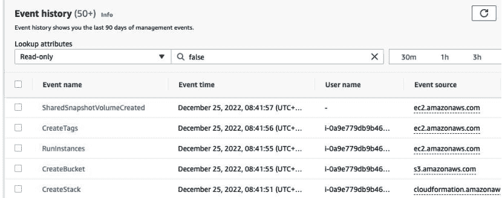
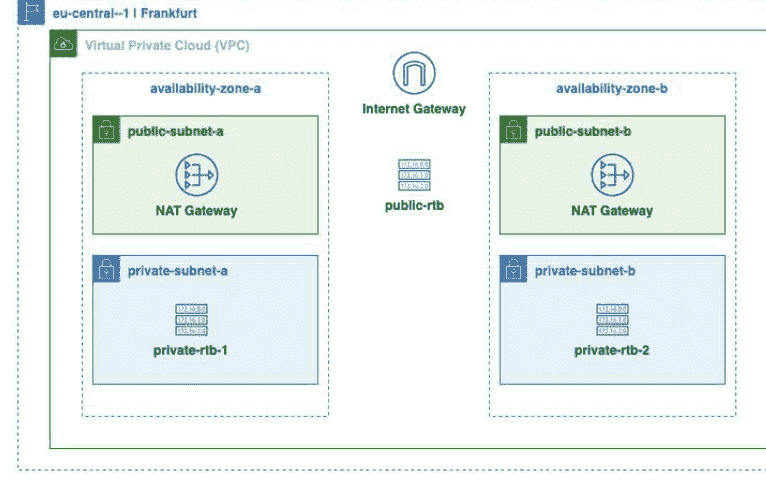
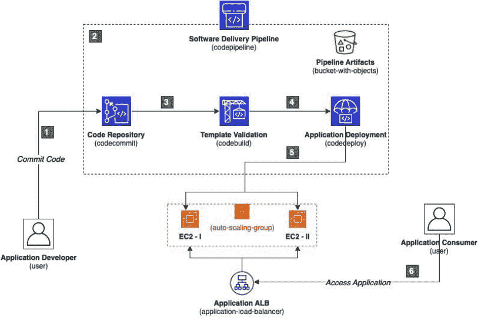
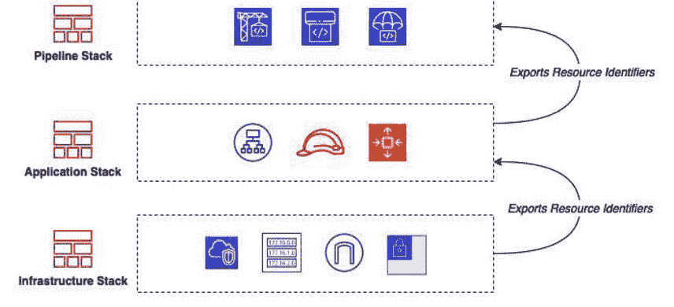
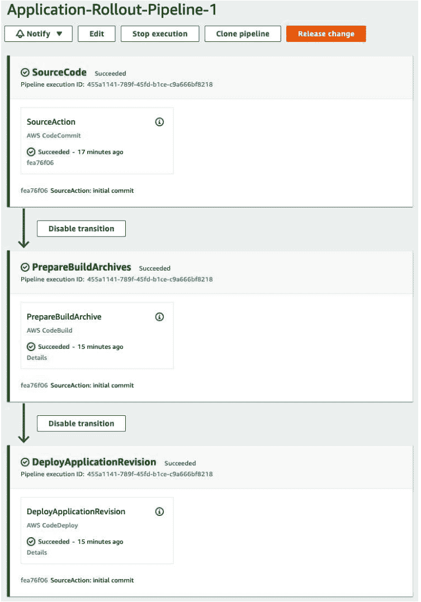
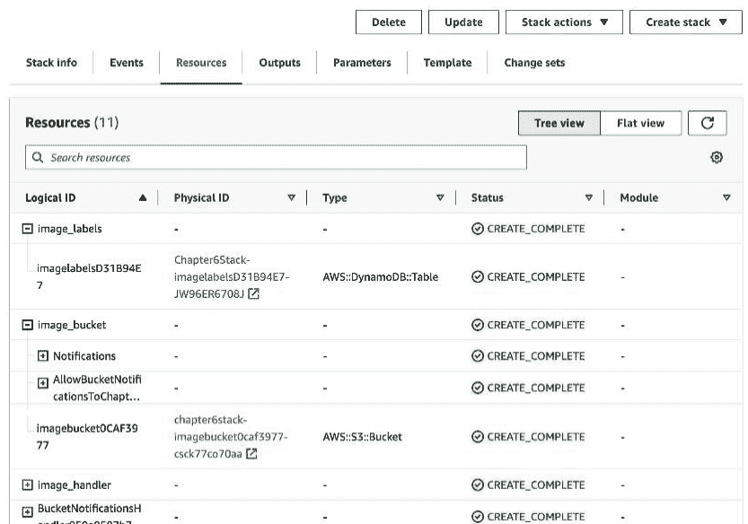
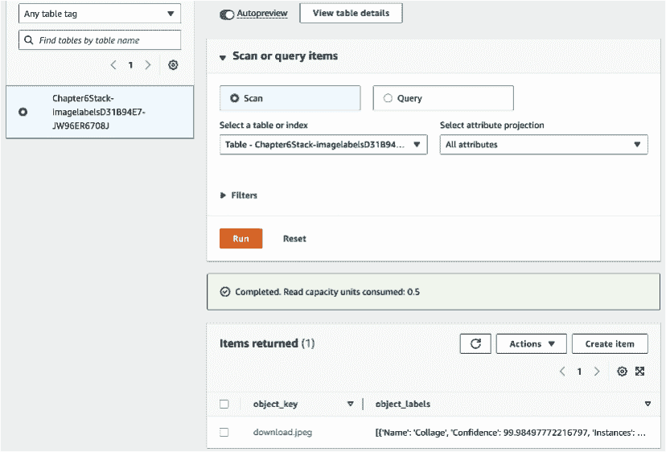

# 第2部分

## 通过一致且可重现的环境加速软件交付

本部分重点介绍AWS基础，这些基础通过一致且可重现的环境来增强软件交付流程。你将探索将基础设施作为代码管理的好处，了解AWS CloudFormation在底层的工作原理，并体验使用AWS托管服务设置CI/CD流水线。进一步深入学习后，你将深入探讨AWS CDK的基础知识——一种以编程方式管理AWS基础设施的方法——同时在你的AWS账户中部署一个图像识别应用程序。

本部分包含以下章节：

+   - 第4章，使用AWS CloudFormation将基础设施作为代码管理
+   - 第5章，推出CI/CD流水线
+   - 第6章，使用AWS CDK以编程方式实现IaC

## 堆栈

在管理IaC时，你会希望将相关资源作为一个单一单元来处理。例如，一个三层Web应用程序需要你创建一组资源，如负载均衡器、计算实例和数据库服务器。能够在一个模板中管理所有这些资源是理想的。这简化了依赖关系和堆栈操作的管理。在CloudFormation术语中，这个单一单元被称为**堆栈**。模板定义是AWS CloudFormation了解你想要创建的资源以及这些资源所需配置的前提条件。

你可以使用`aws cloudformation deploy`命令在AWS账户中创建堆栈。

## 变更集

就像软件应用程序一样，基础设施也需要适应不断变化的需求。这会导致对CloudFormation已在AWS账户中部署的堆栈进行修改。AWS中的某些资源是*不可变的*，这意味着任何修改都需要完全替换，因为无法进行就地更新。为了为此类操作提供安全网，CloudFormation允许你在部署变更之前评估变更的影响。这个中间阶段被称为**变更集**。创建变更集后，它会告诉你计划中的堆栈更新操作对现有资源的影响。如果你发现资源出现了意外变更，可以取消更新过程；否则，你可以继续进行最终部署。

你可以使用`aws cloudformation create-change-set`命令创建变更集。

## 模板

CloudFormation的**模板**是你基础设施堆栈中资源及其依赖关系的蓝图。它是基础设施开发者与服务本身之间的接口。在这里定义的内容将成为CloudFormation最终在你的AWS账户中部署的*堆栈*的一部分。它是一个文本文件，由服务使用以配置资源。当你触发CloudFormation部署时，需要将模板文件作为参数传递给CLI命令。在模板中，有几种构造可用于定义你的基础设施组件。让我们来看其中的一些。

## 资源

这是模板中的必填部分，用于定义应在你的AWS账户中创建的资源。它还包括定义这些资源应具有的特定配置的属性。一个简单的示例是创建EC2实例，该实例映射到特定的安全组，并使用特定的**Amazon Machine Image（AMI）**：

```
Resources:
  TestEC2Instance:
    Type: AWS::EC2::Instance
    Properties:
```


```yaml
ImageId: ami-0834874e33262e665
InstanceType: t3.micro
SubnetId: subnet-0e4f97bea5c50b873
SecurityGroupIds:
  - sg-06320d12095603e68
KeyName: test-key-pair
```

部署此模板将创建一个 EC2 实例，其所有配置均定义在 `TestEC2Instance:` 部分下。你会注意到大部分配置都引用了预先存在的资源标识符。这意味着在你使用此模板部署堆栈之前，它们应已存在于相应的 AWS 账户（和区域）中。

> **提示**
> 
> 大多数 AWS 服务都是区域范围的，你应特别注意这可能带来的影响。例如，在 `eu-central-1` 可用的公共 AMI 不能在部署堆栈的另一个区域的 CloudFormation 模板中引用。此外，AWS 确保除非用户明确配置，否则你的资源不会将数据传输到另一个区域。当你处理需要遵守严格数据驻留和合规需求的架构时，应牢记这一点。

因此，请记住，硬编码配置不是良好的设计实践，因为如果前提条件不存在，堆栈部署将会失败。其次，很难在其他 AWS 账户和区域中重用此类模板。安全性、可重用性和模块化应是你使用它们时首要考虑的问题。我们将在 *使用 CloudFormation 定义企业级架构的最佳实践* 部分后面介绍一些良好的设计实践。

为了确保可重用性和清晰的设计，CloudFormation 提供了使用 **参数** 的功能，可在运行时定义。这使得动态配置成为可能，并简化了模板的维护。

## 参数

这些是在堆栈创建期间传递给模板的值。它有助于将设计与配置分离。你可以设置默认值，还可以提供允许值的列表，以控制用户可以使用或不能使用的内容。一旦参数被定义，就可以使用 Ref 关键字在 Resources 部分轻松引用它们：

```yaml
Parameters:
  InstanceType:
    Type: String
    Default: t3.micro
    AllowedValues:
      - t3.micro
```

```yaml
  - m5.medium
...
...
Resources:
  EC2Instance:
    Type: AWS::EC2::Instance
    Properties:
      InstanceType:
        Ref: InstanceType
...
...
```

这使得你的模板具有灵活性，因为它们可以适应在运行时提供的值。

## 条件

**条件** 为你的模板提供了一种控制机制。根据某个条件为 true 或 `false`，你可以完全跳过资源创建，或在部署堆栈时使用不同的配置值。这在你希望为开发或生产使用不同值的情况下很有用，例如：

```yaml
...
Conditions:
  SkipResourceCreation: !Equals
    - !Ref Environment
    - dev
...
...
Resources:
  EC2Instance:
    Type: AWS::EC2::Instance
    Condition: SkipResourceCreation
...
```

但如果想根据某些参数值的评估来阻止堆栈操作呢？让我们来看看 **规则**。

## 规则

这是模板的可选部分，可用于评估某些参数值的组合并阻止堆栈创建或更新过程。它围绕 *规则条件* 和 *断言* 的概念工作。如果未定义任何条件，则规则断言将始终被评估：

```yaml
Rules:
  testInstanceType:
```

```yaml
RuleCondition:
  !Equals - !Ref Environment
  - test
Assertions:
  - Assert:
      'Fn::Contains':
        - - t3.medium
          - !Ref InstanceType
      AssertDescription: 'For a test environment, the instance type must be t3.medium'
```

此规则在实例类型与 `t3.medium` 不同时拒绝堆栈更新或创建。

到目前为止，我们已经介绍了向 CloudFormation 模板传递信息的不同方式。如果堆栈操作完成后我们需要一些信息返回呢？这就是 **输出** 发挥作用的地方。

## 输出

这些是在堆栈操作完成后你想要检索的值。你可以通过控制台或 CLI 命令访问它们，或在其他模板中作为 *导入* 引用。这种方法确保模板保持可管理大小，因为你不必将所有资源放在一个大文件中。你可以使用 Outputs 构造来定义输出值：

```yaml
Outputs:
  InstanceID:
    Description: ID of the EC2 instance
    Value: !Ref EC2Instance
```

一旦堆栈操作完成，你就可以使用 `InstanceID` 键访问新的 EC2 实例的标识符。

我们迄今为止介绍的概念应该可以帮助你开始 CloudFormation 服务的日常实际使用。为了使调试问题更容易，让我们讨论 CloudFormation 在幕后工作的内部原理。

## CloudFormation 如何工作

AWS 服务如 CloudFormation 在减少终端用户的认知负担方面非常出色。大量内部细节被抽象化，只向用户公开所需的功能。然而，在某些情况下，了解服务内部正在做什么非常重要。这不仅有助于更快地调试问题，还能为你讨论安全、合规以及组织日常运营等主题提供良好的思考基础。

在后台进行多次 API 调用，所有这些调用都旨在实现 CloudFormation 模板中描述的基础设施堆栈。

AWS CloudTrail 的事件历史记录描述了服务代表你触发的所有 API 的事件负载。让我们看看在创建简单堆栈期间记录了哪些事件：

```
AWSTemplateFormatVersion: 2010-09-09
Description: Demonstrate CloudTrail log integration
Resources:
  MyS3Bucket:
    Type: 'AWS::S3::Bucket'
    Properties:
      BucketName: devops-simplified-cfn-test-bucket
  MyEC2Instance:
    Type: 'AWS::EC2::Instance'
    Properties:
      ImageId: ami-0c956e207f9d113d5
      InstanceType: t3.micro
      SubnetId: subnet-0a09e573bc8792a95
```

让我们使用 AWS CLI 在 eu-central-1 区域部署我们的堆栈：

```
aws cloudformation deploy \
  --stack-name devops-simplified-test \
  --template-body file://template.yml \
  --region eu-central-1
```

一旦堆栈创建完成，你可以在 CloudTrail 控制台中看到已记录的 API 调用。这些在图 4.2 中突出显示：



图 4.2：堆栈创建结果在 CloudTrail 中记录的 API 调用

## 使用 CloudFormation 定义企业级架构的最佳实践

当涉及到跨多个账户、团队和区域的架构设计时，有几个指导原则你应始终牢记。

### 保持模板小而可重用

当你刚开始时，你会使用针对最少资源集的小模板。随着时间的推移，你团队和组织的需求会增长，这可能导致同一模板无控制地扩展以用于所有未来添加。基于团队的职责和他们拥有的应用程序限制这些模板的范围是一个良好的实践。在同一个堆栈中管理两个不同应用程序的基础设施资源可能会对团队的敏捷性产生不利影响并引入依赖关系。此外，它还引入了风险，因为某些堆栈操作可能会影响所有其他资源。

其次，保持模板小有助于提高可重用性。例如，遵循所有最佳实践和组织安全控制的三层 Web 应用程序可以轻松与其它团队共享，以便他们以安全且合规的基础设施基线开始。

使用输入和输出可以简化不同堆栈之间的依赖管理。

### 利用输入和输出进行跨堆栈依赖

如前所述，CloudFormation 可以导出某些资源标识符供其他堆栈使用。这可以通过定义 Output 参数并使用预定义名称导出这些值来实现。在这种情况下，服务充当消息总线，促进不同堆栈之间的通信。

导入这些值的堆栈使用 Fn::ImportValue 内在函数：

```
Resources:
  WebServerInstance:
    Type: 'AWS::EC2::Instance'
    Properties:
      InstanceType: t3.micro
      ImageId: ami-0c956e207f9d113d5
      NetworkInterfaces:
        - GroupSet:
          - Fn::ImportValue
            'Fn::Sub': '${NetworkStack}-SecurityGroupID'
```

在此示例中，堆栈从另一个堆栈导入 SecurityGroupID，该堆栈的名称由 ${NetworkStack} 参数引用。


the service itself. The provisioning requests for all other resources are then entirely taken care of by the service itself as it directly consumes the service APIs using AWS’ network backbone. As you can imagine, dealing with these problems in a large-scale deployment can be a pain, and services such as CloudFormation offer a more seamless user experience.

## 用于代码复用的模块

在 Terraform 中使用模块体验更好。首先，可以使用大量公开可用的模块来实现你的基础设施栈。这减少了开发和维护工作，你可以立即开始。其次，工具与外部模块的集成更好，因为你可以在 terraform plan 命令中看到所有更改，这与变更集的作用类似。

总之，两者都有其独特的优势，这对你的具体用例可能更重要或更不重要。然而，如果你只是开始在 AWS 上托管工作负载，并且预见到大规模部署在不久的将来会成为现实，我建议继续使用 AWS CloudFormation。供应商锁定通常被讨论为该服务的缺点，但我认为使用另一家公司的第三方工具同样适用。受益于使用合适的工具解决合适的问题，即使这意味着使用不同的 IaC 框架来高效管理跨不同云提供商的资源。 本书后面，我们将介绍一些已被许多公司使用的企业级 CloudFormation 部署框架。

到目前为止，我们已经涵盖了很多理论细节，我相信让你亲眼看到 CloudFormation 服务运行将是一次很棒的体验。我们将使用一个完整的基础设施部署来在 AWS 账户中托管一个应用程序。让我们动手实践。

## 使用 CloudFormation 的动手部署

在上一章中，我们使用 Hashicorp 的 Packer 部署了一个 AMI，随后创建了 EC2 实例。我们不必担心网络、公共接口、互联网网关等的配置。这是因为 AWS 作为新发放账户的一部分提供了默认 VPC 资源。在实际实现中，这很少见。你从头开始设计并实现整个基础设施栈，并使用工具自动化其管理。这种基础设施配置的定制化和自动化将是我们本节的重点。通过快速回顾我们迄今为止讨论的概念，我们可以动手进行实际的代码部署活动。我也会在途中带你了解一些网络组件。

我们将作为两个 CloudFormation 栈的一部分部署我们的应用程序：

- Network stack: This will include all the networking components required to host a public internet-facing application in your AWS account. We will not use any default resources, which
means everything, including VPCs, subnets, route tables, internet gateways, NAT gateways, and so on, will be managed through the CloudFormation template that we develop.
- **Application stack:** Once the networking foundations are ready, we will host our application in multiple availability zones to adhere to high-availability design principles. It is a good practice to abstract the underlying compute with a load balancer at the network edge. To achieve this, we will deploy an HTTP **application load balancer (ALB)** in the public subnets that can then respond to incoming requests from the users.

## 网络架构设计以支持多可用区部署

我们将在 eu-central-1 部署网络资源，也称为法兰克福区域。一旦所有组件部署完成，我们将拥有一个最终设计，其外观与图 4.3 所示类似：



Figure 4.3: Networking resources deployed on the eu-central-1 region

让我们通过 CloudFormation 模板中的相关代码片段来了解如何实现所有这些资源的部署。

```
Type: AWS::EC2::Route
DependsOn: InternetGatewayAttachment
Properties:
  RouteTableId: !Ref PublicRouteTable
  DestinationCidrBlock: 0.0.0.0/0
  GatewayId: !Ref InternetGateway

PublicSubnet1RouteTableAssociation:
  Type: AWS::EC2::SubnetRouteTableAssociation
  Properties:
    RouteTableId: !Ref PublicRouteTable
    SubnetId: !Ref PublicSubnet1
...
```

CloudFormation 提供了内置函数，可帮助你在运行时不可用时分配值。你可以在模板中使用这些编程功能来构造、提取和定义不同类型的值。!Select（Fn::Select 的简写）就是这样一个函数，可帮助你从列表中提取给定索引的项。在这里，我们获取第一个可用区的 ID，以便我们可以部署公共子网。我们还使用 !Sub 将 EnvironmentName 参数的内容替换为 Tag 值。这是一种通过修改模板中的单个参数来动态更改资源标签名称的高效方法。你可以在 https://docs.aws.amazon.com/AWSCloudFormation/latest/UserGuide/intrinsic-function-reference.html 探索服务支持的其他内在函数。

请注意，我们还为托管在第二个可用区的其他公共子网定义了类似的资源块，但在此示例中未提及以避免冗余。

我们将使用公共子网托管一个面向互联网的负载均衡器，该负载均衡器可以接收来自最终用户的请求，并在后台在多个计算实例之间平衡负载。

## 私有子网

与公共子网类似，私有子网也是从同一 VPC CIDR 块中划分出来的。关键区别在于添加到这些子网的路由。从功能上讲，它们用于托管不会暴露给互联网的资源。如果你还记得上一章的 AMI 部署，我们通过分配公共 IP 将 EC2 实例直接托管在默认 VPC 的公共子网中。在实际实现中，将后端实例直接暴露在互联网上并不是一种好的做法，因为它会在安全性、网络入站流量检查和负载平衡能力方面引入架构限制。因此，后端服务器、数据库和内部工具等资源会部署在这些子网中：

```
Resources:
...
```

are hosted in the public subnets, though, mainly because they want to route traffic to the internet via the internet gateway:

```yaml
Resources:
...
  NatGateway1EIP:
    Type: AWS::EC2::EIP
    DependsOn: InternetGatewayAttachment
    Properties:
      Domain: vpc

  NatGateway1:
    Type: AWS::EC2::NatGateway
    Properties:
      AllocationId: !GetAtt NatGateway1EIP.AllocationId
      SubnetId: !Ref PublicSubnet1
...
```

我们在这里要介绍的一个重要的 CloudFormation 构造是 DependsOn。它用于在模板中定义的两个资源之间标记显式依赖关系。

我们还在这里使用了一个 **Elastic IP (EIP)**，它是一个静态公共 IP 地址，其生命周期独立于其所附加的资源。你可以将这些 IP 在多个不同的 AWS 资源之间移动，这意味着在底层资源被删除时不会丢失它们。大企业通常会对其客户执行 IP 白名单要求。在这种情况下，EIP 非常有用，因为你不希望丢失已经通过漫长审批流程的 IP。

> **Tip**
> 
> 现在可以将 EIP 在多个账户之间转移。目标账户在发起转移后有 7 小时时间接受转移。当组织进行组织重组和灾难恢复程序时，组织会从这种可转移性中受益。

## 栈输出

Earlier, we discussed a best practice to keep your CloudFormation templates modular and organize them with ownership in mind. The network stack we just defined can be deployed and managed by the networking team, independent of the application teams. The application owners, however, will need to consume some resource identifiers from this stack’s output (VPC ID, for example) in their own IaC stack definitions. This is where we can leverage stack outputs and make the outputs from this stack available for use by others:

```
```yaml
...
Outputs:
```
```


## 部署网络堆栈

你可以在 https://github.com/PacktPublishing/AWS-DevOps-Simplified/blob/main/chapter-4/cfn-templates/network-stack.yml 找到网络堆栈模板的完整版本。

在 AWS 控制台中，为我们的 Cloud9 IDE 开启一个新会话。登录后，切换到 chapter-4/ 下的资源，并使用以下命令触发堆栈部署：

```
aws cloudformation deploy \
  --stack-name networking-stack \
  --region eu-central-1 \
  --parameter-overrides EnvironmentName=aws-devops-simplified \
  --template-file network-stack.yml

Waiting for changeset to be created..
Waiting for stack create/update to complete
Successfully created/updated stack - networking-stack
```

此时，所有网络资源都应该在你的 AWS 账户的 eu-central-1 区域中可用，我们便可以继续部署应用程序。让我们看看应用程序设计及相应的堆栈是什么样的。

如果你想查看此堆栈的导出数据，CloudFormation 为此提供了一条 CLI 命令。它会列出该 AWS 账户在目标区域中所有可用的堆栈导出：

```
bash-5.1# aws cloudformation list-exports \
  --region eu-central-1 \

{
  "Exports": [
    {
      "ExportingStackId": "arn:aws:cloudformation:eu-central-1:643998996127:stack/networking-stack/7405c610-8540-11ed-a5cd-02aac4a6643a",
      "Name": "networking-stack-vpc-id",
      "Value": "vpc-0c522c9e7f154179e"
    }
    ...
    ...
  ]
}
```

相应网络接口的 IP 地址，以及转发到后端 EC2 实例的流量：

```
Resources:
  AppLoadBalancer:
    Type: AWS::ElasticLoadBalancingV2::LoadBalancer
    Properties:
      Type: application
      Scheme: internet-facing
      Subnets:
        - Fn::ImportValue:
            'Fn::Sub': "${NetworkStackName}-public-subnet1"
        - Fn::ImportValue:
            'Fn::Sub': "${NetworkStackName}-public-subnet2"
      SecurityGroups:
        - !Ref AppLoadBalancerSecurityGroup
  AppLoadBalancerSecurityGroup:
    Type: AWS::EC2::SecurityGroup
    Properties:
      GroupDescription: This is the Security Group for ALB
      SecurityGroupIngress:
        - IpProtocol: tcp
          FromPort: 80
          ToPort: 80
          CidrIp: 0.0.0.0/0
      SecurityGroupEgress:
        - IpProtocol: tcp
          FromPort: 0
          ToPort: 65535
          CidrIp: 0.0.0.0/0
      VpcId:
        Fn::ImportValue:
          'Fn::Sub': "${NetworkStackName}-vpc-id"
...
```

与 EC2 实例一样，ALB 也需要绑定安全组。由于这是一个面向互联网的应用程序，我们通过端口 80 上的 0.0.0.0/0 入站路由向全世界开放 TCP 流量。

我想强调一下此模板中引用的两个内部函数的用法：

- 从其他部署导入堆栈输出：
  Fn::ImportValue，顾名思义，用于从另一个堆栈导入输出。我们曾使用 aws cloudformation list-exports 命令列出网络堆栈的导出值。这里通过该函数引用了相同的值。这正是 CloudFormation 在保持模板模块化和团队敏捷的同时，解析堆栈间依赖关系的方式。
- 在运行时替换数据以生成配置：
  并非所有配置都可以在模板中静态定义。如此例所示，网络堆栈可能以不同的方式命名。为了保持模板定义的灵活性，我们替换了相应参数的值，从而形成一个明确的字符串。最终，这让我们能够从另一个堆栈导入所需的值。

## ALB 监听器和目标组

为了让 ALB 了解它正在处理的流量类型，我们可以使用监听器的概念。监听器识别协议、端口以及在收到数据包时要执行的操作。监听器还会映射到一个目标组，匹配的流量需要转发到该目标组：

```
Parameters:
...
  NetworkStackName:
    Description: Identifies the name of the network stack.
    Type: String
...
Resources:
...
  AppLoadBalancerListener:
    Type: AWS::ElasticLoadBalancingV2::Listener
    DependsOn: AppLoadBalancer
    Properties:
      Protocol: HTTP
      Port: 80
      LoadBalancerArn: !Ref AppLoadBalancer
      DefaultActions:
        - Type: forward
          TargetGroupArn: !Ref InstanceTargetGroup

  InstanceTargetGroup:
    Type: AWS::ElasticLoadBalancingV2::TargetGroup
    Properties:
      HealthCheckEnabled: true
      TargetType: instance
      Protocol: HTTP
      Port: 8080
      VpcId:
        Fn::ImportValue:
          'Fn::Sub': "${NetworkStackName}-vpc-id"
...
```

目标组是 Auto Scaling 组注册 EC2 实例的实体。我们在此使用 !Ref 关键字来引用同一模板中的其他资源。

所有 CloudFormation 资源都有特定的返回值，可能是 ARN、ID、名称或其他值。在编写模板时，你需要在相应的文档部分中验证这些详细信息。如果需要提取默认值之外的值，CloudFormation 提供了 Fn::GetAtt 函数，可帮助你提取特定属性。

## Auto Scaling 组和启动模板

这些组件负责在任何给定时间点配置和维护计算实例集。Auto Scaling 组定义了计算实例集中的最小、最大和期望实例数。它还映射到一个目标组，实例可以部署到该目标组。

实例的配置由启动模板负责。启动模板定义了 AMI、实例系列、实例类型等：

```
Resources:
...
  AppLaunchTemplate:
    Type: AWS::EC2::LaunchTemplate
    Properties:
      LaunchTemplateName: !Sub ${AWS::StackName}-launch-template
      LaunchTemplateData:
        ImageId: !Ref AMIId
        InstanceType: !Ref InstanceType
        SecurityGroupIds:
          - !Ref AppInstanceSecurityGroup

  AutoScalingGroup:
    Type: AWS::AutoScaling::AutoScalingGroup
    Properties:
      MinSize: !Ref AutoScalingGroupMinSize
      MaxSize: !Ref AutoScalingGroupMaxSize
      TargetGroupARNs:
        - !Ref InstanceTargetGroup
      VPCZoneIdentifier:
        - Fn::ImportValue:
            'Fn::Sub': "${NetworkStackName}-private-subnet1"
        - Fn::ImportValue:
            'Fn::Sub': "${NetworkStackName}-private-subnet2"
      LaunchTemplate:
        LaunchTemplateId: !Ref AppLaunchTemplate
        Version: !GetAtt AppLaunchTemplate.LatestVersionNumber
```

## 部署应用程序堆栈

你可以在 https://github.com/PacktPublishing/AWS-DevOps-Simplified/blob/main/chapter-4/cfn-templates/application-stack.yml 找到应用程序堆栈模板的完整版本。

与我们部署基础设施堆栈的方式类似，现在我们将使用 Docker 工具箱来部署应用程序资源。该堆栈需要注入两个参数——AMI ID 和网络堆栈的名称：

```
aws-devops-simplified:~/environment/chapter-4/cfn-templates $ aws cloudformation deploy \
  --stack-name application-stack \
  --region eu-central-1 \
  --parameter-overrides NetworkStackName=networking-stack AMIId=ami-0a21c185c68c76d52 \
  --template-file application-stack.yml \
  --capabilities CAPABILITY_NAMED_IAM
Waiting for changeset to be created..
Waiting for stack create/update to complete
Successfully created/updated stack - application-stack
```

部署成功后，我们可以检索堆栈输出，输出中会提供应用程序可访问的 ALB 域名：

```
aws-devops-simplified:~/environment/chapter-4/$ aws cloudformation describe-stacks --stack-name application-stack --region eu-central-1
```

由于后台运行着两个 EC2 实例，你会在浏览器中看到随机返回的实例 ID，如图 4.5 所示：

## 延伸阅读

若要深入了解本章涵盖的主题，请参阅以下资源：

- 面向常见用例的 CloudFormation 示例模板：https://docs.aws.amazon.com/AWSCloudFormation/latest/UserGuide/cfn-sample-templates.html
- 使用 cfn-nag 识别不安全的基础设施模式：https://github.com/stelligent/cfn_nag
- 根据资源规范验证 CloudFormation 模板：https://github.com/aws-cloudformation/cfn-lint


## CodeCommit 提供的关键功能

除了通用的代码管理能力外，还有其他亮点可以帮助您建立控制措施，以满足组织在编码、安全或合规方面的要求。

## 使用 IAM 实现细粒度安全控制

限制对受保护分支的访问只需为您的用户或组应用正确的 IAM 策略即可。您可以针对条件非常具体，例如授予特定 Git 操作（push、pull、merge 等）的权限，或将访问限制在特定分支。

让我们看一个仅允许开发人员在 dev 和 test 分支上执行 GitPush 操作的示例 IAM 策略：

```
{
  "Version": "2012-10-17",
  "Statement": [
    {
      "Effect": "Deny",
      "Action": "codecommit:GitPush",
      "Resource": "arn:aws:codecommit:eu-central1:111111111111:SampleRepo",
      "Condition": {
        "StringEqualsIfExists": {
          "codecommit:References": [
            "refs/heads/test",
            "refs/heads/dev"
          ]
        }
      }
    }
  ]
}
```

将某些 Git 权限，例如 MergePullRequestByFastForward，限制给对代码库更熟悉的人员是一种良好实践。通过不允许所有人进行快进合并，您可以避免因提交未经过深思熟虑而污染主分支的场景。Squash 合并通过将功能分支的所有提交压缩成一个提交来解决此问题。组织通常会将这些权限与为特定软件或团队制定的 Git 分支策略保持一致。

## Amazon CloudWatch 事件集成

您可以在仓库中发生特定事件时进行监控并构建自动化。其中包括创建拉取请求、添加评论或对评论做出反应等事件，这些事件可以自动捕获并转发到 Lambda 函数，然后例如通过 Slack 或电子邮件通知团队。

## 为满足合规要求而进行数据保护

代码是软件组织的最大资产，因为它使其与竞争对手区别开来，是其业务的核心。保护这些资源应是首要任务，客户可以使用自己的 **KMS 加密** 密钥来保护静态数据。您还可以使用 HTTPS 或 SSH 进行传输中保护，通过仓库的远程端点启用。

如今，组织正在积极采用 AWS 服务，例如 **Cloud9**，它提供了一个云托管的 **集成开发环境（IDE）**。这些实例可以托管在您的 VPC 中，您还可以通过使用 VPC 端点进一步限制网络流量。这样在推送代码时就排除了任何通过互联网的流量遍历，从而满足高度受限环境的需求。

## 使用 CodeGuru 进行自动化代码评审

代码评审通常会成为希望快速推进的软件团队的瓶颈。如果您的 **Java** 或 **Python** 项目可以由一个基于机器学习的引擎自动评审，该引擎经过数百万行代码的训练会怎样？在拉取请求创建后不久，**CodeGuru** 就会向拉取请求添加评审评论和建议。这对团队来说是极大的增值，他们可以获得额外的一双眼睛来审视代码并提出优化建议，从而改善终端用户体验。如果您感兴趣，可以在 https://docs.aws.amazon.com/codeguru/latest/reviewer-ug/how-codeguru-reviewer-works.html 阅读更多关于此功能的信息。

您还可以通过在代码旁放置服务清单文件来控制要从此分析中排除的文件。这样可以降低如果扫描整个代码仓库而产生的成本。

## 审批规则模板

并非所有代码修改都需要相同的评审和分析级别。为了在审计和敏捷性之间取得正确的平衡，您可以在 CodeCommit 中定义审批模板。例如，合并到主分支的代码可能需要两名高级开发人员批准请求，而 dev 分支上的代码可能只需一名人员批准。

接下来，让我们了解一下 CodeBuild，它与 CodeCommit 等一起工作，帮助团队在规模化处理代码时面临的最大挑战——**构建环境**。

## 使用 CodeBuild 自动化构建和测试

是否曾在冲刺结束时遇到构建和测试负载激增的问题？我也经历过类似的情况。管理构建基础设施面临的挑战与支持应用环境动态特性时观察到的挑战非常相似。在这种情况下，客户——即软件开发人员——应该能够在不担心任何服务限制、不在意工作时间、也不面临系统缓慢的情况下使用这些功能。我过去曾为我的团队管理过 GitLab Runner，并尽我所知涵盖了各种自动化和需求。但时不时地，仍会出现额外的边界情况，需要对构建环境的可用性和可扩展性等进行更多修改。平衡成本与系统可用性也是另一项重大任务。

云的按需付费模式和弹性非常适合创建和维护构建/测试服务器集群的需求。CodeBuild 在此基础上提供了许多其他功能，您可以根据所支持的应用类型进行挑选。让我们深入了解该服务的基础；我们稍后会介绍一些有趣的功能。

## CodeBuild 的工作原理

CodeBuild 提供可广泛定制的托管构建环境。每当您考虑构建代码制品或测试最近的代码修订时，都应评估 CodeBuild。您可以选择构建环境的规格、其应具有的计算和内存能力、应支持的运行时，以及需要执行的命令或脚本。根据这些脚本的结果，您可以为您的应用定义后续工作流。它使用以下构建块：

- **构建项目**：所有配置都位于此处。它定义如何运行构建、从何处获取代码、执行哪些命令以及将输出（*制品*）存储在哪里。您可以对操作系统、编程语言运行时等进行非常具体的设置。您可以通过定位 `docker` 镜像来选择特定的构建环境，这是服务在后台用于启动您的构建/测试实例的方式。
- **BuildSpec**：这是用于验证代码库某些方面的执行命令的规范。它可以作为构建项目的一部分定义，也可以与代码一起单独维护。后者是常见做法，因为它确保所有软件开发人员都可见，并且允许作为代码进行修改。它以 `YAML` 格式定义，允许动态配置更改。该文件在新代码修订被推送时在运行时解析和评估。我们将在本章末尾的动手练习中查看 `buildspec.yml` 文件定义。

您可以独立或与 CodePipeline 一起使用此服务的功能，我们将在以下章节中介绍。接下来将讨论使该服务成为绝佳选择的一些功能。

## 热门编程语言的预配置构建环境

您无需为已知的编程语言和工具依赖重新发明轮子。CodeBuild 提供多个 Windows/Linux 环境和编程运行时，例如 Android、Golang、Dotnet、Java、Node.js 等。最高可提供 255 GB RAM、72 vCPU 和 824 GB 磁盘空间的规格，您可以支持复杂的软件构建和测试流程。


## 访问私有 VPC 资源

默认情况下，在运行 CodeBuild 项目时，你无法访问自己的 VPC 资源。然而，如果需要，可以将服务配置为在你指定的 VPC 和子网中运行构建环境。这样，它就能访问云端或本地的私有资源。这解锁了许多可能性，因为你可以针对仅私有可用的资源运行集成测试，而无需担心在互联网上暴露任何内容。

## 使用 CodeDeploy 在计算环境中编排部署工作流

软件部署对于不同的技术栈可能意味着不同的事情。对于基于 Python 的应用程序，它可能意味着将脚本放置在特定位置；对于 Java Web 应用，它可能意味着在 **Tomcat** 上部署 WAR（**Web 应用程序归档**）文件。无论需求如何，CodeDeploy 都能帮助你部署不同的计算环境。你可以在服务器（EC2/本地）、**弹性容器服务 (ECS)** 甚至 Lambda 的无服务器平台上管理部署。

与 CodeBuild 一样，CodeDeploy 依赖一个清单文件，称为 `appspec.yml`（也可以是 JSON 格式）。该文件包含 CodeDeploy 管理应用程序部署所需的所有步骤。在 EC2 实例或本地服务器上，此任务委托给已经与应用程序一起运行的代理。对于 ECS 和 Lambda，服务直接与相应的控制平面通信，以推出应用程序更改。在部署方面，DevOps 方法论提倡采用不同的策略，如**蓝绿**或**金丝雀**部署以最大程度降低风险。CodeDeploy **原生支持**这些功能，使引入变更的整个过程更加安全。

为了实现部署，CodeDeploy 使用几个组件来描述部署什么、在哪里部署以及如何部署。让我们看看它们是什么以及它们如何工作。

## CodeDeploy 中的关键组件

在开始使用该服务之前，清楚地了解主要组件及其所扮演的角色非常重要。

### 应用程序——所有配置的逻辑容器

CodeDeploy 中的应用程序将所有的配置细节串联在一起。顾名思义，它标识正在部署的应用程序。当你在部署中引用应用程序的名称时，它会选择正确的部署组、配置和类型的组合。

### 部署组——部署内容的位置

部署组标识应用程序工件放置的目标。在我们的动手练习中，我们将使用托管在 Auto Scaling 组中的 EC2 实例。这组实例组合在一起，称为部署组。你在部署配置中定义的操作将在这类服务器上执行。

### 部署配置——微调你的部署设置

你可能希望一次性将所有流量切换到新的 Lambda 函数，或者你可能希望分批进行。你也可能希望在将流量转移到新部署之前等待 X 分钟。微调此类设置正是部署配置的功能。借助健康检查，你可以指示服务仅在确保健康实例达到最低阈值时才继续前进。这些设置使得变更的推出和回滚非常可靠。

### 部署类型——推出变更的策略

CodeDeploy 主要支持两种不同的部署类型：就地部署和蓝绿部署。这控制了在部署组内推出应用程序更改所使用的方法。根据你选择的方法，CodeDeploy 会代表你与额外的服务交互，以达到所需的部署状态。

接下来，让我们了解一些使其成为云中软件部署有价值选择的功能。

## CodeDeploy 提供的主要功能

除了常规的代码部署功能外，该服务在第三方集成方面还提供了极大的灵活性，并且能很好地适应你的 CI/CD 流水线需求。与 CodeBuild 一样，CodeDeploy 也可以直接使用来自受支持来源（S3 和 GitHub）的构建工件，以独立模式运行。

### 与 EC2 Auto Scaling 和 Elastic Load Balancing 的集成

如果你正在使用 EC2 Auto Scaling 或 ELB，CodeDeploy 可以原生集成这些服务，以受控方式推出应用程序。在蓝绿部署场景中，CodeDeploy 确保将你的 Auto Scaling 配置复制到新组，预置实例，部署代码，并在你的部署通过验证测试后，将它们注册到负载均衡器以提供流量。它可以保留你之前的一组实例，逐渐缩减它们，或立即删除它们以节省更多成本。想象一下，如果自己围绕这些服务构建所有编排。你也可以使用其他基于代理的配置系统来管理类似的部署，但原生集成是低投入高收益的一大优势。

### 支持映射到软件变更不同阶段的生命周期钩子

通过支持多个生命周期钩子，你可以在达到推出过程的特定阶段时确定要采取的操作。这些阶段可以是 BeforeInstall、AfterInstall、ApplicationStart 时或 ValidateService 期间等。根据所选的计算平台，你可以选择并实现所有希望自动化的钩子。例如，BeforeInstall 可用于向开发人员发送 Slack 通知，告知他们很快会有变更推出。我们将在动手练习中看到其中一些钩子的实际应用。

### 使用 CloudWatch 监控事件

根据事件类型，你可以构建自动化工作流，以便在部署发生预期或意外事件时采取某些操作。通过为相关的 EventBridge 事件创建规则，你可以添加 Lambda 函数等触发器，或将事件负载转发到 Kinesis 流以进行进一步处理。这使你能够使用完全托管的 AWS 服务创建基于事件的工作流，从而使整体运维过程非常可靠。

### AWS Systems Manager 对代理安装的支持

你可以通过两种方式使代理在你的计算实例中可用——一种是在构建过程中直接将其烘焙到 AMI 镜像中，另一种是使用 AWS Systems Manager 服务安装。第二种方法有额外的好处，因为你始终安装的是最新版本的代理，其次，你不需要为实例打开入站网络流量。使用 Systems Manager，它更像是一种基于拉取的机制，你的实例可以自动获取代理文件并进行部署。一旦代理启动并运行，它就可以响应来自服务控制平面的构建命令。

此时，我们可以讨论一项将所有这些服务整合在一起并为最终用户提供系统性工作流机制的 AWS 服务——**CodePipeline**。

## 使用 CodePipeline 实现端到端软件交付

CodePipeline 是一项持续软件交付服务，可用于设计、操作和自动化软件流程的所有阶段——即开发代码、构建和测试工件，以及在生产环境中执行最终推出。整个活动序列由该服务编排。它在服务之间共享工件，检查其执行状态，与外部工具集成，并围绕你为让代码可供最终用户使用的步骤引入可视化模型。但是，在使用此服务时，你需要了解一些概念。


The overall workflow is highlighted in *Figure 5.2:*



Figure 5.2 – Software delivery process highlighting the important phases

The following are the individual steps you must take, starting from writing code to deploying the changes in the production environment:

1. The application developer commits code to the CodeCommit repository. The repository contains the application code as well as the manifest files for respective services such as CodeBuild and CodeDeploy. Please note that the solution can easily adapt to other version control systems as well. Just replace CodeCommit with other providers, such as GitHub or Bitbucket, and you are good to go.

2. Completing the code check-in process triggers the pipeline’s execution since CodePipeline continuously polls for new changes in the CodeCommit repository. As part of the first stage in the pipeline definition, recent code changes are pulled. The role of this stage is to pass this code (artifact) to the next stage for further processing. It is a good practice to set up CloudWatch event-based triggers for CodePipeline instead of polling for changes. For the sake of simplicity, we will restrict polling behavior in our demo.

3. CodePipeline takes the output artifact from the source stage and passes it further to the build stage as an input artifact. CodeBuild reads the `buildspec.yml` file to understand the build instructions, runs all the validations that have been defined, and reports the outcomes (success/failure) back to the orchestrator – CodePipeline.

4. Upon receiving a successful status from the build stage, CodePipeline picks up the output artifacts, which in this case are the validated templates and code. It then forwards them to CodeDeploy, which serves as its input for the following steps in the process.

5. CodeDeploy makes use of the `appspec.yml` file to understand the deployment steps. Depending on the deployment configuration, it coordinates code rollout activities in the deployment group (two EC2 instances). CodePipeline tracks the output of the respective CodeDeploy deployment and upon receiving a success signal, marks the pipeline as completed.

6. Finally, the new code modifications are deployed to the underlying EC2 instances. Application consumers, or the end users, can now use the application by accessing the load balancer’s URL.

> **Note**
> For a brief duration, you might notice different code versions running in parallel, across different EC2 instances. This is because we do a phased deployment rollout with CodeDeploy. This results in ALB returning different responses while the deployment is mid-way through.

Let’s start with the first step of our deployment, which is to create a new AMI in the AWS account.

## Creating a base AMI for the application instances

Let’s start a new session on our Cloud9 IDE before switching to the chapter-5/ directory and using packer to build the AMI:

```
aws-devops-simplified:~/environment/chapter-5/packer $ packer build ami_build.json
...
...
...
Build 'amazon-ebs' finished after 6 minutes 1 second.
==> Wait completed after 6 minutes 1 second
==> Builds finished. The artifacts of successful builds are:
--> amazon-ebs: AMIs were created:
eu-central-1: ami-09cadf1c312a9b12e
```

As discussed previously, we intentionally excluded the application source code from the AMI creation process in this chapter to demonstrate CodeDeploy’s capabilities.

After the AMI build process completes, we can proceed with stack deployments using CloudFormation. We will deploy three templates in this chapter (in order):

1. **Infrastructure stack**: Deploys foundational resources such as VPCs, subnets, route tables, and so on.
2. **Application stack**: Builds on top of the infrastructure stack and deploys Auto Scaling groups, a target group, and an Application Load Balancer.
3. **Pipeline stack**: Integrates with the application resources to offer an end-to-end CI/CD pipeline for the application developer. Any code change from this point onwards will automatically be rolled out to the EC2 instances.

> **Note**
> You might have provisioned the first two stacks as part of the hands-on exercise in *Chapter 4, Managing Infrastructure as Code with CloudFormation*. If those resources are still available in your AWS account, you can directly proceed with deploying the pipeline stack.

Inter-stack dependencies are highlighted in Figure 5.3:



Let’s proceed with the stack deployments, starting with the bottom layer.

## Deploying infrastructure and application stacks

Before we can deploy pipeline resources, we need to have the underlying infrastructure and application components available. This is mainly to ensure that inter-stack dependencies are met so that the pipeline stack can be deployed successfully:

1. From within the IDE, we can use the CloudFormation CLI to deploy both stacks:

```
aws-devops-simplified:~/environment/chapter-5/cfn-templates $
aws cloudformation deploy \
    --stack-name aws-devops-simplified-network-stack \
    --template-file ./network-stack.yml \
    --parameter-overrides EnvironmentName=aws-devops-simplified \
    --region eu-central-1
Waiting for changeset to be created..
Waiting for stack create/update to complete
Successfully created/updated stack - aws-devops-simplified-network-stack
```

2. Then, we can pass the stack's name and AMI ID while deploying the application stack. Please note that certain resource identifiers, such as Amazon Machine Image (AMI) IDs, can only be referenced in a particular region. In this case, we have used ami-09cadf1c312a9b12e, which is available in the eu-central-1 region. So, you should use the same region when running these commands:

```
aws-devops-simplified:~/environment/chapter-5/cfn-templates $
aws cloudformation deploy \
    --stack-name aws-devops-simplified-application-stack \
    --template-file ./application-stack.yml \
    --parameter-overrides NetworkStackName=aws-devops-simplified-network-stack AMIId=ami-09cadf1c312a9b12e \
    --capabilities CAPABILITY_NAMED_IAM \
    --region eu-central-1
Waiting for changeset to be created..
Waiting for stack create/update to complete
Successfully created/updated stack - aws-devops-simplified-application-stack
```

3. At this point, we have deployed the application, but if you try to access the URL for the Application Load Balancer, the request will end up with a 502 Bad Gateway error. This is expected since the application code has not been deployed to the EC2 instances yet. To do so, let's bring up the CI/CD pipeline:

```
aws-devops-simplified:~/environment/chapter-5/cfn-templates $
aws cloudformation deploy \
    --stack-name aws-devops-simplified-pipeline-stack \
```



Figure 5.5 – Execution of different stages in the pipeline

## Further reading

To learn more about the topics that were covered in this chapter, take a look at the following resources:

- AWS CodePipeline integration examples: https://docs.aws.amazon.com/codepipeline/latest/userguide/integrations-community-blogposts.html
- Integrating CodeDeploy with a GitHub Actions-based workflow: https://github.com/aws-samples/aws-codedeploy-github-actions-deployment
- Practicing Continuous Integration and Continuous Delivery on AWS whitepaper: https://docs.aws.amazon.com/whitepapers/latest/practicing-continuous-integration-continuous-delivery/welcome.html

language. With CDK, they can use familiar programming principles such as inheritance, composition, and loops to manage their infrastructure. CDK offers reusable blocks that speed up infrastructure deployment while keeping you away from undifferentiated heavy lifting.

We will cover the following topics in this chapter:

- Different approaches to managing infrastructure and where AWS CDK fits in
- What is AWS CDK?
- Benefits of using CDK
- Deploying a test application with AWS CDK in your AWS account

Let’s start by providing a basic understanding of where CDK fits in the overall AWS infrastructure automation landscape, and also do a quick comparison with other offerings.

## Different approaches to managing infrastructure in AWS

Many years back, when I was starting with infrastructure automation on AWS, I used to bundle together some CLI commands in a Bash script and fire it off when new AWS accounts required bootstrapping. It worked like a charm for basic setups but surfaced limitations in other areas such as ongoing management, updates, stack removals, extracting resource identifiers, and so on. Every requirement would transform into more scripts being developed and managed, which of course was not a scalable solution.

Secondly, it was difficult for other team members to contribute to these scripts as they didn’t have an operations or scripting background. This is where something more declarative such as AWS CloudFormation/Terraform could have helped them easily get started. There will always be a tipping point in your AWS infrastructure automation journey where you would like to switch from one approach to another as your needs outgrow the capabilities of underlying mechanisms or tools.

Luckily, when it comes to working with AWS, there are a lot of options that can be leveraged to target a specific requirement. As a cloud provider, it has always been a priority area for AWS to meet the requirements of the users, wherever they are in their cloud journey, and infrastructure automation is no different. Let’s dive into the various categories of infrastructure management tools that fit the respective use cases.

### Manual infrastructure management

This is where everyone starts their AWS journey. After logging into the console, users can browse different services across 26+ regions and deploy them with the click of a button. For demonstrations and proof-of-concept development, this is still a viable approach, so long as the user takes care of the security best practices and does not expose any confidential information over the internet.


AWS 提供现成的云组件，例如默认 VPC，让用户能够在其 AWS 账户中快速上手。

## 使用脚本自动化基础设施部署

一旦用户熟悉了 AWS 服务，并理解了将多个服务捆绑在一起以解决业务用例的思路，他们就会开始使用 CLI 命令和 AWS SDK 从终端触发一些操作。如果这些操作遵循特定顺序，也可以使用 Bash 脚本等将它们串联起来。这些脚本还可以在自动化软件交付流水线中使用，借助 Jenkins 和 AWS CodeBuild 等工具。

## 采用声明式方法

当需求超出基本的脚本解决方案时，组织通常会借助更高级的服务（如 CloudFormation 和 Terraform）迈出下一步。在某些情况下，根据公司现有的经验和知识，他们甚至可能直接采用这些服务。

这些服务为基础设施定义提供声明式方法，用户只需定义其 AWS 账户的*目标状态*。然后工具会利用底层服务 API 使这一声明的状态变为现实。要达到这种目标状态，需要在状态管理、解决更新冲突、依赖解析等方面进行大量幕后“魔法”般的工作。所有这一切对最终用户都是透明的。

要开始使用这些工具，用户需要熟悉相应的配置语言和模板结构。需要注意的是，这些服务不会超出模板文件中所写的内容。因此，用户仍然需要在最细粒度上定义架构的所有组件，并将它们组合起来，使其作为一个解决方案协同工作。

以下是以声明式方式定义 EC2 实例的两个配置示例：

- 使用 Terraform：

```
```hcl
resource "aws_instance" "web" {
  ami           = "ami-a1b2c3d4"
  instance_type = "t3.micro"
}
```
```

- 使用 CloudFormation：

```
```yaml
EC2Instance:
  Type: AWS::EC2::Instance
  Properties:
    ImageId: "ami-a1b2c3d4"
    InstanceType: t3.micro
```
```

修改这些属性中的任何一个（如 ImageId 或 ami）都会导致实例更新，但这完全由相应的工具处理，而用户只需专注于定义基础设施的目标状态。

## 使用基础设施定义生成器

与服务原生的配置语言不同，还有一类工具提供了使用常规编程语言（如 Python 或 Golang）生成 AWS CloudFormation 模板的灵活性。当组织对特定编程语言具有较高的成熟度和熟练度时，这些工具会很有用。

Troposphere 和 GoFormation 等工具在该领域广为人知，它们可以根据用户编写的代码动态生成立即可用的 CloudFormation 模板。

让我们看看如何用 Troposphere 定义配置：

```
>>> from troposphere import Ref, Template
>>> import troposphere.ec2 as ec2
>>> t = Template()
>>> instance = ec2.Instance("myinstance")
>>> instance.ImageId = "ami-951945d0"
>>> instance.InstanceType = "t1.micro"
>>> t.add_resource(instance)
<troposphere.ec2.Instance object at 0x101bf3390>
>>> print(t.to_json())
{
    "Resources": {
        "myinstance": {
            "Properties": {
                "ImageId": "ami-951945d0",
                "InstanceType": "t1.micro"
            },
            "Type": "AWS::EC2::Instance"
        }
    }
}
>>> print(t.to_yaml())
Resources:
  myinstance:
    Properties:
      ImageId: ami-951945d0
      InstanceType: t1.micro
    Type: AWS::EC2::Instance
```

采用此类工具的团队仍然需要了解 AWS CloudFormation 等服务在底层如何运作，以及它们向最终用户暴露了哪些构造（构建块）等。

## 使用提供高层抽象的框架

一旦用户熟悉了 AWS CloudFormation 等服务，并在调试生产级部署方面积累了丰富经验，他们可能会考虑采用 **AWS CDK** 和 **Pulumi** 等工具。AWS CDK 提供了一种使用通用编程语言（如 TypeScript、Python、Go、Java 等）管理基础设施的方法。作为 AWS 的官方产品，它在长期承诺、支持和云提供商的开发方面具有一定优势。

活跃在该领域的另一个著名 IaC 平台是 Pulumi。Pulumi 和 AWS CDK 在运作方式上存在一些关键差异，但从最终用户的角度来看，功能大体相同——使用常用编程语言进行基础设施资源管理。Pulumi 与 AWS CDK 一样，也提供了与通用编程语言的集成，但这种支持不仅限于 AWS。它还提供了 60 多种与其他云或 SaaS 提供商的集成。

## Pulumi 与 CDK 对比

在底层，AWS CDK 更像是一个**转译器**。转译器是将一段源代码从一种高级语言转换为另一种高级语言的程序。这些程序的输出与输入具有相同级别的抽象。这与编译器有着根本区别，因为编译器生成的是与底层机器直接交互的低级代码，而且性能更高。

另一方面，Pulumi 不依赖中间状态（例如 AWS CDK 中的 AWS CloudFormation 模板），从而与编程运行时和云提供商进行了更深入的集成。Pulumi 负责管理用户定义目标状态的资源的生命周期。这种集成级别还带来了额外的好处，可以通过利用模拟响应和其他构造来实现高效的单元测试和集成测试。

图 6.1 展示了不同基础设施管理方法及相应工具和框架的可视化映射：

> **注意**
> 本部分中的步骤已经为你预先在 `chapter-6/` 目录中执行过了，因此你只需浏览一下即可理解。

让我们在 Cloud9 IDE 上启动一个新会话，并在终端中切换到 `chapter-6/` 目录，然后再开始 CDK 项目初始化过程：

```
aws-devops-simplified:~/environment/chapter-6 $ npx aws-cdk init
--language typescript
npx: installed 1 in 8.495s
Applying project template app for typescript
### Welcome to your CDK TypeScript project
This is a blank project for CDK development with TypeScript.
The `cdk.json` file tells the CDK Toolkit how to execute your app.
### Useful commands
* `npm run build`    compile typescript to js
* `npm run watch`    watch for changes and compile
* `npm run test`     perform the jest unit tests
* `cdk deploy`       deploy this stack to your default AWS account/region
* `cdk diff`         compare deployed stack with current state
* `cdk synth`        emits the synthesized CloudFormation template
Initializing a new git repository...
...
...
```

`cdk init` 会使用目录名称来为大多数内容（类、子文件夹等）生成动态前缀或后缀。

> **提示**
> 你可能已经注意到，我们没有直接使用 cdk 命令行，而是使用了 `npx aws-cdk`。这种做法可以让你将这些组件固定到特定版本，并确保每个开发者都使用相同的版本。一般来说，这些组件的新版本总是向后兼容的，因此出现问题的可能性很小。

一旦引导过程完成，你将在项目目录中看到以下文件夹和文件的层级结构。我添加了一些描述，以突出每一项的意义：

```
aws-devops-simplified:~/environment/chapter-6 $ tree -L 1 .
.
├── README.md
├── bin                >> (Application entry point)
├── cdk.json           >> (CDK project configurations)
```


```
runtime: lambda.Runtime.PYTHON_3_7,
code: lambda.Code.fromAsset('resources/lambda'),
environment: {
  'IMAGE_LABELS_TABLE': dynamodbTable.tableName
},
handler: 'image.lambda_handler'
}
```

我们代码中初始化的三个对象将对应栈中的 CloudFormation 资源。合成 CDK 栈后我们很快就会看到这一点。

当然，该解决方案仍有一些待完成的部分。正如你可能注意到的，我们没有为我们的应用编排器——Lambda 函数——分配任何权限。此外，我们需要为 S3 存储桶添加事件通知，以便所有后续的图片上传都会自动发送到 Lambda 图片处理函数：

```
// Add appropriate permissions for Lambda to work with S3, Rekognition and DynamoDB
const rekognitionPermissionsForLambda = new iam.PolicyStatement();
rekognitionPermissionsForLambda.addActions("rekognition:*");
rekognitionPermissionsForLambda.addResources("*");

const s3PermissionsForLambda = new iam.PolicyStatement();
s3PermissionsForLambda.addActions("s3:*");
s3PermissionsForLambda.addResources(bucket.bucketArn);
s3PermissionsForLambda.addResources(bucket.bucketArn + "/*");

const dynamodbPermissionsForLambda = new iam.PolicyStatement();
dynamodbPermissionsForLambda.addActions("dynamodb:*");
dynamodbPermissionsForLambda.addResources(dynamodbTable.tableArn);

const kmsPermissionsForLambda = new iam.PolicyStatement();
kmsPermissionsForLambda.addActions("kms:*");
kmsPermissionsForLambda.addResources("*");

const createLogsPermissionsForLambda = new iam.PolicyStatement();
createLogsPermissionsForLambda.addActions("logs:CreateLogGroup");
var logGroupResource = `arn:aws:logs:${process.env.CDK_DEFAULT_REGION}:${process.env.CDK_DEFAULT_ACCOUNT}:*`
createLogsPermissionsForLambda.addResources(logGroupResource);

const putLogEventsPermissionsForLambda = new iam.PolicyStatement();
putLogEventsPermissionsForLambda.addActions("logs:CreateLogStream");
putLogEventsPermissionsForLambda.addActions("logs:PutLogEvents");
```

```
var logGroupArnResource = `arn:aws:logs:${process.env.CDK_DEFAULT_REGION}:${process.env.CDK_DEFAULT_ACCOUNT}:log-group:/aws/lambda/*:*`
putLogEventsPermissionsForLambda.addResources(logGroupResource);
imageHandler.addToRolePolicy(rekognitionPermissionsForLambda);
imageHandler.addToRolePolicy(s3PermissionsForLambda);
imageHandler.addToRolePolicy(dynamodbPermissionsForLambda);
imageHandler.addToRolePolicy(kmsPermissionsForLambda);

// Trigger lambda function when S3 object is added
bucket.addEventNotification(s3.EventType.OBJECT_CREATED, new s3_notifications.LambdaDestination(imageHandler));
```

至此，我们的构造定义已完成。在继续合成模板之前，让我们添加 Lambda 函数的代码。imageHandler 构造定义有一个名为 code 的必填参数，我们在其中定义 Lambda 函数代码的位置。lambda.Code.fromAsset('resources/lambda') 值要求该函数存在于名为 resources/lambda 的子文件夹中。因此，让我们继续创建它。

## 定义用于编排应用工作流的 Lambda 代码

> Note
> 本节中的步骤已在 chapter-6/ 目录中为你完成，因此你只需快速浏览以理解。

让我们创建一个名为 image.py 的新文件来托管 Lambda 函数的 Python 代码：

```
aws-devops-simplified:~/environment/chapter-6 $ mkdir -p resources/lambda
aws-devops-simplified:~/environment/chapter-6 $ cd resources/lambda
aws-devops-simplified:~/environment/chapter-6 $ touch image.py
```

如果你还记得之前讨论过的工作流图，Lambda 图片处理器的两个主要职责如下：

- 从事件负载中提取 S3 存储桶和键信息并将其传递给 Amazon Rekognition 服务
- 将图片标注过程的结果持久化到 DynamoDB 表中

## 合成模板

合成过程会生成一个有效的 CloudFormation YAML 模板。此时，你也可以直接在 AWS 环境中部署它，或指示 CDK 进行部署。现在，让我们使用 `cdk synth` 命令触发模板合成：

```
aws-devops-simplified:~/environment/chapter-6 $ cdk synth
Resources:
  imagelabelsD31B94E7:
    Type: AWS::DynamoDB::Table
    Properties:
      KeySchema:
        - AttributeName: object_key
          KeyType: HASH
      AttributeDefinitions:
        - AttributeName: object_key
          AttributeType: S
      ProvisionedThroughput:
        ReadCapacityUnits: 5
        WriteCapacityUnits: 5
    UpdateReplacePolicy: Retain
    DeletionPolicy: Retain
    Metadata:
      aws:cdk:path: Chapter6Stack/image_labels/Resource
  imagebucket0CAF3977:
    Type: AWS::S3::Bucket
    UpdateReplacePolicy: Delete
    DeletionPolicy: Delete
    Metadata:
      aws:cdk:path: Chapter6Stack/image_bucket/Resource
  imagebucketNotifications2F6EEDF9:
    Type: Custom::S3BucketNotifications
    Properties:
      ServiceToken:
        Fn::GetAtt:
          - BucketNotificationsHandler050a0587b7544547bf3
          - Arn
      BucketName:
        Ref: imagebucket0CAF3977
      NotificationConfiguration:
    ...
    ...
```

点击栈的名称后，你可以查看资源，如图 6.3 所示：



图 6.3 – 作为 CDK 部署一部分部署的栈资源

完成部署后，让我们继续测试端到端工作流。

## 测试图片分析工作流

我们在 AWS 账户中部署的测试应用期望在 S3 存储桶中上传一张图片，这将触发与 Amazon Rekognition 服务交互的 Lambda 函数。我用于测试工作流的图片可以在 https://tinyurl.com/3z9ecjpb 找到。你可能想上传它或使用其他图片。

上传完成后，S3 事件通知将触发 Lambda 函数。图片标签分析结果将可在 DynamoDB 表中获得，如图 6.4 所示：



Rekognition 的响应包含一个 JSON 负载，定义了匹配的类别及其相应的置信度分数：

```
```json
[
  {
    "Name": "Cityscape",
    "Confidence": 99.99959564208984,
    "Instances": [
    ],
    "Parents": [
      {
        "Name": "Architecture"
      },
      {
        "Name": "Building"
      },
      {
        "Name": "Urban"
      }
    ]
  }
]
```
```

## 进一步阅读

要了解更多本章涵盖主题的内容，请查看以下资源：

- 不同编程语言中的 AWS CDK 示例：https://github.com/aws-samples/aws-cdk-examples
- 为 AWS CDK 提供支持的 AWS jsii 框架：https://github.com/aws/jsii
- AWS CDK 模式：https://cdkpatterns.com/patterns/
