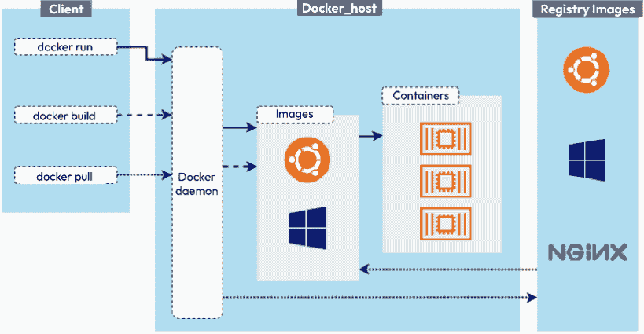
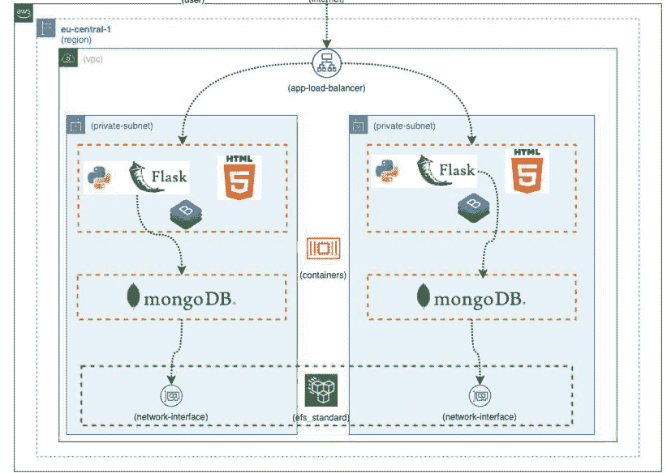

## 在 AWS 中运行容器

众所周知，传统的主机托管单体软件架构会拖慢那些希望利用云能力为客户交付业务成果的团队的步伐。迄今为止，本书中我们已讨论了此类应用可能带来的大量技术和组织影响。为了克服这些阻碍，软件团队更倾向于将单体拆分为更小、可管理的组件，也称为微服务。这些服务通常通过 HTTP(S) 或异步消息协议相互通信，同时向终端用户提供统一的接口，仿佛一切都作为单个应用进行管理。当使用合适的服务时，它们在云中相对容易扩展和运营。如果你从事软件应用设计，我强烈建议你阅读 Martin Fowler 的《Characteristics of Modern Microservices Architecture》 (https://martinfowler.com/articles/microservices.html)。

为了简化微服务架构的采用并构建针对云计算优化的应用，软件团队还使用十二要素设计模式 (https://12factor.net/)。这些是构建现代软件即服务 (SaaS) 应用的经过时间检验的最佳实践。12 要素主要推动以下理念：

- 使用 *声明式格式* 来设置自动化
- 与底层操作系统保持清晰的契约，提供 *跨环境的最高可移植性*
- 构建 *适用于云平台部署* 的应用
- *在不显著更改工具链的情况下扩展*
- 使开发和生产等 *环境之间的差异最小化*

如果我必须指出一项推动所有这些领域的单一技术，那就是 **容器**。微服务和容器配合得非常好。它们使用户能够将强大的应用基础的优势传递给终端用户，以频繁且稳定的业务功能的形式呈现。在现代时代，容器已成为云中或本地软件部署的事实标准。通过提供低计算和内存占用、隔离边界以及一次构建、随处部署等优势，容器已成为任何新项目或存量项目应用的强有力候选。你已在前几章中使用 Docker 工具箱镜像执行了所有动手练习，并且 presumably 同意这些容器提供的稳定体验无与伦比。无论底层系统配置、操作系统或库如何，你的动手体验都将相似。这不是很棒吗？如今，很少有软件应用不采用基于容器的部署模型。它简化了许多原本难以管理的领域。

在本章中，我们将通过涵盖以下主题，进一步扩展我们在 AWS 中对容器的了解：

- 容器生态系统的快速介绍
- 支持在云中运行容器的 AWS 服务
- 使用 AWS ECS 部署测试应用栈

## 容器生态系统的快速介绍

如果你尚未在软件环境中接触过容器，那么这就是为你准备的介绍。我会尽量简短，因为互联网上有大量优秀资源，如果你想深入了解该技术。

### 什么是容器以及为什么需要它们？

容器并不是一个新概念。它们在 Solaris、FreeBSD 和 Unix 操作系统中分别作为 Solaris Zones、Jails 和 Chroot 已存在多年。在计算领域，我们已经经历了大量提升技术成熟度同时抽象底层复杂性的创新。我们从裸机服务器开始，转向用于硬件级虚拟化的虚拟机，开始使用容器进行软件虚拟化，现在则拥有将所有内容从终端用户抽象开的无服务器技术。然而，与无服务器技术相比，容器由于其提供的成熟度与控制之间的平衡，仍然被大量使用。这通常是企业级采用和使用的一个重要要求。

就像 Java 和 Python 让我们无需编写汇编级代码一样，容器抽象了大量操作系统内部细节，以提供资源隔离和安全边界等优势，最终带来更好的敏捷性。与虚拟机不同，容器是一种操作系统虚拟化形式。它们是软件的标准单元，将代码及其所有依赖项封装起来，以便应用能够在多个环境中可靠、快速地执行。

Docker 是一个开源容器平台，它彻底改变了容器的概念。它提供了另一层抽象和构建块，这些构建块现已塑造了容器化工具、应用和平台的行业规范。让我们讨论一下使用 Docker 以及其底层构建块所能获得的关键优势。

## Docker 作为容器平台

Docker 是一个可移植的运行时应用环境，允许我们将应用与其依赖项捆绑在一起，在多个平台上运行，同时保持相同的终端用户体验。

Docker 成功并获得行业广泛采用的关键原因在于它所实现的优势——即可移植性、不可变性、更快的发展和部署，以及高效的资源利用。重要的是要重申，所有这些优势都源于本章开头讨论的 *微服务架构* 和 *十二要素* 设计方法。

### Docker 使用的关键概念

为了为应用开发者提供一致的体验，Docker 架构中使用了一些值得讨论的关键概念。

### Docker 镜像

Docker 镜像是一个可重用的 *只读模板*，其中包含代码、依赖项、运行时和工具，可由一个或多个容器复制。它通常基于另一个父镜像，并在其之上添加一些自定义增量。例如，使用 Ubuntu 作为基础镜像，你可以在其上添加 Nginx 来构建提供 Web 服务器功能的镜像。

你可以创建自己的 `Dockerfile`——一份包含创建 Docker 镜像所需所有指令的蓝图。它指定要使用的基础镜像、要安装的依赖项以及在镜像创建过程中要运行的命令。一旦 Docker 镜像构建完成，它就可以用于生成多个容器。

### 文件系统层

这就是驱动镜像创建和容器执行的功能。你 `Dockerfile` 中的每一条指令都会在前一条指令之上添加一个新的只读层。当从该镜像启动容器时，Docker 会为特定容器实例添加一个短暂的薄写层，该层可供容器内运行的进程使用。

### Docker 容器

容器是镜像的 *运行实例*。它们获得的薄写层仅持续容器的生命周期，可供容器内进程用于任何 *临时需求*。本书中我们使用过的 `docker run` 命令通过将 `akskap/awsdevopssimplified-toolbox` 镜像拉取到你的本地系统（如果尚未存在）然后从打包的工件中运行容器来创建容器。

我们可以在 *图 7.1* 中看到容器、镜像以及周边工具是如何协同工作的：



图 7.1 – Docker 生态系统以及容器与镜像之间的关系

接下来，让我们简要讨论一下注册表是什么以及它们的工作方式。

### Docker 注册表

注册表托管 Docker 镜像。它们可以是公共的或私有的，具体取决于你希望如何将这些工件分发给终端用户。常见示例有 **Docker Hub** 和 **Amazon ECR**。需要托管私有注册表并在静态时加密数据的组织可以使用托管 KMS 密钥和 IAM。在内部，ECR 将镜像存储在 Amazon S3 中。

通过利用这些功能，入门基础的容器部署并不困难。然而，一些领域需要更多关注。

### 将容器化部署扩展到简单用例之外

在本地系统上运行一两个容器实例很容易。对于 CI/CD 用例，团队通常会并行运行多个容器。这确实需要在各自工具公开的接口之上投入一些额外的开发工作（例如，**GitLab CI/CD** 流水线模板），但仍然可以管理。真正的挑战在于，当你想要为生产工作负载运行数百甚至数千个容器时会出现。如何确定将容器放置在哪个计算节点上？如何监控它们是否仍在运行？它们如何安全地从底层云提供商消费数据库和内存缓存等其他服务？这些就是证明需要一个功能完善的容器管理平台以便将这些任务卸载的领域。这些平台经过工程设计，可在规模上解决此类问题，以便你可以专注于编写应用代码。


接下来，我们将讨论这类平台的一些关键职责和特性。

## 容器平台的关键职责

容器平台应允许开发人员大规模地构建、部署和管理容器服务。除了提供与这些容器的生命周期管理相关的能力外，这类平台通常还支持其他几个领域。

## 编排容器的放置

在多个计算节点上调度容器并非易事。这要求平台在基础设施和应用层面同时进行交互。容器平台会基于底层服务器的当前消耗情况获取关键指标，并将其与应用的资源需求进行匹配。某些平台允许最终用户实现能满足其应用需求的进阶放置逻辑。

## 与其他服务的集成

除了运行应用之外，这些平台还提供了一系列集成能力。可想而知，在 AWS 上运行容器时，某个阶段必然需要与底层网络（VPC、子网寻址等）、持久化存储（EBS 或 EFS）以及监控和日志服务进行协作。这些集成省去了开发人员本需投入大量时间的各种管道工程。

## 监控容器化工作负载

并行运行多个容器需要全面了解应用的运行状况。创建依赖关系图、监控关键利用率指标、从日志中获取洞察信息，或提供可与第三方解决方案开箱即用的集成，都是这些平台提供的一些差异化能力。在第 8 章“启用工作负载的可观测性”中，我们将深入探讨 AWS 在该领域的一些产品。

## 为容器化应用实施安全护栏

作为一种操作系统级虚拟化技术，在某些场景下，你可能会在同一台主机上运行多个应用。容器平台应提供强大的安全边界，防止被入侵的应用获得对主机内核的非特权访问。我们将在本章稍后的“确保 ECS 良好的安全态势”部分介绍一些安全最佳实践。

最后，在选择容器平台时，始终牢记管理控制平面本身的复杂性非常重要。无论是自动推出安全补丁的需求，还是动态扩展 Kubernetes 所用底层组件的需求，将这些无差别任务交由平台处理总能让你受益。

第三方合作伙伴生态系统。用户无需管理任何控制平面节点，而且与 EKS 一样，如有需要，你还可以将应用扩展到本地服务器。

该服务允许你声明式地定义应用清单，其中包含资源需求以及其他依赖项。此外，你可以将底层基础设施配置（EC2 节点）任务交由 AWS 处理，并从高标准的隔离和访问管理安全机制中获益。ECS 在底层利用 Docker 运行时来管理你的应用。我们将在实操练习中体验该服务的实际效果。

在本章剩余部分，我们将更深入地探讨 ECS 及其附带的相关功能。

## ECS 概念与安全特性

作为 AWS 的一种带有自身设计理念的容器管理服务，某些概念是 ECS 服务独有的。由于这些概念在容器生态系统的其他工具或平台中并不常用，让我们简要讨论一下。

## ECS 使用的重要概念

类似于我们在 CloudFormation 模板中以声明方式定义资源状态，我们使用基于 JSON 的清单来描述容器的需求、它们之间的相互关系以及与其他服务的集成。下一步是将它们交给 ECS 进行管理。

## 容器定义——最基本的容器配置层级

这是用户所期望的最低层级的配置细节。在容器定义中，你可以定义 Docker 镜像、CPU 和内存分配、网络、安全、Linux 参数、卷挂载、端口映射等属性。

容器定义包含了编排器在特定节点上托管此应用所需的所有信息，并配置了让应用启动和运行所需的全部设置。该概念与你为管理应用而运行的容器一一对应。

## 任务定义——在逻辑上封装相关容器

在规划好容器定义之后，你可以在逻辑上将它们组合成所谓的任务定义。这是 ECS 特有的概念，可用于单独定义（和管理）你的应用组件。假设你有一个 Web 应用，其中的后端应用容器总是与数据库容器通信。那么，这两个容器自然可以放进同一个任务定义中，因为你无论如何都不会将数据库暴露给外部世界。

你还可以在任务定义级别定义 CPU 和内存等资源，然后再将这些资源进一步分配给所有容器。为了实现细粒度的访问控制，任务定义可以

在介绍了 ECS 中的主要概念之后，我们再讨论一些有助于确保组织良好云上安全态势的安全最佳实践。

## 确保 ECS 良好的安全态势

安全护栏可以有多个维度。AWS 提供的服务能够满足其中的大部分需求——无论是 Route53 DNS、防火墙、通过网络防火墙进行网络数据包检查、用于子网的网络访问控制列表，还是用于在接口级别管理流量的安全组。在 ECS（以及一般容器）的背景下，让我们讨论一些能带来巨大安全收益的“低垂的果实”。

## 通过 IAM 角色锁定权限

IAM 定义了 AWS 中与身份验证和授权相关的一切。ECS 也不例外。该服务允许你在 ECS 代理级别和应用任务级别定义并映射 IAM 角色。它们分别称为 ECS 任务执行角色和 ECS 任务角色。ECS 任务代理通常需要访问 ECR 注册表、SSM 参数和 CloudWatch 日志。除此之外，你还可以限制 ECS 容器内运行的应用的权限。当应用容器启动时，ECS 会确保向其中注入动态凭证。这有助于你避免管理长期静态安全凭证，因为这些凭证可能带来安全风险。

## 在发现 CVE 时确保安全补丁就绪

使用 Fargate 上的 ECS，你可以将安全补丁工作交由 AWS 处理，云提供商会负责动态地为你的实例修补任何新发现的常见漏洞和暴露（CVE）。但是，如果你在 EC2 上运行 ECS，则必须了解 AWS 的共享责任模型（https://aws.amazon.com/compliance/shared-responsibility-model/）。最重要的是要记住：AWS 负责云本身的安全，而客户负责云中的安全。这不仅适用于容器，也适用于整个 AWS 生态系统。因此，定期修补 EC2 实例是客户的责任，可以通过动态更新受影响的库或采纳基础设施不可变性的理念来轻松实现，正如第 3 章“在云中利用不可变基础设施”所讨论的那样。这实质上意味着，一旦新的官方 ECS 产物可用，你就可以用整个 AMI 进行替换。然而，这需要一套自动化的、可靠的软件交付和测试流程。

## 使用任务级 ENI 实现网络隔离

在集群中任务的网络属性方面，ECS 相当灵活。有三种模式：host、vpc 和 bridge。从安全角度来看，此功能允许你像管理 EC2 实例一样管理该容器的网络流量。根据你使用的网络模式，你可以使用桥接网络将容器隔离在底层主机的边界内，也可以使用 VPC 结构将 ENI 直接分配给容器，或者使用 host 模式将容器完全抽象在主机 IP 之后。


仅仅专注于某种批处理的任务可以通过利用 Docker 管理的桥接网络来隔离运行。对于其他需要将工作负载暴露到宿主机之外的场景，你可以使用另外两种模式。

## 容器机密与内核能力

通过在你的容器定义中设置相关的键及其对应的值，可以将机密注入容器环境。然而，在处理安全参数时，你可以利用 Secrets Manager 集成，避免在代码或相关配置中泄露任何机密数据。

容器内运行的所有应用程序都需要系统调用能力来执行某些功能。ECS 使你可以精细地分配特定任务所允许的确切系统调用。除非你运行的容器工作负载需要直接在底层宿主机上进行某些更改，否则应尽量避免使用 *特权* 模式。这种模式本质上会让容器表现得像底层宿主机上的 root 用户。

## 在 ECS 上部署测试应用程序

看到我们学到的知识在实际中应用总是很有趣的。基于我们目前探索的内容，让我们亲自动手在 Amazon ECS 上部署一个测试应用程序。这次，我们将创建一个新的应用程序，你也可以在本章范围之外根据个人喜好对其进行自定义——一个 **待办事项列表管理器**。

我们将在应用程序架构中加入一些数据持久化元素，使其尽可能贴近真实的使用模式，在这种模式下，你每天都会添加新任务并删除一些其他任务。让我们勾勒出应用程序的主要组件，如 *图 7.2* 所示。

## 理解测试应用程序架构

待办事项列表管理器是一个应用程序，允许你管理日常工作中完成的所有任务。在本练习中，我们将开发和托管两个功能：创建新任务和删除已完成的任务。你还可以进一步扩展应用程序的范围并按照自己的喜好进行个性化设置。多个应用程序和基础设施级别的组件相互通信，以向最终用户提供任务管理能力。它们大致可以分为两个部分——**基础设施组件和应用程序组件**。

### 基础设施组件

这些是支持底层基础设施的服务，应用程序在其之上运行。和往常一样，你需要一个 VPC、子网以及相应的路由表来管理流量。当用户请求到达托管在边缘的 Application Load Balancer 时，它会将数据包转发到 ECS 集群，然后 ECS 集群根据发送的请求类型返回 HTTP 响应。正如我们在本章中已经讨论过的，ECS 进一步由服务、任务和任务定义组成。我们将利用所有这些组件来在 AWS 账户中托管基于 Python 的 Web 应用程序。

正如我们在上一章《使用 AWS CDK 的 IaC 编程方法》中看到的，利用现有的 CDK 构造来大规模构建和部署 AWS 基础设施是非常高效的。这使我们能够避免投入大量时间从头编写 CloudFormation 模板。因此，我们将使用 AWS CDK 来定义本章所需的全部基础设施。

以下是基础设施部分下的三个层级：

- **网络基础设施（VPC、子网和路由表）**：我们将为本练习创建一个标准的 10.0.0.0/16 VPC CIDR 块，并划分出两个公有子网和两个私有子网，每个子网使用 /24 掩码。我们将所有关于路由表创建、路由条目、NAT 网关和互联网网关的任务通过 `aws-cdk-lib/aws-ec2` 库卸载给 CDK。

- **容器平台（ECS）**：在 ECS 范围内，我们将创建分配计算和内存资源的任务定义，并进一步为应用程序和数据库定义两个容器。为了拥有一个始终运行的应用程序实例，我们将其包装到一个与 Application Load Balancer 集成的 ECS 服务中。由于我们不想管理任何 EC2 实例，我们将使用 Fargate 启动类型，从而将此责任卸载给 ECS 服务。

- **流量控制器（Application Load Balancer）**：为了接收来自最终用户的请求，我们将创建一个面向公众的 Application Load Balancer，并将其接口放入 VPC 的公有子网中。ECS 会自动将运行中的容器注册到相应的目标组，从而将容器端口 5000（由 Flask 使用）抽象到常规的 HTTP 80 后面。



图 7.3 – 托管在 ECS 上的待办事项列表管理器应用程序的组件和工作流程

我们打算使用 CDK 来部署我们的基础设施和应用程序元素。因此，让我们讨论一下我们将需要的堆栈组件。

## 定义 CDK 堆栈构造

我们将在 CDK 堆栈中定义前面讨论的基础设施组件。完整的 CDK 项目位于你的 Cloud9 IDE 中的 `chapter-7/chapter-7-cdk/` 目录下。我们不会详细讨论 CDK 项目的启动步骤，因为这些内容在上一章《使用 AWS CDK 的 IaC 编程方法》中已经介绍过了。让我们深入研究代码级别的构造，并了解启动应用程序所需的内容。像往常一样，所有 CDK 构造定义都可以在项目目录的 `lib/` 文件夹中找到——在本例中是 `chapter-7/chapter-7-cdk/`。让我们详细了解每个基础设施组件。

### 网络基础与 ECS 集群

所有基础设施堆栈定义的常见起点是创建 VPC、子网和相应的路由表。你还需要为 VPC 设置一个互联网网关，并在每个公有子网中设置一个 NAT 网关，以支持数据包通过互联网进行传输：

```
import { Vpc, SubnetType} from 'aws-cdk-lib/aws-ec2';
...
const customVPC = new Vpc(this, 'CustomVPC', {
  cidr: '10.0.0.0/16',
  maxAzs: 2,
  subnetConfiguration: [
    {
      subnetType: SubnetType.PRIVATE_WITH_EGRESS,
      name: 'privateSubnet',
      cidrMask: 24,
    },
    {
      subnetType: SubnetType.PUBLIC,
      name: 'publicSubnet',
      cidrMask: 24,
    }
  ],
  natGateways: 2
})
```

添加 VPC 资源后，我们就可以定义 ECS 集群并将其链接到此自定义 VPC：

```
import * as ecs from 'aws-cdk-lib/aws-ecs';
...
const ecsCluster = new ecs.Cluster(this, 'ECSCluster', {
  vpc: customVPC,
  clusterName: "aws-devops-simplified",
})
...
```

这些简单的构造为用户抽象了许多复杂性。如果你此时执行 `cdk synth`，你会感激在为此堆栈生成 CloudFormation 模板时幕后所做的繁重工作。

现在集群已经准备好了，是时候定义将托管我们两个容器的任务定义了。

### 为我们的 ECS 集群添加任务定义

作为此配置的一部分，我们还将创建可附加到 *任务角色* 和 *执行角色* 的 IAM 策略。这些权限为这些构造提供了对相关 AWS 服务的访问权限：

```
import * as iam from 'aws-cdk-lib/aws-iam';
...
const execRolePolicy = new iam.PolicyStatement({
  effect: iam.Effect.ALLOW,
  resources: ['*'],
  actions: [
    "ecr:GetAuthorizationToken",
    "ecr:BatchCheckLayerAvailability",
    "ecr:GetDownloadUrlForLayer",
    "ecr:BatchGetImage",
    "logs:*",
    "elasticfilesystem:*"
  ]
});
const fargateTaskDefn = new ecs.FargateTaskDefinition(this,
"FargateTaskDefn", {
  cpu: 4096,
  memoryLimitMiB: 8192,
});
fargateTaskDefn.addToExecutionRolePolicy(execRolePolicy);
fargateTaskDefn.addToTaskRolePolicy(execRolePolicy);
```

你可能注意到我们还为 ECR 服务添加了 IAM 权限。这是为了支持从 ECR 仓库消费 Docker 镜像，以防你决定不使用 DockerHub 上的现有镜像。

任务定义帮助我们配置参数、资源和挂载点，这些最终将被作为此任务一部分而配置的容器使用——在我们的案例中即应用程序和数据库容器。现在，让我们继续定义容器及其各自的设置。

### 配置应用程序和数据库容器

想一想应用程序在容器内运行并响应来自互联网的流量所需的所有配置。另一方面，我们不想将数据库暴露给外部世界，它只能通过 `localhost` 供应用程序访问。我们将首先从更大的 *任务* 资源池中为两个容器分配一部分 CPU 和内存资源。默认情况下，Flask 应用程序运行在端口 5000 上。这是我们希望暴露给外部世界的内容：


```javascript
...
const appContainer = new ecs.ContainerDefinition(this,
"AppContainerDef", {
  image: ecs.ContainerImage.fromRegistry("akskap/flask-todo-list-app"),
  taskDefinition: fargateTaskDefn,
  cpu: 512,
  memoryLimitMiB: 1024,
  logging: ecs.LogDrivers.awsLogs({streamPrefix: "aws-devops-simplified-app-container"})
})
appContainer.addPortMappings({
  containerPort: 5000
})
...
const dbContainer = new ecs.ContainerDefinition(this,
"DBContainerDefn", {
  image: ecs.ContainerImage.fromRegistry("mongo"),
  taskDefinition: fargateTaskDefn,
  cpu: 512,
  memoryLimitMiB: 1024,
  logging: ecs.LogDrivers.awsLogs({streamPrefix: "aws-devops-simplified-db-container"})
})

dbContainer.addMountPoints({
  containerPath: mountPath,
  sourceVolume: volumeName,
  readOnly: false,
})
...
```

如你所见，我们对两个容器使用了不同的镜像标识符。一个指向我们的 Flask 应用代码镜像，另一个指向官方的 MongoDB 镜像，但两者都托管在 DockerHub 上。你可能还记得，我们讨论过将 EFS 文件系统挂载到 MongoDB 容器以持久化所有底层数据的变更。这可以通过代码中的 `dbContainer.addMountPoints` 来实现。我们还使用 `appContainer.addPortMappings` 函数为应用容器添加了主机端口映射。

但此时，ECS 会提示挂载点无法识别。这可以理解，因为我们还没有预置 EFS 文件系统，而且在容器定义中使用它之前，也没有将其映射到任务定义。因此，让我们确保这些前提条件得到满足。

## 初始化 Flask 应用和 MongoDB 连接

> **注意**
> 
> 此处及之后讨论的所有应用代码均可在你的 Cloud9 IDE 中的 `chapter-7/chapter-7-flask-app` 路径下找到，或者也可以参考本书的 GitHub 仓库：https://github.com/PacktPublishing/AWS-DevOps-Simplified/tree/main/chapter-7/chapter-7-flask-app。

我们可以使用现有的 Python 模块来与 Flask 和 MongoDB 交互。这些依赖已在应用目录下的 `requirements.txt` 文件中定义：

```
from flask import Flask, render_template, request, url_for, redirect
from pymongo import MongoClient
from markupsafe import escape
from bson.objectid import ObjectId

### Initialize global variables for MongoDB connection

app = Flask(__name__)
mongodb_client = MongoClient('localhost', 27017)
todos_db = mongodb_client.flask_db
todos_collection = todos_db["todos"]
...
```

导入必要的模块后，我们初始化一个数据库客户端、数据库以及相应的集合，这些集合将用于托管 MongoDB 中的 JSON 文档。

现在，我们可以继续使用 Flask 装饰器来定义视图函数和相关的 HTTP 方法：

```
... 
@app.route("/", methods = ('GET', 'POST'))
def todos():
    if (request.method == "POST"):
        todo_item = request.form["todo"]
        todo_type = request.form["tasktype"]
        todos_collection.insert_one({"todo": todo_item,"tasktype": todo_type})
        return redirect(url_for('todos'))
    all_todos = todos_collection.find()
    return render_template('index.html', all_todos = all_todos)

@app.post('/<id>/delete')
def delete(id):
```

```
- Key: Name
  Value: Chapter7Stack/CustomVPC
Metadata:
  aws:cdk:path: Chapter7Stack/CustomVPC/Resource
CustomVPCprivateSubnetSubnet1Subnet6940697D:
...
...
```

你可能会注意到，我们添加到 CDK 堆栈中的一百多行代码，最终生成了约 800 行的 CloudFormation 模板。快速验证的方法是运行 `cdk synth | wc -l`。

现在，让我们在 AWS 账户中预置资源：

```
aws-devops-simplified:~/environment/chapter-7/chapter-7-cdk $ cdk deploy -y

✨  Synthesis time: 12.83s
Chapter7Stack: building assets...
...
...
Do you wish to deploy these changes (y/n)? y
...
[100%] success: Published 35b80399fc491dc502df8e5f40f2587918b2d7045bc2 2bc0e3ba0eea19d30595:current_account-current_region
Chapter7Stack: creating CloudFormation changeset...
...
...
✅  Chapter7Stack
✨  Deployment time: 261.46s

Outputs:
Chapter7Stack.FargateServiceLoadBalancerDNS9433D5F6 = Chapt-Farga-GEIPMTTLTGLY-2055706317.eu-central-1.elb.amazonaws.com
Chapter7Stack.FargateServiceServiceURL47701F45 = http://Chapt-Farga-GEIPMTTLTGLY-2055706317.eu-central-1.elb.amazonaws.com
Stack ARN:
arn:aws:cloudformation:eu-central-1:852467203672:stack/Chapter7Stack/659a4770-b4ea-11ed-bdbc-0a3cfb4cfe00
✨  Total time: 274.3s
```

部署完成后，我们会获得一个 Application Load Balancer URL，可以在浏览器中访问它来启动我们的待办事项管理器应用。复制该链接后，你就能看到应用界面，如图 7.4 所示：

## 待办事项管理器 (AWS DevOps Simplified)

图 7.4 – 运行在 ECS 上的待办事项管理器应用

该应用为你提供了一个蓝图，你可以根据自己的偏好以及对任何待办事项管理器应用的功能需求，轻松地对其进行扩展和定制。

## 总结

在本章开始时，我们了解了容器在现代软件应用中的重要性。容器不仅加快了开发速度，还遵循了微服务模式和十二要素设计原则，这些是软件工件中固有的一部分。如果你还没有接触过容器，我们先从它们的基本工作原理入手，然后进一步介绍了容器运行时环境 Docker 的构成。

在打好基础之后，我们讨论了在云端运行生产工作负载时对容器编排系统的需求。AWS ECS 是 AWS 提供的一种有主见的（opinionated）服务，它简化了在企业级环境中运行容器的操作。接下来，我们更深入地探讨了 Amazon ECS 及其用于定义应用堆栈中逻辑组件的原生结构。当然，在云端部署资源时安全性至关重要。因此，我们讨论了一些最佳实践，以确保你的容器应用采用最小权限访问模式，并与其他 AWS 服务集成。为了让你获得关于 ECS 所讨论内容的实际动手经验，我们从零开始部署了一个待办事项管理器应用。基于前几章学到的知识，我们使用 CDK 来管理所需的基础设施组件。
