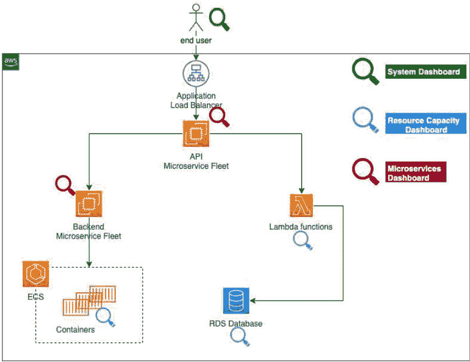
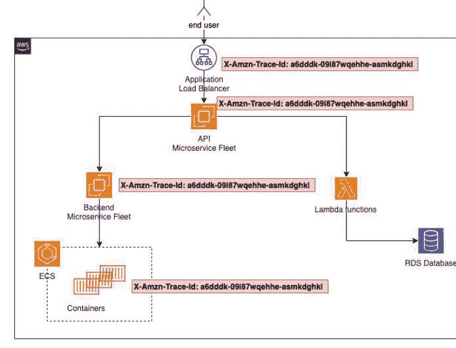
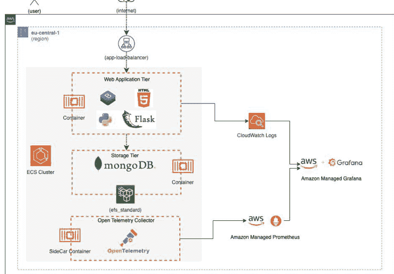
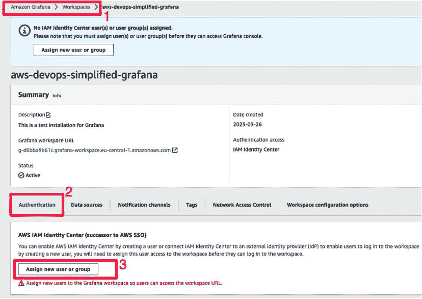
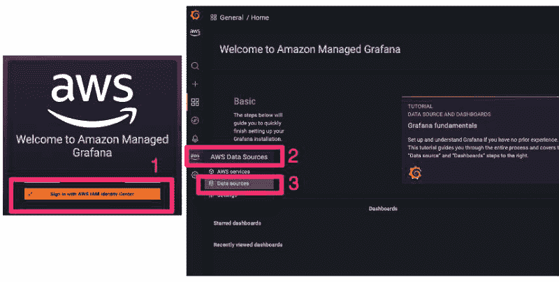
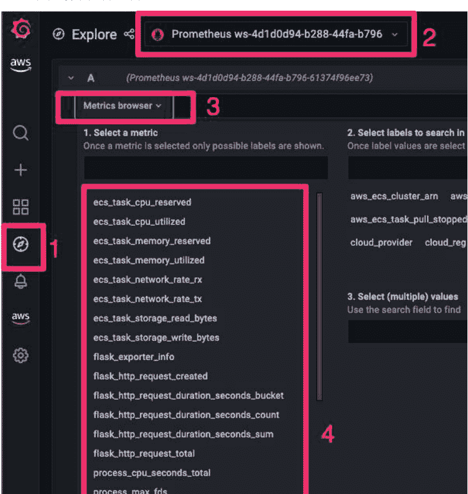
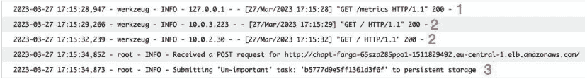
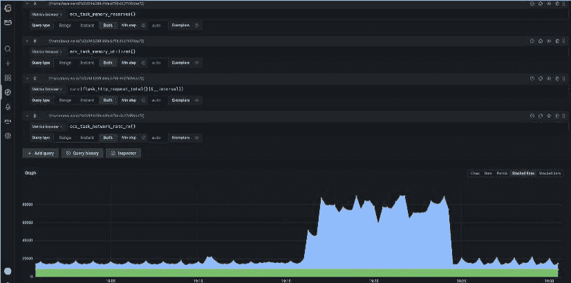

## 实现工作负载的可观测性

随着软件应用日益复杂，我们需要在非常细致的层面上获得洞察，这在以前并不常见。将单体应用拆分为一组微服务带来了公认的好处，但为了同样甚至在某些情况下更好地了解系统在底层的运行状况，我们确实需要做更多工作。

当应用出现问题时，会影响用户体验，并最终影响业务。如果此类情况频繁发生，甚至可能因为软件系统不可靠而导致客户信任的丧失。因此，尽早发现问题，并理解问题发生的原因以及如何修复，是非常重要的。

**监控**处理的是*被动*部分，而**可观测性**处理的是*主动*部分。通过监控，你已经能够很好地了解哪些因素会对软件可用性产生负面影响——例如，一个即将写满的存储磁盘。另一方面，可观测性主要关注的是预见可能发生的问题，并在问题发生时简化根因分析。对于同一个存储磁盘，可观测性解决方案可以分析磁盘使用日志，并将其与软件发布周期中的延迟增加或错误相关联，例如。管理员可以利用这些发现来优化存储配置，避免最终导致宕机。在理想情况下，可能对客户产生影响的软件模式应该在指标告警触发之前，甚至早于客户开始体验服务降级之前就暴露出来。这应该是所有管理工作负载的团队的*北极星*，尤其是在大规模场景下。


在我的职业生涯中与多个软件团队合作时，我注意到一个常见的现象：可观测性和监控总是仅被视为技术指标的范畴。有时，软件专业人员与理解自己的代码对业务产生的影响以及最终用户如何消费他们每天开发的应用有些脱节。从我的角度来看，可观测性完全是关于*设身处地为客户着想*，感受他们所感受的，看到他们所看到的，并衡量对他们最重要的数据。只有这样，我们才能在他们每次使用我们的应用时不断改善体验。当然，这在某种程度上取决于底层技术指标，但方法始终应该是从驱动客户体验的业务目标倒推，然后推导出影响这些目标的相关指标。构建一个与业务需求脱节的技术策略将导致无效的解决方案。

以电子商务平台为例，客户最不关心的是后端服务器上不断上升的 CPU 和内存使用率。然而，如果他们无法在合理的时间内完成订单，他们就会对此感到不满。因此，关注*订单完成时间*作为指标并从那里倒推，弄清楚 CPU 利用率的增加是否导致了该问题，可能很有价值。

在本章中，我们将涵盖以下主题，以了解有关启用在 AWS 中运行的工作负载的可观测性的一些知识：

- 什么是可观测性？
- 用于监控和可观测性的关键 AWS 服务
- 构建稳健可观测性策略的最佳实践
- 如何为托管在 AWS 中的工作负载定义您的可观测性策略
- 为托管在 ECS 上的测试应用部署一个基础可观测性栈

让我们从理解可观测性的核心思想开始。

## 什么是可观测性？

简单来说，它就是关于理解正在运行的系统当前所处的状态，从它所做的工作和它所发出的数据来看。制定一个稳健的可观测性策略不是一次性的工作，并且随着业务需求的演变，它总是有优化的空间。但是，在你甚至能理解发生了什么之前，确保系统至少发出一些数据供我们推导出一些结论是很重要的。但是什么样的数据呢？

可观测性有三个基础支柱，使你能够将数据转化为信息，并从这些信息中得出见解，最终导致需要采取的行动：

- **日志：** 这些是*离散事件*，在为客户请求提供服务时发生在系统的各个组件中。将这些日志存储在集中式数据存储中以便在需要时安全地提取和分析信息，是非常宝贵的。

日志在某些组件因未处理的异常而停止向事件存储推送指标的情况下特别有帮助。这可能是由第三方依赖项、网络问题或其他不可预见的情况引起的。日志是系统中发生的事件的最终真实来源。因此，在创建后防止任何修改，强制执行适当的安全防护措施非常重要。在 AWS 中，使用诸如 **Amazon Key Management Service (KMS)** 之类的服务在静态时加密这些日志是一个很好的做法。

- **指标：** 这些是*原始数据点*，反映了系统随时间推移的性能，在告警、趋势分析和场景预测中特别有用。对于本地部署，组织通常利用第三方工具和 **应用性能监控 (APM)** 解决方案来收集底层基础设施和应用指标。然而，在 AWS 中，大多数服务会自动发布关键指标，而无需任何额外配置或用户成本。这些信息可免费使用，可用于定义阈值违规告警或数学分析——例如，磁盘在任何 5 分钟间隔内的最大 IOPS。

- **追踪：** 在使用多个微服务时，通常需要一个整体视图来理解请求流并识别瓶颈。这使软件团队能够深入了解信息*如何在特定请求的多个系统间传递*，并确定是否出现了异常。这些追踪也是服务图的宝贵输入，因为它们可用于直观地描绘每个服务所拥有的依赖关系和一些问题区域。

AWS 用于所有可观测性需求的瑞士军刀解决方案是 **Amazon CloudWatch**。CloudWatch 可用于各种客户需求，以持续监控应用程序和底层基础设施。

在了解了可观测性的三个主要支柱后，让我们看看它们有助于实现的主要优势。

## 可观测性的优势

当团队使系统可观测时，他们会获得多重益处：

- **增强的客户体验：** 毫无疑问，你对系统行为的理解越好，就越容易最大化客户从软件应用中获得的收益。产品经理可以利用这些数据来了解特定软件应用的使用方式，并为新功能和增强功能制定未来策略，从而取悦客户。

- **高效的故障排除：** 良好的可观测性策略可减少围绕运营问题和中断的调查时间。这使团队有更多时间构建差异化功能，而不是被拉入长时间的调查中。

- **可见性：** 可观测性不仅仅是灭火式的运营问题，有时你会想问自己一些问题，以便更好地了解软件应用的消费模式。*我的大多数用户来自哪里？他们通常花多少时间填写特定表单？用户在我的网站上订购商品需要多少次点击？有多少用户向我的 API 传递了错误的参数，等等？*

在建立了对可观测性是什么以及为什么重要的基础理解后，让我们讨论一下 AWS 在这一领域的服务。

## 用于监控和可观测性的关键 AWS 服务

AWS 提供各种原生服务，使客户能够为其应用工作负载实施端到端的可观测性解决方案。三个可观测性支柱都得到了很好的覆盖。CloudWatch 是 AWS 的主要可观测性平台，它是一套不同的解决方案，解决客户在日志和指标收集方面的需求。对于 **追踪**，AWS 提供 **X-Ray** 服务，这使得追踪应用中的单个请求或工作流变得非常容易。

有趣的是，可观测性领域还有很多客户一直在与开源解决方案合作，并希望在云中扩展其现有实现。AWS 为 **Prometheus** 和 **Grafana** 提供托管解决方案，我们将在本章后面的动手练习中详细介绍。此外，AWS 在 **Cloud Native Computing Foundation’s (CNCF’s) OpenTelemetry** 项目中也非常活跃，该项目也简称为 OTel。它是管理遥测数据的厂商中立框架。OpenTelemetry 引入了*发行版*的概念，它是特定 OpenTelemetry 组件的定制版本。AWS **Distro for OpenTelemetry (ADOT)** 是基于 OpenTelemetry 项目的 AWS 发行版。它提供开箱即用的功能，可一次性对应用进行检测，并将指标和数据发送到多个 AWS 服务，包括 Amazon CloudWatch、X-Ray 和 Amazon Managed Service for Prometheus。

在深入了解良好的可观测性策略的最佳实践之前，让我们了解 AWS 可观测性平台——Amazon CloudWatch 的各个组件。

## Amazon CloudWatch

CloudWatch 是一个集中式平台，允许客户收集、监控和可视化其应用日志、指标和 X-Ray 追踪，所有内容都在单个仪表板中。它在为客户管理的全部工作负载提供统一的运营健康视图方面非常宝贵。

CloudWatch 提供的功能主要有三个方面。

### 基础设施监控

基础设施监控涵盖指标、告警和相关见解的基础方面。


## CloudWatch 指标

大多数 AWS 服务默认会发出免费指标，这些指标可用于了解系统性能，并支持搜索和可视化功能。客户既可以使用指标的基本监控（免费），也可以使用详细版本（付费），后者仅由部分服务提供。根据这些指标的时间粒度，用户可以用它们来了解系统某些部分的工作趋势和模式。用户还可以利用 CloudWatch Metrics Insights，这是一个 SQL 查询引擎，可对指标进行实时分析。

## CloudWatch 告警

可以配置 CloudWatch 告警来监控某个特定指标或涵盖多个指标的数学表达式结果。例如，如果某个 AWS 服务分别发出读 IOPS 和写 IOPS，你可以使用指标加法得出总 IOPS，并在总 IOPS 阈值被突破时配置告警。

例如，告警可以配置为发送 Amazon Simple Notification Service（SNS）通知，并将启动/停止 EC2 实例作为目标操作。

## 应用程序监控

借助应用程序监控，CloudWatch 可以更深入地了解应用程序的内部工作方式。此类别提供了多项服务。

### 合成监控

CloudWatch 允许你从世界多个位置模拟最终用户与应用程序的交互——就像真实用户使用你的应用程序一样。

### Service Lens

Service Lens 将来自链路追踪、指标、日志和告警的所有数据汇总到单个仪表盘上。这不仅为用户提供了服务图谱的统一视图（其中突出显示了应用程序工作流中涉及的不同组件），还将瓶颈以及每分钟请求数、平均响应时间等重要数据指标呈现出来。这种可见性使你可以轻松地在海量数据中找到问题所在，并可以基于此分析回溯，以揭示潜在问题。

### CloudWatch 真实用户监控

CloudWatch 真实用户监控（RUM）可以提供真实用户洞察，让你了解最终用户的真实体验。它是一个 JavaScript 代码片段，你可以将其添加到应用程序中，并立即开始测量关键指标。RUM 代理捕获并注入到网页中的数据可以提取页面加载时间和客户端错误等信息，此外还可用于许多其他场景。

## 洞察与运维可见性

在提供现成解决方案方面，这一类别具有巨大的差异化优势——这类解决方案从多个来源提取数据，从中获取洞察，并为用户提供可操作的后续步骤。

### 容器洞察

在容器领域使用 AWS 服务时，你可以使用 **CloudWatch 容器洞察**来汇总容器化应用程序的指标和日志。它可以针对持续容器重启等问题提供深入洞察。

### Lambda 洞察

在 **AWS Lambda** 上运行无服务器工作负载时，Lambda 洞察可以深入了解 Lambda 调用中的系统级指标和事件。对于支持的运行时，你可以添加一个扩展，该扩展会开始收集有用数据，并帮助用户识别冷启动等问题。

> **你知道吗？**
> 在撰写本文时，Amazon CloudWatch 每月监控超过 9000 万亿次指标观测，并摄取超过 5 EB（艾字节）的日志。与全球 80 多亿人口相比，这意味着该服务平均每月为地球上的每个人处理约 100 万次事件。这就是 CloudWatch 的运行规模。

用户可以通过利用 CloudWatch 可观测性平台中的合适解决方案做非常多的事情。不过，接下来我想讨论一些最佳实践，以便你在使用这些工具时能最大化收益。

## 构建可靠可观测性策略的最佳实践

在本节中，我们将介绍一些基本原理，说明如何最好地呈现可观测性数据，同时保持你需要处理的信息量的适当平衡。

### 构建仪表盘层级结构

可观测性策略成功的一个关键衡量指标是**平均恢复时间（MTTR）**。它定义了处理运维问题的工程师能够多快理解并从潜在问题中恢复。首先，提供恰当详细程度的仪表盘非常重要。减少无关噪音对于降低整体 MTTR 至关重要。软件团队常遇到的一个问题是创建数据量庞大的仪表盘，将所有应用程序的许多不同方面都放在一个屏幕上。这通常会导致漏报，从而消耗大量排查时间。

如本章开头所述，你必须以客户为中心，做到感同身受，并在此基础上构建可观测性策略。为了直观感受最终用户的体验，你可以构建一个仪表盘层级结构，从顶层全局视图开始，并在深入每个组件时提供指向其他子仪表盘的链接。每个子仪表盘都针对应用程序的特定设计领域。例如，让我们考虑一个由多个微服务实现的典型 Web 应用程序架构。在从一个提供重要 API 延迟、服务图谱健康状态和分布式链路追踪数据的高级仪表盘开始后，你可以将调查范围缩小到提供前端、应用程序或数据层更多细节的特定仪表盘。这样你就可以只关注足够的信息，并一步步深入调查。此外，你还可以实现一个全局仪表盘，突出显示所有组件和相应资源的容量问题。图 8.1 突出显示了这些仪表盘可以关注的架构特定区域：



图 8.1 – 构建正确的仪表盘层级结构以降低 MTTR

还有很多实践可以进一步简化或增强仪表盘所呈现的数据。让我们来看看其中的一些。

### 采用时间序列模式分析

对于某些指标，观察时间序列模式比观察标量值更相关。当你的运维团队注意到 API 错误数每 10 分钟出现一次尖峰，但从未超过你设置的告警阈值时，这可以增强主动分析能力。

你还可以在同一图表上绘制相关的时间序列数据，以相对了解某些参数如何随时间演变，以及是否存在需要深入研究的关联。

### 在图表上标注良好和不良阈值

不同的应用程序对良好或不良状态的阈值可能不同。对于计算密集型批处理工作负载，CPU 利用率持续报告为 80% 可能是可以的，但对于另一种类型的应用程序，这可能不符合预期的利用率范围。此外，团队在不断变化，可能会有新成员加入，也可能会有一些人在某个时候离开。当这些阈值范围与底层指标一起绘制时，你可以轻松识别异常值和不符合预期的部分。

### 绘制正确的维度

CloudWatch 指标基于维度概念工作。普通指标只是数据，但当我们添加一定数量的相关维度时，它们就转变为信息。如何利用这些维度对于在运维仪表盘上呈现最相关的信息起着重要作用。

例如，一个维度可以是在定义的时间窗口内发生的 API 错误总数。但这也可能意味着某个客户持续使用错误的负载调用某个 API 端点。当然，你不会希望因为这种情况被寻呼，因此更好的维度可以是按客户统计的 API 错误数。这有助于排除误报，从而节省宝贵的排查时间。

### 在所有系统中使用一致的时区

几乎每次故障排查都始于事件发生时间。这随后成为在其他仪表盘、系统和日志中搜索相关信息的关键。作为经验法则，始终选择 UTC 作为参考，这样你就是在相同的时间标准下比较数据和调查结果。当你在同一个仪表盘上绘制不同指标，并写入带有时间戳的日志（这些日志之后会推送到集中式日志平台）时，这一点尤其有用。

### 传播链路追踪标识符

采用分布式架构可能意味着单个请求在向用户返回任何响应之前，需要流经多个系统或微服务。调试此类请求时，在


缺乏相关上下文可能会很痛苦。因此，在负载通过多个组件传递时附加一个唯一的请求标识符是一个好主意。每个微服务的相应日志随后可以利用相同的跟踪标识符，以及附加的元数据，例如处理请求所花费的时间。

这在很大程度上简化了调试活动，因为你可以过滤特定的请求标识符，并立即了解特定请求如何在系统中遍历。这在图 8.2 中有所强调：



图 8.2 – 在每个请求中注入跟踪标识符

除了跟踪标识符传播请求元数据之外，还很重要的一点是系统的所有组件都要让用户了解其健康状况。

## 确保系统的所有组件都发出事件

无论是日志、指标还是跟踪，在理想情况下，系统中不应存在像黑盒一样运行的组件。每个服务，无论是托管还是非托管，都应在你的中央可观测性平台中记录事件。这也是从云提供商中选择特定服务时的重要标准。验证开箱即用的日志类型、提供的指标、这些事件如何聚合到你选择的工具中等等总是很有帮助的。

需要注意的是，通常有些组件确实是黑盒，因为它们是从其他团队继承的，代码不再可用，或者某种技术债务不允许你在代码级别添加检测。在这种情况下，你可以探索 sidecar 模式，其中最低限度的检测来自另一个软件或工具。这些工具与此类组件一起部署，并且可以在不造成任何性能问题的情况下跟踪对底层内核或其他库的调用。

接下来，我们将深入研究测试应用程序。这将帮助我们亲身体验来自 AWS 和开源社区的一些服务。

## 为托管在 AWS 上的工作负载定义你的可观测性策略

永远不存在一种完美的可观测性策略，可以在规模上为你提供系统最细粒度的视图。相反，这是一段不断发展的旅程，随着你发布新功能和软件应用程序的更新而不断演进。你继续通过确保可观测性堆栈在任何时候都能突出显示对关键业务目标的遵守情况来调整可观测性堆栈。为了在 AWS 上启动你的可观测性之旅，你可以考虑以下方面。

## 为托管在 ECS 上的测试应用程序部署可观测性堆栈

在第 7 章《在 AWS 中运行容器》中，我们看到了在 AWS 上运行容器化工作负载是多么容易。我们使用 Python Flask 框架开发了一个待办事项列表管理器应用程序，并将其部署在 Amazon ECS 上，基础设施组件使用 CDK 推出。通过利用 ECS 的 Fargate 部署模型，我们能够将底层容器节点的管理 offload 给 AWS，同时我们专注于应用程序逻辑及其周围的安全防护。以相同的示例为基础，我们将学习如何为此类应用程序添加可观测性构建。作为最佳实践，这是在你编写代码的前几行时就应该开始关注的事情。你将在哪里处理日志，你将如何可视化指标，你应该为哪些关键阈值设置警报等等？

本书的这一部分将特别关注动手实现，以帮助你体验我们在本章中讨论的可观测性的关键领域。我们将学习如何将日志转发到 CloudWatch，在 Prometheus 中处理指标，最后在 Grafana 仪表板上可视化所有内容。我们将扩展上一章《在 AWS 中运行容器》中的代码库，并将其与将应用程序可观测性提升到下一个水平的其他工具集成。让我们先从我们计划实施的更改概述开始。

## 目标架构概述

在深入代码级更改之前，让我们对我们计划在测试应用程序堆栈周围添加的组件以及它们如何相互通信有一个视觉上的理解。我们将重点关注帮助我们在我们选择的工具上监控应用程序日志和指标的能力。

我们将通过以下组件扩展现有应用程序架构来捕获和显示可观测性数据：

- **CloudWatch Logs**：Amazon ECS 提供与多个日志平台的集成，CloudWatch 是其中之一。我们可以使用 CloudWatch Logs 摄取在 ECS 中运行的应用程序容器 STDOUT 上写入的所有数据。
- **Amazon Managed Prometheus**：Prometheus 安装的最大挑战是数据保留以及随着指标摄取速率增加而动态扩展存储基础设施。类似于其他 AWS 服务提供的优势，我们希望将 Prometheus 服务器及其相关存储的维护 offload 给云提供商。AWS 只为我们提供一个数据摄取端点，可由应用程序用于将指标数据推送到平台。
- **Amazon Managed Grafana**：为了可视化 Prometheus 捕获的指标，我们将使用 Grafana 作为我们的仪表板解决方案。AWS 为我们提供了与运行 Grafana 开源解决方案相同的体验。额外的好处是围绕 AWS 数据源的现成集成以及使用 AWS 提供的服务时开箱即用的配置。
- **OpenTelemetry Collector**：在容器化环境中使用第三方工具的常见部署模式是将其作为 sidecar 部署。在我们的例子中，我们将在托管 Web 应用程序和 MongoDB 容器的同一 ECS 任务定义中部署来自 AWS 的 OpenTelemetry collector。这将允许 collector 代理从应用程序容器上的 `/metrics` 端点抓取指标信息。

所有这些组件和相应的信息流在图 8.3 中突出显示。在这种情况下，基于 Flask 的 Web 应用程序将日志转发到 CloudWatch Logs 服务。应用程序指标由 OpenTelemetry sidecar 容器抓取，然后转发到 Amazon Managed Prometheus (AMP) 服务。最后，我们配置 Amazon Managed Grafana 从这两个源查询数据并在集中式仪表板中显示：



图 8.3 – 待办事项列表管理器测试应用程序的可观测性堆栈

## 注意

如果你过去接触过 Prometheus 工具，你通常会体验到一种基于拉取的方法，其中 Prometheus 服务器直接从相关目标获取指标并存储它们。在这种情况下，我们使用的是来自 AWS 的 OTEL collector sidecar 模式，它在抓取应用程序端点后将指标推送到 Amazon Managed Prometheus 工作区。

作为下一步，让我们用一些代码级修改来动手实现我们刚刚讨论的架构。

## 扩展代码库以获得更好的可观测性

正如你所想象的，除了向我们的堆栈添加 CDK 构造之外，我们还需要对基于 Flask 的 Web 应用程序进行一些更改，以便它开始向 Prometheus 等工具提供指标和见解。让我们先从应用程序级更改开始。

## 修改 Flask 应用程序代码

我们需要两个主要更改。首先，我们必须向代码库添加日志记录功能，其次，我们必须允许代码发布 Prometheus 指标，以便稍后部署的 OpenTelemetry collector 可以使用。

就像其他可重用的 Python 模块一样，Prometheus 为常用的应用程序框架提供了各种即用型集成。Flask 也不例外。两个与我们的用例相关的库是 prometheus-client 和 prometheus-flask-exporter。通过简单地将这些库导入我们的代码，就非常简单地公开 Prometheus 指标，正如我们很快会看到的那样。对于日志记录需求，我们将使用标准 logging 库。

## 在应用程序中启用 Prometheus 指标

Flask 应用程序代码位于 app.py 文件中。完整文件可在 https://github.com/PacktPublishing/AWS-DevOps-Simplified/blob/main/chapter-8/chapter-8-flask-app/app.py 供你参考。创建 PrometheusMetrics 类的实例后不久，它在幕后挂钩到 Flask 框架，从而直接捕获所有相关指标。每当收到 GET 或 POST 请求时，Prometheus 就会知道。这避免了开发人员方面的任何额外工作，除非他们想根据应用程序的业务用例定义和导出额外的自定义指标：

```
...
from prometheus_flask_exporter import PrometheusMetrics
...
app = Flask(__name__)
metrics = PrometheusMetrics(app)
...
```

为了将这些模块包含在我们的构建工作流中，我们还应该将它们添加到 requirements.txt 文件中，以便在创建 Docker 镜像时被拾取。作为最佳实践，我们应该使用确切的版本标识符锁定它们：

```
...
...
Werkzeug==2.2.3
zipp==3.14.0
prometheus-client==0.16.0
prometheus-flask-exporter==0.22.3
```

在此阶段部署应用程序将自动启用 `/metrics` 端点，该端点导出从 Flask 应用程序提取的 Prometheus 指标。


## 在应用程序中记录重要事件

我们将使用 Python 标准日志库为应用程序中发生的相关事件添加日志。在使用之前，我们需要实例化一个带有默认配置的对象，这些配置适用于以下日志语句：

```
...
import logging
import sys
...
root = logging.getLogger()
root.setLevel(logging.DEBUG)
handler = logging.StreamHandler(sys.stdout)
handler.setLevel(logging.DEBUG)
formatter = logging.Formatter('%(asctime)s - %(name)s - %(levelname)s - %(message)s')
handler.setFormatter(formatter)
root.addHandler(handler)
...
```

下一步是在我们的 Flask 装饰器函数中使用 logging 模块，该函数接收任务创建或检索请求：

```
@app.route("/", methods = ('GET', 'POST'))
def todos():
    if (request.method == "POST"):
        logging.info('Received a %s request for %s ', request.method, request.url)
        todo_item = request.form["todo"]
        todo_type = request.form["tasktype"]
        try:
            logging.info('Submitting \'%s\' task: \'%s\' to persistent storage ',request.form["tasktype"], request.form["todo"])
            todos_collection.insert_one({"todo": todo_item, "tasktype": todo_type})
            return redirect(url_for('todos'))
        except Exception as e:
            logging.error("Exception occurred while submitting data to MongoDB", exc_info=True)
    all_todos = todos_collection.find()
    return render_template('index.html', all_todos = all_todos)
```

CloudFormation 资源只是为我们创建了一个 Prometheus 工作区，但我们仍然需要某种机制将相关指标发布到该工作区中。下面我们来介绍这一点。

## 在 ECS 任务定义中注入 Sidecar OpenTelemetry 容器

在创建好 Prometheus 之后，我们现在可以在承载 Flask 应用程序和 MongoDB 数据库容器的同一个 ECS 任务定义中添加一个 sidecar 容器。这将使 OTEL 收集器能够从我们的应用程序中抓取指标，并将它们推送到上一节中创建的托管 Prometheus 工作区：

```
const otelCollector = new ecs.ContainerDefinition(this,
"OtelCollectorDefn", {
  image: ecs.ContainerImage.fromRegistry("public.ecr.aws/aws-observability/aws-otel-collector:v0.26.1"),
  taskDefinition: fargateTaskDefn,
  command: ["--config=/etc/ecs/ecs-amp-prometheus.yaml"],
  logging: ecs.LogDrivers.awsLogs({streamPrefix: "aws-devops-simplified-otel-collector"}),
  environment: {
    "AWS_PROMETHEUS_ENDPOINT": `${apsWorkspace.attrPrometheusEndpoint}api/v1/remote_write`,
    "AWS_PROMETHEUS_SCRAPING_ENDPOINT": "0.0.0.0:5000"
  }
})
```

正如你所看到的，我们在 apsWorkspace CDK 资源中引用了工作区端点，并将其作为 AWS_PROMETHEUS_ENDPOINT 环境变量的值进一步传递到 OTEL 容器中。这样，OTEL 收集器就知道将采集到的指标推送到哪里。其次，我们定义了 AWS_PROMETHEUS_SCRAPING_ENDPOINT，它告诉收集器从哪里抓取指标。所有这些配置都由我们为 OTEL 收集器使用的配置文件类型所决定。AWS OTEL 收集器支持多种平台，既可以从中消费数据，也可以向其中发送数据。在我们的案例中，我们主要关注 Prometheus 指标，因此我们使用了 OTEL Docker 容器中的 /etc/ecs/ecs-amp-prometheus.yaml 文件。

> **注意**
> 如果你想探索该文件的内容及其提供的所有配置选项，可以访问以下链接：https://github.com/aws-observability/aws-otel-collector/blob/main/config/ecs/ecs-amp-prometheus.yaml。

在完成应用程序和基础设施所需的所有代码更改后，我们现在可以进入最激动人心的部分——在我们的 AWS 账户中部署解决方案。

## 在 AWS 账户中部署堆栈

此时，我们可以在 AWS 账户中部署我们的 CDK 堆栈。除了 VPC、子网和网关等核心基础设施元素外，它还将预置 ECS 集群，其中包含三个容器——应用程序、数据库和 OpenTelemetry 收集器。我们还将为 Amazon 托管的 Prometheus 部署一个独立的工作区。最后，我们将手动部署 Grafana，因为在撰写本文时，它还不支持通过 CDK 进行部署。

## 部署 CDK 堆栈

首先，让我们为 Cloud9 IDE 启动一个新会话，并切换到包含本章资源的目录。

进入本章的 CDK 项目文件夹后，我们可以使用 npm install 命令下载所有 node 模块。安装完成后，我们可以触发 cdk synth，以大致了解将要部署到 AWS 账户中的 CloudFormation 模板：

```
aws-devops-simplified:~/environment/chapter-8/chapter-8-cdk $ cdk synth
Resources:
  CustomVPC616E3387:
    Type: AWS::EC2::VPC
    Properties:
      CidrBlock: 10.0.0.0/16
      EnableDnsHostnames: true
      EnableDnsSupport: true
      InstanceTenancy: default
      Tags:
        - Key: Name
          Value: Chapter8CdkStack/CustomVPC
    Metadata:
...
...
```

快速查看模板并了解正在预置的资源后，你就可以进行最终的堆栈部署了：

```
aws-devops-simplified:~/environment/chapter-8/chapter-8-cdk $ cdk deploy
✨  Synthesis time: 11.93s
Chapter8CdkStack: building assets...
...
...
```

```
Do you wish to deploy these changes (y/n)? y
...
Chapter8CdkStack: creating CloudFormation changeset...
...
...
✅  Chapter8CdkStack
    Deployment time: 245.97s

Outputs:
Chapter8CdkStack.FargateServiceLoadBalancerDNS9433D5F6 = Chapt-Farga-
65SZA285PP01-1511829492.eu-central-1.elb.amazonaws.com
✨  Total time: 257.9s
```

CDK 堆栈部署完成后，我们会在屏幕上看到作为输出的负载均衡器 URL。该 URL 可用于在浏览器中访问应用程序。我们将使用同一个 URL 生成一些负载，以便看到一些指标和数据被推送到可观测性堆栈的不同组件中。但在那之前，让我们先配置 Grafana 仪表盘，使其准备好从 Prometheus 消费指标。

## 为 Amazon Managed Grafana 创建工作区

AWS 的官方文档概述了使用 Web 控制台在账户中设置个人 Grafana 工作区所需执行的所有步骤。为了确保你遵循最新的说明，我建议你查看官方链接 https://docs.aws.amazon.com/grafana/latest/userguide/AMG-create-workspace.html。请确保你使用的是部署 CDK 堆栈时所用的同一个 AWS 区域。Grafana 通过 SSO 或 SAML 配置用户访问。如果你对这两个概念都不熟悉，我建议你在账户中设置一个 AWS SSO 用户。这是免费的，同时为你提供了一种安全机制，可以从一个中央面板管理对组织中多个 AWS 账户的访问。

对于数据源，我们需要选择 **Amazon Managed Service for Prometheus**。

安装完成后，你可以进入 Grafana 工作区的用户管理部分。你可以按照 *图 8.4* 中所示的步骤，将你已配置的 SSO/SAML 用户指定为此次 Grafana 安装的管理员：



为新的 Grafana 工作区添加管理员用户后，你可以进入登录页面，输入必要的凭据，并按照 *图 8.5* 所示进行数据源配置。这将使 Grafana 能够从作为 CDK 部署一部分创建的 Prometheus 工作区查询指标：



图 8.5 – Grafana 登录与数据源配置

此选项会进入数据源配置页面，你可以在其中添加要集成的 Prometheus 工作区的其他详细信息。假设你在同一账户中没有创建任何其他工作区，那么在你选择适当的 AWS 区域后（在我们的案例中始终是 eu-central-1，即法兰克福），你将会找到由 CDK 堆栈预置的那个工作区。

如果你看到多个工作区，请参考随 CDK 部署一起创建的那个工作区的标识符。该标识符应该在最近部署的 CloudFormation 堆栈详细信息页面上可以看到。

填写完 Prometheus 的所有数据源配置字段后，你应该会看到类似以下内容：

- `scrape_*`：抓取指标反映了通过 OTEL 收集的持续时间和样本，这些收集是我们在 ECS 任务定义中选择的配置（/etc/ecs/ecs-amp-prometheus.yaml）的一部分：



图 8.7 – 不同类别指标的 Prometheus 选择器

一旦你按需选择了指标，就需要对 Web 应用施加负载，以便在各个平台和工具中看到相关的遥测数据。

## 对应用进行负载测试以生成数据

对 To-Do List Manager 应用进行负载测试的一个简单方法，是在你的 Cloud9 IDE 终端中运行一条针对应用负载均衡器 URL 的 curl 查询。

为了生成哈希，我们可以利用 `RANDOM` 变量，通过以下命令从中派生一个 md5 校验和值：

```
echo $RANDOM | md5sum | head -c 20
```

我们可以将哈希生成用于一条 curl 命令中，该命令在应用端点上触发 POST 请求：

```
curl --location --request POST 'http://chapt-farga-65sza285ppol-1511829492.eu-central-1.elb.amazonaws.com/' \
  --form "todo=`echo $RANDOM | md5sum | head -c 20`" \
  --form 'tasktype="Un-important"'
```

为了使其无限执行（直到手动中断），我们可以用 while 循环包装该命令：

```
while true; do curl --location --request POST 'http://chapt-farga-65sza285ppol-1511829492.eu-central-1.elb.amazonaws.com/' --form "todo=`echo $RANDOM | md5sum | head -c 20`" --form 'tasktype="Un-important"'; done
```

让这段代码运行一段时间，以便在我们的可观测性工具中生成足够的数据。

## 观察数据以了解应用行为

调试运维事件通常需要关联多个指标的信息，并从底层数据中得出洞察。我们的测试应用栈会在不同工具中发布不同类型的数据。我们在 CloudWatch 中拥有基础设施指标和日志，此外还会在 Prometheus 中发布指标。让我们查看一下 CloudWatch，看看是否有在 Flask 装饰器函数中启用的日志记录所生成的日志。

### 使用 Amazon CloudWatch Logs 监控日志

要检查 CloudWatch Logs，你可以前往 CloudWatch 服务控制台并点击相关的日志组。这种无缝的日志摄取由 ECS 与 CloudWatch 之间的集成提供。作为最佳实践，你应该始终将日志流输出到 STDOUT，以便数据能够轻松地被摄取到其他平台。

你可能还记得，我们在每个代表一个 ECS 容器的 CDK 构造中都有日志配置。对于应用容器，配置大致如下：

```
logging: ecs.LogDrivers.awsLogs({streamPrefix: "aws-devops-simplified-app-container"})
```

这一行配置会从应用容器摄取数据，并将其转发到 CloudWatch 服务，使用预定义的流前缀。在 CloudWatch 上检查此日志流的日志会显示一些有趣的洞察，如*图 8.8* 中突出显示的那样：



图 8.8 – 在 CloudWatch Logs 中捕获的应用日志

让我们仔细看看：

- 1. `GET /metrics`：来自 OpenTelemetry 收集器的 HTTP 调用会按预定义间隔抓取应用指标，并将其发布到 Prometheus 服务器。如我们所见，请求来源是 `127.0.0.1`，这符合预期，因为收集器与应用程序运行在同一个任务定义中。
- 2. `GET /`：这些是对应用根路径的调用，似乎来自两个 IP 地址：`10.0.3.223` 和 `10.0.2.30`。这些是应用负载均衡器的接口，它们会触发对应用的定期健康检查请求。
- 3. `POST`：这是对应用域的一个请求，是我们从本地终端触发以产生一些负载的 `curl` 命令的结果。你会看到很多这样的请求，具体取决于你让命令运行了多长时间。

CloudWatch 还允许你根据某些模式从这些日志中创建指标。因此，用户可以跟踪 1 分钟时间窗口内传入的 POST 调用数量，并在其超过预期阈值时发出警报。此外，你还可以跟踪此类请求的源 IP 地址，找出某个时间段内对应用负载贡献最大的来源。如你所见，可能性无穷无尽，这完全取决于你想从这些洞察中挖掘多深。

接下来，让我们看看我们的 Prometheus 指标。

### 使用 Amazon Managed Prometheus 对应用指标进行插桩

如前所述，在我们的 Flask 应用内实例化 Prometheus 客户端还会启用一个 `/metrics` 端点，将应用指标暴露给抓取器——在我们的案例中，就是 OTEL 收集器。

你也可以通过访问应用负载均衡器 URL（末尾加上 `/metrics` 后缀）来查看这些原始指标。

就我而言，访问 `http://chapt-farga-65sza285ppol-1511829492.eu-central-1.elb.amazonaws.com/metrics` URL 得到了以下输出：

```
...
#### HELP flask_exporter_info Information about the Prometheus Flask exporter
#### TYPE flask_exporter_info gauge
flask_exporter_info{version="0.22.3"} 1.0
...
#### HELP flask_http_request_duration_seconds Flask HTTP request duration in seconds
#### TYPE flask_http_request_duration_seconds histogram
flask_http_request_duration_seconds_bucket{le="0.005",method="GET",path="/",status="200"} 309.0
...
```

以 `# HELP` 开头的行描述了后续几行的相关信息以及如何解读它们，而以 `# TYPE` 开头的行则显示指标类型（直方图/仪表）和相关值，这些值随后可通过 Grafana 等工具进行可视化。

### 使用 Amazon Grafana 可视化数据

到目前为止，我们已经验证了应用在 `/metrics` 端点上暴露指标数据，OTEL 收集器正在抓取该端点，并将其进一步发布到我们在 CDK 栈中配置的 Prometheus 工作区中。我们架构中的最后一个工具是 Grafana。如*图 8.7* 所述，你可以选择某些指标显示在 Grafana 仪表板上。我选择了其中几个后得到了以下截图（*图 8.9*），它突出显示了后台运行 `curl` 命令期间持续一段时间的网络请求峰值：



图 8.9 – 在 Amazon Grafana 仪表板上可视化指标

理想情况下，你会根据定义系统行为的关键指标自定义字段选择器，并将其固定到一个可持续监控的仪表板上。

## 总结

开发软件应用只是挑战的一部分。在（企业规模的）生产环境中维护它们需要同样的投入和工程努力。这只能通过可靠的可观测性战略来实现，它不仅让你能更快地响应运维问题，还能收集有意义的洞察，从而让你持续为用户交付差异化的业务成果。

本章开始时，我们基本了解了什么是可观测性以及它为何重要。带着这些知识，我们接着讨论了 AWS 可观测性平台——CloudWatch——以及它为每个可观测性支柱（指标、日志和追踪）提供的解决方案或集成。此外，我们还讨论了 AWS 在 CNCF 的 OpenTelemetry 项目和 ADOT 收集器方面所做的努力，后者使你能无缝地收集、处理和导出指标、日志和追踪到其他 AWS 服务。

在 AWS 之外，Prometheus 和 Grafana 等解决方案因其成熟度、易用性和可扩展性而被企业广泛采用。为了确保涵盖所有这些解决方案的动手体验，我们继续为上一章中的测试应用 To-Do List Manager 部署了一个可观测性栈。这让我们能够全面了解如何集成所有这些工具，并使它们适应我们的特定需求。


在下一章中，*使用 AWS 实施 DevSecOps*，我们将重点讨论一种能够在整个 IT 生命周期中集成安全性的方法。

## 延伸阅读

要深入了解本章涵盖的主题，请参阅以下资源：

- 英国电信如何利用 CloudWatch 监控数百万台设备：`https://aws.amazon.com/blogs/mt/how-bt-uses-amazon-cloudwatch-to-monitor-millions-of-devices/`
- 构建用于运维可见性的仪表板：`https://aws.amazon.com/builders-library/building-dashboards-for-operational-visibility/`
