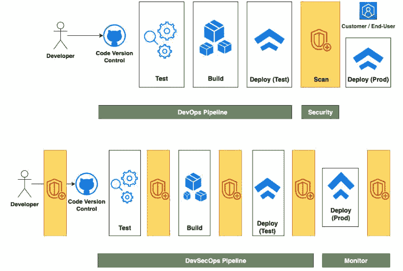
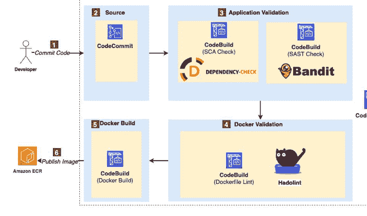
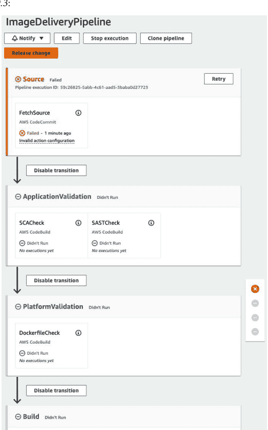

## 使用 AWS 实施 DevSecOps

征信机构 Equifax 报告称，在 2017 年的一次数据泄露事件中，1.43 亿美国公民的个人记录被未经授权访问，而该事件在 76 天内未被发现（https://www.csoonline.com/article/3444488/equifax-data-breach-faq-what-happened-who-was-affected-what-was-the-impact.html）。最初只是 Apache Struts（Java 应用程序常用的一种知名框架）中的一个常见漏洞与暴露（CVE），最终却给该公司带来了财务和声誉损失。即使采取了纠正措施，由于依赖人工流程，仍有少数服务器未得到修复。这些缺口，加上团队普遍缺乏对安全漏洞的认识，被恶意行为者利用，先访问了其中一台服务器，进而访问了其他多台服务器。此类安全事件会损害业务健康，更重要的是，会导致客户信任丧失以及声誉受损。

软件实践的演进和云计算的快速普及进一步加剧了现代应用面临的安全风险激增。这主要是由于对第三方软件模块的依赖日益增加、频繁变更以及现在每个部署的软件制品中都必不可少的多个抽象层所致。如今的安全性不再局限于本地部署的单体式 Java 应用。例如，同一个应用可能已转变为一组微服务，每个微服务都暴露 API，并作为容器镜像部署到公有云中运行的 Kubernetes 集群上。除了应用代码本身，我们还有其他多个层需要保护。如果基础容器镜像或我们添加在之上的自定义库存在漏洞怎么办？我们如何大规模地为所有微服务管理安全的 HTTPS 通信接口？保护 Kubernetes 控制平面和云网络配置等其他组件（对开发人员来说更像黑盒）是完全不同的挑战。此外，如何持续处理所有这些，确保每一行新编写的代码仍然符合我们设定的安全标准？

正如你所看到的，新的软件模式引入了风险维度，在大多数情况下，这些风险并不容易修复，甚至难以识别，因为软件团队自身往往对这些层缺乏所需的深度和可见性。然而，只要在三个领域集中发力——我们称之为 *AEA 框架*——他们就能确保云工作负载获得良好的安全覆盖：

- *感知*（Awareness）：了解系统中存在的安全风险及其相应的严重程度
- *赋能*（Enablement）：让人员能够理解并处理出现的任何信息或警报
- *自动化*（Automation）：在交付链中尽早检测这些安全风险

这三个方面将成为本章的主题，我们将围绕一个名为 **DevSecOps** 的重要概念来学习它们。正如 DevOps 使软件团队能够实现文化转型并更快地交付软件一样，DevSecOps 引入了聚焦安全的新思想和实践。DevSecOps 应被视为 DevOps 实践的一次迭代，因为它为现有的开发和运维流程包裹了一个额外的安全层。这与传统软件开发方法有根本不同，在传统方法中，安全被视为事后考虑。

在更广泛的层面上，我们将在本章中涵盖以下主题：

- 安全的权衡与挑战
- 什么是 DevSecOps？
- 在 AWS 中保护你的工作负载
- 为 DevSecOps 推出测试 CI/CD 工作流

> **提示**
> 如果你对云中不同类型的安全风险及其可能带来的影响感到好奇，我推荐阅读这篇博客：https://appinventiv.com/blog/cloud-security-risks-and-solutions/。

持续成功推出软件制品的关键要求是*自动化*和*有效的反馈循环*。在这一理念的驱动下，DevOps 策略旨在优化软件交付生命周期的每一个步骤。开发人员在自己的本地机器上编写代码，并将更改提交到版本控制系统。此时，交付管道接管，测试更改并创建新版本的软件制品，在每个阶段提供反馈。如果所有测试用例都通过，它会将制品提升到交付链中的后续环境，最终将更改带到预生产或生产环境。然而，在实际场景中，这说起来容易做起来难，尤其是在快速规模发布软件制品时。虽然有几个因素可能会拖慢你的速度，但最需要适应的关键因素是安全。让我们来看看为什么会出现这种情况。

## 安全的权衡与挑战

每个软件团队都有自己独特的挑战需要解决，无论是技术上的还是文化上的。在深入探讨 DevSecOps 的细节之前，让我们先尝试理解是什么导致了对现有 DevOps 方法论进行迭代的需求。在此过程中，我们将讨论为什么安全有时被视为一种阻力，而不是对持续应用交付的积极推动。根据我与不同团队合作的经验，我观察到导致这种放缓的四个主要模式：

- 缺乏所有权意识
- 软件交付中的最后一步
- 应用架构的快速演进
- 过时的安全工具

让我们逐一详细看看这些模式。

### 缺乏所有权意识

通常，开发人员和运维团队成员*并不觉得自己对应用的安全状况负有责任*。站在光谱的另一端——即构建新功能并将其推向生产——他们把安全视为阻碍增长的东西。安全合规被留给坐在另一个房间里的专业人员。

除非这成为共同责任，并且团队成员开始协作识别和修复问题，否则安全将继续成为阻碍项。整个软件交付过程的速度将*取决于链条中最薄弱的环节*——而我们不希望安全成为那个环节。此外，需要强调的是，采用 DevOps 意味着安全在你所做的一切中都是一个反复出现的主题，这会给你带来立竿见影的好处。

### 软件交付中的最后一步

在前面的章节中，我们讨论了很多关于基础设施自动化、应用交付以及如何通过采用 DevOps 方法论来优化大部分这些任务的内容。然而，软件发布周期中一个我们讨论得不够充分的关键步骤是安全。问题不在于*严重性*拖慢了团队——而更多在于它成为了*最后一步*。

传统上，软件团队采用瀑布模型方法开发功能，并在接近上线日期时将其“扔过墙”交给安全团队。这些庞大的发布使准确识别新代码给应用带来的所有安全风险变得非常困难。手动测试需要时间，最终，所有这些都导致软件开发速度与发布速度之间的脱节。作为 DevSecOps 实践者，你应该始终关注此类瓶颈，因为它们可能会拖慢团队步伐，导致挫败感、延迟和信心降低。但究竟是什么让安全审计变得缓慢呢？


## 应用架构的快速演进

我们不能忽视的一个重要维度是过去几年中应用架构的演进，这在某种程度上给安全调查和审批增加了额外的负担。

如今，单体应用被拆分为微服务，导致产生数百甚至数千个 API。以前，你只需要保护可计数的入口点，但现在，你需要管理动态规模的系统。高度安全的环境进一步强制这些微服务之间通过相互 TLS (mTLS) 进行通信。这导致需要管理大量的证书。从运营和可扩展性的角度来看，一个常见的下一步是研究容器化选项。由于在规模上可靠地运行这些容器并非易事，由托管容器平台提供的编排就成为理想的下一步。当然，谁不想简化这些平台的管理，让相当一部分应用将 AWS 等云服务提供商作为新的家园呢？

如果你在此稍作停顿，从安全角度审视这一巨大转变，你会注意到所有这些都极大地增加了攻击面，并引入了团队现在需要防范的新风险。事物不再局限于应用本身，还包括构建在其之上的抽象层——即 API、容器抽象和云平台——各自都有其贡献。

## 过时的安全工具

另一方面，安全专业人员长期以来习惯于一套特定的工具，而这些工具可能并没有像软件开发中的花哨创新那样快速演进。因此，安全不仅需要跟上开发人员采用的新工具，还需要不断寻找新的攻击面。在某些情况下，这可能需要寻找新的安全工具、采用第三方云安全软件，甚至开发定制解决方案。

所有这些都引出一个重要观点——安全永远不会完成。*它是一个持续改进的循环。* 这使得在现代软件团队中工作的安全专业人员很难跟上交付的步伐。潜在的风险面已成倍增加，这已无法再通过手动测试来解决，同时，我们也不能等到软件交付过程的最后阶段。因此，在交付生命周期的每一步都注入安全扫描至关重要，而这正是 DevSecOps 的核心。

## 什么是 DevSecOps？

简单来说，DevSecOps 是将安全测试集成到软件交付生命周期的每个阶段的做法。它是我们迄今为止在本书中讨论的 DevOps 方法的*扩展*。利用工具和流程，它促进开发、运维和安全团队之间的协作。这使得产生的软件制品不仅在运营上高效，而且在任何时间点发布到生产环境都是安全的。与 DevOps 类似，DevSecOps 也带来了关于如何在传统软件交付流程中处理安全问题的文化转变。安全团队不应再被视为某种形式的阻力，而应更多地被视为在组织中推广安全最佳实践的推动者。

在我们继续之前，我想澄清一个你可能正在思考的问题——DevOps 和 DevSecOps 之间的区别。

## 它与 DevOps 有何不同？

DevOps 的核心思想是尽可能快地将应用交付到最终用户手中。虽然这在很大程度上围绕文化转型、自动化工具和流程展开，但安全有时会被落下。软件团队经常将安全视为一个孤立的流程或团队，仅在部署前才介入。在某些情况下，这些安全许可和流程甚至可能被完全忽视，这是一个更关键的情况。

另一方面，DevSecOps 旨在通过确保安全实践无缝集成到日常开发活动中来解决这一差距。开发人员和运维团队成员与安全专业人员一起共同承担每次向最终用户发布安全制品的责任。这种协作通常会导致采用自动化和工具，从而扩展这些团队当前使用的 CI/CD 流程。

我想在此强调的一点是，你的 DevSecOps 成功在很大程度上取决于你的 DevOps 基础是否稳定。它只能建立在现有的 DevOps 实践实施之上，例如持续集成、运营程序和团队文化。这是一种进一步放大 DevOps 投资回报并从持续安全执行和验证带来的好处中获益的方法。

为了证明采用某些实践或工作方式的必要性，分析其带来的好处非常重要。我们接下来将讨论这一点。

## DevSecOps 的关键优势

DevSecOps 实践在软件开发生命周期（SDLC）中对许多领域都有积极影响。虽然每个团队的收益程度会有所不同，但某些优势适用于大多数团队。让我们来看看。

## 降低上市时间

缺乏安全意识和自动化的代码验证会阻碍你仅采用 DevOps 可能获得的好处。除了每天多次频繁发布代码更改外，DevSecOps 还确保软件开发人员免受可能导致最终用户体验下降和信任丧失的未知安全风险的影响。安全评估时间的减少会自动提高软件部署速率。

## 提高团队成员的安全意识

开发人员和运维团队成员经常会遇到可以轻松采用现有开源工具或第三方库来实现功能的情况。虽然始终以构建与购买的思维方式来处理这些决策并避免重复造轮子是一个很好的做法，但使用此类外部代码库可能导致未知的风险暴露。同样，一个现在安全使用的库在未来的版本迭代中可能不再足够安全。在“为 DevSecOps 推出测试 CI/CD 工作流”部分，我们将介绍一些安全工具，它们会将代码扫描与公共漏洞数据库（例如国家漏洞数据库（NVD））进行比对，而这些数据库会持续更新。这极大地提高了参与代码交付的每个人的意识。除了识别风险之外，大多数这些工具还帮助开发人员提供如何立即修复漏洞的建议。

意识到此类问题是采用 DevSecOps 提倡的集成安全实践带来的巨大好处。

> **注意**
> 一个很好的例子是 2021 年的零日 Log4j 漏洞，它暴露了 Log4j 日志实用程序中的安全漏洞，该实用程序在 Java 程序中常用。如果你没有接触过这个新闻，我建议阅读更多相关内容，网址为 https://builtin.com/cybersecurity/log4j-vulnerability-explained。

## 充满信心地开发新功能

虽然安全是一个持续的过程，但通过自动化验证和代码检查获得的反馈有助于更早地解决问题，从而提高软件开发人员的信心。他们可以信任交付链中多个工具执行的扫描，并至少对达到最低安全基线充满信心。

## 在受监管环境中提高合规性

制药、国防和航空航天等受监管行业遵循传统的开发实践，涉及大量手动测试程序。为了遵守多项法规和标准，它们很难像其他非受监管公司那样以类似的规模发布代码更改，而后者无需担心太多问题。这直接影响到软件团队的发布速度和生产力。

此外，它们需要维护软件应用更长的时间，而底层平台和基础设施的变化要求需要持续的评估程序，即使是最小的代码更改也需要重复执行。


## 问题的早期识别

DevSecOps 工具的自动化可以在开发者将代码提交到本地 git 仓库时就启动。通过利用 git 的 `pre-commit` 钩子，他们甚至在将更改推送到远程仓库之前就能从这些代码扫描的反馈中受益。

> **提示**
>
> **Trufflehog** 就是这样一种工具，它可以阻止你意外地将密钥提交到源代码中。你可以在 `https://github.com/trufflesecurity/trufflehog` 了解更多关于此工具的信息以及如何将其配置为 pre-commit 钩子。

这可以控制由最近代码更改引入的任何风险敞口。由于开发者对自己试图完成的事情有完整的上下文，并且修改仍在他们的脑海中，这些问题更容易修复。

*纵深防御* 策略还确保在代码开发过程的多个阶段应用并评估类似的防护措施。因此，即使开发者机器上的本地配置不正常，此类风险也可以在下一层级得到缓解，该层级可能是配置在远程仓库管理系统中的服务器端钩子，例如 **GitHub** 或 **GitLab**。

我们一直在讨论很多的 DevSecOps 重要方面是文化转变以及角色和职责的变化。接下来，我们将讨论这对软件团队中的不同角色意味着什么。

### 对安全专业人员意味着什么

安全同事一直被视为某种守门人，并且最终对出现的任何安全风险负责。根据 DevSecOps 方法论，这需要改变。它们不应抵制频繁的代码修改和发布，而应充当推动者。这些专业人员的成功[content]

## 问题的早期识别

DevSecOps 工具的自动化可以在开发者将代码提交到本地 git 仓库时就启动。通过利用 git 的 `pre-commit` 钩子，他们甚至在将更改推送到远程仓库之前就能从这些代码扫描的反馈中受益。

> **提示**
>
> **Trufflehog** 就是这样一种工具，它可以阻止你意外地将密钥提交到源代码中。你可以在 `https://github.com/trufflesecurity/trufflehog` 了解更多关于此工具的信息以及如何将其配置为 pre-commit 钩子。

这可以控制由最近代码更改引入的任何风险敞口。由于开发者对自己试图完成的事情有完整的上下文，并且修改仍在他们的脑海中，这些问题更容易修复。

*纵深防御* 策略还确保在代码开发过程的多个阶段应用并评估类似的防护措施。因此，即使开发者机器上的本地配置不正常，此类风险也可以在下一层级得到缓解，该层级可能是配置在远程仓库管理系统中的服务器端钩子，例如 **GitHub** 或 **GitLab**。

我们一直在讨论很多的 DevSecOps 重要方面是文化转变以及角色和职责的变化。接下来，我们将讨论这对软件团队中的不同角色意味着什么。

### 对安全专业人员意味着什么

安全同事一直被视为某种守门人，并且最终对出现的任何安全风险负责。根据 DevSecOps 方法论，这需要改变。它们不应抵制频繁的代码修改和发布，而应充当推动者。这些专业人员的成功箴言应该是 *防护措施而非阻碍者*。他们需要不断学习组织内 DevOps 的运作方式，并通过将控制措施直接嵌入 DevOps 方法论中来发展安全流程。

### 为应用和基础设施定义安全策略

安全风险现在是多维度的。它们适用于作为代码管理的任何内容——因此既包括基础设施也包括应用程序。安全专业人员应专注于定义这些代码库应该和不应该被允许做什么的策略。与其为每个应用程序或团队制定细粒度的策略，他们应投入精力建立保护公司和各个团队的防护措施。

## 在云中运行工作负载的安全挑战

软件团队在采用 AWS 或任何其他云服务提供商时，在安全方面面临两个常见的阻碍。

### 理解云中的安全责任

我们首先需要了解云服务提供商的责任究竟在何处结束，以及作为客户的你的责任从何开始。这些责任还可能因你使用的云服务层级类型而异，即 IaaS、PaaS 或 SaaS。我们在第 2 章《选择合适的云服务》中详细讨论了这三个层级。例如，当你在 EC2 上运行应用程序时，修补安全漏洞或升级 AMI 是你的责任。但如果你的代码部署在 Lambda 上，则底层计算基础设施的安全性由 AWS 负责。云服务提供商负责云的安全，而客户负责云中的安全。为了进一步说明这一点，如果超visor 漏洞允许另一位 AWS 用户未经授权访问你的 EC2 实例，则这是 AWS 安全的疏漏。另一方面，配置错误的 security group 允许对 EC2 实例进行不受限制的 SSH 访问，则是客户的过错。我建议你查阅 AWS 共享责任资源以深入了解细节：https://aws.amazon.com/compliance/shared-responsibility-model/。

对于软件应用程序而言，如果你是在本地运行工作负载还是在云中运行，风险或多或少是相同的。然而，发生变化的是应对这些风险的流程和解决方案。AWS 提供了多个服务，可帮助你保护网络、数据以及身份和访问管理。考虑到我们互联网面向的 Web 应用程序示例，你可以将管理自托管负载均衡器的风险转移到 AWS Elastic Load Balancer 并集成 Web 应用防火墙。提取前端 API 逻辑并迁移到 API Gateway 将你的风险转移到云服务提供商，而将传统的静态网站现代化并托管在 CloudFront 上且无需管理服务器则消除了你的风险。因此，了解需要保护的确切内容非常重要。

一旦责任明确，团队遇到的第二个问题是如何管理其风险。

### 识别和优先排序风险

软件团队通常从开始保护他们最熟悉的应用架构部分。这有时会隐藏其他风险，可能发生概率更高。了解你的风险敞口的一种好方法是开始威胁建模流程，正如 AEA 框架中定义的提高意识。

威胁建模是对当前部署资源所面临的风险进行评估，并根据各自的关键性确定其优先级。随着应用架构的演进，这些风险也会不断变化，因此缓解措施也应随之改变。威胁建模有时被视为在软件交付流程的后期阶段、发布前进行的一次性活动。根据 DevSecOps 方法论，应避免这种情况，DevSecOps 方法论提倡将安全实践直接构建到开发生命周期中。因此，在应用程序设计阶段就让安全团队成员参与其中，以便尽早发现风险，这很有意义。在开发的早期阶段，开发者修复具有安全影响的架构方法所花费的成本也更低。

对于互联网面向的 Web 应用程序，这里有一些潜在风险的示例：

- **分布式拒绝服务 (DDoS)** 攻击
- 用户突破应用程序的多租户边界以提取属于其他用户的数据
- SQL 注入和跨站脚本攻击

在此情况下的威胁建模练习应考虑每种风险发生的概率，并提出缓解步骤。具有成熟 DevSecOps 实践的组织进一步确保其威胁建模流程是周期性活动。这确保了良好的安全态势不仅在首次生产发布期间得到验证，而且不断地针对新风险和敞口进行评估和优化。

> **提示**
>
> OWASP Top 10 是了解你的应用程序可能遇到的不同类型的 Web 应用程序安全问题的良好资源。作为威胁建模活动的一部分，你可以考虑将工作负载与这些风险进行评估作为起点：`https://owasp.org/www-project-top-ten/`。

并非所有风险都源于软件开发者编写的专有代码。大量漏洞来自这些项目所使用的依赖项和开源库。**Snyk** 和 **Linux Foundation** 的 2022 年开源安全现状报告指出：

> “平均应用开发项目有 49 个漏洞和 80 个直接依赖项，并且修复开源项目中漏洞所需的时间稳步增加，从 2018 年的 49 天增加到 2021 年的 110 天以上。”

即使这些数字反映了开源项目的现状，它们也说明了持续扫描任何不受信任代码并尽快暴露漏洞的必要性。让我们讨论一些你可以考虑的测试策略。


## 针对AWS工作负载的测试策略

代码不再仅限于最终用户使用的业务应用程序。你的基础设施、CI/CD流水线以及为支持应用程序交付而构建的所有自动化同样可能危及你的安全态势。假设架构的大多数（如果不是全部）组件都是通过流水线部署的，有两个主要方面需要考虑：

- 流水线的安全性
- 流水线中的安全性

让我们来看一看。

### 流水线的安全性

流水线中内置的高度自动化也意味着任何意外的代码更改都可能在交付生命周期中走得很远，最终到达生产环境。良好的安全实践限制了对生产环境的任何形式的人为访问，这反过来要求CI/CD流水线具有高权限的访问权限。因此，确保你的流水线也被视为代码、持续检查并监控安全漏洞非常重要。接下来将讨论需要保护的五个主要领域。

### 流水线的身份与访问管理

AWS Identity and Access Management（IAM）有助于管理身份及其对AWS服务的访问，涵盖人类和非人类访问模式。例如，我们在前几章部署的CodePipeline流水线使用了服务角色，在该角色中，我们定义了服务代表用户在AWS账户中可以做什么或不可以做什么。根据流水线需要执行的操作，你应始终遵循最小权限原则，尽量给予最低权限。

拥有高度成熟DevSecOps实践的公司还可以考虑构建流水线工厂，为针对常见应用程序模式的流水线发出权限最小的可复用模板。

### 检测异常行为

您应该像捕获应用程序日志一样，捕获流水线在AWS中的所有执行日志。此外，CodePipeline和CodeBuild等服务提供了与CloudWatch Logs和CloudWatch Metrics集成的日志和指标集成能力。启用这些设置只需在基础设施代码中添加几行配置即可。

维护这些日志的机密性和完整性是一项重要的安全措施，而良好的组织策略还会在CloudTrail中捕获所有IAM操作事件。这有助于在需要时进行无缝的审计流程。例如，IAM访问请求拒绝的突然激增可能暗示系统已受损，并且可以通过错误代码进行跟踪



图9.1 – 在CI/CD的所有阶段嵌入安全性

与我们之前讨论的*左移*策略一致，DevSecOps旨在使开发人员能够自行保护其代码。为了促进这种文化转变，可以使用不同类型的代码测试方法向开发人员提供反馈。

### 软件组成分析

如今许多现代应用程序由开源代码组成，这对组织来说是一个巨大挑战。他们需要扫描所有这些依赖项及其代码，以有效管理风险。**软件组成分析（SCA）** 可以跟踪所有已报告漏洞和潜在漏洞的软件许可证和依赖项。此外，这些工具会生成**软件物料清单（SBOM）**，可用于跟踪软件所依赖的所有资产。这些工具应在SDLC早期集成，并在引入新依赖项或升级版本时及时集成。

### 静态应用程序安全测试

**静态应用程序安全测试（SAST）** 工具扫描组织专有的代码。它们根据已知的引入安全风险的编程模式来评估代码。作为分析的一部分，它们还提供一些改进反馈，说明如何使代码更安全。SCA和SAST方法都不需要部署代码进行测试。适合在SDLC早期、代码部署到测试环境之前运行这些扫描。

### 动态应用程序安全测试

顾名思义，这些测试是动态的。它们试图穿透应用程序的安全，并将漏洞暴露出来。这些工具通常在生产环境中使用，从这些工具获得的反馈对于安全策略和标准的持续合规非常有价值。

**动态应用程序安全测试（DAST）** 工具主要用于Web应用程序，因为它们经常通过互联网暴露于不受信任的网络和用户。随着应用程序代码的演变，这些工具会在新发现的风险变得严重之前继续扫描它们。

### 保护定义为代码的基础设施

**基础设施即代码（IaC）** 是一种通过配置文件在本地或云中定义和管理基础设施组件的方法。该领域常用的工具和服务包括**Pulumi、CloudFormation、Terraform**和**AWS CDK**。保护它们需要安全团队定义一组规则，然后将其编码并用于评估这些配置中的任何更改。**Open Policy Agent（OPA）** 就是这样一种工具，它允许你根据自定义定义的策略验证基础设施代码。

在所有这些安全测试机制方面，工具领域非常广泛。在我们深入实践练习之前，让我们快速了解一些工具，你可以根据当前用例考虑采用这些工具。

### 用于安全评估的重要工具

下表列出了一些有助于减轻各种安全风险的开源扫描器：

| 工具 | 描述 |
| --- | --- |
| **密钥扫描器** | |
| `git-secrets` | 此工具可防止你意外将机密和凭据提交到git存储库。理想情况下，它应该作为`pre-commit`钩子的一部分调用。 |
| **第三方库漏洞扫描器** | |
| **Grype** | Grype扫描容器镜像和文件系统中来自第三方依赖项的漏洞。它支持Docker、Ruby、Java和Python等。 |
| **OWASP dependency-check** | 此工具对照NVD数据库中注册的漏洞扫描依赖项。它支持Java、JavaScript和Ruby。 |
| **Trivy** | Trivy扫描容器镜像、git存储库以及maven、npm和yarn等依赖框架。 |
| **CloudFormation、CDK和Terraform代码的安全扫描器** | |
| **cfn_nag** | 它搜索CloudFormation模板中的不安全基础设施指示器，包括过度宽松的IAM规则、安全组、缺失的访问日志等。 |
| **cfn_guard** | 从技术上讲，`cfn_guard` 与OPA类似。你可以使用它来定义声明式策略，然后用于评估CloudFormation模板。 |
| **cdk_nag** | 在CDK应用程序中搜索安全合规性问题。它还支持可用于HIPAA、NIST和PCI合规性的规则列表。 |
| **checkov** | `checkov` 是一个静态代码分析工具，可扫描IaC模板并查找开源包中的漏洞。 |
| **tfsec** | `tfsec` 是AquaSec的代码扫描器。它报告基础设施配置中的错误配置。 |

在下一节中，我们将动手部署一个测试CI/CD工作流，总结我们目前学到的所有知识。

### 为DevSecOps推出测试CI/CD工作流

为了将实践付诸行动，我们将在AWS账户中部署一个测试流水线，从安全角度演示各种工具（AWS和**开源**）的用法。更具体地说，让我们考虑一个几乎每个现代软件开发团队都需要解决的需求——在大规模下安全地交付Docker镜像。在真实场景中，你应该考虑将此工作流生成的输出工件（Docker镜像）部署到专用测试环境中，在那里可以执行DAST调查。这在将镜像部署到后续环境（预生产、生产等）之前尤其有用。

为了直观地了解我们将要构建的内容，让我们通过一个突出显示端到端流程的架构图深入了解细节。


## 了解 DevSecOps 流水线的目标架构

在 AWS CodePipeline 中，流水线定义至少包含两个阶段，以及每个阶段中对应的操作。我们在第 5 章“推出 CI/CD 流水线”中详细介绍了 AWS CodePipeline 的组成部分。当我们想到软件交付的整个生命周期时，脑海中浮现的典型阶段是源代码、构建、测试和部署。在接下来的练习中，我们将主要关注前两个阶段，并以 Docker 镜像交付工作流为例，了解如何将 DevSecOps 实践引入其中。

在前几章中，我们开发并部署了一个基于 Python 的待办事项列表管理器应用。我们将复用该应用代码和相应的 Docker 清单文件。我们的主要重点是在此应用的构建阶段引入安全评估，从而创建安全的 Docker 镜像。图 9.2 突出显示了我们将运行的不同类型的安全扫描：



图 9.2 – DevSecOps 流水线的不同阶段

让我们先概述流水线每个阶段执行的步骤：

- **1. 新代码变更**：几乎每个 CI/CD 流水线都会针对感兴趣的事件设置自动触发器。在本例中，我们关注的是开发人员将新提交推送到包含应用代码的 CodeCommit 仓库。
- **2. CodePipeline 执行**：在 CodeCommit 仓库中注册 git 提交后，流水线执行立即开始。如前面的图所示，Source 是第一个阶段，CodePipeline 在此拉取最新版本的代码变更，并在后续阶段和操作中提供这些变更。
- **3. 应用验证**：流水线中的第二个阶段定义了针对安全漏洞评估代码及其依赖项的操作。此阶段进一步包含两个并行执行的*操作*：

  - I. **软件成分分析（SCA）**：这是应用验证阶段中的 CodePipeline 操作。我们利用 CodeBuild 提供临时计算环境，用于安装来自 **OWASP** 的 **Dependency-Check** 工具。安装完成后，我们验证 `requirements.txt` 文件中定义的 Python 代码依赖项。如果你之前没有使用过 Python，`requirements.txt` 文件会列出项目使用的所有依赖项，也就是库和包。

  Dependency-Check 是一种 SCA 工具，支持多种编程语言，可检测项目依赖项中已公开披露的漏洞。这是通过评估指定依赖项是否存在**通用平台枚举（CPE）**标识符来实现的。一旦发现漏洞，将生成一份综合报告，其中包含相应 CVE 条目的链接。

  - II. **静态应用安全测试（SAST）**：在此 CodePipeline 操作中，我们使用 **Bandit** 工具扫描 Python 代码，将安全问题暴露出来。Bandit 会从它扫描的所有 Python 代码文件生成**抽象语法树（AST）**，然后针对该 AST 运行安全验证插件。输出是一份报告，突出显示安全问题，并为开发人员提供建议操作。

- **4. Dockerfile 验证**：这是流水线的第三个阶段，在应用代码扫描通过后触发。你可能已经注意到，我们遵循*由内向外*的原则：先扫描应用本身，然后逐层处理其上的抽象层。这也有助于优化流水线资源的使用，因为在确保要放入 Docker 镜像的代码具有良好安全状态之前，测试 Docker 镜像毫无意义。

  对于 Dockerfile 的 lint 检查和安全分析，我们使用 `hadolint`。除了提供基本的 lint 检查功能外，hadolint 还允许安全专业人员强制执行某些规则。例如，你可以定义这些 Dockerfile 可以基于的可信注册表，或抑制误报。hadolint 的所有验证规则都可以在 https://github.com/hadolint/hadolint#rules 查看。

- **5. Dockerfile 构建**：这是流水线的最后一个阶段，在这里构建 Docker 镜像，然后将其发布到**弹性容器注册表（ECR）**仓库中，供部署活动使用。

我们部署的工作流可以轻松扩展，为任何其他软件添加特定的部署操作。在理想情况下，你还可以有额外的阶段来使用此流水线生成的工件（Docker 镜像），并将其部署到支持运行 Docker 容器的环境上，例如**弹性容器服务（ECS）**或**弹性 Kubernetes 服务（EKS）**。

在了解了 DevSecOps 流水线的整体流程以及我们希望实现的目标之后，让我们概述一下我们将使用的代码库的两个组成部分。

## 了解代码库

与其他章节类似，接下来练习的代码可以在 Cloud9 IDE 中的项目目录 `chapter-9/` 下找到。其中两个子文件夹分别包含 Python 应用和用于推出 DevSecOps CI/CD 流水线的基础设施代码。让我们逐一查看两者的内容：

- **Python Flask 应用：** 此文件夹包含以 Docker 容器形式运行基于 Python 的**待办事项列表管理器**应用所需的代码。除了 `app.py` 文件外，`Dockerfile` 清单还列出了创建 Docker 镜像所需的全部指令。
- **DevSecOps CI/CD 流水线构造：** 我们将利用 **AWS CDK** 构造来部署 CI/CD 流水线的各个组件，并了解典型的 DevSecOps 工作流是什么样子。我们在 CDK 堆栈中使用的所有资源构造都是 AWS 托管服务，因此无需任何基础性基础设施元素，例如 VPC、子网、互联网网关等。

在提交 Python 应用代码并评估其是否存在安全风险之前，我们需要部署 CDK 堆栈并预置流水线组件。

## 在 AWS 账户中部署 CDK 堆栈

要部署堆栈资源，我们首先需要运行 `npm install` 命令，以便下载所有项目依赖项。安装完成后，如果你愿意，可以使用 `cdk synth` 命令检查 CloudFormation 模板。

至此，我们已经准备好将堆栈部署到 AWS 账户中，这将使用 **AWS CodePipeline** 服务设置流水线的所有阶段和相应操作：

```
aws-devops-simplified:~ /environment/chapter-9/devsecops-cicd-pipeline
$ cdk deploy
...
...
✨  Synthesis time: 12.65s
DeliveryPipelineStack:  start: Building 46e40c3e0f5b985e8b4b1bbc5c4eb-24cacee4d46e40c3e0f5b985e8b4b1bbc5c4eb24cacee4d04d15ecbcbecbc4839d8f-9dlcf:current_account-current_region
...
Do you wish to deploy these changes (y/n)? y
DeliveryPipelineStack: deploying... [1/1]
...
DeliveryPipelineStack: creating CloudFormation changeset...
DeliveryPipelineStack
Deployment time: 202.82s
```

CDK 应用成功部署后，你可以访问 CodePipeline 服务，查看已预置的所有阶段和相应操作。你将看到类似图 9.3 的内容：



图 9.3 – CI/CD 流水线的不同阶段

正如你所注意到的，第一个阶段报告了失败，这是预期的，因为新预置的 CodeCommit 仓库中还没有代码。因此，让我们继续将应用代码提交到仓库中。CodeCommit 建议使用 git-remote-codecommit 插件通过 HTTPS（GRC）端点进行身份验证。可以从 AWS Web 控制台中你仓库的 CodeCommit 服务页面获取此 GRC 端点。git-remote-codecommit 插件已经包含在你安装到 AWS 账户中的 Cloud9 IDE 中。

在查看流水线执行之前，最后一步是初始化本地 Git 仓库并设置 Git remote，使其指向我们在 AWS 账户中的 CodeCommit 仓库。我们只需要推送应用代码，所以让我们也切换工作目录：

```
aws-devops-simplified:~/environment/chapter-9 $ cd chapter-9-flask-app/
aws-devops-simplified:~/environment/chapter-9/chapter-9-flask-app $ git init .
aws-devops-simplified:~/environment/chapter-9/chapter-9-flask-app $ git checkout -b master
aws-devops-simplified:~/environment/chapter-9/chapter-9-flask-app $ git add .
aws-devops-simplified:~/environment/chapter-9/chapter-9-flask-app $ git commit -m "Sample application for DevSecOps pipeline"
```

将文件添加到 Git 暂存区后，我们就可以将它们推送到 CodeCommit 仓库：

```
aws-devops-simplified:~/environment/chapter-9/chapter-9-flask-app $ git remote add origin codecommit::eu-central-1://image-delivery-pipeline
aws-devops-simplified:~/environment/chapter-9/chapter-9-flask-app $ git push origin master
...
```

一旦提交在 CodeCommit 中注册，流水线执行就会开始。CodePipeline 现在可以从配置的分支（master）上的 CodeCommit 仓库获取代码。让我们深入了解流水线中配置的安全评估结果。

## 检查安全评估结果

流水线的每个阶段都会针对安全风险验证应用的某个方面。我们遵循相同的*由内向外*原则，从应用本身开始，然后再进行 Docker 验证。


## 使用 dependency-check 进行软件组成分析

如果观察管道执行的输出，你会注意到第一个阶段 ApplicationValidation 在 SCAcheck CodeBuild 动作中报告了一个错误。查看 CodeBuild 构建执行日志可发现 Flask 框架中存在一个发现，并且由于严重性超过了阈值 7（在 buildspec.yml 文件中配置），因此引发了错误。此类安全验证会标记开发人员可能引入到应用程序中的任何新依赖项。这些发现的严重性可能各不相同，并非所有都相关，但有一定误报总比没有报告要好。

在这种情况下，OWASP dependency-check 工具除了标记潜在风险外，还为我们提供了一个包含有关已报告特定 CVE 的更多信息的 URL：

```
"vulnerabilities": [
  {
    "source": "OSSINDEX",
    "name": "CVE-2023-30861",
    "severity": "HIGH",
    "cvssv2": { 
      "score": 7.5,
    ...
    ...
    "cwes": [
      "CWE-539"
    ],
    ...
    "description": "Flask is a lightweight WSGI web application framework. When all of the following conditions are met, a response containing data intended for one client may be cached ... https://ossindex.sonatype.org/vulnerability/CVE-2023-30861
    ...
```

如图 9.4 所示，访问浏览器中的 CVE URL 会进一步解释 Python Flask 框架中的某些配置如何被利用。dependency-check 解析了 requirements.txt 文件以确定第三方依赖项的名称及其版本。然后它将这些依赖项与公开可用的漏洞数据库进行核对——在此案例中为 NVD。由于我们在应用程序中使用的版本被标记为潜在风险，因此被 dependency-check 工具指出。然而，在本例中，我们并未使用 cookie 或标头，因此可以安全地抑制该发现：

## 漏洞

CVE-2023-30861

CVSS Score
7.5
HIGH

CVSS Vector
CVSS:3.1/AV:N/AC:L/PR:N/UI:N/S:U/C:H/I:N/A:N

CWE

[CVE-2023-30861] CWE-539: Information Exposure Through Persistent Cookies

## Description

Flask is a lightweight WSGI web application framework. When all of the following conditions are met, a response containing data intended for one client may be cached and subsequently sent by the proxy to other clients. If the proxy also caches `Set-Cookie`
See More

> Deviation Notice:
> Sonatype's research suggests that this CVE's details differ from those defined at NVD or other reporting sources; sign in for details.

Figure 9.4 – CVE finding reported by the dependency-check utility

### Tip

每次运行时，像 dependency-check 这样的工具都会从公共数据库下载所有 CVE 并在本地存储以供评估。由于 CodeBuild 环境是临时的，每次构建完成后都会导致信息丢失。这会导致每次运行的执行时间非常高（>5 分钟）。这可以通过利用 CodeBuild 构建缓存来优化，该缓存允许你标记需要保存并在后续构建运行中重用的目录。你可以在 https://docs.aws.amazon.com/codebuild/latest/userguide/build-caching.html 上阅读有关此功能的更多信息。

为了简单起见，我们假设我们对 CVSS 评分低于 8 的任何漏洞发现都不感兴趣。我们可以调整 CodeBuild 动作的相应 buildspec 文件并提交更改。为此，我们可以将 buildspecs/sca.yml 文件中的 CVSS 阈值修改为 8：

```
...
  build:
    on-failure: ABORT
    commands:
      - dependency-check --scan "${PWD}" --enableExperimental --failOnCVSS 8 --format JSON
...
...
```

默认情况下，该工具会在命令执行完成后转储一份报告文件。除了 JSON 之外，还支持多种其他格式，可以自动解析以构建你想要在其之上进行的任何额外自动化。进行这些更改后，你可以将新的更新推送到托管在 AWS 上的存储库：

```
aws-devops-simplified:~/environment/chapter-9/chapter-9-flask-app $
git commit -am "Increased threshold for CVSS score in SCA check"
[master 73db6e9] Increased threshold for CVSS score in SCA check
 1 file changed, 1 insertion(+), 1 deletion(-)

aws-devops-simplified:~/environment/chapter-9/chapter-9-flask-app $
git push origin master
Enumerating objects: 7, done.
...
...
   0032123..73db6e9  master -> master
```

接下来，我们可以继续查看 SAST 阶段的输出。

## 使用 Bandit 进行静态应用程序安全测试

**Bandit** 是用于测试 Python 代码中安全问题的著名 SAST 工具。这是我们管道中 ApplicationValidation 阶段的第二个动作，与之前讨论的 SCA 并行执行。

我们在这里也收到一个错误报告。看起来是指 Python 中异常处理的不当使用：

```
>> Issue: [B110:try_except_pass] Try, Except, Pass detected.
   Severity: Low   Confidence: High
   CWE: CWE-703

      More Info: https://bandit.readthedocs.io/en/1.7.5/plugins/b110_try_except_pass.html
   Location: app.py:35:8
34              return redirect(url_for('todos'))
35              except Exception as e:
36                  pass
```

此代码的问题在于我们捕获了所有异常并静默忽略它们。这代表了潜在的安全风险，因为来自服务的大量错误可能暗示有人试图干扰应用程序。即使我们不想以特定方式处理异常，我们也至少应该记录失败消息，而不是仅用 pass 抑制它。

让我们用 logger 语句替换 app.py 中有问题的代码行并再次提交更改：

```
```python
...
    return redirect(url_for('todos'))
except Exception as e:
    logging.error("Exception occurred while submitting data to MongoDB", exc_info=True)
...
```
```

现在我们已修复此安全风险，管道中必须配置的最后一个验证检查涉及将 Dockerfile 的潜在风险或问题暴露出来。

## 使用 hadolint 验证 Dockerfile 清单

除了 lint Docker 文件外，**hadolint** 还通过 *shellcheck* 实用程序执行 bash 代码验证。如果你喜欢为日常操作程序编写 bash 脚本，我强烈推荐使用 **shellcheck**，如果你还没有使用的话。

在 CodePipeline 执行的 `PlatformValidation` 阶段下，你会注意到一些需要修复的错误。让我们看一下：

```
...
...
Dockerfile:10 DL3018 warning: Pin versions in apk add. Instead of `apk add <package>` use `apk add <package>=<version>`
Dockerfile:22 DL3059 info: Multiple consecutive `RUN` instructions. Consider consolidation.
Dockerfile:24 DL3020 error: Use COPY instead of ADD for files and folders
Dockerfile:29 DL3042 warning: Avoid use of cache directory with pip. Use `pip install --no-cache-dir <package>`
Dockerfile:29 DL3013 warning: Pin versions in pip. Instead of `pip install <package>` use `pip install <package>==<version>` or `pip install --requirement <requirements file>`
...
...
```

其中一些是优化 Dockerfile 层结构的优化机会，而其他要求固定库特定版本的要求则具有一定的安全优势。

始终建议避免安装时的缓存目录并使用库的最新版本。这也违背了不可变性的思想，因为当新版本的库发布时，你可能会无意中使用与测试时不同的库版本。这可能会引入潜在的安全风险，如果最新软件包中引入了新的漏洞。

为修复报告的错误，我们可以在 Dockerfile 中进行以下修改：

```
```dockerfile
## Install packages
RUN apk update && apk add --update --no-cache \
    bash=5.2.15-r0 \
    python3=3.10.11-r0 \
    py3-pip=22.3.1-r1 \
    py3-cryptography=38.0.3-r1 \
    vim=9.0.0999-r0 \
    wget=1.21.4-r0 \
    curl=8.1.1-r0 \
    tree=2.0.4-r0

RUN apk --no-cache add --virtual \\
    builds-deps=20230523.220926 \\
    build-base=0.5-r3 && \\
    mkdir /opt/aws-devops-simplified
...
...
```
```

在固定了库版本并合并了 RUN 命令后，我们现在遵循了 hadolint 实用程序推荐的最佳实践。

一旦所有这些更改都提交回 CodeCommit 仓库，我们应该会有一个成功的 CodePipeline 运行，该运行构建 Docker 镜像并将其推送到我们在 CDK 堆栈中创建的 ECR 注册表中。

## 总结

在当今的软件环境中，安全性对于金融、社交媒体和电子商务行业至关重要，但对所有行业都至关重要。随着软件实践的演进和云采用的增加，现代应用程序的复杂性和风险显著增加。这些风险通常超出开发团队的控制范围，可能造成严重后果，包括声誉受损、信息丢失和客户信任丧失。DevSecOps 是一个有助于我们在确保开发者、运维和安全团队成员之间更多协作的同时解决这些需求的重要概念。

我们从介绍 DevSecOps 是什么及其优势开始这一章。与 DevOps 类似，它不仅仅是技术优化，也提倡开发者、运维和安全之间的共同责任。这确保了应用程序可能面临的任何新风险都能尽快得到缓解。在了解了不同测试方法的一些实践方法后，我们还进行了一次动手部署，以在 CI/CD 管道中体验 DevSecOps 工具。我们主要使用开源工具，因为它们在这个领域已经非常成熟，很容易找到合适的工具组合，而无需承诺更广泛范围的服务或解决方案。


在下一章《成功组建团队》中，我们将介绍一些促进协作、学习和成长的理念。我们还将重点讨论无指责反馈文化的好处。

## 延伸阅读

若要详细了解本章涵盖的主题，请参阅以下资源：

- 常见的云安全问题和威胁：https://www.strongdm.com/blog/cloud-security-issues-risks
- 面向构建者的威胁建模工作坊：https://catalog.workshops.aws/threatmodel/en-US
