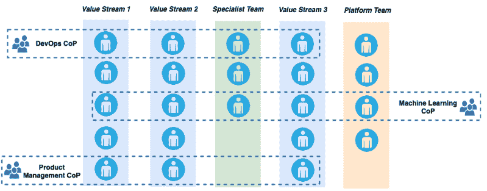

## 成功组建团队

在 DevOps 领域，所有举措的成功和有效性都取决于人员与技术的协调整合。只关注其中一方不会带来太多好处。通过认识到两者的重要性，组织可以释放 DevOps 的全部潜力，从而实现更快的软件交付生命周期，同时提高质量和可靠性。

**人员**推动 DevOps 的文化和协作方面。他们运用自己的技能和专业知识，推动共同责任、持续改进和有效沟通的心态。另一方面，**技术**提供必要的工具、自动化和基础设施管理来支持这种心态。持续集成（CI）、CI/CD 流水线和**基础设施即代码（IaC）**等软件交付方法，使团队能够提高向客户交付代码的整体效率。

在 DevOps 实践中，人们往往过于急于采用工具。在这样做之前，他们需要确保文化和运作模式具备正确的基础。一旦人们认同这两者的价值和好处，他们就会主动采用所需的技术变革和工作方式。在本章中，我们将聚焦两大支柱——人员和技术——以及你可以通过哪些 AWS 措施来成功组建团队。此外，我还将介绍一些资源，供你用于 DevOps 团队的持续学习和能力提升。采用 AWS 通常会带来新的创新机会，有时甚至会导致公司内部的角色转型。在本章末尾，我们将介绍一条基本的学习路径，你可以为自己或其他希望更深入参与 AWS 上 DevOps 工作的团队成员参考。

本章议程如下：

- 建立协作、敏捷的团队结构和文化
- 成功的技术最佳实践与考量
- 支持 AWS 学习与发展的资源
- 转型为 DevOps 角色的学习路径

## 建立协作型团队结构和文化

采用 DevOps 实践说来容易做来难。大多数组织面临的一个根本问题是，将工具和自动化视为解决所有问题的黄金方案——甚至更糟糕的是，从市场上招聘 DevOps 工程师并将其嵌入现有团队，希望他们能引入自动化和云服务，神奇地填补所有空白。在走这条路之前，他们首先需要确保*人员就绪*。在本节中，我们将讨论如何构建一个有效的团队结构，以支持在整个组织中成功实施 DevOps。我们将重点讨论培养协作和有效沟通文化的重要性，这种文化反过来又能为客户创造价值。

## 让团队创造更多价值

你需要应对的第一个挑战是公司的运营模式。团队如何构建？他们的职责是什么？他们如何沟通？这种结构与业务目标的一致性如何？它是否能让团队独立地向客户交付业务成果？日常例行工作是否需要频繁移交其他团队？他们是否在软件运行所必需的关键领域缺乏专业知识？等等。

无论组织规模如何，都可以采用四种基本团队结构。在深入探讨细节之前，有必要指出，这些团队设置可能会因组织的规模和 DevOps 成熟度而略有不同。因此，不要将它们当作一成不变的模板，而应将其视为灵感来源——新团队可据此组建，现有团队也可据此转型。更多地关注这些结构带来了什么价值，以及它们如何帮助团队专注于自己最擅长的工作。

### *价值流对齐团队*

这些团队高度专注于一条定义明确的独特工作流。他们是你的前线战士，始终与最终客户（无论是外部还是内部）建立良好的沟通接口。这个团队的北极星应该是为最终用户提供业务价值。根据公司的规模和产品组合，这条单一工作流可以局限于一个完整的产品或服务、产品中的一组功能，甚至在需要时更加细化。重要的是，他们要承担全部责任，从收集客户意见、理解他们的痛点、开发软件解决差距，到在生产环境中运维软件。例如，**AWS** 等公司可能会将这些团队结构与云提供商提供的不同服务对齐。例如，一个专门团队可能负责 **AWS CodeBuild**，另一个团队可能负责 **AWS CodePipeline**。这些团队拥有跨职能技能，能够理解客户的业务需求，并将这些需求转化为软件功能。他们还应该具备在全球范围内运维这些工作负载所需的所有内部技能。从 DevOps 的角度来看，这满足所有条件，例如“谁构建、谁运维”、自主运营、以最终客户为中心进行构建等等。

再举个不同的例子，比如**eBay**，可能需要对工作流进行不同的划分。例如，可能有一个团队负责*结账*，一个负责*产品目录*列表，另一个负责*欺诈管理*，等等。然而，核心原则保持不变。这些团队几乎可以独立于公司中的任何其他团队交付价值。

组织经常面临的另一个挑战是这些团队应该有多大。为了确保有效的协作、共同的责任感和良好的团队动态，经验法则是将团队人数控制在 10-12 人以下。这也是亚马逊所称的*2-比萨团队*——一个用两个比萨就能喂饱、并拥有充分权力为自己的工作流做出最佳决策的团队。

我们接下来要讨论的其他团队更像是组织中核心价值流的*赋能者*。当某些领域拖慢了价值流向最终用户提供价值的进程时，他们就会出现并提供支持。

## 平台团队

平台团队专注于为其客户——组织内各个价值流中的成员——开发和维护可复用的服务。平台团队唯一的成功标准应该是其提供的服务易于采用、使用和文档化。这些服务越有吸引力、越易于使用，采用范围就越广。

在*第 1 章《借助 AWS 加速你的 DevOps 之旅》*中，我们讨论了降低客户认知负荷的理念。平台团队的概念与此理念密切相关。他们应该让价值流成员能够专注于差异化的业务成果。这只有通过为他们分担其他无差异化的任务才能实现。平台团队的成果满足所有其他价值流的共同需求。例如，如果所有软件制品都依赖于运行在**Amazon Elastic Kubernetes Service（Amazon EKS）**上的容器化工作负载，那么平台团队的正确关注点应该是为在这些 EKS 环境中部署、监控和运维服务提供现成的模板。他们可以提供集中式仪表板和开箱即用的日志集成，方便价值流轻松采用并从中受益。

然而，值得注意的是，各个价值流所开发软件的生产环境所有权仍然归属于这些价值流自身。

在*第 11 章《确保多账户和多区域环境拥有强大的 AWS 基础》*中，我们将讨论**着陆区**的概念。在 AWS 环境的背景下，这很好地映射了平台团队理应对接的工作范围。这使得应用团队能够专注于自己最擅长的工作，同时将多账户、多区域环境的基础架构复杂性交由中央平台团队处理。

## 专业团队

根据组织的业务领域，在大多数（如果不是全部）价值流中，可能存在某些跨领域的专业领域。这些领域需要行业内或公司内部不常见的特殊技能，例如媒体编码、金融风险分析算法、高数据压缩技术等方面的深厚专业知识。

这些知识很可能正是价值流所提供产品的核心，对于持续向最终客户提供价值至关重要。在这种情况下，组织可以考虑建立这些专业团队，由他们围绕这一细分技能集的最佳实践为价值流提供*咨询*。高度成熟的DevOps公司还会投入将这种专业技能*作为服务*提供，通常通过易于理解的接口对底层细节进行抽象，从而降低价值流的认知负荷。

## 赋能团队

交付更多功能的压力不断增加，有时会使价值流偏离其核心差异化产品。价值流可能会被拉入一些临时但需要深厚技能或经验的任务，而这些技能或经验他们未必有时间去学习。

这种模式经常出现在组织中的迁移场景中，例如，组织将应用程序从OpenShift（Red Hat的Kubernetes产品）等技术栈迁移到AWS中的EKS。并非所有价值流都可能意识到此类迁移的特殊性，以及他们应着重评估的应用栈中的依赖关系。为了推进此类迁移，通常有帮助的做法是建立赋能团队，这是一种临时结构，由在公司内参与过许多其他工作负载类似迁移的人员组成。他们过去的经验对于想要进行类似操作的团队来说可以增加巨大价值。

实践社区（CoP）是组织内部对某件事物有共同关注或热情的一群人。他们定期会面，相互协作和学习。这些社区可能有多方面的目的；有时是帮助其他社区解决日常工作需要，分享组织的最佳实践和指导方针，或者促进突破性创新和新实践。如图10.2所示，CoP是一种重叠结构，它衍生出公司的多个团队，并将所有兴趣相似的人聚在一起：

在经历重大转型时，组织通常至少每周计划一次这种协作工作会话。在后期阶段，他们可能希望根据各团队从这种设置中获得的价值，通过进一步减少或增加频率来重新审视节奏。

## 衡量团队的DevOps成熟度

改进某件事的重要先决条件是从衡量它开始。衡量团队的DevOps成熟度也是如此。识别需要改进的领域、了解进展，并跟踪作为组织DevOps实践一部分已推出的任何流程或变更的有效性，这一点至关重要。但您可能想问，究竟需要衡量什么？

**《2022年加速DevOps现状报告》**（参考：`https://services.google.com/fh/files/misc/2022_state_of_devops_report.pdf`）提到两类分析，一类针对*软件交付性能*，另一类针对*运营性能*。这些报告基于来自不同组织超过33,000名受访者的反馈。*图10.3*重点介绍了软件交付性能类别的四个关键指标，这些指标将帮助您量化团队当前的表现，并与行业基准进行比较：

| 软件交付性能指标 | 低 | 中 | 高 |
|---|---|---|---|
| **部署频率** 对于您负责的主要应用程序或服务，您的组织多久将代码部署到生产环境或发布给最终用户？ | 每月一次至每6个月一次 | 每周一次至每月一次 | 按需（每天多次部署） |
| **变更前置时间** 对于您负责的主要应用程序或服务，您的变更前置时间是多少（即从代码提交到代码成功在生产环境中运行需要多长时间）？ | 一个月至六个月 | 一周至一个月 | 一天至一周 |
| **服务恢复时间** 对于您负责的主要应用程序或服务，当发生服务事件或影响用户的缺陷（如计划外停机或服务受损）时，通常需要多长时间恢复服务？ | 一周至一个月 | 一天至一周 | 少于一天 |
| **变更失败率** 对于您负责的主要应用程序或服务，有多少比例的生产变更或发布给用户的变更导致服务降级（例如，导致服务受损或服务中断），随后需要修复（例如，需要热修复、回滚、向前修复、补丁）？ | 46%-60% | 16%-30% | 0%-15% |

图10.3 – 衡量软件交付性能的四个指标

（来源：《2022年加速DevOps现状报告》）

它让您了解其他公司的表现，以及您是否希望通过任何方式改进当前状态，从而追求更高的目标。

然而，所有这些都需要根据应用程序的实际需求和最终客户的期望进行讨论和规划。因此，具体情况很重要。并非所有团队和应用程序都需要每天部署10次，但如果需要，就必须确保发布流程支持这一点。

同一份报告进一步描述了第二种聚类方法，该方法汇总软件交付性能指标，并在此基础上融入可靠性方面。对这些领域的整体审视可以反映您所管理工作负载的当前状态，从而产生四种不同的分类：

- 起步
- 流动
- 放缓
- 退役

作为DevOps实践者，您的目标应该是确保分析结果符合工作负载或价值流的期望。这些分类在*图10.4*中突出显示：

| 分类 | 稳定性：服务恢复时间 | 稳定性：变更失败率 | 运营性能：可靠性 | 吞吐量：前置时间 | 吞吐量：部署频率 | 受访者占比 |
|---|---|---|---|---|---|---|
| 起步 | 一天至一周 | 31%–45% | 有时达到预期 | 一周至一个月 | 每周一次至每月一次 | 28% |
| 流动 | 少于一小时 | 0%–15% | 通常达到预期 | 少于一天 | 按需（每天多次部署） | 17% |
| 放缓 | 少于一天 | 0%–15% | 通常达到预期 | 一周至一个月 | 每周一次至每月一次 | 34% |
| 退役 | 一个月至六个月 | 46%–60% | 通常达到预期 | 一个月至六个月 | 每月一次至每6个月一次 | 21% |

图10.4 – 对软件交付和运营性能指标进行聚类，以识别工作负载的当前状态（来源：《2022年加速DevOps现状报告》）

## 打破开发与运维的孤岛

许多组织可能会将团队划分为独立的功能领域，从而形成由开发人员、运维人员、QA人员等组成的群体。这种模式让您无法获得共享责任、所有权和团队凝聚力在DevOps旅程中可以带来的好处。DevOps方法论的全部理念就是打破这些孤岛，确保团队之间更频繁地沟通，在最终客户需求上保持一致，并协作实现这一目标。这些团队之间存在的壁垒会产生变革阻力，不利于更频繁地可靠发布软件。过去具有一些系统管理背景的开发人员应积极参与软件运维的改进。另一方面，运维人员可能精通一些应用程序编程语言，因此他们可以利用这些能力来帮助开发人员大规模地可靠推出变更。

然而，在长期使用孤岛模式的组织中引入这种改变可能会面临一些阻力。我在这类团队中看到的行之有效的一种策略是暂时*嵌入*DevOps实践者，让他们充当变革推动者。通过引入围绕开发、运维和沟通的新实践，并辅以自动化和工具支持，他们可以激励团队成员超越预设边界思考，专注于推动客户价值。

一个专职团队。关键点在于，应由一个团队全权负责他们所管理服务的整个生命周期，从创意构思到生产运维，并且他们应当以充分的自主权和所有权出色地履行这一职责。

## 投入构建能推广最佳实践的抽象层

创建 Amazon RDS 数据库并非一项差异化任务。利用这些数据库从数据中提取价值并展现卓越的工程能力才是。

如果你把这类服务的基础设施生命周期管理交给各个团队，那么组织中的每个团队很有可能都会以略有不同的方式来实现。有些团队可能不会启用静态加密，有些则可能不会强制使用 SSL 连接参数。此外，对于刚开始使用 AWS 的组织而言，可能希望在团队逐步理解最佳实践的同时，确保云中具备最低限度的安全态势。**AWS Service Catalog** 等服务在这方面会非常有用。平台团队可以通过在 Service Catalog 中实现并抽象实现细节，向最终用户提供现成的打包产品*目录*。此处的产品可以在底层使用 **CloudFormation** 或 **Terraform** 脚本实现，这两种都是著名的 IaC 解决方案。价值流团队无需关心平台团队提供这些服务时的具体配置细节，只需像使用任何其他 SaaS 产品一样将其作为一项服务来使用即可。这些产品还可以适应其被配置部署的软件环境。在生产环境中，它们可以启用备份保留并防止意外删除，而在开发环境中，它们可以强制采用低成本配置。

## 将故障注入演练常态化

对于可用性要求极高的关键业务应用，组织可能会实施**灾难恢复（DR）**流程和架构，以应对区域级故障。这类场景很少发生，意味着灾难恢复流程在真正发生故障之前几乎不会被测试。**Fault Injection Simulator** 和 **Resilience Hub** 等 AWS 服务允许用户主动引入某些故障场景，例如**可用区（AZ）**（AWS 中一组数据中心）不可用、容器 CPU 使用率突然飙升等。除了让团队对其工作负载在这些情况下能否平稳运行更有信心外，这些演练还有助于发现开发人员可能未曾考虑到的方面。过去两年内从未触发过的灾难恢复流程，其风险与完全没有灾难恢复流程一样大。

运维实践高度成熟的组织，每年都会多次从备用站点常规运行其关键工作负载。

## 让技术决策与业务预期保持一致

正如人们所说，使用 AWS 服务就像小孩子走进糖果店。周围有太多东西让你想全部拥有。在消费这些服务时，与实际工作负载的需求保持平衡非常重要。例如，多区域可用性并非始终是应用的必备条件。将现有单体应用容器化也未必总能带来令人满意的结果。追求额外 0.01% 的应用可用性，可能会导致成本和架构复杂性增加，而这些投入并不能证明这微乎其微的可用性提升是值得的。因此，有必要将所有决策与实际业务需求进行权衡，并尽量保持架构精简。

如果你还记得我们之前在 *Accelerate DevOps* 报告中提到的指标，应用可靠性与软件交付一样，被视为一项重要的 DevOps 成熟度指标。

因此，为你的工作负载定义切实可行的阈值和可用性目标，是构建满足你需求的高效云架构的一个非常重要的输入。但如何衡量系统的可靠性，并将其传达给客户呢？这里有两个重要指标：**服务级别目标（SLOs）** 和 **服务级别指标（SLIs）**。SLO 是公司就系统可用性向用户做出的承诺。作为服务提供商，你可以承诺 99.99% 的月度可用性 SLO。而 SLI 则是判断 SLO 是否达标的关键指标，它是 SLO 中所描述指标的实际测量值。

基于服务所承诺的 SLO，提供商会制定**服务级别协议（SLA）**。SLA 规定了公司在无法满足所承诺的 SLO 时将采取的行动。通常，这些行动会转化为服务积分或账单折扣。

**你知道吗？**
谷歌会对某些服务实施定期的计划停机，以防止服务*过度可用*。他们最初在一个内部系统的一些前端服务器上尝试了这种做法。这次停机揭示了一些其他服务正在不当地使用这些服务器。有了这些信息，他们得以将工作负载迁移到更合适的地方，同时将服务器维持在恰当的可用性水平。

DevOps 方法论所推动的新工作方式与 AWS 服务的创新性使用相结合，常常会促使组织内部识别出新的角色和路线图。出于个人兴趣，一些现有员工也可能会受到激励，转变职业方向，在云技能方面发展深度和广度。在下一节中，我将向你介绍一些学习资源，帮助你的团队走向成功。

## 持续学习与赋能的资源

这些是经过时间考验的实践，已被亚马逊采用，要么用于自身使用，要么用于为客户构建创新解决方案。让我们深入了解每个资源的重点领域：

- **Amazon Builders’ Library**

  Amazon Builders’ Library 是一系列文章，解释了亚马逊如何创建、设计、发布和管理技术。这些文章由亚马逊经验丰富的技术领导者和工程师撰写，涵盖了与架构、软件交付和运维相关的各种主题。例如，你可以了解亚马逊的软件交付自动化方法，这使他们能够一年内进行超过 1.5 亿次部署。你还可以探索亚马逊工程师如何利用洗牌分片（shuffle sharding）等原则来构建强大而可靠的系统，即使在故障期间也能处理错误并保持可访问性。Builders’ Library 的文章合集可在 `https://aws.amazon.com/builders-library` 获取。

- **解决方案库及其模式**

  如今，组织都在寻找可信赖的解决方案和有用的建议，以快速解决其业务问题。AWS Solutions Library 提供了由 AWS 及其合作伙伴创建的各种解决方案。这些方案可以按原样使用，也可以根据特定需求进行定制。它们涵盖广泛的行业和技术使用场景，为客户提供了符合其需求的选择。你可以在 `https://aws.amazon.com/solutions/` 访问所有这些模式。

- **AWS 上的研讨会**

  还有什么比动手实践教程更好的方式来学习实用技能、概念和技术，从而解决业务问题呢？你可以使用 AWS 团队开发的精选内容，访问地址为 `https://awsworkshop.io/`。

- **本地社区和用户组**

  另一个很好的知识交流来源是参与本地社区和用户组，人们可以在其中分享他们在 AWS 上使用特定技术栈解决问题的经验。你可以在 Meetup 等门户网站中搜索这些社区：`https://www.meetup.com/`。

在掌握了所有技能和知识之后，许多 DevOps 个人贡献者仍然面临的一个常见问题是，如何在组织内部推动变革。让我们讨论一些技巧，帮助你取得成功。

## 自下而上推动变革

公司内部存在多个层面的影响力，从CEO一直到编写代码为客户交付价值的工程师。作为DevOps从业者，有时向团队推广采用某种工具或自动化方案的理念或好处会成为一种挑战，尽管这些方案能帮助更广泛的团队为客户交付更多价值。本节将介绍一些技巧，供你参考，以展示你所提方案的真实价值。这并不容易，因为你作为个人贡献者的影响力层级可能无法让你自上而下地推动想法。但好处在于，你处于一个独特的位置，可以真正在基层*实施*变革，并快速*验证*想法，以展示切实的价值。在这个范围内，你可以轻松迈出第一步，为你的提案注入活力，看看它是否适合你。一旦奏效，就可以向前推进了。让我们讨论一些能帮助你在组织链条中向上推销DevOps理念的方法。

### 精心构建你的想法

描述想法时，不要从最深的技术实现细节开始。要聚焦于它提供的价值，以及这些价值如何带来成功。如果你构建了一个向架构栈的各个组件注入故障以测试其韧性的工具，务必强调采用这种方法能让所有客户获得的价值。虽然这无疑有助于软件开发人员测试其应用栈的韧性以及代码在灾难期间的行为，但最终也会使终端客户受益，因为他们使用的应用将更加可靠，能够很好地应对意外场景。

### 展示承诺

开发一个端到端可用的**概念验证（PoC）**，并展示使用它的好处。这表明你对该想法有承诺，不会半途而废。此外，通过这样做，你可以降低或完全消除利益相关者可能面临的工作浪费风险。这会让他们更容易接受这个想法，并以可运行的形式体验它。

### 寻找合作者并分享良好实践

一旦初始PoC得到验证，你可能希望在你的团队内外寻找更多合作者，与更大的群体分享采用该工具或自动化的好处。除了获得对当前实施状态的反馈外，这还能帮助你收集其他团队成员的想法和问题。例如，在CoP会议上演示这些PoC，可能是推进事情进展的好方法。

### 小结

在本章开始时，我们强调了在DevOps领域整合人员与技术对成功举措的重要性。人员推动DevOps的文化和协作方面，而技术则提供必要的工具和基础设施。最重要的收获应该是：在采用技术之前，先专注于建立正确的团队文化基础和工作模式。

接着，我们讨论了一些团队工作模式，这些模式在所有权、管理便捷性和自主性之间提供了恰当的平衡。即使它们不能原封不动地适用于你的组织，也可以作为你最终想要过渡到的目标模式。通过这样做，你就能开始收获它们带来的好处。接下来，我们讨论了技术最佳实践，帮助你的团队以最佳方式采用AWS服务。在考虑业务需求的情况下做出技术决策、构建正确的抽象层以及开发可复用工作流，都能帮助团队中的每个人表现得更好。

当然，做所有这些有时会导致公司内部的角色转变。为了使这种转变尽可能顺利，我们讨论了一些持续学习和发展的策略，以及如何自下而上推动变革——这是个人贡献者经常面临的挑战。在下一章《确保多账户和多区域环境中的强大AWS基础》中，我们将探讨在多账户环境中运营AWS的最佳实践。此外，我们还将研究一些AWS服务和开源解决方案，它们可以帮助以代码方式编排这样的环境。

### 延伸阅读

要了解更多关于本章涉及主题的内容，请查看以下资源：

- 适用于团队赋能的AWS动手教程：https://aws.amazon.com/getting-started/hands-on/
- 通过创建云赋能引擎加速云采用：https://aws.amazon.com/blogs/training-and-certification/accelerate-cloud-adoption-by-creating-a-cloud-enablement-engine/
