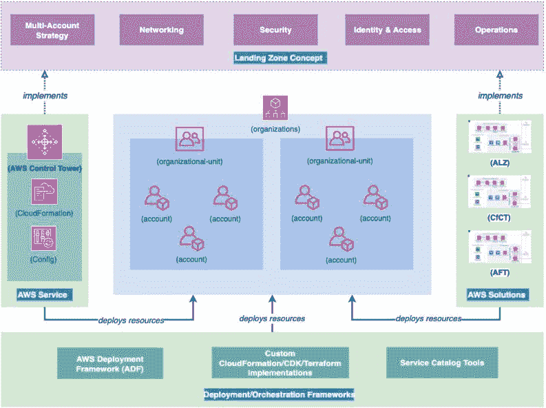
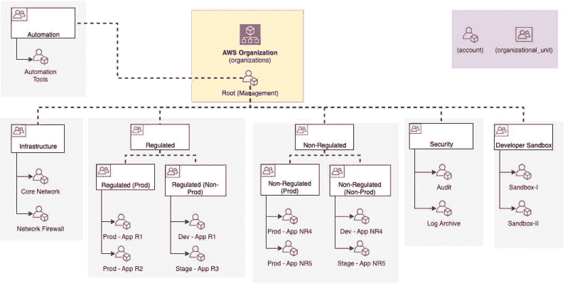
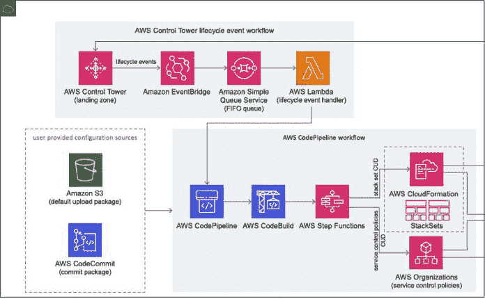

## 确保多账户和多区域环境中的强大AWS基础

AWS账户是你所创建的AWS资源的*逻辑容器*。它提供了一种结构，可用于轻松管理一组相关资源的访问、账单和隔离需求。

所有组织都是从创建一个账户并在其中托管一些**概念验证（PoC）**工作负载开始其AWS之旅的。随着他们获得更多经验和技能，他们对云服务的信心和熟悉度也会增加。在某个时点，组织可能会决定将其本地生产工作负载迁移到云端。或者，更好的情况是，他们可能直接开始利用AWS服务开发云原生应用，以实现最大化的创新。

这通常是一个关键转折点，他们必须决定所有工作负载是托管在一个还是多个AWS账户中。这些讨论背后的主要驱动力是单账户带来的问题。当AWS平台的使用超出其最初托管PoC工作负载的意图，并转变为一个需要企业级安全、治理控制、成本管理、细粒度访问策略等的成熟环境时，这些问题就会出现。

然而，这些问题的性质可能因不同规模运营的不同组织而有所差异。有些组织可能发现难以在单个账户中为多个用户管理细粒度安全策略，而另一些组织可能难以在开发和生产工作负载之间实施边界，例如。除了应用挑战外，云提供商还设置了服务限制和配额，这可能将单个AWS账户的使用限制在某一阈值之外。无论最初讨论的原因是什么，所有组织在AWS使用成熟后都会面临这些挑战，并必须采用多账户策略。

让软件开发人员能够无缝地将工作负载接入专用的AWS账户，同时*自动*提供最低安全基线、网络连接和运维，是*平台团队*的一些关键职责，该团队负责管理整个组织的云环境。这些团队在提供坚实的多账户、多区域云基础（也称为着陆区）方面发挥着重要作用。你可能会问：为什么我们甚至需要为此制定策略？设想一个场景，必须创建多个AWS账户来解决我们之前讨论的所有问题。单独管理几个账户不是问题，但一旦数量增加到几十个甚至上百个——这在中型企业中很典型——你很快就会面临扩展问题。此外，如何确保所有账户中的工作负载合规？如何一次性在所有账户中以代码方式配置全球资源？CISO团队是否有办法轻松验证整个AWS环境的安全态势？平台团队如何在整个AWS环境中提供遥测能力？工作负载如何通过网络相互通信以及与本地数据中心通信？如何强制执行阻止使用某些AWS区域和高成本GPU实例的组织级策略？

这些只是平台团队通常面临的挑战的几个例子，而如何解决这些挑战将是本章的主题。我们将研究AWS通过一些服务和现成解决方案提供的功能，以简化这些多账户环境的运营管理。此外，着陆区也*以代码方式管理*，就像任何其他软件应用一样。因此，我们之前讨论的所有DevOps和DevSecOps原则，如IaC、持续测试和安全左移，同样适用于这一概念。

作为DevOps从业者，每当你注意到与使用单个或极少数AWS账户相关的组织复杂性时，可能就是头脑风暴和推广一个定义明确、自动化驱动、多账户环境（着陆区）理念的正确时机。这些复杂性如果得不到解决，将直接影响软件团队无缝采用AWS服务的敏捷性。此外，重要的是要强调，这些概念不仅限于大型企业公司，对于那些正在迈出第一步以巩固其AWS账户态势、以增强云端敏捷性、治理和控制能力的组织来说，也同样重要。

我们将在接下来的章节中讨论以下主题：

- 什么是着陆区？
- 着陆区中的关键考量
- 运营多账户架构的最佳实践
- 使用Control Tower和CfCT编排多账户部署

### 什么是着陆区？

着陆区是一个预定义的多账户环境的概念，允许你以*自动化*方式安全地将应用工作负载接入云端。一个良好的多账户基础可以降低不同团队的认知负担，并让开发人员更快地行动。它要么阻止


任何默认配置错误，或者无需费力就能从问题中恢复。这些基础通常能解锁两个主要用例——将工作负载从本地环境迁移，或在云端进行全新开发。因此，这里的主要目标如下：

- 安全且合规
- 可扩展且具有弹性
- 灵活适应未来变化

衡量着陆区成熟度的一个好的 KPI 是——创建一个新的 AWS 账户并使其准备好承载生产工作负载需要多长时间。这中间有很多环节，从账户请求、审批、配置到实际使用，凸显了从人员到技术和自动化等各类挑战。

**着陆区**（Landing Zone）一词在不同语境下经常被使用，甚至被误用，这可能会让用户感到困惑。让我们来看看过去几年中我观察到的四种常见模式：

- **作为概念的着陆区：** 这是一个多账户云基础的理念，以及实际部署到你的 AWS 环境中的有形成果。它帮助组织从成本隔离、安全和访问管理以及 AWS 账户边界带来的爆炸半径缩减中获益。它提倡用可重复、易于测试和自动化的代码来管理所有基础设施自动化。

  在整章中，我们将使用“着陆区”一词来同时指代这一概念，以及代表这一概念的有形基础结构。

- **作为解决方案的着陆区：** 解决方案是一种预先配置好、可随时部署的实现，通过利用各种 AWS 服务来满足特定需求——在本例中是多账户架构。几年前，AWS 提供了一个公开可用的大型 CloudFormation 模板，名为 **AWS Landing Zone (ALZ)**，客户可以使用它将多个服务、账户和策略部署到他们的 AWS 组织中。它为客户的 AWS 之旅提供了坚实的企业级基础。该方案已不再受支持，已被弃用，取而代之的是一项名为 **AWS Control Tower** 的托管服务，我们将在本章后面更详细地介绍它。AWS 提供的其他解决方案示例包括 **Customizations for Control Tower (CfCT)** 和 **Account Factory for Terraform (AFT)**。

- **作为 AWS 服务的着陆区：** 诸如 ALZ 之类的解决方案需要进行大量定制才能适应组织的独特需求。由于它完全由 CloudFormation 模板管理，因此不易维护和操作，更不用说通常从 AWS 服务中获得的 AWS 支持也已缺失。为了填补这些空白并降低使用 ALZ 所带来的复杂性，AWS 推出了一项服务——AWS Control Tower——它基于从多个企业客户那里收集的现场经验，以及他们如何使用 ALZ 解决方案来构建可承载应用程序的坚实基础。Control Tower 提供自动化功能，可创建新账户、为其配置基础安全资源、实施治理控制等等。很多时候，当用户使用“着陆区”一词时，他们往往指的是 Control Tower 之类的服务。着陆区是一个更广泛的概念，该服务（在某种程度上）*实现*了它。

- **作为部署编排框架引用的着落区：** 从核心上讲，着陆区是一个多账户概念。将此概念实际应用到你的 AWS Organizations 组织中，需要在多个 AWS 账户中部署资源。一些组织最终使用 CloudFormation、CDK 或 Terraform 开发了自主解决方案。一些编排框架以开源代码的形式在 GitHub 上提供。用户可能会开始将其称为着陆区，但它们只不过是可以用来在多个账户中部署资源的部署框架。即使不在着陆区的上下文中使用，它们也有其自身的意义。

两个常用的开源框架是 **AWS Deployment Framework (ADF)** 和 **Service Catalog Tools**。

*图 11.1* 突出了所有不同的实体及其与着陆区概念的关系：



图 11.1 – 不同实体与着陆区概念之间的关系

**注意**

尽管某些框架（如 ADF）名称中带有“AWS”，但它们并不作为企业支持计划的一部分得到云提供商的官方支持。这可能是公司可能要考虑（或至少要知道）的标准之一。另一方面，AFT 和 CfCT 这两个解决方案与其他服务一样，确实带有 AWS 的官方支持。这些解决方案由 Control Tower 服务团队维护。

我们可以用整整一本书来阐述着陆区的开发。一个重要的提醒是，这是一个*不断演变*的事物。组织不断变化的需求将决定着陆区设计必须满足的新标准和目标。为了实现这一点，服务、解决方案和部署框架必须进行调整。你如何使用这些服务和解决方案，将在很大程度上取决于组织内部的独特需求和实现。这就是为什么你永远不会遇到一个可以按原样采用的端到端实现。服务和解决方案将始终关注适用于大多数企业用例的*最低公共标准*。几乎总是会有一个定制层叠加在上面，以使其成为满足你需求的完整解决方案。

因此，本章的主要重点是向你介绍着陆区的关键考量、相关的 AWS 服务、解决方案和框架。这将帮助你确定应关注的领域，并向你介绍用于在多个 AWS 账户和区域中部署资源的部署编排框架。掌握这些知识后，你就可以提出适合你的自定义实现或设计。

## 着陆区中的关键考量

从零开始创建一个能满足当前和未来所有组织需求的着陆区概念可能令人望而生畏。对于所有组织（无论大小）来说，有五个领域对于构建可扩展的 AWS 基础至关重要。我们将在本节中讨论它们，从多账户结构开始。

## 为组织单位和账户定义结构

着陆区设计的核心是一个账户结构，它使组织能够快速行动、实施细粒度控制、建立隔离边界并缩小爆炸半径，同时保持对未来变化的灵活性。到目前为止，在本章中，我们已经讨论了不少受益于多账户结构的领域。所有这些都与 **AWS Organizations** 服务高度契合，该服务可帮助你在同一个保护伞下管理整个 AWS 环境。它为你提供了组织控制能力，而在许多作为独立实体运行的离散 AWS 账户中，这些控制很难建立和维护。因此，如果你尚未使用 AWS Organizations，启用它是必不可少的。它免费提供，能立即为你带来合并账单、服务集成、用于集中控制服务使用的策略，以及为预算和合规需求而分组账户等方面的好处。让我们更详细地讨论它们，并在推进过程中强调一些最佳实践。

## 为合规和监管需求分组账户

**组织单位（OU）** 是 AWS Organizations 的一项功能，允许你将多个 AWS 账户合并为一个逻辑实体。它是一种软性结构，可用于对需要类似治理和控制的特定账户进行分组。例如，可能有一部分企业应用程序受 **《健康保险携带和责任法案》（HIPAA）** 监管，因此可能不允许使用某些 AWS 服务。将这些账户分组、组成一个 OU，并在 OU 级别强制执行策略（所有账户都会继承这些策略）是很容易的。此外，任何其他被放入此 OU 的 AWS 账户，即使是将来加入的，也会自动遵循相同的规则，从而确保持续合规。再举一个例子，一些公司可能希望将所有开发工作负载账户分组在一起，以便应用某些阻止使用高成本计算的策略。暂且抛开自定义需求，某些 OU 适用于大多数组织，如下所述：

- **共享服务 OU**：此 OU 包含平台服务账户，这些账户将被所有其他 AWS 账户使用，基本上是共享资源。通常会将 **Active Directory**、网络设备或代理服务等系统托管在此 OU 中（在专用账户中），且只能由授权人员访问。
- **安全 OU**：这是你将 **Audit** 和 **LogArchive** 账户分组的地方，外部审计师和内部安全团队可以访问这些账户。作为最佳实践，来自 **CloudTrail** 和 **Config** 的所有平台日志都应推送到中央 LogArchive 账户，以便 **安全信息和事件管理（SIEM）** 系统可以独立分析这些日志以进行威胁检测。
- **自动化 OU**：稍早前，我们略微提到了需要部署框架来让着陆区概念成为现实。在此 OU 中托管一个独立的 Automation 账户是一个很好的做法，该账户包含负责以自动化方式在所有其他账户中部署资源的框架。由于此账户对组织中几乎每个其他账户都有特权访问权限，因此访问权限通常仅限于管理整个 AWS 环境的工具。人工访问（如果有）应受到主动监控。
- **维护 OU**：一旦将安全和监管策略应用于某个 OU，有时很难对该 OU 中包含的账户执行维护程序。因此，建议创建一个维护 OU，用于临时托管所有需要为特定需求做准备或需要对其进行操作的 AWS 账户。一个常见的用例是通过将 AWS 账户放入此 OU 来启用 AWS 可选区域。通常，这将是所有 OU 和账户中的受限操作，因为用户可能会启用可能破坏公司合规态势的区域。一旦区域启用，账户就会被放回其原始 OU。将此 OU 视为*维修站*，就像赛车比赛中用于进行小型维修和加油一样。

作为一项安全措施，还必须撤销所有其他 AWS 用户手动将任何账户移入此 OU 的权限，因为这样做会立即解除账户原来受到的所有限制。


- **Suspended OU：** 所有被暂停的 AWS 账户在被移除前会保持相同状态 90 天，作为冷静期。作为安全措施，该 OU 会限制这些账户中的所有操作，以防止任何额外计费或未经授权的使用。
- **Development OU：** 在安全控制与敏捷性之间取得正确平衡是创新的关键。组织通常会在所有 AWS 账户中强制执行一套标准策略和控制措施，这会阻碍开发者测试新想法并在云中创新。正如 AWS 所说，一个良好的 Landing Zone 设计遵循 *Guardrails, but not blockers* 原则。因此，创建专门的 OU 来托管个人开发者或团队账户作为创新空间非常重要。你仍然可以在这些 OU 上应用一定的预算限制，并阻止可能损害组织安全态势的 IAM 操作。

在介绍了 Landing Zone 中最重要的 OU 后，让我们看看一个拥有专门团队负责技术栈不同领域的大型组织，以及需要遵守 HIPAA 等监管标准的应用程序工作负载，其 OU 设置会是什么样子。

## 适用于受监管组织的示例 OU 设计

大型企业通常拥有专门负责安全、网络运营、审计、软件开发等的团队。这些团队通常按成本中心分组，需要定制化的访问控制，并受安全控制和治理策略管理。另一方面，软件开发团队按业务域或价值流分组，并拥有多个环境，如开发、 staging 和生产，用于托管其应用程序工作负载。AWS 账户在计费、访问和隔离方面提供的边界非常适合此类场景。OU 可以提供逻辑结构，可在此结构下进一步对这些账户进行分组，以进行访问控制和策略执行。示例 OU 结构如下 *Figure 11.2* 所示：



Figure 11.2 – Sample OU hierarchy for an organization hosting regulated workloads

将 AWS 账户分组到特定的 OU 下可简化策略的定义和映射。让我们在下一节中讨论这一点。

## 强制执行策略以控制服务使用和标签分配

AWS Organizations 支持三种类型的策略 – **Service Control Policies (SCPs)**、**Tagging Policies** 和 **Backup Policies。**

SCP 可以限制所有 OU 或其映射的账户的某些 IAM 操作。需要注意不要过度使用它们，因为存在策略大小限制（5,120 字节）以及可以直接应用于 AWS 账户或 OU 的策略总数限制（目前为 5）。将它们视为 *global controls*，拒绝所有你不希望用户执行的操作。例如，拒绝除你希望运营的区域之外的所有其他 AWS 区域是常见的 SCP 控制。另一个例子可以是拒绝将 S3 存储桶设为公开的配置，或限制可能产生成本影响或被以某种方式滥用的某些 EC2 实例类型。AWS IAM 本质上会拒绝所有未明确添加到策略中的操作，但 SCP 是一种全局管理机制，具有最高优先级，即使在某些 IAM 操作被错误地允许在用户或资源上时也是如此。

Tagging policies 与 SCP 结合使用，用于强制执行某些标签键及其对应值存在的策略。几乎所有 AWS 资源都支持标签，它们是键值对，用于为特定资源提供额外上下文。这对于追踪支持、运营或成本分析需求的资源所有者和应用程序团队特别有用。组织常犯的一个错误是投入过多时间和精力制定一个能满足未来所有需求的标签策略。强烈建议从后往前开始——即先确定你希望通过标签解决的问题，然后制定有助于强制执行的标签策略。例如，如果组织在汇总的成本和使用报告中难以识别资源所有者，强制执行映射团队和个人的标签键可能会有所帮助。

Backup policies 用于自动将备份计划应用于所有 AWS 账户中的受支持资源。

## 利用与 AWS Organizations 的服务集成

诸如 **AWS Security Hub**、**AWS CloudFormation** 和 **AWS Config** 等 AWS 服务，以及许多其他服务，可以利用 AWS Organizations 的一项功能 **Trusted Access**，搭载组织服务功能并自动管理组织中的多个账户。这大大简化了某些任务的管理，例如在账户创建后立即启用对账户中所有 AWS 资源合规性记录。例如，Security Hub 可以自动将组织中的任何新账户注册并开始扫描其安全风险。要查找与 AWS Organizations 集成的所有 AWS 服务列表，可以参考此页面：https://docs.aws.amazon.com/organizations/latest/userguide/orgs_integrate_services_list.html。

## 专注于跨账户和混合网络需求

无论你计划使用 AWS 迁移本地工作负载还是在云中开发新应用程序，网络连接都将是一个基本需求。应用程序需要与托管在另一个账户中的共享服务通信，并与本地的对应方通信。从安全和合规角度来看，你可能希望对互联网入站和出站或跨账户通信实施数据包级检查。网络流可以根据组织特定需求进行高度定制。过去几年中 AWS 在网络领域的产品呈指数级增长，但这并不意味着你需要从一开始就采用和使用最精尖的服务。Landing Zone 会随着时间的推移而演进，这同样适用于网络需求。

例如，我经常看到团队从一开始就利用 **AWS Transit Gateway**。如果你只管理少数几个账户，大多数用例都可以通过在多个账户之间共享子网并实现 VPC 对等连接来简单解决，即使是跨区域数据传输需求也是如此。你应该意识到过早采用此类服务的设计权衡和成本或复杂性影响。此外，网格网络通常并不需要，因此了解平台需要支持的不同网络流并构建以成本优化和安全的方式实现必要功能的架构非常宝贵。

本地连接也一样，除非应用程序有具体要求，否则可能不需要高带宽、低延迟的 **Direct Connect** 连接。通过单个 Transit Gateway 汇总多个站点到站点 VPN 连接通常可以满足混合部署的带宽和高可用性需求。

然而，企业在某些情况下确实需要更复杂的设置来支持合规性、数据包检查或性能敏感型应用程序的需求。在这些情况下，诸如入站 VPC、出口 VPC 和集中式数据包检查架构等网络结构可以支持任何新加入 Landing Zone 的 AWS 账户的需求。深入探讨架构细节超出了本章范围，但如果你有兴趣了解更多，我推荐以下博客：`https://aws.amazon.com/blogs/networking-and-content-delivery/tag/hybrid-connectivity/`。

## 使用 IAM 和安全服务保护 Landing Zone

Landing Zone 的设计需要考虑谁将访问 AWS 账户，以及他们将拥有哪些权限。最小权限原则有助于指导定义开发者或工具执行某项活动所需的最低权限。

使用 AWS CloudTrail 审计所有活动，AWS CloudTrail 是安全审计和故障排除服务，可让平台所有者或安全专业人员提醒并调查所有 AWS 账户中的任何意外使用。我们讨论了与 AWS Organizations 的服务集成，CloudTrail 也可从中受益。作为最佳实践，启用组织范围的


通过跟踪，可以将审计数据集中聚合到 LogArchive 账户中的 S3 存储桶。当新账户创建或现有账户加入组织时，它会自动将跟踪配置注入这些账户。作为企业安全措施的一部分，您应强制执行一个 SCP，阻止任何可能导致篡改此 S3 存储桶中的数据或修改 CloudTrail 服务所使用的加密密钥的 IAM 操作。

其次，对于用户访问需求，我强烈推荐使用 **AWS IAM Identity Center**，它允许你集中创建和连接所有员工用户，并管理他们在所有其他 AWS 账户中的访问权限。借助 Identity Center，你可以利用现有的**身份提供商（IdPs）**（如 Azure Active Directory）将用户联合到 AWS 账户中。

> **注意**
> 
> IAM Identity Center 控制平面仅在该服务实例化的 AWS 区域中可用。为同一区域受灾难影响的场景做好准备是一种良好的实践。如果 Identity Center 不可用，可能意味着所有用户对 AWS 账户的访问都将被锁定。为缓解这种情况，建议准备一组 *应急（break-glass）* IAM 用户，可在特殊情况下用于紧急访问。这些凭证应通过 MFA 进行保护；访问密钥 ID 和秘密访问密钥应分别由不同人员保管，以避免滥用。当然，所有活动都应被审计，并且凭证应定期轮换。

第三，很难确保对 AWS 账户中可能发生的所有安全事件都保持警觉并采取预防措施。**Amazon GuardDuty** 是一个唾手可得的选项，它利用机器学习来识别异常网络流量、DNS 日志、CloudTrail 事件以及潜在的权限提升场景。它还可以针对代表恶意软件和比特币挖矿的异常 EC2 行为发出告警。通过利用与 AWS Organizations 的集成，GuardDuty 可以自动扫描组织内的所有 AWS 账户，并将发现结果输入到 AWS Security Hub，后者是一个来自多个其他服务的安全检查聚合器。

## DevOps 与配置管理

您的 Landing Zone 实现将像任何其他软件应用程序一样以代码形式进行管理。强烈建议从一开始就采用定义良好的实践，例如 IaC、CI 和自动化代码验证。您编写的任何 CloudFormation 模板都应通过安全检查门禁和策略，这些策略定义了您在 AWS 环境中可以做什么和不可以做什么。

大多数 AWS 解决方案都从源代码存储库触发，这些存储库通常在 **AWS CodeCommit** 中管理。本章后面介绍 CfCT 解决方案时，我们将看到它在实践中的样子。

由于部署工具具有在组织中几乎所有其他账户中部署资源的权限，因此对这些管道强制执行正确的访问控制至关重要，以确保它们不会以任何方式被滥用。对托管部署工具和框架的账户的访问也应受到严格限制。如果您想使用其他 CI/CD 系统（例如 **GitLab**），您可能会对 **Open ID Connect（OIDC）** 与 AWS IAM 的集成感兴趣，这消除了在 CI/CD 管道中预置任何临时 IAM 用户或凭证的需要。

## 运维

您的 Landing Zone 策略需要考虑平台和应用程序的可观测性、基础设施监控、应用程序监控、事件管理、变更管理等需求。

通知、告警和报告应与现有的寻呼工具集成。这应允许值班运维团队以与处理无法正常工作的生产应用程序相同的优先级来支持 Landing Zone 或任何故障。AWS 还提供了其他服务，例如**个人健康仪表板（PHD）**和**服务限制（Service Limits）**告警，这些服务对于显示特定区域中服务的任何持续问题以及资源的计划维护活动至关重要。

在介绍了优秀 Landing Zone 概念的关键考量之后，让我们深入探讨一些最佳实践，这些实践将帮助您取得成功。

## 管理多账户架构的最佳实践

以下最佳实践涉及我们在上一节中介绍的许多领域。基于我为多家企业客户开发 Landing Zone 的经验，我想分享一些关于您可以为您的组织考虑采用的最佳实践的见解。

### 限制对管理账户的访问

您在其中引导 AWS Organizations 组织的 AWS 账户被称为**管理账户**，即主付款方。这是一个高度特权的账户，可提供对策略管理、集中式计费和成本报告以及账户管理的访问。只有在特殊情况下，才应由选定人员访问该账户。

SCP 不适用于管理账户，这使得在该层面强制执行任何策略或治理控制变得困难。其次，默认情况下，AWS Organizations 会向组织中的所有 AWS 账户注入一个具有 `AdministratorAccess` 权限的 IAM 角色，以及一个允许管理账户不受限制访问的信任策略。这意味着，除非已采取其他措施来阻止，否则任何可以访问管理账户的人都可以代入该角色，并获得对组织中任何其他账户的提升权限。此外，由于所有策略都是从管理账户管理和执行的，您可以解除所有限制，从而使整个组织面临安全风险。

作为 Landing Zone 自动化过程的一部分，某些用例无法避免，即工具需要访问管理账户才能执行一些只能在管理账户内执行的操作。例如，启用可选区域（opt-in region）或将账户移动到不同的 OU，只能从管理账户内部执行。一种良好的安全实践是在管理账户中创建细粒度的 IAM 角色，赋予 Landing Zone 自动化工具仅执行允许的 IAM 操作的权限。

AWS Organizations 还有一个称为**委托管理员（Delegated Admin）**的有趣功能，现在对它的支持已扩展到许多 AWS 服务。它允许将特定服务的管理能力*委派*给组织中的另一个账户。委托管理员进一步减少了登录管理账户的需要，并允许服务所有者从委派账户本身管理特定服务。

### 采用在易用性和控制性之间取得适当平衡的解决方案

值得重申的是：没有任何 AWS 解决方案、服务或框架能够原样满足您所有的 Landing Zone 需求。每个客户都不同，每个用例都需要深入分析，从而产生自定义实现。所有这些服务和框架的优点在于，它们可能功能有限，但它们做得很好。因此，将它们视为可以组合起来构建 Landing Zone 的互补技术总是有帮助的。举一个具体的例子，AWS Control Tower 服务将帮助您在不到一小时内构建每家公司所需的初始 30% 到 40%。然后，您需要专注于将此服务与另一个帮助您构建剩余 60% 到 70% 的框架相结合。

理想情况下，您自己应该开发的唯一代码是跨所有这些服务和框架的编排器，同时充分利用它们所能提供的最佳能力。

另一方面，一些组织在 **CloudFormation** 和 **Terraform** 等技术上投入了大量精力。根据他们的专业知识和熟练程度，他们可能还会决定从头开始构建整个 Landing Zone，这也是可以的，只要他们清楚自行维护这些框架与长期受益于更多控制之间的权衡。

### 投资构建账户自动售货机（Account Vending Machine）

当谈到以代码方式管理 Landing Zone 时，大多数组织专注于构建 IaC 层，该层直接与云提供商的 API 交互并将资源部署到 AWS 账户中。在构建整体基础时，他们忽略了两件关键的事情：

- 首先是一个总体层，将该框架与公司内部的现有工具和流程集成起来
- 其次，忽略了一个事实，即整个 IaC 层都有其相关的生命周期，它从来不是一蹴而就的


即使在 IaC 将资源部署到账户之前，也必须满足某些先决条件。账户配置完成后，您可能需要执行一些安装后流程，这些流程可能涉及通知、工单关闭或其他事项。这就是账户自助机（Account Vending Machine，AVM）概念的用武之地。它负责这两个需求，并充当组织流程、实际 IaC 以及 AWS 账户管理生命周期各阶段之间的粘合剂。其核心职责是以如同从工厂产出并可立即承载生产级工作负载的方式提供账户。让我们看一个示例。

企业通常有工单流程或其它机制来请求和审批 AWS 账户。示例包括 ServiceNow、Jira 或自研定制方案。请求提交后，您希望以事件驱动的方式调用 AVM，这可以通过传递反映工单系统输入的有效负载来实现。AVM 然后管理账户创建流程的生命周期，从确保先决条件就绪开始，通过 IaC 栈部署资源，最后执行部署后流程。

## 为平台开发维护一个单独的 AWS Organizations 组织

与软件开发生命周期类似，首先在隔离环境中测试新的 Landing Zone 功能和变更，然后再在生产 AWS 组织中推广非常重要。诸如 SCP 修改、网络路由配置和安全策略升级等小改动都可能产生巨大影响，同时影响多个账户。例如，错误配置 CloudTrail S3 存储桶可能导致日志和审计数据无法按预期聚合，从而丢失有价值的信息。

在托管生产工作负载的同一 AWS 组织中开发整体平台会大幅增加影响范围。AWS 账户是免费资源，因此复制生产环境的类似结构并不会带来巨大的成本影响。为了进一步限制开发环境中的额外支出，建议设置计费警报，并在不需要时，例如下班后或周末，使用 IaC 自动化删除整个组织中的所有资源。这是一种常见做法，使用诸如 aws-nuke（https://github.com/rebuy-de/aws-nuke）等工具清空所有账户。这验证了 IaC 框架的功能性和可重复性，以便在需要时，例如在灾难情况下，能够从零开始重新构建整个平台。

## 避免配置任何 IAM 用户

凭证泄露最常见的来源就是 AWS IAM 访问密钥，这些密钥可能会意外提交到源代码中，或留在不再使用的 EC2 实例中。您应始终力求为 AWS Landing Zone 中的任何访问需求利用 IAM 角色。在 Landing Zone 中的所有 AWS 账户中拒绝创建 IAM 用户是一种安全最佳实践。从技术上讲，所有 AWS 标识，无论是用户、服务还是资源本身，都可以承担 IAM 角色并在需要时从 IAM 控制平面请求临时凭证。EC2 实例具有实例配置文件概念，而 Lambda 和 RDS 等服务使用服务角色，从而使它们能够访问允许的资源。

大多数企业在组织中已在使用某种形式的 IdP 解决方案。AWS IAM 通过 **OIDC** 或 **Security Assertion Markup Language（SAML）** 原生支持与此类提供商的集成，从而消除了在整个组织中配置和管理用户的需求。IAM 联合进一步防止凭证泛滥，并且从权威身份源（例如 Active Directory）离职的任何员工都会自动失去对所有 AWS 账户的访问权限，这是一个很好的安全收益。

## 优先选择无代码或低代码解决方案

过去需要手动构建的许多集成现在都已由许多 AWS 服务原生支持。虽然这极大地提高了开发速度，但也减少了代码维护并提高了效率。Landing Zone 实现在很大程度上依赖于诸如 **AWS Step Functions、AWS Organizations、Lambda 和 IAM** 等服务，举几个例子。最近，AWS Step Functions，一项工作流管理服务，已启动与 AWS Organizations、Lambda 和许多其他服务的原生集成。因此，将账户移至不同 OU 等操作，以前需要 Lambda 函数在管理账户中承担角色，现在可以直接由 AWS Step Functions 执行，而无需您编写任何代码。

发送平台通知是另一个示例，开发人员过去必须利用 Lambda、事件、SNS 或 SES 等服务的组合。使用 **AWS User Notifications**，您可以利用所选 **EventBridge** 事件的自动通知，整个事件捕获、有效负载解析和通知触发的责任都转移给该服务。它通过多个渠道发送通知，例如 **Microsoft Teams、Slack 和 Email**。

在讨论了构建 Landing Zone 基础时应遵循的几项最佳实践后，让我们讨论一下将服务如 AWS Control Tower 与 CfCT 结合使用时，这在实践中是什么样子的，CfCT 是 AWS 提供的一种跨多个账户部署资源的解决方案。

## 使用 Control Tower 和 CfCT 构建 Landing Zone

与从零开始构建一切相比，AWS Control Tower 为用户建立 Landing Zone 基础提供了快速入门。从托管安全和工作负载账户的基本 OU 结构开始，它提供了一个 *账户工厂* —— 在 **Service Catalog** 之上的抽象，用于创建新账户并在其中配置资源。从日志和安全角度来看，它会自动推广组织范围的跟踪，使用 AWS CloudTrail，并通过利用 AWS Config 的功能聚合合规状态。其核心是 *编排* 跨多个其他 AWS 服务的账户相关活动，以实现多账户结构的优势。此外，它定义了一个由 AWS Config 规则、IAM 策略和 SCP 组成的安全和合规基线。这些合理的默认值阻止了诸如使 S3 存储桶公开、禁用 CloudTrail 日志或关闭 Config 记录器日志等操作，从而确保开箱即用的良好安全态势。

对于刚刚开始构建 AWS 基础的企业，AWS Control Tower 为其做了大量繁重的工作，减少了实施工作量和时间。其他更注重动手操作且精通 AWS 技术栈的人，仍可能决定继续构建 Landing Zone 的定制版本，因为它赋予了他们更多控制权和工具选择。这是因为，作为一项服务，Control Tower 本身并不能做太多。它基于大多数客户在建立可安全用于以最少阻力和延迟启动应用程序的云结构时遵循的最佳实践。对于账户管理，它依赖 AWS Organizations；对于策略，它依赖 SCP；对于合规性，它依赖 AWS Config；将资源部署到目标账户完全交由 CloudFormation 处理。为了受益于它提供的现成指导性基础，使用它仍然是一个好主意，并用另一个补充的部署解决方案或框架来填补空白。

在撰写本书时，该服务在某些方面表现并不突出。由于缺乏 API 支持，我建议在为需要频繁调用的功能构建任何硬依赖之前谨慎行事。通过 Web 控制台执行操作根本无法扩展，并且您需要向某人授予管理账户的访问权限（该服务只能部署在那里），这是不理想的。需要强调的是，服务操作是单线程的，这意味着它们一次只能处理一件事。此限制不适用于某些功能，例如账户请求，您最多可以达到五个，但这些限制对于要大规模配置和管理账户的一些组织来说可能是阻碍。

因此，我的建议是，对于刚刚开始 AWS 基础建设的公司，应利用该服务所提供的内容，让它在更大的 Landing Zone 领域中发挥其作用。您需要一个补充的解决方案或框架来实现服务捆绑中未包含的其他功能。对于已有 Landing Zone 或与 IaC 配合使用的框架的公司，我认为切换到 Control Tower 的价值较小。后者更适合那些愿意动手操作并自行大规模维护此类解决方案的公司。由于这里的实现选项多种多样，涵盖所有可能的实现场景已超出本章范围。在以下各节中，我们将更侧重于将 Control Tower 与您选择的另一个框架结合使用，以构建端到端的 Landing Zone 平台。

在我们进入集成部署解决方案或框架的主题之前，让我们通过查看一张图表来确保我们对 Control Tower 服务有良好的理解：


图 11.3 – AWS Control Tower 对不同 AWS 服务的编排

此图并非详尽展示 AWS Control Tower 在后台处理的每一项功能；相反，它旨在突出账户创建工作流中涉及的不同步骤，以及随后向其中部署资源的过程。让我们更详细地看看这张图：

- 1. 平台开发人员使用 AWS Control Tower 控制台界面提交新的账户创建请求，并指定该账户应加入的目标 OU。
- 2. AWS Control Tower 将请求传递给 Account Factory（一个 Service Catalog 产品），由其启动账户预置工作流。
- 3. 在后台，该请求会调用 AWS Organizations API 来创建新账户。
- 4. 系统会创建一个 AWS 账户，并将其放入目标 OU，该 OU 决定了此账户中托管的工作负载将适用哪些策略控制和治理规则。
- 5. AWS CloudFormation StackSets 是一项可自动将堆栈部署到账户-区域组合的服务功能，AWS Control Tower 服务已经为其定义了一些可复用模板。AWS Control Tower 会为 StackSet 定义创建新的堆栈实例，从而在目标账户中启动 AWS CloudFormation 模板的预置。
- 6. AWS CloudFormation 堆栈预置在目标账户内的特定 AWS 区域中开始，并部署诸如 AWS Config 记录器、IAM 角色以及其他以合规方式管理此账户所需的资源。
- 7. AWS Config 设置一个 *记录器*，用于监控账户内所有资源的变更，并设置一个交付通道。
- 8. 配置记录器是一种记录所有资源配置变更并将数据发送到集中式 S3 存储桶以满足审计需求的机制；同时，通知会发送到 SNS 主题。SNS 通知按区域聚合，当发生意外资源变更时，安全团队可以使用这些通知进行高级分析和自动告警。
- 9. 当你首次安装 AWS Control Tower 时，它会创建一个组织级的 AWS CloudTrail 跟踪，自动获取组织中的新账户，并将跟踪数据聚合到 LogArchive 账户中的中央 S3 存储桶。它还将日志推送到管理账户中的 CloudWatch 日志组。这为中央安全团队提供了审计和调查的可能性，而无需访问 Landing Zone 中的所有账户。

Control Tower 开箱即用地提供了所有这些功能，安装大约需要 1 小时。你可能已经注意到，该服务并不涵盖任何应用程序或组织特定的部署需求。到目前为止，它是一种基于良好实践的规定性设置，会在账户创建后立即推出。要推出其他 AWS 服务和资源，你需要一个部署解决方案或框架来填补缺口，以构建完整的 Landing Zone 平台。

接下来，我们来看看 CfCT。这是一个 AWS 支持的解决方案，可与 AWS Control Tower 服务集成，以推出由 AWS CloudFormation 模板定义的自定义资源。假设你需要为安全扫描第三方平台准备一个特定的 IAM 角色，并且该角色应在所有 AWS 账户预置后自动部署到其中。CfCT 可以帮助实现这一点。或者，你可能希望将某些 Config 规则部署到生产 OU 中的所有 AWS 账户，而不是其他账户。

## 使用 CfCT 部署资源

CfCT 是一个与你的 Control Tower 服务部署集成的部署框架。它需要安装在管理账户中，且必须位于最初设置 Control Tower 的同一区域。它会挂接到服务事件上，并运行一个工作流，在组织内的目标账户中预置 SCP 策略或 AWS CloudFormation 资源。

该框架用于部署两类资源：SCP 策略和 CloudFormation StackSets。每类资源都有专门的部署工作流，通过 AWS Step Functions 实现。用户与框架的交互通过一个具有定义良好的 YAML 格式的清单文件进行。每当文件提交到版本控制时，框架都会获取变更并执行管道。

我们可以查看**图 11.4** 来了解部署框架中涉及的不同组件：



图 11.4 – CfCT 框架的组件（来源：https://docs.aws.amazon.com）

整个解决方案可以作为 CloudFormation 模板部署在你的 AWS 管理账户中。如你所见，CodePipeline 管道会从版本控制（S3 或 CodeCommit）拉取最新更改，并触发一个 CodeBuild 项目来初步验证清单文件。如果一切正常，框架会继续调用 SCP Step Functions 状态机和 CloudFormation Step Functions 状态机。如果你之前没有接触过 AWS Step Functions 服务，它是一个工作流编排器，可以帮助你构建可编程的流程，调用各种 AWS 服务来完成工作。让我们看一下该框架用于在 Landing Zone 中部署资源的清单文件示例：

```yaml
---
region: us-east-1  # Control Tower Home Region
version: 2021-03-15
resources:
  - name: test-preventive-guardrails
    description: Prevent deleting or disabling resources
    resource_file: s3://marketplace-sa-resources-ct-us-east-1/ctlabs/preventive-guardrails.json
    deploy_method: scp
    deployment_targets:
      organizational_units:
        - Security
        - Sandbox
...
- name: create-iam-role
  resource_file: s3://marketplace-sa-resources-ct-us-east-1/ctlabs/describe-regions-iam-role.template
  deploy_method: stack_set
  deployment_targets:
    organizational_units:
      - Security
      - Sandbox
    regions:
      - us-east-1
```

清单文件通过 YAML 结构中的键回答了三个问题：

- `resource_file`：需要部署的代码在哪里？
- `deploy_method`：需要部署什么？该键有两个可能的值——`scp` 或 `stack_set`。
- `deployment_targets`：资源应部署到哪里？在这里，你可以使用单个账户或代表一组账户的 OU。

一旦此文件提交到解决方案所跟踪的 Git 仓库，管道就会触发，从而将 SCP 和 CloudFormation 模板部署到目标位置——在本例中，即安全 OU 和沙箱 OU。

使用 AWS 提供的解决方案的一个好处是，如有需要，你可以获得 AWS Support 的保障。这与你可能开发的其他自定义实现不同。

## 总结

在本章开头，我们确定了多账户结构的必要性，以及它在 AWS 中托管多个工作负载时提供的好处。多种服务、解决方案和部署框架满足了特定需求，但重要的是要明白，它们本身并不能单独帮助你。组织要实现其特定需求，总是需要一定程度的定制。在明确了需求和好处之后，我们接着讨论了在设计 Landing Zone 概念时应该考虑的关键事项。我们还研究了多账户结构、安全与 IAM、DevOps 与 Config 管理以及运维方面的一些最佳实践。

在本章的后半部分，我们更深入地了解了 AWS Control Tower 的内部工作原理，以及它与 CfCT 解决方案的开箱即用集成。客户从这些解决方案中获得的关键好处之一是它们由 AWS 提供支持，就像 AWS 支持任何其他服务一样。

在下一章 *遵循 AWS Well-Architected 原则* 中，我们将探讨一个坚实基础的关键支柱，你可以为自己的应用程序工作负载考虑这些支柱。


## 进一步阅读

要了解本章涵盖的主题的更多信息，请查看以下资源：

- AWS 部署框架 (ADF)： https://github.com/awslabs/aws-deployment-framework
- Terraform 账户工厂： https://docs.aws.amazon.com/controltower/latest/userguide/aft-getting-started.html
- 使用 AWS Organizations 的 OU 最佳实践： https://aws.amazon.com/blogs/mt/best-practices-for-organizational-units-with-aws-organizations/
