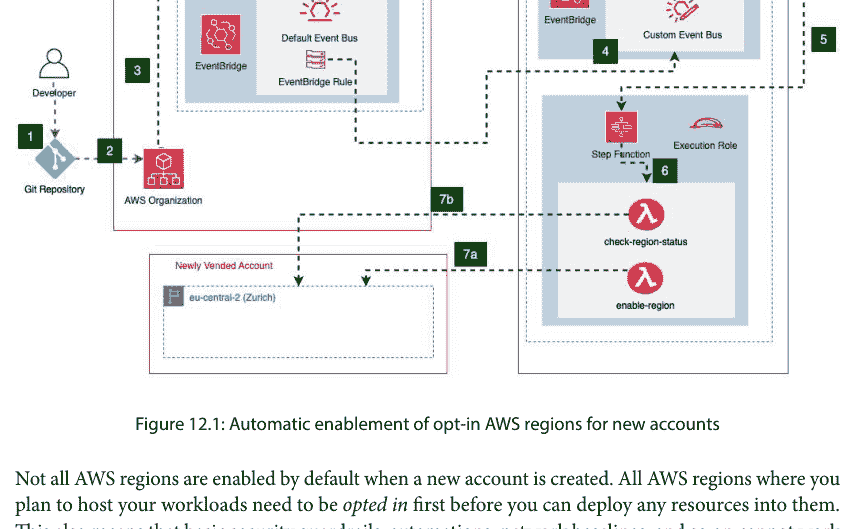
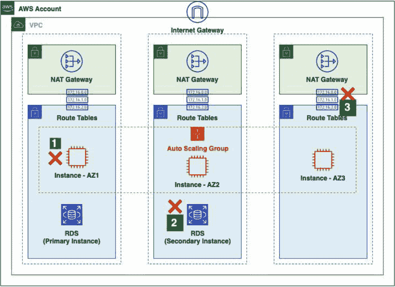
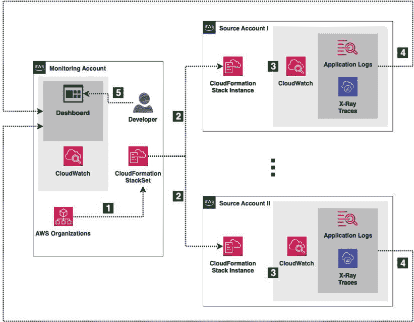
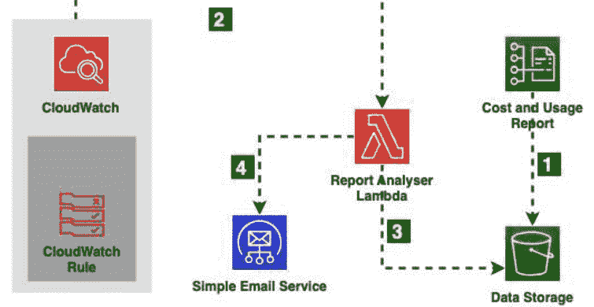

# 12
# 遵循 AWS Well-Architected 原则

早在 2012 年，著名的 **Amazon Web Services (AWS)** 服务之一——Amazon **Elastic Block Store (EBS)**——发生了一次中断，影响了许多客户的工作负载。有趣的是，对少数客户来说，影响可以忽略不计，甚至完全没有。这清楚地表明，除了云服务提供商提供的功能外，那些服务的 *使用模式* 在客户工作负载的稳定性方面也发挥了重要作用。更深入的调查发现了一些架构模式，而少数 AWS 客户一直遵循这些模式。这结合了 AWS 的数据和分析，导致了 **AWS Well-Architected** 的形成。此后，它一直被用来教育客户如何以可靠和高效的方式设计他们的云工作负载。最初是一套最佳实践，后来演变成一些白皮书和在 AWS 上托管应用程序的架构指南。这些实践永远无法满足您工作负载的 100% 架构模式，但将提供强大的基础实践和指导，帮助您随着时间的推移识别、衡量和优化您的架构，从而取得业务成功。

AWS Well-Architected 此后已经发展了很多。截至今天，它提供的远不止通用的架构最佳实践。应用程序团队可以用它来根据技术和业务垂直领域的最佳实践对他们的工作负载进行基准测试。除了识别他们的优势领域之外，他们还可以了解未来优化的机会。一些组织可能会将 AWS Well-Architected 视为 *审计* 他们工作负载的机制，这是不正确的。作为一名 DevOps 专业人员，您应该提倡将这些实践作为建设性的讨论，以促进更好的架构决策，而不是将其用作指出构建云中这些架构的个人或团队责任的机制。IT 架构始终是一种权衡——你赢得了某些东西，同时也失去了其他东西。同样适用于您托管在 AWS 上的应用程序。确保您的应用程序具有更高的可用性可能会导致成本增加，而实施跨区域 **灾难恢复 (DR)** 程序则可能使操作程序复杂化并给应用程序代码的设计带来压力。了解这些权衡将帮助您将技术决策与业务需求保持一致，并在长期架构时协助您的决策。

在本章中，我们将讨论 AWS Well-Architected 的不同组件，以及如何利用它们自信地托管您的关键任务应用程序。从对 AWS Well-Architected 的简要了解开始，我们将深入研究示例实现用例，涵盖适用于大多数企业的常见问题。考虑到本章的范围，我们将无法涵盖这些实现示例的代码级细节，但目的是让您基本了解工作流程的外观以及您可以利用哪些 AWS 服务来推出这些流程。预计您可能需要进行一些自我探索，以在您的 AWS 组织中构建和部署这些解决方案。

本章将涵盖以下主题：

- 了解 AWS Well-Architected 的不同组件
- 将您的架构与框架的六个重点支柱保持一致
- 遵循这些良好架构最佳实践的示例实际实现

如前所述，AWS Well-Architected 远不止架构实践。让我们从对该伞下不同产品的基本了解开始，这些产品共同帮助您以一致的方法进行架构评估和可扩展的设计实施。

## 了解 AWS Well-Architected 的不同组件

**Well-Architected** 是 AWS 提供的一项服务，可让客户访问通过多年来与其他客户进行大量架构评审而获得的知识财富。这确保客户充分了解最有效的实践，并可以减轻其应用程序可能面临的架构风险。有了 Well-Architected，组织可以识别架构中需要改进的领域，从而使他们能够解决并克服那些分散他们对增值活动关注的持续挑战。

从本质上讲，它作为组织实现以下目标的机制：

- 获取云架构有效策略和最佳实践的见解
- 根据既定的最佳实践评估其架构
- 通过解决任何已识别问题来增强其架构

AWS Well-Architected 的三个主要组件是 **框架** 本身、**Well-Architected Lenses** 和 **Well-Architected Tool**。让我们详细讨论它们。

## AWS Well-Architected 框架

Well-Architected 框架为客户提供了一系列问题，以评估其架构是否符合 AWS 最佳实践。从过去其他 AWS 客户的成功经验中学习，避免了重新发明轮子的需要，并提供了一种一致的方法，可以利用它来设计现代云系统，使其安全、经济高效、高效、可靠和可持续。随着新应用程序模式的不断演变，该框架将不断适应它们。因此，有必要将其视为一项 *持续的活动*，您可以在其中持续衡量进展并确保您朝着正确的方向前进。

为了将这些学习成果归类为明确的重点领域，AWS Well-Architected 使用六个关键支柱，我们将在下一节中介绍这些支柱。

## AWS Well-Architected 透镜

为了根据明确定义的技术或业务范围和上下文评估您的架构，可以利用专门的 *透镜*。AWS Well-Architected Lenses 在 AWS Well-Architected 框架提供的建议基础上进行了扩展，并针对不同的行业垂直领域和技术领域。您可以根据应用程序的性质，根据 **金融服务**、**媒体流** 或 **医疗保健** 等业务垂直领域对其进行评估，也可以根据 **混合网络**、**高性能计算**、**容器** 或 **SaaS（软件即服务）** 能力等主题评估技术成熟度。

作为 DevOps 专业人员，您可以利用这些透镜并使应用程序设计、部署和运营活动保持一致，以确保您的应用程序在部署到 AWS 时满足业务需求。这些透镜为框架中涵盖的六个支柱中的每一个 *增加了一个新维度*。

让我们以 AWS Well-Architected 框架的 *SaaS 透镜* 为例。它针对的是在云上托管 SaaS 应用程序的客户。深入研究多租户 SaaS 应用程序常见的关注领域，例如数据隔离、邻居噪音问题、租户入职和租户消耗，该透镜提供了有关如何通过利用 AWS 服务和机制来解决这些问题的最佳实践。这些透镜提供了指导性建议，可以帮助您巩固工作负载的安全性、弹性和可用性，同时降低总体成本。

在上一章 *第 11 章，确保多账户和多区域环境中强大的 AWS 基础* 中，我们介绍了 **登陆区** 的概念。为了识别管理多账户环境的管理和治理的最佳实践，AWS Well-Architected 框架中有一份专门的指南，概述了您应考虑的网络、安全、身份管理和监控的各个方面。有关更多详细信息，请参阅以下链接： https://docs.aws.amazon.com/wellarchitected/latest/management-and-governance-guide/management-and-governance-cloud-environment-guide.html。

## AWS Well-Architected 工具

**AWS Well-Architected 工具**，也称为 **WA Tool**，是一项免费使用的服务，用于审查您在 AWS 中托管的工作负载。它是一种基于云的解决方案，提供了一种统一的方法，用于根据 AWS Well-Architected 框架评估您的架构。使用 AWS Well-Architected 工具，您将获得有价值的建议，以增强工作负载的安全性、成本效益和效率。它不仅帮助您识别改进机会，还能跟踪长期进展。它是您工作负载当前和未来目标状态的*活数据库*。

通过在工具中记录您所做的决策，您可以确保未来的团队成员充分理解为实现特定业务目标而做出的技术决策。

在讨论了 AWS Well-Architected 的关键组件之后，现在让我们深入了解框架的六大支柱的细节。最重要的是，我们将在每个支柱下讨论一些实际实施场景，以解决组织在云中运营时面临的常见挑战。

## 将您的架构与框架的六大重点支柱对齐

AWS Well-Architected 框架将所有实践归类为六大支柱，分别是**成本优化**、**可靠性**、**卓越运营**、**性能效率**、**可持续性**，以及最重要的**安全性**。让我们从**卓越运营**开始，它侧重于大规模运营工作负载并随时间演变的最佳实践，以确保卓越的客户体验。

## 有信心地运营您的工作负载

**卓越运营**支柱旨在以可靠且可重复的方式优化客户环境中新功能和缺陷修复的交付周期。只有当开发者不频繁被运营问题分散注意力时，他们才能专注于构建新功能。为了确保这一点，卓越运营提倡自动化变更和事件响应、持续监控运行中的系统，并在必要时改进流程或程序。在本书的前几章中，我们讨论了软件交付概念，如**持续集成和持续交付（CI/CD）**，这对于在 AWS 中实现工作负载的卓越运营至关重要。让我们讨论一些您可以考虑在此领域采用的最佳实践。

### *在云中高效运营工作负载的最佳实践*

无论您的应用程序属于哪个业务领域或技术领域，您都可以使用这些实践来增强 AWS 上的运营。

## 图 12.1：自动为新账户启用 opt-in AWS 区域

创建新账户时，并非所有 AWS 区域都默认启用。您计划托管工作负载的所有 AWS 区域都必须先选择启用（opt in），然后才能向其中部署任何资源。这也意味着，在新区域配置为可用之前，基本的安全护栏、自动化、网络基线等都无法正常工作。为了处理这种用例，可以实现一个自动化工作流设计，如图 12.1 所示。该工作流的顺序步骤如下：

- 1. 平台工程师利用基础设施即代码（IaC）实践，使用 CloudFormation、Terraform 或 Cloud Development Kit（CDK）等工具添加新账户配置。
- 2. CI/CD 管道启动，并在 AWS Organizations 组织中预置新账户。
- 3. AWS Organizations 服务在 us-east-1 中发出事件，这是生成来自全局服务事件的默认区域。
- 4. 为了限制对组织管理账户的访问，一种良好的安全实践是将相应事件转发到指定的自动化或工具账户，并在那里托管所有自动化。在此架构中，我们遵循相同的做法，并将事件转发到另一个账户中不同区域的自定义事件总线。
- 5. 一旦目标账户收到事件，EventBridge 规则就会调用 AWS Step Functions 状态机，这是用于编排工作流的 AWS 服务。
- 6. AWS Step Functions 状态机可以进一步触发其他几个 AWS 服务并编排其执行。在此示例中，我们使用状态机调用两个 Lambda 函数：一个启用 opt-in 区域（此处为 eu-central-2，即苏黎世），另一个检查该区域是否可供使用。此操作可能需要 15 到 60 分钟，这有力地说明了为什么此类操作应该自动化。
- 7. 两个 Lambda 函数对新 AWS 账户调用相应的 API，以实现所需的目标状态，即启用新的 AWS 区域，以便工作负载可以托管在新账户中。

在了解了实现卓越运营的最佳实践后，让我们讨论一些在 AWS 上保护您的工作负载和基础设施的方法。

## 增强基础设施和工作负载的安全态势

Well-Architected 框架的安全支柱侧重于改善您的基础设施和应用程序工作负载的安全态势。在前面的章节中，我们讨论了 AWS 责任共担模型的概念，该模型强调 AWS 作为云提供商负责云的安全，而客户负责云中的安全。安全支柱确定了客户可以采取的步骤，以改善云中用户和工作负载的安全性。让我们来看其中的一些。

## 增强云安全态势的最佳实践

从用户如何访问 AWS 账户和应用程序，到保护传输中和静态数据，有许多领域需要解决，以确保在 AWS 上拥有良好的安全态势。

## 集中化身份和访问管理

避免在任何 AWS 账户中创建静态身份和访问管理（IAM）凭证，并通过您组织中可能已在使用的集中式身份提供商（IdP）联合所有人类访问。通常的做法是使用 Azure AD、OneLogin 等解决方案来集中认证和授权人类用户。诸如 IAM Identity Center 之类的 AWS 服务使利用同一 IdP 将用户联合到具有不同访问权限级别的 AWS 账户变得容易。对于技术用例，即应用程序或自动化工具需要访问 AWS 服务时，始终利用 IAM 角色，而不静态预置用户凭证。IAM 角色为您提供动态生成的临时凭证，这大大改善了您的安全态势。

但是，在某些例外情况下，根据紧急访问模式的最佳实践，您可能必须在管理账户中创建一对 IAM 凭证。这些模式主张在管理账户中创建有限数量的静态凭证，以处理诸如 IdP 中断或需要调用手动干预程序的安全事件等场景。然而，重要的是要注意，应对这些凭证的使用进行充分监控，并且所有活动都应进行审计。在本节的末尾，我们将讨论使用 **AWS User Notifications** 服务的实现，该服务可用于通过常用的通信平台和渠道发送通知。

## 实现深度防御原则

安全应应用于多个层级，从网络边缘到 VPC 和子网的边界，再到实例级别，保护应用程序和操作系统本身。实施预防性和检测性安全控制以允许健康的通信模式是一种良好的实践。

通过组合 **AWS 服务控制策略（SCPs）**、AWS Config 规则以及子网**网络访问控制列表（NACLs）**、安全组等网络控制，可以采取适当的措施来实现深度防御。

## 保护传输中和静态数据

许多 AWS 服务提供开箱即用的静态数据加密。这至少为您的数据提供了安全保护，但加密密钥的所有权和管理权归 AWS 所有。在金融服务业等更敏感领域运营的客户可能会使用自己的加密密钥，这些密钥可以使用 AWS **密钥管理服务（KMS）**进行管理。

## 以代码形式自动化安全措施

利用基于软件的自动化安全机制来增强可扩展性，同时确保成本效益。通过版本控制的模板开发安全架构，将安全控制定义和管理为代码。

## 减少直接人工数据访问模式

利用各种机制和工具，最小化或消除直接访问或手动处理数据的需求，从而降低涉及敏感数据的错误处理和人因错误风险。

## 为安全事件做好准备

在事件管理方面，每个组织在云中的运营方式略有不同。因此，有必要制定一套定义明确的事件管理程序，并针对您的独特需求和团队结构进行测试和定制。

接下来，让我们看看一个常见的针对紧急用户访问的安全监控需求，我们刚才讨论过。

### *针对紧急用户访问的安全监控*

为了在紧急用户的凭证被使用时触发警报，组织可以实施一种解决方案，详见*图 12.2：*

图12.2：监控安全紧急访问用户的使用情况

让我们更详细地看一下，如下所示：

+   1. 在涉及身份提供商（IdP）的安全漏洞事件或服务本身中断期间，安全团队成员可能必须通过使用在AWS管理账户中配置的IAM用户凭证来启动紧急访问流程。
+   2. 用户登录会在用户登录的区域中，于EventBridge服务中创建一个事件。
+   3. 为了跟踪这些事件，可以利用AWS用户通知服务，该服务负责管理账户目标区域中事件跟踪和转发的生命周期管理。
+   4. 通知会发送到配置的目标平台，在撰写本章时，该平台可以是MS Teams、Slack或电子邮件。

为了跟踪定义紧急访问用户控制台登录的事件，可以在用户通知服务中配置IAM用户亚马逊资源名称（ARN）。例如，要跟踪名为break-glass-1的用户，可以在该服务中使用以下ARN：`arn:aws:iam::<management_account_id>:user/break-glass-1`。

然后，该事件会被转发到该服务也负责管理和配置的三个聚合区域之一。

## 构建弹性和高可用系统

AWS Well-Architected框架中**可靠性**支柱的主要关注点是创建能够从基础设施或服务中断中自动恢复，并无缝适应不断变化条件的系统。最终目标是保证应用程序的**高可用性**（**HA**）、弹性和可维护性，将停机时间保持在最低限度，并为最终用户提供可靠且不间断的体验。

让我们讨论一些在AWS上部署工作负载时简化实现这些目标的最佳实践。

### 在AWS上构建可靠应用程序的最佳实践

通过实施自动化恢复流程、严格测试、水平扩展和高效变更管理，组织可以确保其应用程序保持弹性，并为用户提供一致的体验。务必记住，AWS架构中的每一个组件都可能发生故障；因此，你至少需要有一个计划，概述在意外事件发生时应该采取的应对措施。

### 从故障中自动恢复工作负载

良好的监控和告警策略取决于业务KPI，而不是技术阈值。根据应用程序的性质，你可以从“正常状态”的样貌入手，从中推导出业务KPI，然后对这些KPI进行监控。例如，电子商务商店可以关注购物车处理时间的延迟，而不是盲目查看CPU使用率是否超过90%的阈值，因为后者无法帮助你衡量业务成果。

### 利用AWS可用性构造扩展工作负载

所有AWS区域都由三个或更多**可用区（AZ）**组成，而可用区本身又是多个数据中心的集合。在云端设计系统时，将资源分散到这些离散的位置并进行水平扩展非常重要。此外，资源限制通常限定在特定的可用区内。因此，将应用程序分布到多个可用区可以提供更高的可用性和均匀的资源分布等额外好处，最终提高应用程序的正常运行时间和可靠性。

### 动态适应变化的容量需求

在AWS中静态配置资源无法提供根据需求变化自动扩展或缩减的弹性。借助**弹性计算云（EC2）**自动扩展或AWS服务的无服务器能力等功能，你可以确保合理需求自动得到满足，无需任何人工干预，也不会中断应用程序的可用性。

例如，电子商务商店在一年中的特定时间可能会有需求高峰，这些实践可以轻松应对这种高峰。另一方面，还应该有控制措施，阻止超过特定阈值的自动扩展，因为这种扩展可能反而代表服务可用性攻击，如**分布式拒绝服务（DDoS）**攻击。这些措施避免了意外的成本负担和服务滥用。

### 利用自动化处理基础设施或应用程序的任何变更

完全避免人工干预应用程序或基础设施中任何需要推出的变更，是构建可靠系统的重要一步。在AWS中运营时，你可能需要在多个账户、区域和可用区之间部署资源。这进一步增加了自动化的必要性，因为当这些变更手动推出时，配置漂移的可能性会增加。其次，当今任何现代应用程序都由多个服务组成，只有通过使用预先在其他环境中测试过的代码进行协调和推出变更，才能高效管理这些服务。

此类方法使在基础设施或应用程序层面推出变更的过程更加可靠、可见和可跟踪，同时让你能够专注于差异化价值创造。

大多数公司都会为其云应用程序设计故障处理，但很少在实践中测试这些场景，这导致对应用程序在遇到意外情况时的实际表现缺乏了解。让我们看一个测试设置，演示如何模拟典型Web应用程序堆栈中不同组件的故障。

### 使用AWS故障注入模拟器注入故障

跨不同应用程序组件模拟故障可以通过控制台中的手动操作、自动化测试脚本或利用**AWS故障注入模拟器（FIS）**等服务来执行。FIS提供了与EC2、**关系数据库服务（RDS）**、**弹性Kubernetes服务（EKS）**等服务的开箱即用集成，以模拟操作事件。这些模拟会暴露软件行为，而这些行为通常只有在真实中断事件中才会遇到。

请查看下图：

图12.3：使用AWS故障注入模拟器模拟故障

对于典型的Web应用程序，其前面有负载均衡器，应用程序代码部署在EC2实例中，数据持久化在Multi-AZ RDS数据库中，你可以按照以下步骤使用FIS服务进行故障注入：

+   1. 架构中的随机EC2实例被关闭，但整个应用程序仍应预期正常工作，因为传入的请求应由负载均衡器分发到剩余的EC2实例。在这些弹性测试中，首先要对发生故障时的预期行为做出*假设*，然后通过实际执行相应操作来确认该假设。为了在此过程中持续检查应用程序API的响应，可以利用**AWS CloudWatch Synthetics**服务，该服务会反复测试端点，生成与普通最终用户类似的流量。
+   2. 在计算实例的故障模拟得到验证后，可以继续进行数据库级别的弹性测试。FIS服务支持在Multi-AZ设置中从RDS集群重启活动数据库实例。这应模拟特定可用区受到影响从而导致数据库故障转移过程被触发的情况。

3. 最后，在分析了单个资源的故障及其相应影响之后，可以继续进行整个可用区的中断模拟。这通常通过从第二个或第三个可用区的子网中分离NACL来实现，如图12.3中的第3点所示。这将使该可用区中的所有资源不可达，测试可以验证应用程序对这种情况的响应。

使用这些弹性测试流程，软件团队可以增强对软件应用程序架构未知局限性或对AWS云服务预期的认识，从而增强信心。建议定期执行这些测试，以便操作运行手册和流程也能随时间演变，从而实现更可靠的云部署。

## 提高工作负载的性能效率

**性能效率**支柱的核心思想围绕着计算资源的最优利用，以最有效的方式满足特定业务需求。此外，它还探讨了在需求波动和技术不断发展的背景下维持这种效率的策略。

### 在AWS上充分发挥工作负载价值的最佳实践

这些实践着重于在满足特定性能要求的同时，实现计算资源的最优利用。通过这样做，组织可以最大化其云系统的价值，并提高整体成本效益。

### 避免重新发明轮子并委派可重复任务

使用AWS，你可以让云供应商处理那些不会为你的软件团队提供差异化价值的可重复任务。例如，维护在EC2中运行的数据库或托管自管理负载均衡器从长远来看对你没有帮助，除非有强烈的业务理由要求这样做。因此，只要可能，建议采用AWS托管服务，这将减少你原本用于维护此技术栈的时间和精力。这种节省精力的做法直接影响你在云中运营时的**总拥有成本（TCO）**。

### 采用无服务器技术以降低成本并减少运维

**AWS Lambda**、**DynamoDB**和**Step Functions**等无服务器技术在底层抽象了许多复杂细节，消除了围绕复杂技术栈维护和开发的许多开销。在引领实际应用程序开发的同时，它们缩短了实现业务价值的时间，这对刚刚开始云战略或已相当成熟的软件团队都非常有益。

## 将应用程序部署到更靠近终端用户的位置以提高性能和可靠性

通过利用 AWS 服务，例如 **CloudFront 边缘位置** 和 **AWS Global Accelerator**，应用程序团队可以将应用程序托管在更靠近终端用户的位置，这可以降低响应延迟、提高性能，并让你在同一组计算资源上获得更多价值。

## 尝试不同的服务配置

无论是在 **AWS Lambda** 函数中运行应用程序的业务逻辑，还是使用 **AWS CodeBuild** 运行 CI/CD 构建作业，都需要根据具体用例合理配置计算资源。例如，增加 Lambda 函数的内存大小可能会让你在更短的时间内处理相同的请求，最终由于计费时长指标大幅下降而降低成本。

在开始对应用程序代码或技术栈中使用的 AWS 组件进行任何优化之前，重要的是要衡量重要指标，以发现瓶颈并确定优化区域。为此，**Amazon CloudWatch** 可观测性平台提供了一个 *跨账户可观测性* 功能，可用于在一个中央 AWS 账户中分析整个组织中的指标。让我们来看一个实际实现的示例。

### *聚合跨账户可观测性数据以识别性能瓶颈*

在 AWS 上运行工作负载时，大多数组织都没有投入建设一个集中的可观测性平台来帮助在中央位置关联性能指标。使用 Amazon CloudWatch，可以利用内置的 **Observability Access Manager (OAM)** 功能将多个 *源账户* 与中央 *监控账户* 关联起来。无需产生任何成本，性能瓶颈的重要指标，例如日志、指标和跟踪，可以从多个账户汇总到一个中央位置。

使用 AWS Organizations 服务，可以使用 **CloudFormation StackSets** 或类似的部署框架自动配置可观测性数据的收集。让我们看看这些步骤在实践中是如何进行的，见 *Figure 12.4*：

Figure 12.4: Cross-account observability to observe metrics and identify performance bottlenecks

让我们更详细地看一下，如下所示：

- 1. **CloudFormation StackSets** 在幕后会连接到 AWS Organizations 事件，该事件会在组织中创建新账户时通知该服务。
- 2. **CloudFormation OAM** 需要从 *源账户* 配置数据共享。这可以使用 StackSet 实例轻松完成，后者设置所需的配置。
- 3. 堆栈实例部署完成后，可观测性数据，例如日志、指标和 X-Ray 跟踪将自动与中央监控账户共享。
- 4. 软件开发人员或运营团队成员可以在中央账户中查看聚合的指标，以了解系统行为并识别性能瓶颈。一旦识别出来，可以采取额外措施来提高性能或合理配置资源以提高效率。

## 在最大化业务价值创造的同时最小化云成本

AWS Well-Architected Framework 的 **成本效率** 支柱侧重于优化云资源的使用以实现最大价值，从而降低支出。通过了解资源使用情况和成本管理实践，用户可以做出明智的决策来优化其云支出。在此领域有一些推荐的最佳实践，我们接下来将介绍。

## 降低云支出的最佳实践

根据特定的用例和应用程序需求，某些措施可以大幅降低云支出。让我们讨论一些可以使大多数应用程序受益的做法。

### 使消费与业务需求保持一致

并非所有计算资源都需要全天候运行。除了生产工作负载外，通常可以在工作时间之外完全停止开发和测试环境。此外，为这些非关键环境配置低成本资源类型可以节省成本，这些成本可用于实验或研究与开发工作，从而为创新提供空间。

### 分析成本异常

定期查看成本和账单报告以识别意外的成本增加并调查突然成本激增的原因。让软件团队意识到其架构决策的成本影响是迈出的第一步。

### 在可能时选择具有成本效益的替代方案

诸如 AWS Lambda 之类的服务允许你将特定要求和财务约束与无服务器计算资源相匹配，采用 *按需付费* 模式。通过仅按实际使用量向你收费，它们消除了管理可能在相当长一段时间内处于空闲状态的专用服务器资源并承担其成本的需求。

为了优化云成本，重要的是设置资源消耗的自动报告和分析。实现此目的的常见企业模式是利用 AWS **Cost and Usage Reports (CUR)**。*Figure 12.5* 描述了如何使用此类解决方案进行收集、自动分析或报告。

## 对 AWS 资源成本和用量的自动分析

与实现此功能相关的 AWS 服务包括 Amazon CloudWatch、AWS CUR、AWS Lambda 和 Amazon **Simple Storage Service (S3)**。成本分析逻辑可以根据特定要求进行自定义，并且该解决方案还可以扩展为在必要时发送自动通知或电子邮件：

Figure 12.5: Automated analysis of cost and usage reports in AWS

让我们更详细地看一下，如下所示：

- 1. AWS CUR 提供一份全面的报告，收集多个账户的成本和用量数据。这些报告可以每天自动发布最多三次到 Amazon S3 存储桶等目标位置。
- 2. 可以配置 Amazon CloudWatch 规则以在一天中的预定义时间触发，具体取决于你的用例。你可能希望每天处理这些记录，也可能每周或每月处理一次。或者，也可以定义 S3 事件通知，以便在对象上传后立即自动触发 Lambda 函数。这些 CloudWatch 规则触发器通常配置为调用预先部署的 Lambda 函数，该函数具有必要的权限来从相关 S3 存储桶中提取和处理数据。
- 3. Lambda 函数提取最近的报告，解析 CSV 记录，并从原始数据中得出额外的见解，将其转换为可操作的信息。此处理后的信息可能支持创建可视化、图表或任何其他形式的见解，然后可以帮助你的团队了解他们做出的决策的成本影响。
- 4. 准备好见解后，可以通过电子邮件或其他形式的通知与相关团队共享。

## 在云中构建可持续的工作负载

AWS Well-Architected Framework 的 **可持续性** 支柱侧重于控制和减少应用程序消耗的云资源对环境的影响。正如安全性一样，这也是一种 *共享责任* 模式，AWS 专注于为数据中心能源需求使用可再生能源，而用户则需要尽自己的一份力量，避免浪费，并在可能时进行架构改进。从用户的角度来看，这主要归结为减少资源并最大化现有资源的利用。

与其他支柱一样，还有一些可持续性最佳实践，我们接下来将介绍。

## 使云环境可持续的最佳实践

这些做法侧重于用户可以帮助减少的 *间接排放*，因为 AWS 对你如何管理工作负载以及由此产生的资源消耗类型几乎没有控制权。实际消耗取决于客户使用的 AWS 服务类型、这些服务的能源需求，最后是数据中心继续运行这些工作负载的能源需求。

### 从使用模式中得出可操作的 KPI

首先，用户需要了解并衡量其云工作负载的影响，包括所有形式的影响，包括终端客户如何使用其产品以及整个生命周期直至资源退役的情况。一旦测量就位，就很容易得出每单位工作的能源需求，然后通过高效的架构设计和使用 AWS 云资源来努力降低该需求。

### 最大化已配置资源的利用率

消除资源浪费是为可持续性目标做出最大贡献的低垂果实。后续步骤是通过优化软件设计和架构来最大化已配置资源的利用率，从而降低能源消耗。CI/CD 流水线执行环境中的空闲资源是首批优化的良好候选对象，之后团队可以专注于单个应用程序。

### 利用共享的管理服务资源池

多个客户共享资源使用会导致数据中心基础设施得到最佳利用，从而使 AWS 能够通过做出有利于大量客户的决策来减少可持续性影响。例如，在将应用程序迁移到诸如 **AWS Fargate serverless** 等托管服务时，客户受益于 AWS 在大规模上高效处理的共享数据中心资源，例如电力和网络。

## 摘要

在本章中，我们深入探讨了 AWS Well-Architected 的基本原则和重要性，它作为设计和运营可靠、高性能、经济高效、安全且可持续的云系统的综合指南。

我们首先讨论了 AWS Well-Architected 的不同组成部分——框架、透镜和 Well-Architected 工具。从所有这些学习中得出的一个重要结论是，它是一个不断演进的概念。随着云能力的演进，以及通过观察不同客户如何利用这些能力解决其独特的业务问题，云服务提供商将不断扩展框架以及各支柱下的建议。透镜 additionally 提供了对客户工作负载所映射到的特定业务或技术领域的聚焦关注。基于 Well-Architected 建议记录工作负载评估和学习成果是一项重要活动，这由 Well-Architected 工具的使用得以实现。只有这样，你才能持续衡量进展并识别未来团队成员某些架构决策的驱动因素。

在本章的最后一部分，我们重点关注了框架的六大支柱，并涵盖了每个支柱下的组织最佳实践。这些实践作为通往企业在 AWS 云之旅中应考虑的最重要方面的指导路径。对于这些支柱中的每一个，我们还涵盖了一个示例实现工作流，突出了适用于大多数企业的常见用例。

作为一名 DevOps 从业者，重要的是你要倡导采用这些实践并持续评估工作负载与 Well-Architected 框架的符合性。与此同时，同样重要的是要阻止将 Well-Architected 用作审计或追责机制。

我希望这些学习能帮助你建立一个坚实的 AWS 基础，以此作为你流程和技术架构的基础。建立基于其他客户如何使用 AWS 服务的学习成果的持续改进文化 additionally 将使你能够解决组织对可靠、经济高效、安全且可持续的云系统的需求。

## 延伸阅读

以下是一些案例研究，概述了三家公司通过采用 AWS Well-Architected 框架和实践所实现的好处：

- https://aws.amazon.com/solutions/case-studies/moots-technology-wa-case-study/
- https://aws.amazon.com/solutions/case-studies/well-architected-natura-case-study-en/
- https://aws.amazon.com/solutions/case-studies/bmc-software-wa/
