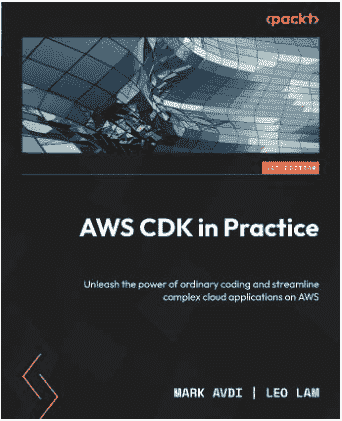
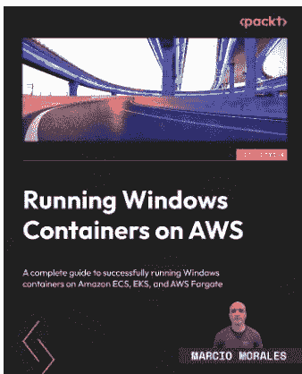
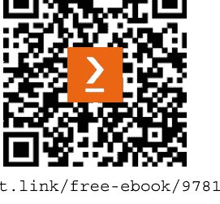

## 索引

A

abstraction level 22
business requirements 23
cloud skills and resources 23
security considerations 23
simplicity versus control 22
abstract syntax tree (AST) 211
A/B testing 92
Account Factory for Terraform (AFT) 239
Account Vending Machine (AVM)
building 248
Amazon Builders’ Library 234
Amazon Chime 32
Amazon CloudWatch 12, 97, 169, 170, 270
Amazon CloudWatch, application monitoring 171
real user monitoring (RUM) 171
service lens 171
synthetic monitoring 171
Amazon CloudWatch, infrastructure monitoring
CloudWatch alarm 171
CloudWatch metrics 171
Amazon CloudWatch, insights and operational visibility 172
container insights 172
Lambda Insights 172
Amazon CloudWatch Logs
used, for monitoring logs 189, 190
Amazon EC2
Amazon VPC 31
Elastic Block Store 31
Elastic File Storage 31
Amazon ECR 144
Amazon ECS 176
Amazon Elastic Kubernetes Service (Amazon EKS) 225
Amazon Grafana
used, for visualizing data 191, 192
Amazon GuardDuty 246
Amazon Inspector 206
Amazon Key Management Service (KMS) 169
Amazon Machine Image (AMI) 61, 62, 107
building, with Packer 49-52
Amazon Macie 206
Amazon Managed Grafana 177
workspace, creating 184-188
Amazon Managed Prometheus (AMP) 177
used, for instrumenting application metrics 190, 191
Amazon Managed Service, for Prometheus
workspace, creating 181
Amazon Rekognition 123

Amazon Resource Name (ARN) 265
Amazon Simple Notification Service (SNS) 171
Amazon VPC 31
Amazon Web Services (AWS) 3, 4, 257
account, creating 41
additional users, creating 43, 44
Cloud9 environment, navigating 46, 47
infrastructure, managing approaches 116
offerings, for monitoring 170
offerings, for observability 170
on-prem IT landscape, extending with 11
root user credentials, securing 42, 43
working with 40
Amazon WorkMail 32
Ansible modules 38
Apache Struts 195
application behavior
data, observing 189
application components 152-154
CDK constructs, defining 128-130
Application Load Balancer (ALB) 73
listeners and target groups 83, 84
web application, hosting with 81, 82
application metrics
instrumenting, with Amazon Managed Prometheus 190, 191
application performance monitoring (APM) 169
application stack
deploying 85
application workflow
Lambda code, defining to orchestrate 130, 131
automated guardrails, for policy enforcement 202
Auto Scaling group (ASG) 81
web application, hosting with 81
Auto Scaling groups 84
Availability Zones (AZs) 266
AWS account
bootstrapping, to enable CDK deployments 127
CDK stack, deploying 183
CDK stack, deploying into 133, 134
fully automated CI/CD pipeline 103, 104, 105
AWS Cloud9 integrated development environment (IDE) 44
setting up, in AWS account 44, 45
AWS Cloud Development Kit (CDK) 17, 20, 29, 120, 121
apps 122
benefits 123
construct 121
development workflow 122
disadvantage 123
stacks 121
test application, deploying 123
versus Pulumi 119, 120
AWS CloudFormation 17, 20, 60, 244
AWS CloudFormation StackSets 252
AWS CodeArtifact 16
AWS CodeBuild 15, 224, 270
Amazon CloudWatch event integration 97
build environments, pre-configuring 96
builds and tests, automating 95, 96
Jenkins implementation, integrating 97
private VPC resources, accessing 98
test report integration 97
used, for enabling continuous integration (CI) 93
working 96
AWS CodeCommit 15, 246
used, for enabling continuous integration (CI) 93

AWS CodeCommit, key features 94
Amazon CloudWatch event integration 94
approval rule templates 95
automated code reviews with CodeGuru 95
data protection, for compliance requirement 95
granular security controls with IAM 94
AWS CodeDeploy 16
AWS CodePipeline 17, 212, 224
AWS Config 202, 244
AWS Control Tower 239
AWS Deployment Framework (ADF) 240
AWS DevOps, services
CD and continuous deployment 16
CI 14
IaC 17
AWS DevOps services, CD and continuous deployment
AWS CodeDeploy 16
AWS CodePipeline 17
AWS DevOps services, CI
AWS CodeArtifact 16
AWS CodeBuild 15
AWS CodeCommit 15
AWS DevOps services, IaC
AWS CDK 17
AWS CloudFormation 17
AWS Distro for OpenTelemetry (ADOT) 170
AWS Elastic Beanstalk 32
AWS Elastic Compute Cloud (EC2) 146
AWS Elastic Container Service (ECS) 146
constructs 147
AWS Elastic Kubernetes Service (EKS) 146
AWS Fargate Serverless 274
AWS Fault Injection Simulator (FIS)
used, for injecting failures 267-269
AWS Global Accelerator 270
AWS IAM Identity Center 246
AWS Lambda 32, 172, 269
AWS Landing Zone (ALZ) 239
aws-nuke 249
AWS and DevOps
production-like environments 4-9
scaling, with cloud 9-13
AWS Organizations 241
maintaining, for platform development 249
service integrations, leveraging with 244
AWS Parameter Store 69
AWS PrivateLink 67
AWS Secrets Manager 69
AWS Security Hub 206, 244
AWS Service Catalog 232
AWS services 31
Amazon EC2 31
infrastructure, abstracting 31
software delivery, accelerating with platform services 32
solution components, mapping to 8, 9
AWS Step Functions 250
AWS Transit Gateway 245
AWS User Notifications 250, 263
AWS Well-Architected Framework 259
components 258
pillars 260
AWS Well-Architected Lenses 259
AWS Well-Architected Tool (WA) 260
AWS workloads
securing 202
security assessments 208, 209
AWS workloads, security challenges 203
cloud security responsibilities 203
risks, identifying 203, 204
risks, prioritizing 203, 204
AWS workloads, test strategies 205
security in pipeline 206, 207
security of pipeline 205

B

备份策略 244
Bandit 217
Bicycle framework 6, 7
构建环境 95
构建项目 96
buildSpec 96

C

牲畜
  对比宠物 36, 37
CDK 构造
  为应用程序组件定义 128-130
  L1 构造（原始）121
  L2 构造（精选）121
  L3 构造（自定义抽象）121
CDK 部署
  引导 AWS 账户以启用 127
CDK 项目
  引导 125-127
CDK 堆栈
  部署到 AWS 账户中 133, 134, 183
  使用构造扩展 181
  推出 183, 184
CDK 堆栈构造
  配置应用程序和数据库容器 156, 157
  定义 154
  添加 EFS 文件系统 158
  将 EFS 文件系统映射到任务定义 158
  添加具有 Application Load Balancer 集成的 Fargate 服务 158, 159
  网络基础和 ECS 集群 155
  为 ECS 集群添加任务定义 156

变更集 61
CI/CD 89, 90
  最佳实践 92
  有效的分支策略 91
  用于实现软件交付 91
CI/CD 解决方案
  集成 92
  需求 92
  本地数据中心 93
  开源或商业版本 93
用于 DevSecOps 的 CI/CD 工作流
  在 AWS 账户中部署 CDK 堆栈 212-214
  代码库 212
  DevSecOps 流水线目标架构 210, 211
  检查安全评估结果 214
  测试 209
云
  利用基础设施弹性 12
  利用云扩展 9-13
Cloud9 95
Cloud9 环境
  导航 46, 47
云抽象
  通过云抽象简化服务交付 12
Cloud Development Kit (CDK) 17, 176, 262
CloudFormation 208, 248
  使用 CloudTrail 记录 API 调用日志 66, 67
  用于资源管理的权限委派 65
  通过网络请求流程 67
  用于动手部署 72
  工作原理 64
CloudFormation 钩子 202
CloudFormation 堆栈
  应用程序堆栈 73
  网络堆栈 72

编排容器放置 145
对容器化应用程序实施安全护栏 145
容器 141, 142
持续交付 (CD) 13, 90
持续部署 (CD) 13, 90
实施 91
持续集成和持续交付 (CI/CD) 260
持续集成 (CI) 13
使用 AWS CodeBuild 和 AWS CodeCommit 启用 93
持续学习和赋能资源 234
Control Tower
用于构建 Landing Zone 250-253
成本和使用情况报告 (CUR) 272
成本效率支柱 272
对 AWS 资源成本和使用的自动化分析 272, 273
最佳实践 272
跨区域操作 103
客户 7
Control Tower 定制 (CfCT) 239
用于构建 Landing Zone 253
用于部署资源 253-255
D
数据
观察以了解应用程序行为 189
对待办事项列表管理器应用程序进行负载测试以生成数据 189
使用 Amazon Grafana 可视化 191, 192
声明式方法
采用 117, 118
装饰器 159
委托管理员 248
DevOps 3, 4
衡量成熟度 228-230
对比 DevSecOps 199
DevOps 理念
寻找协作者 235
展示承诺 235
构建 235
用于加速软件交付的 DevOps 方法
持续交付 (CD) 13
持续部署 13
持续集成 (CI) 13
有效的沟通与协作 14
基础设施即代码 (IaC) 14
DevOps 方法论 230
DevSecOps 196-199
开发人员 202
开发功能 200
问题识别 201
在监管环境中改进合规性 200
主要优势 199
运维团队 202
安全专业人员 201
对比 DevOps 199
DevSecOps 的优势
提高团队成员的安全意识 200
缩短上市时间 199
DevSecOps CI/CD 流水线构造 212
DevSecOps 流水线目标架构 210, 211
应用程序验证 211
代码更改 210
CodePipeline 执行 210
Dockerfile 构建 211
Dockerfile 验证 211
数字化转型 3, 89
灾难恢复 (DR) 232, 257
分布式拒绝服务 (DDoS) 攻击 267
Docker 40, 92, 142
  概念 143, 144
  用作容器平台 143
Docker Compose 146
Docker 容器 143, 144
Docker Hub 144
Docker 镜像 143
Docker 注册表 144
Docker Swarm 146
动态应用程序安全测试 (DAST) 208
DynamoDB 269

E
EC2 Auto Scaling 服务 11
ECS
  在 ECS 上部署测试应用 150
ECS 启动类型
  ECS on EC2 148
  ECS on Fargate 148
ECS 任务定义
  注入边车 OpenTelemetry 容器 182
ECS 任务执行角色 149
ECS 任务角色 149
EKS Anywhere 146
Elastic Beanstalk
  代码部署 30
  配置 30
  监控 30
  运维 30
弹性块存储 (EBS) 31, 40, 257
弹性计算云 (EC2) 31, 40, 60, 266
  变更集 61
  概念 60
  资源 62
  堆栈 61
  模板 61
弹性容器注册表 (ECR) 211
弹性容器服务 (ECS) 40, 98, 211
弹性文件存储 31
弹性文件系统 (EFS) 40
弹性 IP (EIP) 78
弹性 Kubernetes 服务 (EKS) 40, 212, 267
赋能团队 226, 227
端到端软件交付
触发操作 103
使用 CodePipeline 实施 100
使用 CloudFormation 的企业级架构
设计最佳实践 68-70
Equifax 195
EventBridge 250
EventBridge 事件 100

F
Fargate 176
功能标志 92
功能开关 92
使用 92
文件系统层 143
Flask 176
Flask 应用程序代码
记录事件日志 180, 181
修改 179
在应用程序中启用 Prometheus 指标 179

## G

Git 93
GitHub 201
GitHub Actions 91
GitLab 201, 246
GitLab 持续集成和持续交付 9, 91
架构组件 10
GoFormation 118
Golang 118
Grafana 170

## H

hadolint 218
使用 CloudFormation 进行动手部署 72
网络架构设计，以支持多可用区部署 73
使用 ALB 和 Auto Scaling 组托管 Web 应用程序 81
HashiCorp 配置语言 (HCL) 29, 70
健康保险可携性与责任法案 (HIPAA) 242

框架
使用提供高层抽象的框架 119
全自动 CI/CD 流水线
为应用程序创建 AMI 105, 106
在 AWS 账户中 103-105
部署基础设施和应用程序堆栈 107-112
全托管软件服务 32
Amazon Chime 32
Amazon WorkMail 32
仪表板层级
标注图表 174
构建 172, 173
绘制维度 174
采用时间序列模式分析 174
高可用性 (HA) 266
IAM 用户
避免预置 249, 250
身份与访问管理 (IAM) 250, 263
身份提供者 (IdPs) 246, 263
图像分析工作流
测试 134-136
图像识别应用程序的组件 124, 125
Amazon Rekognition 124
DynamoDB 表 124
事件集成 124
Lambda 函数 124
S3 存储桶 124
不可变基础设施 37, 39
权衡 40
基础设施
在 AWS 中的管理方法 116
基础设施即服务 (IaaS) 20
基础设施即代码 (IaC) 14, 208, 262
基础设施组件 151
容器平台 (ECS) 151
网络基础设施（VPC、子网、路由表）151
流量控制器（Application Load Balancer）151
基础设施定义生成器
使用 118, 119
基础设施部署
使用脚本自动化 117
集成开发环境 (IDE) 95
关注混合网络需求 245
运维 247
使用 IAM 保护 245, 246
使用安全服务保护 245, 246
为组织单元和账户定义结构 241

J
Java 项目 95
Jenkins 10, 91
Jira 249
Linux 基金会声明 204
监听器 83
日志
使用 Amazon CloudWatch Logs 监控 189, 190

K
密钥管理服务 (KMS) 264
Kinesis 数据流 100
KMS 加密密钥 95
Kubernetes 92

M
管理账户 247
手动基础设施管理 116
平均恢复时间 (MTTR) 172
聚会
参考链接 234
监控 167
AWS 提供的监控产品 170
多账户架构
管理最佳实践 247
限制对管理账户的访问 247, 248
构建账户自动售货机 248, 249
为平台开发维护 AWS 组织 249
避免预置 IAM 用户 249, 250
优先选择无代码/低代码解决方案 250
采用解决方案 248
多因素身份验证 (MFA) 42
可变基础设施 37, 38
双向 TLS (mTLS) 198

L
Lambda 250
Lambda 代码
定义以编排应用程序工作流 130, 131
Lambda Insight 172
Landing Zone 238, 241
作为 AWS 服务 239, 240
作为概念 239
作为部署编排框架的参考 240
作为解决方案 239
使用 CfCT 构建 253
使用 Control Tower 构建 250-253
目标 239
Landing Zone 注意事项 241
配置管理 246, 247
关注跨账户需求 245
DevOps 246, 247

## N

- 国家漏洞数据库（NVD） 200
- 网络访问控制列表（NACLs） 264
- 网络地址转换（NAT） 77
- 网络架构设计，用于通过 CloudFormation 部署
  - 互联网网关 74, 75
  - NAT 网关 77, 78
  - 部署网络栈 80
  - 私有子网 76, 77
  - 公有子网 75, 76
  - 栈输出 78, 79
  - 虚拟私有云 74

## O

- 可观测性 167, 168
  - AWS 的产品 170
  - 优势 169, 170
  - 日志 168
  - 指标 169
  - 追踪 169
- 可观测性访问管理器（OAM） 270
- 可观测性栈
  - 为测试应用程序部署
    - 托管在 ECS 中 176
  - 用于待办事项列表管理器测试应用程序 177
- 可观测性策略
  - 为托管在 AWS 中的工作负载定义 176
- OpenID Connect（OIDC） 246, 250
- 开放策略代理（OPA） 208
- OpenTelemetry Collector 177
- 卓越运营支柱 260
  - 自动启用新账户的可选 AWS 区域 261-263
  - 最佳实践 260, 261
- 组织单位（OU） 242
  - 自动化 OU 242
  - 开发 OU 243
  - 维护 OU 242
  - 安全 OU 242
  - 共享服务 OU 242
  - 暂停 OU 243
- Otel 170
- 输出 64

## P

- Packer 72
  - 用于构建 AMI 49-52
- 参数 62
- 性能效率支柱 269
  - 最佳实践 269, 270
  - 聚合跨账户可观测性数据以识别性能瓶颈 270, 271
- 个人健康仪表板（PHD） 247
- 宠物
  - 对比牲口 36, 37
- 基于 PHP 的 Beanstalk 应用程序
  - Amazon S3 存储桶 25
  - 自动扩缩组 25
  - CloudWatch 告警 25
  - EC2 实例 25
- 平台即服务（PaaS） 21-26
  - 代码部署 27
  - 配置 27
  - 监控 27
  - 运维 28
- 平台服务
  - AWS Elastic Beanstalk 32
  - AWS Lambda 32
  - 完全托管的软件服务 32
  - 用于加速软件交付 32
- 平台团队 225
- 类生产环境 4-8
- Prometheus 170
- 概念验证（PoC） 235, 237
- Pulumi 208
  - 对比 AWS CDK 119, 120
- Python 118
- Python Flask 应用程序 212

## R

- 关系型数据库服务（RDS） 26, 267
- 可靠性支柱 266
  - 使用 AWS 故障注入模拟器注入故障 267-269
  - 最佳实践 266, 267
- 资源
  - 使用 CfCT 部署 253-255
- 用于持续学习和能力提升的资源
  - 本地社区和用户组 234
  - AWS 上的研讨会 234
- 根本原因分析（RCA） 231
- 规则 63, 64

## S

- 示例 OU 设计
  - 用于受监管组织 243
- 脚本
  - 基础设施部署自动化 117
- 安全断言标记语言（SAML） 250
- 安全评估结果
  - 检查 214
  - 使用 hadolint 验证 Dockerfile 清单 218, 219
  - 软件成分分析（SCA），用于识别依赖风险 215-217
  - 使用 Bandit 进行静态应用安全测试（SAST） 217
- 安全组
  - 使用安全组保护入站流量 52
- 安全信息和事件管理（SIEM） 67, 242
- 管道中的安全 206, 207
  - 动态应用安全测试（DAST） 208
  - 基础设施即代码（IaC） 208
  - 软件成分分析（SCA） 207
  - 静态应用安全测试（SAST） 208
- 管道安全 205
  - 保护数据处理流程 206
  - 身份与访问管理（IAM） 205
  - 使用事件检测和监控 206
  - 检测异常行为 205
- 安全性支柱 263
  - 最佳实践 263, 264
  - 针对紧急用户访问的安全监控 264, 265
- 安全态势
  - 增强基础设施的安全态势 263
  - 增强工作负载的安全态势 263
- 使用 ECS 的安全态势
  - 容器密钥 150
  - 确保 149
  - 内核能力 150
  - 使用 IAM 角色锁定权限 149
  - 使用任务级 ENI 进行网络隔离 149
  - 识别 CVE 后确保安全补丁就绪 149
- 安全专业人员
  - 用于策略执行的自动护栏 202
  - 使开发人员能够发现并修复安全问题 202
  - 为应用程序和基础设施定义安全策略 201
- 安全的权衡与挑战 197
  - 缺乏所有权 197
  - 过时的安全工具 198
  - 应用架构的快速演进 198
  - 软件交付 197
- 服务目录 250
- 服务目录工具 240
- 服务控制策略（SCP） 244
- 服务集成
  - 利用 AWS Organizations 244
- 服务视角 171
- 服务级别协议（SLA） 233
- 服务级别指标（SLIs） 233
- 服务级别目标（SLOs） 233
- 服务限制 247
- ServiceNow 249
- shellcheck 218
- sidecar OpenTelemetry 容器
  - 在 ECS 任务定义中注入 182
- Snyk 状态 204
- 软件即服务（SaaS） 21, 22
- 软件物料清单（SBOM） 207
- 软件成分分析（SCA） 207
- 软件交付
  - 使用平台服务加速 32
- 软件开发生命周期（SDLC） 199
- 稳健的可观测性策略
  - 最佳实践 172
  - 在所有系统中使用一致的时区 174
  - 构建仪表板层次结构 172
  - 确保系统组件发出事件 175
  - 传播追踪标识符 174, 175
- 解决方案库 234
- 专家团队 226
- 栈 45, 61
- 静态应用安全测试（SAST） 208, 211
- 静态 HTML 模板
  - 准备 161
- Step Functions 269
- 可持续性支柱 274
  - 最佳实践 274
- 合成监控 171

## T

- 标签策略 244
- 目标组 83
- 任务定义 147
- 技术
  - 最佳实践和注意事项 231-233
- 模板
  - 合成 132, 133
- Terraform 20, 29, 70, 208, 248
- Terraform 对比 CloudFormation 70
  - 云原生服务集成 71
  - 用于代码复用的模块 72
  - 资源定义，与部署映射 71
  - 已部署资源的状态管理 71
  - 对编程结构的支持 71
  - 第三方提供商生态系统 70
- 测试应用程序 48, 49
  - 使用 AWS CDK 部署 123
  - 使用 47, 48
- 在 ECS 上部署测试应用程序
  - 应用程序组件 152, 153
  - 打包应用依赖项 162
  - 架构 150
  - 定义 CDK 栈构造 154, 155
  - 在 AWS 账户中部署 CDK 栈 162-164
  - 基础设施组件 151, 152
  - 准备静态 HTML 模板 161
  - 准备 Web 应用程序代码 159
- 托管在 ECS 中的测试应用程序
  - 部署可观测性栈 176
- 测试 EC2 实例
  - 创建 53
  - 部署 52
  - 使用安全组保护入站流量 52
  - 终止 54
- 威胁建模过程 203
- 云的三个层次 20
  - 基础设施即服务（IaaS） 20
  - 平台即服务（PaaS） 21
  - 软件即服务（SaaS） 21, 22
- 待办事项列表管理器应用程序 150, 176, 210
  - 进行负载测试以生成数据 189
- 总拥有成本（TCO） 93, 269
- 追踪 170
- 转译器 119
- Troposphere 118
- TruffleHog 201
- 可信访问 244
- 十二要素设计模式
  - 参考链接 141
- 两个披萨团队规则 14

## V

- 价值流对齐团队 224
- 版本控制系统（VCSs） 93
- 虚拟私有云（VPC） 47

## W

- Web 应用程序归档（WAR） 38, 98
- Web 应用程序代码
  - 初始化 Flask 应用程序和 MongoDB 连接 160, 161
  - 准备 159
- Well-Architected 258
- 托管在 AWS 中的工作负载
  - 为其定义可观测性策略 176

## X

- X-Ray 服务 170

www.packtpub.com

订阅我们的在线数字图书馆，即可全面访问超过 7,000 本图书和视频，以及行业领先的工具，帮助您规划个人发展和推进职业生涯。如需更多信息，请访问我们的网站。

## 为什么订阅？

- 通过来自 4,000 多位行业专业人士的实用电子书和视频，减少学习时间，增加编码时间
- 通过专为您打造的技能计划改善学习效果
- 每月免费获取一本电子书或视频
- 完全可搜索，便于获取关键信息
- 复制粘贴、打印和书签内容

您是否知道 Packt 为每本已出版图书提供电子书版本，并提供 PDF 和 ePub 文件？您可以在 packtpub.com 上升级到电子书版本，作为纸质书客户，您可享受电子书折扣。如需了解更多详情，请联系我们：customercare@packtpub.com。

在 www.packtpub.com 上，您还可以阅读一系列免费技术文章，订阅各种免费通讯，并获取 Packt 图书和电子书的专属折扣和优惠。

## 你可能喜欢的其他书籍

如果你喜欢这本书，你可能也会对 Packt 出版的以下其他书籍感兴趣：

## AWS CDK in Practice

Mark Avdi | Leo Lam

ISBN: 978-1-80181-239-9

- 将容器化 Web 应用转变为完全托管的解决方案
- 探索将 DevOps 融入日常代码的益处，使用 AWS CDK
- 发掘 AWS 服务与 CDK 的潜力
- 创建以无服务器为中心的本地开发环境
- 使用 CI/CD 和自动化实时测试自行组装项目
- 使用 AWS CDK 构建从开发到生产的完整路径
- 通过最佳实践熟练处理生产问题

## Running Windows Containers on AWS

Marcio Morales

ISBN: 978-1-80461-413-6

- 熟悉 Windows 容器的基础知识
- 在 Amazon ECS、EKS 和 AWS Fargate 上运行和管理 Windows 容器
- 有效监控并集中 Windows 容器的日志
- 妥善维护 Windows 主机并保持容器镜像为最新
- 管理临时 Windows 主机以降低运营开销
- 使用容器镜像缓存加快容器的启动时间

## Packt 正在寻找像你这样的作者

如果你有兴趣成为 Packt 的作者，请访问 `authors.packtpub.com` 并立即申请。我们已与成千上万的开发者和技术专业人士合作，就像你一样，帮助他们与全球技术社区分享见解。你可以提交通用申请、申请我们正在招募作者的特定热门主题，或提交你自己的想法。

## 分享你的想法

现在你已经读完了 *AWS DevOps Simplified*，我们很想听听你的想法！如果你是在 Amazon 购买的这本书，请点击这里直接前往该书在 Amazon 的评论页面并分享你的反馈，或在你购买的网站上留下评论。

你的评论对我们和技术社区都很重要，将帮助我们确保提供卓越质量的内容。

## 下载本书的免费 PDF 副本

感谢你购买本书！

你喜欢随时随地阅读，但又无法随身携带纸质书吗？你的电子书购买与你选择的设备不兼容？

不用担心，现在每本 Packt 书籍都免费提供一本无 DRM 的 PDF 版本。

在任何地方、任何地点、在任何设备上阅读。直接从你喜爱的 technical 书籍中搜索、复制和粘贴代码到你的应用程序中。

福利还不止于此，你可以每天通过电子邮件获得独家折扣、新闻通讯和优质免费内容

按照以下简单步骤获取福利：

- 1. 扫描二维码或访问下方链接

https://packt.link/free-ebook/9781837634460

- 2. 提交你的购买证明
- 3. 就这样！我们会直接将你的免费 PDF 和其他福利发送到你的电子邮件

