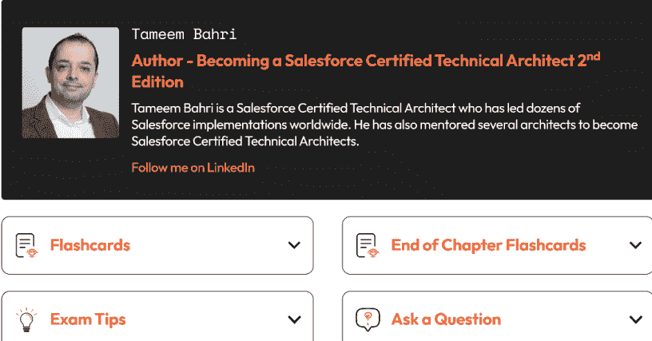
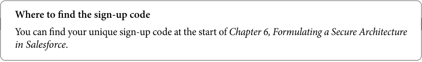
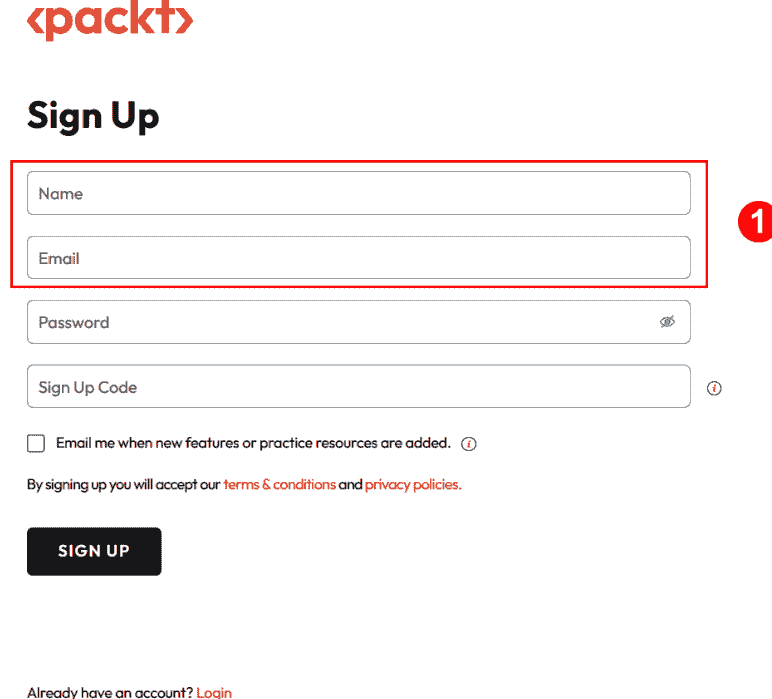
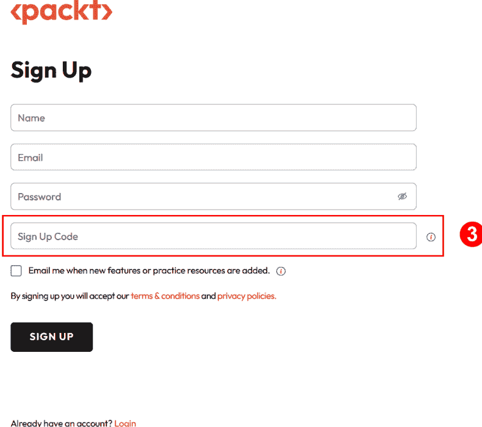
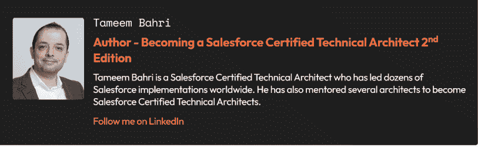

# 成为 Salesforce 认证技术架构师：架构原则与策略掌握指南——准备 CTA 评审委员会

## 贡献者

## 关于作者

**塔米姆·巴赫里** 是一名 Salesforce 认证技术架构师，在信息技术和商业咨询行业拥有可证明的工作经历。他在职业生涯中担任过多个职务，包括 A.P. Moller - Maersk 的 CRM 全球工程总监和 Capgemini 的欧洲 Salesforce 首席技术官。他在业务转型、数字服务、创新、流程设计与再设计、企业系统安全、身份和访问管理 (IAM) 以及企业解决方案架构方面拥有深入经验。

他在多个行业工作过，例如供应链与物流、制造业、CPRD、旅行与运输、能源与公用事业、物业管理以及软件开发。他主导了全球数十个 Salesforce 实施项目，并指导多位架构师成为 Salesforce 认证技术架构师。

他与妻子和儿子住在阿联酋迪拜。业余时间，他喜欢学习历史、在大自然中散步、阅读经典文学和观看足球比赛。

> 献给我的母亲拉埃法·阿尔瓦尼，我的第一位老师，也是我所认识的最聪慧的人。
> 献给我的妻子拉娜和我的儿子阿米尔，感谢他们的爱、支持和启发。

## 关于审阅者

**穆斯塔法·埃尔·哈萨克** 是一名 Salesforce 认证技术架构师 (CTA)，拥有广泛的专业知识，持有 17 项 Salesforce 认证。拥有 13 多年的 IT 行业经验，他已确立自己为高级技术架构师。他的主要专注点在于使用 Salesforce Customer 360 平台技术设计和交付 SaaS 解决方案。

他曾作为受尊敬的书籍（如 ‘Talend Open Studio Cookbook’ 和 ‘Creating Actionable Insights Using CRM Analytics’）的技术审阅者为行业做出贡献，并在各种 Salesforce 社区活动上进行过演讲。

在他职业生涯中，他担任过重要职务，成功管理了两家摩洛哥公司的数据分析、数据质量和数据迁移项目，并监督了从旧数据库到新解决方案的过渡。此外，他主导了全球范围内的众多 Salesforce 实施项目，目前担任追求 Salesforce 认证技术架构师认证的有志架构师的导师。

居住在摩洛哥卡萨布兰卡，穆斯塔法重视全面发展的生活，珍惜与妻子和两个孩子共度的高质量时光。闲暇时，他喜欢阅读效率类书籍，并练习武术，包括合气道和柔道。

**尼汀·沙马**，Deloitte UK 的高级经理，是一位经验丰富的 Salesforce 认证技术架构师 (CTA)，拥有 14 年的丰富经验。他的专业知识涵盖 CRM 架构、安全性和数据建模、企业集成、业务流程设计及转型。Nitin 最初以 CRM 业务分析师开始职业生涯，逐步成长为 Salesforce 技术架构师。

在职业生涯中，Nitin 始终为全球客户交付成功的多云数字化转型计划。他曾在多个行业工作，包括制造业、保险业、银行业、电信业和私营行业。除了对 Salesforce 平台和 CTA 辅导的热情之外，Nitin 对自动化也浓厚兴趣。闲暇时，他喜欢搭建智能家居。

**莫希特·沙马** 是 Capgemini 的荷兰 Salesforce 首席技术官，也是一名 Salesforce CTA，拥有超过 16 年的企业解决方案架构、安全性、架构治理、企业集成、业务流程设计和转型方面的经验。

他有解决复杂技术和业务挑战并成功为多家企业客户交付多云数字化转型计划的出色记录。他曾主导多个行业客户的 Salesforce 实施项目，这些行业包括消费品、能源与公用事业、石油与天然气、金融服务、软件开发、旅行和医疗保健。除了对 Salesforce 平台和 CTA 辅导的浓厚兴趣外，他还对 AI 和其他新兴技术充满热情。

## 目录
## 前言

随着 Salesforce 经济的快速增长，从事 Salesforce 相关职业从未像现在这样是个好时机。架构师及相关技能的需求前所未有地高涨。

**Salesforce认证技术架构师 (CTA)** 认证被评为行业顶级企业架构师认证之一。快速在网上搜索招聘信息，你就会看到对这些持证者的巨大需求。全球 CTAs 数量有限，让新获得认证的 CTAs 感到更加满足，仿佛*加入了这个俱乐部*。

本书将首先解释每位架构师都应掌握的核心概念，包括数据生命周期、集成和加密，并培养你创建高层次技术方案的能力。理解这些概念对于理解 Salesforce 方案中建议的一些最佳实践背后的原理至关重要。此外，拥有这种深入的知识在解释你的端到端解决方案如何工作时将大有裨益。

接着，你将探索评审委员会考试中涉及的特定知识领域。在真实案例的帮助下，本书对选择解决方案的系统或组件、设计可扩展且安全的 Salesforce 架构、规划开发生命周期和部署等关键主题提供了洞察。最后，你将完成两个完整的模拟场景，模拟评审委员会考试，帮助你学习如何识别需求、制定草稿方案，并将所有元素结合起来，向评审委员会或实际生活中的客户展示一个有效的解决方案。

读完本书后，你将获得通过评审委员会考试所需的知识和技能，并能在日常工作中实施架构最佳实践和策略。

## 第二版

自本书第一版出版以来已过去两年多。在此期间，Salesforce 平台和 Salesforce 生态系统发生了许多变化。第二版为读者带来了更新的材料，并提供了额外的注释、提示、技巧和窍门，帮助你在不断发展的 Salesforce 世界中导航。*新版本现在让你无限次访问我们的在线练习资源平台，让你可以从任何设备练习书中所学的内容。在那里，你可以获得专门设计的闪卡和考试提示，帮助你记住关键主题，并充分准备以取得考试高分。* 此外，在新版本中，信息的组织方式使得创建解决方案变得更加容易。一些拟议的解决方案也已更新，以考虑 Salesforce 生态系统中的最新创新和进步。

## 在线考试准备工具

拥有本书后，你将解锁我们在线考试准备平台（图 0.1）的无限访问权限。这是你练习书中所学所有内容的地方：

图 0.1 – Salesforce认证技术架构师在线考试准备平台

通过多组交互式闪卡，在所有现代网页浏览器中都可访问，增强你对 CTA 概念的掌握。如果你遇到困难，可以直接通过网站向作者提出疑虑。在这样做之前，请务必也浏览一下已解决的疑问列表。这些是基于其他用户提出的问题。最后，查看网站上的考试提示，确保你已做好充分准备。

## 本书适合人群

本书面向对 Salesforce 平台有深入理解并拥有多年架构师经验的 Salesforce 专业人士。这些架构师理想情况下希望通过争取 Salesforce CTA 认证来进一步提升自己的职业生涯。本书也面向那些希望通过学习如何在 Salesforce 平台上设计安全、高性能的技术解决方案，以及如何有效地向业务利益相关者传达技术解决方案和设计取舍，并采用确保质量与成功的交付框架，来为自己增加更多技能的架构师。

随着 Salesforce 生态系统的当前快速增长，某些工作场所中传统角色之间的界限正在变得模糊。拥有能够连接不同团队的卓越人才的价值变得至关重要。未来的 CTAs 不怕深入挖掘业务挑战，并提出艰难的问题，以揭示特定需求背后的真实业务价值。他们喜欢深入研究问题，并卷起袖子选择适用于当前和未来潜在需求的正确解决方案方法。他们毫不犹豫地加入与开发团队的对话，提供指导和最佳实践，然后与项目管理团队合作，为利益相关者准备尖端的演示文稿。

## 本书内容概要

*第 1 章，开始你的 CTA 之旅，* 提供了关于本书和认证的一般信息。你将了解典型 CTA 的画像，它与 Salesforce 架构师日常工作的相关性，以及为什么了解 CTA 的思维方式至关重要，即使对于不一定以 CTA 证书为目标的高级架构师也是如此。本章还详细介绍了评审委员会考试设置（无论是物理还是虚拟）的详情。

*第 2 章，核心架构概念：数据生命周期，* 探讨架构师需要掌握的与数据相关的核心架构技能。其中部分知识与平台无关，尽管其他部分对 Salesforce 架构师尤为重要。这些技能将在本书后续部分以及评审委员会考试本身中大量使用。

*第 3 章，核心架构概念：集成与加密，* 探讨架构师需要掌握的与集成和加密相关的核心架构技能。其中部分知识与平台无关，尽管其他部分对 Salesforce 架构师尤为重要。这些技能将在本书后续部分以及评审委员会考试本身中大量使用。

*第 4 章，核心架构概念：身份与访问管理，* 探讨架构师需要掌握的与 **身份与访问管理** (IAM) 相关的核心架构技能。其中部分知识与平台无关，尽管其他部分对 Salesforce 架构师尤为重要。这些技能将在本书后续部分以及，当然，评审委员会考试本身中大量使用。

*第 5 章，开发可扩展系统架构，* 对一些最棘手的系统架构领域进行了深入回顾，例如确定构成整体解决方案的正确系统选择，包括本地和平台外组件，并考虑平台的功能、约束和限制。这些知识将通过一个微型假设场景进一步加强。

*第 6 章，在 Salesforce 中制定安全架构，* 对安全性中一些最棘手的领域进行了深入回顾，例如了解声明式平台安全功能以及如何使用它们来满足记录级可见性和安全性要求。这些知识将通过一个微型假设场景进一步加强。

第 7 章，设计可扩展的 Salesforce 数据架构，深入审查了数据中一些最棘手的领域，例如设计正确的数据迁移策略和工具，以及架构师需要牢记的不同注意事项。这种知识将通过一个小型假设场景进一步加深。

第 8 章，创建精益解决方案架构，深入审查了解决方案架构中一些最棘手的领域，例如选择适当的声明式和编程式功能组合以满足特定需求。这种知识将通过一个小型假设场景进一步加深。

第 9 章，打造集成解决方案，深入审查了集成中一些最棘手的领域，例如合理选择用于与外部系统集成的适当技术，并考虑平台的功能和限制。这种知识将通过一个小型假设场景进一步加深。

第 10 章，开发生命周期与部署规划，深入审查了开发生命周期和部署规划中一些最棘手的领域，例如推荐合适的全面测试策略并缓解不同项目风险的能力。这种知识将通过一个小型假设场景进一步加深。

第 11 章，沟通与社交化你的解决方案，深入审查了一些最棘手的沟通领域。这包括解释架构师需要掌握的一组关键软技能，以便向评审委员会评委或在现实生活中向内部或外部客户展示端到端解决方案。这还包括以合理且理性的方式阐述所提议解决方案架构背后的优势、局限性、注意事项和设计选择，并做好处理异议和即时调整的准备。这种知识将通过一个小型假设场景进一步加深。

第 12 章，演练评审委员会：首次模拟，将之前章节中涵盖的所有知识和技能付诸实践。你将接触到你的第一个完整假设场景。你将逐步解决它，从识别需求、创建草稿解决方案开始，再将所有元素结合起来向评委或在现实生活中向内部或外部客户展示一个有效的解决方案。

第 13 章，展示与辩护：首次模拟，将之前章节中涵盖的所有知识和技能付诸实践。你将继续使用上一章的假设场景，并利用草稿解决方案创建一个精炼的端到端解决方案和演示文稿。你将通过逐步指南获得实操经验，其中解决方案会被审查、根据需要调整，并创建产出物的最终版本。然后你将利用所有这些内容向评委或在现实生活中向内部或外部客户展示一个有效的解决方案。

第 14 章，演练评审委员会：第二次模拟，将之前章节中涵盖的所有知识和技能付诸实践。你将接触到你的第二个完整假设场景。你将逐步解决它，从识别需求、创建草稿解决方案开始，再将所有元素结合起来向评委或在现实生活中向内部或外部客户展示一个有效的解决方案。

第 15 章，展示与辩护：第二次模拟，将之前章节中涵盖的所有知识和技能付诸实践。你将继续使用上一章的假设场景，并利用草稿解决方案创建一个精炼的端到端解决方案和演示文稿。你将通过逐步指南获得实操经验，其中解决方案会被审查、根据需要调整，并创建产出物的最终版本。然后你将利用所有这些内容向评委或在现实生活中向内部或外部客户展示一个有效的策略。

附录，技巧与诀窍，以及前进之路，提供了一系列技巧和诀窍，帮助考生在评审当天取得成功，首先是演示过程中应遵循的最佳实践，接着是关于时间管理的提示。本章突出了其他 CTA 通过评审委员会考试所使用的不同策略，并提供了一组准备评审委员会的考生应考虑的建议活动，包括如何为最后一英里做准备、在获得支持方面有哪些资源和群组可用，以及如何在评审委员会考试当天进入正确的心态。

## 在线内容要求

在线内容包括闪存卡和考试提示等交互式元素。为获得最佳体验，建议使用最新版本的现代桌面（或移动）网络浏览器，例如 Edge、Chrome、Safari 或 Firefox。

## 解锁在线内容的说明

要解锁在线内容，你需要使用本书中提供的唯一注册码在我们的考试准备网站上创建一个账户。

1. 访问上述提到的章节。在那里，你会找到你的唯一注册链接和代码。打开链接，记下注册码，然后返回此章节。

2. 打开注册链接。页面加载后，输入你的姓名和电子邮件地址（1）：

图 0.2 – 在注册表单中输入你的姓名和电子邮件地址

3. 创建一个强大的字母数字密码（2）（最少六个字符长度）：

注册

姓名

电子邮件

密码

注册码

当新功能或练习资源添加时通知我。

注册即表示您接受我们的条款与条件和隐私政策。

注册

已有账户？登录

图 0.3 – 在注册表单中创建强密码

4. 输入唯一的注册码（3）。如在 *步骤 1* 中所述，注册码可以在 *第 6 章，在 Salesforce 中制定安全架构* 的开头找到。输入代码后，单击 `Sign Up` 按钮：

图 0.4 – 输入唯一的注册码

> **重要**
> 你只需要输入一次注册码。创建账户后，你将能够从任何设备仅使用电子邮件地址和密码访问该网站。

5. 如果你希望在我们向平台添加新练习资源或功能时收到通知，请选择复选框（4）。

注册

- [ ] 当新功能或练习资源添加时通知我。

注册即表示您接受我们的条款与条件和隐私政策。

注册

已有账户？登录

图 0.5：选择复选框以接收关于新功能或练习资源的通知

6. 成功注册后，你将被重定向到仪表板（参见 *图 0.6*）。今后，你只需使用电子邮件地址和密码登录：

- 闪存卡
- 章节末尾闪存卡
- 考试提示
- 提出问题

图 0.6 – 在线考试准备平台仪表板

> **注意**
> 如果你在注册过程中遇到问题，请联系 customercare@packt.com。

## 快速访问网站

如果你已成功注册，建议将此链接加入书签以便快速访问网站：https://packt.link/ctabookwebsite。单击页面右上角的登录链接以打开登录页面。使用你在 *解锁在线内容的说明* 章节的步骤 2 和步骤 3 中创建的凭据。

或者，你可以扫描以下二维码以打开网站：

图 0.7 – Salesforce 认证技术架构师在线考试准备平台的二维码

## 如何最大程度地利用本书

本书旨在通过实操示例帮助你获得通过 CTA 考试所需的知识和技能。它涵盖了 CTA 为通过考试需要掌握的所有七个知识领域，你将针对每个领域处理一个小型假设场景。你将逐步开发解决方案，在发现和权衡不同设计决策时创建，然后重新创建解决方案产出物。这正是许多架构师在日常工作中所做的。他们深入挖掘细节，在每个阶段，他们都会构建更清晰的解决方案图景以及制作所需的正确元素。他们会重新审视之前的决策，并在需要时进行调整或更改。

强烈建议你练习重新创建解决方案，重新考虑其他替代方案，并权衡每个方案的优缺点。这将帮助你熟悉解释解决方案所需的产出物和图表，你会发现自己创建它们变得更快、更高效。此外，你的成果质量也会提高。

每个阶段都会提供图表，并且会逐步演变；你会注意到这些产出物可能与最初大不相同。在保持端到端解决方案全貌的同时，能够演进解决方案并灵活更改其元素，是 CTA 必须掌握的一项关键技能。你将在整本书中学习很多相关内容。

| 书中涵盖的软件/硬件 | OS 要求 |
|---|---|
| MS Office（或 Google Slides 和 Google Sheets） | Windows, MacOS X, Linux（任意） |
| 绘图工具，例如 Lucidchart、Draw.io 或 Visio | Windows, MacOS X, Linux（任意） |
| Salesforce Developer Edition | Windows, MacOS X, Linux（任意） |

表 0.1：使用本书假设场景时推荐使用的工具

建议使用 Salesforce Developer Edition 组织来试用某些功能。您可以使用以下链接注册免费组织：https://packt.link/5Jll6。

您可以使用任何绘图工具，无论免费还是付费，甚至可以在纸上或翻页图表上绘制图表。要练习虚拟 Salesforce CTA 评审委员会，您需要熟悉 **Microsoft PowerPoint** 和 **Microsoft Excel** 或 **Google Slides** 和 **Google Sheets** 等工具（后者更受推荐）。

## 所使用的约定

文本中的代码词、数据库表名、文件夹名、文件名、文件扩展名、路径名、虚拟 URL、用户输入和 Twitter 账号显示如下：“类似 `hello world` 的语句可能会变成 `ehllo wrdl`。”

新术语和重要词汇显示如下：“识别 **大数据量 (LDV)** 对象。”

## 联系我们

读者的反馈始终受欢迎。

**一般反馈**：如果您对本书有任何疑问，请在邮件主题中注明书名，并发送邮件至 customercare@packtpub.com。

**勘误**：尽管我们已竭力确保内容的准确性，但错误难免。如果您在本书中发现错误，我们将不胜感激，如果您能将其报告给我们。请访问 www.packtpub.com/support/errata 并完成表格。

**盗版**：如果您在互联网上发现我们作品的任何非法副本，我们将不胜感激，如果您能提供位置地址或网站名称。请带上材料链接联系 copyright@packt.com。

**如果您有兴趣成为作者**：如果您在某个主题上有专长，并有兴趣撰写或参与编写书籍，请访问 authors.packtpub.com。

## 分享您的想法

读完 *成为 Salesforce 认证技术架构师，第二版* 后，我们很乐意听取您的想法！请单击此处直接前往本书的 Amazon 评论页面并分享您的反馈。

您的评论对我们和技术社区非常重要，并将帮助我们确保提供高质量的内容。

## 下载本书的免费 PDF 副本

感谢您购买本书！

您是否喜欢随时随地阅读，却无法随身携带纸质书？您购买的电子书是否与您选择的设备不兼容？

不用担心，现在购买每本 Packt 图书，您都可以免费获得该图书的 DRM-free PDF 版本。

随时随地，在任何设备上阅读。直接从您喜爱的技术图书中搜索、复制并粘贴代码到您的应用程序中。

福利不仅如此，您每天还可以在收件箱中独家获取折扣、新闻通讯和精彩免费内容。

按照以下简单步骤获取福利：

1. 扫描二维码或访问以下链接：

https://packt.link/free-ebook/9781803239439

2. 提交您的购买证明。

3. 完成！我们将直接将免费 PDF 和其他福利发送到您的电子邮件。
