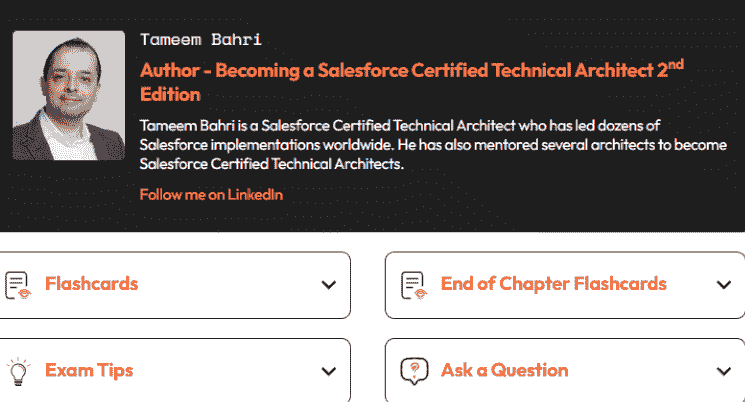
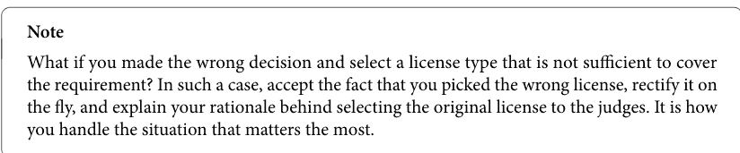
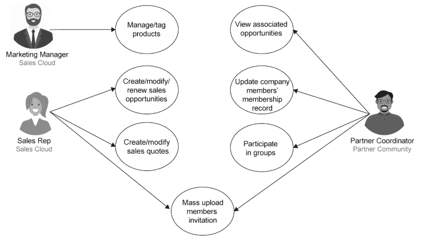
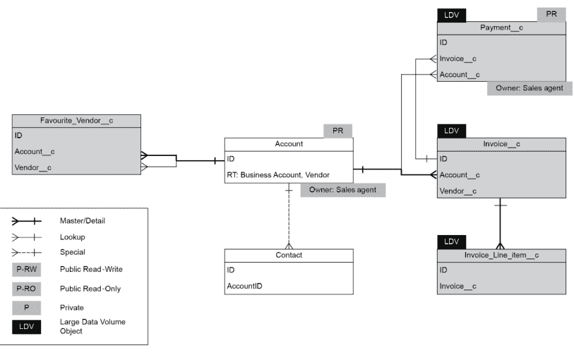
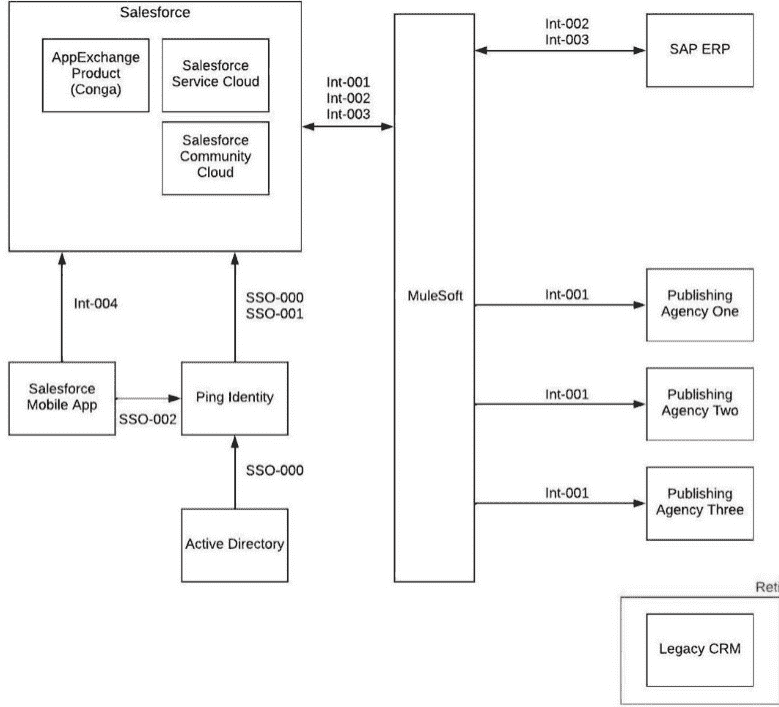
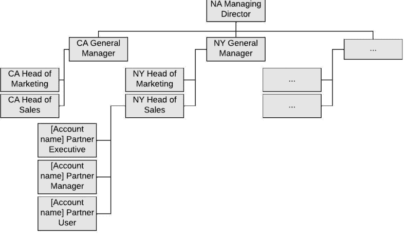
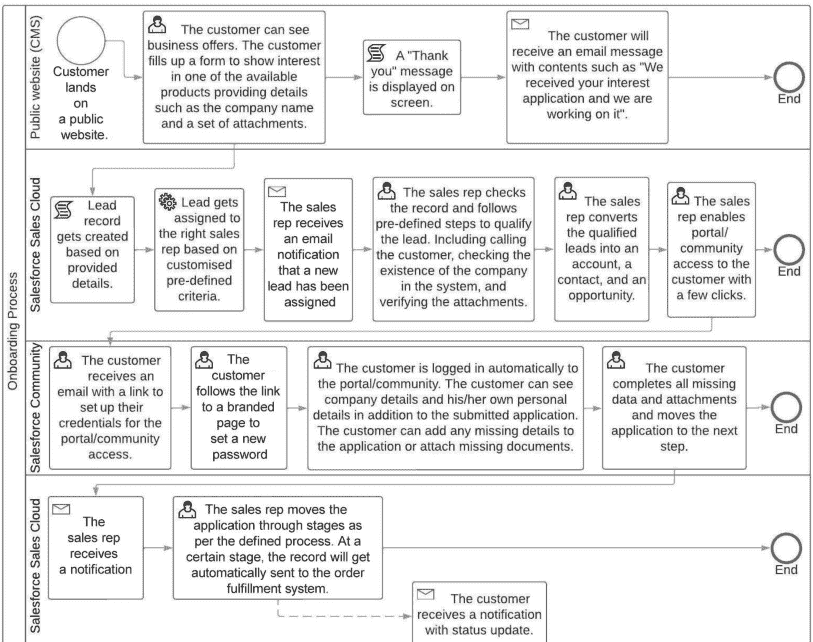

## 开始您的 CTA 之旅

### 本书附带免费在线内容

通过本书，您可以无限次访问基于 Web 的 CTA 考试准备工具，例如闪存卡和考试技巧。

图 1.1 – CTA 在线资源仪表板

要解锁内容，您需要使用本书提供的唯一注册码创建一个账户。有关具体操作方法，请参阅前言中的“解锁在线内容说明”部分。

## 访问在线内容

如果您已按照这些说明创建了账户，请访问 packt.link/ctabookwebsite 或扫描以下二维码以快速打开网站。

图 1.2 – 访问 CTA 在线资源的二维码

到达后，单击页面右上角的“登录”链接，使用您的凭据访问内容。

本章将通过提供本书及 Salesforce 认证技术架构师 (CTA) 资质的一般信息，帮助您入门。本章将帮助您找到诸如以下问题的答案：CTA 的典型概况是什么，考试与 Salesforce 架构师的日常活动有何关联，以及为什么即使对于不一定以获得 CTA 资质为目标的资深架构师来说，理解 CTA 的思维方式也很重要。本章还介绍了评审委员会考试的结构和设置（无论是实体还是虚拟）以及记录端到端解决方案所需的主要成果物。

在本章中，您将学习以下主题：

- 了解 Salesforce CTA 的概况
- CTA 评审委员会的结构和格式
- 从考试到现实生活——如何培训成为 CTA
- 考试的性质：积分收集练习
- 您需要生成哪种成果物以及原因

## 了解 Salesforce CTA 的概况

随着 Salesforce 经济的快速发展，构建基于 Salesforce 的职业生涯从未有过比现在更好的时机。架构师及相关技能的需求前所未有地高涨。

Salesforce CTA 资质被评为行业内顶级企业架构师认证之一。只需在网上快速搜索招聘启事，您就会对这个享有盛誉的证书的价值深信不疑。全球有限数量的 CTA，让新认证的 CTA 对加入这个专属俱乐部感到更加满意。

随着 Salesforce 生态系统的如此快速增长，某些工作场所中传统角色之间的界限正在模糊。此外，拥有合格人员作为不同团队之间的纽带变得至关重要。CTA 不害怕深入研究业务挑战并提出尖锐问题，以揭示特定需求背后的真实业务价值。他们喜欢探究根本，并在必要时挽起袖子进行尝试，以选择适当的解决方案方法，满足当前和未来的潜在需求。他们毫不犹豫地加入与开发团队的对话，提供指导和最佳实践，然后与项目管理团队合作，为利益相关者准备前沿演示。

作为 CTA，您需要依靠自己对多种技术的广泛了解以及在 Salesforce 平台上的深厚专业知识，设计安全、高性能的系统，以充分发挥 Salesforce 平台的潜力。然后，您必须将此与一套优秀的软技能相结合，帮助您对所提议的解决方案进行沟通推广和捍卫。

候选人应能在以下领域展示深厚的知识和经验：

- 应在整个软件开发生命周期中拥有超过五年的实施经验（包括开发）。虽然动手开发技能不是强制性的，但有机会编写代码的人通常会形成对软件解决方案哪些通常有效的感觉。这有助于从逻辑上选择和证明特定解决方案的合理性。
- 应拥有超过三年的架构师角色经验，涵盖整个架构活动范围。这包括设计数据模型、集成接口和端到端解决方案；沟通和推广解决方案；以及对平台功能和潜在解决方案权衡拥有深厚的动手经验。
- 应在 Lightning Platform 上拥有超过两年的经验，其中至少一年担任首席架构师角色，实施 Salesforce 应用程序和技术。
- 必须在多个复杂部署中担任过技术架构师角色，或通过参与和接触此类项目获得同等知识。

- 应有指导开发团队适当使用平台技术的经验。
- 应能够识别并缓解架构中的技术风险，这通常来自经验。
- 应有接触项目全球化考量的经验。具有全球化要求的项目会带来特定的一系列挑战。对平台功能有实际理解的人是关键。
- 应有面向对象设计模式的经验。虽然CTA不一定需要编写代码，但理解面向对象设计模式和原则可以培养更全面的架构师，使其更能够解释某个特定模块的工作原理。
- 必须了解平台特定的设计模式和限制。为了通过CTA评审委员会，强烈建议他们具备不同平台功能的实操经验。
- 应有在`https://packt.link/WKCGT`平台上开发代码的经验，以及对相关限制和挑战的理解，即使他们不一定从事实际编码。
- 应有能力识别平台的开发相关风险、考量和限制。
- 应有多种开发语言（例如.NET、Java或Ruby）和设计框架的经验。在设计集成解决方案时，这将大有帮助。关键是了解什么是可能的，什么可能是不可能的。
- 应有常见集成模式的经验，了解常见企业服务总线（ESB）工具以及Salesforce平台上的集成。这种实操经验是巨大的优势。
- 应了解并具备能力，在功能安全模型的一部分中，为Lightning平台上的安全复杂性、机制和功能设计架构解决方案。
- 应了解并具备能力，作为端到端解决方案的一部分设计身份和访问管理策略。
- 应了解数据迁移考量、设计权衡以及常见的提取、转换和加载（ETL）工具。
- 必须了解大数据量的考量、风险和缓解策略。
- 必须了解常规移动解决方案和架构，并理解平台上的移动解决方案和考量。
- 应有项目和开发生命周期方法论的经验。

既然你了解了CTA的个人档案，让我们来探索并了解评审委员会。

## CTA评审委员会的结构和形式

本节主要面向备考CTA考试的人员。要通过考试，你需要参加由三位CTA评委组成的评审委员会。你会收到一个假设性场景，并在有限的时间内解决它并制作一份端到端的演示文稿，解释你解决方案的不同元素以及你将如何解决识别出的场景要求。评委随后会就你的解决方案提出问题并对其提出挑战。如有需要，你需要证明、捍卫并相应地修改你的解决方案。

以下是关于考试的更多细节：

- **格式**：考生将审查并解决一个假设性场景，然后向三位CTA评委组成的小组进行展示。展示之后是与评委的问答环节。
- **考试先决条件**：你需要同时持有Salesforce认证应用架构师凭证和Salesforce认证系统架构师凭证。此外，你需要通过架构师评审委员会评估。这与CTA虚拟评审委员会的形式相似，你需要解决一个假设性场景。不同之处在于，这种情况下的场景要短得多（一个迷你场景），并且由一位而非三位CTA评委进行评判。
- **完成评审委员会考试的时间分配：**
  - 用于场景审查和解决方案准备的时间为180分钟
  - 用于场景演示的时间为45分钟
  - 用于场景问答环节的时间为40分钟
  - 非母语者将获得额外时间（解决方案设计30分钟，问答环节20分钟）
  - 如果你提前完成演示，剩余时间将添加到问答环节中

考试期间，考试协调员和监考人员将在现场（如果考试是虚拟进行的，则将虚拟加入）。

评审委员会期间，考生可使用的以下工具/材料：

| 考试类型 | 现场 | 虚拟 |
| :--- | :--- | :--- |
| 提供/允许的工具/材料 | • 可访问Google Workspace（幻灯片、文档和表格）的计算机 • 图表纸 • 仅供考生做笔记的空白纸 • 钢笔、荧光笔和记号笔 • 计时器 | • 可访问Google Workspace（幻灯片、文档和表格）的远程计算机。考生预计将使用远程桌面从自己的系统访问此计算机。 • 允许考生使用空白纸绘制图表。 |
| 您可以使用以下一种或多种工具来交付您的工件/图表 | • Google Workspace（幻灯片、文档和表格） • 图表板 • 白板（此物不可携带。请记住，你通常会在一个房间创建解决方案和工件，然后在另一个房间进行演示。） • 以上组合 | • Google Workspace（幻灯片、文档和表格） • Lucidchart（`https://packt.link/rEEiRi`）使用基本模板。你将在远程计算机上使用Salesforce提供的账户。 • 扫描的手绘图表。如果可读且质量高，照片也可接受。 • 你还可以使用网络摄像头实时展示你的图表。考虑到通话过程中可能出现多种潜在技术挑战（例如延迟），个人不建议采用这种方法。 • 以上组合 |
| 限制 | • 考试期间不得访问或引用任何纸质或在线材料。 • 开始考试前必须移除并妥善存放智能设备（如手机和手表）。 | |

表 1.1 – 考生提供/允许的工具/材料

你应使用这些工具/材料生成工件，以帮助你向评委解释解决方案。你应该选择最适合你的技能和偏好的工具。你需要根据自己的技能和对工具（表1.1中）的熟悉程度，建立自己的习惯和计划，然后使用任何最适合你的工具。

你可以使用免费账户练习使用其中一些工具，例如Lucidchart。

> **注意**
> Salesforce有权更改本次考试允许/限制的工具。本章及其元素不应被视为官方文档，因为它仅基于作者的知识和经验。

## 从考试到现实生活——如何培训成为CTA

除了显著的职业提升之外，还有其他几个原因，值得学习如何按照CTA的期望，在Salesforce平台上设计安全、高性能的技术解决方案。

在评审委员会考试期间，你需要执行某些活动（例如创建数据模型图、在多个潜在解决方案之间进行理性选择，以及以故事的方式展示你的解决方案），并以特定的方式思考。这不应被视为通过考试所需的活动，而更应被视为架构师应遵循的最佳实践，以产生交付价值且实现风险更低的解决方案。

无论你是否在瞄准 CTA 资格认证，作为架构师，你都会发现可以将本书中的知识应用到日常工作中。获得所有所需领域知识的实操经验的最佳方法是遵循以下简单步骤：

- 1. 将本书中解释的方法论（或其自身变体）应用到日常工作中。付诸实践，你会发现过一段时间它会变得得心应手。这使得你更容易通过评审委员会考试。可以这样说：如果你日复一日地练习，你就会在正常工作时间内为评审委员会考试做准备。

- 2. 搭建实验环境亲手试试各种事物。作为架构师，必须对构成解决方案的不同元素和技术拥有实操经验。这一点在使用 Salesforce 平台时尤为重要，考虑到其所有灵活性，以及它能让你轻松注册几乎无限数量的开发者环境。

没有什么能比得上实操经验。因此，下次你在调查某个特定 **单点登录 (SSO)** 流程如何工作时，不要只阅读相关内容：*搭建一个实验环境*并*密切观察系统之间如何交互*。在评估给定业务挑战的不同潜在解决方案时，将此作为你日常工作的一部分。

- 3. 让自己熟悉记录设计决策的活动。在进行 Salesforce 实施项目时，你会遇到无数存在多个潜在解决方案的情况。让自己熟悉以结构化方式记录每个选项的细节以及其优缺点。

此活动有多种好处，包括帮助你通过将想法写在纸上并与他人分享来组织思路。这增加了选择正确解决方案/方法的机会。此外，它可以帮助你清晰地向项目架构委员会和利益相关者传达可用的不同选项。不仅如此，它还能帮助你记录解决方案；这是你的项目赞助商会欣赏的事情。

这是另一个可以显著帮助你为评审委员会做准备的日常活动示例。虽然你可能不会以现实中那样彻底的方式记录不同的解决方案和权衡，但识别不同的方法、权衡、妥协和风险，并理性地证明特定解决方案的合理性，这正是评审委员会期间对你的期望。

上述提到的实践和技能不应被视为仅为了通过评审委员会考试而学习和掌握的东西；这些是有价值的技能和实践，应该成为你日常例行工作的一部分。当你这样做时，你会发现自己正在变得准备好参加评审委员会考试。CTA 证书将简单地成为锦上添花之物，证明你具备所有所需技能，并且知道如何将它们全部付诸实践。

## 考试的性质：一个积分收集练习

了解评审委员会考试的性质将帮助你准备考试，并在演示阶段特别有价值。下表将帮助你揭开此考试某些元素的神秘面纱：

| 主题 | 详情 |
| --- | --- |
| 以引人入胜的故事呈现你的解决方案。 | • 你将被要求创建一个端到端解决方案，并将其传达给评委。为此，你需要创建一组交付物，帮助你以引人入胜的故事讲述解决方案。 • 你的演示应以能吸引听众注意力的方式执行。 • 一旦开始演示，试着忘记自己身处评委面前的考场。相反，想象自己坐在场景中提到的公司的一群高管和 CXO 面前。暂时忘记这些评委为 Salesforce 工作；让自己处于向他们展示解决方案的正确心态和思维中。他们对该平台有扎实的技术知识，并希望了解你计划如何使用它来解决他们的问题。 |
| 针对所有要求并避免错失易得点。考试是一个积分收集练习。 | • 考试本身就是一个积分收集练习。你通过识别场景中的任何解决方案要求来获得分数。有些要求容易发现并解决。例如，你可能会遇到一个可以通过字段级安全设置来解决的安全要求。不要忽略它，或将其从你即将讲述的解决方案故事中删除。你可能会简单地错失一个易得点。 • 在问答环节，评委会尝试询问你在演示中未涵盖的要求。这将为你提供第二次机会来涵盖它们。 • 请记住，你在问答环节的时间有限，如果你有许多未识别或未解决的要求，那么在涵盖所有要求之前可能会用完时间。这意味着会丢失可能影响结果的宝贵分数。 |
| 拥抱问答环节。 | • 许多 CTA 候选人误解了问答环节的目的，并将其视为考试中最具挑战性的部分。但你应该将此阶段视为弥补一些遗漏差距的机会。这是帮助你向世界上最优秀的技术架构师展示你的知识、技能和经验的阶段。 • 诚然，你将受到挑战，你的知识将受到考验，但这正是你可以向评委展示技能的时刻。 • 你必须保持专注，并精确回答。尽量避免重复。记住充分利用问答环节的可用时间。 |
| 为场景中的一些变化做准备并预见它们。 | • 在演示过程中，评委可能会决定更改其中一个要求，以检查你快速调整并即时找到解决方案的能力。 • 因此避免紧张，或假设自己可能犯了错误。请记住保持冷静，因为这是测试的一部分。 |
| 处理你犯错时的情况；最重要的是你如何处理这种情况。 | • 在演示（或问答环节）中，你可能会发现犯了错误并决定进行调整。这并非灾难。不要失去专注；评委会欣赏你以专业的方式处理此类困难情况并恢复到正轨。 • 如果你犯了错误，请专业地承认，解释你决策背后的原因，并予以纠正。 • 此外，简要说明你在实际项目中将如何处理此类要求。 • 然而，请记住，如果你犯多个错误，通过考试的可能性将降低。 |
| 让评委知道你在想什么以及你如何做出决策。 | • 评委在场是为了确保你具备使用 Salesforce 平台创建安全、可扩展解决方案的能力。让他们知道你在想什么以及你如何做出决策是件好事。  • 这将帮助他们理解你的逻辑，从而更好地理解做出导致次优解决方案的决策背后的原因。  • 你将面对的大多数场景都有多种解决方法。需要牢记的关键是，你的解决方案必须基于正确的考量和逻辑。这是 CTA 必须具备的一项重要技能，即能够思考整体解决方案、识别潜在解决方案，并理性地选择合适的方案。 |
| 从技术角度争取最佳解决方案。 | • 你提出的解决方案应是你能从技术角度想到的最佳方案。你不应假设存在场景中未直接或间接提及的挑战。  • 例如，不要因为担心客户可能面临预算挑战而选择次优解决方案；只有当场景本身提及时才这样做。 |
| 提升你的沟通技巧。 | • 请始终牢记，你给出的解决方案必须基于给定的要求进行呈现。  • 记住，你应该向客户公司的 CXO 做演示，并将解决方案与要求联系起来。  • 这将吸引听众，并使整体画面更加清晰。你将在本书后面章节中遇到多个此类示例。 |

表 1.2 – 了解考试的性质

既然你了解了评审委员会考试的性质，让我们来学习和探索你需要创建的交付物，以便为假设场景获得解决方案。

## 你需要生成哪些工件及其原因

Salesforce 架构师始终致力于创建安全且可扩展、满足所有所需功能的解决方案。此外，架构师还应确保解决方案的文档以一种能够有效向利益相关者传达的方式编写。这既适用于评审委员会，也适用于处理真实实施项目。

**架构图**是包含在架构中的一组概念的图形表示。它们在软件架构中被广泛使用，当被有效使用时，可以成为记录和传达解决方案的通用语言。

根据经验，在创建架构图时通常存在一些差异。它们可能不一致、碎片化或缺少某些细节。在几种情况下，这些差异可以追溯到对**架构描述语言**（例如，统一建模语言）的误用，或者在某些情况下，完全未使用任何标准。有时，这是由于误解了图表的价值并依赖不当或不一致的指南，而在某些情况下，则是缺乏架构教育。

要描述你的 Salesforce 技术解决方案架构，你需要以下工件：

- 必备项（强制性工件）：
  - 参与者和许可证
  - 数据模型图
  - 系统架构图
  - 角色层级
  - 开发生命周期图

- 可选但有益项（选项但有利）：
  - 流程图（在真实项目中，这被视为必备项）
  - 上下文 SSO 流

- 其他图表，例如数据流图、思维导图等等

> **注意**
> 
> 你可以使用以下一种或多种工具交付你的工件/图表：
> 
> - PowerPoint 演示文稿/Google 幻灯片、表格、文档（虚拟）
> - 翻页图表/手绘扫描图像（虚拟）
> - 白板（此项不可携带）
> - 以上工具的组合
> 
> 没有正确的工具。你需要培养自己的习惯，并使用对你最有效的工具。

关于这些图表，有几点需要牢记：

- **确保质量**：在评审委员会考试中，你有非常有限的时间来构建解决方案并创建你的工件。你的图表质量需要足够。在创建工件和图表时，请牢记这条黄金法则：它们必须值得呈现给 CXO。在评审委员会考试中，请确保图表可读、可理解、传达正确信息，并反映你对细节的专业关注。

- **使用最适合你技能的工具**：有些架构师在使用 PowerPoint 时更得心应手，而另一些人则更擅长手绘图表。避免感到受限，选择最适合你且你最感到舒适的工具。

- **根据场景选择工具**：某些工具更适合特定图表。例如，某些图表如果在交互式环境中绘制，说明效果会更好。例如，观众可以看到图表在他们面前被创建，并将其与你讲述的故事联系起来。

一个很好的例子是 SSO 序列图。但是，其他图表更适合预先绘制，因为创建它们需要大量时间，例如数据模型图。在这里，你需要为正确的图表选择正确的工具（你还必须考虑你计划如何设置你的评审委员会，是线下还是虚拟）。

对于线下评审委员会，白板更适合交互式绘制的图表。翻页图表和 PowerPoint 演示文稿更适合预先绘制的图表和工件。

现在，在下一部分中详细了解每个工件。

## 参与者和许可证图表

该图表的重要性源于根据每组用户预期的具体用例，向利益相关者清晰传达所需的 Salesforce、功能和第三方许可证的需求。该图表将帮助你实现以下目标：

1. 识别每个参与者的关键用例。这将帮助你确定要使用的正确许可证。

2. 清晰传达每个参与者在你的解决方案中的角色。在现实世界中，这也应该帮助你计算所需的许可证、功能许可证或第三方许可证的数量。此外，记录每个角色的范围将帮助你回答常见问题，即这些用户预期要做什么？随着时间的推移，这个问题往往会变得更难回答。

对于此图表，你需要考虑以下事项：

1. 包含场景中提到的所有参与者。

2. 包含所有所需的许可证，包括功能和第三方许可证。对 Community 许可证格外小心。你需要了解每种 Salesforce 许可证类型的功能和限制。

3. 选择最合理的技术解决方案（就许可证而言）。避免任何旨在削减成本的非标准方法。避免任何可能违反 Salesforce 条款和条件的模式。

4. 这不一定要是图表。它可以只是一个表格。但标准参与者和用例图表非常适合上述目的。由于时间限制，你可能会发现用翻页图表或纸张绘制这个图表比使用 PowerPoint 创建它更容易。或者，你可以将此工件作为参与者和许可证的要点列表，以及活动或用例的子列表来创建。

现在，让我们看一个示例。以下简化的参与者和许可证图表说明了三种不同角色相关的活动或用例，以及每个角色所需的许可证：

图 1.3 – 参与者和许可证图表

如果选择一个许可证而非另一个许可证没有明确原因，请将你决策背后的额理由添加到图表/文档中。这将帮助评委（或在现实生活中，利益相关者）进一步理解你的愿景和决策背后的驱动因素。

## 数据模型图

数据模型图是你需要创建的最关键的图表之一。你需要它来恰当地解释你的解决方案，无论是在考试中还是在现实生活中。该图表将帮助你完成以下任务：

- 识别你的解决方案中使用的自定义和标准对象。请记住，标准对象带有预构建的功能和限制，而自定义对象有不同的考虑因素（例如，某些许可证限制了它们可以访问的自定义对象的数量）。同时，请记住标准对象访问取决于所使用的许可证，因此你应该确保数据模型与所选的许可证相匹配。这个图表将帮助你识别和传达你的数据模型以及每个对象的计划用途。

- 识别**大数据量 (LDV)** 对象。虽然识别 LDV 需要的不止是数据模型（它需要基于给定场景进行计算），但拥有一个文档完善的数据模型可以帮助你识别问题可能出现的地方以及数据可能增长更快的地方（例如，联结对象），这可以帮助你制定缓解策略。

- 这个图表对于共享和可见性要求也至关重要。记录所有权以及对象之间的关系类型直接影响记录的可见性。没有一个你能一目了然的图表，这很难轻易识别。

- 你的数据模型直接影响你的报告策略。通过查看这个图表，你应该能够告诉特定报告所需的数据应该来自哪里。

- 在不了解基础数据模型的情况下，你无法制定稳健的集成策略。

这个图表应包括以下内容：

- 关系类型（主从关系 versus 查找关系）。
- 基数（一对多、多对多等等）。
- 对象类型（标准对象 versus 自定义对象 versus 外部对象）。
- 所有权详情（拥有特定对象类型记录的参与者）。
- **组织范围默认值 (OWD)** 每个对象。
- 必须突出 LDV 对象，尽管你必须为此做数学计算（将这些内容放在图表中的某个位置是一个良好的做法）。
- 可选地，你可以包括相关对象的记录类型详情。
- 对于评审委员会考试，逻辑数据模型级别应该足够了（显示每个对象的关键字段）。在现实生活中，你必须创建物理级数据模型（显示所有字段）。

现在，请看一个示例。简化的数据模型显示了一组标准对象和自定义对象之间的关系：

图 1.4 – 数据模型图示例

高亮显示每种对象类型的记录所有者，有助于阐明您共享和可见性策略的一部分。为图表添加图例以进行说明，也会是一个专业的加分项。

## 系统架构图

系统架构图将帮助您阐明解决方案中包含的系统以及这些系统之间的关系。这一点至关重要，因为您最终很可能会创建一个跨越多个系统的集成解决方案。该图还将帮助您识别并记录有关集成接口的高级信息。这将是描述数据如何在系统间流动的主图（除非您决定创建数据流图）。

> **注意**
> 
> 您创建所有这些制品是为了帮助向受众解释端到端解决方案。了解为何需要每个图表以及如何使用它非常重要。如果您不确定是否要使用某个图表，请避免创建它。

对于此图，您需要执行以下操作：

- 显示架构中涉及的所有系统（包括第三方，例如 AppExchange 产品或外部系统）。在实际工作中，您可能还希望扩展系统架构，以包含每个系统提供的关键功能。在评审会上，添加所有关键功能可能会花费比您可分配更多的时间。
- 包括您计划完全/部分退役的系统。找到一种方法将它们与您想要添加或保留的其他系统区分开来。颜色编码是一个好主意，但您可以简单地在系统旁边添加一个符号来指示其状态。在实际工作中，您可能会创建此图表的多个副本，每个副本代表一个时间点。
- 显示拟议的集成接口。您还需要包含集成模式、计划如何保护通道以及使用的身份验证标准等信息。您可以将此信息直接添加到图表中，但这可能会使图表显得笨拙。或者，您可以在图表中使用接口参考/代码，并创建一个包含完整详细信息的支持表格。然后，您可以在评审会上同时使用它们来解释您的集成策略。
- 请记得包含 SSO 接口。您还可以包含架构中涉及的任何移动设备。在其旁边添加移动应用的类型（Salesforce 移动应用、原生自定义应用、混合应用或基于 HTML5 的应用）。

现在，请看一个示例。图 1.5 显示了 Salesforce 正在替换旧版 CRM 的架构中涉及的系统。您还会注意到，它通过一些集成中间件（MuleSoft）与外部系统集成：

图 1.5 – 系统架构图示例

图 1.6 描述了拟议的集成接口：

| 接口代码 | 源/目标 | 集成层 | 集成模式 | 描述 | 安全 | 身份验证 |
| --- | --- | --- | --- | --- | --- | --- |
| Int-001 | Salesforce -> MuleSoft -> 出版机构一、二和三 | 数据 | 数据同步 – 阻塞 | 机会关闭后，“发送到出版商”按钮将变得可见。当用户单击它时，机会数据将通过 MuleSoft 发送到出版机构，MuleSoft 将处理编排并将结果返回到 Salesforce。 | HTTPS (单向 SSL/TLS) | Salesforce 与 MuleSoft 之间的 Oauth 2.0 Web 服务器流。由于限制，MuleSoft 与出版机构系统之间使用简单的用户名/密码 |
| Int-002 | SAP -> MuleSoft -> Salesforce | 数据 | 数据同步 – 批量 | MuleSoft 每 30 分钟启动一个批处理作业，从 SAP 拉取新增/修改的账户并将其同步到 Salesforce。 | HTTPS (双向 SSL/TLS) | MuleSoft 与 Salesforce 之间的 Oauth 2.0 JWT 流。MuleSoft 与 SAP 之间的用户名/密码 |
| Int-003 | Salesforce -> MuleSoft -> SAP | 数据 | 数据同步 – 批量 | MuleSoft 每 30 分钟启动一个批处理作业，从 Salesforce 拉取状态为“已确认”的新订单并同步到 SAP。 | HTTPS (双向 SSL/TLS) | MuleSoft 与 Salesforce 之间的 Oauth 2.0 JWT。MuleSoft 与 SAP 之间的简单用户名/密码 |
| Int-004 | Salesforce Mobile -> Salesforce | 数据 | 数据同步 – 阻塞 | 使用 Salesforce 移动应用访问 Salesforce 中的账户、联系人和订单对象。 | HTTPS (单向 SSL/TLS) | Open ID Connect 用户代理流 |
| SSO-000 | Active Directory -> Ping -> Salesforce | 数据 | 数据同步 – 异步 | AD 中新预配的用户通过 Ping 同步到 Salesforce。 | HTTPS (单向 SSL/TLS) | Open ID Connect Web 服务器流 |
| SSO-001 | 针对 Salesforce 用户的单点登录。Ping 是 IDP。 | SSO | N/A | Salesforce 用户通过单点登录进行身份验证。在此场景中，Salesforce 是服务提供商 (SP)，Ping 是身份提供商 (IDP)。 | HTTPS (双向 SSL/TLS) | 使用 Open ID Connect Web 服务器流 |
| SSO-002 | 针对 Salesforce 移动应用的单点登录，Ping 作为 IDP | SSO | N/A | 与 SSO-001 类似。移动用户最终也是 Salesforce 用户。因此，在此示例中，他们将依赖 Ping 作为 IDP。 | HTTPS (双向 SSL/TLS) | Open ID Connect 用户代理流 |

图 1.6 – 拟议的集成接口

通常，您不会在系统架构图中包含数据迁移接口。但是，这可能会很有帮助，尤其是在评审会上，用于解释您计划使用的工具和拟议的迁移策略。请确保将其与集成接口明确区分开来。混淆数据迁移和数据集成概念是一个常见错误。

## 角色层次结构图

数据安全和可见性是 Salesforce 架构中的一个关键主题。错误的数据共享和可见性架构会显著影响解决方案的性能，并对合规性和安全性造成重大风险。构成您整体数据共享和可见性架构的要素包括数据模型、角色层次结构、地域结构以及某些 Salesforce 许可证的功能和限制。**角色层次结构图**说明了解决方案中使用的 **Salesforce 角色层次结构**，这是平台上常见的数据共享机制。创建此图将帮助您阐明整体数据共享和可见性策略。在实际工作中，您甚至可能希望包含共享规则的完整文档。

角色层次结构图应包含以下内容：

- 在评审会上，您必须为至少一个分支创建完整的角色层次结构。如果各分支只是所示分支的简单复制变体，则无需创建所有分支。

例如，如果您要创建一个包含美国各州销售负责人的角色层次结构，则无需为所有州创建分支，只要您能为某些州展示一两个完整分支，并表明其他州将采用类似方法即可。在实际工作中，您将有足够的时间为完整的层次结构创建文档。

- 您还必须为 Partner Community 和 Customer Community Plus 许可证创建角色。
- 留意任何许可证类型限制。在此阶段，角色和许可证图将非常有用。

现在，请看图 1.7，它展示了一个总部位于美国的公司层次结构：

图 1.7 – 角色层次结构图示例

此外，您还可以包含计划使用的共享角色和其他共享机制的列表，可能作为附表。

## 业务流程图

**业务流程**图可帮助你阐述并传达给定流程的目标用户体验。这是评审委员会期间*非必须但有价值*的图表，因为它能增加价值。不过，创建它也需要相当多的时间。

练习创建此类图表，并决定是否将其作为生成的工件包含在内。请记住，这些图表的目的是帮助我们解释端到端的解决方案，而不仅仅是为了创建图表。

在现实生活中，解释每个业务流程的图表是必不可少的。还强烈建议采用标准 BPMN 2.0 格式，因为这在团队成员之间创建了一种通用语言，避免遗漏细节和精度问题。

此图表应包含以下内容：

- 特定流程中应包含的系统。这通常以泳道表示。
- 流程的启动操作和参与者。
- 每个阶段包含的活动，以及它们是手动还是自动化的。
- 应包含控制从一个步骤移动到另一个步骤或从一个系统移动到另一个系统的逻辑。
- 应包含系统之间交换的数据。

现在，请看一个示例。*图 1.8*中的业务流程图描述了合作伙伴入职流程。你可以根据给定的假设场景添加所需的任意多细节。在现实生活中，该图表可能会包含更多细节：

图 1.8 – 业务流程图示例

子流程有助于创建可重用元素。建议在适用时尽量使用子流程。不过，这可能更适合现实场景，而非评审委员会。

## 开发生命周期图

治理是你必须作为端到端解决方案一部分涵盖的另一项关键知识领域。其中包括你的环境策略；即你计划使用哪些环境以及用于什么目的。如果你未在演示文稿中创建此图表，那么在问答环节很可能会被要求现场绘制。此图表在现实生活中是必不可少的，还可以推动一些与预算相关的讨论。此图表应包含以下内容：

- 每个阶段计划的环境类型。
- 沙箱类型选择的理由，以及它与测试计划的关联。不过，这很可能不是你在图表本身中记录的内容，而是在演示过程中提及。
- 你为每个环境计划的活动以及包含的测试类型。
- 谁将在哪个阶段部署到哪个分支的详细信息。
- 确保你完全理解**持续集成和持续部署 (CI/CD)**的概念。实践经验非常重要。
- 你计划使用的任何第三方（例如，自动化构建工具、源代码控制等）。

你将在本书后续章节中了解与此图表相关的示例和更多详细信息。

通常可以将此图表与可选的源代码分支图结合使用，如果你决定创建的话。

## 上下文 SSO 流程图

大多数 CTA 考试场景都会有 SSO 要求。此图表（根据所用的 SSO 标准，你可能需要不止一个）将帮助你引导听众了解目标用户体验的细节。如果你未在演示文稿中创建此图表，那么在问答环节很可能会被要求现场绘制。

强烈建议使用标准序列图。这是我个人推荐的图表之一，因为它更适合交互式绘制（例如，使用白板）。

对此图表，请考虑以下几点：

- 你需要熟练掌握以下流程的完整绘制方法，并掌握所有必需的细节：
    - SAML IDP 发起
    - 带深度链接的 SAML SP 发起
    - OAuth 2.0/OpenID Connect Web 服务器/授权码
    - OAuth 2.0/OpenID Connect 用户代理
    - OAuth 2.0/OpenID Connect 刷新令牌
    - OAuth 2.0/OpenID Connect JWT 流
    - OAuth 2.0 资产令牌流

你需要了解何时使用这些流程中的每一个。

- 在将它们纳入集成架构（例如，外部系统对 Salesforce 进行身份验证）或移动架构（例如，原生应用对 Salesforce 进行身份验证）时，需格外关注使用场景。
- 社交登录伴随着一些需要注意并能够解释的注意事项。

你将在本书的其他章节中看到此图表的详细示例。建议在序列图的每个步骤中包含所交换数据的信息。

## 摘要

本章，你对典型的 CTA 画像有了更好的了解。你学习了本书的结构以及如何充分利用本书，还学习了如何利用日常活动为 CTA 评审委员会做准备。你现在更好地理解了考试的性质以及需要牢记的一些关键考虑事项。你还深入探讨了一些关键工具和工件，这些工具和工件可以帮助创建安全且可扩展的端到端解决方案，并与你的听众进行沟通。

在下一章——第 2 章，核心架构概念：数据生命周期——中，你将深入探讨一些关键架构技能和知识领域。这些技能对企业架构师和软件架构师都很常见，你将了解它们如何适用于 Salesforce 平台。
