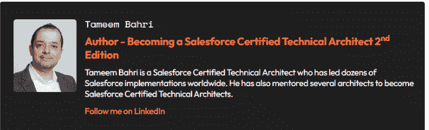
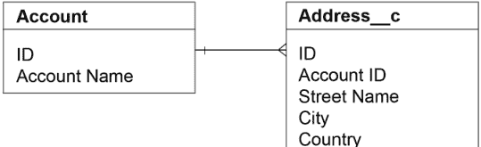
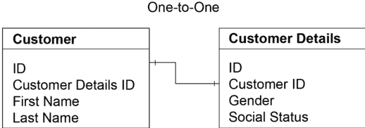
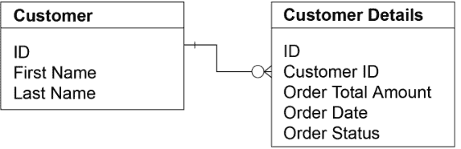
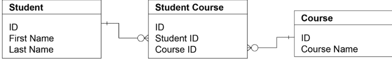
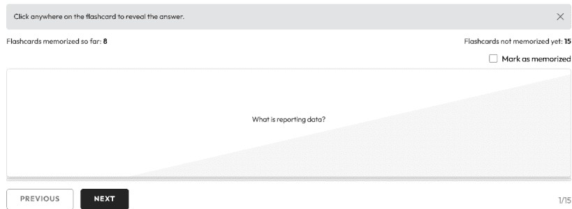
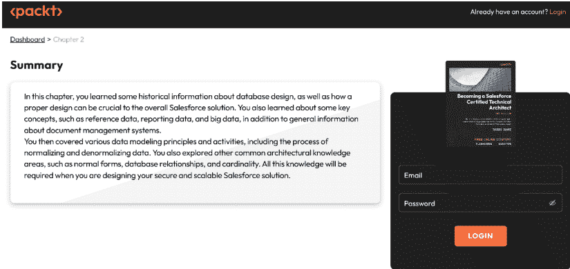
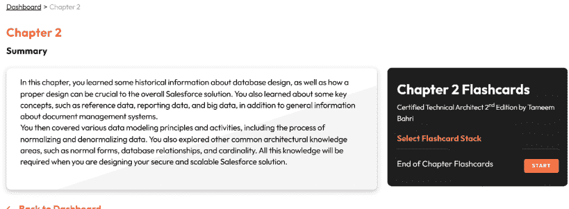

# 核心架构概念：数据生命周期

本书附赠免费在线内容

使用本书，你可以无限次访问基于 Web 的 CTA 考试准备工具，如闪卡和考试提示。

图 2.1 – CTA 在线资源仪表板

要解锁内容，你需要使用随本书提供的唯一注册代码创建一个帐户。有关如何操作，请参阅前言中的“解锁在线内容说明”部分。

## 访问在线内容

如果你已经按照上述说明创建了帐户，请访问 packt.link/ctabookwebsite 或扫描以下二维码以快速打开网站。

图 2.2 – 访问 CTA 在线资源的二维码

到达该页面后，请点击页面右上角的登录链接，使用你的凭据访问内容。

正如你在上一章中所学，Salesforce CTA 对期望值很高。架构师应深入理解平台的功能和特性。除了深入理解特定架构概念外，架构师还应在许多架构领域拥有广博的知识。数据是架构师需要掌握的关键架构领域之一。数据无处不在，贯穿你的日常生活，每天你都会为数据发现新的潜力。从销售到服务、市场营销、商业智能和人工智能，数据都是当今现代系统的核心。

本章，你将学习以下主要主题：

- 经典 RDBMS 与 Salesforce 的区别
- 了解数据治理
- 了解数据安全
- 数据法规合规性
- 探索数据类别
- 数据仓库和数据湖的本质
- 选择合适的文档管理系统
- 了解数据架构概念
- 设计和记录你的数据模型
- 使用数据库关系

## 经典 RDBMS 与 Salesforce 的区别

人们在日常活动中使用数据库已有几个世纪。虽然直到最近才被命名为“数据库”，但它们已经开发多年，并为其发明了越来越多的用例。大多数现代应用程序都会以某种方式使用数据库。理论上，数据库只是相关数据的集合。管理此数据的软件系统称为**数据库管理系统 (DBMS)**。DBMS 还负责控制对数据库的访问。

数据库多年来已从简单的基于文件的系统发展为复杂的基于云的关系型数据库管理系统和内存数据库。

了解基于文件系统的问题，可以帮助你避免在现代数据库系统中可能出现的挑战。**基于文件的系统**是为特定的一组用例而设计的。这主要是由试图将通常手动完成的活动数字化所驱动。以手动归档系统为例。企业和某些图书馆过去曾有组织地存储其拥有的不同文件和书籍。典型的安排是将这些资产存放在带标签的柜子里。柜子本身可能配有锁，以控制谁可以打开它们，谁不可以，而整套柜子可以存放在安全的房间或区域内，以确保采取正确的安全措施。在这种安排下，查找文档的最简单方法是逐一翻阅所有文档，直到找到所需内容。

最终，索引系统被用来更快地定位特定文件。换句话说，你可以在归档系统中设置分区，或者使用一份摘要索引表，指向每个存储文档的位置。

只要存储的项目数量较少，或者你只想简单地存储和检索项目，此系统就能正常工作。你大概可以想象，检索交叉引用数据或试图从收集的数据中获取任何智能信息的复杂性。

**关系型数据库**在上世纪末变得非常流行。它们主导了企业格局，并且至今仍然相关。RDB 中的数据被分割到多个_关联表_中，其中这些表的每一行都有一个称为**主键**的_唯一标识符_。相关表可以通过引用这些主键的**外键**进行链接。最终，引入了**备用键**或**次要键**的概念。与主键一样，次要键为每一行包含一个唯一标识符。但是，出于某种原因，它未被选为表的主键。

在 Salesforce 世界中，每个对象都有一个代表主键的唯一 ID 字段。查找和主从关系字段充当子对象的外键。唯一外部键是备用键的一个很好示例。

数据通常通过**结构化查询语言**（例如 Salesforce 中的 SQL 或 SOQL）来访问。检索此数据的速度受多种因素影响，例如底层基础架构、数据索引的方式，以及在数据未索引时可以存储和检索的数据量。

关系型数据库事务由以下四个特性定义（可以使用首字母缩写 ACID 来记忆）：

- **原子性**：事务必须被视为一个原子单元。其所有任务和操作都必须成功；否则，整个事务将被回滚。数据库绝不能处于事务部分完成的状态。
- **一致性**：如果在特定事务之前数据处于一致状态，那么在该事务执行后也应保持一致。数据库状态应在整个事务过程中保持一致。换句话说，事务不应对数据库中的数据产生负面影响。
- **隔离性**：事务是独立的，因此它们之间不应有依赖关系和共享数据。当多个事务并行同时执行时，这一点尤其真实。没有任何事务会影响其他事务的存在。
- **持久性**：数据应以持久方式保存，即使系统无法重新启动。当事务更新数据库中的数据并提交时，预期数据库会保留修改后的数据。在系统故障的情况下，在数据写入磁盘之前，系统重新运行后应再次更新数据。

关系型数据库适合复杂操作和数据分析任务。它们的设计侧重于重视一致性而非可用性，并提供数据必须符合的严格结构。

20 世纪 90 年代，随着互联网的兴起，网络应用开始产生不一定是结构化或有组织的数据，有时这些数据难以适应如此严格的结构，由此出现了新的挑战。随之而来的是**非关系型数据库**的兴起，如今它们被称为不仅仅是 SQL（即 NoSQL）数据库。

非关系型数据库具有以下三个特质（可以使用首字母缩写 BASE 来记忆）：

- **基本可用**：即使发生故障（包括网络故障），系统也应保持可用。
- **软状态**：系统中数据的状态可能会因为最终一致性活动而发生变化。
- **最终一致性**：不保证一致性，但在某种程度上，数据最终会处于一致状态。在此，你可以看到与 ACID 的即时一致性相比的延迟一致性原则。

非关系型数据库高度可扩展，但这需要付出代价。在每个时间点都不保证数据一致性，这意味着不同用户可能会同时看到同一数据的不同版本——尽管数据最终会处于一致状态。非关系型数据库——与关系型数据库恰恰相反——重视可用性高于一致性。

在设计 Salesforce 解决方案时，您可能会遇到需要高可用且可扩展的数据库系统的挑战。Heroku 作为附加组件支持一些最流行的 NoSQL 数据库，例如 MongoDB 和 CouchDB。

以下用例将帮助您更多地了解 NoSQL 的用途：

- 经常写入但很少读取的统计数据
- 大数据（例如多年多国的统计数据）
- 二进制资产（例如 PDF 或 MP3 文件），需要在可直接提供给用户浏览器的数据存储中提供存储
- 瞬时/临时数据
- 高可用性应用，其中停机时间至关重要
- 高可扩展性应用，需要处理非常高数量的事务

Salesforce 平台并非为需要接收和摄取大量传入数据的用例而设计。请考虑一个 IoT 场景，通常需要一个高可用且可扩展的平台来接收、摄取和汇总数据，然后再对其进行处理或将其转移到另一个处理平台。这是 Heroku 等平台可以为您的解决方案增加很大价值的用例，尤其是因为它通过 Heroku Connect 与 Salesforce 平台内置了连接器。在评审委员会期间，避免会导致某个解决方案组件过度紧张的错误，例如直接将 IoT 入站通信推入 Salesforce。

Salesforce 与常规 RDBMS 略有不同。作为经验丰富的 Salesforce 架构师，您已经知道它是一个多租户数据库，不同租户的数据通过 OrgIds 隔离。但是，您需要了解一些在标准 RDBMS 设计中可能被认为次优但在 Salesforce 世界中完全可以接受的概念，例如以下内容：

- Salesforce 中自关联关系是可以接受的。实际上，它们可能会让您利用一些开箱即用的功能，而如果使用两个对象来建模数据，这些功能根本无法工作。
- 在常规数据库中，通常不可接受拥有 500 个不同列的表。但是，在 Salesforce 某些用例中这是可以接受的，特别是当您创建反规范化聚合对象时。
- 在常规数据库中，您很少注意到从子记录到祖父母记录的直接关系。而在 Salesforce 中，这并非罕见之事。建立这种关系仅仅是因为它们影响数据向最终用户呈现的方式（例如，在建立查找关系时，相关记录会自动显示在祖父母记录的页面布局上，无需您编写自定义代码将这些记录从父记录汇总到祖父母记录）。
- Salesforce 字段是类型感知的。除了作为数据容器的角色之外（类似于常规数据库字段），它们还提供内置的数据类型验证。您无法在复选框字段上设置数字，而且这是无法关闭的。
- Salesforce 有自己的结构化数据查询语言，称为 Salesforce Object Query Language (SOQL)，它用一些内置功能换取了 SQL 的灵活性，这些功能将显著加快大多数用例的开发速度。
- 在设计 Salesforce 数据模型时，数据存储是一个需要牢记的重要主题。存储空间本身是一回事，因为与其他平台相比它并不十分便宜。但最重要的是，您应该留意 Salesforce 对象的大小，以确保某些功能（例如报表）的性能不会随对象大小的快速增加而下降。您将在第 7 章“设计可扩展的 Salesforce 数据架构”中深入了解此主题。
- Salesforce 自带非常可靠的数据访问控制模型。这使您不仅可以控制特定用户对对象和字段的访问，还可以控制对记录的访问。所有这些都可以通过使用点击式功能来完成，而无需编写代码。

但是，这些功能通常会在幕后创建一些支持数据，以满足可见性要求。您需要了解它们的工作原理，并预期在使用每种不同的共享方法时可能会遇到什么样的挑战。您还将在第 6 章“在 Salesforce 中制定安全架构”中涵盖此内容。

现在您了解了经典 RDBMS 与 Salesforce 之间的主要区别，请继续探索两者之间的一个共同主题，这也是任何企业数据战略成功的关键——数据治理。

## 了解数据治理

在企业语境下，数据治理是一种数据管理概念，旨在确保数据在其完整生命周期内保持高水平的质量。

数据治理概念可以扩展到多个关注领域。企业通常关注数据易用性、可用性、安全性和完整性等主题。这包括在数据生命周期的不同阶段需要遵循的任何所需流程，例如数据管理，它确保数据质量始终保持在高标准，以及其他确保数据可供所有消费应用程序和实体访问和使用的活动。

数据治理旨在实现以下目标：

- 提高数据驱动决策的一致性和信心。这反过来使企业范围内具备更好的决策能力。
- 打破数据孤岛。
- 确保将正确的数据用于正确的目的。这样做是为了阻止潜在的误用，并减少在系统中产生数据错误的风险。
- 降低与监管要求相关的风险，避免罚款。
- 持续监控并改进数据安全，同时定义和验证数据分发策略的要求。
- 实现数据货币化。
- 通过定义职责归属来提高信息质量。
- 基于高质量、可信赖的数据，实现以客户为中心的现代用户旅程。
- 最大限度地减少因治理不善的活动而产生的返工需求。

数据治理机构通常创建和维护以下制品：

- **数据映射和分类**：这有助于记录企业的数据资产及相关数据流。数据集可以根据特定标准进行分类，例如是否包含个人信息或机密数据。这反过来会影响数据治理策略如何应用于每个数据集。
- **业务术语表**：这包含企业中使用的业务术语的定义。一个好例子是定义什么是活跃客户。
- **数据目录**：这些通常通过从跨系统收集元数据来创建。然后用于创建可用数据资产的清单。治理策略以及关于自动化机制等主题的信息也可以构建到目录中。

设计良好的数据治理计划通常包括数据管家和充当治理机构的团队的组合。他们共同努力，为治理数据创建所需的标准和策略，以及实施和执行计划的活动和流程。这主要由数据管家执行。

**数据管家**是企业内的一个角色，负责维护和使用组织的数据治理流程，以确保数据和元数据的可用性和质量。数据管家还负责利用政策、指南和流程来管理组织的数据，以符合给定的政策和/或监管义务。数据管家和数据保管人可能共享某些职责。

**数据保管人**是企业内的一个角色，负责传输和存储数据，而不是关心将哪些数据放入系统以及原因等主题。数据管家通常负责数据集中存储的内容，而数据保管人则涵盖技术细节，例如环境和数据库结构。数据保管人有时也被称为数据库管理员或 **提取、转换、加载（ETL）** 开发人员。

现在您了解了数据治理机构以及数据管家和保管人所涵盖的活动，请继续了解他们在数据策略中需要涵盖的关键主题之一——数据安全。

## 了解数据安全

数据安全是当今企业最关注的问题之一，尤其是随着收集的数据量和价值不断增加。这关乎保护数字数据免受未经授权用户（例如数据泄露或违规事件）或破坏性力量的影响。作为其中一部分，您需要熟悉一些概念，包括加密、备份和恢复、数据掩码以及数据擦除。您将在接下来的几节中逐一了解它们。

## 数据加密

**数据加密**可以应用于数据生命周期的多个级别和阶段。这包括数据存储在最终数据存储区时（静态加密）以及数据在移动过程中（从一个系统移动到另一个系统）（传输中加密）。

**传输中加密**通常通过在传输前加密消息并在目标处解密来实现。此过程旨在保护传输过程中的数据，防止攻击者拦截传输或有时被称为中间人攻击的行为。这通常通过使用 HTTPS 等安全通道来实现，尽管可以应用更高级别的安全性。您将在 _第 3 章，核心架构概念：集成与加密_ 中深入探讨此主题，以更好地了解加密算法的工作原理以及它们如何用于以安全方式交换数据。

静态加密关乎存储已加密的数据。这使得在没有特定加密密钥访问权限的情况下，无法读取和显示其解密版本。某些应用程序或平台开箱即用提供此功能。这是一种保护机制，用于防止攻击者访问存储数据的数据库或物理磁盘。

**Salesforce Shield** 为静态数据加密提供加密解决方案。这适用于文件系统、数据库和搜索索引文件。如果您计划将 Salesforce Shield 作为解决方案的一部分使用，则需要在您的环境架构中明确突出这一点。

## 数据恢复

备份和恢复解决方案用于确保数据存储在安全位置/来源中，以防需要进行恢复。在大多数行业中，保留任何运营数据的备份至关重要。最重要的是，您必须制定清晰的恢复策略。数据恢复通常比备份更具挑战性，因为它伴随着额外的挑战，例如恢复部分数据、引用数据以及父子记录和关系。

> **注意**
> Salesforce 宣布，自 2020 年 7 月 31 日起，数据恢复作为付费功能将被弃用，不再作为服务提供。但是，根据客户反馈，Salesforce 决定恢复其数据恢复服务。随后，在 2021 年秋季，Salesforce 宣布了一个新的内置平台，具有原生备份和恢复功能。

因此，将全面的数据备份和恢复策略作为数据治理策略的一部分至关重要。有几种工具可用于从 Salesforce 平台备份和恢复数据，包括 Salesforce 的备份和恢复，以及一些 AppExchange 产品。通过实施 ETL 工具构建定制解决方案也是可行的，尽管会产生额外的构建成本。作为架构师，您应能够引导利益相关者了解各种可用选项，以及潜在的优缺点。

> **注意**
> 在评审委员会中，您应从技术上提出最佳可能的解决方案。除非场景中明确说明，否则成本不应作为考虑因素。购买与构建决策始终倾向于选择 _购买_ 选项，因为其投资回报快。

## 数据掩码

结构化数据的**数据掩码**（也称为**数据模糊化**）是用修改后的内容覆盖原始数据的过程。这主要是为了保护被归类为**个人身份信息（PII）**或敏感商业或个人数据的数据。示例是掩码国家身份号码，仅显示最后四位数字，同时将所有其他数字替换为静态字符（如通配符）。通常会对数据进行模糊化处理，以保护其免受用户（例如内部代理、外部客户，甚至开发人员（通常需要类似真实生产环境的数据来测试特定用例或修复特定错误））的访问，从而符合监管要求。

数据模糊化有两种常见技术，即 **去标识化** 和 **匿名化**。以下是对这两种技术的简要描述：

- **匿名化**：这是通过更改和打乱字段内容来实现的，使其变得无用。例如，名为 Rachel Greene 的联系人可能会变成 hA73Hns#d$。类似 RachelG@gmail.com 的电子邮件地址可能会变成 JA7ehK23 等不可读值。
- **去标识化**：这将字段转换为与原始值无关的可读值。例如，名为 Rachel Greene 的联系人可能会变成 Mark Bates。类似 RachelG@gmail.com 的电子邮件地址可能会变成 MarkBates@SomeDomain.com。

在上述两种技术中选择哪一种，取决于掩码数据所关联的风险程度以及数据的处理方式。去标识化数据仍然允许某种形式的重新识别（即使是远程或间接的），而匿名数据无法重新识别。匿名数据的常见方法是打乱数据，该过程有时可以逆转；例如，“London”可能会变成“ndooln”。这种掩码技术允许用静态或随机字符隐藏部分数据。另一方面，**数据模糊**使用数据值的近似值，使无法识别个人或使数据的意义过时。

## 数据擦除

**数据擦除**（也称为数据清除、数据销毁或数据擦拭）是一种基于软件的活动，其中特定数据被其他值覆盖，以销毁电子数据并使其无法恢复。这与数据删除不同，尽管它们听起来相同。

**数据删除**可能会将数据保留在可恢复格式中（例如，仅从索引表中删除其引用，同时仍在存储磁盘上保留它）。另一方面，数据擦除是永久性的，对于高度敏感的数据尤为重要。理解这些术语之间的区别很重要，以便您可以向利益相关者推荐最佳策略，同时还要考虑到他们对数据最终在 Salesforce 中的存储方式控制有限。

值得提及的是，只需销毁加密密钥，就可以永久销毁/擦除加密数据。

数据治理机构需要涵盖的另一个关键主题是数据法规合规性。随着收集的客户和业务数据量不断增加，引入规范数据使用的规则已成为必不可少的。作为架构师，您必须了解这些法规，以设计完全合规的解决方案。您可能需要与主题专家合作，以确保您的解决方案满足所有监管要求，但您仍应能够独立完成大部分工作。您还需要能够向利益相关者解释您的解决方案如何符合这些法规。

## 数据法规合规

现行的多项数据法规依据行业标准和政府法规制定。这些法规旨在降低对企业数据、个人数据或政府数据未经授权访问的风险。在当今设计 Salesforce 解决方案时，您可能会更频繁地遇到以下一些法规：

- 通用数据保护条例 (GDPR)
- 英国版通用数据保护条例 (UK-GDPR)
- 健康保险可移植性和责任法案 (HIPAA)
- 加州消费者隐私法案 (CCPA)
- 2003 年公平准确信用交易法案 (FACTA)
- 个人信息保护法 (APPI)
- 格拉姆-里奇-比利法案 (GLB)
- 支付卡行业数据安全标准 (PCI DSS)

未能遵守这些法规可能导致巨额罚款和企业声誉公开受损，此外还可能面临民事和刑事责任。本书不详细介绍这些法规的具体内容，但鼓励您通过网络和其他书籍获取更多知识。在接下来的章节中，您将遇到必须解决的要求，以及涉及前述部分法规的注意事项。

PCI DSS（又称 PCI 合规）是一项信息安全标准，适用于所有参与信用卡信息相关活动的公司，例如接受、处理、存储或传输来自信用卡提供商的信用卡信息。Salesforce 计费于 2012 年成为 PCI 第 1 级合规，并且此后每年都保持合规状态。

您可以通过在支付方式收集的所有阶段（之前、期间和之后）完全不在 Salesforce 中存储任何信用卡信息来保持 PCI 合规。支付卡信息应仅通过令牌传输给支付处理器，且绝不能在 Salesforce 中存储。每个令牌对每个客户、支付卡、商户和支付处理器都是唯一的。一旦令牌提交，支付处理器即可将其链接到存储的实际个人账户号码。

使用令牌，Salesforce 可以存储客户支付卡的表示，而无需存储卡片本身的实际详细信息。如果令牌落入不法分子手中，它将毫无用处，因为它仅在由原始商户和支付处理器使用时才有效。

在保持 PCI 合规的同时，可以在 Salesforce 中存储的信息包括以下数据：

- Name on card
- Last four digits of the credit card number
- Card type
- Token
- Expiration month and year

了解在线支付机制的工作原理以及如何为您的解决方案选择合适的机制非常重要。在评审委员会期间建议非 PCI 合规的解决方案，可能会引发许多您不希望进行的讨论。当您提出次优解决方案时，评委会会尝试理解您建议背后的依据。未能展示出对法规和合规性的足够知识和理解可能导致考试失败。

对于在线支付，您需要知道，集成支付网关通常有两种主要方式。您可以创建托管在自己网站上的结账页面（例如，Salesforce 社区），也可以使用由支付网关提供和托管的结账页面。

关于外部托管结账方式，您的结账页面托管在支付提供商提供的不同网站上。当客户点击您网站上的结账按钮时，他们将被重定向到托管在不同域名上的支付页面。订单信息和购物车总金额通常会显示在支付页面上。客户将在此页面输入卡片详细信息，然后点击提交按钮。请注意，卡片详细信息仅在外部支付网站上输入；您的页面和表单从不用于捕获此类详细信息。付款成功后，客户将被重定向到您网站上的着陆页。确认码或交易码也会传回您的网站。

托管结账方式具有以下优势：

- **安全性增强**：参与支付交易的每个额外方都会增加数据泄露相关的风险。您应尽量减少数据传输次数。此外，由于支付详细信息由支付提供商/处理器收集，您的网站不被视为交易的一部分，因此该方法的总体安全性较高。
- **责任减少**：作为商户，您降低了责任，因为您没有收集任何敏感信息。所有这些都由支付提供商完成。
- **让客户更安心**：客户可能会觉得，向他们已经信任的网站/域（例如 PayPal）提供支付详细信息更令人放心。这对较小的商户或较新的品牌尤其如此。
- **支付方式灵活**：通常，托管的结账页面为用户提供从多种支付方式中选择的选项。随着支付提供商加入更多支付方式，此页面将继续更新。您无需为此担心，也无需更改代码中的任何内容。
- **设置简化**：此方法最容易设置和维护。
- **定制有限**：虽然支付页面托管在另一个网站上，但许多支付提供商允许有限程度的定制，例如设置徽标、页眉和页脚以及配色方案。

关于本地结账方式，客户在其自己网站上托管的页面（例如 Salesforce 社区）上提供支付详细信息。您对该页面的外观和感觉拥有完全控制权，但您也负责实现每项所需的功能、验证和安全措施。

本地结账方式具有以下优势：

- **完全无缝**：这可能是该方法最重要的优势。客户不会被重定向到任何地方；整个支付过程感觉是您为客户提供的旅程和体验的一部分。
- **一键购买**：这类似于亚马逊等大型商户的做法。您收集客户的支付详细信息，以便将其附加到其账户。这为引入一键功能打开了大门。
- **定制化**：您可以按任何喜欢的方式制作支付收集页面。它可以完全设计为符合您网站的外观和感觉。这超出了 UI 样式，例如，您可以在结账过程中收集其他详细信息。

如果您通过托管页面收款，填写和提交所需表格以保持 PCI 合规会容易得多。这也使维护过程更加简单。如果没有明确理由采用本地结账方式，那么始终建议采用外部托管页面方式。

现在您已了解有关数据法规的一些关键主题，接下来请了解可用的不同数据类别。

## 探索数据类别

**参考数据**和**主数据**是架构师在大多数项目中通常会遇到的两种常见数据类别。除这些之外，在本节中，您还将发现事务数据、报告数据、元数据、大数据和非结构化数据的特点。更深入地了解这些不同的数据类别将帮助您制定整体数据策略，包括数据治理。这也将帮助您使用数据架构师偏好的语言进行沟通。请仔细查看每种类别。

## 事务数据

事务数据由常规业务交易生成。它描述业务事件。通常，它是企业中变化最频繁的数据。事务数据事件可能包括以下内容：

- 向客户销售的产品
- 收取的付款
- 创建的报价
- 运送到客户的物品

事务数据通常由业务系统生成和管理，例如 CRM、ERM 和 HR 应用程序。

## 主数据和主数据管理

企业通常提供支持日常交易的关键业务信息。此类数据通常描述客户、产品、位置等等。

此类数据称为**主数据**，通常被称为各方（员工、客户、供应商等等）、地点（站点、区域等等）和事物（产品、资产、车辆等等）。

通常业务操作会将主数据的创建/编写和使用作为正常业务流程的一部分。但是，操作应用程序通常针对主数据的特定于应用程序的用例进行设计。这可能导致与企业对高质量、通用主数据的整体要求不一致。这将导致以下结果：

- 主数据质量低
- 数据重复且分散
- 缺乏真正受管理的数据

**主数据管理（MDM）**是广泛用于描述一种学科的概念，其中 IT 和业务协同工作，使用特定工具和技术确保企业主数据的准确性和一致性。保持单一真实版本是大多数组织议程中最高优先级的话题之一。

主数据管理工具用于检测和删除重复项、批量维护数据，并加入规则以防止错误数据被输入。

存在不同的 MDM 实现风格，例如注册表风格、整合风格和共存风格。这些风格是 MDM 工具的基础。业务类型、其数据管理策略及其情况将很大程度上影响选择哪种风格。

这些实现风格之间的主要区别在于它们处理数据的方式，以及 MDM 工具本身的角色（它是控制数据的中心，或是与其他数据存储同步数据的中心）。以下是三种常用风格：

- **注册表风格**：该风格通过运行匹配、清理算法并为匹配记录分配唯一全局标识符，在各种连接的系统中识别重复项。这有助于识别相关记录，并在各系统中构建给定数据资产的全面 360 度视图。

在此方法中，数据不会发送回源系统。对主数据的更改将继续在源系统中进行。MDM 工具假设源系统可以管理其自身的数据质量。当需要特定数据资产的 360 度视图时（例如，客户需要它），MDM 工具使用每个参考系统，通过唯一全局标识符实时构建 360 度视图。通常需要一个持续的过程，以确保唯一全局标识符对于给定数据集仍然有效。

- **整合风格**：在此风格中，数据通常从多个来源收集并在中心汇总，以创建单一真实版本。这有时被称为**黄金记录**，其集中存储在中心中，最终用于报告或作为参考。对黄金记录所做的任何更新随后都会推送并应用到原始来源。整合风格通常遵循以下步骤：

- I. 识别给定对象的相同或相似记录。这可以使用精确匹配或模糊匹配算法。
- II. 确定将自动整合的记录。
- III. 确定在整合前需要由数据管家审核的记录。

在这些过程中，工具可能会使用配置的字段权重。权重较高的字段在确定最终形成黄金记录的属性时，通常被视为更重要的因素。

- **共存风格**：该风格与整合风格类似，因为它会创建黄金记录。但是，主数据更改可以在 MDM 中心或数据源系统中进行。由于双向数据同步的复杂性，此方法通常比整合风格更昂贵。

了解匹配逻辑的工作原理也很有帮助。主要有两种匹配机制：

- **模糊匹配**：这是使用更广泛的机制，但执行速度较慢，因为识别匹配需要付出努力。模糊匹配基于数据模式中可能存在的变化（例如转位、遗漏、截断、拼写错误和语音变化）使用概率性判断。

- **精确匹配：** 此机制更快，因为它将记录上的字段与目标记录中的相同匹配项进行比较。

身为 Salesforce 架构师，您需要了解平台中可用的开箱即用工具的功能和局限性，以及市场上关键 MDM 厂商提供的功能——特别是那些通过 AppExchange 应用程序与 Salesforce 直接集成的厂商。

在评审委员会演示以及实际工作中，您需要指导利益相关者并解释他们拥有的不同选项。您应该能够为合适的工具提出名称。仅仅说需要使用 MDM 工具是不够的，您需要更具体并提供建议的产品名称。这适用于您可能推荐的所有第三方产品。您可能还会被要求解释 *如何* 使用这些 MDM 工具来解决特定挑战。您需要了解您提议的工具所采用的 MDM 实现风格。

## 参考数据

想想诸如订单状态（已创建、已批准、已交付等等）或带有 ISO 代码的国家名称列表等数据。您也可以思考业务账户类型，例如白银、黄金、铂金等等。两者都是参考数据的示例。

**参考数据**通常是静态或缓慢变化的数据，用于对其他数据进行分类或分级。参考数据集有时也称为查找数据。此类参考数据中有些可以是通用的（如前面提到的带有 ISO 代码的国家），而其他一些可能是领域特定或企业特定的。

参考数据与**主数据**不同。它们都为业务流程和交易提供上下文。但是，参考数据主要关注分类和分级，而主数据主要与业务实体（例如，客户）相关。

## 报告数据

以特定方式组织以便于报告和商业智能的数据被称为报告数据。以汇总或非汇总方式用于运营报告的数据属于此类别。

报告数据是通过结合主数据、参考数据和事务数据创建的。

## 元数据

元数据有一个非常酷的定义；它被称为描述其他数据的数据。**eXtensible Markup Language (XML)** 是一种常用的元数据格式。

一个简单的例子是计算机文件的属性，即其大小、类型、作者和创建日期。Salesforce 大量使用元数据，因为其大多数功能都可以使用结构良好的元数据来描述。自定义对象、工作流、报表结构、验证规则、页面布局等更多功能均可从 Salesforce 平台提取为元数据。这能够实现自动合并和部署流程，您将在即将到来的章节中学习相关内容。

## 大数据

大数据指的是传统数据库或数据处理应用程序无法处理的超大规模数据集；也就是说，包含数亿（甚至数十亿）行的数据集。大数据在过去十年中变得流行，尤其是随着数据存储成本降低和处理能力提升。

企业越来越认识到其数据的重要性以及从中获得的显著益处。它们不希望丢弃数据，并希望将其用于多种目的，包括 AI 驱动的决策和个性化的以客户为中心的服务与旅程。值得注意的是，大数据方法也受到了一些批评。有人将其描述为只是把数据倾倒在某个地方，希望某天能证明其有用。然而，当大数据以正确的方式使用时，它也可以证明是特定企业的差异化因素。大数据的未来似乎很有希望，它是机器学习算法的关键要素。

身为架构师，您应该能够指导客户结合所需技术，以管理海量且多样化的数据（可能采用非关系型数据库）与关系型数据（用于处理复杂业务逻辑）。

## 非结构化数据

由于互联网的兴起，非结构化数据变得更加流行。此类数据没有预定义的结构，因此无法装入结构化 RDBMS 中。在大多数情况下，此类数据以文本数据形式呈现；例如，一个 PDF 文件，文本挖掘有助于从该非结构化文档中提取结构和相关数据。

大数据和非结构化数据的兴起将我们直接带到了下一个主题——数据仓库和数据湖。

## 数据仓库和数据湖的特性

数据仓库（DW 或 DWH）是从一个或多个异构来源集成的当前和历史数据的中央存储库。DWH（也称为企业数据仓库（EDW））是用于数据分析和报告的系统。它通常被视为企业商业智能策略的核心。

存储在 DWH 中的数据来自多个系统，包括业务系统（例如 CRM 系统）。数据在上传到 DWH 之前可能需要经过一系列数据清理活动，以确保数据质量。

一些 DWH 工具具有内置的 **提取、转换和加载 (ETL)** 功能，而其他工具则依赖外部第三方工具（您将在 *第 3 章，核心架构概念：集成与加密* 中学习 ETL 工具和其他集成中间件）。此 ETL 功能将确保摄取的数据具有特定的质量和结构。数据在加载到 DWH 之前可能会暂存在特定的暂存区域中。您需要熟悉一些流行的数据仓库解决方案的名称，例如 Amazon Redshift，它是一种完全托管的、基于云的数据仓库。

**数据湖**是一种以非结构化方式存储数据的系统或存储库。数据以最原始的形式保留；未经处理、修改或分析。数据湖接受并存储来自所有来源的各种数据。结构化、半结构化、处理过和转换过的数据也可以存储在数据湖中（例如 XML 数据或来自数据库的数据）。收集的数据将用于报告、可视化、商业智能、机器学习和高级分析。您需要熟悉一些流行的数据湖解决方案的名称，例如 AWS Lake Formation。

您还需要知道应该推荐哪种解决方案及其原因。如果您需要提供一个能够提供历史趋势报告、深度数据分析功能以及报告大量数据能力的平台，那么 DWH 更适合您的用例。请记住，从 Salesforce 提取的数据大多是结构化格式（文件除外）。

在许多评审委员会场景中，您会遇到需要存档平台数据的需求。您将在 *第 7 章，设计可扩展的 Salesforce 数据架构* 中了解可用的选项，但目前您只需要知道这些选项之一是 DWH。

如果您需要将结构化和非结构化数据存储在同一位置以便于机器学习或高级分析等任务，数据湖可能是正确的解决方案。

当今企业解决方案中另一个常见需求是文档管理系统。您将在下一节中了解更多有关这些系统的内容。

## 选择合适的文档管理系统

当今企业中，电子文档无处不在。电子文档可以简单地被视为一种电子媒体内容，既可以以电子形式使用，也可以作为打印输出。这不包括系统文件或计算机应用程序。**文档管理系统 (DMS)** 是一种用于在文档整个生命周期中存储、跟踪和管理电子文档的计算机应用程序。这包括与这些文档相关的活动，例如版本控制和工作流。

**文档管理**与内容管理存在重叠，尽管它们原本性质不同。当今它们通常被视为**企业内容管理 (ECM)** 系统的组合，主要原因是当今可供特定企业使用的许多电子文档不一定由该企业本身生成。

当今的文档管理系统在复杂性、功能和范围方面各不相同，从简单的独立应用程序到可服务大量受众的企业级系统。当今 ECM 系统提供的一些关键功能如下：

- 以细粒度格式进行安全性和访问管理
- 版本控制
- 综合审计跟踪
- 能够签入和签出文档，并集成锁定机制

身为 Salesforce 架构师，理解文档管理系统和企业内容管理的功能非常重要。您还必须了解将功能齐全的 DMS 纳入架构所需的其他工具。

Salesforce 自带一些可提供 DMS 功能的内置功能。了解每个功能的功能和局限性（包括可用性，因为某些功能可能会随时间退役）非常重要。这些功能如下：

- **Files:** 这允许用户上传和存储电子文档。文档可以私下存储，也可以使用 Chatter 与其他用户共享。文档存储在平台上，并被视为旧版附件功能的替代品，尤其是在 Lightning Experience 中。
- **Salesforce CRM Content:** 这允许用户创建、复制和开发企业文档。一个很好的示例是演示文稿或传单。它还允许您将此内容与其他内部或外部用户（例如客户或合作伙伴）共享。
- **Salesforce Knowledge:** 这更像是一个企业知识库。它允许用户创建和策划知识文章，并使用受控工作流发布它们。它还允许内部和外部用户（通过社区）搜索这些知识文章并以多种方式使用它们（例如，将其附加到案例中）。知识文章可以组织成库，这使得它们更易于维护和共享。
- **Documents:** 这些主要用于将静态文件存储在文件夹中，而无需将其附加到记录。例如，当您需要在 Visualforce 页面中引用静态资源（如徽标）时，这特别有用。

大多数企业已经拥有一种 DMS；例如，Microsoft SharePoint、Box、Google Drive、OneDrive 等企业级应用程序。您很可能需要与这些系统集成，以便在 Salesforce UI 中访问和管理外部文档，而不是从头开始创建。

为此，您可以使用 Salesforce 中名为 **Files Connect** 的另一种开箱即用工具。使用 Files Connect 获得一些实践经验以更好地了解其工作原理非常重要。而且，由于它有自己的局限性，因此熟悉 AppExchange 上可用的一些其他替代方案也很重要。您不需要了解天下所有工具的名称和功能，只需熟悉其中一些工具并确切了解它们能做什么即可。

身为架构师，您会遇到多种 DMS 需求和挑战。您也肯定会遇到需要您的技能和经验来设计稳健数据架构的业务需求。接下来，我们将进入下一节，您将了解更多有关关键数据架构概念的信息。

## 理解数据架构概念

先前，您了解了数据的重要性以及数据架构对企业的重要性。数据架构师——作为 Salesforce 架构师，您需要与其密切合作，或者在较小的项目中担任此角色——需要以类似于普通建筑架构的方式处理数据架构。而且在很大程度上，软件架构也应遵循类似的原则。

首先，理解业务流程并创建概念和逻辑蓝图至关重要。然后，您需要了解底层技术来构建详细设计和实现。为了更好地理解这些内容，请仔细查看数据架构设计的三个阶段/级别——概念级、逻辑级和物理级。

### 概念级数据架构设计

在概念级阶段，数据架构师需要深入了解业务知识、业务流程和运营。这包括与数据流、业务规则以及数据在企业中如何使用或预期使用相关的知识。这可以扩展到财务、产品、营销和行业特定知识领域（例如制造、保险等）等领域。然后，数据架构师可以通过设计代表企业每个业务领域的数据实体来构建蓝图。

架构师还将定义每个业务流程背后的各种分类法和数据流。数据蓝图对于构建强大且成功的数据架构至关重要。在许多情况下，此活动在项目级而非企业级进行。而且，这通常包含在业务分析师的活动中。通常，需要涵盖以下领域：

- 关键数据实体和元素（账户、产品、订单等）
- 数据实体关系，包括数据完整性要求和业务规则等详细信息
- 最终客户期望的输出数据
- 所需的安全策略

- 将被收集、转换并用于生成输出数据的数据
- 已定义数据实体的所有权以及它们将如何被收集和分发

### 逻辑级数据架构设计

这种数据架构设计有时也被称为 **数据建模**。在该阶段，架构师将开始考虑所涉及的技术类型并定义要使用的数据格式。逻辑数据模型将业务需求与技术和数据库的结构连接起来。数据架构师应考虑每个底层系统或数据库的标准、功能、最佳实践和局限性。数据流必须在此阶段明确定义。通常，需要涵盖以下领域：

- **数据完整性要求和命名约定**：应为每个涉及的数据库定义并一致使用命名约定。应考虑并强制执行操作数据与参考数据之间的数据完整性要求——尤其是当数据需要位于多个底层系统中时（在概念级别，所有这些数据实体理想上应属于同一概念实体）。

- **数据归档和保留策略**：数据不能无限期地堆叠在其他数据之上。在早期阶段未能解决数据归档和保留策略通常会影响项目的整体成本、系统性能较差（尤其是在数据更新或数据查询期间），以及潜在的数据不一致性。数据架构师应与利益相关者合作，根据业务运营和法律或合规要求定义数据归档和保留策略。

- **隐私和安全信息**：尽管概念设计更关注定义哪个数据元素被视为敏感，但逻辑设计深入更多细节，以确保机密信息受到保护，并且数据仅对正确的受众可见。数据架构师还需要制定与数据复制相关的策略，以及如何在转换过程中和静止状态下保护复制的数据。

- **数据流和管道**：在此阶段，应清晰阐述数据在不同系统和数据库之间流动的详细信息。这些流应与概念级别定义的流保持一致，并应反映诸如管道中所需的数据转换以及数据摄入频率等详细信息。

### 物理级数据架构设计

这种数据架构设计也称为 **内部级别**。这是数据设计的最低级别。在此阶段，架构师关注底层系统或数据库的实际技术方面。它甚至可以延伸到定义数据如何存储在存储设备中（例如，在特定文件夹结构中）。

作为 Salesforce 架构师，您很可能会参与概念设计，并且更可能被期望参与逻辑设计。您在物理设计中的参与不会那么密集，大多是在咨询情境下进行。

在第 1 章《以 CTA 身份开始您的旅程》中，您在评审委员会考试期间学习了创建数据模型图的重要性。这很可能基于逻辑模型（您将在本书中看到多个示例）。在现实生活中，逻辑模型图在您项目的设计阶段也是必需的，而物理模型图在实施阶段则是必不可少的。

您需要记录（或领导记录活动）解决方案的完整 Salesforce 物理数据模型。这包括提供每个标准对象和自定义对象的完整描述，它如何被使用（即使是标准对象，仅提到您正在使用账户对象也是不够的；例如，您必须清楚地说明它是如何被使用的），以及每个集成字段中的数据源，并对所有涉及的数据流进行清晰描述。

接下来，您将了解设计和正确记录数据模型背后的更多原则。

## 设计和记录您的数据模型

您的数据模型设计的重要性无论如何强调都不为过。在许多情况下，它可能在 Salesforce 世界中被忽视，因为 Salesforce 自带预构建的数据模型，此外还具有创建和更改自定义字段和对象的极大灵活性。

然而，合适的数据模型设计可能是智能、灵活且可扩展的解决方案（它提供有价值的实时洞察，证明输入数据所需的所有努力是合理的）与设计不良的数据库（包含大量倾倒的数据，整体感觉数据输入是一种开销）之间的区别。

您的数据模型是解决方案的基础。多个解决方案方面取决于您的数据模型，例如数据共享和可见性策略以及您识别 **大数据量** (LDV) 对象的能力。

您可以通过理解其数据模型来阅读解决方案。您的解决方案将像其基础一样强大。您需要正确设计您的数据模型，而要做到这一点，您需要理解数据建模中的关键概念。这始于规范化与反规范化，经历数据库设计的三种标准范式，最后，理解数据库表之间的常见关系类型以及它在 Salesforce 中的体现。

### 规范化与反规范化

**规范化** 是根据数据库中数据的关系高效排列数据的过程。这种方法旨在消除数据冗余，因为冗余会浪费磁盘空间、减慢查询速度，并且执行 **创建、读取、更新和删除 (CRUD)** 操作需要更多的处理时间。此外，冗余数据还可能增加数据不一致性。例如，当相同的数据持久化在多个位置并在其中一个位置更新时，您需要确保更改反映在所有其他出现处；否则，您可能面临数据不一致的风险。规范化应旨在消除数据冗余，但不能以丢失数据完整性为代价。

规范化基于所谓的 **范式** 的概念。数据集必须满足特定标准，才能被视为这些范式之一。有三种主要范式（1NF、2NF 和 3NF），您都将很快学习，还有其他范式，如 BCNF、4NF、5NF 等，为了简洁起见，您不会在本书中学习。

**反规范化** 可以被视为规范化过程的对立面。在反规范化的数据集中，您有意使用冗余信息。这样做有多种目的，但主要是为了在执行查询和进行分析时提高性能。当然，保持所有冗余数据的一致性和对齐存在相关开销。

反规范化过程减少了表的数量（尽管它消耗更多存储空间）并简化了复杂的表连接，从而有效地提高了查询位于多个表中的数据时的性能。反规范化采用的概念是，通过将所有数据放在一个地方，您可以简化搜索过程，因为它只需在一个表上执行。

在设计数据模型时，您可能会遇到一些使用案例，使用一组规范化的表可能更好地解决。在其他情况下，反规范化可能是答案。您可以参考这些用户故事来更好地理解区别。

> 作为客户经理，我想存储所有客户的地址，以便我可以生成一份重要报告，显示在给定时间段内我们向这些地址发送的货物数量。

这个用户故事的重点是分析/报告。考虑到 Salesforce 的标准报告功能，将账户和账户地址详细信息存储在两个独立的表中是有意义的。这还将使我们能够立即将货运记录链接到正确的地址，并以最小的努力构建所需的报告，尽管 Salesforce 在幕后执行额外过程以从多个表中查询数据。

下图展示了拟议的数据模型及其存储数据示例：

### 账户

| ID | 名称 |
|---|---|
| 1 | Acme |
| 2 | Globex Ltd |

### 地址

| ID | 账户 ID | 街道名称 | 城市 | 州/省 | 国家 |
|---|---|---|---|---|---|
| 1 | 1 | No.1 Atlantic Street | London | | United Kingdom |
| 2 | 1 | No.5 Florence Avenue | London | | United Kingdom |
| 3 | 1 | No.27 Argyle Street | San Francisco | CA | USA |
| 4 | 2 | 50a Glebe Point | Los Angeles | CA | USA |
| 5 | 2 | 44 Grosvenor Street | Los Angeles | CA | USA |

图 2.3 – 规范形式的数据模型示例

现在，探索第二个用户故事。

> 作为客户经理，我想存储所有客户的地址，以便在查看客户记录页面和列表视图时能够快速查找联系地址。

此处的重点在于输入或查看数据时的用户体验。在这种情况下，使用非规范化数据集是合理的。这些非规范化字段可以轻松添加到列表视图和页面布局中。它们也可以使用更少的点击次数进行编辑。

在本书中，你将遇到更复杂的场景，在这些场景中可以利用非规范化数据集来减少数据存储。尽管理论上，非规范化数据集消耗更多的存储数据，但在 Salesforce 中，大多数对象记录的数据存储大约为 2 KB（少数例外，例如人员账户和文章）。无论其中包含多少个字段，也无论这些字段是否已填写，此规律均适用（某些字段类型除外，例如富文本字段）。如前文所述，Salesforce 中的某些数据建模概念可能看起来有所不同。

下图展示了拟议的数据模型及其存储数据示例：

| ID | 账户名称 | 街道名称1 | 城市1 | 州/省1 | 国家1 | 街道名称2 | 城市2 | 州/省2 | 国家2 | 街道名称3 | 城市3 | 州/省3 | 国家3 |
|---|---|---|---|---|---|---|---|---|---|---|---|---|---|
| 1 | Acme | No.1 Atlantic Street | London | | United Kingdom | No. 5 Florence Avenue | London | | United Kingdom | No. 27 Argyle Street | San Francisco | CA | USA |
| 2 | Globex Ltd | 50a Glebe Point | Los Angeles | CA | USA | 44 Grosvenor Street | Los Angeles | CA | USA | | | | |

图 2.4 – 非规范化形式的数据模型示例

规范化数据集与非规范化数据集的区别可以总结如下：

- 规范化过程依赖于将数据拆分到多个表中。其目的是减少数据冗余并提高一致性和数据完整性。另一方面，非规范化依赖于合并数据以加快检索过程。在 Salesforce 中，它还可用于减少数据存储并减少大数据量（LDV）对象的大小。尽管如此，这在其他数据库中并非常见优势。
- 规范化通常用于**在线事务处理（OLTP）**系统，其中插入、删除和更新操作的速度是关键。另一方面，非规范化用于**在线分析处理（OLAP）**，其中查询速度和分析是关键。
- 与规范化数据集不同，在非规范化数据集中很难维护数据完整性。
- 非规范化会增加数据冗余。
- 与规范化相比，非规范化过程减少了表的数量和潜在的连接语句，而规范化会同时增加这两者。
- 通常，非规范化数据集占用更多的磁盘存储。如前所述，在 Salesforce 中这不一定成立。

标准 Salesforce 数据模型默认采用规范化形式。为了进一步理解规范化过程，你需要了解三种主要的不同规范范式。

## 规范范式

如前所述，规范化旨在根据数据库中数据的关系高效地安排数据。数据规范化有三种常见形式。接下来逐一探讨。

### 第一范式（1NF）

如果数据库满足以下条件，则被视为第一范式：

- **仅包含原子值**：原子值是不可分割的值。例如，在下图中，`Phone Number` 列的值可以分为三个不同的电话号码。因此，它不属于第一范式（非 1NF）：

#### 表 1

| 客户 ID | 电话号码 |
|---|---|
| 1 | 0794312000, 021432000, 0914312000 |
| 2 | 0912239382 |
| 3 | 0773322000,0214332000 |

图 2.5 – 表 1，不符合第一范式（1NF）

- 不存在重复组：这意味着表不包含两个或多个字段/列，这些字段/列表示同一数据实体的多个值。例如，在下图中，你可以看到电话号码 1、电话号码 2 和电话号码 3 字段表示同一数据实体（即电话号码）的多个值。因此，该表不属于 1NF：

#### 表 2

| 客户 ID | 电话号码 1 | 电话号码 2 | 电话号码 3 |
|---|---|---|---|
| 1 | 0794312000 | 021432000 | 0914312000 |
| 2 | 0912239382 | | |
| 3 | 0773322000 | 0214332000 | |

图 2.6 – 表 2，不符合第一范式（1NF）

要将图 2.5 中的表转换为 1NF，必须将其拆分为以下两个表：

#### 表 3

| 客户 ID | 电话 ID |
|---|---|
| 1 | 1 |
| 1 | 2 |
| 1 | 3 |
| 2 | 4 |
| 3 | 5 |
| 3 | 6 |

| 电话 ID | 电话号码 |
|---|---|
| 1 | 0794312000 |
| 2 | 021432000 |
| 3 | 0914312000 |
| 4 | 0912239382 |
| 5 | 0773322000 |
| 6 | 0214332000 |

图 2.7 – 图 2.5 中表 1 修改后以符合第一范式（1NF）

### 第二范式（2NF）

如果数据库满足以下条件，则被视为第二范式：

- 它属于 1NF。
- 非键属性取决于主键。这尤其适用于你拥有复合键的情况。（在 Salesforce 中，ID 字段始终是主 ID。没有使用复合键，这意味着此条件始终满足。）例如，以下表不属于 2NF，因为地址城市依赖于复合键（即站点 ID）的一个子集。这一点在第二行和第四行中可以清楚地看到。因此，该表不属于 2NF：

| 客户 ID | 站点 ID | 地址城市 |
| :--- | :--- | :--- |
| 1 | 1 | San Francisco |
| 2 | 3 | London |
| 3 | 5 | Los Angeles |
| 4 | 3 | London |

图 2.8 – 不符合第二范式（2NF）的表

要将表转换为 2NF，必须将其拆分为以下两个表：

| 客户 ID | 站点 ID |
| :--- | :--- |
| 1 | 1 |
| 2 | 3 |
| 3 | 5 |
| 4 | 3 |

| 站点 ID | 地址城市 |
| :--- | :--- |
| 1 | San Francisco |
| 3 | London |
| 5 | Los Angeles |

图 2.9 – 图 2.8 中的表修改后以符合第二范式（2NF）

### 第三范式（3NF）

如果数据库满足以下条件，则被视为第三范式：

- 它属于 2NF。
- 非键属性不对主键存在传递依赖。以下表为例。ID 字段是主键。该表属于 1NF 和 2NF。名称、合作伙伴编号和银行代码字段在功能上依赖于 ID 字段。但是，银行名称字段依赖于银行代码字段。因此，该表不属于 3NF：

| ID | 名称 | 合作伙伴编号 | 银行代码 | 银行名称 |
|---|---|---|---|---|
| 1 | Person X | 1234 | XYZ-000242 | Bank 1 |
| 2 | Person Y | 5432 | ABC-004444 | Bank 2 |
| 3 | Person Z | 7867 | MM-00432 | Bank 3 |

图 2.10 – 不符合第三范式（3NF）的表

要将此表转换为 3NF，必须将其拆分为以下两个表：

| ID | 名称 | 合作伙伴编号 | 银行代码 |
|---|---|---|---|
| 1 | Person X | 1234 | XYZ-000242 |
| 2 | Person Y | 5432 | ABC-004444 |
| 3 | Person Z | 7867 | MM-00432 |

| 银行代码 | 银行名称 |
|---|---|
| XYZ-000242 | Bank 1 |
| ABC-004444 | Bank 2 |
| MM-00432 | Bank 3 |

图 2.11 – 图 2.10 中的表修改后以符合第三范式（3NF）

现在你已经掌握了三种规范范式，接下来将探讨不同数据库表之间可以创建的关系类型。

## 使用数据库关系

规范化过程的目标之一是消除数据冗余。要做到这一点，你必须将表划分为多个相关的基于主题的表。关系主要有三种——一对一、一对多和多对多。让我们详细了解一下：

- **一对一关系**：在这种关系中，第一个表中的每条记录与第二个表中的一条——且仅一条——关联记录相连。同样地，第二个表中的每条记录也可以与第一个表中的一条——且仅一条——匹配记录相关联。在这种关系中，其中一个表实际上被视为另一个表的扩展。在许多情况下，额外的属性最终只会被添加到其中一个表中。这就是为什么这种关系并不常见的原因。然而，它仍然有其有效的用例，包括出于安全原因拆分数据。

在 Salesforce 中，考虑到可用的丰富共享模型，这一点尤其有用。你可以通过多种方式实现一对一关系，最常见的是从每个对象创建到另一个对象的查找关系，并配合自动化脚本（触发器、工作流、流程构建器等）来确保两个查找字段始终填充正确的值，并且每个对象都链接到其对应对象：

图 2.12 – 一对一关系

- **一对多关系**：这种常见的关系类型发生在一个表中的一条记录（有时称为**父记录**）与另一个表中的多条记录（有时称为**子记录**）关联时。这类例子有很多，包括客户下多个订单、一个账户拥有多个地址，以及一个订单包含多个订单行项目。

要建立这种关系，你需要使用所谓的主键和外键。在子表中，主 ID 是该表中每条记录的唯一标识符，而外键引用父表主键的唯一标识符。在 Salesforce 中，可以使用查找字段或主从关系字段创建这种关系。本书假设你已经了解两者的区别。你还将在后面的章节中学习一些需要记住的特定区别：

### 一对多

图 2.13 – 一对多关系

- **多对多关系**：这种关系类型发生在第一个表中的多条记录可以与第二个表中的多条记录关联时。这也是你每天都会遇到的常见关系类型。可以想象学生与课程的例子，每个学生可以参加多门课程，每门课程也可以有多名学生参加。

在两个表之间创建多对多关系时，需要创建第三个表，通常称为**桥接表**或**联结表**。这种多对多关系实际上会被拆分为两个一对多关系。联结表中的记录将保存两个外键的值，每个外键分别指向两个主表中的一条记录。

在 Salesforce 中，可以通过创建带有两个主从关系字段的自定义对象，或者带有两个查找字段的对象来创建联结对象（在这种情况下，它更常被称为桥接而非联结）。两种方法都有效，并有其最合适的用例。

你甚至可以使用主从关系字段和查找字段的组合来创建联结对象。前提是你已设置好所需的所有验证和业务规则，以确保它们始终填充正确的值。你将在后面的章节中遇到 Salesforce 联结对象的示例和用例：

### 多对多

图 2.14 – 多对多关系

请记住，这些关系的基数可以采用不同的形式。例如，如果存在第一个表没有来自第二个表的相关记录的情况，一对多关系可能更好地表示为一对零或多，如之前的学生和课程示例所示。

下图展示了其他关系基数的列表。唯一且唯一的关系可能有点令人困惑。当两个不同表中两条记录之间的关系无法修改时使用它——例如，用户和登录 ID。一旦登录 ID 与用户关联，之后就不能再分配给任何其他用户。而且它只能与一个用户关联。这与用户和手机之间的所有权关系不同，例如，如果手机以后卖给另一位所有者，这种关系本身可能会在将来更新：

| 术语 | 符号 | 术语 | 符号 |
|---|---|---|---|
| 一 | + | 多 | < |
| 零或一 | O+ | 一或多 | <| |
| 一且仅一 | +|| | 零或多 | O< |

图 2.15 – 表关系基数

## 摘要

在本章中，你了解了数据库设计的一些历史信息，以及恰当的设计对整体 Salesforce 解决方案的重要性。你还了解了一些关键概念，例如参考数据、报表数据和大数据，此外还有关于文档管理系统的一般信息。

接下来，你学习了各种数据建模原则和活动，包括数据规范化和反规范化的过程。你还探讨了其他常见的架构知识领域，例如范式、数据库关系和基数。

所有这些知识在你设计安全且可扩展的 Salesforce 解决方案时都将需要。在下一章中，你将掌握另一组基本的常见架构技能。这次，你将专注于不断发展且始终有趣的集成领域。

## 章节复习闪存卡

在进入下一章之前，建议你先浏览本章的闪存卡。这些闪存卡将本章所有概念浓缩成更小、更容易管理的片段，有助于快速复习和记忆。通过参与这些闪存卡，你将加强对关键主题的理解，找出需要进一步学习的领域，并在进入新概念之前建立信心。

以下图片展示了闪存卡界面的示例。

仪表板 > 第 2 章闪存卡

## 第 2 章闪卡

图 2.16 – CTA 闪存卡

1. 打开你的 Web 浏览器并访问 https://packt.link/ctach2。你将看到以下屏幕：

图 2.17 – 章节摘要和登录

你也可以扫描以下二维码来访问该网站：

图 2.18 – 访问第 2 章闪存卡的二维码

2. 使用你的凭据登录到你的帐户。如果你尚未激活帐户，请参阅前言中的*在线内容解锁说明*部分以获取详细说明。登录成功后，你将看到以下屏幕：

图 2.19 – 章节摘要和章末闪存卡

3. 点击闪存卡堆栈上的“开始”以开始你的复习。
