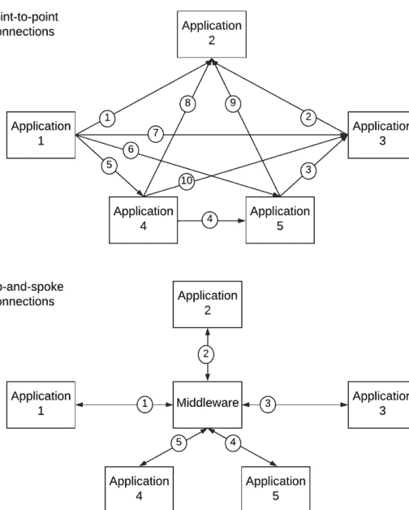
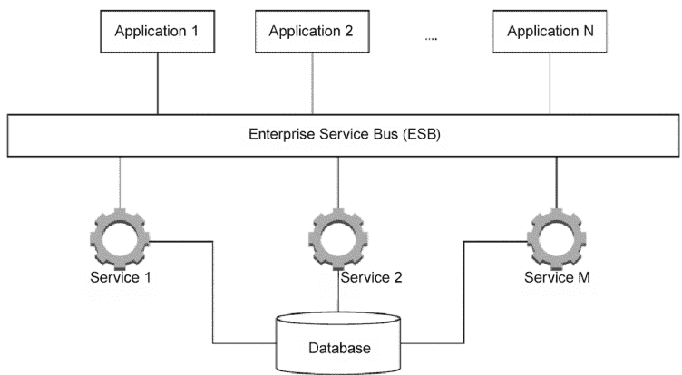
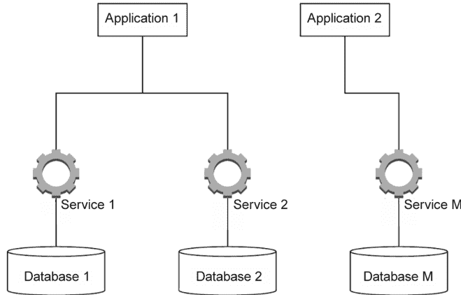
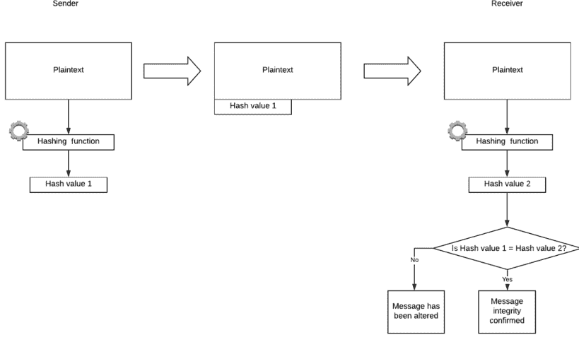
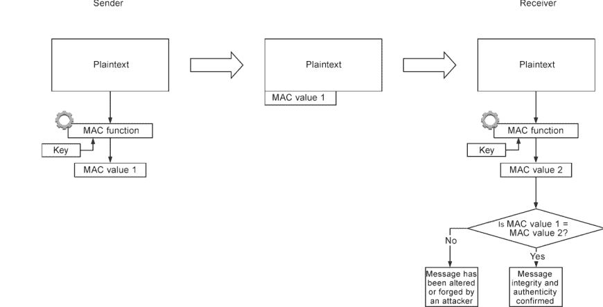
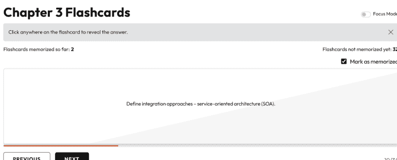
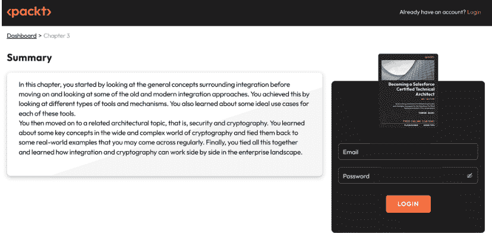
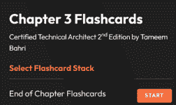

# 核心架构概念：集成与加密

本书附带免费在线内容

有了这本书，你可以无限次访问基于 Web 的 CTA 考试准备工具，例如闪存卡和考试技巧。


图 3.1 – CTA 在线资源仪表板

要解锁内容，你需要使用本书提供的唯一注册码创建帐户。关于如何操作，请参阅*前言*中的*在线内容解锁说明*部分。


## 访问在线内容

如果您已使用这些说明创建了帐户，请访问 pact.link/ctabookwebsite 或扫描以下二维码以快速打开网站。


图 3.2 - 访问 CTA 在线资源的二维码

到达该页面后，请单击页面右上角的登录链接，使用您的凭据访问内容。

在本章中，您将继续了解 Salesforce CTA 应熟悉的一般架构概念。在当今世界，很少遇到 Salesforce 完全孤立的单一实现。在大多数情况下，Salesforce 将成为企业业务转型流程的核心，这意味着它必须与数十个其他新旧应用程序相关联。集成成本有时被忽视或低估，尽管多项研究指出，总项目成本中约有 25-35% 可能用于集成。

制定正确的集成架构对于 Salesforce 项目的成功至关重要。此外，保护内部和外部集成接口变得越来越重要，尤其是随着向 API 经济和数据货币化的逐步转型。人们期望 Salesforce 架构师能够设计安全且可扩展的集成解决方案。

在本章中，您将了解集成和密码学的一般架构概念。建立这种广度知识将帮助您在后续章节中深入探讨 Salesforce 特定主题。在本章中，我们将涵盖以下主题：

- 企业中的集成：了解格局
- 常见集成风格介绍
- 不同集成工具的讨论
- 探索现代集成方法
- 密码学：了解一般概念
- 密码学算法类型和用例

现在，让我们探索列表中的第一个项目。

### 企业中的集成：了解格局

数字企业格局不断变得更加复杂。企业曾拥有不到 10 个系统来覆盖大部分业务流程的日子已一去不复返。如今的企业拥有数百个甚至数千个不同的应用程序，这些应用程序是购买的、内部构建的或组合的。此外，还有仍然幸存的一组遗留系统。如今，很常见的情况是，企业拥有数十个网站、多个 ERP 系统实例以及许多其他部门应用程序，此外还有多个数据仓库或数据湖。

企业最终陷入此类情况的原因之一是构建业务应用程序所关联的复杂性。构建一个运行所有业务流程的单一应用程序几乎是不可能的。维护它、适应日常业务挑战以及请求变更更具挑战性。将业务功能分解为较小的应用程序块始终是合理的。这为企业提供了足够的灵活性和敏捷性，以其需要的速度前进，而不是受制于更大的一体化解决方案的技术边界。此外，它还为企业提供了挑选和选择最适合其需求的最佳应用套件的机会。这意味着将最佳 **客户关系管理 (CRM)** 系统与最佳 **订单管理系统 (OMS)** 和 **企业资源规划 (ERP)** 解决方案相结合。

在过去 20 年左右，供应商为特定核心功能提供了专注的应用程序。对现有应用程序不断添加功能，导致了一种功能外溢。例如，多个客户服务软件已添加扩展以包含有限的计费功能，因为在系统之间划清清晰的功能分界很困难。例如，如果客户对账单提出争议，那会被视为由客户服务还是计费应用程序处理的问题吗？

另一方面，用户并不真正关心这些边界或幕后的系统。他们期望执行业务功能，而不论涉及哪个或哪些系统来交付该功能。例如，当客户在线下订单时，这可能需要多个系统之间的协调来交付多个功能，例如检查客户的历史记录或信用评分、检查库存、计算税费、创建订单、履行订单、处理运输、发送账单、收取付款等。这些过程可能跨越多个系统，但从客户的角度来看，那是一次单一交易。

为了支持这些仍需作为连贯业务流程运行的分布式功能，这些应用程序需要以高效、安全、可扩展且可靠的方式进行集成。

典型的企业集成需求如下：

- **获取正确信息**: 获取由不同系统和企业业务流程创建的特定信息的精确知识。此知识必须以一种能够支持其他业务需求的方式进行结构化。
- **将信息传递到正确位置**: 这需要处理跨异构环境的信息交易的机制，这些环境可能基于不同的技术栈，并驻留在不同的服务器/硬件和操作系统上。
- **在正确时间获取信息**: 理想情况下，这需要实时分发信息，以反映特定数据实体的实际状态。
- **灵活性和对变化的拥抱**: 这是为了适应外部因素，例如市场需求、客户行为转变、新立法或社会哲学的转变。
- **协调业务流程**: 这是一项具有挑战性的操作，可能需要对企业业务流程、它们之间的关联方式以及交换的信息类型进行建模。这可能需要深入了解业务以及对企业的某些知识。

那么，什么是良好的集成架构？您将在下一节中了解。

### 集成架构设计原则

与任何复杂的技术架构主题一样，在设计目标集成策略和架构时，需要牢记若干注意事项和后果。集成是关键领域之一，其中 _次优_ 设计可能对整体解决方案产生重大影响。

主要决策点通常如下：

- **原生集成**: 简单来说，如果您能开发一个单独的独立应用程序，无需与任何其他应用程序协作即可独自满足所有业务需求，那么就可以避免由集成要求驱动的大量复杂性。然而，这通常不是您能实现的。多次尝试扩展应用程序以包含其他功能，可能会最终创建一个难以管理和维护、对市场需求反应缓慢且难以调整以满足新业务需求的复杂系统。

此问题在 Salesforce 世界中也存在，尽管方式更有限。许多 Salesforce 产品是原生集成的，许多被认为是市场上最好的，并能够提供不同的用户体验。例如，Salesforce 社区为暴露客户门户提供了一个原生解决方案，该门户与您的 CRM 原生集成。

Salesforce 社区提供了非常好的共享模型和一种简单的方式来控制社区本身的外观和感觉。与其选择技术，不如支持它，然后想办法以安全合规的方式将其与 Salesforce 集成。此外，使用原生集成为未来使用其他原生集成功能敞开了大门。

- **简洁性：** 这超越了集成架构。简洁性是架构师和开发人员应始终追求的目标。尽可能避免复杂的解决方案，并始终牢记黄金 80-20 原则。

使用简化架构满足 80% 的用例，应优于针对使用过度复杂的架构来覆盖 100% 用例的解决方案。保持集成代码简单整洁。在某些用例中，您可能仍需要引入一些复杂模块来提供高度复杂的功能。

- **应用程序依赖关系：** 集成应用程序应彼此具有最小依赖关系。这使解决方案能够独立发展，而不受彼此路线图的限制。它还允许您完全替换一个应用程序，而不影响其他集成系统。

紧密耦合的应用程序彼此有许多依赖关系，并依赖关于它们各自工作方式的许多假设。当一个应用程序被修改时，这些假设可能会改变，从而反过来破坏集成。

在松散耦合的集成中，集成接口足够具体以交付特定功能，但又足够通用以在需要时允许更改。

- **时序：** 理想情况下，集成架构应力求将应用程序发送数据和另一个应用程序接收数据之间的持续时间最小化。集成架构应力求尽可能频繁地共享小块数据，而不是等待交换可能不一定相关的大块数据。

在设计架构时应考虑数据共享延迟。数据交换过程耗时越长，就越可能变得更加复杂，并面临其他挑战，例如数据状态的变化。批量数据交换仍可用于合适的用例，例如归档操作数据。

- **同步与异步：** 在同步过程中，一个过程会等待其所有子过程执行完毕。然而，在集成环境中，集成应用程序可能位于不同的网络上，或者不一定同时可用，您可能会发现更多用例，其中过程不必等待其所有子过程结束。它只需调用子过程，然后让它在后台异步执行，利用当今许多应用程序中可用的多线程能力。


- 集成技术：选择合适的技术至关重要。根据可用的集成技术，可能会对特定技能集、硬件或软件产生更高的依赖。这可能会影响项目的速度和敏捷性。

- 数据格式：不同应用程序之间交换的数据必须遵循预先商定的格式。在企业世界中，这不太可能。因此，集成过程必须有一个中间步骤，将数据从一种格式翻译成另一种格式。

另一个相关挑战是数据格式的自然演变。容纳数据格式变化和扩展的灵活性在定义集成架构的灵活性方面起着重要作用。

- 数据与功能：集成不一定是关于共享数据。集成的应用程序可能希望共享功能。考虑这样一个用例：一个应用程序需要调用另一系统中的特定功能，例如检查特定客户的信用评分。可能有一组参数会发送到另一端，以促进远程进程的逻辑。调用远程功能可能很困难，并可能对集成的可靠性产生重大影响。身为 Salesforce 架构师，你需要了解特定的集成模式，并理解平台的局限性。你将在第 9 章“构建集成解决方案”中学习此内容。

架构师在设计集成策略或分布式解决方案时，需要考虑多个因素。现在，你需要了解有哪些关键的集成样式，以及它们应该用于什么场景。

## 介绍常见的集成样式

在设计两个或多个系统之间的集成架构时，关键挑战是如何实现它。架构师应该熟悉一些常见的集成样式。你需要对它们有基本了解，并理解如何以及何时使用每种样式。在当今世界，其中一些集成样式已经演变，并作为现代企业集成平台的一部分被使用。接下来，你将熟悉文件传输、统一数据存储、远程过程调用（RPI）、消息传递和混搭集成样式。

### 文件传输

在这种集成样式中，应用程序生成包含其他应用程序将使用的数据的文件。此文件通常采用所有目标系统都能读取的格式，并存储在所有相关系统都能访问的存储库中。这些系统负责将文件转换为它们期望的任何其他格式，而文件生产者则负责根据业务需求定期生成数据文件。

这种方法面临的挑战之一取决于生成的文件类型，因为有些应用程序可能无法以标准格式（例如 XML）生成数据。这对于旧版应用程序尤其如此。该方法的时机和有限的可扩展性一直是一个问题，而可靠性以及及时发现和报告异常的能力则是另一个问题。此外，这种方法仅适合在特定时间点交换数据快照。它缺乏当今集成应用程序所需的敏捷性、可扩展性和速度。

在当今世界，客户预期在完成付款后立即收到付款收据。订单提交后，他们将收到订单确认邮件，随后还会收到确认发货日期的另一封邮件。未能提供类似或更好的用户体验意味着你的整体解决方案未能达到当今的数字客户体验标准，而数字客户体验被视为数字企业最重要的成功因素之一。然而，对于合适的用例，这种方法仍然有效，特别是当需要从旧版系统或不支持 API 且不通过任何其他机制授予你访问其数据权限的外部系统复制报告数据时。

### 统一数据存储

可以这样考虑：如果一组集成应用程序被设计为依赖于共同数据库，那么它们几乎始终以一致的方式集成。如果一个应用程序更新了数据，其他系统在尝试检索数据时，将立即访问最新更新的数据版本。只有缓存的数据可能过期。此外，不需要进行任何数据转换，因为所有相关系统都是为使用给定的底层结构而构建的。

这种方法的挑战在于应用程序之间以及应用程序与数据库之间存在高度依赖。此外，在当今不断变化的技术环境中，期望所有系统都使用统一数据库是不现实的。这种方法在分布式系统的早期非常流行，尤其是在客户端-服务器架构中。今天，它受到数据湖概念的一定推动。许多企业正在尝试一种概念，即将所有运营数据集中在数据湖中，并在其上提供一组丰富的 API，为其他应用程序提供灵活的接口以进行集成。

现实地说，这种方法面临许多挑战，包括当今企业应用程序是为使用其自身数据库而设计和构建的。尝试更改成本非常高且耗时。此外，这可能导致原始应用程序失去关键功能，或最终造成性能瓶颈。

### 远程过程调用

当仅交换数据还不够时，会使用这种集成样式。如你可能已经注意到，前两种方法是在系统之间复制数据。然而，这可能不够。应用程序通常在其依赖的数据发生变化后采取特定操作。例如，应用程序 A 中订单状态的更改可能会触发应用程序 B 中法律实体的创建。为了简化此过程并减少应用程序依赖，引入了 RPI，其中在应用程序 B 中创建该法律实体的逻辑将被封装并提供给其他系统调用。

从历史上看，有几种技术实现了 RPI 概念，例如 CORBA 和 .NET remoting。在当今世界，首选的技术是 Web 服务。如果你不熟悉 Web 服务，可以将其视为一组使用常用开放标准和协议构建的封装功能。Web 服务的主要功能是促进系统之间交换数据。它还继承了一些 RPI 概念，因为被调用的 Web 服务可以反过来调用目标应用程序中的另一个操作。Web 服务主要依赖两种常见标准：SOAP 和 REST。后者被认为更现代，因为其数据占用小且简单，客户端（包括浏览器或移动应用）可以轻松调用它。

Web 服务的概念有时会与应用程序编程接口（API）的概念混淆。API 是一种软件接口，用于将特定应用程序的逻辑和功能暴露给其他应用程序。这样，不相关的应用程序可以集成和交互，而不需要知道彼此是如何构建的。两者概念混淆的原因在于，许多现代系统已将其自身的 API 构建为 Web 服务形式，使用 SOAP 和 REST 等标准。有些系统甚至更进一步，将这些 Web 服务公开给公众，例如 AWS 和 Google。

### 消息传递

消息传递是一种异步集成样式，其中两个或多个系统通过消息总线松散集成。消息总线包含连接发送方到接收方（称为通道）的多个虚拟管道，以及消息路由器（即确定如何导航通道拓扑以将消息传递给正确接收方的组件）。

在这种样式中，集成系统不一定需要同时运行。该样式的异步特性也意味着它更能够扩展以支持高要求的应用程序。然而，如果消息总线的设计未能实现平滑自动扩展，它本身可能会成为瓶颈。这种集成样式提供了企业服务总线（ESB）的原则，ESB 在当今企业中被广泛采用。你将在本章后面学习 ESB 和其他集成工具。该样式的原则也是事件驱动集成架构以及事件存储和流处理平台（例如 Apache Kafka）兴起的基础。

### 混搭

混搭是一种相对较新的技术，主要依赖于浏览器。在混搭中，Web 应用程序/网站通过将数据嵌入 UI 来利用其他 Web 应用程序/网站的数据。这种集成样式有时被称为 UI 级集成。


你很可能多次遇到过混搭应用。想想那些使用 **Google Maps** 将地图嵌入其网页的应用程序。混搭应用通常依赖于 Web 服务，但也可以简单地是一个 **iFrame**（Salesforce 具有一种功能，可实现与其他第三方 Web 应用程序的 UI 级集成，称为 **Canvas**）。

大多数混搭应用都是可视的，尽管有些对用户来说可能是不可见的（例如跟踪 Cookie，它们跟踪 Web 用户在多个网站和设备上的行为）。可视化混搭应用（例如 Google Maps）天生具有交互性，并且在当今的 Web 应用程序中被大量用于丰富整体用户体验。

既然你已经探索了不同的集成样式，现在来看看一些现代的集成方法和工具。作为 Salesforce 架构师，你需要深入理解这些工具之间的差异，以便为你的项目选择合适的工具。

## 讨论不同的集成工具

在讨论当今可用的一些常见类型的集成工具之前，你需要理解 **为什么** 这些工具是必要的。作为 Salesforce 架构师，在选择支持商定的集成策略的正确工具集方面，人们期望你指导客户和集成团队。你应该能够基于有效的逻辑和理由来挑战次优的设计决策。选择错误的工具或在不考虑其潜在影响的情况下选择捷径，可能会证明非常昂贵，并且这可能会以多种方式影响项目/计划，并成为 Salesforce 实施成功的重大风险。在 CTA 评审委员会期间，你始终需要证明你选择集成工具的理由。

历史上，集成两个应用程序的常见方式是通过直接通道，中间没有第三方应用程序或中介。这可以通过 **点对点（P2P）集成** 来实现。现在，让我们更仔细地看一下。

### 点对点集成

作为架构师，你需要了解 P2P 集成的功能和局限性，以及为什么你很可能需要一个集成工具（在某些情况下，它也被称为 **中间件**），在企业环境中。本节描述了各种 P2P 连接。

#### 唯一通道建立

在每对需要相互交互的应用程序之间建立一个 **唯一通道**。连接 N 个系统所需的唯一通道数量可以使用公式 N (N–1) / 2 计算。例如，如果你需要通过单向接口连接三个系统，则需要三个唯一通道。但是要链接 10 个不同的应用程序，你将需要 `10 * (10-1) / 2 = 45` 个唯一通道。当然，所有这些都假设是单向方向。每个通道都必须定期开发、记录、测试和维护。

尽管如此，这不应被视为 P2P 方法的全部成本。真正的成本将在宏观层面开始显现，因为向环境添加额外系统或将额外系统连接到该环境的成本不是线性的。计算一下将三个新应用程序添加到先前提到的环境中需要多少个新的集成通道。实际上，企业不一定期望新应用程序将链接到每个其他应用程序。但是，成本仍然是不可预测的，并且取决于新应用程序及其业务功能的性质，成本可能会大幅上升。

集线器-辐射模式需要的通道要少得多。在这种方法中，每个应用程序都是一个辐射，并且仅针对任何给定事务连接到集线器。这会产生一个更加灵活的环境，能够轻松预测连接额外系统所需的新通道数量。

以下图表比较了两种方法所需的通道数量：



图 3.3 – P2P 和集线器-辐射连接中的唯一通道数量

每个唯一集成通道都预计处理所需的任何数据转换。这将要求你的开发人员充分了解两个集成应用程序。此外，数据转换的逻辑将隐藏在每个通道中，降低了重用或集中管理它们的能力。

### 流程编排

流程编排也需要在通道级别进行处理。这包括任何异常处理和重试机制。例如，考虑这样一个场景：你有一个订单录入应用程序 A，它从在线网页收集客户和订单信息。然后它将这些信息传递给订单管理应用程序 B，后者分别存储客户数据和订单数据。

假设两个应用程序都有可被其他应用程序调用的安全 API。在这种情况下，应用程序 A 将调用应用程序 B 的客户创建 API，并且一旦收到流程已成功完成的响应，它将调用订单创建 API 来创建与最近创建的客户相关的订单。集成通道必须构建为处理客户创建的潜在失败，原因可能包括应用程序 B 不可用。它可能需要实现一个具有全面异常处理和日志记录功能的重试机制。

拥有通知机制也将很有价值。回滚功能也是可取的。请记住，所有这些都必须在环境中的每个 P2P 集成通道中重复。这将需要大量工作，并必然会降低集成解决方案的整体可靠性。

### 整体可靠性

集成解决方案的整体可靠性是一个需要考虑的重要主题，特别是在使用 P2P 连接时。想象一下三个不同应用程序（即 A、B 和 C）的集成解决方案。对于特定的业务流程，应用程序 A 需要与应用程序 B 通信，而应用程序 B 反过来又将与应用程序 C 通信。在使用 P2P 连接时，这些可以被视为三个按顺序连接的系统。这意味着集成解决方案的整体可靠性可以使用此公式计算：

```
R = A1-R * A2-R * A3-R ... * AN-R
```

此处，AN-R 是应用程序 N 的可靠性。

在此示例中，假设应用程序具有以下可靠性：

- A1-R = 0.9
- A2-R = 0.8
- A3-R = 0.5

在此，整体解决方案的可靠性将为 0.9 x 0.8 x 0.5 = 0.36。

为简单起见，假设给定应用程序的可靠性不会随时间变化，也不受任何外部因素（例如服务器容量降低或网络延迟）的影响。每个应用程序的历史故障率也未计入。与 P2P 相比，使用集线器-辐射方法将显著提高解决方案的整体可靠性，因为它简化了连接。集线器本身可能会成为瓶颈，但可能出错的东西更少了。

### 功能受限

由于所有数据转换和流程编排都在每个单独的通道上进行，其中许多通道最终都变成了简单的集成。虽然简单性是应努力实现的架构目标，但 P2P 强加的有限技术功能将有效地限制企业引入复杂业务差异化服务的能力。

### 使 IT 成为阻碍者

随着时间的推移，P2P 集成必然会变得难以维护和支持。团队会担心尝试对其中的任何内容进行更改，部署任何新功能甚至热修复的过程将变得越来越缓慢和昂贵。这将有效地使 IT 部门成为企业的阻碍者，而非推动者。

### 高度依赖

通常，紧密耦合的集成应用程序彼此之间具有高度依赖性。你之前在可靠性和拥有成本的背景下遇到过这种情况。但是，这也可以扩展到其他维度。

考虑一个用例：先前提到的 10 个集成应用程序中有 3 个已达到生命周期结束并需要更换。由于基于 P2P 的环境中存在高度依赖性，这很可能会直接影响环境中所有其他应用程序。

### 可扩展性

由于所有上述原因，很容易理解为什么 P2P 不是设计可扩展企业解决方案的正确选择。


在提出集成架构时，你需要牢记本节讨论的所有注意事项。在 CTA 评审委员会考试中，你需要提出最佳技术方案。在现实生活中，你需要能够向利益相关者阐述利弊，并引导他们了解不同的选择，因为这将帮助他们为自己选择最合适的方案。在接下来的章节中，你将学习更多 Salesforce 特定的集成主题。

既然你了解点对点连接的挑战，你将发现不同的可用集成工具。其中一些工具天生支持辐射型集成架构。

## 提取、转换和加载

在此数据集成方法中，数据从一个或多个数据源复制到目标数据存储，该目标数据存储不一定与数据源具有相同的结构。这种集成方法遵循文件传输集成样式和更现代的 ETL 工具的一些原则，并使用从消息传递样式继承的一些原则：

- **数据提取**涉及访问一个或多个数据源并从中提取数据。
- **数据转换**包括数据在传递到目标之前进行的所有活动。这些活动包括数据清洗、数据格式化、数据丰富、数据验证和数据增强。
- **数据加载**包括访问并将数据加载到最终目标数据存储所需的进程。

ETL 工具可能会将数据暂存到暂存区或暂存数据存储中，以对其运行复杂的转换，例如去重、自定义逻辑，或通过查找外部参考数据进行数据丰富。通常，暂存数据存储将与 ETL 工具在同一服务器上共存，以提供尽可能快的响应时间。三个 ETL 进程都需要时间，因此通常将它们计划运行或以异步方式运行。大多数现代 ETL 工具可以计划每隔几分钟运行特定作业。

某些 ETL 工具还可以公开可触发的端点，这只是一个 HTTP 监听器，可以接收来自特定授权发送者的消息以触发一个或多个 ETL 作业。例如，可以公开一个监听器来接收来自特定 Salesforce 实例的特定类型外发消息。一旦接收到外发消息，监听器将触发一个或多个 ETL 作业，以检索或更新 Salesforce 以及其他系统中的数据。

当今大多数 ETL 工具带有针对不同类型应用程序数据库的*内置连接器*，例如 Salesforce、Microsoft Azure、Amazon Redshift、Amazon S3 和 SAP。此外，它们还带有通用数据库 API 的适配器，例如 **开放数据库互连 (ODBC)** 和 **Java 数据库连接 (JDBC)**。有些甚至为 **文件传输协议 (FTP)** 和 **SSH 文件传输协议 (SFTP)** 提供连接器。这些连接器允许你以优化的方式访问特定的应用程序数据库。例如，Salesforce 连接器可以构建为根据正在执行的操作和处理的数据量，自动在使用 Salesforce 的标准 REST API、Salesforce SOAP API 或 Salesforce Bulk API 之间切换。

当今，多种 ETL 产品以 SaaS 方式提供。在这种情况下，你需要了解 ETL 工具如何连接到防火墙后面的数据库。企业的托管应用程序和数据库通常位于企业防火墙后面。大多数企业都有严格的法规，防止此类资源暴露。这些称为 **非军事区 (DMZ)**。

DMZ 是企业用于向外部暴露面向外部的材料和内容（主要面向不受信任的公众用户）的物理或逻辑子网络。这些 DMZ 中的资源可以被基于云的应用程序访问。然而，这并不是基于云的 ETL 工具访问企业本地托管应用程序的方式。实现此目的最流行的方法之一是在企业本地网络上安装一个 *客户端应用程序*。这是由 ETL 工具产品提供商提供的受信任应用程序，其主要职责是促进企业本地应用程序和数据库与基于云的 ETL 工具之间的通信。安全团队仍然需要配置防火墙，以允许客户端与基于云的 ETL 工具双向通信。

ETL 工具适用于 *数据复制* 操作。它们被设计和构建以提供强健且可扩展的服务，因为它们可以处理数百万甚至数十亿条记录。ETL 工具也非常适合需要大量时间的数据复制，例如复制媒体文件。它们灵活且易于使用。

作为 Salesforce 架构师，你需要了解当今使用的一些流行 ETL 工具。你还需要了解开箱即用工具（例如 Salesforce Data Loader）的局限性，该工具过于简单，无法归类为 ETL 工具。当今使用的一些最流行的 ETL 工具包括 Informatica PowerCenter、Informatica Cloud、Talend、Jitterbit 和 MuleSoft（尽管 MuleSoft 通常被认为更多是一种 ESB 工具，但它支持这两种集成方法）。

## 企业服务总线

**企业服务总线** 是用于特定数据集成方法的名称，其中不同的应用程序通过通信总线进行集成。每个应用程序仅与总线通信。这解耦了应用程序并减少了依赖关系，因此系统可以在不知晓其他系统如何运行的细节的情况下进行通信。这种集成方法遵循 *消息传递集成* 样式以及 *RPI* 样式的原则。ESB 工具进一步发展了这一概念，目前支持不同的架构概念，例如微服务、API 导向的连接性和事件驱动架构。你将在本章后面学习所有这些概念。

ESB 支持同步和异步两种通信类型，这使它们非常适合在业务逻辑层上运行的集成，RPI 是其中需要寻找的关键能力。ESB 还利用 *内置连接器* 连接到不同类型的应用程序和数据存储，类似于 ETL 工具。此处的连接器还将数据从源系统格式转换为总线格式。考虑到 ESB 通常是无状态的，总线中每条消息的状态都包含在消息本身中。当数据在总线上传输时，它被认为处于 **规范数据格式** 中。规范数据格式只是一种数据模型，它涵盖了环境中同一数据的所有其他模型。此规范数据通常 *转译* 为目标数据模型。**云信息模型 (CIM)** 是规范数据模型的一个好示例。

> **注意**
> 描述 CIM 超出了本书的范围，但强烈建议熟悉它。

ESB 可以处理复杂的编排。例如，应用程序 A 可能正在向 ESB 发送客户详细信息，ESB 随后将与多个外部应用程序通信以进行实时信用检查，然后调用 CRM 系统以启动客户入职旅程。客户入职旅程随后生成一个唯一客户 ID，并随成功消息返回给应用程序 A。ESB 可以处理复杂的编排，并可以使用支持数据库作为临时存储或某些数据的缓存。数据库通常与 ESB 工具在同一服务器上共存，以提供尽可能快的响应时间。

ESB 还处理任何所需的数据清洗、数据格式化、数据丰富、数据验证和数据增强，以及从/到不同数据格式的转换。例如，应用程序 A 以 **中间文档 (IDoc)** 格式向 ESB 发送数据，ESB 接收该数据，并使用来自查找/参考数据源的其他数据对其进行增强，然后将其转换为接收者预期的格式，例如 XML、CSV 和 JSON。

ESB 还可以为同一组件提供多个接口，这对于提供向后兼容性特别有用，尤其是对于 Web 服务。ESB 通常设计为可扩展且能够处理高负载流量，当今几种现代 ESB 以 SaaS 方式提供，并可选择在本地托管。由于其无状态特性，ESB 不被认为适合长时间运行的操作，例如在系统之间复制大量数据或移动大型媒体文件。

作为 Salesforce 架构师，你需要了解当今使用的一些流行 ESB。你还需要了解何时以及为何建议将 ESB 作为环境的一部分来利用。确保你充分了解 ESB 和 ETL 之间的区别，以及各自适用的场景。此外，请确保你理解，在大多数情况下，企业应该使用某种中间件而不是点对点连接。请确保你了解 ESB 的 *理想用例*，以识别它们在给定实现中是否以最佳方式利用。ESB 和 ETL 在 Salesforce 解决方案中非常常见，你将遇到多个示例，其中


它们将在后续章节中使用。当今与 Salesforce 一起使用的一些流行 ESB 工具包括 MuleSoft、webMethods Integration Server、IBM Integration Bus、TIBCO ActiveMatrix Service Bus 和 WSO2 Enterprise Integrator。

### 反向代理

反向代理是正向代理的对立面；正向代理由客户端用作中介以连接到服务器，而反向代理是服务器（或服务器集群）在其自身与潜在客户端之间放置的东西。

对于最终客户端，任何检索到的资源都将看起来像是源自代理服务器本身，而非其背后的服务器或服务器集群。反向代理常用于为处理不可信客户端（如未经授权的互联网用户）提供更安全的接口，并屏蔽其背后可能无法处理过载或无法提供所需安全措施（例如无法支持 HTTPS）的其他应用程序。

反向代理可以提供诸如将 HTTPS 请求转换为 HTTP、处理 Cookie 和会话数据、在后台将一个请求转换为多个请求，然后合并响应并缓冲传入请求，以保护受屏蔽服务器免受过载影响等功能。反向代理产品的一些提供商包括 VMware、Citrix Systems 和 F5 Networks。

### API 网关

**API 网关**历史上被用于保护您的内部 Web 服务（或 API——请记住，在 Web 语境中这两个术语可以互换使用，因为大多数现代 API 都是作为 Web 服务提供的）。企业内部 API 可能未设计用于处理身份验证和可扩展性等主题，因此 API 网关将在其上提供一层来保护 API，并启用一组其他功能，例如 API 商业化、提供实时分析以及防范 **拒绝服务 (DOS)** 攻击。

API 网关在概念上与反向代理非常相似，可以被描述为一种特殊的反向代理。在某些情况下，您的架构中可能同时拥有两者，其中 API 网关位于处理负载均衡的反向代理之后。API 网关通常可以通过 API 或 UI 进行配置。另一方面，反向代理通常通过配置文件进行配置，并需要重新启动才能使用新的配置集。API 网关还提供高级 API 功能，例如速率限制、配额和服务发现。

身为 Salesforce 架构师，您需要了解当今使用的一些流行 API 网关，例如 MuleSoft、Microsoft Azure API Management、Google (Apigee) 和 IBM API Management。

## 流处理平台

**流处理平台**旨在充分利用并行处理的系统。这使它们能够充分利用服务器的计算能力。理想情况下，它们用于事件驱动的集成。该过程继承了 *消息集成* 风格的一些原则。流处理平台通常被称为 *消息队列平台*。您将很快了解事件驱动的集成方法。

流处理平台可以处理大量传入数据，因为它们设计用于利用弹性伸缩。它们也易于封装在容器中，这使得它们可以轻松部署在不同平台上，包括云、本地或混合环境。由于其功能和特性，流处理平台被认为是需要大规模可扩展消息平台的用例的理想选择，例如 IoT 服务器。当今使用的一些最流行的流处理工具包括 Apache Kafka、Amazon Kinesis、Redis 和 RabbitMQ。Salesforce Heroku 支持其中一些技术，例如 Kafka。

至此，您已了解 P2P 连接可能产生的挑战以及中间件的必要性。您还发现了不同类型的中间件，每种都反映了几个价值。您现在将探索一些现代集成方法，例如 **面向服务架构 (SOA)**、微服务、API 连接性和事件驱动架构。

## 探索现代集成方法

技术格局不断变化，身为 Salesforce 架构师，您每天都在处理现代工具和技术。将您之前涵盖的主题与当今的现代集成方法保持一致非常重要。这些方法中的一些已经失去了流行度，但其概念仍然是其他现代方法的基础。

要完全理解现代集成方法，并能够与客户、企业架构师和集成架构师就采用最合适的集成策略进行讨论，您需要对当今的现代集成方法有广泛了解，并对其基础有深入扎实的理解。有时，技术爱好者会被新概念和术语所吸引。虽然了解最新市场趋势很重要，但作为高级架构师，您需要了解哪种方法最适合您的客户和手头的项目。

## 面向服务架构

SOA 是一种软件开发方法，旨在将业务逻辑封装为 *服务*，以充分利用可重用代码。每个服务包含完成特定业务用例所需的代码和数据集成，例如下单购物或引入新客户。

这些服务是松耦合的，并使用 *ESB* 相互通信。这意味着开发人员可以通过在企业范围内重用现有 SOA 服务来节省时间。

SOA 服务是具有明确特定结果的特定业务活动的逻辑表示。它们作为 *黑盒* 提供给消费者，消费者无需担心这些服务的工作原理。这些服务可以由多个底层服务组成。

SOA 出现于 20 世纪 90 年代末，是其他现代集成方法（如微服务和事件驱动架构）的基础。SOA 的一些批评者提到其性能和可维护性方面的挑战，以及将其设计到适当粒度级别的困难。

基于 SOA 的简化架构如下所示：

SOA-Based Architecture



图 3.4 – 基于 SOA 的架构示例

## 微服务

微服务是 SOA 的一种现代诠释。它们由松耦合且可重用的组件组成，具有明确的功能和结果。微服务不通过 ESB 进行通信，而是直接相互通信。服务可以使用不同的技术和协议。

微服务架构面向云端。它利用 **开发和运维** (**DevOps**) 概念，允许分散的小团队完全负责特定服务，使用其首选技术交付其功能，并通过轻量级容器将其快速发布到企业。

微服务通常用作其他企业应用程序的构建块。它们是细粒度服务，并可访问自己的数据存储以检索所需数据。微服务不应访问相同的数据存储/数据库，因为这会在它们与其他数据存储之间创建依赖关系。微服务原则倾向于封装和独立性，而非可重用性；冗余代码被视为可接受的副作用。

微服务自 2014 年推出以来因其与 DevOps 概念的关系而变得流行。由于 SOA 和微服务之间存在相似性，了解这些集成方法之间的一些关键差异很有用：

- 同步调用：可重用的 SOA 服务应通过使用 SOAP 或 REST API 等同步协议在整个企业中可用。在微服务架构中，不太偏好同步调用，因为它们可能会创建实时依赖关系，从而导致延迟。更偏好异步方法，例如发布/订阅，因为它能增强服务的弹性和可用性。

- 通信：SOA 服务使用 ESB 进行通信，这使得 ESB 成为性能瓶颈。微服务是独立开发的，并直接使用不同的协议和标准进行通信。

- 重用：SOA 的核心是提高可重用性，而在微服务架构中，这不那么重要。这是因为在运行时实现一定程度的重用可能会在微服务之间创建依赖关系，从而降低敏捷性和弹性。在微服务中，通过复制粘贴来复制代码被视为可接受的副作用，以避免依赖关系。

- 数据复制：在 SOA 中，服务可以直接访问和修改数据源或应用程序中的数据。这意味着多个 SOA 服务可能会访问同一个数据存储。

- 微服务始终旨在减少依赖关系。理想情况下，微服务应能本地访问所有数据以交付其预期功能。这意味着可能需要复制一些数据。这也意味着不同服务之间的数据可能不同步。数据复制为微服务的设计和潜在使用增加了大量复杂性，因此必须与微服务独立性所带来的预期收益相权衡。

- 粒度：微服务设计为专业且细粒度，以执行一个特定任务，而 SOA 服务反映业务服务，范围从小型到更大的企业范围服务。

- 速度：由于多种因素，速度是 SOA 的较弱方面之一。微服务轻量且更专业，通常使用轻量级通信协议，例如 REST。它们通常比 SOA 服务运行速度更快。


基于微服务的简化架构如下所示：

## 基于微服务的架构



图 3.5 – 基于微服务的架构示例

## API 导向架构

**API 导向架构**是一种 API 策略，其中所有外部和内部服务都作为受管 API 暴露，无论其实现方式如何（微服务、SOA 服务、源自单体应用程序的 Web 服务，或基于其他架构）。**受管 API**在当今的现代术语中，不仅仅提供诸如安全策略、限流、版本控制和自动服务发现等治理能力。该原则已扩展到包括开发者门户（他们可以在使用 API 之前尝试 API）、生产力工具以及一种注册和支付 API 使用的机制。在这种方法中，API 通常组织成三个不同的层：

- 系统 API：这些 API 用于访问核心系统和服务。它们在服务消费者与底层系统或服务之间提供了一个简化的绝缘层。
- 流程 API：这些 API 用于与来自底层系统 API 或其他流程 API 的数据进行交互、转换和塑造，从而有效地打破数据孤岛。它们不依赖数据来源的源系统，也不依赖数据将要传送到的目标系统。系统 API 和流程 API 都可以用于连接现有的微服务以及其他企业服务，具体取决于用例。
- 体验 API：这些 API 用于让最终用户或应用程序轻松访问和消费数据。它们通常与一个或多个流程 API 通信，以交付特定功能。

微服务众所周知会创建许多端点，这些端点通常难以控制和货币化。API 导向架构旨在制定一种 API 策略，通过利用 REST 等轻量级标准的功能，并将其与现代 API 网关功能相结合，来管理不同企业服务之间以及与外部消费者之间的交互方式。

微服务通常由应用程序消费。API 导向架构旨在将这些应用程序转化为一组更小、更轻量的 API。这可以帮助企业向 API 经济迈出步伐。例如，企业可以在其丰富的服务集之上创建一组 API，这些服务使用不同的技术构建并基于不同的架构，然后利用 API 管理器以不同的适用策略和订阅机制在内外部暴露这些服务。

此外，这种方法也被视为快速应用程序开发的推动者，因为你可以重用基于不同业务流程构建的 API。MuleSoft Anypoint Platform 是一种工具，可帮助企业交付 API 导向的集成架构。

## 事件驱动架构

事件驱动架构是一种软件开发方法，利用事件在集成和解耦的应用程序中进行通信和触发操作。事件只是特定对象状态的变化。例如，客户状态值的变化可能会触发客户状态变更事件，从而在集成系统中启动一组操作，例如启动营销旅程。

事件驱动架构继承了前面提到的消息集成风格的一些原则。事件驱动架构有三个主要组件，即事件生产者、事件路由器和事件消费者。生产者将事件发布到路由器，路由器处理过滤并将事件推送到订阅的消费者，消费者接收事件、解析它、将其转换为适合其需求的格式，然后使用它，通常用于更新其自身的数据版本或触发后续逻辑。流处理平台、现代 ESB 或 CometD 等事件路由总线通常用作路由器。

现在您已经掌握了现代集成方法的一个重要主题，可以进入另一组关键的架构概念。密码学是现代数字通信构建的基础之一。它已使用数百年，但在数字时代得到了蓬勃发展。密码学概念与集成密切相关并被大量使用。在下一节中，您将了解一些一般密码学概念，理解关键的密码学算法类型，并详细讨论它们的一些用例。

## 密码学：理解一般概念

密码学与其他架构领域（例如集成以及身份和访问管理 (IAM)）有着紧密的关系。它也与数据有着强烈的关系。作为 Salesforce 架构师，您需要了解密码学的价值、不同类型的密码学算法，并对流程有高层次的理解。这将帮助您了解 Salesforce 实施项目中日常活动的复杂性，例如使用传输层安全性 (TLS) 或双向 TLS（也称为相互身份验证）来保护集成通道，或者身份验证令牌是如何进行数字签名的。

**加密**是将原始可读数据（也称为明文）转换为未经授权的一方无法读取的形式（也称为密文）的过程。加密不是防止他人干扰数据的方法，而是一种机制，用于拒绝未经授权的一方访问数据的可读形式。换句话说，攻击者最终会得到一个没有用的数据版本，并且在合理的时间内无法将其转换回有用的格式。

以古代加密算法为例。移位密码是一种经典且非常基础的方法，用于在不安全地区通过信差发送加密消息。在移位密码中，单词字母的顺序根据特定逻辑重新排列。例如，hello world 这样的陈述可能会变成 ehllo owrdl。如果消息落入不法之徒手中，他们仍然可以破坏或篡改它，但理想情况下，他们不应该能够读取它。

古代加密的另一个例子是替换密码，它依赖于根据只有消息生成器和授权方知道的规则，用其他字母或符号替换字母或符号。例如，London 通过将每个字母替换为英文字母表中的下一个字母，变成 Mpoeop。通常，一旦你知道两件事（即算法和密钥），消息就可以轻松解密。在此示例中，算法是替换密码，密钥是英文字母表中的字母顺序 + 1。

在当今，使用计算机很容易破解这些算法。当今的密码学算法要复杂得多，更难以破解。

直到现代，密码学和加密主要指同一件事。然而，在第一次世界大战期间，密码学使用的技术有了飞跃。首先使用了转子密码机，然后在第二次世界大战期间开发了更多计算能力。

现代密码学依赖于计算机科学实践和数学理论。它们旨在提供一种机制，通过使破解尝试变得不可行来保护加密数据的内容。理论上，所有加密算法都可以破解，只要给予足够的时间并考虑可用的计算能力（最基本的攻击形式是暴力破解，它会尝试每一个可能的密钥，直到找到正确的密钥为止）。然而，考虑到实现这一过程可能不可行，这使得这些算法在计算上是安全的。例如，要使用暴力破解破解 AES-256，攻击者平均需要尝试 2^255 个密钥。估计


这对于 2016 年的高端 PC 来说，将需要 27 万亿年的五倍时间。随着计算机技术的最新进展，所需时间已大幅减少，但仍可能需要一段时间。因此，破解此加密在实践中根本不可行，因此在计算上是安全的。

你之前已经接触过一些术语，但有一些关键术语你需要熟悉：

- 密钥/加密密钥：加密密钥是控制密码学算法输出的输入参数。密钥是密码过程中的基本元素。解密密文需要密钥。没有它，密文可以被视为无用。

在第 2 章“核心架构概念：数据生命周期”中，你接触过一种数据销毁机制，它只是依赖于销毁加密密钥。这样一来，加密数据就变得无用且无法恢复。密钥被认为是密码学过程中最重要的元素。攻击者可以找出用于加密一段信息的算法（这可能是公开可用的东西，例如 TLS 使用的算法，你将在本章后面学习），但只要密钥尚未泄露，这不应是问题。生成长加密密钥的过程极其复杂。

对称密码学算法通常使用 128 位和 256 位长度的密钥。另一方面，非对称密码学算法通常使用 1,024 位和 4,096 位长度的密钥。你将在本章末尾了解更多关于对称和非对称密码学算法的信息。

- 密钥管理：这是管理密码学密钥的过程。它包括生成、交换、存储、使用、替换和销毁密钥。安全的密钥管理对企业至关重要。它涉及制定企业政策、培训用户以及定义组织和部门之间的交互。密钥和证书通常在存储库中进行管理。

> **注意**
> 密钥管理是一个广泛的领域，超出了本书的范围。

最近，云服务提供商开始支持一种称为自带加密（BYOE）或自带密钥（BYOK）的机制，其目的是通过让客户完全控制其加密密钥，而不是依赖云服务提供商提供或托管的密钥存储库，来增强客户在云中存储数据的信心。Salesforce Shield 支持 BYOK 概念。

- 初始化向量（IV）：这通常可以被视为密码过程中使用的一个初始值，很可能在迭代开始时使用。这个伪随机值用于确保每条消息都以不同的方式加密。即使同一条消息被加密两次，结果每次看起来也会不同。这有助于进一步保护密文，因为攻击者不会意识到两个密文块基于相同的明文，这显著降低了攻击者分析模式的能力。与密钥不同，IV 不应泄露。许多算法会将 IV 设置为密文的前 128 位。如果消息落入不法之徒手中，攻击者可以轻松提取 IV，但没有密钥它是无用的。对于接收者（拥有密钥），使用密钥和唯一 IV 解密消息是简单直接的。

如果你熟悉 Salesforce Crypto 类，你会注意到它具有 encryptWithManagedIV 和 decryptWithManagedIV 方法，不像标准的 encrypt 和 decrypt 方法，它们不希望将 IV 作为输入参数。encryptWithManagedIV 和 decryptWithManagedIV 都会从加密消息本身中提取 IV，并期望其位于密文的开头。如果你不熟悉 Salesforce Crypto 类，请查看在线文档。你将在后续章节中了解更多关于此类的信息，但查看在线文档并理解该类提供的不同功能仍然是个好主意。

- 盐：盐是添加到输入中的一段伪随机数据。盐主要用于单向哈希算法。例如，捕获用户密码的系统可以在哈希组合文本之前向其中添加一个盐值。这使得攻击者更难猜测原始密码的长度。此外，考虑到盐值每次都是随机的，对于两个相同的输入，输出将完全不同。

回到这个例子，即使攻击者设法破解了其中一个密码，他们也无法猜测是否有其他用户使用了相同的密码，从而也危及他们的账户。用更专业的术语来说，加盐会增加低熵输入的熵。

与 IV 类似，盐值不应泄露。通常，它将与其他用户详细信息一起存储在数据库中。

- 证书：证书是一份电子文档，包含称为公钥的加密密钥，以及其他信息，例如颁发者和证书的用途。证书用于证明拥有证书公钥对应私钥的特定实体（例如 Web 服务器）的真实性。公钥和私钥是用于非对称密码算法的术语。证书可以由颁发者进行数字签名。对于公共网站，颁发者将是一个称为证书颁发机构（CA）的第三方独立实体。CA 的示例包括 Comodo、GeoTrust 和 Symantec。

例如，当您访问安全的 HTTPS 网站时，网站会将其证书呈现给您的浏览器。证书包含服务器的公钥。这是由 CA 颁发的，因此证书本身将包含 CA 的数字签名，以确认证书的真实性。使用公钥和 CA 签名，浏览器可以确保它正在与之通信的服务器确实是正确的服务器，并且与该服务器的任何通信都将受到中间人攻击的保护。由 CA 颁发或签名的证书通常称为 CA 签名证书。后来，您将了解 TLS 协议的工作原理，这将帮助您进一步理解数字证书的价值和用途。您还将更详细地了解数字签名的工作原理。

- **分组密码**：这是赋予对 _固定长度_ 比特组（称为 _块_）进行操作的密码学算法的名称。例如，**高级加密标准**（**AES**）算法使用不同长度的密钥（如 128、192 或 256 位）加密 128 位块。

你已经学习了密码学，并探索了当今使用的一些常见术语。现在，让我们继续了解不同类型的密码学算法。

## 密码学算法类型和用例

你将深入研究的两种密码学算法是对称密码学算法和非对称加密算法。你还将深入了解哈希算法、数字签名和 **消息认证码**（**MAC**）。

## 对称密码学算法

这是一类依赖于 _对称密钥_ 来同时加密明文和解密密文的算法。安全、可靠地存储密钥对这种类型的算法至关重要。需要在双方（发送方和接收方）之间共享密钥，是这种类型算法的主要缺点之一，因为攻击者可能会拦截所使用的通道并获取密钥。历史上存在多种变通方法（记住，其中一些算法已经存在多年了）。数字世界中已经采用了更精简的方法，当你了解 TLS 的工作原理时，会了解更多相关内容。

有几种对称密码学算法也被视为 **互易密码** 或 **自互易密码**。这是一种密码算法，它可以获取明文并使用加密密钥将其通过特定算法逻辑转换为密文。然后，它获取密文并使用相同的密钥通过完全相同的逻辑再次生成明文。这包括 XOR 密码和 Beaufort 密码，以及著名的二战 Enigma 机。

对称密码学算法主要有两种类型，即 _流密码_ 和 _分组密码_。你之前学习过后者，而前者超出了本书的范围。流行的现代对称密码学算法示例包括 **数据加密标准**（**DES**）、Blowfish、AES 及其不同版本，即 AES-128、AES-192 和 AES-256。Salesforce `Crypto` 类支持这三个版本的 AES。


还有派生的对称加密算法，其运行方式与您刚才介绍的算法略有不同。虽然 AES 等算法旨在将明文加密为密文，但哈希算法旨在确保特定消息的完整性。MAC 算法用于提供这种哈希功能，以及某种身份验证。下一节将详细介绍这一点。

## 哈希算法

哈希算法是为解决一个简单问题而设计的算法：接收者如何确保接收到的消息未被更改或篡改？哈希算法从明文生成摘要。摘要（也称为哈希值）无法转换回明文。哈希算法是单向函数，即其输出不可逆转。哈希算法具有以下属性：

- 这些算法是确定性的。因此，对于相同的输入消息，您始终会得到相同的输出结果（除非使用盐值，如前面讨论过。在哈希之前向消息添加不同的盐值会生成不同的哈希结果）。
- 由于其特性，攻击者尝试生成产生给定哈希值的消息在计算上不可行。
- 即使对原始明文进行微小更改，也会显著改变哈希值，使新哈希值看起来与旧值完全无关。这有时被称为雪崩效应。
- 通常，哈希算法不需要或不使用密钥。请记住，哈希算法的目的是确保原始明文的完整性。哈希算法在计算机系统中有广泛用途。它们用于数字签名和 MAC 算法，以及生成加密密钥、创建索引数据、检测重复数据和创建消息校验和。
- 流行的现代哈希算法示例包括 MD5 消息摘要算法、Whirlpool、安全哈希算法（SHA）及其不同版本，即 SHA-1、SHA-256 和 SHA-512。Salesforce Crypto 类支持这三个版本的 SHA。

以下图示说明了哈希算法的一般机制：



图 3.6 – 哈希算法工作原理图

## MAC 算法

MAC 算法与哈希算法相似，两者都会生成明文的单向摘要/哈希值。但是，MAC 算法主要旨在_验证消息发送者的真实性_，此外还验证消息本身未被篡改。

为此，MAC 算法在过程中使用密钥。通常，这用于加密哈希值本身。密钥应由发送方和接收方都知道。它可用于验证生成哈希的实体拥有相同密钥的副本，这是消息本身真实性的证明。

流行的现代 MAC 算法示例包括 **键控哈希消息身份验证码 (HMAC)** 及其不同版本，即 HMACMD5、HMACSHA1、HMACSHA256 和 HMACSHA512。Salesforce `Crypto` 类支持所有这些版本。

以下图示说明了 MAC 算法的一般机制：



图 3.7 – MAC 算法工作原理示意图

## 非对称加密算法

这些也被称为 **公钥加密算法**，旨在创建一种加密机制，其中两个通信实体可以使用一对不同的密钥。第一个称为私钥，不应泄露，而第二个称为公钥，可以安全分发。

在这些算法中，应用程序可以使用公钥加密消息。该消息只能使用配对的私钥解密。这就像有一个带锁的袋子，可以用一把钥匙锁上，用另一把钥匙打开。非对称加密算法生成密钥对的过程比生成对称密钥的过程更复杂。此外，非对称算法通常更复杂且运行更耗时。

非对称加密算法当今广泛采用。它们主要用于以下两种用例：

- 消息机密性：分发公钥是完全安全的。但是，私钥必须与应接收和解密密文消息的实体一起保密。

在这种情况下，非对称算法解决了对称算法面临的主要挑战之一，即密钥分发。使用非对称算法，消息使用公钥加密，只能由最初颁发密钥对的实体使用私钥解密。

在此机制中，私钥所有者可以确保接收消息的机密性。众所周知的非对称加密算法示例包括 ElGamal、RSA 和 Diffie-Hellman 密钥交换。

- 数字签名：在此情况下，私钥用于通过生成该消息的摘要/哈希值来有效签署特定消息。任何拥有公钥访问权限的人都可以验证签名。验证过程证明签署消息的实体有权访问私钥，从而证明了发送者的真实性。

此外，哈希值用于确保特定消息未被篡改。这可能听起来与之前提到的 MAC 算法类似，但您需要记住，公钥用于验证数字签名。分发公钥从来都不是问题。一些用于数字签名的流行非对称加密算法示例包括 RSA-SHA1、RSA-SHA256、RSA-SHA384 和 RSA-SHA512，所有这些都由 Salesforce 的 Crypto 类支持。

现在您已经了解了这两种加密算法及其变体和主要用例，让我们来看一个您在浏览安全网站时每天都会遇到的真实示例。

## 加密用例

首先，将讨论 TLS 的工作原理细节。然后，您将继续了解其被称为双向 TLS（也称为双向 SSL 或相互身份验证）的特殊情况。作为 Salesforce 架构师，您很可能在项目中接触到这两个主题。理解两者的工作原理非常重要，因为您可能会在评审委员会或实际工作中被要求解释。

## 了解 TLS 的工作原理

TLS 是一种已取代安全套接字层 (SSL) 的加密协议。它旨在保护两个计算机应用程序通过网络（例如互联网）进行的任何通信。迄今为止，TLS 有四个版本（1.0、1.1、1.2 和 1.3）。Salesforce 不断更新其平台以支持最新且最安全的 TLS 版本。您应尽可能使用最新可用的 TLS 版本，并避免使用早于 1.2 的任何版本。

当通信通道由 TLS 保护时，两方之间的通信（通常称为 *客户端*，例如浏览器，和 *服务器*，例如 `packtpub.com*）具有一个或多个以下属性：

- * **私密连接**：使用对称加密算法加密传输的数据。用于此加密的密钥每个会话唯一，并作为 *握手* 过程的一部分生成。握手过程是安全的，即使针对中间人攻击也是如此。
- * **真实身份**：通信双方的身份可以使用利用 *CA 签名证书* 的非对称加密过程进行验证。验证通信双方的身份可以是可选的，但通常至少要求对服务器进行验证。一个示例是客户端尝试打开 HTTPS 网站时。如果双方的身份都经过验证，则此通道变为双向 TLS 安全通道。您将很快了解其工作原理。
- * **可靠**：每条交换的消息还将包含 MAC 值，以确保消息本身未被修改或篡改。

现在，请看当用户尝试导航到诸如 `https://packt.link/LWerl` 之类的安全网站时发生的高级别细节：

- 1. 客户端（在此情况下为浏览器）启动握手过程。客户端提供其愿意支持的密码套件（及其版本）列表。
- 2. 服务器（在此情况下为 `https://packt.link/LWerl`）检查其是否愿意支持和使用客户端提供的任何密码套件。例如，Salesforce 于 2019 年 10 月 25 日停止为其生产组织支持 TLS 1.1。如果浏览器配置为使用不晚于 TLS 1.1 的版本，则连接将被拒绝。如果服务器同意使用客户端支持的密码套件之一，它将发送包含其 CA 签名证书的响应。（请记住，证书还将包含公钥。）
- 3. 客户端将使用提到的 CA 验证给定的证书（验证数字签名）。此步骤是必要的，以向客户端保证其正在通信的网站是真实的，并确实是其声称的样子。如果证书成功验证，客户端将从证书中提取公钥。
- 4. 客户端生成随机预主密钥，并使用公钥对其加密。这意味着该预主密钥只能由私钥持有者解密。客户端现在将此加密的预主密钥发送到服务器。
- 5. 服务器使用其私钥解密预主密钥。
- 6. 客户端和服务器均使用预主密钥计算一个称为 **共享密钥** 或 **会话密钥** 的新共享密钥。*步骤 4、步骤 5* 和 *步骤 6* 也可以使用 Diffie-Hellman 密钥交换来实现，但这超出了本书的范围。
- 7. 客户端发送使用会话密钥加密的新测试消息。这现在是简单的对称加密。


- 8. 服务器使用会话密钥解密消息并确认该过程成功。这意味着双方已成功交换一个独特的对称加密密钥，该密钥安全且仅双方知晓，即使存在第三方攻击者监听整个对话。会话密钥将是安全的且仅客户端和服务器知晓。

- 9. 从现在起，双方之间的任何通信都将在会话剩余时间内使用会话密钥进行。所有交换的消息也受到使用会话密钥的 MAC 保护。此会话密钥仅在此会话期间有效。下次客户端和服务器想要通信时，他们必须再次经历相同的过程并生成新的会话密钥。

你可能已经注意到，在此过程中，非对称加密最初用于生成会话密钥（握手过程）。一旦生成会话密钥，对称加密将用于通信会话的其余时间（使用会话密钥本身加密任何发送的消息）。这主要是因为与对称加密算法相比，非对称加密算法太慢（并且消耗更多计算资源）。因此，它们通常仅用于加密少量数据。

此示例包含了你之前学过的大部分术语，包括证书、数字签名、对称和非对称加密以及 MAC 值。接下来，你将了解更多关于双向 TLS 的内容。

## 了解双向 TLS 的工作原理

双向 TLS（有时仍称为双向 SSL）与标准单向 TLS 非常相似，主要区别在于...

在单向 TLS 中，客户端验证服务器的证书以确认服务器身份。身份验证成功后，客户端会确信服务器的身份，但服务器无法确认客户端的身份。在之前的示例中，这可能不太重要，因为公共服务器每分钟都有成千上万甚至数以百万计的用户访问；它们为所有用户提供服务，而无需确认其身份。但是，如果服务器提供的服务应仅限于有限数量的客户端使用，该怎么办呢？正因如此，使用了双向 TLS，因此它有时也被称为相互身份验证或双向身份验证。

双向 TLS 的流程如下：

- 1. 客户端（在此情况下通常是应用程序而非浏览器）启动握手过程。客户端提供其愿意支持的加密套件（及其版本）列表。
- 2. 与单向 TLS 的步骤 2 相同。
- 3. 与单向 TLS 的步骤 3 相同。
- 4. 客户端生成随机的预主密钥并使用公钥对其进行加密。这意味着只有持有私钥的人才能解密此预主密钥。客户端将其自身的证书连同此加密的预主密钥一起发送到服务器。
- 5. 服务器使用提到的 CA 验证客户端的证书（验证数字签名）。通常，服务器将配置为仅限制特定客户端访问。在此情况下，服务器会将给定的证书与其持有的 *允许的客户端证书* 存储库进行比较。如果给定的证书在其中，它将继续下一步。
- 6. 其余步骤与单向 TLS 相同。

双向 TLS 在 SaaS 领域是一种非常流行的机制，因为许多生产环境（在 Salesforce 领域，这些被称为 *生产实例*）共享相同的基础设施、域名和 IP 范围。双向 TLS 提供了一种方便的方式，以确保正确的实例可以由正确的客户端应用程序集访问。现在，让我们看一个快速示例来进一步解释这一点。

## 将集成与加密结合起来

假设你有一个 Salesforce 实例，它已通过 ESB 中间件（例如 *MuleSoft CloudHub*，这是一个基于云、多租户且完全托管的平台）与一组基于云和本地托管的应用程序集成。你需要确保只有你企业的 Salesforce 实例可以与你企业的 MuleSoft CloudHub 实例通信，反之亦然。双向 TLS 将提供该功能，并确保你的数据在传输过程中始终安全且加密。但是，在下一章（*第 4 章，核心架构概念：身份和访问管理*）中，你将了解到，对于某些用例，你可能需要在该架构中添加另一层身份验证。

## 摘要

在本章中，你首先了解了围绕集成的一般概念，然后继续了解了一些旧的和现代的集成方法。你通过查看不同类型的工具和机制实现了这一点。你还了解了每种工具的一些理想用例。

然后，你转向了一个相关的架构主题，即安全与加密。你了解了广阔而复杂的加密世界中的一些关键概念，并将它们与你可能经常遇到的真实世界示例联系起来。最后，你将所有这些整合在一起，了解了集成与加密如何在企业环境中并肩工作。

在下一章中，你将学习另一个关键架构概念。IAM 架构概念现在在现代分布式解决方案中被广泛使用。这些 IAM 概念与集成和加密领域密切相关，并且在 Salesforce 等基于云的解决方案中很常见。在探讨这些 IAM 概念时，你将查看它们的定义、标准和流程。

## 章节复习闪卡

在继续下一章之前，建议你先浏览本章的闪卡。这些闪卡将本章的所有概念浓缩为更小、更易于管理的块，有助于快速复习和记忆。通过参与这些闪卡，你将加强对关键主题的理解，找出需要进一步学习的领域，并在继续学习新概念之前建立信心。

以下图片显示了闪卡界面的示例。



图 3.8 – CTA 闪卡

要访问本章的章节末尾闪卡，请执行以下步骤：

- 1. 打开 web 浏览器并访问 https://packt.link/ctach3。你将看到以下屏幕：



图 3.9 – 章节摘要和登录

你也可以扫描以下二维码来访问该网站：


图 3.10 – 访问第 3 章闪卡的二维码

- 2. 使用你的凭据登录到你的帐户。如果你尚未激活帐户，请参阅序言中的“在线内容解锁说明”以获取详细说明。登录成功后，你将看到以下屏幕：

Dashboard > 第 3 章

## 第 3 章

## 摘要

在本章中，你首先了解了围绕集成的一般概念，然后继续了解了一些旧的和现代的集成方法。你通过查看不同类型的工具和机制实现了这一点。你还了解了每种工具的一些理想用例。然后，你转向了一个相关的架构主题，即安全与加密。你了解了广阔而复杂的加密世界中的一些关键概念，并将它们与你可能经常遇到的真实世界示例联系起来。最后，你将所有这些整合在一起，了解了集成与加密如何在企业环境中并肩工作。



<- 返回控制面板

图 3.11 – 章节摘要和章节末尾闪卡

- 3. 点击闪卡堆栈上的“开始”以开始复习。


