## 核心架构概念：身份和访问管理
# 

在本章中，你将继续探索 Salesforce CTA 应熟悉的通用架构概念。**身份和访问管理 (IAM)** 是架构师需要处理的最具挑战性的主题之一。在正常项目中，你可能会发现自己在与来自不同技术背景的多个 IAM 专家合作。你需要能够与他们使用同一种语言，理解他们的愿景，并在必要时挑战其架构设计。作为 Salesforce CTA，你需要跳出标准平台知识范畴，在其他相关事项中提供专家指导。与集成一样，IAM 是另一个很好的示例。

在本章中，你将学习以下主题：

- 了解 IAM 的一般概念
- 熟悉常见的 IAM 标准
- 了解关键的身份验证流程

## 了解 IAM 的一般概念

IAM 架构是定义流程、工具、监控机制和治理的活动，旨在以受控且安全的方式向企业内部和外部用户授予对正确数字资产的访问权限。IAM 架构需要确保根据内部和外部要求（例如企业政策或法规合规性）为用户授予适当的访问权限。

IAM 架构中包含的用户可能是外部用户（在这种情况下，使用术语**客户身份和访问管理 (CIAM)**）或内部用户（在这种情况下，改用术语 IAM）。

IAM 策略旨在为企业客户和员工创建一个_统一数字身份_，并提供一系列工具和流程来管理该身份及其相关的访问权限。

IAM 架构在当今互联的企业应用中至关重要。数据价值的快速增长以及企业为充分利用数据而采用的各种方法（包括_API 变现_）的激增，要求将公司内部资源暴露给公众。毫无疑问，在没有适当安全规划和策略的情况下这样做是灾难的前兆，尤其是考虑到勒索软件、网络钓鱼、高管网络钓鱼和社会工程攻击的急剧上升。此外，当今人们普遍希望特定事务能够跨越多个系统。

集成分布式系统几乎无处不在。在某些用例中，需要通过可扩展且安全的集成接口将一些系统连接在一起。在其他用例中，需要促进一种机制，以便用户能以最简便的方式在这些多个系统之间切换，特别是不需要用户再次登录到其他应用程序。此外，社交网络已成为当今大多数（如果不是全部）互联网用户日常生活的一部分。因此，拥有与之集成的机制正在成为当今**客户体验 (CX)** 世界中的标准期望。

你还接触过一些常见的法规合规要求，例如**通用数据保护条例 (GDPR)**，其中保护用户个人数据的责任被视为企业的责任之一。其他法规（例如**纽约州金融服务部 (NYDFS)** 引入的法规）要求一种全面的机制，以确保在审计日志中捕获和监控已登录用户的活动。稳健的 IAM 架构是确保遵守此类法规的关键要素。

IAM 解决方案的四个关键组件如下：

- **身份存储库**：这是存储每个用户个人详细信息的位置或系统。它可以采用不同的形式。
- **管理工具箱**：这有助于管理、编辑、添加或删除身份存储库中的数据。
- **监控平台**：用于提供对用户活动的持续监控，并将其存储在安全的审计日志中。
- **策略强制执行器**：用于监管和强制执行用户的访问权限。

有些现代 IAM 工具在单一平台上提供所有这些功能。但是，你可能需要在其他连接的系统中进行额外配置，以便实现预期的功能。

当今用于对用户进行身份验证的工具种类繁多（这是监管和强制执行访问权限和策略的必经步骤），例如用户凭据、令牌、数字证书、指纹识别器、虹膜识别器、人脸识别、智能卡和硬件令牌。近年来，**多因素身份验证 (MFA)** 的使用有所增加，它依赖于你所知道的信息（例如用户凭据）与你独家拥有访问权限的事物（例如你的电子邮件收件箱或手机）或你本人具备的特征（例如你的指纹）相结合。

在即将到来的章节中，你将学习一组需要熟悉的 IAM 概念和原则。这将帮助你、你的 IAM 团队成员以及其他 IAM 架构师建立一套共同的语言。

## 熟悉 IAM 术语和定义

以下术语和定义常用于定义和描述 IAM 架构的各个元素。其中一些比其他更直截了当。你将学习的术语和定义如下：

- 身份
- 身份验证
- 授权
- 身份提供者 (IDP)
- 服务提供者 (SP)
- 单点登录 (SSO)
- 多因素身份验证 (MFA)
- 用户配置和取消配置
- 基于角色的访问 (RBA)
- 生物特征身份验证
- 身份即服务 (IDaaS)
- 基于风险的身份验证 (RBA)
- 轻量级目录访问协议 (LDAP)
- 服务用户与上下文用户身份验证

## 身份

此用于识别特定个人或事物。通常，你使用姓名来标识自己。但是，你可能会遇到多个同名的人，尤其是在处理大量个人时。在系统中，通常使用唯一的字母数字标识符来识别某人，例如国民身份证号码、社会安全号码甚至员工 ID。其他系统使用特定格式的唯一标识符，例如电子邮件地址格式。

Salesforce 就是这种系统的一个好示例。一旦特定用户的身份被识别，所有操作都将在其上下文下运行。Salesforce 可以根据给定的身份应用各种安全策略并运行适当的监控活动。要识别特定身份并开始使用它，你需要确认声称该身份的人是真实的。这就是身份验证发挥作用的地方。

## 身份验证

这是一个用于唯一、安全且自信地识别特定个人或事物的过程或一系列过程的术语。当今应用程序中经常使用此步骤，用户预期会使用一种或多种技术来证明其身份，完成后，应用程序将基于被识别的身份进行操作（有时称为_已登录用户_或_已验证用户_）。

身份验证通常通过向个人/事物请求以下一个或多个输入来完成：只有该个人知道的事物（例如密码或唯一密钥）；该个人/事物拥有的事物（例如物理 ID 卡、加密狗或嵌入式芯片）；或与被识别对象的物理结构相关的事物（例如指纹或虹膜扫描）。一旦个人/事物被验证，就需要确定他们在当前系统中被允许访问_什么_。这就是授权发挥作用的地方。

## 授权

该过程在验证特定用户后发生，用于在特定系统中授予适当的权限以查看、执行和拥有事物。在软件应用程序中，通常会有一个**超级用户**（也称为**管理员**），其定义特定系统中的允许策略和权限。管理员通常还负责定义/创建其他用户。

企业在设计授权策略时应力求应用最小权限原则。这要求用户、应用程序和设备获得正常运行并交付所需功能所需的最小充分权限。在设计整体安全架构时，你应该牢记这一点，特别是避免授予服务用户（也称为集成用户）超过必要范围的权限。


## 标识存储

这是用于描述具有目录结构的数据库或系统的常用名称，这些系统用于存储特定系统所使用的用户（或更一般来说，_标识_，也称为 _主体_）的信息。

标识存储中保存的信息可能包括个人详细信息，如姓名、电话号码和电子邮件地址，此外还包括验证用户所需的任何其他信息，例如唯一用户标识符或密码（请记住，密码绝不应以明文甚至可解密的加密形式存储。如前面在 _第 3 章，核心架构概念：集成与密码学_ 中所学，密码通常存储为无法反向/解密的哈希值），以及任何其他唯一描述用户的数据。

标识存储还可以包含用户的 _组成员身份_，这些定义了授予特定用户的权限。标识存储可以简单是一个数据库，也可以是更高级的东西，例如 Microsoft **活动目录** (**AD**)。

## 标识提供程序

IDP（或 IdP）是一个受信任的系统，用于管理已知用户/主体的标识。它包括创建、更新和维护不同标识信息的功能。此外，它还提供可供其他应用程序使用的身份验证服务。现代 IDP 与标识存储的主要区别在于，前者可以通过使用自身功能或依赖连接的标识存储来提供标识维护和身份验证服务。换句话说，IDP 不一定需要维护用于身份验证的值（如密码），因为它们可以连接到标识存储来提供身份验证服务。在这种情况下，IDP 为整个流程提供标准化和编排层。

同样，IDP 不需要维护标识的个人信息，因为这些信息可以在标识存储中维护。在这种情况下，IDP 在顶层提供一组服务，用于显示、更改和同步使用 IDP 服务的应用程序与相关标识存储之间的数据。但这并不意味着 IDP 不具备原生保存此类信息的能力。现代 IDP 提供了托管此类信息或使用连接标识存储服务的选项。Ping Identity、Okta 和其他提供商是 IDP 的示例。即使 Salesforce 也提供有限的 IDP 功能。

## 服务提供程序

为内部或外部用户提供特定服务的应用程序通常称为 SPs。但是，在 IAM 的背景下，SPs 通常是依赖其他 IDP 来提供 IAM 功能（包括用户管理和身份验证）的应用程序。SPs 通常拥有自己的用户存储库（如数据库）和用户访问控制管理控制台（在其中将特定权限分配给特定用户）。

在 SP 依赖 IDP 来处理身份验证、标识管理和潜在授权（通常称为 SSO）的用例中，需要一种特殊设置，其中 IDP 中维护的标识权限将被转换为特定的本地 SP 用户权限。在较简单的情况下，此设置将仅限于身份验证服务和一小组标识管理活动。

SPs 的示例有很多。Salesforce 本身可以被视为一个 SP。根据其在特定 SSO 设置中的角色，Salesforce 可以扮演 IDP、SP 或两者的角色。其他 SP 示例包括 Workday、SAP 等应用程序以及许多其他应用程序。

## 单点登录

SSO 术语用于描述用户仅需进行一次身份验证即可访问多个应用程序的过程。SSO 的常见形式是：用户使用先前提到的任何身份验证机制（例如凭据）向一个应用程序进行身份验证，然后尝试访问属于另一个应用程序的资源，该应用程序与相同的 SSO 机制关联。在这种情况下，用户不需要再次进行身份验证。这可以在用户界面 (UI) 级别或业务逻辑级别（通常通过 API）发生。SSO 消除了重新进行身份验证的需求，这可能是一个繁琐的过程。因此，它被视为提高用户生产力的技术。此外，它提供了一种集中式机制来监控用户身份验证活动，从而提高安全性和合规性。

SSO 设置使用 IDP 来提供集中式用户身份验证和策略强制执行功能。例如，如今企业实施 SSO 以确保其所有系统都遵循相同的登录策略（如密码复杂性要求、登录限制和额外验证机制）是非常常见的。这些策略和法规将由充当 SSO 设置中央单元的 IDP 强制执行。所有使用此 IDP 的应用程序都将被视为 SPs。

作为 Salesforce 架构师，您需要了解，您可能会处理的大多数（如果不是全部）企业应用程序通常都有自己的用户存储库/数据库，并且大部分功能是基于存在已登录用户（也称为上下文用户，从该本地存储库中标识）的假设构建的。例如，考虑 Workday、SAP、Oracle NetSuite、Microsoft Dynamics 和 Salesforce 等应用程序。它们都期望用户登录，并作为其本地数据存储中的上下文用户或应用程序用户进行标识。

因此，在 SSO 设置中，用户通常会在各个系统中多次复制。IDP 将控制完整的用户列表，包括其身份验证机制（例如其哈希密码），而每个 SP 将维护允许使用该应用程序的用户列表，并依赖 IDP 来验证这些用户，因此它们可能不会在本地持有任何身份验证数据。需要为每个用户提供一个唯一标识符，以将本地用户映射到 IDP 的用户。这通常被称为联合标识符。联合标识符可以采用多种形式，例如电子邮件地址、社会安全号码，或者仅仅是一个唯一的企业 ID。

以下图表是说明 SSO 设置中全局和本地数据存储的示例：

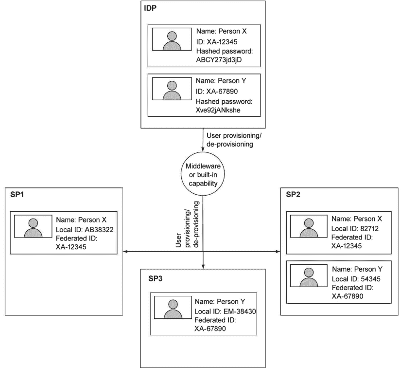

图 4.1 – SSO 设置中全局和本地数据存储示例

## 多因素身份验证

MFA 用于描述一种安全机制，成功的身份验证过程要求用户使用不同的方法通过不止一个身份验证过程。例如，用户可能会被要求提供他们知道的东西（例如密码）、他们拥有的东西（例如在手机上接收的一次性令牌）以及他们物理上拥有的东西（例如指纹）。在 MFA 中，用户通常需要通过三个（或更多）不同的安全层。一种较宽松的安全机制通常被称为双因素身份验证（2FA），只需通过两个身份验证过程。一个常见示例（Salesforce 专业人士所熟悉的）是在第一步请求用户的凭据。成功通过验证后，用户将被重定向到带有单个输入字段的另一页，并且一次性令牌将发送到指定用户的电子邮件地址。用户将被要求将该一次性密码 (OTP) 令牌输入到输入字段中。

再次，此身份验证过程依赖于用户知道的东西（密码）和用户拥有的东西（访问其自己的电子邮件收件箱）。MFA 和 2FA 确保攻击者无法通过简单猜测或窃取用户的密码（或任何其他单一身份验证机制，例如身份证）来访问所需的资源。如今，许多企业正在将此方法设为强制性。值得注意的是，Salesforce 正在分阶段自动为生产组织的直接登录启用 MFA，从 Spring ’23 版本开始，到 Spring ’24 版本结束。

拥有 SSO 设置使此过程变得简单且流畅。定义 2FA/MFA 策略、执行策略以及提供其使用的全面日志等任务，将由 IDP 完全处理。这意味着 SPs 不需要担心实现其中的任何内容。它们可以简单地依赖 IDP 来处理所有这些内容，然后根据它们拥有的信任关系对通过 IDP 检查的用户进行身份验证。您将在“了解关键身份验证流程”部分稍后了解这些信任关系的更多信息。

这意味着企业在更改和发展其安全策略时可以更加敏捷和灵活。例如，企业可能决定在当前基础上添加新的身份验证层。通过正确的设置，他们只需向管理整个企业 SSO 流程的 IDP 引入一次即可。

## 用户配置和取消配置

配置是在标识存储库中创建用户的过程。这包括全局和本地标识存储库。通常，还会为用户在每个存储库中分配一组角色，例如读取某些数据库表的权限。取消配置正好是相反的过程，涉及从全局和本地标识存储中停用或删除标识，包括与之关联的任何角色，终止任何打开的会话，并撤销现有令牌。


简化配置和取消配置流程对企业很重要，因为员工可能经常入职和离职。这也是确保您可以从单个位置关闭用户对所有相关系统的访问权限的关键。从优化、效率、安全性和合规性方面来看，这带来了诸多好处。

## 基于角色的访问

大多数企业级应用都附带一个工具或模块，用于管理用户访问特定功能、数据库对象、记录或字段的权限。同样的原则也可应用于网络上可用的所有资源。在这种情况下，该工具通常称为 **基于角色的访问控制 (RBAC)**，用于为用户分配特定角色。这些角色控制用户在整个网络中可以看到和执行的操作。根据 RBAC 工具本身，角色也可能被称为 **组成员资格**。

通过身份验证识别用户后，授权服务器会确定适用于已登录用户的角色。有时，这两项活动可以由同一系统完成。企业理想情况下希望拥有一个集中式工具，以便管理所有可用角色及其分配。在 SSO 设置中，这通常分为两个步骤：

- 1. **定义和管理一组全局角色**：全局角色将在集中式 RBAC 系统中定义并分配给相应的用户。这些角色可基于用户的职责、工作描述或特定系统上的功能，例如系统管理员 – 北美，或 Salesforce 系统管理员 – 北美。同一用户可以关联多个角色；例如，当同一用户需要以不同的权限级别访问多个系统时。

- 2. **定义和管理本地应用程序角色**：对于每个 SP 应用程序，都需要定义一组可分配给应用程序用户的角色/配置文件/权限。这些本地角色将映射到全局角色。然而，这不一定是一对一映射；例如，Salesforce 系统管理员 – 北美全局角色可以转换为名为 Salesforce 系统管理员的 Salesforce 配置文件（位于北美的 Salesforce 组织中），以及一组权限集、功能许可证和第三方许可证，以确保指定用户能够执行其预期的所有功能。

角色转换过程可以采用多种方式进行。一种常见的方式是将该任务分配给用户配置工具。一些现代 IDP 具有此内置功能。例如，某些 IDP（如 Ping Identity）可以使用标准 Salesforce API 或使用 **跨域身份管理系统 (SCIM)** 标准（同样依赖 API 调用）在 Salesforce 中配置和取消配置用户。另一种常见方法是使用集成中间件来处理此任务。

以下图示是说明 SSO 设置中全局角色和转换后的本地角色的示例：

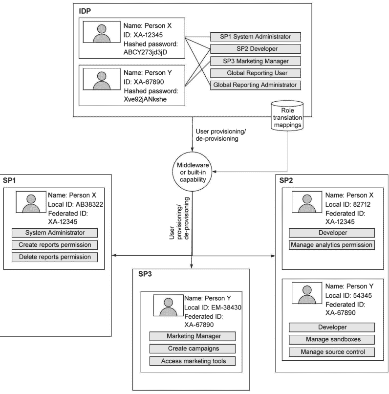

## 图 4.2 – SSO 设置中全局和转换后的本地角色示例

## 生物识别身份验证

生物识别身份验证是使用生物特征（例如指纹、视网膜扫描、语音、面部识别等）唯一识别个人的过程。甚至有研究通过步态来识别人。最近，由于该领域技术迅速发展，生物识别身份验证在市场上备受青睐。千禧年初，面部识别等主题不过是科幻小说。如今，它已成为许多智能手机的必备元素。您现在可以使用智能手机进行在线购物，然后使用安全存储在手机电子钱包中的信用卡详细信息在线支付，该电子钱包通过您的指纹或面部特征进行保护。此类技术的成功及其提供的便利性表明，在不久的将来会出现更多此类用例。

许多企业已将某种生物识别身份验证采用为 2FA 或 MFA 机制，用户使用一种身份验证机制（例如密码）登录门户。完成后，将向用户手机上应有的移动应用程序发送一条推送消息。用户随后打开该应用程序，该应用利用移动设备的生物识别身份验证功能再次对用户进行身份验证。

身份验证成功完成后，将向服务器发送一条消息，服务器随后会继续执行其身份验证过程中定义的后续步骤（例如，完成身份验证过程、在用户浏览器中创建会话 Cookie、运行一些预定义的验证，然后将用户重定向到登录页面）。

以下图示说明了将生物识别身份验证用作第二身份验证因素的用法：

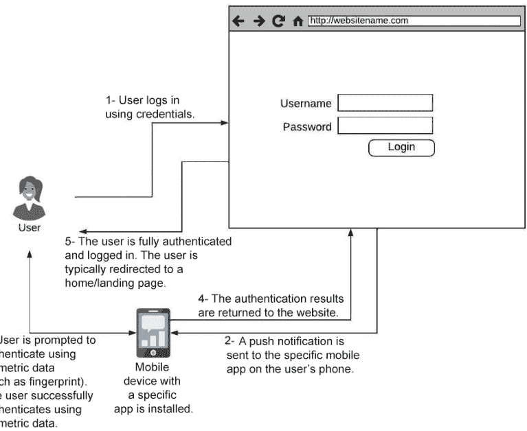

图 4.3 – 使用生物识别身份验证作为第二身份验证因素

## 身份即服务

这是一种以 SaaS 方式提供身份服务的解决方案。IDaaS 应用程序通常提供一个在线门户，带有一些工具和控制面板，以便按需配置和设计。这些解决方案中的一些提供不同级别的 IAM 功能，例如用户配置和取消配置。一些提供商还提供可本地托管的解决方案形式。

这些提供商的示例包括 Okta、Microsoft Azure 身份管理、Ping Identity，以及在一定程度上包括 Salesforce。与本书中提到的其他所有产品一样，您需要记住这些名称中的一些，以便在 CTA 审查委员会期间推荐合适的解决方案。

## 基于风险的身份验证

此技术使用不同的工具和算法，为尝试访问安全资源或试图进行身份验证的用户计算风险分数。根据计算出的风险分数，用户可能需要提供第二个身份验证因素（或更多）。计算特定用户风险分数的算法可能取决于许多因素，例如 IP 地址范围、具体的时间点、用户浏览器中特定域的 Cookie 是否存在、特定用户上次成功登录的时间，以及许多其他可能依赖于从复杂逻辑到机器学习和人工智能的任何内容的更高级算法。RBA 提供了一种令人信服的方式，可以在不使不必要地使用户体验变得杂乱的情况下确保高级别的安全性。多个 IDP 作为其解决方案的一部分提供了各种级别的 RBA。

## 轻量级目录访问协议

这是一种旨在提供标准化机制以与存储在分层目录结构中的数据进行交互的协议。LDAP 可以高效地存储和检索这些结构中的数据，这也是它如此流行的原因之一。Microsoft AD 是一个存储企业数据（通常是策略、角色和权限）并在分层结构中组织这些数据的工具示例。此类工具通常称为目录服务数据库。

LDAP 是一种能够高效地与 Microsoft AD 等目录服务数据库进行通信和交互的协议。在 CTA 审查委员会场景和现实生活中，您可能会遇到 LDAP 用于与其他目录服务数据库（例如 Apache Directory、OpenLDAP、JXplorer 或其他）进行通信的用例。您需要了解哪些工具和 IDP 是专门为与 AD 协同工作而构建的，例如 Microsoft Active Directory Federation Services (ADFS)，或者是为与 LDAP 通用协同工作而构建的（如前文“身份即服务”部分中提到的 IDaaS 产品）。

## 服务用户与上下文用户身份验证

在某些用例中（特别是访问 API 时），身份验证通常可以遵循两种方法之一。第一种使用命名主体（也称为服务用户），其中仅对单个集成用户进行身份验证并用于访问 API，而第二种遵循按用户策略，这意味着尝试访问 API 的每个用户至少进行一次身份验证。


在第一种情况下，在目标系统中执行的操作将在集成用户的上下文下运行，这意味着你为每个连接用户提供精细化访问权限的机会较少。相比之下，在第二种情况下，目标系统中的操作将在已登录用户（也称为上下文用户）的上下文下运行，这允许你为每个连接用户定义不同的权限、角色和配置文件。下图说明了这两种不同的方法：

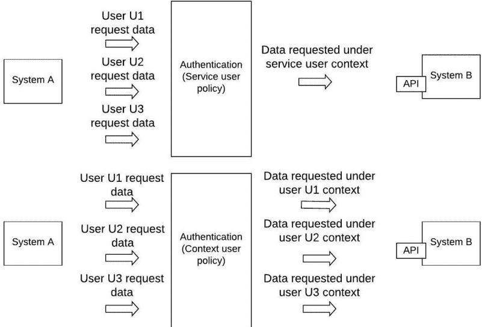

图 4.4 – 服务用户与上下文用户身份验证的区别

现在，你已经了解了常见的 IAM 术语和概念，并了解了它们如何协同工作，你将了解三种最常见的 IAM 标准。

## 熟悉常见 IAM 标准

IAM 是一个复杂的领域，为了确保其所需功能以安全、一致和合规的方式交付，随着时间的推移，已经开发了多种标准和协议。作为架构师，你需要非常熟悉这些标准，了解它们的运行方式以及它们之间的差异，并确切知道何时建议使用其中任何一种。此外，其中一些标准具有已知且定义明确的流程，精确描述了如何使用给定标准针对特定用例对用户进行身份验证。这些流程称为身份验证流。

为了理解身份验证和授权概念以及标准如何在其中使用，请考虑一个简单的例子。例如，你正在从英国前往美国。当你试图通过美国边境管制时，他们会想要验证你的身份。并且假设还需要检查其他一些与你被允许做什么相关的信息，例如持英国驾照在美国驾驶汽车。在这种情况下，美国边境管制将需要与英国通信并发出请求以验证你的身份。一旦验证通过，他们会询问你有权做什么。

身份识别/身份验证过程可以采取多种形式。例如，你可以使用护照进行身份识别，而护照本身的真实性可以使用其中嵌入的特殊安全措施/电子芯片进行验证。你的护照可以被扫描，并可以向特定的在线端点发出实时调用，以检索你被允许做的事情列表，例如在特定时间段内在美国驾驶普通尺寸汽车。

在这个例子中，英国充当 IDP，而美国边境管制是 SP。你的护照代表某种身份验证令牌，由安全措施保护。在数字世界中，这可能是一个数字签名。数据交换的方式和使用的格式代表用于给定任务的标准/协议，而身份验证和授权过程步骤的顺序代表身份验证/授权流。

为客户设计 IAM 策略时，依赖行业标准之一，而不是试图重新发明轮子，是有意义的。除了节省时间和精力之外，这还将确保你的身份验证机制安全、可扩展且合规。偏离标准可能导致巨大的安全漏洞，并且几乎肯定会导致在 CTA 评审委员会期间 IAM 领域失败。

## 了解常见 IAM 标准

在本节中，你将了解一些最常见的 IAM 标准，然后进一步了解这些标准中涉及的令牌类型，最后了解一套你应该非常熟悉的身份验证流。以下是常见 IAM 标准列表：

- 安全断言标记语言 (SAML)
- 开放授权 (OAuth)
- OpenID Connect (OIDC)
- Kerberos

### 安全断言标记语言

SAML 标准创建于 2001 年。目前版本为 2.0，该版本于 2005 年发布。SAML 被视为身份验证和授权的标准，并且基于 XML。在 SAML 中，SP 可以请求 IDP 使用 SAML 断言请求对用户/主体进行身份验证和授权。IDP 将使用 SAML 断言响应进行回复，这被称为 SP 发起的流程。SAML 还有另一种常用的身份验证流程，称为 IDP 发起的流程，其中主体可以从包含指向各种系统（SP）链接的特定网页开始。每个链接都包含 IDP 生成的 SAML 断言。单击该链接后，断言将发送到目标 SP，SP 将基于 SP 和 IDP 之间建立的信任关系验证 SAML 断言。然后主体将获得访问 SP 的权限。

SAML 断言使用 XML 签名包装进行签名，这是一种高级形式的数字签名。验证数字签名（如第 3 章“核心架构概念：集成与密码学”中之前讨论过的）需要访问公钥，公钥通常以数字证书形式呈现。信任关系通过数字证书在 IDP 和 SP 之间建立。

在设置阶段，架构师/开发人员/配置人员通常会将 IDP 共享的证书上传到 SP。然后 SP 将使用此证书验证将来从 IDP 接收的 SAML 断言。使用 SAML 在 SP 和 IDP 之间设置连接还涉及其他步骤，这些步骤可能会根据所使用的技术略有不同。Salesforce 支持 SAML V1.1 和 V2.0。

在你的解决方案中，应力求使用最新受支持的版本。本章稍后，你将了解两个与 SAML 相关的流程，即 SAML IDP 发起的流程和 SAML SP 发起的流程。SAML 最适合用于 SSO；但是，它不太适合手机或 JavaScript，并且在 API 中不太流行。

### 开放授权

OAuth 是一个为解决特定问题而创建的开放标准。它通常被称为访问委派或安全委派访问，即允许应用程序（通常称为客户端）代表用户访问服务器（通常称为资源服务器）上的资源或执行活动。该标准促进此过程，而无需用户向客户端共享其凭据。这是通过使用 IDP 在用户批准后颁发的令牌来实现的。这些令牌包含客户端在资源服务器上被授权访问和执行的操作的描述。该标准的当前版本是 2.0，这是你应力求使用的最低版本。

OAuth 通常被视为授权标准，尽管围绕将其视为身份验证标准存在一些争论，这种争论基于授权过程可以被视为伪身份验证的假设。为了理解这个主题并理解访问委派的含义，请看这个例子。

假设你即将进行一次短途旅行，并希望你的朋友 Suzanne 在你不在家时照顾你的房子。你希望 Suzanne 能够进入你的房子、车库以及你房子里的四个房间中的两个。在你离开之前，你将一把钥匙链交给 Suzanne，其中包含主房门、两个房间和车库的钥匙。Suzanne 现在可以使用钥匙进入房子和指定的房间，而无需你在身边。

在这个例子中，Suzanne 是 *客户端*，你是 *用户*，房子和房间是 *资源服务器*，而钥匙链是 *令牌*，它仅授权 Suzanne 访问特定资源。钥匙链和钥匙由一位锁匠创建，在此例中，锁匠类似于 IDP。这位锁匠根据你自己的许可/批准创建了钥匙。对于观察 Suzanne 进入房子的人来说，她可能看起来像是房子的主人。这是一个假设，因为她拥有钥匙。在这种情况下，钥匙持有者拥有的授权可用于对人进行伪身份验证，并假设他们是房子的主人。现在，看看你一定经历过的数字世界中的另一个例子。

你正在一个图书评论网站上。你刚刚读完一本书并写了一篇评论。提交评论后，网站向你显示一个 **分享到 Facebook** 按钮，并附带一条消息，询问你是否有兴趣将评论发布到 Facebook。你喜欢这个主意，于是点击了按钮。这是你第一次这样做。网站将尝试获得代表你在 Facebook 上发布内容的许可/授权。因此，它将你重定向到 Facebook；如果你尚未登录，Facebook 将向你显示标准登录页面。

身份验证后，Facebook 将向你显示一个页面，页面上有一条消息，告知你网站正在请求代表你发布内容的权限（这将是网站代表你被允许做的唯一事情，称为范围）。页面还将包含批准和拒绝按钮。一旦你点击批准按钮，Facebook 会向网站颁发一个令牌，授予网站代表你发布内容的有限权限。网站将使用此令牌向 Facebook 进行身份验证，并在你的 Facebook 墙上发布你的评论，而对你的 Facebook 好友来说，这看起来像是由你直接完成的活动。请注意，你仅将凭据共享给了 Facebook；你从未将它们共享给网站或任何其他实体。

通常，还会向网站颁发另一个令牌，使其能够在下次无需经过整个一系列活动即可获取新令牌。下次你在网站上发布评论并点击同一按钮时，网站将使用上一步授予它的令牌再次向 Facebook 进行身份验证并代表你发布内容。根据这些令牌的设置，这可以持续发生，直到你撤销这些令牌。

在前面的例子中，这相当于从 Suzanne 那里收回钥匙链，或者完全更换所有锁。本章稍后，你将了解一些 OAuth 2.0 和 OIDC（基于 OAuth 2.0）的流程，例如 Web 服务器、用户代理、刷新令牌、JSON Web 令牌 (JWT) 持有者、设备、资产令牌和用户名-密码。

### OpenID Connect

OpenID 基于 OAuth 2.0，但旨在提供类似于 SAML 的联合身份验证机制。它在 OAuth 2.0 之上添加了一组不同的功能，但你特别应该注意的一个功能是一个称为 **ID 令牌** 的附加令牌。ID 令牌包含经过身份验证的用户的信息，例如名、电子邮件、联合身份和请求的客户端，此外还有 IDP 可能添加的自定义属性。此令牌可以帮助确认为其颁发该令牌的个人身份。


ID 令牌本身经过数字签名，因此可以轻松验证并确认其内容是否被篡改。由于 IDP 的数字签名保护了 ID 令牌，并且包含关于为其生成该令牌的用户的关键信息（包括联合标识符），因此信任该 IDP 的其他系统（SP）可以使用它来验证该用户。信任关系是通过数字证书建立的。

OIDC 当今已得到广泛应用；大多数社交网络，例如 Facebook、Twitter、Google 和其他网络，都支持它。社会化登录是指使用社交网络作为 IDP 来登录其他网站的身份验证过程。社会化登录大多使用 OIDC。此外，许多企业将 OIDC 作为其 SSO 标准。

### Kerberos

作为一种身份验证协议，Kerberos 用于网络（例如本地企业网络）以提供 SSO 功能。它使用票据，原则上与令牌相似。Kerberos 以希腊神话中看守冥界入口的三头犬刻耳柏洛斯（Cerberus）命名。Kerberos 用于多种系统，最典型的是 Microsoft Windows。集成 Windows 身份验证（IWA）是一种 Microsoft 产品，它利用 Kerberos（也可以与其他协议如 NT LAN Manager（NTLM）一起工作）来允许 Windows 用户使用 AD 进行 SSO。

例如，假设您是一家使用 AD 管理所有员工身份的公司的员工。您早上到达办公室，打开一台基于 Windows 的笔记本电脑，并使用您的 AD 凭据进行身份验证以加入域（这将创建一个 Kerberos 票据）。现在您想访问贵公司的 Salesforce 实例（它具有一个唯一的 MyDomain URL）。但您希望在无需再次进行身份验证的情况下完成此操作。

Kerberos、IWA 以及 Salesforce Identity Connect、Microsoft ADFS 或 Ping Identity 等工具（这些工具将促进 Salesforce 和 AD 之间的身份验证流程）将结合起来提供此功能。设置 Kerberos 或 IWA 的详细信息超出了本书的范围。为了简洁起见，本书不会详细介绍 Kerberos 协议本身，但您将在第 13 章“Present and Defend: First Mock”中了解它在 SSO 流程中的应用。

这些标准（SAML、OAuth、OIDC 和 Kerberos）在其设计中利用和生成令牌。令牌在 IAM 中发挥着至关重要的作用。它们涉及许多不同的操作，并具有不同的格式和用途。您现在将了解作为 Salesforce Architect 可能遇到的最常见的令牌类型。

## 了解不同类型的令牌

作为 Salesforce Architect，您将被期望领导为 Salesforce 实施设计和实施 IAM 策略的活动。令牌是 IAM 标准的必要元素，您需要知道的不仅仅是它们的名称。

> 注意
> 此处列出的令牌绝非所有可能令牌的完整列表；列表太长，可能需要一本专门的书。

这是一组精选的令牌，Salesforce Architect 在为 B2B 和 B2C 设计解决方案时可能会遇到。

### 访问令牌

访问令牌是 OAuth 2.0 和 OIDC 使用的术语。访问令牌是您的应用程序追求的最重要的令牌。这是允许应用程序（也称为客户端）代表用户向资源服务器进行身份验证并请求资源（例如检索特定数据）的令牌。访问令牌也可用于对 Web 服务进行身份验证，通常是通过在标头中传递令牌本身来实现。访问令牌可以根据颁发系统的不同采用多种格式。例如，由 Salesforce 颁发的访问令牌采用普通会话 ID 的形式，将类似于以下示例：

```
00DR0000000o8tBT!AQwAQCPqzc_HBE59c80QmEJD4rQRRc1GRLvYZEqc80QmEJD4
```

此令牌的值无法解码。它是一个唯一哈希值，不应被解密或解码。它本身不包含任何信息。然而，它可以用于访问资源服务器上的资源，因为服务器会缓存同一令牌的副本，通常在键/值对字典中，并附带其到期日期。访问令牌的有效期相对较短（例如 30 分钟、60 分钟和 120 分钟）。系统管理员确定会话超时前的具体时间。

另一个示例是 Azure 颁发的访问令牌，其格式为 JWT。JWT 包含一些标准和自定义属性/载荷（也称为声明）。

> 注意
> 您可以使用 https://packt.link/cPtWd 等在线工具查看 JWT 及其解码值的实时示例。

您将在本章后面遇到其他 JWT 格式的令牌。

### 刷新令牌

这是 OAuth 2.0 和 OIDC 使用的另一个术语。刷新令牌针对特定用例颁发给客户端（取决于客户端类型和使用的身份验证流程）。刷新令牌的有效期通常比访问令牌长。有时，它们可以设置为永不过期（直到被撤销）。

客户端应用程序应将刷新令牌存储在安全位置，并定期或在需要时使用它来获取新的访问令牌。您现在可以使用智能手机上的某个应用程序来观察刷新令牌的运作情况。

您可能已经注意到，某些应用程序在首次启动应用时要求您登录一次。下次打开应用时，即使过了几天或几周，您也无需再次输入凭据。这是因为应用程序已配置为使用刷新令牌。首次进行身份验证时，应用程序同时接收了访问令牌和刷新令牌。访问令牌的 **生存时间（TTL）** 比刷新令牌短；它通常有效几个小时。只要访问令牌仍然有效，应用程序就会继续使用它。

例如，您在两周后打开了应用程序。应用程序将使用缓存的访问令牌与资源服务器通信，但会立即收到回复，指示令牌已过期。应用程序将通过使用刷新令牌来获取新的访问令牌来响应。完成此操作后（您将在本章后面看到该流程），应用程序将使用新检索的访问令牌与资源服务器通信。所有这些对用户来说都是完全透明的。

### ID 令牌

这是仅适用于 OIDC 的令牌。如前面在 OpenID Connect 部分中所述，ID 令牌为客户端应用程序提供了一种机制，用于验证为其颁发此令牌的用户的身份。ID 令牌包含颁发时间和过期时间等信息。除了有关已验证用户的数据之外，例如用户的唯一标识符（也称为联合标识符）。根据 IDP 设置，联合标识符可以是员工 ID、电子邮件地址或其他类型的唯一标识符等值。

ID 令牌还包含有关为其颁发令牌的客户端应用程序的信息。最重要的是，令牌还将包含 IDP 的数字签名，可用于验证令牌的内容。ID 令牌格式基于 JWT，JWT 是基于 JSON 的数据结构。如果传递了正确的参数，应用程序可以使用相同的 OAuth 2.0 流程请求 ID 令牌。例如，在 Web 服务器流程中，如果客户端应用程序将 OpenID 范围作为传递范围参数的一部分，则可以获取 ID 令牌。您将在本章后面看到更多有关此内容的详细信息。

### JWT

**JWT** 是一种用于格式化数据的标准，该数据可用于向其他各方声明一方的身份，以及声明令牌本身包含的一组信息（称为声明）。ID 令牌使用 JWT 格式。JWT 可以是签名的（类似于前面描述 ID 令牌时给出的示例），在这种情况下它们被称为 **JSON Web 签名（JWS）** 令牌；也可以是加密的，在这种情况下它们被称为 **JSON Web 加密（JWE）** 令牌。


通常，当提到 JWT 时，默认指的是已签名的 JWT（实际上是 JWS）。如果 JWT 既未签名也未加密，则会通过将其称为未受保护的 JWT 来明确说明。JWT 的主体经过编码。它通常如下示例所示（末尾的三个点表示为简化文本而进行的截断）：

```
eyJhbGciOiJIUzI1NiIsInR5cCI6IkpXVCJ9.
eyJzdWIiOiIxMjM0NTY3ODkwIiwibmFtZSI6IkpvaG4gRG9lIiwiaWF0IjoxNTE2MjM5MDIyfQ.
MDIyY2Y0.SflKxwRJSMeKKF2QT4fwpMeJf36PO...
```

当你使用 https://packet.link/cPtWd 等工具解码 JWT 时，你会发现 JWT 由三个主要部分组成——标头、载荷和签名（请记住，单独使用 JWT 这个术语时，通常隐含地表示该 JWT 实际上是 JWS）。标头和载荷部分可能如下示例所示：

```
{
  "alg": "HS256",
  "typ": "JWT",
  "kid": "228",
}
{
  "iss": "www.packtpub.com",
  "sub": "11050225117732",
  "email": "testemail@packtpub.com",
  "email_verified": true,
  "aud": "825249835659",
  "iat": 1401908271,
  "exp": 1401912171
}
```

诸如 iss、aud、iat 和 exp 之类的属性被称为声明。这些是标准声明；它们是标准 JWT 的一部分。IDP 可能会添加自定义声明，并在其中包含其他信息。以下是对其中一些声明含义的说明：

- iss（签发者）：此声明用于存储关于签发令牌的主体的标识符。
- aud（受众）：此声明用于存储令牌签发给的接收者的标识符，例如客户端应用程序。
- iat（签发时间）：这是签发令牌的时间。
- exp（过期时间）：这是之后不应接受令牌的时间。
- alg（算法）：这是用于加密或数字签名的算法。
- kid（密钥 ID）：这是一个可选的标头声明。并非所有 OpenID 提供者都会包含它。当 Salesforce 配置为 OpenID 提供者时，其 ID 令牌（JWT 格式）将包含此可选标头声明。

此声明包含用于签名令牌的密钥的标识符。Salesforce（以及一些其他 OpenID 令牌提供者）使用多个私钥来签名 JWT，因此它们需要提供 **密钥 ID** (`kid`) 以帮助接收者识别可用于验证签名的哪个公钥。

从 Salesforce 接收已签名 JWT 的应用程序将提取 `kid` 标头声明的值，然后使用它从 Salesforce 定期发布的列表中查找正确的公钥以验证令牌的签名。这一切都透明发生，除非签名无效，否则用户不会受到打扰。在这种情况下，将抛出一个异常。

> 注意
> 
> 如果您访问此公共 URL 页面，`https://packt.link/qBw4j`，您将看到 Salesforce 列出的多个密钥。每个密钥都使用唯一的密钥 ID 进行标识。

需要牢记的一点是，Salesforce 与其他 OpenID 提供者类似，可以定期更改用于签名其令牌的密钥。客户端应用程序绝不应尝试硬编码 `kid`，而应尝试动态解析它，就像你在本节前面学到的那样。

### 会话令牌

也称为会话 ID，`session token` 是引用 Web 应用程序时常用的一个术语。会话令牌是一个唯一字符串（通常是哈希值），用于标识当前登录用户的特定会话。会话 ID 在网站上被大量使用，通常存储在 Cookie 中。会话 ID 通常可以映射到应用程序服务器上的键值字典，其中包含有关登录用户及其有权执行操作的信息。如果攻击者获得了会话 ID/会话令牌，他们通常能够在目标应用程序服务器上冒充受害者。

因此，用户在使用特定安全网站结束工作后，始终被建议 *注销* 以销毁其会话。这也是为什么会话 ID 通常配置为具有较短生命周期的原因，特别是在金融服务应用程序（如网上银行）中，会话在短时间（例如五分钟）的空闲时间后可能会过期。

令牌的 TTL 可以是 *固定的*（这意味着无论用户是否活跃，令牌都会在给定时间后过期），也可以根据用户活动*延长*。这意味着令牌仅在特定给定的空闲时间段（用户未与服务器交互）后才会过期；在这种情况下，它通常称为 **滑动令牌**。

### 授权代码

这是一种特殊的令牌。它用于 OAuth 2.0/OpenID 流（_Web 服务器_ 流）之一。它的 TTL 非常短，由授权服务器创建并（通过浏览器）返回给客户端应用程序。客户端应用程序随后将授权代码发送回授权服务器（直接发送，不通过浏览器）以换取访问令牌（以及可选的刷新令牌）。

由于授权代码是通过浏览器返回的（速度非常快），因此授权代码对最终用户可见，并可以使用一些工具观察（例如 **Google Chrome DevTools**）。这正是其 TTL 如此短的原因，因为这降低了被攻击者窃取的风险（攻击者可以使用它来获取访问令牌）。

### SAML 断言

与 JWT 类似，SAML 断言可用于向特定资源服务器/SP 对用户进行身份验证。它包含用户身份、发行时间和过期时间等信息。它还可以使用多种机制进行保护，包括 **XML 签名包装**。应用程序也可以利用 SAML 断言来对 API 进行身份验证。

### Salesforce 安全令牌

当您尝试访问 Salesforce API 并使用基本身份验证机制（用户名/密码）进行身份验证时，需要将安全令牌附加到提供的密码上。令牌本身是一个区分大小写的字母数字密钥。您应尽可能避免使用基本身份验证，并改用前面提到的标准之一，例如 OIDC。

现在您已熟悉各种类型的令牌，请查看不同的身份验证流，并观察整个过程中每种令牌的生成情况。

## 了解关键身份验证流

对于以下每个流，您将阅读流的序列图，涵盖每个步骤的高级细节，并提供潜在用例和关键注意事项。为了正确绘制和阅读序列图，您需要熟悉所使用的标准符号。

以下列表列出了最常见的 UML 序列图符号：

- 对象符号：它表示实体或对象。
- 生命线符号：它用于显示在给定过程中特定实体所发生的事件序列。生命线符号通常从实体符号延伸出来。
- 激活框符号：它表示特定实体完成任务所需的时间。符号的长度定义所需时间。在我们的流程图中，所有使用的激活框大小相同，表示非常短的时间段。
- 异步消息符号
- 同步消息符号
- 异步返回消息符号

### 图 4.5 – 常见序列图符号

这些流并非 Salesforce 特有；它们是开放标准，并应用于不同的技术。您需要熟悉所有这些流。在 CTA 评审委员会期间，您可能需要解释其中一个流。解释流的最佳方式是绘制其序列图，并引导听众了解它。最好的建议是反复练习绘制这些图表，直到完全记住它们。此外，还要练习向听众解释这些流。这将有助于评审委员会演示以及您的日常工作。

准备好了？系好安全带，开始吧。

## 熟悉 SAML 2.0 流

SAML 2.0 有三个主要流，即 IDP 发起的、SP 发起的和 SAML 承载者断言流。SAML 承载者断言流与 OAuth 2.0 JWT 流非常相似，该流不会明确介绍，但将在本章后面的 JWT Bearer Flow 部分中讨论。


### SAML IDP 发起的流程

下图表示 SAML IDP 发起的流程。该流程通常由为员工提供一个中心位置/页面以访问与同一企业 IDP 关联的所有应用程序 (SP) 的企业使用：

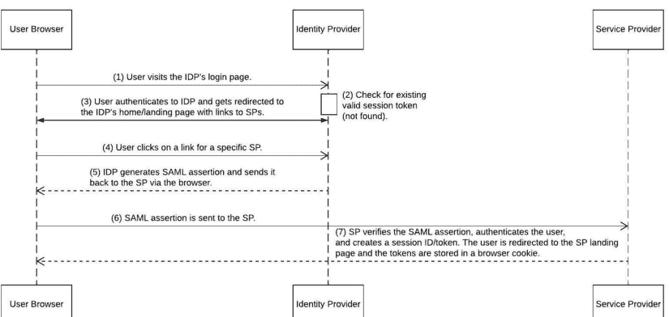

图 4.6 – SAML IDP 发起的流程

流程如下：

- 1. 用户访问 IDP 登录页面或 IDP 主页。
- 2. 主页或登录页面将通过检查 IDP 域是否存在带有有效会话令牌的存储 Cookie 来检查用户是否已通过身份验证。假设这是用户当天的第一次登录，且未找到有效会话令牌。此时，用户应看到登录页面。
- 3. 用户输入其用户名和密码（或按 IDP 定义的流程进行身份验证）。如果 IDP 配置为使用 2FA 或 MFA，则在用户通过身份验证之前会先请求其他因素。用户通过身份验证后，将被重定向到 IDP 的主页。
- 4. 用户登陆到 IDP 的主页/登录页面。该页面包含所有使用 IDP 进行 SSO 的可用应用程序 (SP) 的链接。用户单击其中一个链接。
- 5. IDP 生成使用 IDP 私钥/证书签名的 SAML 断言。断言通过浏览器发送到 SP。
- 6. 断言发送到 SP。
- 7. SP 接收断言，并使用 IDP 的公钥/证书对其进行验证。用户已通过身份验证，并为特定 SP 域创建并保存在浏览器 Cookie 中的会话令牌。用户被重定向到 SP 主页。下次用户尝试访问 SP 时，SP 将检测到带有会话令牌的 Cookie。如果仍然有效，则允许用户访问所需页面。否则，将重新启动新的身份验证流程。唯一的区别是，这次将从 SP 而非 IDP 开始。这就是所谓的 SP 发起的流程。

### SAML SP 发起的流程

下图表示 SAML SP 发起的流程。当用户尝试访问特定 SP 的深层链接时使用此流程。深层链接可能是保存在书签中的 URL、电子邮件中的链接、浏览器历史记录中的 URL、用户熟记于心的 URL，甚至是 SP 主页的 URL。其理念是用户正在尝试访问 SP 的某个资源。SP 在允许访问该资源之前需要对用户进行身份验证。这是一个非常常见的流程：

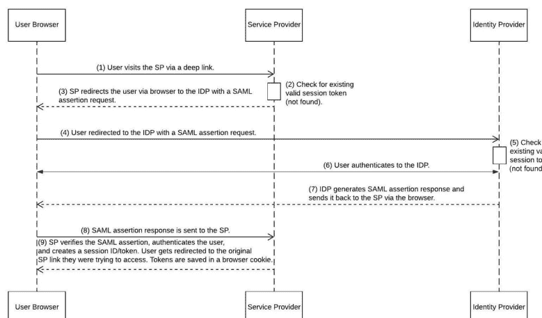

图 4.7 – SAML SP 发起的流程

流程如下：

- 1. 用户使用深层链接访问 SP，或单纯尝试访问 SP 主页。
- 2. SP 检查与 SP 域关联的 Cookie 中是否存在现有且有效的会话令牌。假设未找到此令牌，因为这是用户今天第一次尝试访问此应用程序/SP。
- 3. 用户通过浏览器携带 SAML 断言请求被重定向到 IDP。其理念是让 IDP 对用户进行身份验证，然后将用户返回到用户尝试访问的 SP 页面/URL（例如，深层链接 http://www.packtpub.com/books/SF_ExamplePage.html 中的 URL）。目标 URL 通过名为 RelayState 的参数传递。在此示例中，该参数的值将为 /books/SF_ExamplePage.html。用户身份验证后，此参数最终会传回 SP，以帮助将用户重定向到正确的 URL。
- 4. 用户被重定向到 IDP 登录页面（带有 RelayState 值）。
- 5. IDP 检查与 IDP 域关联的 Cookie 中是否存在现有且有效的会话令牌。假设未找到此令牌，因为这是用户今天第一次登录 IDP。
- 6. 用户输入用户名和密码（或按 IDP 定义的任何方式进行身份验证）。如果 IDP 配置为使用 2FA 或 MFA，则在用户通过身份验证之前会先请求其他因素。
- 7. 用户通过身份验证后，将创建一个 SAML 断言，使用 IDP 私钥/证书签名，并通过浏览器连同 RelayState 值一起返回到 SP。
- 8. SAML 断言通过浏览器连同 RelayState 值一起发送到 SP。
- 9. SP 接收断言，并使用 IDP 的公钥/证书对其进行验证。用户已通过身份验证，并为特定 SP 域创建并保存在浏览器 Cookie 中的会话令牌。然后，用户将被重定向到 RelayState 值中指定的 SP 页面。用户登陆到步骤 1 中尝试访问的 URL。

假设 SP 会话 Cookie 仍然有效，当用户下次尝试访问同一 SP 的其他页面时，情况如下：

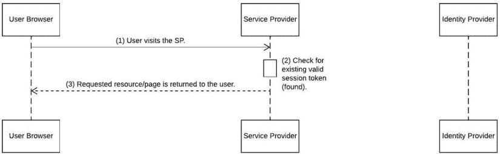

图 4.8 – 在拥有有效 SP 会话并完成用户身份验证后继续 SAML SP 发起的流程

流程如下：

- 1. 用户使用深层链接访问 SP，或单纯尝试访问 SP 主页。
- 2. SP 检查与 SP 域关联的 Cookie 中是否存在现有且有效的会话令牌。假设之前身份验证的令牌仍然有效。
- 3. 用户被授予访问所需资源的权限。现在来看另一种场景：用户在 SP 会话令牌过期但 IDP 会话令牌尚未过期后尝试访问 SP 的某个页面。如果 IDP 令牌的过期时间设置为高于 SP 会话令牌的持续时间，则可能发生这种情况：

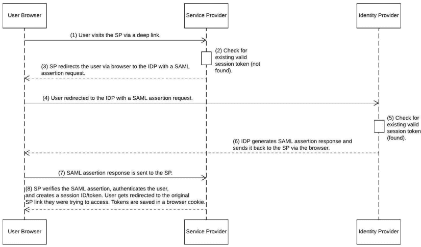

图 4.9 – 在 SP 会话过期且 IDP 会话仍然有效的情况下继续 SAML SP 发起的流程

流程如下：

- 1. 用户使用深层链接访问 SP，或单纯尝试访问 SP 主页。
- 2. SP 检查与 SP 域关联的 Cookie 中是否存在现有且有效的会话令牌。假设之前身份验证的令牌已过期。
- 3. 用户通过浏览器携带 SAML 断言请求被重定向到 IDP。RelayState 的值也会被填充并传递。
- 4. 用户被重定向到 IDP 登录页面（带有 RelayState 值）。
- 5. IDP 检查与 IDP 域关联的 Cookie 中是否存在现有且有效的会话令牌。假设 IDP 找到了一个活跃/有效的会话令牌。
- 6. 创建一个 SAML 断言，使用 IDP 私钥/证书签名，并通过浏览器连同 RelayState 值一起返回到 SP。
- 7. SAML 断言通过浏览器连同 RelayState 值一起发送到 SP。
- 8. SP 接收断言，并使用 IDP 的公钥/证书对其进行验证。用户已通过身份验证，并为特定 SP 域创建并保存在浏览器 Cookie 中的会话令牌。然后，用户将被重定向到 RelayState 值中指定的 SP 页面。

这些是最常见的 SAML 2.0 流程。现在，您将探索并了解 OAuth 2.0/OIDC 流程。

## OAuth 2.0/OIDC 流程

请记住，OIDC 基于 OAuth 2.0，因此以下大多数流程均适用于两者。以下是这些流程中使用的一些术语：

- -**客户端应用**：代表用户尝试访问资源服务器上资源的应用程序。例如，www.mywebsite.com 等网站可能正在尝试访问 MySInstance.my.Salesforce.com 等 Salesforce 实例上的资源。Salesforce Workbench https://pact.link/0oXKc 是另一个很好的示例，该网站正在访问另一个（本例中为 Salesforce 组织）上的资源。
- -**授权服务器**：这是将向已登录用户授予正确授权的服务器。为简单起见，假设此服务器还处理识别尝试登录用户的过程（有效地对用户进行身份验证并充当 IDP），并且它可以访问存储用户识别机制（例如用户凭据）的身份存储。login.Salesforce.com 就是这样的服务器的示例。
- -**资源服务器**：这是客户端应用程序代表用户尝试访问其资源的服务器。例如，这可能是 MySInstance.my.Salesforce.com 等 Salesforce 实例，用户正在尝试从那里访问特定页面或 Web 服务。
- -**客户端 ID/消费者 ID**：这是给定客户端应用的唯一字母数字 ID。授权服务器在将应用与授权服务器注册时，为特定客户端应用生成此值。应用注册通常作为设置过程的一部分执行，但在某些情况下也可能动态发生。
- -**客户端密钥/消费者密钥**：这是一个唯一的字母数字值，代表一个高度机密的值，客户端应用绝不应向用户或外部实体泄露，受信任的授权服务器除外。与客户端 ID 类似，授权服务器也会在将应用与授权服务器注册时，为特定客户端应用生成此值。


本章后续将介绍你将会遇到的其他术语。接下来，你将了解以下身份验证流程：

- Web 服务器流
- 刷新令牌流
- 用户代理流
- JWT 持有者流
- 设备流
- 资产令牌流
- 用户名-密码流

准备好了吗？现在，你可以继续了解这些流程。

### Web 服务器流

该流程也称为授权码流或 auth-code 流。当网站/Web 应用程序尝试代表用户从资源服务器访问资源时，通常会使用此场景。网站/Web 应用托管在服务器上，要使用此流程，网站/Web 应用应能够安全存储高度机密的客户端密钥值。该值绝不能暴露给最终用户，绝不能返回给浏览器，绝不能通过非安全渠道交换，且绝不能暴露给授权服务器以外的任何实体。如果网站/Web 应用（在此情况下即客户端应用）无法满足此要求，则需要考虑不同的流程。

该流程支持服务器到服务器的通信，但需要用户交互，至少在首次身份验证期间需要。该流程可以向客户端应用授予访问令牌，可选地授予 ID 令牌（如果在过程中指定了 OpenID 作用域），以及刷新令牌（如果在过程中指定了 refresh_token 或 offline_access 作用域）。刷新令牌允许客户端应用在当前访问令牌过期时，与授权服务器通信以请求新的访问令牌。

刷新令牌可以配置为永不过期。这意味着 Web 服务器流可用于在客户端应用和资源服务器之间建立永不过期（直到被吊销）的经过身份验证的连接。此流程也可用于向目标应用程序验证中间件（例如，将 MuleSoft 验证到 Salesforce，或反之亦然）。请记住，在发生首次身份验证的设置阶段，仍然需要人工交互。

请查看序列图：

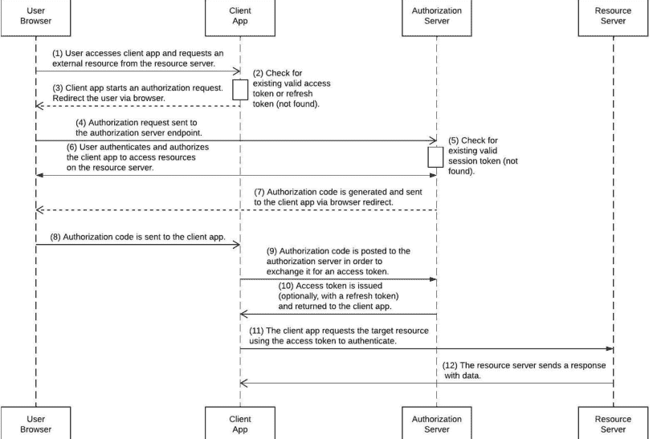

### 图 4.10 – OAuth 2.0/OIDC Web 服务器流

流程如下：

- 1. 用户访问客户端应用程序（网站/Web 应用）。为简化起见，假设网站本身已在本地识别并验证了用户（使用其自身的身份验证机制）。但是，网站也正尝试代表用户访问存储在资源服务器上的部分用户数据。例如，网站可能正尝试检索用户的完整个人资料。

假设应用程序未找到当前用户针对目标资源服务器的任何令牌，这很可能是因为该用户首次尝试从资源服务器检索数据。

- 3. 客户端应用通过发送授权请求来启动授权过程。此过程有时被称为 *OAuth 舞步*。客户端应用通过浏览器向目标 *授权端点* 执行 HTTP 重定向，例如 `https://packt.link/2FEvu`，并传递一组参数。

关键传递参数为 `client_id`，即客户端应用的唯一字母数字 ID，以及 `redirect_uri`，即用户在成功身份验证后将被重定向到的 URI。此 URI 也必须在授权服务器上注册（这也在设置过程中完成）。`response_type` 参数定义 OAuth 2.0 授权类型；这基本上定义了所使用的身份验证流程类型。对于 *Web 服务器* 流程，该参数的值必须为 `code`。

可以使用几个可选参数来配置流程的行为。其中之一是 *scope*。该参数包含应用程序在成功身份验证后请求获授权使用的权限列表。授权服务器通常定义此参数的可能值。

但是，存在一些常见作用域，例如 `full`（允许访问已登录用户可访问的所有数据）、`OpenID`（在使用用户代理流或 Web 服务器流时请求此作用域，可使应用接收签名的 ID 令牌）和 `refresh_token`（使应用在特定条件下能够接收刷新令牌）。例如，重定向的完整 URI 可能如下所示：`https://packt.link/d2KaB`。

- 4. 授权请求发送到授权服务器。

- 5. 授权服务器检查与服务器域关联的 Cookie 中存储的现有且有效的会话令牌。假设未找到此令牌，因为这是用户今天首次登录授权服务器。

- 6. 用户会看到由授权服务器提供的登录屏幕。用户输入用户名和密码（或以授权服务器定义的任何方式进行身份验证）。如果服务器配置为使用 2FA 或 MFA，则在用户身份验证之前会请求其他因素。完成后，用户会看到一个屏幕，询问是否批准客户端应用访问资源服务器上的特定作用域。该屏幕将如下截图所示：

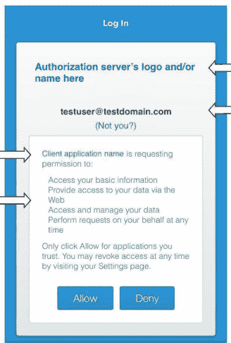

图 4.11 – OAuth 2.0/OIDC 授权批准屏幕示例

- 7. 用户经过身份验证，并生成授权码，通过用户浏览器（重定向）返回给客户端应用。授权码将返回到给定的 redirect_uri。在本示例中，返回的 auth code 可能如下所示：https://packt.link/5i3bi。

- 8. 授权码通过浏览器发送到客户端应用。请注意，由于通过浏览器进行重定向，授权码可能会暴露给攻击者。但是，它的 TTL 非常短，并且有其他保护机制可防止攻击者利用它，例如需要客户端密钥值（该值据称仅由客户端应用知道）。

- 9. 客户端应用接收授权码。它使用该码从授权服务器获取访问令牌。这是通过将授权码和其他值发布到特定服务器端点来实现的。

其他传递参数包括 grant_type（对于给定流程，此值必须为 authorization_code）、redirect_uri（在此阶段，该参数的值仅用于验证，并且应与步骤 3 中使用的值匹配）、code（该参数包含授权码的值）、client_id（这包含客户端应用的 ID）和 client_secret（这是一个关键参数，应包含仅客户端应用知道的高度敏感的客户端密钥值）。

假设攻击者可以访问客户端密钥。在这种情况下，他们可以使用授权码获取访问令牌（通常还包含一些其他保护机制，但攻击者会发现它们更容易规避）。因此，客户端密钥必须存储在托管客户端应用的服务器的安全位置。

- 10. 授权服务器接收 POST 请求并颁发访问令牌。可选地，根据 scope 参数中传递的值，服务器还可以生成刷新令牌和 ID 令牌 (OIDC)。这些令牌将返回给调用者（通常为 JSON 格式）。

- 11. 客户端应用接收令牌。可选地，如果客户端应用接收 ID 令牌，则应用应验证该令牌（通过使用授权服务器的公钥验证其签名）。客户端应用使用访问令牌从资源服务器请求所需资源。

- 12. 资源服务器通过发送请求的资源来响应。

现在假设用户刷新了页面。客户端应用将尝试再次从资源服务器检索用户的个人资料详细信息。但是，这次，你已经拥有令牌。流程将如下所示：

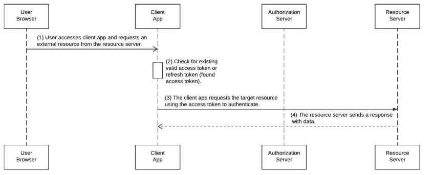

图 4.12 – OAuth 2.0/OIDC Web 服务器流，初始授权后

请注意，前面的图表假设访问令牌仍然有效。如果不是，客户端应用将使用刷新令牌在称为刷新令牌流的过程中获取新令牌。


### 刷新令牌流程

这种方法使用刷新令牌来获取新的访问令牌。请查看序列图：

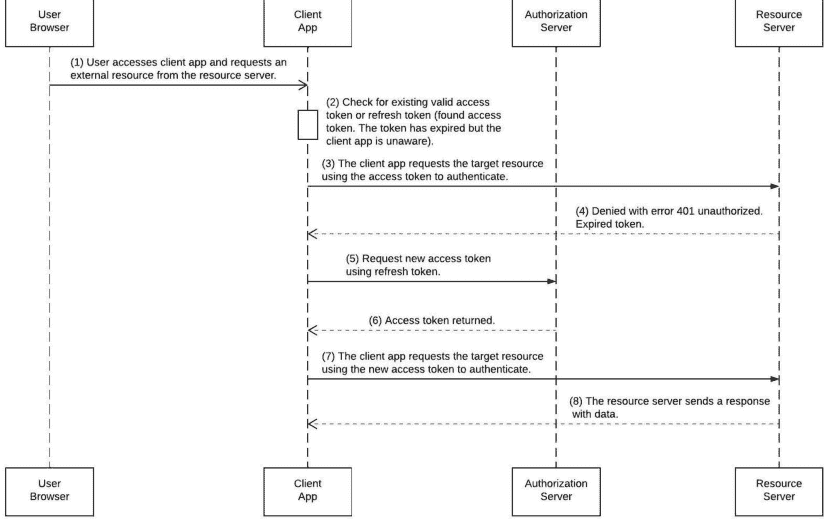

图 4.13 – OAuth 2.0/OIDC 刷新令牌流程

流程如下：

- 1. 用户访问客户端应用程序（网站/网页应用）。网站会代用户尝试访问存储在 *资源服务器* 上的某些用户数据，例如用户的完整个人资料。
- 2. 网站会检查当前用户和目标资源服务器是否存在有效的访问令牌或刷新令牌。假设应用程序找到了两者。然而，应用程序不知道访问令牌已过期。某些访问令牌内部包含指示其过期日期的信息，而有些则不包含。假设应用程序无法得知访问令牌已过期，它会尝试使用该令牌来获取所需资源。
- 3. 客户端应用程序使用 *访问令牌* 向资源服务器请求所需资源。
- 4. 资源服务器返回一个响应，指示令牌已过期。资源服务器通常会有存储（内存中或数据库中）用于保存所有活动访问令牌和刷新令牌。过期或撤销的令牌将从该存储中清除。在此示例中，资源服务器在其存储中查找了过期的访问令牌但未找到（或找到了，但带有指示其已过期的标志，具体取决于资源服务器本身的设置）。

- 5. 客户端应用程序使用刷新令牌，通过将以下参数发布到授权服务器端点来获取新的访问令牌：grant_type=refresh_token。此流程的值必须为 refresh_token；client_id，客户端应用程序的唯一 ID；client_secret，包含客户端应用程序的密钥值；以及 refresh_token，包含刷新令牌本身。
- 6. 授权服务器接收 POST 请求，颁发访问令牌，并将其返回给客户端应用程序。
- 7. 客户端应用程序接收访问令牌，并使用它向资源服务器请求所需资源。
- 8. 资源服务器通过发送所请求的资源来响应。

### 用户代理流程

也称为隐式流程，与 Web 服务器流程相比，该流程被认为安全性较低，主要用于无法为客户端密钥值提供安全存储的客户端应用程序。JavaScript 单页应用程序 (SPA) 和移动应用程序是很好的示例。请查看序列图：

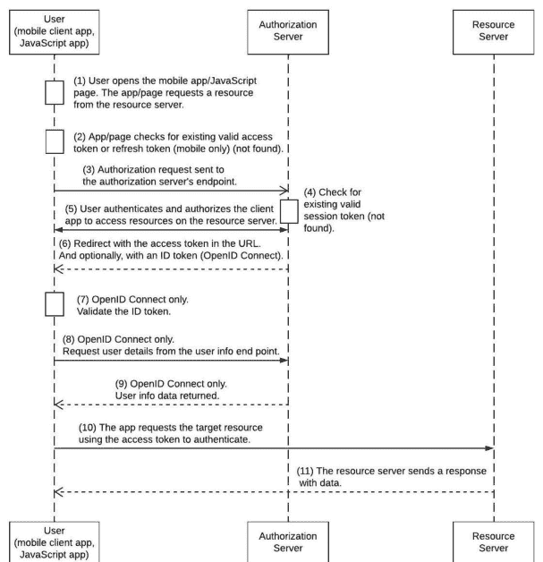

图 4.14 – OAuth 2.0/OIDC 用户代理流程

流程如下：

- 1. 用户启动移动应用程序（或访问基于 JavaScript 的 SPA）。假设这是用户第一次打开此应用程序，并且假设移动应用程序旨在使用来自单一来源（即资源服务器）的数据来运行。
- 2. 应用程序会检查是否存在有效的访问令牌或刷新令牌。考虑到这是用户第一次启动该应用，将找不到任何令牌。移动应用启动 OAuth 2.0/OIDC 用户代理流程。传递的参数与 Web 服务器流程中传递的参数非常相似，但这次 response_type 参数的值应为 token。例如，重定向的完整 URI 可能如下所示：https://packt.link/k7vTsv。

除 response_type 值之外，还需要注意的一点是，原生移动应用程序可以注册并使用自定义协议（例如 myapp://），然后定义回调（例如 myapp://callback）。由于用户代理流程的特性，并且它不如 Web 服务器流程安全，因此通常不会返回刷新令牌。

例外情况是当客户端应用程序在 redirect_uri 值中使用自定义协议时。在前面的示例中，假设使用了正确的作用域，该流程可以返回访问令牌、刷新令牌和 ID 令牌。

- 3. 授权请求被发送到授权服务器。
- 4. 授权服务器会检查与服务器域关联的 Cookie 中存储的现有且有效的会话令牌。假设未找到该令牌，因为这是用户今天第一次登录授权服务器。
- 5. 用户将看到由授权服务器提供的登录屏幕。用户输入用户名和密码（或按授权服务器定义的任何方式进行身份验证）。如果服务器配置为使用 2FA 或 MFA，则在用户身份验证之前将请求其他因素。完成此操作后，用户将看到一个屏幕，要求批准允许客户端应用程序访问资源服务器上的特定作用域。这将是一个类似于图 4.11 的屏幕。
- 6. 用户将获得身份验证并生成访问令牌。如果使用了正确的作用域，还会生成刷新令牌和 ID 令牌（假设如此，这对移动应用程序来说是常见情况，主要是因为它们通常希望通过不要求用户在下次打开应用程序时再次进行身份验证来提供更好的用户体验）。端点将解析响应并从中提取三个令牌。
- 7. 这是一个可选（但强烈推荐）的步骤，用于接收 ID 令牌的情况。客户端应用程序通过验证其数字签名来验证 ID 令牌。
- 8. 这是一个可选步骤。客户端应用程序可以使用 ID 令牌中的信息来请求登录用户的完整个人资料详细信息。

- 9. 这是一个与步骤 8 相关的可选步骤。将返回完整的个人资料详细信息。
- 10. 客户端应用程序使用访问令牌向资源服务器请求所需资源。
- 11. 资源服务器通过发送所请求的资源来响应。

您应该能够解释并证明您计划在解决方案中使用的流程。由于 Web 服务器流程具有更好的安全措施，因此优于用户代理流程。但是，当客户端应用程序无法安全地存储客户端密钥值时（例如在移动应用程序或基于 JavaScript 的应用程序中），用户代理流程为大多数企业提供了可接受的安全级别。

### JWT 持有者流程

您在本章中（在 JWT 部分）之前遇到过 JWT，并了解了它们的结构以及它们包含签名部分的事实，该签名部分包含作者的数字签名。任何拥有 JWT 作者公钥的实体都可以验证该签名。当您授权客户端应用程序访问资源服务器上的数据而无需用户交互（登录）时，通常会使用此流程。

JWT 本身中的数字签名将用于身份验证客户端应用程序。考虑到此流程不需要用户交互，客户端应用程序必须要么在早期阶段获得用户批准/授权（可能使用其他流程，例如 Web 服务器；用户应使用类似于图 4.9 的屏幕来授权客户端应用程序），要么由管理员授权（其设置取决于授权服务器）。例如，如果 Salesforce 是授权服务器，则有一个名为“管理员批准的用户已预先授权”的设置，可以在连接的应用功能中启用。

现在，请查看此流程的序列图：

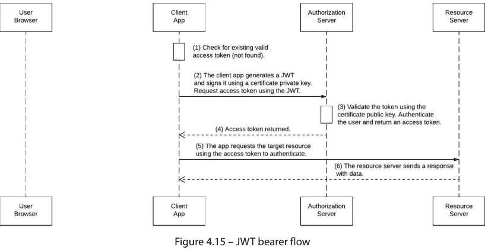

流程如下：

- 1. 客户端应用程序会检查是否存在有效的访问令牌。这是因为客户端应用程序可能被配置为定期（例如每天）从资源服务器检索某些数据，并且需要有效的访问令牌才能执行此操作。假设它没有找到。也可以合理地假设没有可用的刷新令牌。如果有刷新令牌可用，那么使用它来获取新的访问令牌（刷新令牌流程）比经历 JWT 持有者流程更合理。

- 2. 客户端应用程序生成 JWT 并使用其私钥/证书进行签名。生成 JWT 相对简单快捷，有许多现成的库可用于几乎所有编程语言。

- 3. 授权服务器接收 JWT 并使用客户端应用程序的公钥/证书验证其签名。在设置阶段可能需要将公钥与授权服务器共享。

验证签名后，授权服务器可以从 JWT 中提取用户标识符（这通常存储在名为 `sub` 的变量中）。授权服务器使用用户标识符在其身份存储中查找用户。如果找到匹配项，并且客户端应用程序已获授权的作用域，则授权服务器会生成一个 `access token`，以便该客户端应用程序可以代表已识别用户访问资源服务器。

- 4. 访问令牌被返回给客户端应用程序。

- 5. 客户端应用程序使用访问令牌向资源服务器请求所需资源。

- 6. 资源服务器通过发送所请求的资源来响应。

### 设备流程

要了解此流程，需要先澄清此处所指的“设备”是什么意思。这主要是指可以连接到互联网但输入或显示功能有限的电子设备。

智能电视和家电就是很好的示例。当今许多智能电视都带有内置操作系统（例如 Google Android），并且要求用户进行身份验证后才能正常工作。此外，它们还需要获授权才能访问特定资源服务器以执行特定操作。例如，智能电视可能需要访问您的 Google 个人资料，以便根据您的个人资料权限和已知行为为您显示推荐节目。考虑到设备的限制，此流程的设计旨在尽可能简单易用。


现在，请查看序列图：

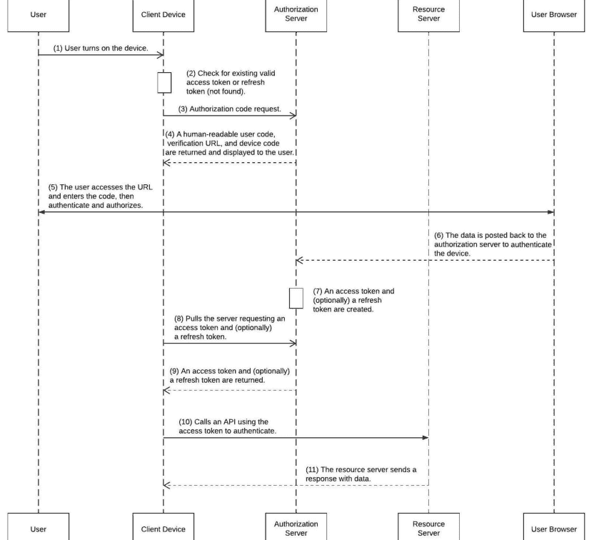

### 图 4.16 – OAuth 2.0 设备流

流程如下：

- 1. 用户打开设备（例如，打开智能电视）。
- 2. 设备检查是否有有效的访问令牌或刷新令牌。假设两者都不可用，因为这是用户首次使用此设备。
- 3. 设备向授权服务器端点发送授权码请求。
- 4. 授权服务器验证请求并颁发人类可读的用户代码/授权码，通常附带验证 URL 和设备代码。这些值通常显示在设备屏幕上。你通常会在智能电视屏幕上看到一条消息，其中包含用户代码、设备代码以及用户应使用的验证设备的 URL（有时这会以二维码的形式呈现，以便更轻松地使用移动设备打开 URL）。
- 5. 随后，用户需要使用另一台设备（例如笔记本电脑或移动设备）打开该 URL（考虑到智能电视上使用键盘的能力有限，这样通常更方便）。该 URL 会将用户引导至一个页面，用户可以在该页面输入设备代码和用户代码。完成此步骤后，设备将被授权服务器识别。在某些情况下，用户还将被要求使用社交网络提供商（例如 Google）登录并授权应用程序。这将与 Web 服务器流非常相似；用户需要授权设备访问资源服务器上的特定范围。
- 6. 收集的数据将用于对设备进行身份验证和授权。然后，浏览器将这些信息发布到授权服务器。
- 7. 将生成访问令牌，以及可选的刷新令牌。
- 8. 在此期间，设备将定期向授权服务器拉取令牌。一旦令牌可用，它们将被发送到设备。
- 9. 访问令牌和刷新令牌将发送到设备并安全存储。
- 10. 设备使用访问令牌从资源服务器请求所需资源。
- 11. 资源服务器通过发送请求的资源来响应。

## 资产令牌流

此流主要为 IoT 设备创建。这可能有点令人困惑，因为智能电视和家电也可以被视为 IoT 设备。然而，此流服务于不同的目的。它是一个开放标准，旨在验证和保护与连接设备的通信，特别是那些没有任何可用屏幕的设备。换句话说，设备将无法显示人类可读的代码供使用。

如今，许多 IoT 设备（例如智能传感器和智能家居设备）都很常见。此类设备的用户通常需要在使用前注册它们。一旦设备在 IoT 管理平台上注册，就可以远程管理和控制。此外，其数据将开始安全地流向 IoT 聚合平台。资产令牌（基于 JWT）将用于唯一标识和验证特定设备（也称为 _IoT 资产_）。请查看序列图：

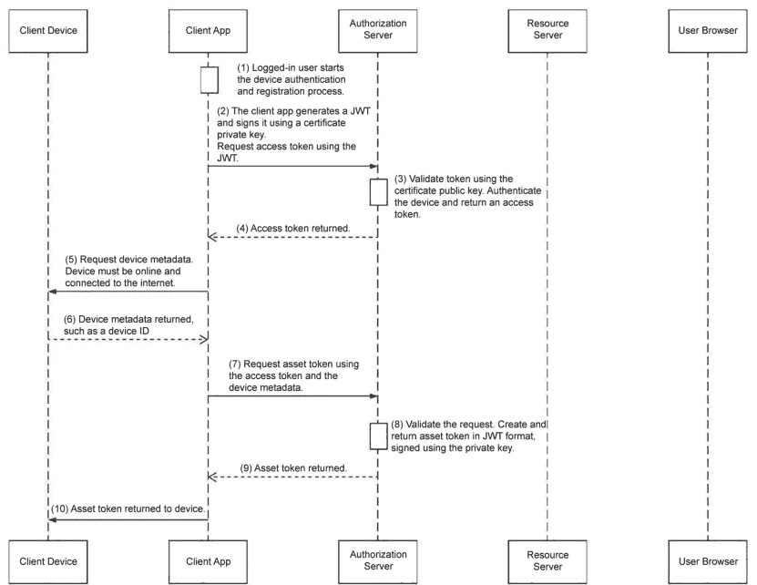

### 图 4.17 – OAuth 2.0 资产令牌流

流程如下：

- 1. 已登录的用户尝试注册新设备。使用特定门户（称为客户端应用），用户输入设备 ID 并单击链接以启动身份验证和注册过程。
- 2. 客户端应用生成 JWT，使用应用的私钥/证书对其签名，并使用它从授权服务器请求访问令牌。
- 3. 授权服务器接收令牌，验证它，并颁发访问令牌（步骤 2 和 3 旨在从授权服务器请求访问令牌，可以使用 JWT 或 Web 服务器流来完成）。
- 4. 访问令牌返回到客户端应用。
- 5. 客户端应用调用设备上的特定 API 以请求设备信息。假设设备已联机并连接到互联网。
- 6. 设备通过发送设备信息（如设备 ID、序列号等）来响应。
- 7. 客户端应用接收完整的设备信息。它现在可以使用访问令牌和可选的参与者令牌请求资产令牌。参与者令牌可用于向授权服务器传递关于资产/设备本身的信息（元数据），这可能包括客户端应用已知的自定义属性（例如，该特定资产应链接到的账户 ID）。参与者令牌本身采用 JWT 格式，可以签名，以便授权服务器在接收时验证它。访问令牌和参与者令牌都将发布到授权服务器以交换资产令牌。
- 8. 授权服务器接收令牌，验证它们，并颁发资产令牌（采用 JWT 格式），使用其私钥/证书对其签名。资产令牌可以包含描述资产本身的标准和自定义属性，这些属性最初在参与者令牌中传递。
- 9. 资产令牌返回到设备。设备随后可以使用它向资源服务器（IoT 聚合平台）进行身份验证并发送其数据。

## 用户名-密码流

此流使用用户凭据（用户名/密码）来检索访问令牌。此流不返回刷新令牌，旨在用于特定用例，主要是当客户端应用由与授权服务器相同的机构开发时。在这方面可以假设存在高度信任。

例如，你可以想象一个名为 mywebsite.com 的网站试图访问其自身子域 api.mywebsite.com 上的资源。但是，如果可能，你被鼓励考虑替代流。

请查看其序列图：

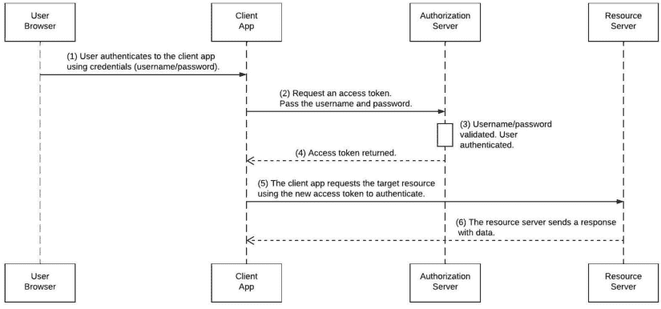

### 图 4.18 – 用户名-密码流

流程如下：

- 1. 用户使用凭据对客户端应用进行身份验证，假设这是用户当天首次尝试访问客户端应用且没有可用的会话令牌。
- 2. 客户端应用使用接收到的凭据向授权服务器请求访问令牌。应用将传递以下参数：`grant_type`（此流的值应为 `password`）；`client_id`（客户端应用的唯一 ID）；`client_secret`（应用的客户端密钥），`username`（从用户处捕获的用户名）；以及 `password`（从用户处捕获的密码）。值得注意的是，使用此流对 Salesforce API 进行身份验证时，需要将 Salesforce 安全令牌与密码连接起来。
- 3. 授权服务器验证凭据并颁发访问令牌。
- 4. 访问令牌返回到客户端应用。
- 5. 客户端应用使用访问令牌从资源服务器请求所需资源。
- 6. 资源服务器通过发送请求的资源来响应。

这就涵盖了本章需要介绍的关键身份验证流。这绝非完整列表。但是，这将帮助你快速掌握日常工作中可能遇到的最常见标准和流。

## 摘要

本章首先介绍了有关 IAM 的一些一般概念。你了解了制定精心设计的 IAM 策略的重要性，以及它如何显著影响最终用户体验以及整体系统安全性和合规性。然后，你熟悉了一些关键 IAM 术语和定义，包括 _身份_、_身份验证_、_授权_、_身份存储_ 和其他内容。接着，你了解了一些最常见的 IAM 标准，包括 SAML、OAuth 2.0、OIDC 和 Kerberos，以及它们生成或使用的不同类型的令牌，例如访问令牌、刷新令牌、会话令牌和 ID 令牌。

这一切为深入研究一些常见且标准的身份验证流奠定了基础。你阅读了九种不同流的深入评论，包括 SAML IDP 发起、SAML SP 发起、OAuth Web 服务器、OAuth JWT 及其他内容。

这就结束了本书的这一部分，你在其中讨论了多种常见的架构概念，包括数据、集成、安全与加密以及 IAM。在下一部分中，你将深入了解更多 Salesforce 特定的知识领域，并完成一些实操练习，这些练习将帮助你为 CTA 评审委员会做好准备。


## 章节复习闪卡

在进入下一章之前，建议您先浏览本章的闪卡。这些闪卡将本章的所有概念浓缩为更小、更易管理的片段，帮助您快速复习和记忆。通过使用这些闪卡，您将加强对关键主题的理解，找出需要进一步学习的领域，并在进入新概念之前建立信心。

下图显示了闪卡界面的示例。

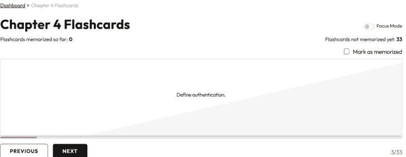

图 4.19 – CTA 闪卡界面

要访问本章的章末闪卡，请执行以下步骤：

- 1. 打开网络浏览器并访问 https://packt.link/ctach4。您将看到以下屏幕：

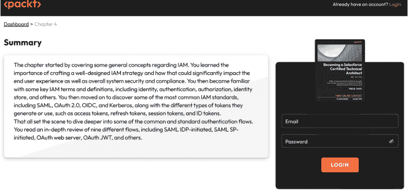

图 4.20 – 闪卡界面登录

您也可以扫描以下二维码访问该网站：


图 4.21 – 访问第 4 章闪卡的二维码

- 2. 使用您的凭据登录帐户。如果您尚未激活帐户，请参阅前言中“解锁在线内容的说明”部分以获取详细说明。

登录成功后，您将看到以下屏幕：

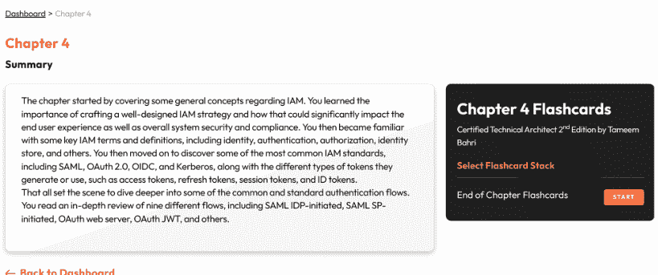

图 4.22 – 章节摘要和章末闪卡

- 3. 点击闪卡堆栈上的“开始”以开始复习。
