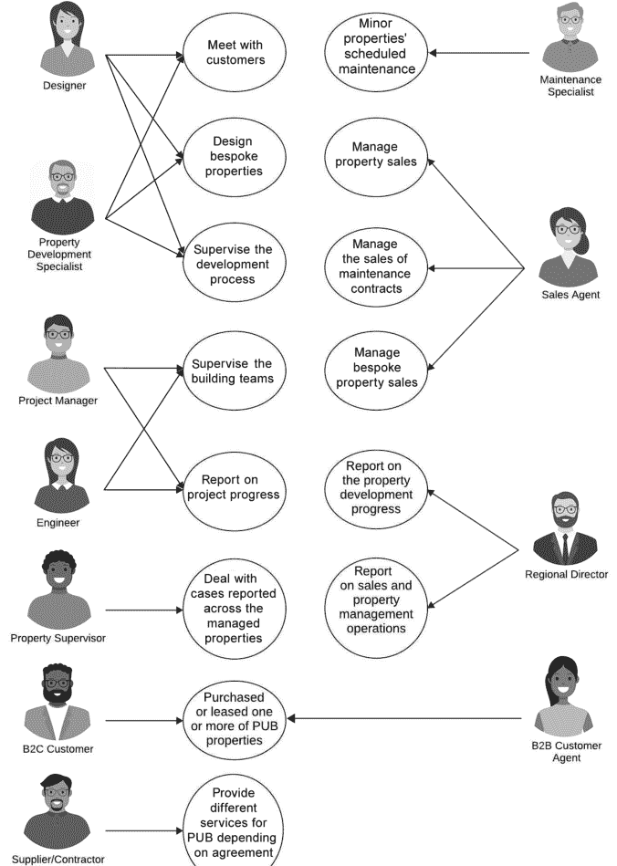
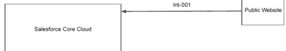
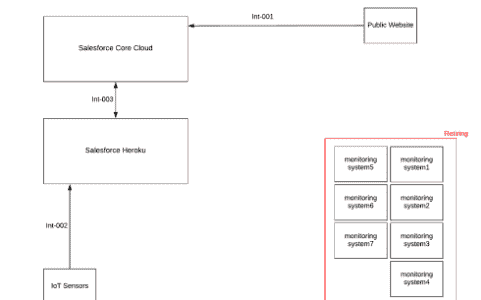
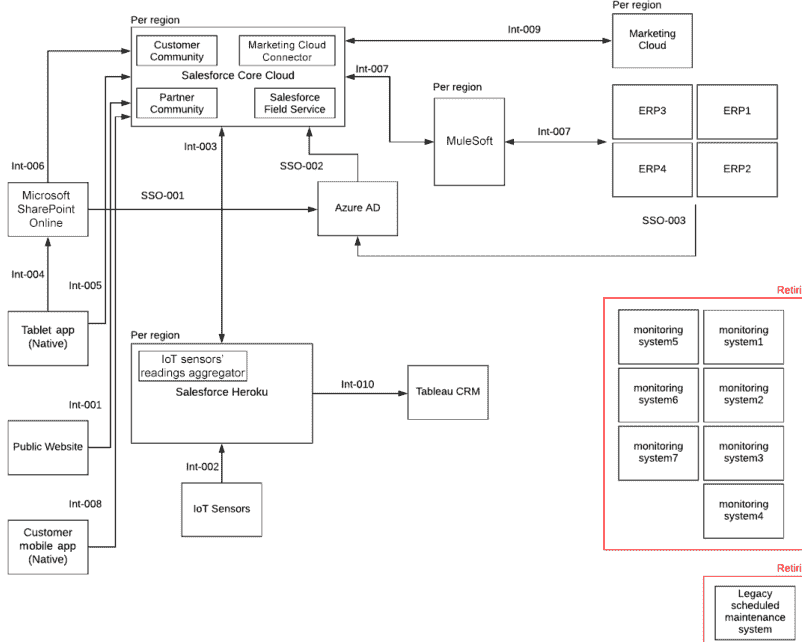
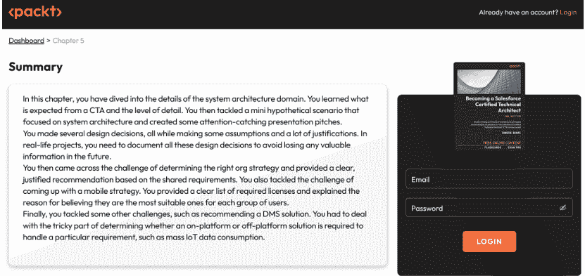
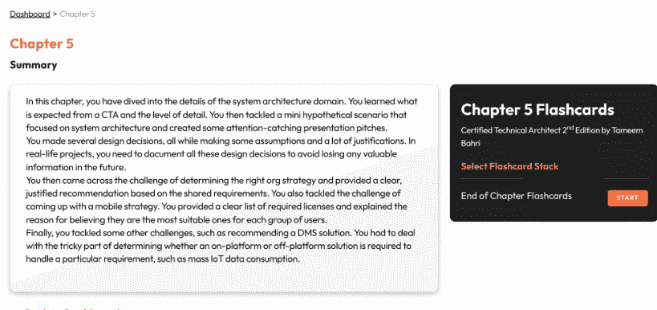

# 开发可扩展的系统架构

作为 Salesforce 系统架构师，您将被期望主导这些解决方案的设计，利用 Salesforce 丰富的产品和功能以及生态系统中的第三方产品和插件。在此过程中，您必须始终牢记所需的用户体验、施加的治理限制以及客户业务模式的性质。

在本章中，您将深入探讨通过 CTA 评审委员会所需的不同 Salesforce 特定知识领域。然后，您将利用一个侧重于系统架构的微型假设场景，将这些知识付诸实践。您将逐步解决该场景，在每个阶段提出有据且简洁的建议。

本章将涵盖以下主要主题：

- 了解作为 Salesforce 系统架构师您应该知道和能够做什么
- 介绍系统架构领域微型假设场景：Packt United Builder
- 确定适当的系统组合并构建您的解决方案和演示文稿

## 了解作为 Salesforce 系统架构师您应该知道和能够做什么

系统架构师通常是一位富有才华的技术专家，负责制定实现企业目标所需的正确 IT 策略以及最佳工具、软件、硬件和网络元素。Salesforce 系统架构师显然会花更少的时间考虑硬件组件，而花更多时间解决平台特定的挑战，例如正确的 Salesforce 组织策略、所需许可证、移动策略、文档管理解决方案 (DMS) 以及报告和分析策略。

**注意**

根据 Salesforce 的在线文档，CTA 候选人应满足一组特定目标，所有目标均可在以下链接中找到：https://packt.link/o3EDS。

现在，您将逐一详细了解这些目标。

## 确定适当的系统组合

Salesforce Platform 是一款出色的工具，能为客户带来巨大价值。然而，它并非应对您可能遇到的每个挑战的解决方案。`Force.com` 平台在多租户环境中提供 SaaS 解决方案。作为一名对该平台有丰富经验的人，您将理解需要牢记若干限制条件。

在实际的 Salesforce 实施过程中，您可能会遇到非技术挑战，例如预算限制。但在评审委员会考试中则不是这种情况。作为系统架构师，您应始终致力于在技术上设计最佳解决方案，使用有据的工具、功能和产品，以最短的时间为客户提供高价值。

可按客户需求进行`配置`的专业解决方案通常能提供更短的上市时间和更高的投资回报率。使自己熟悉一些常见的 **AppExchange** 解决方案以及其他一些第三方解决方案。您必须了解它们的功能，以及何时、在何处以及如何使用它们。

CTA 评审委员会场景通常会包含相当多的要求，这些要求可以使用原生平台功能来满足。每次您建议第三方解决方案（无论是通过 AppExchange 还是完全不同的平台），都要确保有充分的理由。成本不应成为您决策的主要驱动力，因为客户通常会从设计良好的技术解决方案和更短的上市时间中获益更多。

## 报告和分析的设计注意事项

您需要了解标准 Salesforce 报告功能。四种标准报告格式如下：

- 表格式
- 汇总
- 矩阵
- 合并报表

您需要亲自操作它们，以了解它们的功能和局限性。

标准 Salesforce 报告是针对平台上托管的记录数量有限的数据进行报告的绝佳工具。然而，它们不适用于对百万级记录对象或不托管在平台本身上的数据进行报告。趋势及其他跨多年的报告往往包含大量记录；这些要求会让您立即远离 Salesforce 的标准报告。请确保根据场景中给出的数字（以及在必要时基于合理的假设）进行数据量计算。然后，相应地确定您的报告策略。

在处理涉及百万级记录数据集的报告要求时，您可以考虑 CRM Analytics（以前称为 Tableau CRM）、Tableau 以及其他第三方 BI 工具（例如 Power BI）等选项。您不必推荐 Salesforce 产品。正确的做法是根据您的知识和经验，推荐您认为正确的解决方案。Salesforce 产品之间以及与 Salesforce Platform 的集成更加容易。

## 组织策略

这是您在实际操作中和评审委员会期间需要指导客户做出的关键决策之一。您需要帮助客户决定解决方案是使用单个 Salesforce 组织还是多个组织来交付更合适。每次面临此决策时，您都需要记住这两种方法的几个主要优缺点。现在，您将首先了解单组织方法。

### 单组织

在此方法中，您的解决方案使用单个 Salesforce 生产组织进行交付。此方法具有以下优点：

- 来自多个部门和业务单元的用户可以在同一组记录上协同工作和协作。
- 使用此方法通常更容易引入统一流程。例如，跨多个国家/地区使用机会对象的统一销售流程。
- 所有平台数据都在单个实例上；因此，构建使用这些数据的报告更加容易。
- 安全配置、策略、配置文件和权限都在一个位置进行管理。
- 每个用户通常会消耗一个 Salesforce 许可证并使用一组登录凭据。
- 考虑到您只需处理一个 Salesforce 组织，集成接口更容易维护。
- 由于所有平台数据都在一个地方，构建客户 360 度视图更加容易。

然而，这种方法存在以下缺点：

- 请记住，可能阻止您选择此方法的任何法规。
- 由于您可能需要容纳拥有不同流程和要求的多个业务单元，单个组织的复杂性可能会迅速增加。这意味着它最终可能变得非常难以维护。
- 您触及 governor 限制的几率更高。
- 由于组织的复杂性以及更改可能影响许多用户和业务单元，创新和更改可能会缓慢且受到限制。
- 在单个位置维护所有策略、配置文件和权限所带来的优势，当这些配置过于复杂难以维护时，也可能成为劣势。
- 不同团队可能正在开发相互冲突的功能，这最终可能导致彼此功能受损。在这样一个环境中，彻底的回归测试策略至关重要。回归测试是一种软件测试类型，用于检查和验证最近的软件更改是否对任何现有功能产生了不利影响。
- 在本地进行管理比较困难。

## Multi-org

在此方法中，您的解决方案是使用多个 Salesforce 生产组织交付的。它们可以是完全自治的，也可以设计为主子架构风格，其中主组织将数据推送到或从多个子组织拉取数据，或者设计为没有中央组织，其中某些组织彼此直接连接以交换数据。此方法具有以下优点：

- 触及 governor 限制的几率更少。
- 与单组织方法相比，创新和上市时间更好，因为对每个组织所做的更改不会影响其他组织。
- 不同业务单元之间发生冲突的几率更少，因为它们可以在自己的组织中工作。
- 每个组织的复杂性总体较低。
- 在本地管理比较容易。
- 更好地处理不同监管要求的能力。
- 发布周期的灵活性更高，因为每个组织可以有自己的发布周期。

但是，它也有以下缺点：

- 在多个组织之间实现统一流程比较困难。尽管您可以使用未锁定包等部署功能部分地促进这一点，但独立组织更难进行治理，因此最终更有可能采用不同的流程。
- 与多个组织的用户协作的能力有限。尽管某些第三方产品可以部分弥补这一差距，但单个组织在协作方面始终会提供更好的功能。
- 维护集成接口既困难又耗时/耗费资源。
- 需要访问多个 Salesforce 实例的用户将为每个实例消耗一个 Salesforce 用户许可。您可能还需要引入**单点登录 (SSO)** 功能以提供更好的用户体验。
- 第三方的成本可能会增加，具体取决于其许可结构。
- 在多个 Salesforce 实例中报告数据的能力较弱。但是，您可以使用 CRM Analytics 或 Tableau 等工具来弥补这一差距。
- 可能需要多个发布策略、工具集以及维护它们的团队。

在确定最适合的组织结构时，您需要考虑上述所有要点以及更多内容。有时，您可能会遇到明确要求，直接将您推向某个选项。建议先假设采用单组织策略，并在经历多场景要求的过程中更新您的假设。

## 移动解决方案和策略

在您的解决方案中，可以考虑四种主要的移动应用程序类型：

- Salesforce 移动应用（由 Salesforce 构建并持续更新）。Salesforce Mobile Publisher 是 Salesforce 移动应用的一种形式，旨在让您能够轻松为 Salesforce Lightning 应用或 Experience Cloud 站点创建和发布品牌/定制移动应用。它作为独立应用分发。
- 原生应用（使用特定编程语言为特定平台构建的应用，例如 iOS）。
- 混合应用（使用 Apache Cordova（原 PhoneGap）、JavaScript、HTML5 及其他技术等跨平台框架构建的应用）。
- HTML5 应用（使用 JavaScript 和 CSS 等 Web 技术开发的基于 HTML5 的应用）。

这些应用程序各自最适合特定的用例。下表可以帮助您为解决方案确定合适的移动策略：

| 功能 | Salesforce Mobile App | 原生应用 | 混合应用 | HTML5 应用 |
| :--- | :--- | :--- | :--- | :--- |
| 性能 | 最佳 | 最佳 | 次优 | 次优 |
| 分发 | 通过商店（例如 App Store），Salesforce Mobile Publisher 可用于促进品牌列表 | 通过商店（例如 App Store） | 通过商店（例如 App Store） | Web |
| 访问相机 | 需要定制 | 是 | 是 | 否 |
| 访问地理位置 | 是 | 是 | 是 | 是 |
| 访问联系人和日历 | 是 | 是 | 是 | 否 |
| 离线 | 有限 | 最佳 | 有限 | 非常有限 |
| UI 功能（例如捏合、滑动、展开） | 良好 | 最佳 | 有限 | 有限 |
| 定制 UI | 有限 | 最佳 | 有限 | 有限 |
| 跨平台 | 是 | 否 | 是 | 是 |
| 品牌功能 | 否（使用 Salesforce Mobile Publisher 时除外） | 是 | 是 | 是 |
| 所需开发技能 | 无；如果需要自定义功能，则使用 Lightning 组件和 Visualforce | 原生开发语言，例如 Objective-C 和 Java | 特定框架。HTML5、JavaScript、CSS | HTML5、JavaScript、CSS |
| 开发速度 | 快 | 慢 | 中等 | 中等 |

图 5-1 – 不同类型移动应用的功能比较

作为解决方案的一部分，在考虑场景上下文和共享要求的同时，您应当解释您的移动策略。作为 CTA，您不仅需要简单列出不同选项，还应根据其要求、合乎逻辑的假设和有效的论据，引导受众选择正确的选项。

## 所需许可类型

您需要为解决方案指定所需的许可，包括任何第三方许可。例如，如果您的用户使用 Conga Composer 等第三方工具生成 PDF 文档，则需要在解决方案中包含该许可。

在评审委员会期间，您无需详细到粒度级别。不过，在实际解决方案中需要这样做（例如，在评审委员会期间，您可以指定需要 Conga CLM 许可，但在实际操作中，您可能需要明确指定需要多少个 Conga CLM 完整用户和 Conga CLM 请求/仅查看用户许可）。在实际操作中，您有更多时间浏览所选供应商提供的完整许可类型列表，以确定哪些更符合您的要求。这些列表会不断变化，您不需要将其记下来。

对于 Salesforce 许可，通常只需识别并使用以下主要许可之一即可：Sales Cloud、Service Cloud、Salesforce Platform、Salesforce customer community、Salesforce customer community plus、Salesforce Partner Community、CRM Analytics、Marketing Cloud 和 Pardot。

请注意，从 Spring '21 版本开始，Salesforce Community Cloud 已重命名为 Salesforce Experience Cloud。但是，许可仍称为 Salesforce customer community、Salesforce customer community plus、Salesforce Partner Community 和 Salesforce Employee Community。

> **注意**
> 您可以通过以下链接了解最新的许可列表及其功能（特别是其被允许使用的对象和功能）：https://packt.link/XIy4g。

对于评审委员会场景，您可以合理假设使用 Salesforce Enterprise 版。

## 确定合适的文档管理解决方案

您已经了解过 Salesforce Platform 提供的不同类型的 DMS。您还在第二章“核心架构概念：数据生命周期”中简要了解过市场上一些最常见的解决方案以及如何将它们连接到 Salesforce。请确保您对 Files Connect 有实际操作经验（这是一款 Salesforce 产品，允许 Salesforce 用户访问、搜索和查看存储在 Google Drive、Box 或 Microsoft SharePoint 等外部系统中的文档）。

> **注意**
> 您可以使用此链接查看完整的官方指南：https://packt.link/iFJXi。

现在是将所有这些知识付诸实践的时候了。在下一节中，您将了解一个专注于系统架构领域的微型假设场景。

## 系统架构领域微型假设场景简介：Packt United Builder

以下微型场景描述了一个特定客户面临的挑战。您将阅读该场景，然后逐步创建解决方案。为了从中获益最大，建议您阅读每一段，尝试自己解决问题，然后返回本章，阅读建议的解决方案，将其与您的解决方案进行比较，并做笔记。

> **注意**
> 
> 请记住，此处列出的解决方案不一定是 *唯一* 可能的解决方案。只要在技术上正确且逻辑合理，替代方案也是可以接受的。

废话不多说，继续查看场景。

### 场景

**帕克特联合建筑（Packt United Builder，PUB）** 是一家全球房地产开发商。它在20个地区拥有200个办事处，包括15个美国州、法国、德国、意大利、阿联酋和新加坡。PUB提供的服务涵盖房地产设计、建造、管理和维护。它既开展自有房地产开发项目，也为B2B和VIP B2C客户提供特殊的定制项目。

PUB拥有超过五百万B2C客户和约10万 B2B客户，此外还有分布在约5万家公司中的广泛供应商和承包商网络。

PUB在全球管理约10万处房产。每处房产平均配备10台智能火灾监控设备、安防设备和传感器。所有设备均连接至互联网，并至少每30秒发送一次状态消息。PUB预计未来五年其管理的房产组合将每年增长10%。

PUB长期面临系统脱节的问题，导致数据质量不佳，员工工作量增加。它已在意大利试点了一个基于Salesforce的解决方案，并希望将其推广到其他地区。各地区都有业务必须遵守的一套房地产开发和管理法规。

PUB在为其管理的房产部署和监控传感器方面推行统一机制也遇到了困难。目前，这些传感器产生的数据被收集在多个功能低下、对业务价值有限的脱节系统中。

### 内部利益相关者

以下PUB员工将使用新系统：

- 300名设计师和房地产开发专家，他们与客户会面，设计定制房产并监督开发流程
- 10,000名项目经理和工程师，他们监督施工团队并汇报项目进度
- 5,000名专家，他们负责照管较小的房产及其计划维护
- 10,000名销售代理，他们负责管理房产、维护合同和定制房产的销售周期
- 100名区域总监，他们需要定期获取房地产开发进度，以及销售和房产管理运营的报告
- 50名房产主管，他们处理受管房产报告的案例，并确保客户根据其商定的支持等级获得服务

接下来，您将了解更多关于外部利益相关者的信息。

### 外部利益相关者

PUB还识别出将使用该系统的外部用户：

- **五百万B2C客户**：这些是在特定时间购买或租赁了一处或多处PUB房产的个人。
- **10万 B2B客户**：这些是在特定时间购买或租赁了一处或多处PUB房产的公司。PUB认为其中大部分记录都是最新的。
- **5万家供应商和承包商**：这些是根据不同类型的协议为PUB提供不同服务的公司。

现在，请继续查看要求。

### 要求

PUB共享了以下要求，描述了当前和期望的解决方案。PUB使用多个系统来运行其业务：

- PUB使用一个自定义的多语言公共网站，向潜在客户提供公司信息、办公地址、电话号码和询价表单。PUB计划保留该网站，并根据需要进行更新以适配新系统。
- PUB使用七个不同的脱节监控系统，其中没有内置业务逻辑。这些系统部署在本地，拥有公开可访问的 Web 服务，可直接接收安装在受管房产中不同传感器发出的信号。

PUB认为这些系统价值不大，希望用新系统取代它们，新系统将作为一个统一平台，接收、解释并响应来自全球不同类型和型号传感器的不同信号。

- 存在四个不同的ERP系统——一个在美国，一个在欧洲，一个在阿联酋和中东地区，一个在新加坡和东亚地区。由于防火和安全系统的法规要求，这些ERP实现有不同的数据要求。因此，它们一直相互独立。
- PUB使用一个定制的设计应用程序，专门为在企业平板电脑上使用它的设计师量身打造。设计师在与客户讨论时，使用该应用程序显示和调整不同的设计元素。

该应用程序生成PDF文件作为输出，理想情况下应与描述房产的一组文档一起保存，例如说明已安装传感器位置的文档。

目前，所有这些文件都存储在各个地区的不同系统中。PUB希望将新系统作为集中工具，以结构化且符合地区合规要求的方式存储这些文档。PUB倾向于使用其新购买的 Microsoft SharePoint Online 软件来实现这一点，前提是它可以与新系统完全集成。

- PUB拥有一套CRM（意大利除外，均非Salesforce），用于跟踪项目开发和销售活动，这些活动在各地区的性质各不相同。PUB希望用新系统取代所有这些脱节的应用程序。

其中一些CRM与PUB的区域ERP系统集成。PUB希望新系统与ERP系统完全集成，以便客户和订单数据可以根据地区复制到正确的ERP系统中。

- PUB有一个用于计划维护操作的中央系统。该系统在过去曾面临多项挑战，现在被认为效率低下。PUB希望用新系统取代它。
- 所有现有系统都通过企业 Azure Active Directory (AD) 为内部用户提供单点登录(SSO)。PUB希望新系统继续使用 Azure AD 实现新系统与保留的 ERP 之间的单点登录。
- 德国已推出一款移动应用程序，允许员工在连接互联网时从世界任何地方访问德国CRM。PUB希望为新系统提供类似的功能，并在全球范围内推出。

除上述要点外，PUB认识到，为了提供最佳客户体验，新系统还需要交付以下功能：

- 客户应能下载带有PUB品牌的移动应用程序，查看其在线账户、针对其房产创建工单并更新个人资料。该应用程序应提供现代且定制的用户体验和 UI。
- PUB目前与客户沟通较少。PUB希望能够根据客户偏好定期发送营销材料。
- PUB认识到，受管房产传感器收集的数据可能揭示有价值的业务趋势，帮助 PUB 提供更好、更高效的服务。维护数据同样适用这一原则。PUB希望能够分析过去五年的数据，以得出有价值的市场趋势。

PUB希望获得您的帮助，根据其共享的要求和愿景设计一个可扩展且面向未来的解决方案。

## 确定合适的系统组合并构建您的解决方案和演示

您通常应先快速浏览场景以了解全局，并对解决方案形成一些初步想法。然后，您应再次逐节阅读场景，并逐步构建您的解决方案。

### 了解当前情况

从场景的第一部分开始，以“以下PUB员工将使用新系统”和“PUB已识别出也将使用该系统的外部用户”开头的章节可以帮助您识别涉及的不同角色和人物画像，并确定每个角色所需的许可证。

仅凭这一段就能让你对所需的许可证类型有个大致了解，不过在最终确定之前，你需要浏览完整的场景。你可以先绘制角色图。在你对解决方案有了更明确的构思后，再将许可证添加到图中。此时，角色图如下所示：

### 图 5.2 – 角色图（初稿）

需求部分描述了当前的 PUB 系统环境及其对未来环境的看法。这一部分还包含几条提示，可帮助你确定合适的组织策略和移动策略，此外还有其他一些要求。

CTA 评审委员会场景的结构可能略有不同，尤其是考虑到完整场景要比这个小型场景长得多。不过，在大多数情况下，会有一个描述当前环境的章节，以及几个提供多个要求的其他章节，这些要求可以帮助你确定未来环境以及与系统架构相关的其他设计决策。

## 深入共享需求

现在，逐条阅读需求，识别其中的不同需求，以便你能为解决方案添加更多元素。第一条要求以如下陈述开头：

> 一个定制的多语言公共网站，为潜在客户提供公司信息、办公地址、电话号码和咨询表单。

基于此陈述，你可以先将定制网站添加到未来环境中。你已经知道 Salesforce Core Cloud 将成为解决方案的一部分，并且可以利用 Web-to-Lead 表单为咨询表单提供集成机制。你可以将所有这些包含在你的环境图和集成接口中。这些工件现在如下所示：

| 接口代码 | 源/目标 | 集成层 | 集成模式 | 描述 | 安全 | 身份验证 |
| :--- | :--- | :--- | :--- | :--- | :--- | :--- |
| Int-001 | 公共网站 -> Salesforce | 数据 | 远程调用 | 使用 Web-to-Lead 捕获潜在客户。潜在客户包含诸如公司信息、办公地址、电话号码以及潜在客户咨询等信息。 | HTTPS（单向 SSL/TLS） | 无，建议实施防止 DOS 攻击的机制（例如 CAPTCHA）。 |

### 图 5.3 – 环境架构和集成接口

现在，继续阅读下一段，该段以以下陈述开头：

> 七个不同的、互不连接的监控系统，且内置没有业务逻辑。

在这里，你将了解到 PUB 并不特别偏爱的七个 IoT 平台系统。你可以将这些系统添加到环境图中，并强调它们即将被退役。在图中包括即将退役的系统，将有助于你在演示中讲述完整的故事。

通过阅读场景，你了解到 PUB 正在寻找一个可以与各种传感器集成并提供某种智能的统一平台。这是通过针对接收到的不同信号做出反应的陈述来传达的。这里的问题是，你能否利用 Salesforce Core Cloud 作为平台来接收这些消息？你可以在 Salesforce 上开发一个不错的决策引擎，但有几个平台限制需要牢记。

场景中提到，全球有 100,000 处房产，每处房产平均有 10 个传感器，每个传感器每分钟发送两条消息。这意味着每天接收到的消息数量为 100,000 * 10 * 2 * 60 * 24 = 2,880,000,000 条。即使不考虑存储如此数量消息所需的数据存储，你也能清楚地看出，这个数量将达到入站 API 调用数量的治理限制。

在此购买更多配额也不是正确的决定。这是一种成本非常高且不合理的解决方案，主要是因为你将平台用于其并非设计用途的场景。或者，你应该考虑非平台解决方案。

你可以提出你熟悉且知道能满足要求的解决方案，或者只需建议一个托管在 AWS 或 Heroku 等 PaaS 平台上的自定义构建应用程序。PaaS 平台旨在处理如此巨大的流量；有些甚至提供用于处理 IoT 设备的内置模块。

选择 Heroku 有其优势，因为你可以在需要时利用 Heroku Connect 将数据与 Salesforce Core 同步。在现实生活中，还有其他几个因素会影响此决定。在评审委员会上，你可以简单地采取稳妥策略并选择 Heroku，以防万一你需要利用 Heroku Connect 来满足尚未识别的其他要求。

在将这些消息传递给 Heroku 之前，你是否需要 ESB 或 API 管理器来接收它们？目前，没有驱动此决定的要求。你可以轻松开发安全的自定义 Web 服务并通过 Heroku 公开它们。这些 Web 服务是公开可访问的，因为 Heroku 本身是基于云的。目前没有理由将 ESB 包含在环境中。环境架构图和集成接口表现在如下所示：

| 接口代码 | 源/目标 | 集成层 | 集成模式 | 描述 | 安全 | 身份验证 |
| :--- | :--- | :--- | :--- | :--- | :--- | :--- |
| Int-001 | 公共网站 -> Salesforce | 数据 | 远程调用 | 使用 Web-to-Lead 捕获潜在客户。潜在客户包含诸如公司信息、办公地址、电话号码以及潜在客户咨询等信息。 | HTTPS（单向 SSL/TLS） | 无，建议实施防止 DOS 攻击的机制（例如 CAPTCHA）。 |
| Int-002 | IoT 传感器 -> Heroku | 数据 | 远程调用 | 传感器大约每 30 秒向 Heroku 发送常规状态更新。 | HTTPS（单向 SSL/TLS） | OAuth 2.0 资产令牌流。 |
| Int-003 | Salesforce <-> Heroku | 数据 | 批量数据同步 – 异步 | 使用 Heroku Connect 在 Salesforce 核心云（Force.com）和 Heroku 之间进行双向数据同步。假设对象：账户和案例。 | HTTPS（单向 SSL/TLS） | OAuth 2.0 Web 服务器流。 |

### 图 5.4 – 环境架构和集成接口（第二稿）

查看下一段，该段以以下陈述开头：

> 四个不同的 ERP 系统。一个在美国，一个在欧洲，一个在阿联酋和中东地区，一个在新加坡和东亚地区。

基于此陈述，这些 ERP 将继续作为环境的一部分，你还了解到新的重要信息。每个地区关于火灾和安全系统数据存储方式的法规要求都很严格。这可能有助于你确定正确的组织策略方法。

请记住，作为解决方案的一部分，你需要确定组织策略。你会找到可以帮助指导你的要求；这里有一个这样的要求。建议首先假设解决方案将使用单个组织交付，然后逐条审查要求，并在每个阶段重新评估并确定该假设是否仍然有效。

在这种情况下，你脑海中应该出现的问题是，我能否使用单个 Salesforce 组织来满足这些法规要求？显然，使用 ERP 系统无法实现这一点，因此可以合理地假设，使用单个 Salesforce 实例也无法做到。Salesforce Shield 在这种情况下无法提供帮助，共享和可见性设置也无法帮助。

基于此，你应该考虑选择多组织策略。你需要在演示中证明你的决定的合理性，而不必在此话题上花费过多时间。例如，你可以用以下方式总结你的决定：

由于火灾和安全系统数据的法规要求，我提议采用多组织策略。使用单个组织无法满足这些法规。因此，我提议每个地区拥有自己的 Salesforce 组织。每个组织将在其所在地区本地托管。我还假设意大利组织可以重新用作欧洲组织。场景未明确规定法规要求，因此我假设在同一地区内托管此数据足以保持合规。场景也没有提到跨地区需要统一的全球流程，因此我假设四个区域组织是完全自主的。

此陈述证明了你的理由，并解释了你做出此决定所使用的假设。在大多数情况下，场景设计会为你留出一些假设空间。对你的假设要合理、逻辑清晰，并清晰地传达它们。阅读和演示前一段不应超过 60-90 秒。你的演示时间宝贵，你应该充分利用它。

现在，继续进行下一段/要点，该段以以下行开头：

一个定制设计应用程序，专门为设计师在其企业平板电脑上使用而设计。

此陈述中有两个要求。自定义构建的平板应用程序必须使用新系统来存储生成的 PDF。此外，这些 PDF 必须存储在企业级 DMS 中。考虑到 PUB 明确偏好使用 Microsoft SharePoint 来实现此目的，Files Connect 是一个强大的工具，可用于在 Salesforce 中公开存储在 SharePoint 中的文档。但是，你需要考虑如何将文档最初放入 SharePoint。

如果你已经使用过 Files Connect 并熟悉其功能，那么可以基于它来设计解决方案。否则，选择你知道有效的解决方案。不要仅仅因为你在参加 Salesforce 考试就试图将每个要求都强行塞进 Salesforce 功能中。你需要提出你知道有效的解决方案，并合理地证明使用它的合理性。

在这种情况下，你可以提议更新平板应用程序，使其同时使用 Salesforce 软件开发工具包（SDK）和 SharePoint API。然后，它可以使用这些 API 将文件直接上传到 SharePoint。如有需要，以后可以使用 Files Connect 在 Salesforce 中公开这些文件。目前还没有此类要求。你需要解释你计划如何对 SharePoint 进行身份验证。

第 6 章《在 Salesforce 中制定安全架构》中为这些要求提供了专门的小型场景。目前，你可以这样解释针对此段落要求的拟议解决方案：

为了满足存储生成的 PDF 的要求，我提议更新平板应用，以便我们可以使用 SharePoint API 将 PDF 直接上传到 SharePoint。我假设平板应用可以更新，因为它是定制开发的。我还假设它是原生应用，以支持所需的 UI 功能。PDF 上传到 SharePoint 后，可以通过 Files Connect 在 Salesforce 中公开。实际文件将继续存储在 SharePoint 中，但前提是 Salesforce 中有其链接可用。

我还提议更新平板应用，使其使用 Salesforce SDK 检索客户名称和 ID 等信息，这些信息将用于将 PDF 上传到正确的位置。平板应用将使用 OpenID Connect 用户代理流向 SharePoint 和 Salesforce 进行身份验证。每个 PUB 设计师将在 SharePoint 和 Salesforce 中都拥有一个用户。我假设可以使用员工 ID 作为联合标识符，以跨系统映射用户。

请注意，此时您没有关于 PUB 所使用 IDP 的详细信息。然而，在几段之后，您将注意到以下陈述：

所有现有系统均已连接到企业 Azure AD，以供内部用户使用 SSO。

现在，您可以相应地更新架构图和集成接口。请按渐进方式继续操作。在此阶段，您可能需要更改和重绘内容。因此，建议先在草稿纸上开始，然后再将成果物复制到最终形式中，以便尽可能使其看起来专业。

现在，请转到下一段，该段以以下行开头：

PUB 拥有一组 CRM（除意大利外均非 Salesforce），用于跟踪项目开发和销售活动，每个地区的性质各不相同。

这似乎与采用多组织策略的计划相符。PUB 希望将每个地区的 ERP 与基于 Salesforce 的新系统集成。考虑到您提议采用多组织策略，可以合理地假设每个 ERP 都将与其对应的区域 CRM（即区域 Salesforce 实例）集成。

接下来您应该考虑如何将 Salesforce 与 PUB 的 ERP 集成。回顾您在第 3 章（核心架构概念：集成与加密）中涵盖的主题，您知道这些系统可以通过多种方式集成。考虑到您在该章中关于使用中间件的优缺点，以及不同的工具，您应考虑以下选项：

- 使用 ESB：考虑到 ESB 能够处理复杂的编排要求
- 使用 ETL 工具：考虑到 ETL 工具专为大规模数据复制而设计

注意

您被期望从技术角度提出最合适的解决方案。精益架构和企业级扩展能力应始终是您的目标之一；两者都无法通过点对点集成来实现。

该场景未指定预计在系统之间传输的记录数量。它也没有指定任何编排要求。您必须在此做出一些假设，清楚地传达它们，并将其作为拟议解决方案的基础。

在评审委员会中，您被期望根据传达的要求、假设和逻辑提出一个明确的推荐解决方案。您可以提及其他选项，但必须明确选择并传达您推荐的方案。

您可以按以下方式解释针对本段要求的拟议解决方案：

*为了满足将区域 ERP 与基于 Salesforce 的新系统集成的要求，我提议使用 ESB 作为中间件。目前未传达描述这些系统之间每日交换数据量的要求。*

*ETL 工具在处理大规模数据复制方面更出色。不过，我假设记录数量相对较少，因此更倾向于使用 ESB，考虑到其在处理数据编排要求方面的卓越能力，企业很可能需要这种功能。考虑到新解决方案将基于多组织策略，每个 ERP 都将与其区域 Salesforce 实例集成。*

*我还假设 ESB 将基于云并在区域内托管，以确保数据永不离开区域。我提议使用 MuleSoft 作为 ESB，因为它是市场上领先的 ESB 之一，并带有内置的 Salesforce 连接器。*

每当您提议使用第三方产品时，必须指明名称。到目前为止，您已看到两个示例：您命名了拟议的 PaaS 平台，现在您也命名了集成中间件。您不必选择 Salesforce 自有产品。您应选择自己熟悉且确定能够满足要求的产品。再次提醒，您应在不浪费不必要时间的情况下覆盖此要求。前一段可在 60-90 秒内演示完毕。

现在，请转到下一段，该段以以下行开头：

*PUB 拥有一个用于计划维护操作的中央系统。*

这是一个直接的要求。PUB 想要用新系统取代其旧版计划维护系统。您无需成为现场服务解决方案专家，但应熟悉其中的一些解决方案并了解其提供的功能。在此情况下，您的拟议解决方案可以如下：

*为了满足此要求，我提议使用 Salesforce Field Service。它可以配置为生成计划维护工单，从而提高现场服务和维护团队的效率。*

**注意**
请记得将 Salesforce Field Service 添加到您的图表中。它是一个安装到您的组织中的包，因此请确保您的图表反映这一点。另外，不要忘记包括即将退役的旧版系统。一旦此图表准备就绪，它将帮助您以引人入胜且吸引人的方式展示您的解决方案。

现在，请转到下一段，该段以以下行开头：

*所有现有系统均已连接到企业 Azure AD，以供内部用户使用 SSO。*

该场景不太可能明确提及充当身份提供者的系统。您应具备足够的市场知识，认识到 Azure AD 是此领域领先的产品之一。基于该场景，它在此架构中必然充当身份提供者。请确保将 SSO 接口作为架构图和集成接口列表的一部分。

请继续转到下一段，该段以以下行开头：

*德国已推出一款移动应用程序，允许员工在联网时随时随地访问德国 CRM。*

显然，这是一个移动应用程序要求。对于这些要求，您应能够选择正确的移动策略。您之前使用平板应用提供了一个示例。本段不包含足够的信息来帮助您选择正确的移动策略，但下一段包含。它以以下声明开头：

*客户应能够下载一个带有 PUB 品牌的移动应用程序，以查看其在线账户、针对其房产提交工单并更新个人资料。*

您可以基于 Salesforce 移动应用、原生应用、混合应用或基于 HTML5 的应用来选择移动策略。考虑到该应用程序应带有 PUB 品牌，您可能会认为 Salesforce 移动应用不合适。

然而，Salesforce 最近推出了一项名为 **Mobile Publisher** 的新服务，允许您向最终客户交付其移动应用的品牌化版本。所有可能的移动策略都可以提供品牌化、在线个人资料访问以及与 Salesforce 的集成。

但是，区分需求的是与 UI 相关的那个。PUB 正在寻找一种能够驱动特定用户体验的复杂且定制化的 UI。在这种情况下，您的最佳选择将是原生应用。您提议的解决方案可以如下：

> 考虑到拥有定制化、现代且复杂的移动 UI 的需求，我提议将此移动应用程序作为原生应用进行开发。也许我们可以利用德国开发的移动应用，并将其更新为使用 Salesforce 移动 SDK，或者直接从头构建。客户仍将使用客户社区许可证对 Salesforce 进行身份验证。移动应用将使用 OpenID Connect 用户代理流。

您需要从端到端解释该解决方案。不要留下任何遗漏，例如跳过解释用户如何对 Salesforce 进行身份验证的部分。您的解决方案必须清晰可靠。请注意，对于客户，您提议使用 Salesforce 作为身份提供者。这应该是可以的，考虑到该场景中提到 Azure AD 主要用于内部用户。

> 注意
> 请记住将客户的原生移动应用及其集成接口添加到您的工件中。

接下来看下一段，如下：

PUB 目前与客户沟通很少。PUB 希望能够根据客户的偏好定期发送营销材料。

您脑海中应该浮现的问题是：对于这一需求，Salesforce 生态系统中最合适的解决方案是什么？您需要在核心云中进行大量定制来构建此功能，并且仍然会遇到不同的限制。

外部系统是一个选项，但最明显的解决方案以及与核心云提供最佳开箱即用集成的解决方案是 Marketing Cloud。Marketing Cloud 可用于根据客户偏好对客户进行细分。您提议的解决方案可以如下：

> 我提议使用 Marketing Cloud 来满足此需求。Marketing Cloud 可用于根据客户偏好对客户进行细分。考虑到法规要求，每个地区将有一个不同的 Marketing Cloud 实例。可以使用标准的 Marketing Cloud Connector 将区域核心云与其对应的 Marketing Cloud 实例进行集成。核心云中的联系人 ID 将用作 Marketing Cloud 中的订阅者密钥。

跨云架构概念正在持续增长。作为 CTA，您被期望对 Salesforce Platform（主要是 Force.com，也称为核心云）有非常扎实的了解。但是，您仍然需要对 Salesforce 生态系统中的常用工具和技术及其相互交互方式有一定的了解。

Marketing Cloud 是当今 Salesforce 版图中非常常见的元素，您需要对其功能及其与核心云的集成方式有基本的了解。值得指出的是，Marketing Cloud Connector 使用 OAuth 2.0 客户端凭据流来对 Marketing Cloud 进行身份验证。

> 注意
> 您可以通过以下链接了解有关 OAuth 2.0 客户端凭据流和 Marketing Cloud Connector 托管包的更多信息：https://packt.link/g5ZJP。

现在，进入下一段，该段落以以下行开头：

> PUB 意识到，从托管房产中的传感器收集的数据可能揭示有价值的业务趋势，从而帮助 PUB 提供更好、更高效的服务。

传感器数据存储在 Heroku 的 Postgres 数据库中，与您提议的解决方案一致。PUB 想要现在利用这些数据进行一些 BI 操作。此前，您粗略估计每天将收到 2,880,000,000 条消息。如果您打算对过去五年内存储的数据进行报告，这个数字将会更大。

Salesforce CRM Analytics 是一个可靠的分析解决方案，但它不是设计用于处理像 Tableau 那样大量数据的。但是，在得出 Tableau 是正确解决方案的结论之前，您需要分析需求并思考存储那么多数据能带来什么价值。

大多数时候，传感器只会发送相同的状态消息；除非发生影响其读数的事情。可以合理地假设，您可以使用自定义代码来汇总这些读数，这将确保您仍然获得数据的价值，但不会不必要地存储太多数据。您可以在 Heroku 上开发该自定义模块，然后在其上使用 CRM Analytics 来提供所需的 BI。您提议的解决方案可以如下：

> 考虑到从传感器接收到的数据量，我提议在 Heroku 上开发一个自定义模块来汇总接收到的读数，并确保我们只保留可能对业务有价值的数据。这应该能显著减少需要报告的数据量。我们可以使用策略来汇总所有超过一年的传感器数据。然后我们可以使用 CRM Analytics 为业务提供高价值的趋势报告。

> 注意
> 请记住，您在此提出的解决方案基于假设和合理逻辑。然而，这并不意味着它们是唯一的解决方案。解决这些需求有多种可能的方式，只要基于合理的假设和论据，CTA 评委可能会接受它们。

至此，您已经完成了该场景。恭喜！您现在拥有了所需的一切，可以完善您的工件并发表一场突破性的演示。

现在，重新审视参与者图，并尝试向其中添加许可证。通常，您需要先了解业务流程并绘制数据模型，然后才能确定所需的确切许可证类型。此微型场景中不包含业务流程要求。第 12 章“练习评审委员会：首次模拟”和第 14 章“练习评审委员会：第二次模拟”中的完整模拟场景将包含这些内容。根据该场景，您可以假设销售流程将使用现成的机会管理功能来实现，这意味着销售代理需要 Sales Cloud 机会。

设计师和房地产开发专家可能会使用一组自定义对象来收集客户需求并交付房地产设计。但是，他们很可能需要访问存储在机会中的销售详细信息。因此，他们也需要 Sales Cloud 许可证。另一方面，项目经理和工程师只会使用自定义对象，这意味着您可以为他们使用 Salesforce Platform 许可证。

物业主管和维护专家需要处理案例和权益。因此，他们被分配了 Service Cloud 许可证。此外，维护专家还需要 Salesforce Field Service 许可证。区域总监需要报告销售机会，因此他们也需要 Sales Cloud 许可证。此外，您可以假设他们将使用 CRM Analytics 的趋势报告。B2C 客户和 B2B 客户代理需要访问 Salesforce 社区。客户社区许可证对此应该足够了。相比之下，您可以假设供应商/承包商需要访问已售房产；以及与之相关的任何合同。您可以为此使用 Partner Community 许可证，并作为环境的一部分开发一个特定的 Partner Community。

您的参与者和许可证图现在看起来更有趣了，可以帮助您讲述关于参与此解决方案的人物角色、他们预期要做什么以及他们需要什么样的许可证的故事：

- **设计师**
  - Sales Cloud 许可证
  - 与客户会面
  - 小型房产的计划维护

- **维护专家**
  - Service Cloud 许可证
  - Field Service Lightning (FSL) 许可证

- **房地产开发专家**
  - Sales Cloud 许可证
  - 设计定制房产
  - 管理房产销售
  - 监督开发流程
  - 管理销售合同的维护

- **销售代理**
  - Sales Cloud 许可证

- **项目经理**
  - Platform 许可证
  - 监督建筑团队
  - 管理定制房产销售

- **工程师**
  - Platform 许可证
  - 报告项目进展
  - 报告房地产开发进展

- **区域总监**
  - Sales Cloud 许可证
  - CRM Analytics 许可证

- **物业主管**
  - Service Cloud 许可证
  - 处理托管房产中报告的案例
  - 报告销售和物业管理运营

- **B2C 客户**
  - 客户社区
  - 购买或租赁了一个或多个 PUB 房产

- **B2B 客户代理**
  - 客户社区

- **供应商/承包商**
  - 合作伙伴社区
  - 根据协议为 PUB 提供不同的服务

### 图 5.5 – 参与者和许可证图（最终）

现在，请查看景观架构图：

### 图 5.6 – 景观架构（最终）

### 你的集成接口表现在将如下所示：

| 接口代码 | 源/目标 | 集成层 | 集成模式 | 描述 | 安全 | 身份验证 |
|---|---|---|---|---|---|---|
| Int-001 | Public Website -> Salesforce | Data | Remote Call-in | 使用 web-to-lead 捕获线索。线索包含公司信息、办公地址、电话号码和潜在客户的询价等信息。 | HTTPS (单向 SSL/TLS) | 无，建议实施 DOS 机制（例如 CAPTCHA） |
| Int-002 | IoT sensors -> Heroku | Data | Remote Call-in | 传感器大约每 30 秒向 Heroku 发送定期状态更新。 | HTTPS (单向 SSL/TLS) | OAuth 2.0 资产令牌流 |
| Int-003 | Salesforce <-> Heroku | Data | Batch data sync – async | 使用 Heroku Connect 在 Salesforce Core Cloud (Force.com) 和 Heroku 之间进行双向数据同步。假设对象：账户和案例。 | HTTPS (单向 SSL/TLS) | OAuth 2.0 Web 服务器流 |
| Int-004 | Tablet app -> MS SharePoint Online | Data | Remote process invocation – request and reply | 使用 SharePoint API 从平板应用上传文档到 SharePoint。 | HTTPS (单向 SSL/TLS) | OpenID Connect 用户代理流 |
| Int-005 | Tablet app -> Salesforce | Data | Remote Call-in | 从 Salesforce 拉取数据，例如客户信息和 ID。 | HTTPS (单向 SSL/TLS) | OpenID Connect 用户代理流 |
| Int-006 | MS SharePoint Online <> Salesforce | Data | Batch data sync – async | 使用 Files Connect，检索存储在 SharePoint 中的文档链接并在 Salesforce 中显示。 | HTTPS (单向 SSL/TLS) | OpenID Connect Web 服务器流 |
| Int-007 | Salesforce <> MuleSoft <> ERPs | Data | Batch data sync – async | 一项计划批处理作业，用于将客户和订单数据从 Salesforce 同步到 ERPs。这些记录的更新应从 ERPs 同步回 Salesforce。计划作业的频率取决于变更量，假设为 15 分钟。 | Salesforce 和 MuleSoft 之间 HTTPS (双向 SSL/TLS)。MuleSoft 与 ERP 之间 HTTPS (单向 SSL/TLS)。 | OpenID Connect JWT 流 |
| Int-008 | Mobile app -> Salesforce | Data | Remote process invocation – request and reply | 使用 Salesforce REST API 检索和更新客户数据，例如个人资料。 | HTTPS (单向 SSL/TLS) | OpenID Connect 用户代理流 |
| Int-009 | Salesforce <> Marketing Cloud | Data | Batch data sync – async | 使用 Marketing Cloud Connector 将联系人和线索等数据从 Salesforce 同步到 Marketing Cloud，反之亦然。 | HTTPS (单向 SSL/TLS) | OAuth 2.0 客户端凭据流（用于向 Marketing Cloud 进行身份验证）OAuth 2.0 Web 服务器流（用于向 Salesforce 进行身份验证） |
| Int-010 | Heroku -> Tableau CRM | Data | Batch data sync – async | 将来自 Heroku 的聚合传感器读数数据复制到 Tableau CRM。 | HTTPS (单向 SSL/TLS) | OpenID Connect Web 服务器流 |
| SSO-001 | SSO for MS SharePoint using Azure AD as IDP | SSO | SSO – SAML 2.0 | 使用 SAML 2.0 进行 SSO，Azure AD 作为 IdP，SP 发起的流。 | HTTPS (单向 SSL/TLS) | SAML 2.0 SP 发起的流 |
| SSO-002 | SSO for Salesforce using Azure AD as IdP | SSO | SSO – SAML 2.0 | 使用 SAML 2.0 进行 SSO，Azure AD 作为 IdP，SP 发起的流。 | HTTPS (单向 SSL/TLS) | SAML 2.0 SP 发起的流 |
| SSO-003 | SSO for ERP systems using Azure AD as IdP | SSO | SSO – SAML 2.0 | 使用 SAML 2.0 进行 SSO，Azure AD 作为 IdP，SP 发起的流。 | HTTPS (单向 SSL/TLS) | SAML 2.0 SP 发起的流 |

### 图 5.7 – 集成接口（最终）

这结束了第一个小型场景。你可以根据需要多次尝试重新解决此场景。建议第一次尝试不设时间限制进行解决，目标是创建尽可能出色的成果物和演示宣传。

然后，你可以尝试添加一些时间限制，例如 90 分钟限制，以创建端到端解决方案。

## 摘要

在本章中，你深入了解了系统架构领域的细节。你了解了对 CTA 的期望以及详细程度。然后，你处理了一个专注于系统架构的小型假设场景，并创建了一些引人注目的演示宣传。

你做出了多个设计决策，同时做出了一些假设和大量理由。在实际项目中，你需要记录所有这些设计决策，以避免未来丢失任何有价值的信息。

然后，你遇到了确定正确组织策略的挑战，并根据共享需求提供了明确且有理由的建议。你还解决了制定移动策略的挑战。你提供了一份所需许可证的清晰列表，并解释了为什么认为它们是每组用户最合适的。

最后，你解决了其他一些挑战，例如推荐 DMS 解决方案。你必须处理棘手的部分：确定是需要平台内还是平台外解决方案来处理特定需求，例如大规模 IoT 数据消耗。

你现在准备进入下一章，你将在其中学习需要掌握的第二个领域，即安全性。

## 章节复习闪卡

在进入下一章之前，建议你先过一遍本章的闪卡。这些闪卡将本章所有概念浓缩成更小、更易管理的小块，有助于快速复习和记忆。通过参与这些闪卡，你将加强对关键主题的理解，识别需要进一步学习的领域，并在进入新概念之前建立信心。

以下图片显示了闪卡界面的示例。

仪表板 > 第 5 章闪卡

第 5 章闪卡

专注模式

点击闪卡上的任意位置以揭示答案。

目前已记忆的闪卡：0
尚未记忆的闪卡：3
标记为已记忆

定义现场服务管理解决方案。

上一个 下一个
2/3

### 图 5.8 – CTA 闪卡界面

要访问本章的章末闪卡，请执行以下步骤：

- 1. 打开网络浏览器并访问 https://packt.link/ctach5。你将看到以下屏幕：

### 图 5.9 – 闪卡界面登录

你也可以扫描以下二维码访问网站：

### 图 5.10 – 访问第 5 章闪卡的二维码

- 2. 使用你的凭据登录帐户。如果你尚未激活帐户，请参考前言中的《解锁在线内容说明》以获取详细说明。

成功登录后，你将看到以下屏幕：

### 图 5.11 – 章节摘要和章末闪卡

- 3. 点击闪卡堆栈上的“开始”以开始复习。
