# 在 Salesforce 中制定安全架构

## 你的唯一注册代码

用于解锁在线内容的你的唯一注册代码是 c147tx。注册链接是 https://packt.link/ctasignup。

打开链接，输入代码，并按照前言《解锁在线内容说明》部分中详细说明的步骤完成注册流程。

本章将继续探讨通过 CTA 评审委员会所需的 Salesforce 特定知识领域。这一次，你将处理安全领域。

在当今，随着持续向以客户为中心的解决方案转移以及联网设备的兴起，设计安全系统从未像现在这样重要。

Salesforce 重塑了人们对 CRM 的普遍理解。多家企业正在将 Salesforce 作为其中央参与平台，拥有数十个与不同系统的入站和出站集成。

作为 Salesforce 安全架构师，你需要利用 Salesforce 的丰富功能来设计稳健的安全架构。你还需要定义在数据从其他系统传输到 Salesforce 及从 Salesforce 传输到其他系统过程中保护数据所需的安全措施。你必须掌握许可证类型和对象关系影响数据可见性的不同方式——尤其是在处理 Salesforce 社区或复杂的共享和可见性要求时。

安全是 Salesforce 中最广泛的领域之一。它涵盖许多不同且多样的功能，并且也受其他领域的影响。考虑到它与其他领域（例如数据架构）的紧密关系，你将在后续章节中遇到与安全架构相关的主题。在本章中，你将涵盖以下主要主题：

- 了解作为安全架构师你应该能做什么
- 介绍安全架构领域（小型假设场景）——Packt 创新零售商 (PIR)

- 利用适当的安全机制来构建你的解决方案和演示

> 注意
> 建议你参考 _第 3 章，核心架构概念：集成与加密_ 中的加密部分，以及 _第 4 章，核心架构概念：身份与访问管理_ 中列出的身份验证流程，作为参考，帮助你充分利用本章。

现在，开始探索并入门！

## 作为安全架构师，你应该能够做什么

安全架构师至关重要，因为他们帮助评估企业系统的弱点，进行渗透测试，并为其组织制定安全标准。作为认证技术架构师，你需要能够与安全架构师合作，并确保你提出的解决方案达到最高级别的安全合规性。

> 注意
> 根据 Salesforce 的在线文档，你应该能够满足一组特定的目标，这些目标可以在以下链接中找到：https://packt.link/g6RGI。

本章结束时，你应该能够完成以下任务：

- 利用适当的平台安全机制
- 设计安全的门户架构
- 使用声明式和/或编程功能控制记录级安全性
- 使用平台安全功能控制对象和字段访问权限
- 设计端到端的身份管理解决方案

现在，让我们仔细看看每个目标。

## 利用适当的平台安全机制

Salesforce 拥有一组丰富的功能和工具，可用于管理对数据的访问。这些功能可以被视为堆叠在多个级别上。你需要很好地理解每项功能、它们的工作方式以及其局限性。你还需要练习配置这些功能，以便深入了解其行为。使用这些工具，你可以在多个级别上配置安全性：

- 组织
- 对象
- 记录
- 字段级别

以下图表说明了这些不同的级别：

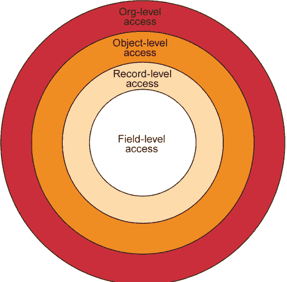

图 6.1 – 数据访问控制级别

**对象和字段级别**有时被视为一个综合级别，它允许你配置用户可以访问哪些对象和字段，以及他们可以对这些对象和字段执行什么操作。另一方面，**记录级**访问确定用户有权访问的对象中的哪些记录对该用户可见，以及他们只能查看还是也可以编辑这些记录。

记录所有者始终对记录拥有完全访问权限。在考虑数据共享和可见性架构时，始终是关于确定当前用户不拥有但仍需要访问的哪些记录。

**组织级**访问是指确保你的组织中的数据无法被其他组织的用户访问，此外还有不同的安全机制来确保用户可以安全地访问你的组织。

可帮助你设计和配置数据共享和可见性架构的工具和功能在以下图表中列出：

- 限制规则：用户有权访问的记录可以通过限制规则进行过滤。
- 文件夹访问（报告）：可以使用文件夹限制报告访问权限。
- 公共组和队列：可以用于授予特定组/队列成员的访问权限。
- 地区管理：一种基于账户特征授予账户访问权限的账户共享系统。
- 标准团队：Salesforce 中的标准功能（如账户团队和机会团队）可用于授予对某些标准对象的访问权限，并可以使用默认团队。
- 手动共享和 Apex 共享：这使你可以手动或通过 Apex 自动共享记录。
- 共享规则：可以基于记录所有者或基于条件。请记住，每个组织的共享规则数量有限。
- 角色层次结构：用于授予对数据的垂直访问权限。
- 组织范围默认值（OWDs）：定义每个对象的基本访问级别。
- 权限集：指在配置文件设置之上的额外对象和字段级别权限。
- 用户配置文件：定义对象和字段级别权限。
- 用户许可证：控制用户启用哪些对象的基本内容。
- 组织级访问：数据使用组织 ID 与其他组织的数据分开。“我的域”功能可以唯一标识组织。IP 限制、登录策略和登录流可用于控制对组织的访问。

图 6.2 – Salesforce 数据访问控制工具和功能

在图表底部，你可以看到组织级安全机制。它们确保一个组织的数据不会与其他组织的数据混合。Salesforce 基于多租户架构，因此多个租户的数据可能托管在同一平台上。组织 ID 确保一个组织的用户只能访问属于该组织的数据。其他组织级安全功能旨在保护组织本身免受未授权访问。

存在对象级安全机制，用于控制特定用户许可证可以访问哪些对象。例如，授予特定用户的许可证不允许访问机会对象。在这种情况下，所有更高级别的安全机制都将遵守此限制，这意味着你无法通过配置文件或权限集授予用户对机会的访问权限。

如果继续向上查看图表，你将遇到记录级安全机制，它控制对特定对象记录的访问权限——假设用户已从较低的对象级层获得对该对象的访问权限。这始于组织范围默认值（OWD），它为对象记录设置默认访问级别。例如，账户的 OWD 可以是私有、公共只读或公共读写。这定义了用户对其不拥有的账户记录的访问级别，假设他们有权访问账户对象。

角色层次结构、共享规则和其他共享机制可用于授予用户访问更多记录或更高权限级别的权限。例如，你可以使用基于条件的共享规则，授予特定角色的用户访问满足特定条件的账户记录的权限。

还有其他因素会影响这些工具和功能，例如数据模型的结构以及对象之间的关系类型。

在图表的最顶部，你可以看到限制规则，这是 Salesforce 最近引入的一项功能。你通过指定必须满足的记录和用户条件来定义限制规则，以激活该规则。一旦条件满足，用户原本可通过其他机制（如 OWD、共享规则、手动共享等）访问的记录将被过滤。该功能提供了一种限制某些用户访问特定记录的方法。它对于任务、事件和合同等对象特别有用。

**限制规则**适用于标准任务、事件、合同、时间表和时间表条目对象，以及自定义对象和外部对象。

注意 你可以通过以下链接了解有关限制规则的更多信息：`https://packt.link/bnsbu`。

不应误解或滥用此功能的存在，将其作为引入效率较低的数据控制机制的借口。该功能并非旨在替换任何其他功能，而是为了扩展它们，以涵盖过去难以控制的用例。人们期望 CTA 了解平台上可用的所有共享机制的全貌，并充分利用它们。

**作用域规则**是另一项你应该了解的功能。这未包含在 *图 6.2* 中，因为它并不扩展或限制用户对记录的访问权限，而是简化了访问。作用域规则控制用户默认看到的记录。但是，用户并未被限制访问其他记录。作用域规则旨在帮助用户专注于默认的一组记录，同时在需要时仍能让他们查找其他记录。

想象一个场景，你有用户每天支持特定的一组客户。你可以配置范围规则，以便用户默认每天看到不同的一组客户。如果需要，他们仍然可以访问其他客户记录（毕竟，他们被期望在被分配支持这些客户的当天这样做），但范围规则会使他们的日常工作更简单、更专注。

> **注意**
> 
> 你可以通过以下链接了解更多有关此功能的信息：`https://packt.link/w47wD`。

在了解此功能之前，你仍然可以实现所需结果，但需要付出更多的努力、时间和系统开销。现在，这是一个开箱即用的内置功能。

## 设计安全门户架构

Salesforce 社区功能（现在是 Salesforce Experience Cloud 的一部分）允许你设计和暴露安全的客户和合作伙伴门户。外部应用程序许可也可以帮助你为内部员工开发自定义应用程序。

数据可以使用标准共享机制（例如 *共享规则*）与合作伙伴许可和外部应用程序许可用户共享。拥有 **客户社区 Plus 许可** 的用户也可以从中受益。虽然你可以使用共享集与客户社区用户共享数据，但 Salesforce 最近也将该功能提供给了客户社区 Plus 和合作伙伴社区用户。由没有分配角色的许可用户（例如客户社区许可）拥有的记录，可以通过基于条件的共享规则与具有基于角色的许可（例如合作伙伴社区用户）的用户共享。这是在 Spring’22 版本中引入的功能。

> **注意**
> 
> 你可以通过以下链接了解更多有关不同类型社区许可的信息：`https://packt.link/seMbm`。

CTA 评审委员会场景可能包含一个或多个可以使用 Salesforce 社区解决的客户需求。强烈鼓励你尝试不同类型的社区并亲自配置它们。

此外，你需要熟悉 *社交单点登录* 功能，这一功能当前变得越来越流行。随着社交媒体的兴起，大多数企业允许其客户使用社交媒体凭据登录安全门户。社交媒体网络通常支持 OpenID Connect 和/或 OAuth 2.0 标准。考虑到 Salesforce 是一个安全平台，可以安全地存储消费者密钥，因此用于社交单点登录的流程是 Web 服务器流程，该内容在第 4 章“核心架构概念：身份和访问管理”中有所介绍。

Salesforce 内置支持某些社交网络，例如 Facebook、LinkedIn 和 Twitter。

## 使用声明式和/或编程功能控制记录级安全性

你需要熟悉图 6.2 中所示的所有声明式记录级安全性功能。此外，你需要了解 Salesforce 共享的工作原理。这将帮助你确定何时适合选择声明式或编程式共享机制。

## 创建和计算记录访问数据的过程

每次用户尝试以任何方式访问 Salesforce 记录时（例如打开记录页面、在列表视图中查看、运行报告、通过 API 访问，甚至使用全局搜索查找），Salesforce 都会检查该记录的安全配置，以确定允许该用户的访问级别。此过程可能代价高昂且耗费资源。在处理拥有数百万条记录、复杂层次结构、数十条共享规则和多个门户的复杂环境时，情况尤其如此。进行此类复杂计算以确定用户是否可以访问这些记录可能需要花费显著更长的时间。这就是为什么 Salesforce 仅在需要时（通常是在配置修改时）才计算记录访问数据。

Salesforce 计算记录访问数据并将其持久化，以便在需要时可以快速访问和评估。这确保了最佳的系统性能。这也意味着，在进行任何修改之前，你需要考虑更改数据安全性和共享机制的影响。

你可以以编程方式共享记录，如果你的 Apex 类已开发为使用 with sharing 关键字，那么你的类将尊重你组织中的共享和可见性规则。带有 without sharing 关键字的类将忽略共享设置并从某个对象中检索所有记录，即使当前执行用户无法访问其中一些或所有记录。这是一个强大的工具，你应明智地使用，因为它可能导致数据泄露。强烈建议你设计 Apex 类，使其始终使用 with sharing 关键字。

## 不同类型的访问授权

Salesforce 使用四种不同的访问授权类型来确定用户或组对特定对象（具有私有或公共只读 OWD 设置）拥有多少访问权限。这四种授权如下：

- 隐式授权：这也称为内置共享。这些是平台内置的不可配置的特殊情况授权。例如，有权访问子机会的用户也可以查看其父账户记录。

- **显式授权**：当记录明确共享给特定用户或组时，使用这些授权。

> **注意**
> 
> 以下用例是显式授权的示例：
> 
> - 用户成为记录的所有者
> - 队列成为记录的所有者
> - 记录通过共享规则与用户、公共组、队列、角色或地区共享
> - 记录使用分配规则与用户共享
> - 记录使用地区分配规则与地区共享
> - 记录手动与另一用户、公共组、队列、角色或地区共享
> - 用户被添加到账户、机会或案例团队
> - 记录以编程方式与用户、公共组、队列、角色或地区共享

在幕后，Salesforce 会创建一个共享记录，定义可以访问该记录的实体和允许的访问级别：

- **继承授权**：这特定于层次结构，特别是当用户、个人或公共组、队列、角色或地区通过角色、地区或组层次结构继承记录访问权限时。

- **组成员授权**：当组成员（例如用户、公共组、队列、角色或地区）因为组已被明确授予记录访问权限而获得记录访问权限时，会发生这种类型的授权。

数据模型中不同对象之间的关系直接影响记录可见性和整体共享架构。

## 对象关系对共享架构的影响

对象之间的主从关系在用户有权访问其父/主记录时授予子记录的访问权限。在设计数据模型时，你需要特别小心，并确保正确使用主从字段。使用 UI 层隐藏记录不应是首选解决方案。你应该努力用尽所有选项，包括编程式共享，因为用户始终存在绕过 UI 并获取受限记录访问权限的风险。

## 使用平台安全功能控制对象和字段访问权限

你需要了解如何使用配置文件、权限集和字段级安全性的组合来控制对象和字段级访问。要小心，不要忽略场景中需要对象级访问控制的要求。它们通常很简单，因此许多考生倾向于忽略它们。这可能导致错过与这些要求相关的分数。请始终记住，CTA 评审委员会是一项得分收集练习，你应避免错失容易得分的机会。

你还需要了解何时可以建议使用查看所有和修改所有对象级权限。这些是强大的权限，允许你的用户绕过共享机制并直接访问记录。对于具有查看所有或修改所有对象权限的用户，Salesforce 甚至不会创建共享记录，因为他们根本不需要。这使得访问大量数据的过程比常规情况更快，而在常规情况下，Salesforce 需要先查询和评估共享记录。因此，这些强大的权限被认为适合需要快速访问大量数据的服务用户，例如集成用户。

查看所有数据和修改所有数据权限是配置文件级权限，允许用户访问组织中所有对象的所有数据。它们比对象级的查看所有和修改所有权限更强大，风险也更大。在建议授予用户如此高特权的解决方案时要小心。即使是集成用户，也应在没有充分理由的情况下不要授予如此高的特权。想想如果此类用户帐户被攻破，可能会造成多大的损害。

此外，要熟悉可以在配置文件级别配置的其他安全设置，例如会话设置、密码策略和登录策略。亲自尝试所有这些功能以熟悉它们。

## 设计端到端身份管理解决方案

到现在为止，你应该已经了解在你的解决方案中构建稳固 IAM 架构的重要性。在当今这个客户体验是在线业务主要差异化因素的现代世界中，这一点尤其正确。

在第 4 章“核心架构概念：身份和访问管理”中，你涵盖了所有这些方面并了解了一些关键行业标准。你还了解了 Salesforce 支持的几种身份验证流程。请确保你非常熟悉每一种。强烈建议你反复练习编写这些身份验证流程，以彻底理解它们。

大多数（如果不是全部）CTA 评审委员会场景至少会有一个 IAM 要求，并且你很可能会被问及身份验证流程。在讲解该流程时，你应展现出足够的理解和信心。

还有一种身份验证流程，称为委托身份验证，你需要了解。它是 Salesforce 特有的。因此，它未包含在第 4 章“核心架构概念：身份和访问管理”中（该章侧重于常见和标准流程）。

## Salesforce 委托身份验证：为什么及如何使用

平台可以提供定制机制来实现 SSO 功能，同时支持 OAuth 2.0、OpenID Connect 和 SAML 2.0 等标准。委托身份验证提供与其他提到的标准相同的 SSO 功能，但使用不同的用户体验。在此模式下，系统依赖另一个系统对用户进行身份验证。听起来很熟悉，对吧？这里的区别在于，这种身份验证以阻塞方式执行，且不依赖令牌。此外，如果有多个系统依赖另一个系统来对其用户进行身份验证，那么用户每次尝试访问这些系统之一时都需要重新登录。举个简单的例子来更好地说明这一点：

- 1. 假设你有三个 Salesforce 实例——实例 A、B 和 C（每个实例都有不同的 My 域名以进行唯一区分）。
- 2. 所有这些实例都已配置为依赖远程身份验证 Web 服务来验证尝试登录的用户。
- 3. 当用户尝试登录到实例 A 时，他们会看到 Salesforce 登录界面（请注意，用户不会被重定向到不同的登录页面，这与 SAML 或 OAuth 等标准的情况不同）。用户输入远程身份验证 Web 服务已知的凭据，并单击登录按钮。
- 4. Salesforce 会检查用户记录，由于用户已启用 Is Single Sign-On 用户权限，因此不会自行验证凭据。相反，它会调用远程身份验证 Web 服务，传递凭据（加上发起登录尝试的 IP 地址），并等待响应。
- 5. 如果响应为正面，则用户已通过实例 A 身份验证，为实例 A 的域创建会话 Cookie，用户即登录成功。
- 6. 现在，假设用户正在尝试访问实例 B。浏览器不会检测到实例 B 域的有效会话 Cookie，这是理想情况。使用 SAML 等标准时，用户不需要再次输入凭据（请回顾第 4 章“核心架构概念：身份和访问管理”中的 SAML SP 发起流程部分）。但是，使用委托身份验证时，没有机制可以自动为其登录（因为他们之前已针对远程身份验证 Web 服务进行过身份验证）。相反，他们将不得不再次输入凭据（即之前用于登录到实例 A 的相同凭据），并再次由远程 Web 服务进行身份验证，然后才能进入实例 B。

下图说明了登录到实例 A 时发生的事件序列：

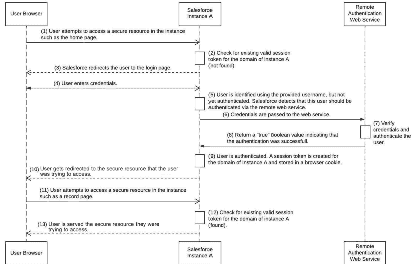

图 6.3 – 登录到 Salesforce 实例（实例 A）时的委托身份验证

下图说明了在成功登录到实例 A 后登录到实例 B 时的事件序列。你会注意到相同的事件序列正在重复：

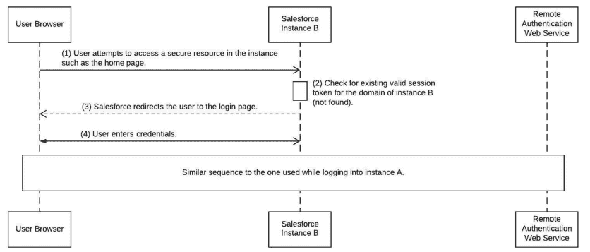

图 6.4 – 登录到第二个 Salesforce 实例（实例 B）时的委托身份验证

通常，当你希望利用 Salesforce 不认可的任何标准的身份提供商来提供 SSO 功能时，会使用委托身份验证。如果企业使用的是复杂的登录机制（可能是为了提高安全性），而该机制无法通过任何受支持的 IAM 标准来实现，也可以使用此方式。

现在是时候将所有这些知识付诸实践了。在下一节中，你将接触到一个关注安全架构领域的微型假设场景。

## 引入安全架构领域：Packt Innovative Retailers

下面的微型场景描述了特定客户面临的挑战。你将研究该场景，然后逐步创建解决方案。为了充分利用此场景，建议你阅读每个段落，尝试自行解决其中的问题，然后回到本章，查看建议的解决方案，并进行对比和记录。

请记住，此处列出的解决方案不一定是 *唯一* 可能的解决方案。只要在技术上正确且逻辑合理，替代方案也是可以接受的。

### 场景

Packt Innovative Retailers (PIR) 是一家全球数字零售商。他们通过多种渠道向 B2B 和 B2C 客户销售计算机、计算机配件和服务。他们还通过合作伙伴/分销商网络进行销售。

### 当前情况

该组织分为两个主要部门——销售和服务。每个部门都向一名**执行副总裁**（**EVP**）汇报，而该副总裁又向 CEO 汇报。PIR 主要在三个地区运营：AMER（北美、中美和南美洲）、EMEA（欧洲、中东和非洲）以及 APAC（亚太地区）。它们共享一个单一的 Salesforce 组织，并当前有一组已处理和配置的全球销售和服务流程，这些流程使用了账户、联系人、商机、商机行项目、产品、服务合同、资产、案件和权利等对象。销售部门团队当前按照以下结构组织：

- 全球销售 EVP，需要全局查看所有销售交易。
- 覆盖三个主要地区（AMER、EMEA 和 APAC）各一名**高级副总裁**（**SVP**）。SVPs 向 EVP 汇报。
- 地区内每个国家（例如法国和德国）各一名 VP，向地区 SVP 汇报。总计，PIR 在 100 个国家开展业务。
- 每个国家每个主要地区/州的一名州/区域主管。每个国家最多可有 60 个地区。平均每个国家有 10 个地区。州主管向所在国家的 VP 汇报。
- 通常在特定地区或城市运营的销售代表。他们向州主管汇报。销售代表通常拥有销售机会和直接客户关系。
- 此外，还有 5,000 名渠道代表（通过合作伙伴/分销商渠道销售公司产品）。他们直接向全球销售 EVP 汇报，并与合作伙伴保持直接关系。
- 总计，销售部门约有 20,000 名员工。

服务部门分为两个主要产品线——硬件和软件。此外还有呼叫中心代理，他们跨两个产品线运营。它们按照以下结构组织：

- 全球服务 EVP，需要全局查看所有报告的客户问题、服务协议和服务交易。
- 每个产品线一名 SVP，需要查看与其产品线相关的报告客户问题、服务协议和服务交易。
- 每个产品线都有多个服务专家团队（多达 25 个不同的团队），他们提供支持以解决提交的客户工单和报告问题。这些团队按其支持的不同产品类别组织，例如软件服务器、软件云和硬件台式机。专家可以在多个团队中工作。团队通常包含约 30 名专家。
- 500 名呼叫中心代理，负责接听客户来电并提交支持工单。他们需要查看所有产品线的所有客户记录、服务协议和案件。
- 总计，服务部门约有 1,000 名员工。

PIR 对当前设置存在担忧。有几名用户报告称，他们可以查看和编辑本不应该能看到的记录。PIR 还希望为客户提供自助服务功能，因为他们认为这是未来以客户为中心服务的关键部分。

### 需求

PIR 共享了以下要求：

- 销售部门用户只能访问其本人或下属拥有的账户。这包括直销和渠道销售。
- 直销报告应从整个销售组织汇总到全球销售 EVP。
- 渠道销售报告应汇总到全球销售 EVP。

- 服务部门的报告应按产品线汇总，并最终汇总给服务部EVP。
- 呼叫中心代理可以代表客户创建案例。这些案例可能涉及特定的投诉、询问，或是服务他们购买的PIR产品的请求。案例按类型和子类型组织，类型值与产品线（硬件或软件）对齐，子类型与产品线类别对齐，例如软件服务器、软件云和硬件桌面。
- 专家团队可以处理一个或多个案例子类型。
- 仅处理该案例的专家团队及层级结构中高于他们的任何人才能查看它。
- 案例创建后，将根据案例的类型和子类型分配给专业团队的一名成员。
- PIR希望让客户能够通过提交不同类型的案例来自助服务。他们目前拥有50万B2B客户（每个客户最多10个联系人）和100万个独立B2C客户。
- 客户只能访问与其账户相关的案例。
- PIR希望允许B2C客户自助注册或通过Facebook登录。B2B客户在注册时必须提供其企业ID和企业电子邮件地址。B2B客户在登录时还需提供第二因素身份验证以增强安全性。
- PIR合作伙伴应由其渠道代表引入。PIR有20,000个合作伙伴，平均每个合作伙伴10名用户。合作伙伴只能访问由其渠道代表指定的客户账户。他们还应能够查看并协作处理特定客户的不同销售和服务机会。他们不应能够访问客户的案例。
- APAC地区的PIR员工的凭据和用户详细信息定义在APAC的Active Directory中。其他地区使用不同的LDAP提供程序。PIR希望所有员工使用统一登录机制访问Salesforce，该机制还要求员工使用移动应用程序提供第二因素身份验证。
- 一旦PIR员工入职，应在Salesforce中为其创建用户。一旦员工离职，其对应的Salesforce用户必须立即停用。
- 呼叫服务代理希望使用现代技术根据来电号码查找客户账户。PIR不想使用其现有的呼叫中心基础设施，并希望获得更可扩展、易于维护的解决方案建议。

## 利用适当的安全机制并构建您的解决方案和演示

请留出一些时间快速浏览场景，了解全貌，并对解决方案形成一些初步想法。完成后，再逐段回顾，并逐步构建解决方案。

### 了解当前情况

首先，尝试了解PIR的当前情况和格局。您将从以以下行开头的段落开始：

> 组织结构分为两个主要部门——销售和服务。

PIR在AMER、EMEA和APAC三个地区的销售和服务部门共用一个组织。在阅读场景时请牢记这一点，如果您认为他们应考虑多组织策略，请做笔记。

您还了解到PIR使用一组特定的标准对象。您必须记住这里的关键标准对象（如销售和服务对象）。使用官方Salesforce文档获取完整且最新的数据模型图。它们有助于您在方寸之间了解不同对象之间的关系。

> **注意**
> 您可以使用以下链接了解有关标准Salesforce数据模型的更多信息：
> https://packt.link/dJINu.

基于标准数据模型，您可以绘制自己的图表，这对于后续阶段很有用。您的数据模型图可能如下所示：

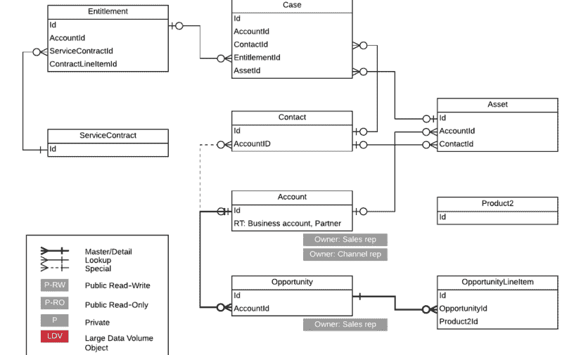

图 6.5 – 数据模型（初稿）

通过了解正在使用的标准对象，您可以早期构建用户所需许可证类型的概念。显然，PIR用户同时使用销售对象（如机会和机会行项目）和服务对象（如案例和权利）。在阅读其余场景时请牢记这一点。您可以将这些笔记记在草稿纸上。

接下来，您有一组以"An EVP for global sales"开头的项目符号点。

这些项目符号点描述了PIR销售部门的组织结构/组织图。本部分可帮助您了解潜在的角色层次结构。请记住，您不一定需要设计与组织图匹配的角色层次结构。这是一个常见错误。角色层次结构中的角色在定义用户将能访问哪些数据方面发挥作用；特别是数据的访问级别。角色层次结构顶部的用户可以访问其角色可见的所有记录，以及其下角色可见的所有数据。

尽管如此，场景的这部分很好地了解了组织图，可以帮助您早期构建角色层次结构的概念。"有5,000名渠道代表（通过合作伙伴/分销商渠道销售公司产品）"这一陈述对您来说尤应引起重视，因为它描述了一种渠道销售模式。这意味着一些机会可能通过合作伙伴销售。

这是PIR可能需要**合作伙伴社区**的一个很好的早期迹象。这一陈述还表明渠道代表将拥有合作伙伴的账户。考虑到合作伙伴角色直接设置在拥有合作伙伴账户的用户角色之下，这一点也很重要。

请记住，您最多可以有三个级别的合作伙伴角色（高管、经理和用户），并且它们以合作伙伴账户的名称命名（如果为账户名称字段启用了盾形加密，则为账户ID值）。例如，如果作为合作伙伴账户启用的账户记录名称是test account，那么该账户的合作伙伴角色将是*测试账户合作伙伴高管*、*测试账户合作伙伴经理*和*测试账户合作伙伴用户*。

您目前仍没有关于合作伙伴社区的明确要求，但暂时将所有这些笔记添加到您的列表中。这将帮助您最终创建所需的工件。

渠道代表直接向全球销售EVP汇报。这是否意味着他们应该被授予EVP下方的角色？目前没有明确要求指导您。您可以暂时添加，稍后再审查。

在此阶段，您的角色层次结构草稿可能如下所示：

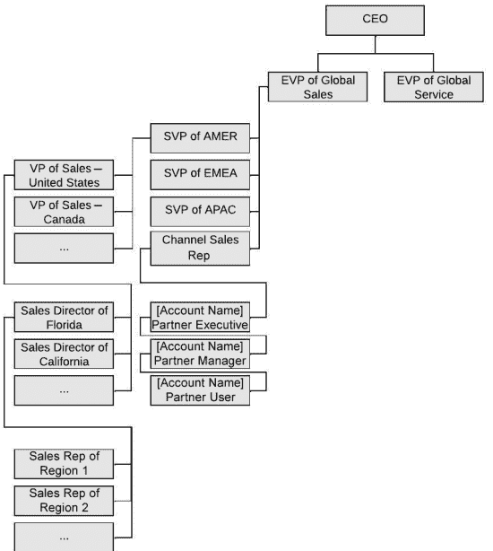

图 6.6 – 角色层次结构（初稿）

您的格局应保持简单，如下所示：

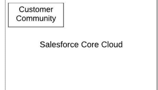

图 6.7 – 格局架构（初稿）

**注意**

在格局架构图中，您也可以使用术语`Force.com`来描述Salesforce Core Cloud。术语**客户360平台**不仅仅包含`Force.com`平台。建议使用Salesforce Core Cloud术语，因为不同Salesforce云和跨云解决方案在不断增加，该术语作为描述听起来更精确。

现在，继续下一段，该段以以下行开头：

### *服务部门组织为两个主要产品线。*

本段及其后的项目符号点描述了服务部门的组织图。请相应地更新您的角色层次结构。陈述`Each product line has multiple teams of service specialists`（可能多达25个不同的团队）……它们按其支持的不同产品类别组织，例如软件服务器、软件云和硬件桌面。专家可以在多个团队中工作。团队通常包含约30名专家。这尤其有趣，因为它描述了一种角色层次结构不太支持的工作方式。您有用户可能属于多个团队。

用户在特定时间只能拥有一个角色。考虑到您在此处讨论的是*服务部门*，可以合理假设这些用户将主要处理案例对象。此时仍没有明确要求，但假设是合理的。基于该假设，您可以考虑两种可能的开箱即用功能，即案例团队和队列。还有其他可使用的功能，如公共组，但到目前为止，您对要求缺乏足够细节。

在转向编程解决方案之前，您必须耗尽可配置的潜在功能。记下您认为可能使用的功能。这两种功能（案例团队和队列）通常不属于您在*第1章，开始您的CTA之旅*中涵盖的工件。然而，您仍需要将其纳入演示中，即使只是一个简单的陈述。确保您没有遗漏任何要求，因为它们都很重要。

再次，根据你的最新设计更新你的笔记和草图。 “500名呼叫中心客服，负责接听客户电话并创建支持工单。他们需要查看所有产品线上的客户记录、服务协议和案例” 这些陈述也很有意思，因为它们清晰地描述了呼叫中心客服的可见性需求。这是组织结构图与角色层级不匹配的一个很好的例子。要查看两个产品线的记录，呼叫中心客服必须属于一个位于服务EVP正下方、产品线SVP正上方的角色。这不太可能与组织结构图匹配，但请记住，你正在使用Salesforce角色来梳理记录可见性，而不是复制组织结构图。

更新你的笔记和草图。你的参与者和许可图应类似于以下内容：

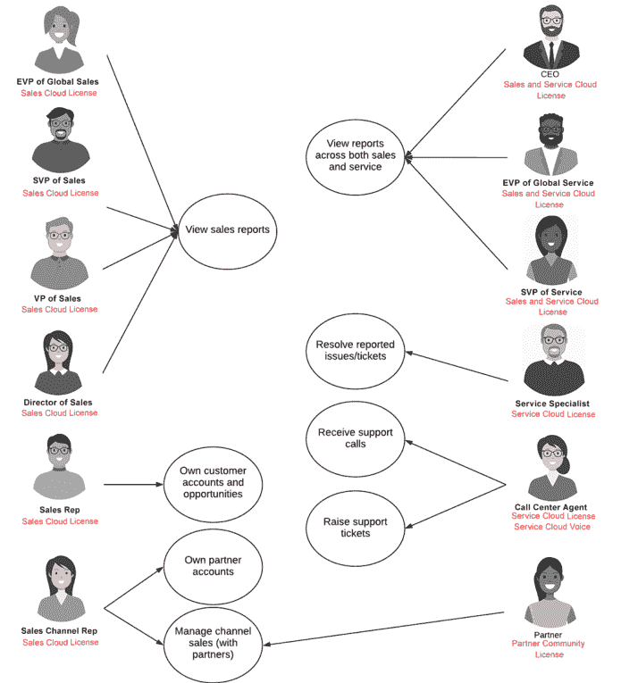

图 6.8 – 参与者图（初稿）

你的角色层级应如下所示：

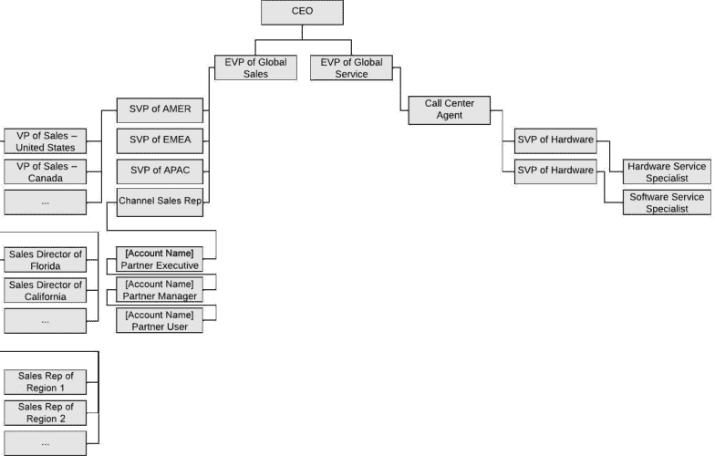

图 6.9 – 角色层级（第二稿）

未对景观架构图进行任何更改。

> **注意**
> 请注意，尽管这个小型场景侧重于安全领域，但你仍然需要生成《第 1 章，以 CTA 身份开始你的旅程》中涵盖的标准工件集，以端到端地描述你的解决方案。

现在，转到下一段，该段以以下行开头：

_PIR 对当前设置有顾虑。_

有两个具体的需求。PIR 期望你作为架构师，提出一个共享和可见性架构，以解决他们报告的问题。他们还计划为客户提供自助服务，这表明你可能需要一个客户社区。

请记住这一点，更新你的景观架构图和参与者及许可图，然后继续处理 PIR 共享的长需求列表。

## 深入探讨共享需求

PIR 共享了一组需求。你将逐一审查每个需求，制定拟议解决方案，并相应更新你的图表。从第一个需求开始：

- *销售部门的用户只能访问其本人或其下属拥有的账户。*

若要限制账户记录的可见性，你需要使用 OWD。在此情况下，账户应设置为私有。这样可以确保账户记录仅对拥有它们的用户以及该用户在角色层级中的上级可见。更新你的数据模型图，以指明账户对象的 OWD 现在为私有。

- *直销报告应从整个销售组织汇总到全球销售 EVP。渠道销售报告应汇总到全球销售 EVP。*

拟议的角色层级已满足此要求。这意味着你对角色层级这部分的最初设想是正确的。图表中无需更改任何内容。

- *服务部门报告应按产品线汇总。*

角色层级也满足了此要求。这是一个很好的例子，说明一张精心制作的图表可以帮助你回答演示过程中提出的问题。

> **注意**
>
> 在展示你的解决方案时，使用你创建的工件来讲述故事。你的演示必须引人入胜且具有吸引力。工件是你应该用来传递信息并讲述你对端到端解决方案看法的引人入胜的故事的工具。使用你的图表，指向它们，并帮助听众跟随你并理解你的愿景。
>
> 例如，不要只说此要求由拟议的角色层级满足。在这样做时，使用图表，并直接指向满足该要求的角色层级分支/路径。

现在，转到下一个需求。

- *呼叫中心客服可以代表客户创建案例。*

此要求通过授予呼叫中心客服创建案例的正确许可来满足。之前假设他们将使用 Service Cloud 许可，这满足了该要求，并允许用户使用权益对象，该对象被列为 PIR 使用的对象之一。

- *专家团队可以处理一个或多个案例子类型。*

为了进一步理解此要求，你需要查看下一个要求，其中包含以下详细信息：

只有处理案例的专家团队以及层级中位于他们上方的人员才能查看该案例。案例创建后，会根据案例的类型和子类型分配给专业团队的一名成员。

在提出解决方案之前，应将这些要求综合考虑。你现在应该尝试回答的问题如下：

- 是否有声明式功能可以满足此要求？
- 应使用哪个 OWD 来限制案例的可见性？如何仅让专家团队可见？
- 案例分配规则将是什么样子？

考虑不同的可能声明式共享机制。你可以使用案例团队，并将特定专业团队的所有成员添加到他们正在处理的案例中，但随后你需要一种机制将案例分配给团队中的一名成员，由其拥有并关闭案例。

或者，你可以为每个案例子类型创建队列，将专家添加到这些队列中，并利用案例分配规则根据案例子类型（这也取决于案例类型）将案例分配给其中一个队列。请记住，可能存在多个可行的解决方案。你需要选择一个满足所有要求且基于有效逻辑在技术上最合适的解决方案。此处你的建议解决方案可以如下：

> 为满足这些要求，我建议将案例对象的 OWD 设置为私有。我将为每个案例子类型创建队列，并根据专家的技能将其添加到一个或多个队列中。我将使用案例分配规则根据案例子类型将案例分配给特定队列。案例分配给队列后，该队列中的所有专家都能看到它，而其他用户则因 OWD 设置无法查看。这样将允许队列中的一名成员认领并处理案例。任何拥有比案例拥有者更高角色的用户，也可以通过拟议的角色层级查看该案例。

解释此主题时，请记住使用你的图表并指向正确的部分。转到下一个要求。

PIR 想要为客户提供自助服务功能。

你在此处应自问的问题如下：

- 你需要哪种类型的社区？
- 是否需要多个社区？
- 能否使用合作伙伴社区？
- 你可以使用哪些声明式共享功能来满足所需的可见性要求？

考虑到该要求与 PIR 的客户相关，使用其中一个客户社区许可（客户社区或客户社区加）是合理的。对于 B2C 客户，此要求明显可以由客户社区许可满足。你是否需要为 B2B 客户分配客户社区加许可？

这样做的好处是能够使用共享规则。缺点是你会占用实例的门户角色配额，而该配额是有限的。此外，这是一种更昂贵的许可，除非有有效的技术理由，否则不应为此类用例提出此许可。给定场景中没有共享要求无法使用更便宜且更具可扩展性的客户社区许可来满足。

> **注意**
> 关于门户角色的更多详细信息，请参阅以下链接：https://pact.link/C5dyY。

默认情况下，客户社区许可用户只能访问与其联系人记录相关的账户。这也自动满足了下一个要求：

- *客户只能访问与其账户相关的案例。*

客户社区用户没有分配的角色。因此，你不需要更新角色层级图。但是，你确实需要更新参与者和许可图。

此要求的建议解决方案可以如下：

> *为满足此要求，我建议使用客户社区。无论客户是 B2B 还是 B2C，都将使用客户社区许可登录到客户社区。PIR 可以考虑使用按登录许可或指定用户许可。这不会对解决方案的技术方面产生任何影响。我建议为客户创建一个新社区，因为它很可能与合作伙伴社区具有完全不同的外观和体验。我假设 PIR 将为 B2B 和 B2C 客户提供同一组功能，并提供相同的社区外观和体验。因此，我不找到任何理由采用两个不同的客户社区。客户社区许可默认允许用户访问与其联系人记录相关的账户。但是，为了允许客户访问与该账户相关的案例，我将使用一个共享集，其中 User.Account 等于 Case.Account。*

下一个要求如下：

- *PIR 想要允许 B2C 客户自行注册或通过 Facebook 登录。*

您的解决方案可以如下：

为了满足此要求，我建议为客户社区启用自助注册。我将自定义注册界面，根据客户类型提供一组不同的必填字段。

当访客选择以商业用户身份注册时，页面将显示一组输入字段，包括用于捕获企业 ID 的必填字段。提交表单后，代码将使用企业 ID 查找 B2B 账户，并使用账户中存储的网站地址值来验证电子邮件地址。这样可以确保电子邮件属于同一域名，并且 Salesforce 中不存在具有相同电子邮件地址的联系人。如果两个条件都满足，代码将使用提供的数据创建联系人和社区用户，然后将新创建的联系人链接到企业账户记录。

B2C 客户的自助注册非常简单。代码将检查提供的电子邮件在 Salesforce 中是否唯一。如果满足该条件，将创建一个人员账户，并伴随一个社区用户。

要启用社交登录/社交单点登录，我将在 Salesforce 中创建一个新的身份验证提供程序，并从预定义提供程序列表中选择 Facebook。我们不需要消费者 ID 或消费者密钥，因为 PIR 未要求我们自定义 Facebook 授权审批界面。

因此，无需在 Facebook 中创建特定应用。随后，我将在社区登录页面添加一个按钮，允许用户通过 Facebook 登录。将使用 OpenID Connect Web 服务器流来促进社交单点登录。我将为该身份验证提供程序创建一个注册处理程序类，并将运行用户的值设置为其中一个管理员用户。我假设 PIR 不希望允许社交注册。因此，注册处理程序的代码将从 Facebook 传递的数据中提取电子邮件地址，并用它来查找具有相同电子邮件地址的用户。如果未找到此类用户，登录将失败。代码不会自动创建新用户，因为 PIR 未提出此要求。

当 B2B 用户登录时，将使用登录流向用户发送请求，要求其使用 Salesforce Authenticator 移动应用验证身份。B2B 用户需要从 Google Store 或 App Store 安装移动应用，并在使用前对其进行配置。登录流将基于 B2B 用户配置文件。B2C 用户将具有不同的配置文件，因此不会经历相同的过程。

这样一来，您为共享要求提供了一个端到端的解决方案。演示过程中请留意计时器；前面的段落演示不应超过 180 秒。

在您的解决方案中，需要提及拟议的身份验证流。此阶段不一定需要描述该流，只需提及即可。如果评委想在问答环节测试您的知识，他们会询问此问题。如果他们询问，请准备好绘制身份验证流的序列图，并详细解释。该流在第 4 章“核心架构概念：身份和访问管理”中有解释。您可以在解释时交互式地绘制图表，或者在早期阶段创建它，然后简单地引导他们了解。

这与您在实际项目中通常遵循的方法非常相似。进入下一要求：

### PIR 合作伙伴应由其渠道代表引入。

此处的解决方案可以如下：

账户对象的 OWD 为私有。我建议引入基于条件的共享规则，将所有账户共享给渠道销售代表角色。这将确保渠道代表可以访问所有账户，并可以手动与合作伙伴代理共享。他们还可以通过账户团队共享，或者我们可以引入一个流，根据特定条件自动化此过程。我假设在这种情况下手动共享是可接受的。

为了限制对案例对象的访问，我建议使用合作伙伴用户的配置文件设置来控制此权限，并完全禁止合作伙伴访问案例对象。没有任何要求表明需要授予合作伙伴访问案例对象的权限。

更新您的图表，并进入下一要求：

### PIR APAC 区域员工的凭据和用户详细信息定义在 APAC 的 Active Directory 中。

此处的解决方案可以如下：

我建议引入诸如 Ping Identity 之类的身份提供程序，以提供统一的登录机制。这使 Ping Identity 能够与 Active Directory 和 LDAP 集成。可以配置 Ping，根据不同的条件（例如 IP 范围）使用 Active Directory 或 LDAP 来验证用户。还可以配置 Ping，在失败时尝试一系列身份存储来验证用户身份。

例如，它可以先尝试针对 Active Directory 验证用户，如果用户不存在，则尝试使用 LDAP 进行相同操作。Ping 可以与多个双因素身份验证提供程序集成，并且有自己的移动应用。我假设 PIR 允许其员工使用标准的 Ping 移动应用。

Ping 可以集中配置为要求所有尝试登录的内部用户通过移动应用进行第二因素身份验证。要使 Salesforce 能够将 Ping 用作身份提供程序，PIR 还需要在其 Salesforce 实例中启用“我的域”功能。我建议将 SAML 2.0 用作身份验证标准。用户将使用 SP 发起的 SSO 流登录 Salesforce。

同样，请准备好绘制所需的序列图，并详细解释 SAML 2.0 SP 发起的流，该流在第 4 章“核心架构概念：身份和访问管理”中已详细介绍。

下一要求如下：

### 一旦 PIR 员工加入公司，应为其在 Salesforce 中创建一个用户。

可以按如下方式实现：

内部用户的预配和取消预配可由 Ping Identity 控制。可以配置 Ping 以检测 Active Directory 和 LDAP 中的更改，例如创建新用户或停用现有用户。一旦检测到此类更改，Ping 可以连接到 Salesforce，并使用 Salesforce API 或 Salesforce 支持的 SCIM 标准在 Salesforce 中预配或取消预配用户。

最后，是时候进入最后一要求了：

### 呼叫服务代理希望使用现代技术根据来电号码查找客户账户。

此处，您的拟议解决方案可以如下：

为满足此要求，我建议使用 Service Cloud Voice。它会检测来电号码并在 Salesforce 中查找具有该号码的联系人记录。它可以支持完全基于云的呼叫中心，无需利用现有电话基础设施。

现在，根据拟议的解决方案更新所有图表。架构全景图应如下所示：

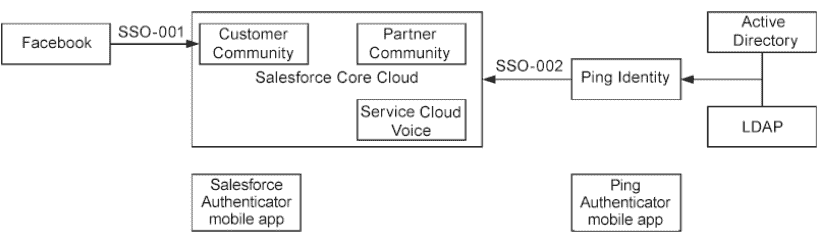

图 6.10 – 架构全景图（最终）

### 集成接口列表应如下：

| 接口代码 | 源/目标 | 集成层 | 集成模式 | 描述 | 安全性 | 身份验证 |
| --- | --- | --- | --- | --- | :--- | :--- |
| SSO-001 | 使用 Facebook 作为身份验证服务器的社交单点登录 | SSO | SSO – OpenID Connect | 使用 Facebook 作为授权服务器的 OpenID Connect 社交单点登录。这是一种 Web 服务身份验证流。 | HTTPS（单向 SSL/TLS） | OpenID Connect Web 服务器流 |
| SSO-002 | 使用 Ping Identity 作为 IDP 的 Salesforce SSO | SSO | SSO – SAML 2.0 | 使用 Ping Identity 作为 IDP 以及 Active Directory 和 LDAP 作为身份存储的 SAML 2.0 SSO。这是一种 SP 发起的流。 | HTTPS（单向 SSL/TLS） | SAML 2.0 SP 发起的流 |

图 6.11 – 集成接口（最终）

参与者和许可证图表应如下所示：

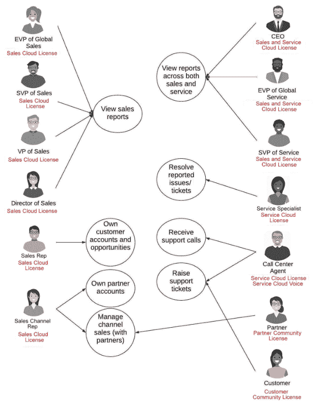

图 6.12 – 参与者和许可证（最终）

最后，数据模型图应如下所示：

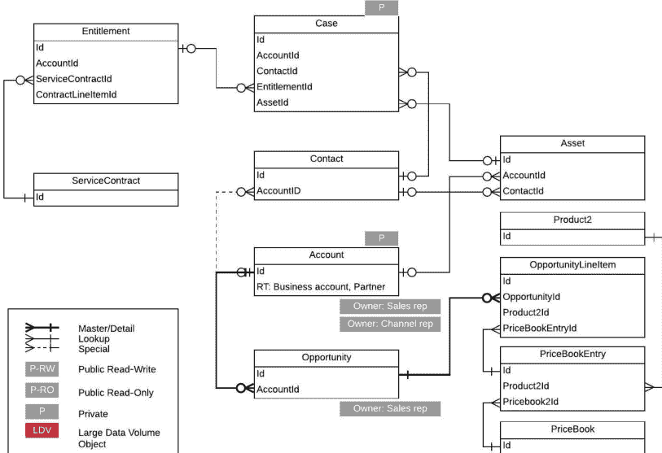

图 6.13 – 数据模型（最终）

角色层次结构的第二份草案没有任何更改。因此，可以将其视为最终版本。

## 摘要

在本章中，你深入了解了安全架构领域的细节。你了解了 CTA 需要涵盖的内容和所需的详细程度。随后，你发现基于 SAML 等标准的委派身份验证流程与其他流程有何不同，然后深入研究了 Salesforce 中一些安全性和数据可见性功能的细节。

接着，你处理了一个专注于安全性的小型假设场景，找到了解决方案，并创建了一些吸引人的演示提案。你开发了一组 OWD 以将特定对象的记录限制在其所有者范围内。随后，你构建了一个复杂的角色层次结构和一组共享机制，以允许用户访问正确的记录。

最后，你使用了多种类型的社区，并提出了一个安全解决方案，以允许通过 Facebook 进行社交登录。你使用二次身份验证增加了额外的安全性。然后，你解释了如何利用第三方身份管理工具在多个身份存储之间提供无缝的 SSO 体验。

在下一章中，你将探讨需要掌握的第三个领域，即数据架构。
