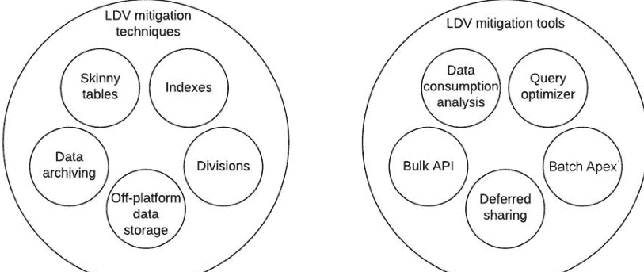
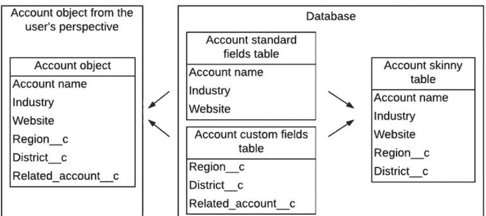
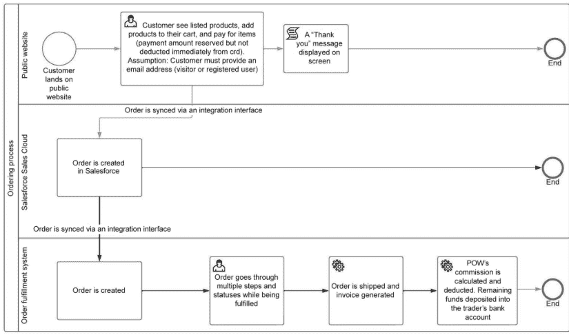
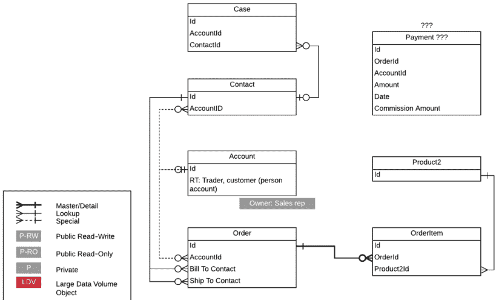
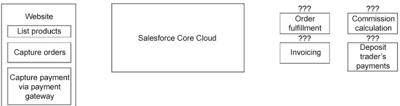
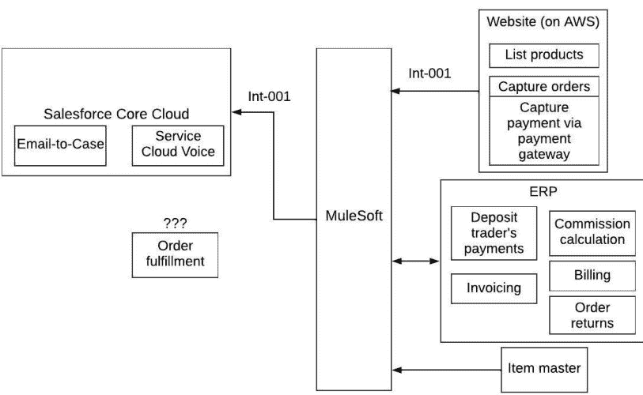
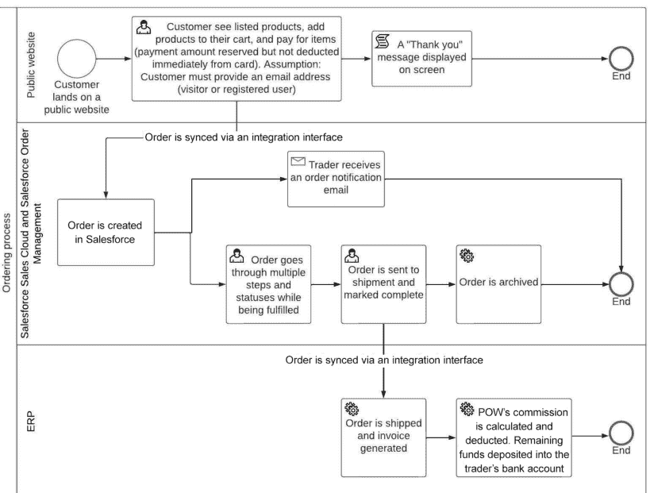
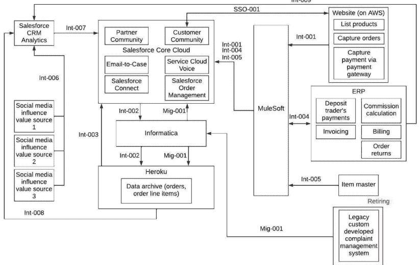
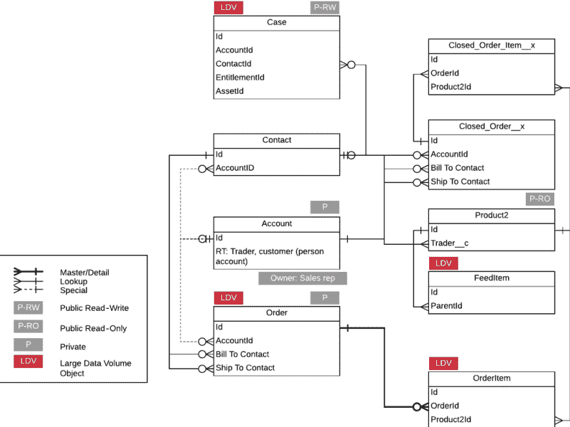

# 设计可扩展的 Salesforce 数据架构

在本章中，你将继续探索 CTA 必须掌握的其他 Salesforce 特定知识领域。数据领域是七个领域中的第三个。你将理解所需的知识，然后使用每个领域的小型假设场景完成一项动手练习。

数据领域范围广泛，存在大量的相互依赖。它影响其他多个领域，反之亦然，并可以被视为任何 Salesforce 解决方案的核心部分。它涉及理解设计数据模型的基本原则，而数据模型是任何软件解决方案的核心。可以说，几个世界一流应用程序成功的关键在于其设计良好的数据模型。

一名成功的数据架构师还应能够基于逻辑和经验发现数据模型中的潜在挑战，并提出切实可行的缓解策略。如果这些挑战不加以缓解，可能会直接影响解决方案的性能或可扩展性。

以正确的方式组织数据，将使你能够从已收集的数据中交付价值。作为 Salesforce 数据架构师，你需要引导项目相关方了解不同的工具和技术以实现这一目标。你还应该就管理数据和将其迁移到目标平台的最佳方法向他们提供建议。

你已在第 2 章“核心架构概念：数据生命周期”中介绍了一些通用数据架构概念。在本章中，你将深入探讨更多 Salesforce 特定的主题和架构原则。以下是将要涵盖的主要主题：

- 了解作为 Salesforce 数据架构师你应该能够做什么
- 介绍数据架构领域小型假设场景—Packt Online Wizz (POW)
- 了解数据架构注意事项和影响，并构建你的解决方案和演示文稿

## 了解作为 Salesforce 数据架构师你应该能够做什么

数据架构师是一位经验丰富的技术专业人员，负责设计和描述解决方案的整体数据建模概念，并确定数据收集、组织和迁移的政策、流程和注意事项。数据架构师是设计可扩展、高性能且经过优化的数据模型的主要负责人，该模型会考虑大数据量（LDV）对象的影响。值得注意的是，LDV 挑战不仅特定于 Salesforce 平台，尽管 Salesforce 数据架构师可能应该更加意识到它们。

注意 根据 Salesforce 的在线文档，CTA 候选人应满足一组特定目标，所有目标都可以在以下链接中找到：https://pactt.link/3QOIV。

请仔细查看每个目标。

## 在使用大数据量对象时描述平台注意事项、其影响和优化方法

在 Salesforce 实现中拥有 LDV 对象可能会导致多个性能注意事项，例如查询变慢、记录创建变慢和记录锁定。CTA 应意识到这些挑战，并预料已识别 LDV 对整体解决方案的潜在风险。CTA 应相应地制定缓解策略来解决这些风险和挑战。

首先，你需要能够识别 LDV。可以使用一种简单的数学方法来识别 LDV，其中对象必须至少满足以下条件之一：

- 拥有超过 500 万条记录
- 具有每年产生 500 万条新记录的增长率

此外，还有一些其他指标可以指向 LDV 用例，例如：

- 组织中有数千名活跃用户可以同时访问系统
- 该对象具有查找/父对象，与具有超过 10,000 条记录的相关/子对象相关联
- 组织使用超过 100 GB 的存储空间

上述标准可能有些保守。Salesforce 可以很好地处理两倍于此数量的记录。但是，建议采用更安全的方法，使用前面提到的数字来识别 LDV 对象。

## LDV 的影响

LDV 对多个功能有广泛影响，包括：

- 减慢 CRUD 记录操作
- 减慢标准搜索功能
- 减慢 SOQL 和 SOSL 查询
- 减慢列表视图
- 减慢报告和仪表板
- 影响数据集成接口
- 增加记录共享计算和重新计算所需的时间
- 影响 Salesforce API 的性能
- 增加触发治理器限制的可能性
- 减慢 Full Copy 沙箱刷新过程
- 占用组织数据存储空间
- 增加遇到记录锁定错误的可能性

值得注意的是，Salesforce 组织上的并非所有事务都会受到 LDV 影响。上述影响仅限于 LDV 对象及其相关对象。换句话说，涉及非 LDV 对象的报告不会受到影响，即使你的实例中有一些 LDV。另一方面，某些 LDV 的存在可能会在特定情况下影响实例的整体性能，例如重新计算共享记录。

几乎没有任何完整的 CTA 审核委员会场景不包含至少一个与 LDV 相关的要求。在实际中，这很大程度上取决于项目的类型和规模，以及你所合作的业务。

## 缓解 LDV 对象的影响

当你识别出 LDV 对象时，预期你能提出一个清晰且锐利的*缓解策略*。这不是潜在解决方案的混合体，而是一个明确推荐且有据可依的方法，与 CTA 审核委员会中的所有其他要求类似。以下列表和图表将帮助总结你可以用来创建 LDV 缓解策略的不同工具和技术：

LDV 缓解技术：

- 瘦表
- 索引
- 分区
- 数据归档
- 非平台数据存储

LDV 缓解工具：

- 数据消耗分析
- 查询优化器
- Bulk API
- 批量 Apex
- 延迟共享

图 7.1 – LDV 缓解技术和工具

现在，让我们简要了解一下这些技术和工具。

## 瘦表

你可以通过联系 Salesforce 支持来在 Salesforce 组织中启用 Salesforce 瘦表。瘦表是一种特殊的只读自定义对象，包含标准或自定义 Salesforce 对象中一部分字段。瘦表可以显著提高使用它们的 Salesforce 报告、列表视图和 SOQL 查询的速度。瘦表只能在 Account、Contact、Opportunity、Lead 和 Case 对象以及自定义对象上创建。

幕后，Salesforce 使用两个独立的表来存储其标准对象和自定义对象，并在用户查询该对象时即时连接它们。其中一个表用于标准字段，而另一个表用于自定义字段。精简表将两种类型的字段合并在一个表中。这消除了连接两个表的需求，因此，精简表非常适合报告。但是，由于其性质，它不能包含多个 Salesforce 对象的字段，并且不能包含超过 100 个字段。

Salesforce 会在适当的时候自动在原始表和精简表之间切换；这不是你可以控制的。

下图说明了精简表的结构：

图 7.2 – 精简表的结构

> **注意**
> 你可以通过以下链接了解更多关于精简表的信息：https://pact.link/nKZKd。
> 请确保你完全理解精简表的限制和使用场景。

值得注意的是，精简表不包含软删除的记录。软删除的记录只是被标记为已删除，但尚未完全从平台中移除，可以通过 Salesforce 回收站访问和恢复。硬删除特定对象的记录可以减少该对象上的 LDV 影响，特别是在存在大量软删除记录的情况下。

## 标准索引和自定义索引

与任何数据库一样，如果你在查询条件中使用索引，就可以运行高性能查询。与其他数据库一样，**主键**（Salesforce 中对象的 ID 字段）、**外键**（Salesforce 中的查找和主从/详细关系）和**备用键**（Salesforce 中的唯一外部键）默认都会被索引。

> **注意**
> 此外，还有一组标准索引字段，例如 RecordTypeId、Division、CreatedDate、Systemmodstamp (LastModifiedDate)、Name 和 Email（用于联系人和线索）。你可以通过以下链接找到更多详细信息：https://pact.link/esgWV。

你也可以请求在其他一些字段上启用自定义索引。只要查询返回的记录占完整数据集的特定百分比，利用索引字段的查询性能会好得多。即使使用了索引字段，仍可能出现 LDV 查询性能不佳的情况。在许多情况下，这是由于对 Salesforce **查询优化器**工作原理的误解。请确保你完全理解查询不会使用索引的特殊情况。更多详细信息可以在前一个链接中找到。

## 分区

分区类似于普通的数据库分区。它们允许你将 Salesforce 实例的数据分割为多个逻辑分区。这实际上将一个巨大的数据集转换为更小数据集的子集，从而使搜索、列表视图和报告更高效。分区并非用于安全，因为它们不限制对数据的访问。

分区通常按地理位置进行。启用后，它们会影响 Salesforce 中的多个功能，例如报告和列表视图。

> **注意**
> 你可以通过以下链接了解更多关于分区的详细信息：https://pact.link/tkU62。

## 非平台数据存储

处理 LDV 最有效、最高效的机制之一是分析并重新考虑特定数据集是否需要存储在平台上（这是描述将数据存储在 Salesforce Core Cloud，即之前称为 Force.com 的术语），或者存储在平台外并在需要时即时检索。

有几种机制可以从外部数据源/应用程序即时获取数据并在 Salesforce 中显示，包括 API 和混搭应用。

数据可以存储在基于云或本地托管的平台上。常用于此目的的平台之一是 Heroku。Heroku 自带一个名为 **Heroku Connect** 的开箱即用连接器，用于连接 Salesforce Core Cloud。这可以用于在两个平台之间同步数据，而不会消耗 Salesforce 组织的任何治理限制。

其他平台包括 AWS、Microsoft Azure、Google Cloud 和 Rackspace。将部分数据存储在平台外可能是数据设计决策的一部分，也可能是数据归档策略的一部分，这将在下一节中解释。

## 数据归档

归档是一种用于处理 LDV 的非常有效的策略。它依赖于识别那些不一定需要保留在平台上并可以移至平台外存储的数据。有时，你甚至可以使用 API 或混搭应用等工具将归档的数据重新暴露出来。Salesforce 还提供一个与 **OData** 标准兼容的工具，名为 **Salesforce Connect**。它允许你将外部数据表暴露为 **Salesforce 外部对象**。外部对象类似于自定义对象，但有特定的限制和注意事项。

> **注意**
> 你可以通过以下链接了解更多关于外部对象的详细信息：https://pact.link/zF5TQ。

现在，让我们仔细看一下使用非平台数据存储/归档缓解策略的示例。假设你有一个大量使用标准案例对象的 Salesforce 组织。通常，每个月会创建超过 1000 万个案例。这使得案例对象成为 LDV。列表视图、报告以及其他与 CRUD 相关的操作都会相应面临性能挑战。缓解 LDV 影响的一种方法是将数据卸载到另一个数据存储平台（例如 Heroku 上的 PostgreSQL 数据库，但对于本示例，你可以选择 **Azure Data Lake**）。数据卸载过程包括以下步骤：

- 1. 关闭超过一个月的案例会定期从 Salesforce 复制到 Azure（ETL 批处理作业可以完成此操作）。然后将复制的数据从 Salesforce 中清除（并清空回收站）。这确保案例对象保持精简。但是，对于用户来说，访问卸载/归档的数据将有点具有挑战性且耗时。

- 2. 为了提升用户体验，你可以开发一个自定义 **Lightning 组件**（或 **Visualforce 页面**）来调用在 Azure 上开发的 API 以检索存储的数据。然后将该组件嵌入到标准案例页面布局中。但是，这意味着你需要开发一个自定义 Lightning 组件，并且可能需要一组自定义 API 以灵活的方式从 Azure 检索数据，这既耗时又耗费资源。

- 3. 为了加快速度，你可以使用适配器（例如 CData.com 提供的适配器）将 Azure 中存储的数据暴露为 **OData**，然后利用 **Salesforce Connect** 来使用它。这将在目标 Salesforce 组织中为归档的案例对象生成一个 **外部对象**。它可以命名为类似 `Case__x` 的内容。**外部对象**易于与其他 Salesforce 对象关联，并且可以通过点击几下轻松添加到页面布局中，从而节省时间并实现更快的功能发布。

> **注意**
> 你可以通过以下链接了解更多关于 OData 标准的信息：https://pact.link/TU4YW。

要制定稳健的归档策略，你需要获得以下关键问题的答案：

- 必须在平台上保留多少数据/记录？
- 归档对象的数据保留期是多久？
- 该策略涉及哪些其他系统？数据将流向哪个系统？
- 将归档哪些对象，这将如何影响子对象/相关对象？

你可以将数据归档到非平台存储容器中，例如 Heroku，或使用 **Salesforce 大对象**。大对象旨在平台上存储数十亿条记录。但是，与任何其他技术一样，它有其优缺点。下面的汇总表可以帮助你确定要使用的合适技术：

| | Salesforce Big Objects | 非平台存储 |
|---|---|---|
| 优势 | 存储和管理数十亿条记录 相对低成本的数据存储 平台上存储，无需额外技术 维护的平台更少，因为它是 Salesforce Core Cloud 的一部分 | 存储和管理数十亿条记录 数据存储成本通常较低 你可以选择既支持数据归档又支持报告的目标归档平台 有多种可选方案，包括自托管解决方案 更适合大型组织，尤其是使用中央数据仓库时 假设平台支持 OData，归档的数据可以使用 Salesforce Connect 重新暴露给 Salesforce |

| | Salesforce 大型对象 | 非平台存储 |
|---|---|---|
| 注意事项 | 无现成 UI；需要开发 Visualforce 页面或 Lightning 组件 无现成报告功能 无现成搜索功能 需要开发自定义代码将数据插入 Big Objects 无记录级访问控制功能 | 可能需要第三方中间件工具定期将数据从 Salesforce 归档并迁移到外部系统 数据将分布在多个数据源上；构建整合所有数据源的报告可能需要额外的工具 需要维护的额外平台 可能会导致合规性尽职调查的额外工作 记录级访问控制功能需要开发或购买特定模块 |

表 7.1 Salesforce 大型对象与非平台存储的比较

根据用例，您可能还需要考虑其他几个方面，例如，除非您通过 Heroku Connect 将数据归档到 Heroku，否则非平台存储可能会占用部分 API 限额。

## LDV 缓解工具

这些是一组经过精选的工具，可帮助您制定 LDV 缓解策略。如果您希望开发出正确的端到端解决方案，了解如何以及何时使用这些工具至关重要。

## 延迟共享计算

您在第 6 章《在 Salesforce 中制定安全架构》中了解到，Salesforce 在多种用例中会生成共享记录，以向特定用户或组授予记录访问权限。计算和创建这些共享记录非常耗时，尤其是在处理大量记录时。

延迟共享计算是一项权限，允许管理员暂停共享计算，然后稍后恢复，以避免干扰或影响任何关键业务流程。

在加载大量记录时，延迟处理共享规则非常有用。您可以停止计算共享记录，直到加载完新数据或完成跨组织的多步共享机制更改。

> **注意**
> 您可以通过以下链接了解有关此功能的更多信息：http://packt.link/TPeWw.

## 查询优化器

查询优化器是一个*透明工具*，在后台运行。它会评估查询（SOQL 和 SOSL）并将查询路由到正确的索引。由于 Salesforce 是一个*多租户平台*，它需要跟踪自己的统计信息，以找到检索数据的最佳方式。统计信息收集过程*每晚*进行，无需用户干预。

## 大容量 API

大容量 API 旨在提供一种快速高效的机制，用于向 Salesforce 组织加载或从中检索大量数据。

如果在您的 Salesforce 组织中启用了大容量 API 功能，则该功能可用。对于性能版、无限版、企业版和开发者组织，默认已启用。

您可以编写利用大容量 API 的自定义应用程序，或购买现成的产品。大多数带有内置 Salesforce 连接器的现代 ETL 工具都支持大容量 API。有些工具甚至在检测到您即将加载大量数据时，会自动切换到大容量 API。

> **注意**
> 您可以通过以下链接了解有关大容量 API 的更多信息：https://packt.link/7RX2x.

## 批量 Apex

批量 Apex 可用于开发处理大量记录的复杂、长时间运行的进程，因此需要较宽松的*governor 限制*。

批量 Apex 分*批*运行，每次处理一批预定大小/记录数的记录。它会这样做，直到正在处理的整个记录集完成。

您可以使用批量 Apex 构建在计划时间运行（例如，每周）的数据归档解决方案。代码可以查找早于预定义时间期限的记录，并按预定义机制将其归档（例如，将它们移动到聚合反规范化表）。

您需要记住，这仍然是符合 governor 限制的平台内功能。只是对于批量 Apex，governor 限制稍微宽松一些。您应继续考虑使用第三方工具（例如 ETL）来执行此类数据归档活动。

> **注意**
> 您可以通过以下链接了解有关批量 Apex 的更多信息：`https://packt.link/8ysjA`.

## 数据消耗分析

确定合适的 LDV 缓解策略非常实用的一种技术是了解数据存储的消耗情况，找出是否由于数据治理规则不佳而创建了孤立记录，并分析现有数据模型对生成/使用记录数量的影响。

> **注意**
> 您可以使用数据使用工具查找有关实例数据用途的更多详细信息。在以下链接中查找更多详细信息：`https://packt.link/J64p6`.

## 解释数据建模概念及其对数据库设计的影响

标准 Salesforce 对象是规范化的。它们以高效的方式在带有关系的表中存储数据，以最大限度地减少冗余并确保数据完整性。

您可以创建规范化或反规范化的自定义对象。由于 Salesforce 对象的性质，您可以使用在典型数据库系统中被认为是次优的模式，例如定义具有大量字段的对象。

Salesforce 中的记录大约消耗 2 KB 的数据存储空间，无论字段/列的数量如何（少数例外除外）。创建反规范化对象来存储聚合数据是您可以使用的一种 LDV 缓解策略。它被视为数据归档的一种特殊情况。

> **注意**
> 要了解有关规范化和反规范化数据集的更多详细信息，请参阅*第 2 章，核心架构概念：数据生命周期*。

除此之外，您需要熟悉**数据偏斜**。Salesforce 在底层使用关系数据库，在不同对象之间保持数据完整性至关重要。Salesforce 在更新记录时使用临时锁来确保数据完整性，并且及时执行此操作，因此您通常不会遇到任何问题。但是，在更新大量记录时，锁可能会持续比平时更长的时间。这可能导致事务失败。

为避免此类事件，您需要以一种方式设计数据模型，以避免/缓解数据集中数据的非均匀分布，这被称为数据偏斜。

在设计数据模型以及将数据上传到该数据模型时，需要考虑三种数据偏斜类型：

- 账户数据偏斜
- 查找偏斜
- 所有权偏斜

您将在下一节中简要介绍不同类型的 Salesforce 数据偏斜。

## 账户数据偏斜

这与特定的标准 Salesforce 对象相关，例如账户和机会。这些对象之间存在一种特殊的数据关系，当账户的组织范围默认值 (OWD) 为私有时，允许访问父记录和子记录。

当大量子记录与同一父账户记录关联时，就会发生账户数据偏斜。在这些条件下，当您并行（例如，通过 Bulk API）更新与同一账户关联的许多子记录（例如，机会记录）时，可能会遇到记录锁。在这种情况下，Salesforce 会锁定正在更新的机会及其父账户，以确保数据完整性。这些锁的保持时间非常短。尽管如此，由于所有并行更新进程都在尝试锁定同一账户，因此更新可能会因无法锁定已锁定记录而失败的可能性很高。

## 查找偏斜

将大量记录链接到单个父级/查找记录（适用于标准对象或自定义对象）会创建所谓的查找偏斜。

例如，您可以通过查找关系将数百万个自定义对象记录与单个账户记录关联。每次创建该自定义对象的记录并将其链接到账户记录时，Salesforce 都会锁定目标账户记录，直到插入的记录提交到数据库，以确保数据完整性。

同样，在正常情况下，这需要的时间非常短，因此您不太可能遇到任何问题。但是，在 LDV 对象上执行自定义代码、共享记录计算和其他工作流所需的时间可能会减慢保存操作，从而增加遇到锁定异常（基本上，尝试锁定已锁定的记录）的可能性，这会导致操作失败。值得注意的是，如果查找关系被配置为在删除查找记录时清除字段值，则不会发生记录锁。

查找偏斜难以发现。审查数据模型以理解对象关系，然后将其与数据使用模式以及每个对象中的记录量进行比较，是一个不错的起点。

你通常会更关注记录量极大的对象以及并发插入和更新操作数量较多的对象。

## 所有权偏斜

当同一用户拥有同一对象类型的多条记录时，就会发生所有权偏斜。在Salesforce中，所有记录都必须有所有者，有时业务流程可能会将记录暂存或默认分配给单个特定用户。但是，由于计算共享记录所需的活动，这可能会影响性能。Salesforce在共享私有对象时，使用共享对象的共享记录来控制访问和可见性。例如，AccountShare对象的记录用于授予对Account对象记录的访问权限（如果Account对象的OWD设置为私有）。这些共享记录可以通过多种方式创建，包括Apex托管共享。

在Salesforce中，所有权更改被视为昂贵的事务。每次更新记录所有者时，系统都会删除属于前所有者和角色层次结构中父用户的所有共享记录。此外，系统会删除与其他用户关联的共享记录，这些记录是由共享规则或其他共享机制（例如手动共享）创建的。

你可以通过将记录所有权分配给多个用户，或者确保指定的所有者没有角色，因此不属于角色层次结构，来最大限度地降低所有权偏斜的风险。你还可以确保指定的所有者属于层次结构顶部的角色。

## 确定数据迁移方法、工具和策略

数据迁移是Salesforce项目中的典型任务。虽然这是一个广泛的话题，但在CTA评审委员会期间，你需要解释你的数据迁移策略的高层次细节。在实际生活中，你会深入得多，并在决策中包含许多其他因素。

## 数据迁移策略中需要考虑的关键主题

在评审委员会期间，你需要关注诸如以下等关键主题：

- 记录数量至关重要，即你将要迁移的对象数量以及每个对象中的记录数量。

- *涉及的系统*的数量和类型以及从中提取数据的机制。你可能需要假设数据将以特定格式并基于共享模板提供，以限制你这边的风险。

- 你需要确定哪种数据迁移方法最适合你。两种关键方法是大爆炸方法和持续累积方法。

- 你可以从关键方法中推导出其他方法，例如在不同区域/业务单元中顺序执行的本地大爆炸、维护多个实时系统并定期迁移数据增量的持续迁移方法，等等。

- 你需要考虑可能受影响的不同*治理限制*，例如每日入站API调用限制。

- 触发器和工作流根据特定标准执行特定逻辑。它们在执行时也需要时间和CPU资源，并消耗治理限制，在加载大量数据时可能存在风险。作为最佳实践，建议你在数据加载期间关闭它们或提供一种绕过机制。

- 如果可能，请使用Bulk API。如果你使用的是现代ETL工具，这可能是一个简单的开关。

- 使用前面*LDV缓解工具*部分中描述的延迟共享计算功能。然后，在完成数据加载后激活共享规则计算。

- 加载子记录时，尝试按其父ID进行分组。

此外，你需要根据你的假设、经验和逻辑提出合适的工具。

## 数据备份和恢复

Salesforce宣布，自2020年7月31日起，作为付费功能的数据恢复将被弃用，不再作为服务提供。但是，基于客户反馈，Salesforce决定恢复其数据恢复服务。在2021年秋季，Salesforce宣布了一种新的内置平台原生备份和恢复功能。

准备好解释你的解决方案将如何满足数据备份和恢复要求（如果在场景中指定）。

你可以查看*第2章，核心架构概念：数据生命周期*，以了解有关实现此目标的不同方法和工具的更多信息。

## 介绍数据架构领域微型假设场景—Packt Online Wizz

以下微型场景描述了一个特定客户面临的挑战。该场景已调整为专注于与*数据架构*相关的挑战。但是，该领域与*安全领域—共享和可见性*密切相关，特别是前者。因此，你仍然会注意到大量的共享和可见性要求。在后续章节中，还会有其他也依赖于数据架构领域的场景。

你将阅读该场景并逐步创建解决方案。为了充分利用此场景，建议阅读每个段落，尝试自己解决问题，然后返回本章，阅读建议的解决方案，将其与你的方案进行比较，并做笔记。

请记住，此处列出的解决方案不一定是唯一可能的解决方案。只要在技术上正确且在逻辑上有道理，备选解决方案也是可接受的。

### 场景

**Packt Online Wizz (POW)**是一个在线购物门户，交易商在上面向消费者提供不同的商品。POW目前正在与超过100,000名不同的交易商打交道。POW目前估计，他们有超过200万种独特的待售商品，分为150个不同的类别。根据他们当前的网站流量，每天有超过500万访问者访问他们的网站。他们每天下大约150,000个订单。每个订单平均包含五件商品。

### 当前情况

当前网站允许消费者匿名下单或以注册用户身份下单。他们目前有300万注册用户。该网站还支持所有主要的在线支付方式，例如PayPal和信用卡。POW共享以下信息：

- 一旦下单，可以通过POW或交易商本身来完成履行，具体取决于交易商为其每件产品提供的偏好。订单通常在不超过两周内完成履行。

- POW存储所有交易商的银行账户详细信息。一旦商品被运送给消费者（无论是由POW还是交易商），POW会自动计算其佣金，从已收付款金额中扣除该佣金，并将余额存入交易商的银行账户。

POW设有一个全球支持中心，包含2,000名支持代理和100名经理，通过电话和电子邮件渠道全天候运作。POW共享以下信息：

- 支持中心每天处理大约20,000个案例。

- 每位支持经理领导一个由20名支持代理组成的团队。所有支持团队都可以查看案例。

POW拥有一个全球ERP系统来处理账单、库存管理和订单退货。他们使用定制应用程序作为商品主数据，并在AWS上运行其定制网站。他们使用MuleSoft作为所有系统之间的集成中间件。

### 要求

POW共享了以下要求：

- 公司希望为其消费者提供便捷的自助服务体验，允许他们提出支持工单和询问。

- POW还希望向消费者公开一套丰富的可搜索常见问题解答，以帮助尽可能多地将案例从呼叫中心转移出去。

- 注册消费者应能查看长达四年的购买历史。

- 注册消费者应能评论其购买的商品。这些评论应对注册和非注册的网站访问者公开可用。

- 支持代理应能对提出特定案例的消费者拥有360度视图。这应包括过去四年客户的历史、过去四年中提出的其他案例、订单退货以及客户的任何产品评论。

- 支持代理应能看到整体消费者价值指标，该指标显示该消费者在其与POW的整个互动历史中的价值。该指标应考虑多种因素，例如购买的产品、每月消费金额、购买数量以及客户的社交媒体影响力因子。社交媒体影响力因子是POW从三个不同提供商处每日收集和更新的值。

- 交易商应能查看其客户长达四年的购买历史。

- 交易商应能登录POW交易商门户以查看其当前待处理的订单。一旦有新订单下单，他们还应收到电子邮件通知。所有电子邮件都应发送到指定的企业电子邮件地址。

- 交易商应能为自己提出支持工单，以解决与付款和库存相关查询的问题。

- POW的高层管理人员应能运行报告和仪表板，以跟踪不同类别中商品的性能趋势。仪表板应包括售出商品数量、退货以及特定期间内售出商品的每周总价值等信息。

- 历史上，POW使用定制开发的解决方案来管理消费者投诉。POW希望停用该系统并用新解决方案替代。当前系统包含超过2亿条记录，其中包括一些仍在处理中的记录。

POW担心系统的整体性能，希望作为架构师的你能就设计解决方案以确保其具有最佳可能性能提供明确的建议。

## 了解数据架构考虑因素及影响，并构建您的解决方案和演示

给自己一点时间快速浏览场景，了解全局，并对解决方案形成一些初步想法。完成后，您可以再逐节过一遍，并逐步构建解决方案。

### 了解当前情况

第一段包含关于 POW 业务模式的一些一般信息。它还包含一些有趣的数字，例如每天 500 万访问者和每天 150,000 笔订单，每个订单平均包含五个商品。请记下这些数字。在某些场景中，有些数字不一定会从技术角度影响解决方案。然而，它们可能与其他数字混淆，因此您在撰写时应小心。

例如，乍一看，您会注意到巨大的每日访问者数量，这可能会以多种方式影响 Governor 限制。此时仍不清楚哪个 Governor 限制面临风险，但请记下这个数字并继续。毕竟，这可能只是一个影响非平台第三方解决方案的数字。

每日订单数量也非常庞大。也请将其列入关注范围。开始绘制您的数据模型图。您目前还不知道这些对象中哪些最终会进入 Salesforce，但即便如此，拥有该图表在您深入场景后将有助于做出正确决策。目前为止，您知道很可能会使用以下对象：`account`、`contact`、`product`、`order` 和 `order line item`。

第一段和第二段也有助于早期了解系统架构。到目前为止，您知道有一个网站用于列出、显示和捕获订单。必然存在一个 `order fulfillment system`、一个 `shipment system` 和一个 `invoicing system`。您不确定哪些功能将由 Salesforce 实现，哪些不会，但请记录这些要求，并将假设的系统添加到您的初始架构图中。

下单后，订单可通过 POW 或交易者本身履行，具体取决于交易者为其每种产品提供的偏好。

您可以看到其中一个业务流程的清晰描述。业务流程图对于评审委员会来说不如其他图表那么重要，但它仍然很有用，可以帮助您将解决方案与业务流程联系起来，进而帮助您以引人入胜的方式呈现解决方案。业务流程图在实际项目中是必备的，因为它可以显著提高您收集的客户需求的质量。开始创建您的草稿业务流程图。下一段完成了这一图景：

POW 存储所有交易者的银行账户详细信息。商品寄送给消费者后（无论是由 POW 还是交易者寄送），POW 会自动计算其佣金，从收到的付款金额中扣除佣金，并将剩余金额存入交易者的银行账户。

您现在对流程了解更多。您目前还不知道将使用哪个系统进行订单履行，但请根据您在此阶段的认知和预期创建业务流程图。

可能还需要一个对象来存储交易者的付款详细信息和计算出的佣金。还需要一个应用程序来完成银行存款。您仍不确定这是平台内还是平台外解决方案，但请先将其添加到架构图中，稍后再更新。更新图表后，您可能会得到以下业务流程图：

图 7.3 – 订购业务流程图（初稿）

您的数据模型可能如下所示：

图 7.4 – 数据模型（初稿）

您的系统架构图可能如下所示：

图 7.5 – 架构布局（初稿）

现在，继续下一段：

POW 设有一个全球支持中心，包含 2,000 名支持代理和 100 名经理，通过电话和电子邮件渠道全天候运营。

您现在可以将更多参与者添加到您的笔记或参与者和许可草图中。场景中未提及呼叫中心基础设施的任何细节以及它如何与 Salesforce 集成。您可以假设客户正在使用 **Service Cloud Voice** 和 **Email-to-Case** 来处理电子邮件支持渠道。

POW 有一个全球 ERP 系统，用于处理账单、库存管理和订单退货。

将 ERP 系统、物料主数据和 MuleSoft 添加到架构中将帮助您完成架构设计。您尚未浏览完整个需求集，但在此阶段，您可以重新审视一些早期假设。佣金计算模块可能与开票流程密切相关。此外，将资金存入交易者银行账户的流程可能最终会由 ERP 系统处理。现在，相应地更新架构，并记下创建的案件数量。这可能表明案件将是 LDV 对象。

您更新后的架构可能如下所示：

图 7.6 – 架构布局（第二稿）

这结束了场景的第一部分，主要描述的是现状。现在，继续场景的下一部分，该部分描述了 POW 的需求。

## 深入了解共享需求

POW 分享了一组需求。您将逐一浏览它们，制定拟议的解决方案，并相应地更新图表。从第一条需求开始：

该公司希望为其消费者提供便捷的自助服务体验，使他们能够提交支持工单和咨询。

消费者目前使用公共网站下订单，并且您从场景中知道，该网站允许消费者注册并登录到某种门户。

利用 Salesforce Service Cloud 的功能，提出应创建和管理案例以满足此需求是合理的。但是，您可能会问自己一个问题：应该建议使用 Salesforce 社区，还是仅在现有门户之上构建一个自定义解决方案，然后将其与 Salesforce Service Cloud 集成？

毕竟，门户已经存在。您可以简单地在其中开发创建、查看和更新案例的功能，然后使用集成用户将其与 Service Cloud 集成，对吧？答案是否定的。这是另一个构建或购买的决策。购买选项在大多数情况下能提供更好的投资回报率。但在这种情况下，很容易证明其理由。

要构建一个安全的门户，您需要在现有门户之上构建完整的用户访问控制功能，以确保用户无法访问不应访问的案例。集成用户可能会访问所有案例。一个完全自定义的用户访问控制模块不易开发、测试或维护。

此外，以这种方式使用集成用户可能会违反 Salesforce 的条款和条件，如果门户被攻破，可能会导致重大数据泄露。

所有这些理由足以证明使用 Salesforce 社区是合理的。它们附带一个稳健的用户访问控制模块，此外还有可配置页面。一些客户更喜欢使用他们自己的完全自定义页面。在这种情况下，他们最终可能会使用 Salesforce 社区许可证，但不使用页面。这在技术上是一种可接受的方法。

POW 未分享任何表明他们希望将提交支持工单的功能嵌入当前门户的需求。您可以提出引入一个基于 Salesforce 社区的全新门户。然后，通过 SSO 将两个门户链接起来，以便用户无需登录两次。

您的拟议解决方案可能如下：

为满足此需求，我建议使用 Salesforce 社区。消费者将被分配一个 Salesforce Customer Community 许可证。我认为基于登录的许可证在这种情况下可能是一个更好的选择。我假设当前门户正在使用支持 SAML 2.0、OAuth 2.0 或 OpenID Connect 标准的身份提供商。这将允许 POW 在现有门户和 Salesforce 社区之间启用 SSO。

相应地更新您的角色和许可证图、景观架构图以及集成接口。现在，请查看下一个要求：

POW还希望向其消费者公开一套丰富的可搜索常见问题解答，以尽可能将更多案例从呼叫中心转移出去。

Salesforce Knowledge是一款强大的工具，您可以使用它构建内部或外部知识库。可以使用配置文件和权限集，将社区用户配置为对特定文章类型具有读取访问权限。请注意，组织必须至少拥有一个Salesforce Knowledge许可证才能启用和设置Salesforce Knowledge。您的建议方案可以如下：

> 为满足此要求，我建议使用Salesforce Knowledge。我将使用配置文件和权限集来控制社区用户对特定文章类型的访问权限。
> 此新功能将作为为POW创建的新Salesforce客户社区的一部分。

更新您的景观架构并移动到下一个要求，其内容如下：

注册消费者应能够查看长达四年的购买记录。

根据场景，每天有150,000个订单，每个订单平均包含五个商品。这意味着每月有近450万个订单和2250万个订单行项目。四年之后，这些数字将变得巨大，大约为2.16亿个订单和超过10亿个订单行项目。这两张表在两个方面被归类为LDV对象，即每月数据增长和每年的记录总数。

您还不清楚将用于订单履行的系统。考虑到数据量，您可以提出一个异地平台解决方案，例如使用自定义Heroku解决方案、ERP扩展或全新系统。

但是，根据场景，订单通常在不超过两周内完成履行。这意味着您可以使用本平台订单履行解决方案来处理未完成订单，并使用存档机制将已完成履行的订单移出平台。在任何给定时间，存储在本平台上的未完成订单数量都不会导致创建LDV对象。

AppExchange上有几种订管理解决方案。Salesforce还拥有一个名为Salesforce Order Management的自有解决方案，该方案于2019年推出。场景本身并未深入探讨订单如何履行的详细信息，这意味着即使您不完全了解Salesforce Order Management的工作原理，您仍然可以提议并假设其功能足以满足POW的需求。

使用本平台解决方案交付此功能将使您能够覆盖其他即将到来的要求。因此，建议在开始解决方案之前至少浏览一次场景。这将帮助您对潜在解决方案的某些关键部分形成早期想法。

您仍然可以提出异地平台解决方案，但您需要确保它仍能满足POW的所有要求。

> **注意**
>
> 小心将不应承担的更多职责转移到异地平台应用程序。这可能表明您不完全了解平台的价值和功能，也不了解在像Force.com这样的灵活平台之上构建解决方案的好处，该平台与其他CRM功能提供原生集成。
>
> 简而言之，在提出异地平台解决方案时，请确保它增加价值并解决无法使用本平台功能得到最佳满足的问题。

对于此要求，您可以选择以下方案之一：

- POW的网站每天用于捕获大量订单。我进行了一些计算，发现每月将有近450万个订单和2250万个订单行项目。四年之后，将有近2.16亿个订单和超过10亿个订单行项目。在Salesforce中保留如此大量的数据。

- 我曾考虑使用异地平台订管理解决方案来处理此问题，但这意味着我们将失去Salesforce平台上可用的许多开箱即用功能。我们还知道，用户通常在不超过两周内完成履行。因此，我建议使用Salesforce Order Management来处理订单履行要求。此外，我建议引入一种存档机制，其中所有已完成履行的订单都将复制到Heroku并从Salesforce中删除。

- 我曾考虑使用Heroku Connect进行数据同步，但我知道它不提供部分同步数据的机制，而我只需要同步已完成履行的订单。因此，我建议使用Informatica等ETL工具来同步数据。它将按计划运行，从Salesforce中选取所有已完成履行的订单并将其复制到Heroku，然后删除所有成功同步的订单。同步作业包括订单和订单行项目。

- 我们可以为此使用MuleSoft，但考虑到需要移动的数据量，我更愿意使用专为这种大容量数据传输设计的ETL工具，而不是MuleSoft，MuleSoft本质上是一个ESB。

- 一旦记录位于Heroku中，我将使用Salesforce Connect和外部对象将它们重新暴露给社区用户。用户将使用命名主体/服务用户进行身份验证。我将开发一个Lightning组件来显示外部对象，因为这样我可以控制向用户显示哪些记录。我将使用组件控制器中的SOQL语句来确定检索的记录，确保每个查询都有where子句，以将检索的记录限制为当前登录用户ID。

我将使用OAuth 2.0 Web服务器流向Heroku进行身份验证。我将在Salesforce中使用命名凭据来设置Salesforce Connect身份验证机制。

社区用户将能够在一个页面上查看未完成订单，在另一个页面上查看所有先前已完成履行的订单。

请记住，这只是一个建议方案，不是唯一可能的解决方案。您需要交付的方案应切实可行，满足所有要求，并在技术上正确。您还需要为自己的方案提供理由，并解释选择它的依据。您需要在问答环节为自己的方案进行辩护。如果您对自己的逻辑有信心，这并不困难。在解释此类主题时，请留意计时器。上述陈述应在不超过180秒内完成。

现在，更新您的图表，包括数据模型（以便包含外部对象），并继续处理下一个要求，其起始行如下：

注册消费者应能够对其购买的商品进行评论。

这些评论应对已注册和未注册的网站访问者公开可用。您有近200万个产品。您对平均评论数量没有明确的了解，因此可以做出一些假设。您对产品评论功能也没有额外要求，除了它应对已注册和未注册客户公开可用之外。

通常，产品评论允许其他用户对评论进行评分，甚至可能回复它。但是，POW未请求此类功能。您可以在此处自由做出自己的假设。

接下来的问题是是否有开箱即用的功能可以满足此要求，或者您是否需要考虑自定义解决方案？您需要做出什么样的假设以避免出现LDV对象？

您的建议方案可以如下：

为满足此要求，我建议使用Salesforce Chatter。通过将社区偏好设置中的“允许公共API请求访问Chatter”标志（通过社区偏好设置）设置为true，可以通过API向未经过身份验证的社区用户显示Chatter帖子。已注册用户可以针对特定产品发布评论。

产品的OWD将针对外部用户设置为公共只读。我将通过开发一个Lightning组件来启用未经过身份验证的社区用户查看产品，该组件使用不考虑共享注意事项运行的Apex控制器（使用without sharing关键字）。

考虑到200万个产品，这可能会导致由评论、点赞和评论创建许多额外的Chatter记录。我假设每个产品限制三条评论。我还假设POW同意删除评论

与不再销售的产品以及超过三年的评论相关。

我可以利用 ETL 工具运行每周或每月一次的定期清理进程，以删除额外记录。我还假设无需归档这些记录。如果需要，我们可以将其归档到 Heroku 的 Postgres 数据库中。

用户只能评论已购买的产品。为实现此目标，我建议在 Chatter FeedItem 对象上引入基于触发器的验证规则。此触发器将确保社区用户只能评论其之前购买过的产品。

你能想到其他潜在解决方案吗？你本可以创建一个外部评论对象，并将其与无限数量的评论一起使用。但那样的话，你就需要引入更多对象来存储点赞、评论和附件等数据。同样，这是在了解其局限性的情况下使用开箱即用功能，还是开发可能需要大量时间和精力但功能更强大的自定义功能之间做出的决定。在此案例中，你使用了前者。

更新你的数据模型图。Chatter 模块包含多个对象，不要求你了解所有对象。你可以直接将 FeedItem 对象添加到数据模型中。

现在，转到下一个需求，它以下行开头：

### 支持代理应能够查看提交特定案例的消费者的 360 度视图。

此需求涉及由多个系统提供的四个不同数据实体。订单在 Salesforce 中管理，完成后归档到 Heroku。案例也在 Salesforce 中管理，但每天有 20,000 个新案例，这里存在 LDV 对象的潜力。每月增长到近 600,000 条记录，每年将产生大约 720 万个新案例。

四年后，该数字将达到近 2880 万条记录。这不算很高，但仍然足够高，足以将该对象视为 LDV。此用例不像 Order 对象时那样强烈和明显，但这仍然是你需要纳入 LDV 策略的对象。

幸运的是，环境中已经有 Heroku，并且你已经在使用 ETL 工具归档订单和订单行项目。你可以轻松地将其扩展以包含案例对象。你也可以使用 Big Objects 归档订单、订单行项目和案例。此时，没有明确需求指示这两种选项中哪个更好。将数据归档到 Heroku 允许你通过 Heroku Connect 将其暴露给面向客户的移动应用。不过，POW 未请求此功能。

订单退货由 ERP 处理。你有多种方式从 Salesforce 访问这些记录。该场景未提及 ERP 系统的任何细节，因此你必须做出一些合理的假设。你知道 MuleSoft 用于将 ERP 连接到其他 POW 系统。可以合理地假设 MuleSoft 可以访问此数据，并且可以在其之上公开一个 REST 服务，允许任何经过身份验证的一方（包括 Salesforce）访问此数据。你甚至可以假设 MuleSoft 将以 OData 标准格式公开此 REST 接口。这允许你使用 Salesforce Connect 在 Salesforce 中显示数据，而无需开发任何自定义模块，例如 Lightning 组件。

最后，产品评论存储为 Chatter 帖子，你可以开发一个 Lightning 组件来显示特定用户创建的所有评论帖子。现在，将此解决方案的所有不同元素整合在一起：

为了让代理在这些数据集中获得客户 360 度视图，我将使用多种不同技术的组合。订单和订单行项目可以直接显示在客户记录下方，因为它们在 Heroku 中归档后通过 Salesforce Connect 检索。

每月新案例数量大约为 600,000，每年将产生近 720 万条记录。为了确保保持最佳平台性能，我建议将一年前的案例记录归档到 Heroku，使用与订单相同的机制。然后，我们可以使用 Salesforce Connect 将其重新暴露给 Salesforce。

我建议在 MuleSoft 中开发一个 OData 接口，通过 Salesforce Connect 将 ERP 中存储的订单退货数据暴露给 Salesforce。

产品评论存储为 Chatter 帖子。我建议创建一个 Lightning 组件，用于以组合和有组织的方式查询和显示所有四个数据集，以便在单个位置向支持代理提供所需的客户 360 度视图。

Chatter 帖子记录和外部对象都可以在 Lightning 组件的 Apex 控制器中查询。我仍然可以将 Salesforce Connect 外部对象添加到页面布局中，但我相信这个 Lightning 组件可以通过将所有数据集合并在一个视图中来节省时间。

支持代理应能够看到整体消费者价值指标，该指标显示该消费者与 POW 整个互动历史中的价值。

你应当自问的问题如下：

- 此报告的数据将来自何处？
- 考虑到包含的数据量，是否有可用来构建此类报告的开箱即用功能？
- 如何利用来自三个社交媒体影响力来源的数据？

此类需求应直接指向对商业智能（BI）工具的需求。此数据大部分位于 Salesforce Core Cloud 之外，数据量也应让你轻松判断，这不是可以使用标准 Salesforce 报表实现的事情。构建自定义模块成本太高，且无法提供所需的灵活性。这应该是一个容易做出的购买决策。

市场上有很多可用的 BI 工具，它们内置了连接到 Salesforce、Heroku 和其他数据源的连接器。Salesforce CRM Analytics 是其中之一，它是一个 Salesforce 产品，提供可以轻松嵌入 Salesforce Core Cloud 的吸引人的仪表板。在现实生活中，选择适合此工作的工具时可能还有许多其他因素需要考虑，但对于此场景，Salesforce CRM Analytics 听起来是一个不错的解决方案。

你的解决方案可以如下：

考虑到此报告所需的灵活性、它涵盖的数据量以及数据来自多个来源这一事实，我建议使用 Salesforce CRM Analytics 等 BI 工具来满足此需求。Salesforce CRM Analytics 自带一套丰富的连接器，可帮助其连接到不同的数据源，例如 Salesforce 或 Heroku。我假设三个社交媒体影响力系统以 CSV 文件形式提供数据，我可以直接将其加载到 Salesforce CRM Analytics 中。生成的仪表板将在 Salesforce 中呈现，支持代理将获得访问权限。

更新你的角色、许可和环境架构图，然后转到以下开头的下一个需求：

### 交易者应能够查看其客户最多四年的购买记录。

考虑到该数据在外部对象中可用，这个需求应该很简单。

你的解决方案可以如下：

订单和订单行项目在 Heroku 中归档，然后通过 Salesforce Connect 和外部对象重新暴露给 Salesforce。我们将构建一个带有 Lightning 组件的自定义页面，该组件查询外部对象以获取所有包含此交易者产品的订单并显示它们。

### 交易者应能够登录 POW 交易者门户以查看其当前待处理订单。

处理此类要求时要小心，因为它们可能包含其他次要要求。例如，此处的主要要求是说明交易者如何访问正确记录，但你还有一个嵌入式要求，请求在创建订单时发送电子邮件通知。你的解决方案可以如下：

将使用 Salesforce 社区向交易者授予 Salesforce 数据访问权限。交易者将被分配 Partner Community 许可证。我认为 Partner Community 许可证更适合此用例，因为我们需要能够与交易者共享某些记录，例如订单。我假设交易者的账户记录将由为其入职的销售代表拥有。我还假设每个交易者的合作伙伴账户将只有两个角色。

订单的 OWD 设置将设置为私有，而不是默认的由父级控制值。这将允许与正确的交易者共享订单，而不会意外授予他们访问不属于他们的其他订单的权限。

订单将使用自定义 Apex 共享与正确的交易员角色共享。我考虑过使用基于条件的共享规则，但每个对象的此类规则数量有限，而且我们有超过 100,000 名交易员，每人拥有两个角色。我还考虑过使用共享集，因为它们现在可用于合作伙伴社区。但考虑到这将需要对数据模型进行更改以将订单链接到正确的合作伙伴账户记录，并且考虑到它在控制与哪个合作伙伴角色共享记录方面的灵活性较低，我决定使用基于 Apex 的共享。订单将根据购买的产品与正确的交易员共享。

待处理订单将保留在 Salesforce 中。已完成订单将被归档。因此，交易员将默认根据前面提到的共享机制访问待处理订单。

每个交易员在入职时必须提供公司电子邮件地址。此值将存储在交易员的账户记录上。创建订单时，我建议使用 Salesforce Flows 触发向交易员电子邮件地址发送电子邮件警报。我们可以根据购买的产品获取电子邮件地址值，因为产品将链接到其交易员的账户。我建议使用 Flows 而不是 Apex，因为它是一个可配置的工具，易于编辑和修改。我可以使用 Process Builder 做同样的事情，但 Flows 功能更强大，未来可能需要。

不要因忽略易于配置的功能（例如电子邮件警报）而错失易得点数。现在，更新您的图表，并转到下一个要求，其开头如下：

交易员应能够为自己创建支持工单，以解决与付款和库存相关的查询。

这个应该很简单；您的解决方案可以如下：

交易员将获得合作伙伴社区的访问权限，在那里他们可以创建案例。我们可以配置多个案例记录类型，并将合适的记录类型分配给交易员和消费者。

现在转到下一个要求，其开头如下：

POW 的高层管理人员应能够运行报表和仪表板，以跟踪不同类别商品的绩效趋势。

这是另一个应该直接指向提出 BI 工具的要求。您已经提出了一个。您的解决方案可以如下：

> 我建议为此要求使用 Salesforce CRM Analytics。所需数据来自多个来源；有些是外部的。请求的报表还需要分析大量数据。Salesforce 标准报表和仪表板无法处理此类要求。我们已经提议使用 Salesforce CRM Analytics 来覆盖另一个要求，因此在此利用它也是合理的。

更新您的图表并转到下一个要求，其开头如下：

历史上，POW 使用自定义开发的解决方案来管理消费者投诉。

这是与即将退役的一个系统相关的数据迁移要求。因此，不需要维护并行运行的系统。如果不是因为需要迁移的数据量巨大，这可能是一个大爆炸式方法。您提出的解决方案可以如下：

> 考虑到不需要将旧系统与新解决方案并行运行，我提出采用分阶段的大爆炸式数据迁移方法。我将使用我们环境中已存在的 Informatica ETL 工具连接到旧投诉管理应用程序，从中提取数据，执行任何所需的转换，然后将其加载到 Salesforce Core 和 Heroku。

> Informatica ETL 内置了利用 Salesforce Bulk API 的功能。我建议在将数据加载到 Salesforce 之前打开此功能，以实现最佳性能。

> 开放的投诉工单将迁移到 Salesforce Core 的案例对象，而关闭的工单将直接迁移到 Heroku。

> 考虑到需要迁移的数据量巨大，我建议优先迁移开放的工单和不到六个月的关闭工单。我假设这可以在黑域期间完成，例如周末夜间。随后将迁移较旧的工单。迁移较旧的工单不必在黑域期间进行，因为我假设其优先级较低。

> 在将数据上传到 Salesforce 时，所有工作流和触发器都将关闭。我建议通过向数据上传用户分配特定自定义权限来实现此目的，并在所有工作流和触发器中检查该权限。

> 我还将利用延迟共享计算，暂停计算共享记录，直到第一批记录上传（即开放的工单和不到六个月的工单）。

这是最后一个共享的 POW 要求。现在，更新所有图表并查看它们的外观。订购业务流程图应如下所示：

图 7.7 – 订购业务流程图（最终）

景观架构图应如下所示：

图 7.8 – 景观架构（最终）

集成接口列表应如下所示：

| 接口代码 | 源/目标 | 集成层 | 集成模式 | 描述 | 安全 | 身份验证 |
|---|---|---|---|---|---|---|
| Int-001 | 网站 -> MuleSoft -> Salesforce | 数据 | 远程调用 – 异步 | 通过 MuleSoft 将订单和订单行项目数据从网站复制到 Salesforce。数据将尽快从网站发送到 Salesforce。 | HTTPS（双向 SSL/TLS） | 网站与 MuleSoft 之间的相互身份验证。MuleSoft 与 Salesforce 之间的 OpenID Connect JWT 流 |
| Int-002 | Salesforce -> Informatica -> Heroku | 数据 | 批量数据同步 – 异步 | 一个定时批处理作业，用于将 Salesforce 数据归档到 Heroku。Informatica 将在每个预定义的计划周期运行，将 Salesforce 中的已完成订单复制到 Heroku，然后从 Salesforce 硬删除归档记录。 | HTTPS（单向 SSL/TLS） | OAuth 2.0 Web 服务器流 |
| Int-003 | Heroku -> Salesforce | UI | 数据虚拟化/Mashup/OData | 归档数据将在 Salesforce 中按需使用 Salesforce Connect 检索。检索的数据不会存储在 Salesforce 中。 | HTTPS（单向 SSL/TLS） | OAuth 2.0 Web 服务器流 |
| Int-004 | Salesforce <-> MuleSoft -> ERP | 数据 | 批量数据同步 – 异步 | 订单将在某个阶段复制到 ERP 以进行发货流程。假设订单的发货状态将从 ERP 同步回 Salesforce。此接口也可用于同步其他对象（如账户），Salesforce 和 ERP 将尽快将数据发送到 MuleSoft。Salesforce 将利用平台事件发送出站数据。 | HTTPS（单向 SSL/TLS） | OAuth 2.0 Web 服务器流 |
| Int-005 | Item master -> MuleSoft -> Salesforce | 数据 | 批量数据同步 – 异步 | 假设的接口，用于通过计划的 MuleSoft 批处理作业将数据从物品主数据系统复制到 Salesforce。 | HTTPS（单向 SSL/TLS） | OAuth 2.0 Web 服务器流（假设支持） |
| Int-006 | 社交媒体源 -> CSV 文件 -> Tableau CRM | 数据 | 批量数据同步 – 异步 | 假设社交媒体源每天以 CSV 文件形式发送其更新数据。这些文件假设是手动检索并随后加载到 Tableau CRM 中。 | N/A | N/A |
| Int-007 | Tableau CRM -> Salesforce | UI | 数据虚拟化/Mashup | 将 Tableau CRM 的仪表板在 Salesforce 中公开。 | HTTPS（单向 SSL/TLS） | OAuth 2.0 Web 服务器流 |
| Int-008 | Heroku -> Tableau CRM | 数据 | 批量数据同步 – 异步 | 归档数据（如订单）将使用标准 Tableau CRM Heroku Postgres 连接器从 Heroku 复制到 Tableau CRM。 | HTTPS（单向 SSL/TLS） | OAuth 2.0 Web 服务器流 |
| Int-009 | ERP -> Tableau CRM | 数据 | 批量数据同步 – 异步 | 数据（如订单退货）将从 ERP 复制到 Einstein Analytics，假设为此 ERP 存在标准 Tableau CRM 连接器。 | HTTPS（单向 SSL/TLS） | OAuth 2.0 Web 服务器流 |
| Mig-001 | 旧投诉管理系统 -> Informatica -> Salesforce 和 Heroku | 数据 | 批量数据同步 – 异步 | 旧投诉数据将从旧投诉管理系统迁移到 Salesforce 和 Heroku。归档数据将迁移到 Heroku，而活动和半活动数据将迁移到 Salesforce。 | HTTPS（单向 SSL/TLS） | OAuth 2.0 Web 服务器流 |
| SSO-001 | 社交登录，身份验证服务器是订购网站 | SSO | SSO – OpenID Connect | 使用 OpenID Connect 和订购网站的授权服务器作为 IDP 进行单点登录。假设该授权服务器支持 OpenID Connect。 | HTTPS（单向 SSL/TLS） | OpenID Connect Web 服务器流 |

图 7.9 – 集成接口（最终）

### 演员和许可证图应该如下所示：

| 角色 | 许可证 |
|------|---------|
| 交易商 | Partner Community License |
| 呼叫服务代理 | Service Cloud License Service Cloud Voice |
| 呼叫服务经理 | Service Cloud License Tableau CRM |
| 消费者 | Customer Community License |
| 销售代理 | Sales Cloud License |
| 高层管理 | Sales and Service Cloud License Tableau CRM |

- 提交与支付和库存相关的支持案例
- 登录交易商门户
- 下单时接收电子邮件警报
- 在网站上列出产品
- 查看消费者价值指标报告和仪表板
- 查看 360 度消费者数据
- 通过电话和电子邮件渠道处理案例
- 下订单
- 监控和管理支持团队
- 访问公共网站
- 提交案例
- 负责交易商的入职流程
- 查看和搜索常见问题解答
- 查看报告以跟踪物品的性能趋势
- 审查已购买的物品
- 登录消费者门户

### 图 7.10 – 演员和许可证（最终）

最后，数据模型图应该如下所示：

### 图 7.11 – 数据模型（最终）

这就是本场景的全部内容。请记住，你的图表是帮助你使端到端解决方案清晰明了的工具。它们本身不是目标，而是可以帮助你设计和记录更好解决方案的工具。它们为你的演示增添了很大价值。

## 摘要

在本章中，你深入了解了 Salesforce 数据架构领域的细节。你学习了 CTA 必须涵盖的内容以及细节的程度。随后，你发现了一些 Salesforce 数据架构师需要掌握的有趣原则，并深入内部了解了 LDV 对象的原因、影响和缓解策略。

接着，你处理了一个专注于数据架构的小型假设场景，为其制定了解决方案并创建了一些引人注目的演示提案。你识别了几个 LDV 对象，并根据业务性质和共享要求制定了全面的缓解策略。

如果你现在正在参与 Salesforce 实施项目，或者正在管理一个运行中的实例，你可以练习识别 LDV 的过程。首先分析数据模型图（如果你还没有，请先创建一个！），并使用本章中介绍的工具和技术来识别 LDV。进行计算，并将你的观察、顾虑和拟议解决方案与利益相关者分享。请记住，使你的解决方案清晰明了；它必须从端到端覆盖主题，并且必须从你的角度逻辑地解释为什么这是正确的解决方案。

你在小型场景中还涵盖了其他几个主题，包括选择合适的报告工具以及解释如何将数据导入其中。随后，你根据共享要求制定了全面的数据迁移策略，确保数据完整性，并最大限度地减少对日常运营的干扰。

在下一章中，你将学习需要掌握的第四个领域：解决方案架构。
