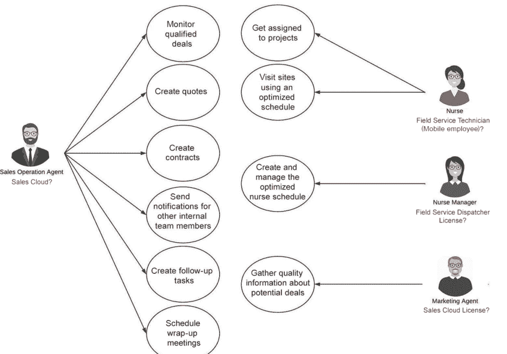
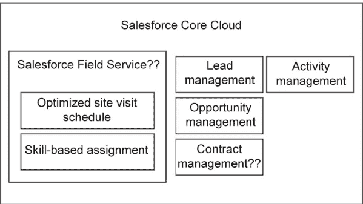
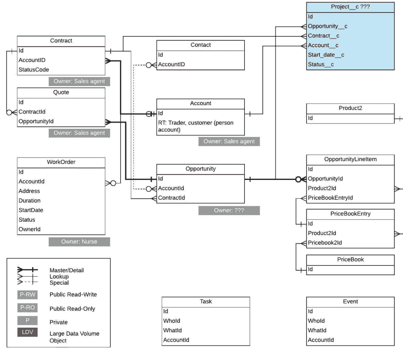
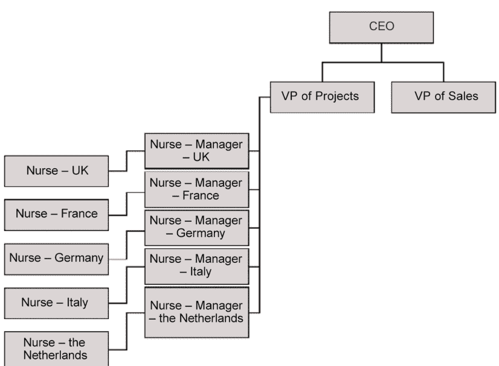
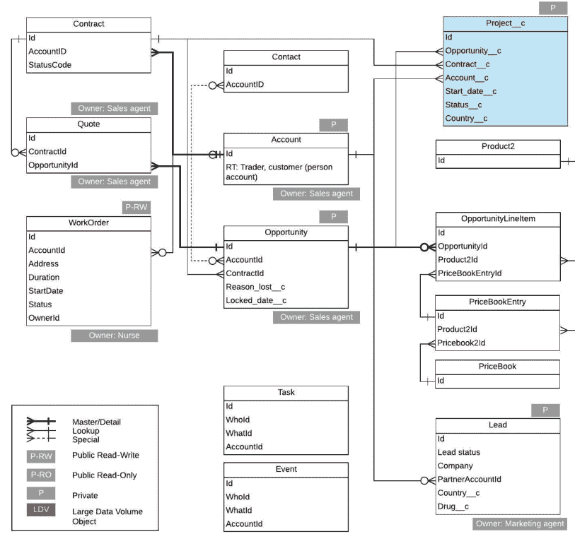
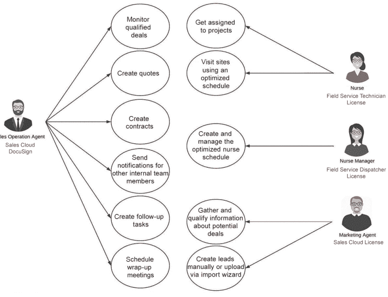
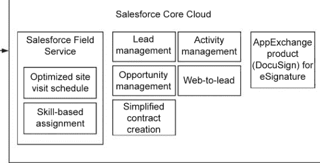
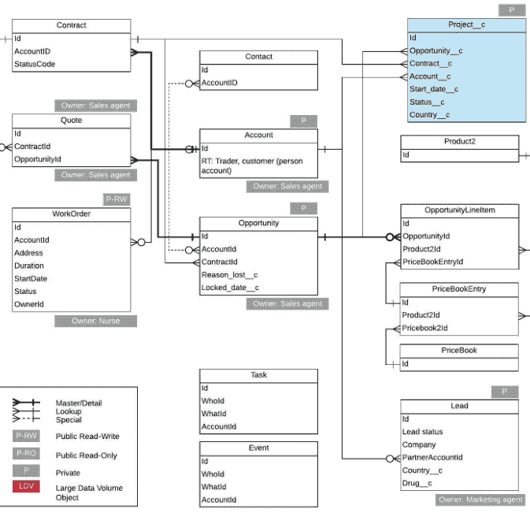
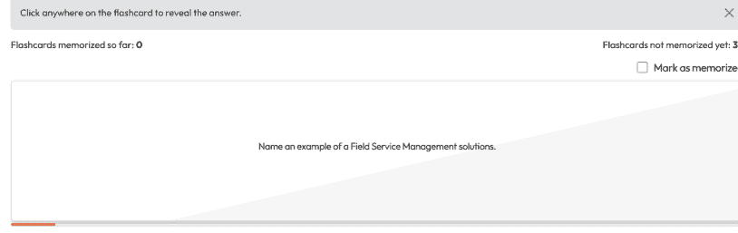
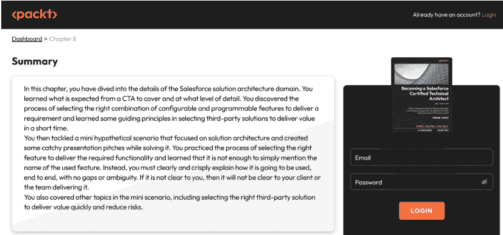

# 创建精益解决方案架构

在数字世界中，“解决方案架构”这一术语指的是分析客户需求、理解其问题核心，并确定能为企业提供可衡量效益的适当解决方案的过程。

解决方案架构师通常是项目中最具业务意识的架构师。要通过 CTA 评审委员会，你必须同时具备技术技能以及解读业务需求并制定端到端解决方案架构的能力。你的解决方案必须考虑平台的功能和限制。

精益架构的详细原则超出了本书的范围。但简而言之，它全部关乎通过以下方式消除浪费：

- 它定义并遵循标准，以减少在重复性挑战和讨论上浪费的时间。这还应旨在减少整体解决方案不一致。
- 它确保你建立一个能够实现顺畅功能开发的环境。架构不良的解决方案在可扩展性和可扩展性方面可能会面临许多困难。
- 它确保所有流程都为客户创造价值，减少在不产生附加价值的活动上浪费的时间和精力。
- 它引入了一种成熟的机制来记录关键解决方案产出物，减少在低商业价值的大量文档上浪费的时间和精力。

作为 CTA，人们期望你对平台有丰富的实际操作经验，并在设计解决方案时运用这些知识。Salesforce 是一个使架构师能够轻松尝试事物的平台。这是一种强大的功能，应该充分利用。

> 我过去总是对我的学员说，你不能只是凭空想出一个解决方案。你必须卷起袖子，在现场尝试事物。你很幸运能够使用一个在提交提案之前允许你尝试 70-80% 功能的平台。

你在过去三章中已经接触过与解决方案架构相关的原则和活动。在本章中，你将深入探讨这些原则，并涵盖以下主要主题：

- 了解作为 Salesforce 解决方案架构师你应该能够做什么
- 介绍解决方案架构领域小型假设场景：Packt visiting angels
- 选择合适的功能来构建你的解决方案和演示

## 了解 Salesforce 解决方案架构师的角色

解决方案架构师通常是连接业务与技术的桥梁。这位架构师将专注于为解决特定业务问题创建技术愿景。作为 CTA，在实施过程中，你需要领导和支持 Salesforce 和非 Salesforce 解决方案架构师。

> 注意
> 根据 Salesforce 在线文档，CTA 候选人应满足一组特定的目标，可在以下链接中找到：https://packt.link/7kjFw。

在本章结束时，你应该能够做到以下几点：

- 选择声明式和编程式功能的正确组合
- 使用合适的外部应用程序增强你的解决方案

现在让我们仔细看看每个目标。

## 选择声明式和编程式功能的正确组合

这听起来可能很简单，但你需要记住，作为 CTA 评审委员会解决方案一部分提出的每个建议都应该清晰且有据可依。Salesforce Core Cloud 附带了许多不同的功能和开箱即用的功能。

在设计解决方案时，你应首先考虑可配置功能。只有当配置无法满足所需功能时，才转向编程式解决方案。配置现有的成熟系统通常比从头开始开发软件要快得多。这是企业购买现成软件解决方案而非自行开发的主要原因之一。

你可能会发现，可配置功能提供的用户体验不够理想，或者留下了一些未解答的问题。在这种情况下，随时可以提出编程式解决方案。毕竟，平台的编程式功能（例如 Apex、**Lightning Web 组件 (LWCs)**、Visualforce 页面等）存在是有原因的。

请记住，点击式开发比基于代码的开发更快、出错率更低。因此，应优先考虑。你需要了解一些核心平台工具（例如 Salesforce Flows）的最新功能。Flows 最近不断发展和成熟，正在成为一种通过点击而非代码来构建自动化的流行工具。但仍有许多其他功能需要某种编程式解决方案：LWC、Visualforce 页面、基于 Apex 的触发器、批处理作业或自定义 Apex Web 服务。

要选择可配置功能与编程式功能的正确组合，你必须对平台的功能有深入的实际操作经验。鼓励你尝试本书中提出的每一个可配置解决方案。使自己熟悉关键的销售、服务和营销流程。例如，在销售方面，你需要了解以下内容：

- 了解将线索导入平台的不同机制，包括导入向导。
- 了解用于线索去重和一般去重（无论对象如何）的不同开箱即用功能。
- 了解其他产品如何与核心云集成以捕获和导入线索。
- 了解线索管理业务流程中包含的典型活动，例如线索自动响应、线索培育、线索分配等。
- 了解规划和设置营销活动背后的一些基本原则。
- 在使用标准 Salesforce 销售和营销对象方面有实际操作经验，并熟悉如何利用 Marketing Cloud 和 Pardot 等附加产品来执行营销活动。
- 了解如何设置与线索和其他对象相关的重复性和自动任务。
- 了解如何使用 `Product`、`PriceBook` 和 `PriceBookEntry` 对象，以及如何使用它们来建模待售的物品/服务。
- 在整个从线索到商机的转换过程中有实际操作经验，包括转换后商机分配的细节。此外，你需要了解销售代表如何使用 `Opportunity` 对象和诸如报价单等支持对象来推动销售流程。

- 了解商机关闭的流程，以及商机关闭前后通常执行的活动。

同样，你需要充分了解服务和营销方面提供的功能。使自己熟悉其他常规功能，例如电子邮件警报、多语言支持、翻译工作台、多币种支持、流程、流程操作、基于时间的工作流、配置文件、权限集、App 生成器、验证规则、自定义设置、自定义元数据类型、报表、分析等等。

在编程方面，你需要很好地了解平台提供的可用功能。实际操作经验是一项优势。使自己熟悉 Apex 的结构及其关键字。查看一些 Apex 类、触发器、LWC 和 Visualforce 页面的示例。

> 注意
> 你可以通过以下链接了解更多关于 Apex 的信息：https://packt.link/8Ux8K。

另一种处理无法通过开箱即用功能满足的需求的方法是通过第三方应用程序。你将在接下来的内容中学习这一点。

## 使用合适的外部应用程序扩展你的解决方案

在得出开箱即用的功能不足以满足所需功能的结论后，你可以考虑编程解决方案甚至外部解决方案。在某些情况下，决策很容易做出。在其他情况下，这可能会变成一个复杂的构建与购买决策。

在现实生活中，构建与购买的决策并不容易做出。你需要考虑以下几点：

- 成本和价值实现时间：定制构建解决方案的成本可能会因许多因素而变得不可预测，包括复杂性和资源可用性。此外，定制开发的解决方案往往需要花费更多精力进行设计、规划、测试和部署。

另一方面，购买外部解决方案的成本可以轻松计算和预测。它们更容易部署且出错率更低。

- 维护：Salesforce 作为软件即服务（SaaS）提供。它是完全托管的软件，大部分维护开销由供应商处理。核心云每年有三个版本。每个版本都包含可能影响构建在核心云之上的定制开发代码的更新。

完全定制开发的解决方案或基于开源框架构建的解决方案带来的维护开销更多，包括修补新发现的安全威胁。第三方解决方案也不能免受此类挑战。但是，它们有其他公司进行维护，从而降低了客户的整体维护成本和开销。

- **可扩展性**：工具的好坏取决于使用它们的人。定制开发解决方案的质量在很大程度上受到设计和开发团队的影响。有些解决方案在正常情况下可以按预期运行，但在需要扩展或延伸时就会失效。

软件开发公司拥有框架、方法论、法规和流程，专门用于交付高质量、可扩展、可配置和可扩展的软件产品。

- **质量和安心**：大多数企业都在寻找经过实战检验的解决方案，尤其是针对关键任务流程。一个已经成功交付给其他客户多次的产品，尤其是在同一行业，可以带来高度的信心。

计算软件总拥有成本并不容易。在 CTA 评审委员会期间，不要求你这样做，但假设购买产品总是比开发更昂贵是 CTA 不应犯的错误。

另一方面，当在技术上合理时，不要犹豫提出在 force.com 平台之上开发的定制解决方案。

请注意以下构建与购买决策的示例：

- 避免提出构建定制 CPQ 解决方案。市场上有很多优秀的解决方案，包括 Salesforce 自身的一个解决方案（Salesforce CPQ）。

- 避免提出构建定制现场服务解决方案。此类解决方案很复杂，如果定制开发，需要多年才能成熟。市场上有很多功能强大的现场服务解决方案，包括 Salesforce 现场服务。

- 避免提出为复杂的 **合同生命周期管理 (CLM)** 需求构建定制解决方案。Salesforce 在此领域开箱即用提供了简单的功能，你当然可以投入时间和资金，在 force.com 平台之上或完全脱离平台开发定制解决方案。但是，要将定制开发的产品提升到企业期望的成熟度水平，需要花费相当多的时间和精力。市场上有几款成熟的产品，例如 DocuSign CLM。

- 你可以提出构建定制 LWC 作为数据录入工具，以提高用户效率。

- 你可以使用额外的对象、字段、流程、工作流、Apex 和其他平台工具，通过自定义模块扩展 Salesforce 的开箱即用功能，例如商机管理和案例管理。

当你提出 AppExchange 或第三方解决方案时，仍然需要清晰说明你认为它如何被利用来交付所需功能。你还需要提及所提议产品的名称。请确保你熟悉 Salesforce 生态系统中的一些流行产品。你将在接下来的小型假设场景中看到示例。

## 介绍解决方案架构领域小型场景
### 假设场景：Packt Visiting Angels

以下小型场景描述了一个特定客户的挑战。该场景侧重于与解决方案架构相关的挑战。但正如你所料，也存在与其他领域（如数据和安全性）相关的要求。

像在之前的章节中所做的那样，你将逐步了解该场景并创建解决方案。除非你已经熟悉所述功能，否则你应该亲自尝试建议的解决方案。你还被鼓励尝试不同的解决方案来满足要求。

请记住，列出的解决方案不一定是唯一可能的解决方案。只要在技术上正确且在逻辑上有据可依，备选解决方案也是可接受的。

## 场景

Packt visiting angels (PVA) 是一家居家临床试验公司，架起了临床研究组织（CRO）和临床试验志愿者之间的桥梁。PVA 提供各种服务，包括上门就诊和现场护士服务。他们在五个不同的欧洲国家（英国、法国、德国、意大利和荷兰）运营。

### 当前情况

PVA 有一个销售运营团队，负责与 CRO 打交道。他们接手营销团队的工作，营销团队通过多种渠道收集并评估潜在交易的信息。

销售运营团队监控合格交易，特别是高价值交易（总金额超过五百万欧元）。它还处理各种后续活动，例如创建报价、管理合同、向其他内部团队成员发送通知、后续任务以及安排总结会议。

一旦交易完成，护士将被分配到项目。护士应遵循优化的日程安排，尽可能多地访问现场，同时考虑他们的技能、位置和最短路线。

PVA 的业务正在快速增长，他们希望引入更多自动化，使用 Salesforce 作为中央 CRM 解决方案来提高内部团队的效率。

### 要求

PVA 分享了以下要求：

- 线索通常通过三个渠道收集。这些渠道包括网页表单、第三方供应商以及由营销团队手动创建。PVA 希望确保收集的线索是唯一的，即同一家公司、同一种药品和同一个国家的线索同一时间不得超过一条处于打开状态。

- 非手动创建的线索应根据地理位置（国家）自动分配给相应国家的营销团队。每个线索只能关联一个国家。

- 一旦线索被分配，它将进入多个阶段。在每个阶段，预期由线索所有者完成一组活动。

- 一旦线索被合格化，它必须转换为商机，并自动移交给相应国家的销售运营团队。团队成员之一（一名销售运营代理）应认领商机并进一步开发。

- 销售运营代理将跟进交易。代理应能够创建报价并与客户进行谈判。

- 一旦报价被接受，代理将商机更新至合同阶段。完成此操作后，系统应使用商机信息自动生成合同记录。

- 代理应确保合同数据准确，选择正确的条款和条件，并将合同发送给客户进行在线签署。合同应以目标国家的当地语言呈现。

- 客户应收到在线签署文件的请求。文件签署后，合同应变为活跃状态，且商机应更新为已赢。

- 代理应手动将丢失的商机更新至已失单阶段，并设置丢失原因。

- 一旦商机已赢，应自动创建一个包含从商机中派生的关键信息的项目。只有目标国家的护士及其经理才能查看项目详情。

- 解决方案应为护士提供每日优化的访问日程安排。该日程安排应旨在让护士在工作时间内尽可能多地访问现场。

- 一旦商机关闭，除管理员和商机所有者外，锁定所有用户的所有商机字段。
- 商机行项目的字段也应被锁定。商机关闭后，不能添加、编辑或删除任何产品。
- 商机所有者在关闭商机后的七天内可以更改描述字段的值。但是，在此期间，这是他们唯一可以更改的字段。
- 七天后，除管理员外，所有用户的所有字段都应被锁定。
- 如果高价值交易被关闭并输掉，发送一封电子邮件通知销售代理的经理。电子邮件应包括商机名称和金额。创建一个后续任务，分配给销售代理的经理，任务期限为10天，以便与代理审查输掉的原因。
- 系统应同时支持欧元和英镑货币，并带有日期汇率。

PVA正在寻找一个提案解决方案，利用Salesforce提高其内部团队的效率并减少手动错误。

## 构建解决方案和演示文稿的适当功能选择

给自己一些时间快速浏览场景，了解大局，并对解决方案产生一些初步想法。现在，再仔细阅读一遍，分段进行，逐步构建解决方案。

### 了解当前情况

场景的第一段包含关于PVA业务模型的一些一般信息。它还告诉你将要使用该系统的不同角色的重要信息。您现在知道他们拥有营销团队、销售运营团队和护士。每个角色都在执行一组特定的活动。基于此，您可以开始创建参与者和许可证图的草稿。您的图表可能如下所示：

### 图8.1 – 参与者和许可证（初稿）

您可以包含一个假设的护士经理角色，以预期需要有人来创建和管理护士的排班。假设营销和销售代理需要Salesforce Sales Cloud许可证，因为他们需要处理线索、商机和其他一些对象。同时，如果您最终将Salesforce Field Service作为解决方案的一部分，护士和护士经理将需要Field Service许可证。您可能需要稍后更改此假设。

即使在这个阶段，您也可以看到一些潜在需求，例如创建报价单、合同和优化的现场访问排班。您可能也已经开始对可能需要的功能、许可证和第三方产生一些早期理解。

使用您所学到的任何信息创建一份草稿环境架构图，并包括您能想到的任何假设和早期想法。您的环境架构图可能如下所示：

### 图8.2 – 环境架构图（初稿）

优化排班需求应该立刻让您想到两种可能的解决方案，即Salesforce Maps和Salesforce Field Service。还有其他第三方解决方案，但这是一个复杂的话题，您根本不应该考虑使用任何自定义开发的解决方案来解决。目前还为时过早，无法确定哪种解决方案更适合PVA，但暂时来说，避免丢失此信息的最佳方法是将其添加到您的草稿环境图中。

此外，基于您目前所知的少量信息，您可以创建早期版本的草稿数据模型：

### 图8.3 – 数据模型图（初稿）

PVA的业务正在快速增长，他们希望引入更多自动化，利用Salesforce作为其中心CRM解决方案来提高内部团队的效率。他们共享了一份冗长的需求列表，您将在接下来的部分中涵盖这些需求。

## 深入研究共享需求

现在，浏览PVA的需求，为每个需求制定拟议解决方案，并相应地更新图表以帮助演示。您可以从第一个需求开始，它从以下部分开始：

### 线索通常通过三种不同的渠道收集。

这是一个确保跨渠道线索唯一性的要求。打开的线索使用公司、药品和国家属性进行唯一标识。您可以假设药品和国家的值使用自定义字段捕获。

您可以使用不同的方法来根据给定属性确保线索记录是唯一的，例如以下方法：

- **使用自定义开发的Apex代码和触发器**：自定义开发的代码为您提供对去重逻辑的终极控制，但必须正确构建以确保最佳性能。而且，考虑到所需的工作量，这是一个昂贵的解决方案。
- **使用第三方解决方案**：有几种第三方产品可以与Salesforce集成，包括一些来自AppExchange的解决方案（如Cloudingo和RingLead）。它们提供高级可配置功能并针对性能进行了优化。但是，它们需要额外的许可证。如果没有开箱即用的Salesforce功能可以满足需求，这是一个不错的选择。
- **创建隐藏的唯一自定义文本字段**：该字段需要配置为唯一外部键，然后自动用线索属性的连接值填充它。因为该字段是唯一的，它将防止创建具有相同连接值的其他线索记录。一旦线索关闭，您可以自动清空此字段，这将确保未来可以创建其他类似线索。

此解决方案的性能已优化。但是，更改匹配逻辑很困难，因为它依赖于持久数据。例如，要引入新字段到考虑用于去重的字段集中，您需要更新所有现有的打开线索。而且，这是一种硬去重，总是防止创建新的类似记录。虽然这是当前要求，但以这种方式满足它会阻止企业未来采用不同的策略，例如允许创建重复记录但将其标记为重复。

- **使用Salesforce重复规则**：这是一种标准的开箱即用功能，利用可配置的匹配规则。当发现重复记录时，它提供定义不同操作的灵活性，例如阻止创建新记录或在提示下允许创建。与任何其他工具一样，它有其局限性，但应该足以满足此要求。

上述四种潜在解决方案的顺序被故意颠倒，以提供更多关于每种解决方案使用的资格逻辑的细节。您通常首先会考虑开箱即用的可配置功能，并在需要时才转向其他解决方案。

您对此要求的拟议解决方案可能如下所示：

为满足此要求，我建议使用标准Salesforce去重规则。我将创建一个依赖于公司、药品、国家和线索状态字段的自定义匹配规则。我将设置去重规则，以防止在找到匹配项时创建线索记录。我不认为有必要使用第三方解决方案，因为此要求可以使用开箱即用的可配置功能来满足。这也是我放弃为此使用自定义Apex解决方案的原因。我假设通过Web表单创建的线索将使用Web-to-Lead功能，而第三方线索将通过导入向导手动上传。

更新您的图表并继续下一个要求。

### 非手动创建的线索应根据地理位置（国家）自动分配给国家的营销团队

让我们先问自己一个简单的问题：是否有开箱即用的可配置功能可以用来满足此要求？作为Salesforce解决方案架构师，您应该了解标准平台功能的细节。在这种情况下，线索分配规则可以与队列结合使用。此解决方案是可配置的、经过优化的，并满足要求。此外，它也是面向未来的，因为它基于标准的可配置Salesforce功能。

"future-embracing"（面向未来的）一词优于futureproof（未来无忧的），因为精简且架构良好的解决方案应该拥抱和欢迎未来的变化，而不是阻止它们。

您的拟议解决方案可能如下所示：

我将利用标准线索分配功能，根据国家字段值将线索分配给国家队列。

现在，您可以继续下一个要求。

线索分配后，它会经过多个阶段。在每个阶段，线索所有者都需要完成一组活动。

在利用开箱即用功能开始时，可以轻松意识到您可以使用标准线索流程功能来定义多个线索流程，每个流程都有不同的线索状态。在每个阶段，您可以生成一组任务并将其分配给线索所有者。这可以通过以下任一方式实现（按顺序）：

- **Flows（流程）**：Salesforce Flows 可用于在创建或更新记录时执行复杂逻辑。这是一个可配置且可扩展的工具，可以提供所需的功能。此外，它是 Salesforce 在每个版本中积极增强的现代工具。显然，与列表中的任何其他工具相比，它获得更多未来增强功能的机会更大。

- **Custom Apex code（自定义 Apex 代码）**：这提供了终极的功能和灵活性，但伴随着不合理的额外开发和维护成本。

**注意**
Salesforce 已在 Winter '23 版本中退役 Process Builder 和工作流规则。虽然当前的工作流规则和流程构建器将继续运行，但您将无法使用这些工具创建新的自动化。这些工具不应被视为您解决方案的一部分。

您的拟议解决方案可以如下：

我建议利用线索流程功能来定义具有不同线索状态的多个线索流程。然后，创建一个 Salesforce 记录触发式流程，以便在将线索更新为特定状态时自动创建任务并将其分配给线索所有者。该流程可以配置为使用基于条件的分支逻辑，这样我们可以根据线索状态创建不同的任务集。

一旦线索合格，必须将其转换为机会，并自动移交给该国的销售运营团队。

此要求未指定线索转换是否应自动发生，或者是否可以继续手动流程。您可以假设其中一种，并以此为基础制定解决方案。

默认情况下，当机会通过线索转换创建时，其所有者与转换后线索的所有者相同。您需要一个自动化流程，将其分配给该国销售代理的队列。

### 您的拟议解决方案可以如下：

*该场景未指定转换是否必须自动发生；因此，我假设由线索所有者手动完成。一旦线索转换为机会，我将使用 Salesforce 记录触发式流程来设置目标国家的销售代理作为机会所有者。我假设每个国家都有一个预定义的用户。该流程还会将该国的销售运营用户添加到机会团队中。我还假设每个国家的用户数量有限。*

*销售运营代理将跟进交易。代理应能够创建报价并与客户协商。*

这是标准的 Salesforce 功能。销售代理拥有 Sales Cloud 许可证，因此可以使用报价对象。

### 您的拟议解决方案可以简单如下：

*将向销售代理分配 Sales Cloud 许可证；这使他们能够创建和更新报价。这是标准的 Salesforce 功能。*

在解释解决方案时，请记得使用图表。角色和许可证图表（例如您在图 8.1 中看到的图表）在这种情况下特别有用。

*一旦报价被接受，代理会将机会更新为合同阶段。*

主要要求是根据已成交的机会自动创建合同，这可以轻松使用流程或自定义开发代码完成。该场景未指定任何高级合同创建逻辑来证明提出第三方解决方案的合理性。

市场上有多种 **CLM（合同生命周期管理）** 解决方案，包括一些在 AppExchange 上提供的，例如 Apttus Contract Management、DocuSign CLM 和 Conga Contracts。它们提供高级合同创建和谈判功能。但是，本场景未要求此功能。

> **注意**
>
> 您需要记住 Salesforce 生态系统中一些常见第三方产品的名称，例如 CPQ 工具、集成中间件、身份提供商和身管理解决方案、电子签名解决方案、文档生成解决方案、高级线索分配解决方案、CTI、版本控制、发布管理、备份和恢复等。
>
> 您将在本书中遇到适用的示例。作为 CTA，您应该熟悉并保持对 AppExchange 上可用内容的更新。

您的拟议解决方案可以如下：

没有共享关于高级合同创建功能的要求。因此，我假设一个简化的解决方案，即使用 Salesforce 记录触发式流程在机会更新到所述阶段时自动创建合同。

代理应确保合同数据准确，选择正确的条款和条件，并将合同发送给客户进行在线签名。

在此，您会遇到电子签名需求，这是一项需要大量精力开发的功能。考虑到市场和 AppExchange 上有多种经验证的解决方案，例如 DocuSign、HelloSign 和 Adobe Sign，这完全不合理。这些产品还可以帮助满足要求的第二部分，即合同应以 CRO 的本地语言呈现。

您的拟议解决方案可以如下：

为满足此要求，我建议使用 AppExchange 上的第三方应用程序，例如 DocuSign。这将允许在将合同发送给客户之前，选择带有适当语言的合同模板。该工具还将允许选择要包含在合同中的合适条款和条件。

更新您的景观架构图，然后转到下一要求。

客户应收到在线签署文档的请求。

文档签署后，合同应设为活动状态，且机会应更新为 closed-won。幸运的是，使用您建议的第三方电子签名工具，此要求的大部分内容会自动满足。不过，您仍需解释其工作原理。

您的拟议解决方案可以如下：

此功能已内置于所提议的电子签名解决方案中。使用 DocuSign，您可以在文档签署后更新合同状态。然后，您可以使用 Salesforce 记录触发式流程将机会阶段更新回 closed-won。该流程将在合同状态更新后启动。

现在，转到下一要求，如下所示。

代理应手动将失去的机会更新为 closed-lost 阶段，并设置损失原因。

您可以假设损失原因是使用自定义字段捕获的。然后，您需要引入一种机制，以确保在机会更新到给定阶段时，该字段成为必填项。您可以使用字段依赖和验证规则来确保这一点。

### 您的拟议解决方案可以如下：

为满足此要求，我建议引入一个带有预定义值的自定义选项列表字段，用于记录失去机会的可能原因。然后，利用标准字段依赖功能，使该字段依赖于机会阶段值。我还建议引入一个自定义验证规则，以确保在机会更新为 closed-lost 阶段时，始终在此字段中输入值，无论更新是通过 UI、代码还是 API 调用进行的。

一旦机会 closed-won，应自动创建一个包含从机会中导出的关键信息的项目。

不要期望要求根据其相关领域而孤立。在许多情况下，您会遇到跨越不同领域知识的要求，就像现实生活中一样。在这里，您有两个要求——一个与解决方案架构相关，另一个与安全相关。

### 您的拟议解决方案可以如下：

为满足此要求，我建议使用自定义对象来存储项目详细信息，并使用 Salesforce 记录触发式流程在机会关闭后创建并填充此对象的记录。我考虑过使用标准对象（例如案例对象）来表示项目，但决定使用自定义对象，因为没有共享要求来证明使用案例对象的合理性，例如 SLA 要求或升级流程。此外，我假设案例对象未来可能用于客户支持相关主题，并希望不将其重新用于其他目的。

自定义对象的 OWD（组织范围默认值）将设置为私有，以限制记录可见性仅对其所有者（默认为销售代理）可见。考虑到记录将在关闭机会时创建（这是由销售代理执行的操作），我认为将此记录对销售代理可见是可以接受的。

我建议引入角色层次结构，以包含护士及其经理。然后，使用基于条件的共享规则将项目记录共享给护士，并自动授予其经理访问权限。

> 注意
>
> 该场景对数据共享和可见性的规格要求不多，也没有提供足够的细节来设计角色层次结构。在这种情况下，您可以做出一些假设，例如假设有一个向 CEO 汇报的护士经理之上的角色。

你需要为在数据模型中引入自定义对象提供理由。如果可能，你应该先尝试利用标准对象。但如果你出于任何原因决定使用自定义对象（例如，标准对象不符合要求或可能需要大量自定义才能重新用途），那么你应该清楚地阐述你的理由。要简洁自信；避免基于可能受其他非技术因素影响的个人经验做出决策。

始终关注演示所花费的时间。不要在已经解释过的主题上浪费宝贵的时间进行进一步解释。例如，你决定在解决方案中不使用案例对象，并提供了该决定背后的关键原因。不要试图列出决定背后的每一个次要原因来浪费演示时间。保持对关键决策点的关注。

你的角色层级图可能如下所示：

图 8.4 – 角色层级（初稿）

你的数据模型可能如下所示：

图 8.5 – 数据模型图（第二稿）

现在，转到下一个要求。

*该解决方案应为护士提供每日优化的访问日程。*

沿用你为其他要求使用的相同逻辑并按相同顺序，你应该得出结论：此类功能需要特定的额外产品来实现。

幸运的是，Salesforce 有一个可提供此功能的产品，它很可能是市场上最先进的现场服务排程工具之一。Salesforce Field Service 允许为技术人员创建优化的现场访问。在此情况下，技术人员可以是护士。排程器可以考虑许多因素，例如不同的工作时间、技能集、首选技术人员、地理位置、排程策略等更多因素。

你无需成为现场服务专家顾问即可通过 CTA 评审委员会。但你需要了解该产品，明白何时提出它，以及需要哪些类型的许可证。建议熟悉其底层数据模型。

> **注意**
> 你可以通过以下链接了解有关 Salesforce Field Service 的更多信息：
> https://packt.link/aclKE.
> 你可以通过以下链接了解有关核心现场服务数据模型的更多信息：
> https://packt.link/HfqJB.

在演示中，你不需要涵盖 Salesforce Field Service 的工作原理细节（记住考试目标），但你需要解释你计划将其作为整体解决方案的一部分如何利用。

你的提议解决方案可能如下：

为满足此要求，我建议使用 Salesforce Field Service。它提供根据多种因素为护士创建优化日程的功能，例如地理站点位置、所需技能、护士的工作时间等更多因素。

在角色和许可证图中，我假设护士将被分配现场服务技术人员（移动员工）许可证。这将允许他们登录 Salesforce 并查看优化后的日程。

我还假设会有一个或多个用户来管理和创建优化的护士日程。我在图中将此角色称为护士经理。护士经理将需要现场服务调度员许可证才能使用现场服务排程器和调度员控制台。

你可以更新图表并转到下一个要求。

*一旦机会关闭，除了管理员和机会所有者之外，锁定所有用户的所有机会字段。*

沿用你之前使用的相同技术和顺序，你可以思考一些潜在解决方案：

- 使用自定义验证规则：可以配置为在尝试保存编辑的记录时触发。但是，它们不能防止用户尝试编辑记录。它们仅在尝试保存记录时触发。如果打算使用验证规则，你需要想出一种有效的方法来防止编辑记录的字段。你不能简单地在验证规则中列出每个字段。

引入一个新的自定义 is_locked__c 字段，并在关闭机会时使用流对其进行更新，这可能是一个解决方案。你的验证规则将仅依赖此字段。但是，如果你追求良好的用户体验（你应该如此），你需要牢记，仅此解决方案本身并不能防止用户尝试编辑记录。

- 关闭机会时更新记录类型：也可以使用流来完成此工作。然后，你可以向该记录类型分配带有只读字段的页面布局。某些字段无法设置为只读，例如名称、货币、关闭日期、阶段和其他一些字段。此解决方案也不能防止通过代码或 API（例如，通过数据加载器）编辑记录。你应将此解决方案视为其他方法的补充，而不是自身的全面解决方案。

- 在 before-update 触发器中使用 Apex 验证：这为你提供了最终的功能和灵活性，但需要额外的开发工作。这种方法还会导致敏捷性下降，因为任何未来更改都需要代码修改。你应仅针对复杂的用例考虑此选项。

- 通过审批流程锁定记录：你可以使用审批流程完全锁定记录。但是，请注意，在这种情况下，只有管理员或拥有 Modify All 权限的用户才能编辑记录，这不符合要求。

此要求可以完全通过配置来实现。没有理由使用 Apex 验证。你可以基于前两种方法的组合提出解决方案。在起草要展示的端到端解决方案之前，请先查看接下来的三个要求，因为它们与此相关。

> 机会行项目的字段也应该被锁定。机会关闭后，不得添加、编辑或删除任何产品。

你明白锁定也应扩展到机会行项目。你也可以在 OpportunityLineItem 对象上引入验证规则，该规则依赖于其父机会的 is_locked__c 标志。你可能还需要考虑更新记录类型。该要求仍可使用可配置功能实现。现在，探索下一个要求。

> 机会所有者被允许在机会关闭后最多七天内更改描述字段的值。

但是，在此期间，这是他们允许更改的唯一字段。所有者应该能够在有限的时间段内更改单个字段。你还能使用验证规则来涵盖此情况吗？当然可以。但你需要稍微改变你的方法。

与其使用 is_locked__c 这样的 true 或 false 标志，不如改用 locked_date__c 这样的日期字段。验证规则将把该日期与当前日期进行比较，并在所有情况下触发，除非是机会所有者进行更改，locked_date__c 的值不超过今天日期的七天，且修改针对的是描述字段。

你还有其他需要考虑的吗？请查看下一个要求。

七天后，除了管理员之外，所有用户的所有字段都应该被锁定。

你需要允许管理员随时编辑此记录。管理员还应该能够编辑任何可编辑字段。你可以更新验证规则，如果执行用户的个人资料设置为管理员，则绕过验证。这不够灵活，因为它包含硬编码值。更好的方法是创建自定义权限，将其分配给管理员，然后配置验证规则，如果当前执行用户已分配该自定义权限，则绕过验证。

你的提议解决方案可能如下：

为满足此要求，我建议引入一个自定义字段来存储机会的锁定日期。可以使用 Salesforce 记录触发流在关闭机会时设置该字段的值。我建议使用自定义字段而不是标准机会关闭日期字段，因为后者的值可能用于其他目的。

然后，你可以在 Opportunity 对象上引入自定义验证规则。验证将确保没有人可以修改机会记录。对于机会所有者，有最多七天且仅在尝试更新描述字段时的例外情况。这都可以通过在验证规则中配置正确的逻辑来实现。

我也建议引入自定义权限来绕过此验证，并将其分配给管理员。验证规则将检查执行用户是否拥有该权限。这将为我们未来在需要时将此权限分配给其他用户提供灵活性。

将在机会行项目对象上引入类似的验证规则，该规则将检查 Opportunity 对象上的同一自定义字段，并为管理员提供类似的绕过机制。

最后，我建议使用记录触发流在机会关闭时更新机会的记录类型。你可以向该记录类型分配带有只读字段的页面布局。这将提供更好、更友好的用户体验。

现在，你可以进入下一个也是最后一个需求。

*系统应同时支持欧元和英镑货币，并提供带日期的汇率。*

这是一个简单直接的需求，可以通过开箱即用的功能来满足。你的解决方案可以像下面这样简单：

*针对这一需求，我建议启用 Salesforce 中的高级货币管理功能。然后，输入合适的带日期汇率。*

那是最后一个共享 PVA 需求。更新所有图表并查看它们的效果。订购业务流程图如下所示：

### 图 8.6 – 参与者和许可证（最终）

架构全景图如下所示：

### 图 8.7 – 架构全景（最终）

数据模型图如下所示：

### 图 8.8 – 数据模型（最终）

该情景到此结束。请注意，对于某些小型情景，你无需创建所有强制性图表。这是因为它们是简化情景，专注于特定领域，解决它们可能不需要所有图表。而完整情景则完全不同，你需要生成所有强制性图表。

## 摘要

本章深入探讨了 Salesforce 解决方案架构领域的细节。你了解了 CTA 需要覆盖的内容以及详细程度。你发现了为交付需求而选择可配置功能和可编程功能的正确组合的过程，并了解了在短时间内通过选择第三方解决方案来交付价值的一些指导原则。

随后，你处理了一个专注于解决方案架构的小型假设情景，并在解决过程中创建了一些吸引人的演示话术。你练习了为交付所需功能而选择正确功能的过程，并了解了仅提及所用功能的名称是不够的。相反，你必须清晰、简洁地解释其端到端的使用方式，不留空白或歧义。如果你自己都不清楚，那么你的客户或交付团队也不会清楚。

你还在小型情景中涵盖了其他主题，包括选择合适的第三方解决方案以快速交付价值并降低风险。

在下一章中，你将进入 CTA 需要掌握的第五个领域，即集成。

## 章节复习闪卡

在进入下一章之前，建议你先浏览本章的闪卡。这些闪卡将本章的所有概念浓缩为更小、更易管理的小块，有助于你快速复习和记忆。通过参与这些闪卡，你将加强对关键主题的理解，找出需要进一步学习的领域，并在进入新概念之前建立信心。

仪表板 > 第 8 章闪卡

## 第 8 章闪卡

图 8.9 – CTA 闪卡界面

要访问本章的章末闪卡，请执行以下步骤：

- 1. 打开网络浏览器并访问 https://packt.link/ctach8。你将看到以下屏幕：

图 8.10 – 闪卡界面登录

你也可以扫描以下二维码访问该网站：

图 8.11 – 访问第 8 章闪卡的二维码

- 2. 使用你的凭据登录你的帐户。如果你尚未激活帐户，请参阅前言中的“解锁在线内容”说明，以获取详细说明。

登录成功后，你将看到以下屏幕：

仪表板 > 第 8 章

## 第 8 章

## 摘要

本章深入探讨了 Salesforce 解决方案架构领域的细节。你了解了 CTA 需要覆盖的内容以及详细程度。你发现了为交付需求而选择可配置功能和可编程功能的正确组合的过程，并了解了在短时间内通过选择第三方解决方案来交付价值的一些指导原则。随后，你处理了一个专注于解决方案架构的小型假设情景，并在解决过程中创建了一些吸引人的演示话术。你练习了为交付所需功能而选择正确功能的过程，并了解了仅提及所用功能的名称是不够的。相反，你必须清晰、简洁地解释其端到端的使用方式，不留空白或歧义。如果你自己都不清楚，那么你的客户或交付团队也不会清楚。你还在小型情景中涵盖了其他主题，包括选择合适的第三方解决方案以快速交付价值并降低风险。

## 第 8 章闪卡

Tameem Bahri 著，《认证技术架构师》第 2 版

选择闪卡堆栈

章末闪卡

开始

<- 返回仪表板

图 8.12 – 章节摘要和章末闪卡

- 3. 点击闪卡堆栈上的“开始”以开始复习。
