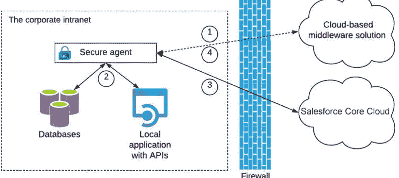
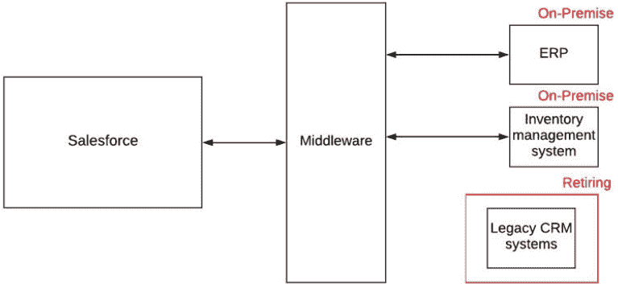
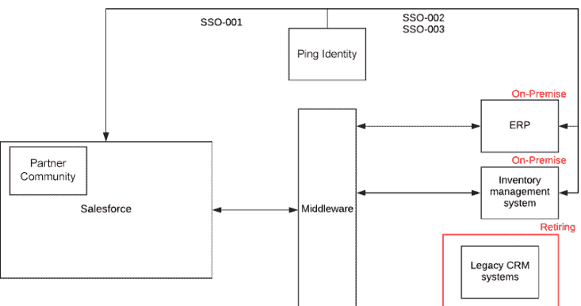
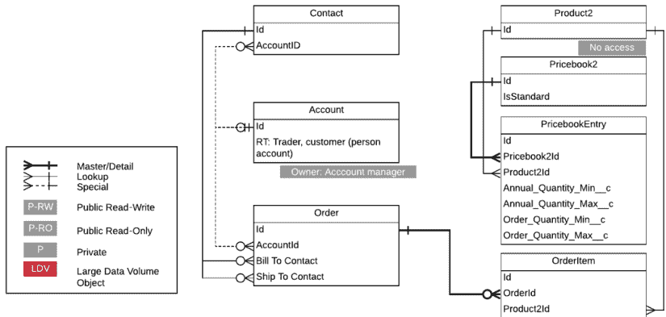
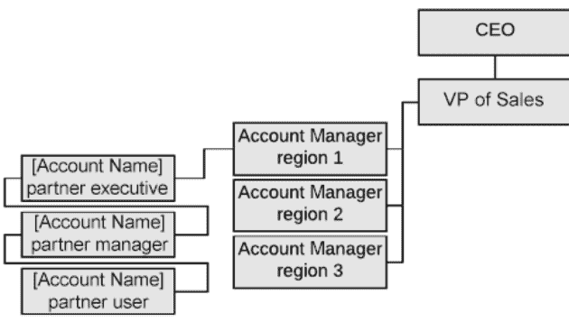
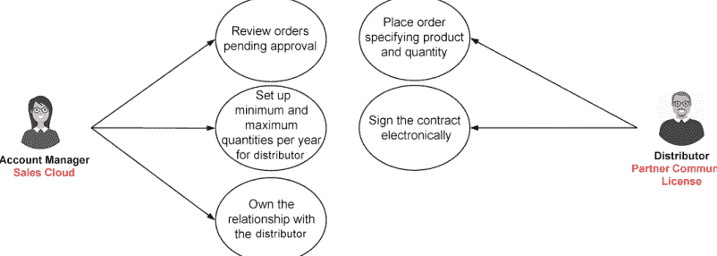
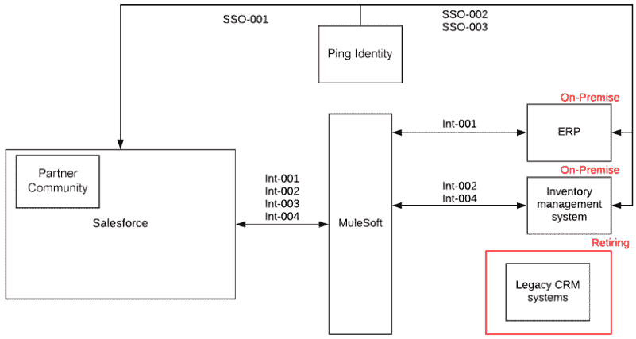
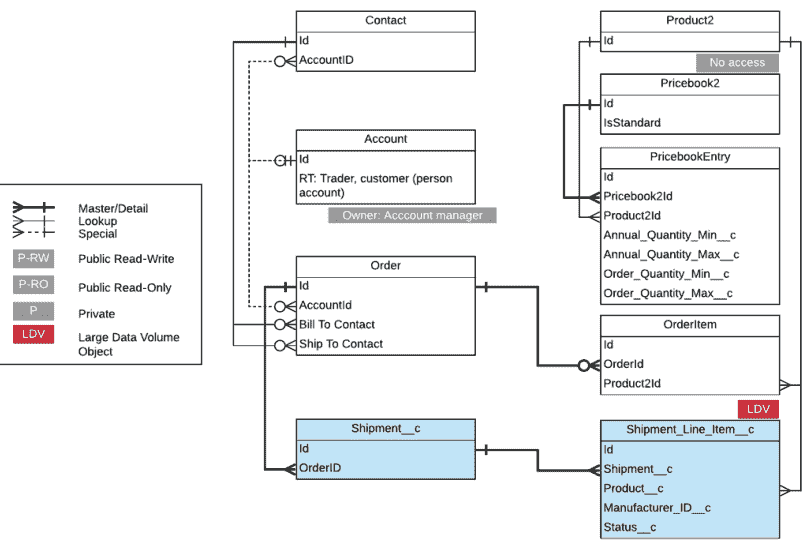

# 构建集成解决方案

在本章中，你将继续学习 CTA 必须掌握的 Salesforce 特定知识领域。集成架构是七个领域中的第五个。你将涵盖所需知识，然后为每个领域完成一个使用小型假设情景的实践练习。

企业格局在不断增长并变得日益复杂。当今鲜有企业会将 Salesforce 与其他系统隔离使用。分布式解决方案如今已成为默认选择，因为集成比以前简单得多。然而，它仍然是对已实施软件解决方案的成功产生最重大影响的领域。

集成是一个复杂的领域，但具有有限数量的独特用例。这在一定程度上类似于你在 *第 4 章，核心架构概念：身份和访问管理* 中涵盖的 **身份和访问管理** (**IAM**) 概念，其中概念本身具有挑战性和复杂性，但身份验证流程的数量有限。

Salesforce 集成模式数量有限。理解这些不同的模式（包括其优缺点、何时使用每种模式，以及通过此领域的重要性）非常重要。在本章中，你将逐一了解这些模式，并学习它们的特征和典型用例。

在了解何时以及如何使用这些集成模式后，你将处理一个小型假设情景，将该知识付诸实践。在本章中，你将涵盖以下主要主题：

- 了解作为 Salesforce 集成架构师你应该能够做什么
- 介绍集成架构领域小型假设情景—**Packt 医疗设备** (**PME**)
- 设计企业集成接口以构建你的连接解决方案

## 了解作为 Salesforce 集成架构师你应该能够做什么

集成架构师通常是技术能力强的专业人士，能够理解集成数据结构及其对整体解决方案的影响。

他们推荐、设计并开发合适的企业集成架构，允许多个系统以安全、可扩展和高性能的方式进行交互。

集成架构师应能够根据给定情景选择并证明正确的集成模式。他们应能够制定考虑集成应用程序的权衡、局限性和功能的集成策略。Salesforce 集成架构师还应了解平台的开箱即用功能和局限性。

> **注意**
> 根据 Salesforce 在线文档，CTA 候选人应能够满足一组特定目标，这些目标可通过以下链接查找：https://packt.link/ZAjmz。

在本章结束时，你应能够完成以下操作：

- 推荐合适的集成架构
- 确定合适的企业集成架构技术
- 使用正确的集成模式设计集成接口
- 选择并证明合适的平台特定集成功能

现在，让我们仔细了解每个目标。

## 推荐合适的集成架构

集成是一个复杂的领域。确定集成解决方案的组件包括询问以下问题：

- 它们如何连接？
- 它们如何安全地交互？
- 交换什么数据？
- 这需要对集成原则有深入的理解吗？

在集成领域，对技术缺乏理解很容易导致努力浪费和脆弱的解决方案。

例如，集成架构师可能会决定使用发布-订阅方式在集成的企业系统之间传输文件，而忽略了文件大小对该方法的影响。这可能会严重影响性能和稳定性。

另一个类似的例子是，集成架构师决定在核心 Salesforce 云之上构建整个中间件，引入几十个类、对象和组件来创建一个链接多个系统的编排引擎。在这种情况下，技术被用于错误的上下文，并创建了一个脆弱的解决方案，迟早有一天会崩溃。

不理解技术的细节及其被如此设计的原因，可能会导致你做出错误的设计决策。第 3 章“核心架构概念：集成与加密”将帮助你理解每种集成方法和技术背后的历史、它们之间的差异以及各自的良好用例。这将帮助你为集成解决方案确定理想的架构布局。

## 确定正确的企业集成架构技术

确定集成方法后，技术是接下来需要考虑的话题。你需要了解企业环境中可用的不同工具。需要考虑的几个问题，例如：

- 什么是提取、转换、加载 (ETL) 工具？
- 什么是企业服务总线 (ESB)？
- ETL 和 ESB 之间有何区别？何时应该选择其中一种而不是另一种？
- 什么是反向代理？
- 什么是 API 管理器？
- 如何将云应用程序连接到本地应用程序？

你在第 3 章“核心架构概念：集成与加密”中已经学习了其中的大部分内容。

建议亲手体验一下 ETL 工具或 ESB（或两者兼用）。这将帮助你理解某些工具支持的不同方法。

例如，要与本地/防火墙后的应用程序集成，某些工具提供安装安全客户端（也称为安全代理）的功能。安全客户端是一个占用空间小的应用程序（由提供中间件的同一公司提供），可以安装在安全的内网（防火墙后面）上。它可以使用特定端口直接连接到本地数据库或 API。然后，安全客户端将通过其他端口（例如 80 或 443，分别用于 HTTP 和 HTTPS，通常由防火墙允许）与基于云的解决方案进行通信。在某些情况下，你可能需要要求防火墙管理员允许针对特定地址的特定端口进行通信（假设目标应用程序具有唯一 URI）。

以下图示说明了安全客户端/安全代理如何用于基于云的 ETL 解决方案（不同 ETL 产品之间可能略有不同）：

图 9.1 – 使用安全代理应用的基于云的中间件

因此，图 9.1 说明了以下内容：

- 安全代理会直接与云中间件通信，通常使用端口 443 或 90。这些是出站通信，因此无需调整或更改防火墙规则。代理会下载其要执行的集成作业的定义，并将其本地存储（通常是加密的）。
- 根据下载的作业信息，安全代理执行计划的作业。
- 数据被提取、转换并直接传输到目标系统（在图 9.1 中为 Salesforce）。数据不会在中间件云中暂存（这通常是数据隐私法规的一项基本要求）。
- 基于预定义的计划，安全代理会将日志和监控数据发回到基于云的中间件。

理解这些细节将帮助你在评审委员会面前展示完整的端到端解决方案。现在，你将探索 CTA 在这一领域应满足的下一个目标。

## 使用正确的集成模式设计集成接口

集成模式描述了将 Salesforce 与其他系统集成的标准方式。这些原则本身并不特定于技术/平台，因为它们可以应用于任何其他技术和平台。你需要充分理解这些集成模式的目的、常见用例以及用于实现它们的 Salesforce 技术。在创建端到端解决方案时，你需要根据用例选择使用哪种模式。

> **注意**
> 你可以在以下链接中找到有关模式的更多详细信息：https://packt.link/bw3nY.

你将学习以下六种模式：

- 远程进程调用 (RPI)：请求和响应
- RPI：发送即忘
- 批量数据同步
- 远程呼入
- 基于数据变化的 UI 更新
- 数据虚拟化

接下来，你将深入了解这些模式及其特征的细节。

## 远程进程调用：请求和响应

关于该模式的高层信息如下：

- **描述**：该模式用于调用远程 Web 服务并等待其响应。在等待期间，系统处于阻塞状态。在经典的单线程桌面应用程序中，你会发现应用程序在等待响应时会冻结。Web 应用程序（如 Salesforce）不是这种情况，但在等待响应时通常会看到一个旋转的进度指示器。
- **时序**：该模式是同步的，有时也被称为实时。
- **操作层**：该模式根据实现方式同时作用于数据层和业务逻辑层。该模式的名称可能会令人困惑。RPI 集成作用于业务逻辑层，例如调用远程天气预报 Web 服务，传递位置和日期，并接收给定日期的预期天气预报。此外，该模式还可用于数据层的同步集成，例如调用 Web 服务将本地记录复制到远程系统，并等待事务提交并返回确认。此处的整个数据插入事务被视为 RPI。
- **关键用例**：调用远程 Web 服务、执行操作并等待结果。这可能包括传递将被复制到远程系统的数据结构。
- **相关 Salesforce 功能**：外部调用（Callouts）可被视为相关功能，例如从 Visualforce 页面或 Lightning 组件调用的外部调用。这不包括使用 future 方法或类似功能调用的异步外部调用。从 Flows 或 Apex 调用的 Salesforce 外部服务也与该模式相关。

> 注意
> 你可以在以下链接中找到更多详细信息：https://packt.link/B7jk7.

## 远程进程调用：发送即忘

关于该模式的高层信息如下：

- **描述：** 该模式用于调用远程 Web 服务并继续执行其他进程，而无需等待响应。系统不会因执行其他操作而阻塞。在经典的单线程桌面应用程序中，应用程序会调用远程 Web 服务并继续执行其他操作。
- **时序：** 该模式是异步的。在某些情况下，可以视为近实时。
- **操作层：** 该模式同时作用于数据层和业务逻辑层，类似于 RPI 请求和响应模式。
- **关键用例：** 调用远程 Web 服务以执行操作，而无需等待结果。这可能包括传递将被复制到远程系统的数据结构。该模式可以修改为包含回调。在这种情况下，Salesforce 会期望远程系统在处理完成并发送结果后进行回调。由于其近实时特性、敏捷性、可扩展性和小开销，这是一种常见模式。
- **相关 Salesforce 功能：** 几个 Salesforce 功能与此相关，例如外发消息、平台事件、**变更数据捕获**（CDC）、Salesforce 流式 API、使用 future 方法的外部调用、使用 queueable 类的外部调用、电子邮件通知和推送通知。

> 注意
> 你可以在以下链接中找到更多详细信息：https://packt.link/dl4cl.

## 批量数据同步

关于该模式的高层信息如下：

- **描述：** 正如其名称所示，该模式主要用于将数据集从一个系统复制到另一个系统。数据集通常包含大量记录，以提高效率。
- **时序：** 该模式是异步的，通常计划在特定时间和间隔运行。执行时间通常取决于复制的数据集的大小。

- **操作层**：此模式在数据层上运行。
- **关键用例**：将一个系统中的一个数据集复制到另一个系统，或同步两个不同系统上的两个数据集。由于其高效性，这种模式很常见，尽管它无法满足当今应用程序所要求的实时/准实时体验。在许多情况下，业务可以接受延迟的数据同步，例如每 12 小时将发票从开票系统复制到数据仓库。
- **相关的 Salesforce 功能**：Salesforce Bulk API 是一个相关功能（适用于较小数据量的 REST、SOAP 和 Graph API 也是如此）。Salesforce Batch Apex 结合回调可能很诱人，但这是一种有风险的模式，建议您避免使用。请考虑改用中间件。

> 注意
> 您可以在以下链接中找到更多详细信息：https://packt.link/B5qRq.

## 远程调用

以下是有关此模式的高级信息：

- **描述**：当远程系统想要在 Salesforce 中调用一个流程时使用此模式。从远程系统的角度来看，这将是 RPI 模式之一。从 Salesforce 的角度来看，它被视为调用。
- **时机**：此模式可以是同步的或异步的，具体取决于实现（调用 Salesforce 的外部系统可能会等待响应，也可能不会）。
- **操作层**：此模式在数据层和业务逻辑层上运行，具体取决于实现。
- **关键用例**：调用标准 Salesforce API 以创建、读取、更新或删除（CRUD）数据，或调用自定义 Salesforce Web 服务（SOAP 或 REST），以返回特定结果。
- **相关的 Salesforce 功能**：多个 Salesforce 功能相关，例如 Salesforce REST API、Salesforce SOAP API、Salesforce Metadata API、Salesforce Tooling API、Salesforce Bulk API（用于批量操作）和 Apex Web 服务。

值得注意的是，当您希望暴露一个应用全有或全无事务原则的原子功能时，Apex Web 服务特别有用，例如，暴露一个接受特定数据结构作为输入并生成客户、机会和机会产品行的 Web 服务。如果创建这些对象中的任何记录失败，将导致整个事务回滚，当数据完整性是关注点时，此类原子事务至关重要。

您还可以利用 Salesforce 标准 REST API 提供的复合请求来创建原子事务。在复合请求中，多个依赖请求在单个调用中执行，一个请求的输出可能成为后续请求的输入。您可以指定，在子请求中遇到的错误是导致整个复合请求完整回滚，还是仅回滚依赖于它的子请求。

> 注意
> 您可以在以下链接中找到更多详细信息：https://packt.link/K596j.

## 基于数据变更的 UI 更新

以下是有关此模式的信息：

- **描述**：这是一个相对较新的模式。当您需要根据 Salesforce 数据的某些变更更新 Salesforce UI，而无需刷新整个页面时使用它。
- **时机**：此模式是异步的。
- **操作层**：此模式在 UI 层上运行。
- **关键用例**：构建一个基于 Salesforce 数据显示特定值和图表的动态页面，并在基础数据变更时更新该页面的某些元素。
- **相关的 Salesforce 功能**：多个 Salesforce 功能相关，例如 Salesforce Streaming API、推送通知、平台事件和 CDC（技术上基于平台事件）。

> 注意
> 您可以在以下链接中找到更多详细信息：https://packt.link/S4Ql1.

## 数据虚拟化

以下是有关此模式的信息：

- **描述**：此模式用于在 Salesforce 中检索和显示存储在远程系统上的数据，而无需持久化数据。当无需将数据保留在 Salesforce 中时，这非常有用。数据会实时按需获取并显示给用户。
- **时机**：此模式是同步的。但是，诸如懒加载等某些技术可以将其转变为异步通信的一种特殊情况。
- **操作层**：此模式在 UI 层上运行。
- **关键用例**：构建利用 Salesforce 外部托管数据的 UI，例如归档数据。使用 Google 地图等远程服务的混搭应用是另一个有效的用例。
- **相关的 Salesforce 功能**：自定义 Visualforce 页面、Lightning 组件、Salesforce Connect 和 Salesforce Canvas 都是相关功能。

在设计集成接口时，您需要定义模式并指定要使用的 Salesforce 技术。这项技能是您在此领域接下来需要掌握的内容。

## 选择并证明合适的平台特定集成能力

Salesforce 提供了一组开箱即用的功能，以促进不同的集成模式：

| 功能 | 描述 |
|---|---|
| REST API | Salesforce 自带开箱即用的 REST API，可用于与 Salesforce 数据交互。一般来说，REST API 易于集成，尤其是来自移动端和 JavaScript。Salesforce REST API 支持简单的 HTTP 调用（GET、POST、PUT、PATCH 和 DELETE）。 |
| SOAP API | Salesforce 自带的开箱即用 SOAP API 可以通过使用标准的两个 Web 服务描述语言 (WSDL) 文件之一来使用。企业 WSDL 是强类型的，这使得维护具有挑战性。但是，如果数据模型很少更改，则使用它更容易。另一方面，合作伙伴 WSDL 是弱类型的，这使其更加动态，适合由合作伙伴或经常遇到数据模型更改的组织使用。SOAP API 可用于像 REST API 一样处理 Salesforce 数据。但是，对于移动设备和 JavaScript 应用等瘦客户端来说，其实现更具挑战性。此外，它的负载往往更大，因此被认为比 REST 稍慢。 |
| Bulk API | 此 API 旨在处理大量数据。某些 ETL 工具设计为在用于向 Salesforce 加载大量数据时自动切换到此 API。 |
| Salesforce Connect | 这是一项付费功能，允许从支持 OData 2.0 或 OData 4.0 标准的外部数据源实时检索数据。OData 接口是 REST 风格的，您可以使用自定义代码调用它们。Salesforce Connect 使该过程更加简单。外部 OData 表会自动在 Salesforce 中表示为外部对象，从而允许将此数据与其他 Salesforce 数据关联，并使用常规 SOQL 语句进行查询。 |
| Canvas | Salesforce Canvas 是一项付费功能，可让您在 Salesforce 中集成远程 Web 应用程序。这通常是 UI 级集成，但 Canvas SDK 可以添加更高级的功能。 |
| Chatter REST API | Chatter 有其自己的 REST API。此 API 可以与 Chatter 信息流、推荐、群组、话题和关注者等对象进行交互。 |
| Metadata API | 此 API 不太可能用于数据集成场景。它主要由发布管理工具使用。它用于检索、创建、更新、部署或删除 Salesforce 元数据信息，例如页面布局和用户配置文件。 |
| Streaming API | 流 API 用于开发现代动态页面。它允许您的页面/组件在 Salesforce 数据更改时接收通知，从而相应地更新页面/组件的部分内容。它利用 PushTopic 功能。 |
| Tooling API | 此 API 旨在帮助构建与 Salesforce 平台交互的自定义开发工具。 |
| Apex callouts | 此功能允许使用 Apex 调用远程 Web 服务。Apex 调用可以是同步或异步的。异步方法必须带有 @future 注解。您还可以利用 Queueable 接口来开发带有异步方法的 Apex 类。您可以使用 continuation 类进行长时间运行的调用。 |
| Email | 这是一种旧的集成技术。但是，它仍然有效并有其用例，例如在与不支持任何较新接口的旧版应用程序集成时。您可以利用 InboundEmailHandler 接口来开发自定义 Apex 类，以处理 Salesforce 电子邮件服务接收到的入站电子邮件。 |

| 功能 | 描述 |
|---|---|
| Outbound messages | 这是一个可配置的出站集成功能。它只能包含来自一个 Salesforce 对象的数据，并使用 SOAP 标准发送。这意味着消费者必须能够实现 SOAP WSDL。发送的出站消息可以包含会话 ID，使接收方能够使用会话 ID 进行身份验证，从而回调到 Salesforce。出站消息具有 24 小时重试机制。 |
| Platform events | 平台事件基于发布-订阅集成方法。您可以以类似自定义对象的方式定义平台事件的结构。平台事件可以使用 Apex、Flow 和 Process Builder 发布，您可以使用相同的工具以及 CometD 客户端订阅它们。从 Winter '23 版本开始，您还可以使用 Pub/Sub API 发布和订阅平台事件。由于平台事件可以使用不同的 Salesforce 功能轻松订阅，因此除了将数据传递给外部订阅者外，还可以利用它们在 Salesforce 平台本身内创建基于事件驱动架构的应用程序。 |
| Change data capture (CDC) | CDC 是构建在平台事件之上的功能，这意味着它们共享许多特征。CDC 发布表示 Salesforce 记录更改的事件，例如创建新记录、删除和更新现有记录以及记录未删除。 |
| External services | 外部服务允许使用 Salesforce 流和 Apex 调用远程 Web 服务。 |

表 9.1: 用于促进不同集成模式的开箱即用功能

现在您已熟悉该领域的预期，是时候着手一个实际示例了，您将利用这些知识来设计一个集成的、安全的且可扩展的解决方案。

## 介绍集成架构领域微型假设场景：Packt 医疗设备

以下微型场景描述了特定客户面临的挑战。该场景专门针对与集成架构相关的挑战进行了调整。但如您所料，还有与其他领域（如数据和安全）相关的要求。

在开始之前，请先熟悉在“使用正确的集成模式设计集成界面”部分中提到的六种集成模式。在此微型场景中，您将了解这些集成模式中一些模式的实际示例。本章将侧重于设计集成界面所需的逻辑思考。

建议您先通读一遍场景，以构建所需解决方案的初步图景。然后，浏览要求并尝试自行解决。完成尝试后，将其与建议的解决方案进行比较。尝试向另一个人讲解端到端的解决方案，此人将扮演评委角色，描述特定的集成界面。

### 场景

**Packt 医疗设备（PME）**在过去 75 年来一直向全球医疗保健提供商销售医疗设备。PME 目前销售来自不同品牌的 20,000 多种不同的设备型号。PME 在近年来经历了巨大增长。去年他们销售了近 500 万台设备，并预计年销售额将增长 10%。

### 当前情况

PME 在多个地理区域运营。每个区域都有针对与分销商合作而定制的各种 CRM 解决方案。PME 希望用基于 Salesforce 的解决方案替换所有现有的 CRM 解决方案。但是，他们希望保留两个现有系统，因为他们认为这些系统提供了一套有价值的定制服务：

- 一个集中式的基于浏览器的 **企业资源平台（ERP）**系统，PME 客户经理使用该系统查看其合作分销商的财务详细信息。该系统仅可从公司内部网访问。
- 一个集中式库存管理系统，存储每个地点可用设备的数据。它包含关于运往分销商途中的设备的到达日期和时间的更新信息。此外，该系统允许获取分销商地点设备的信息。

目前，数据是手动输入到库存管理系统中的。该系统未与其他系统集成，也没有任何公开的 API。该系统使用 MS SQL 数据库存储数据。ERP 系统也未与其他系统集成。但是，它拥有一组丰富的 SOAP 和 REST API。

用户在使用这些系统之前必须对每个系统进行身份验证。目前身份验证是单独进行的，因为每个系统都存储自己的用户凭据。

订购流程包括三个阶段，即谈判、确认和发货。订单按季度下达。

PME 希望现代化其系统环境并在全球范围内提供更标准化的流程。此外，他们希望通过尽可能避免重复数据录入来提高用户生产力。

### 要求

PME 分享了以下要求：

- PME 安全团队要求在新解决方案中使用的所有系统（包括 ERP 和库存管理系统）中使用单点登录（SSO）。
- 设备订单应源自 Salesforce。
- 在谈判阶段之前，PME 应该能够为每个分销商的设备类型设置最大和最小分配量。
- 在谈判阶段，分销商应该能够下订单，其中包含设备型号和数量列表。
- 如果每个型号的请求数量在每个型号定义的分配范围内，订单应自动确认。
- 如果每个型号的请求数量超出每个型号定义的分配范围，订单应发送给客户经理审批。系统应自动从 ERP 中检索表示分销商财务状况的四个值。
- 客户经理应利用财务状况指标值，以及该分销商的历史订单，来确定正确的操作。
- 当订单即将发货时，库存管理系统可能会创建多个发货。对于每个发货，将创建设备及其唯一制造商 ID 的列表。发货及其行项目应对分销商的车队经理在 Salesforce 中可见。每个行项目的状态应为“在途中”。
- 发货送达后，分销商的车队经理有三天时间确认收货。他们应确认由其唯一制造商 ID 标识的每个设备的状态。每个行项目的状态应为“可用库存”。
- 如果超过三天仍未收到确认，应通知客户经理。
- 分销商的车队经理应定期按制造商 ID 更新每个设备的库存状态。他们应指示设备是已售出、已退回、已损坏还是仍可用库存。此信息也应在库存系统中更新。

PME 正在寻求您的帮助，设计一个满足其要求和雄心勃勃的路线图的可扩展集成解决方案。

## 设计企业集成界面以构建您的连接解决方案

请花点时间快速浏览场景，了解大局并对解决方案形成一些初步想法。这是每个场景中必不可少的步骤。我们的方法是逐步解决场景。但是，您仍需要先了解大局并形成一些初步想法，否则可能会浪费大量时间重新设计您的解决方案。

## 了解当前情况

第一段包含关于 PME 的一些一般信息。您从中了解到，PME 有一些旧版 CRM 解决方案，并希望使用 Salesforce 将它们整合。此外，您还了解到他们希望保留两个系统：一个仅可通过公司内部网访问的旧版 ERP 系统，以及一个集中式库存管理系统。

这两个系统都未与任何其他系统连接。场景没有确切说明它们托管在哪里，但根据您对 ERP 解决方案的了解，可以合理假设它是本地托管的（或位于 VPN 后面，但这种情况较少见）。也可以合理假设库存管理系统也是本地托管的。

即使在这个阶段，您也需要开始思考：我如何将 Salesforce 等基于云的平台与本地托管的应用程序集成？

> **注意** 如果您难以找到答案，请翻回第 3 章“核心架构概念：集成与密码学”，特别是“讨论不同集成工具”部分，并确保您熟悉这些工具中的每一个。

简而言之，您需要某种中间件，从 Salesforce 向本地托管的应用程序进行出站调用。您目前还不确定需要哪种中间件。在通读其余场景时，您会了解更多信息。

暂时，请在草图系统架构图中记录您所了解的内容。您的图表可能如下所示：

图 9.2 – 系统架构（初稿）

PME 希望使用 Salesforce 现代化其系统环境。他们还希望将其与旧版应用程序集成，并且希望以正确的方式完成，以确保未来的可伸缩性和可扩展性。

他们共享了一份冗长的需求列表，接下来你将对其进行讲解。

## 深入了解共享的需求

现在，浏览 PME 共享的需求，为每个需求制定拟议解决方案，并相应更新图表以帮助演示。从第一个需求开始，它以以下行开头。

> PME 安全团队规定，新解决方案中使用的所有系统都必须使用单点登录，包括 ERP 和库存管理系统。

你知道 ERP 和库存管理系统拥有自己的身份验证功能。但是，场景中并没有任何迹象表明它们不支持 OAuth 2.0、OpenID Connect 或 SAML 2.0 等标准。你可以做出该假设，清晰地传达它，并以此为基础制定解决方案。

你仍然需要定义一个可与所有系统协同工作的身份提供者。此外，你需要说明哪个系统将保存用户凭据（身份存储）。遗漏身份存储的标识是你应避免的常见错误。

你将在后面的第 11 章《传播和社会化你的解决方案》中学到一种技术，称为问题预埋（question seeding）。简而言之，这是故意留下一些冗长的对话领域不予回答，以便在问答环节吸引大家对其的注意。必须充分理解并谨慎使用。当你使用该技术时，你已经知道某个问题的答案。你将评委的注意力引向它，但随后将其留空，允许他们在问答环节就此提问。

当你因为不了解某些主题的重要性或不知道答案而将其留空时，这更像是试图施放烟雾弹，希望评委不会注意到。这是一种你应不惜一切代价避免的策略。

当你提出单点登录策略时，除非你故意将某些领域留空以供进一步讨论，否则需要对其所有领域都清晰明确。在此场景中，你必须解释你的身份管理策略。你的拟议解决方案可以如下：

我假设 ERP 和库存管理系统都支持 OpenID Connect 标准。我建议将 Ping Identity 等身份提供者和身份管理工具引入系统环境。Ping 将使用其身份存储（PingDirectory）来维护用户凭据。

目前，用户凭据由 ERP 和库存管理系统在本地托管。我建议将这些系统中的用户详细信息迁移到 Ping。

我假设无法迁移系统的密码，因为只存储了它们的哈希值。因此，我们需要向所有已迁移的客户发送电子邮件，要求他们设置新密码。电子邮件将包含一个受保护的一次性链接，允许他们使用 Ping 托管的页面设置新密码。

Ping 将处理所有关联服务提供商（SP）之间的用户预配和取消预配。我将使用联合 ID 来在各系统中唯一标识客户。这可以是员工 ID。

当用户尝试使用唯一的 MyDomain URL 访问 Salesforce 实例时，系统将检测为该实例配置的身份验证提供者。如果 Ping 是唯一的身份验证提供者，用户将自动重定向到 Ping 的登录页面。身份验证将使用 OpenID Connect Web 服务器流进行。

你是应该在那里停下来，还是继续详细说明该流程的具体情况？这取决于你的策略以及你计划如何利用演示时间。如果你在那里停下来，你实际上是在预埋一个问题。如果评委有兴趣测试你对该流程的了解，他们会在问答环节再次提及它。如果他们不感兴趣（因为他们认为你已经知道通过 IAM 领域所需的条件），那么他们就不会。

这就是该技术的威力。如果明智地使用，你可以避免浪费时间去解释那些不一定需要解释的领域。

在一个专注于集成的小型场景中看到 IAM 需求，你感到惊讶吗？到现在你不应该感到惊讶。你了解到各个领域并非孤立，而是彼此紧密相关。现在，更新你的系统架构图，然后继续处理下一个需求。

- *设备订单应源自 Salesforce。*

这是一个简短而直接的需求。订单必须源自 Salesforce。但是，这并不意味着它们将在整个生命周期中都留在那里。

现在你脑海中可能会出现一个问题：我可以使用哪个对象来满足这个需求？显而易见的答案是标准订单对象。但是，不要让场景中使用的用词决定你的设计决策。如果场景将其称为 **订单**，也不意味着它必须转换为 **标准订单** 对象。你可以在某些用例中使用机会对象来表示订单，主要是在存在价格谈判过程（报价）或有 **预测** 需求时。

你也可以决定使用自定义对象，如果任何标准对象都无法满足需求。目前，你对情况还没有足够清晰的了解来做出决定。

- *在谈判阶段之前，PME 应能够为每个分销商的每种设备类型设置最大和最小分配量。*

你计划如何组织并向 PME 的分销商提供产品？一种方法是使用 *Pricebooks*（该对象在技术上称为 *Pricebook2*）。在此情况下，你可以在 *PricebookEntry* 上定义最大和最小分配量作为额外字段。

请记住，*Pricebooks* 同时适用于订单和机会对象。你尚未决定使用哪个对象，但在浏览场景时，你没有发现任何表明存在价格谈判或预测的需求。你可以先假设将使用订单对象，并在需要时稍后更新。

这是解决这个需求的唯一方法吗？到现在你已经知道答案了。解决一个问题有多种方法。你的解决方案应提供一个有效且技术正确的解决方案，考虑你所做的假设。

> **注意**
> 
> 场景中的需求是否足以提出使用 B2B Commerce？
> 
> 从中立的角度来看，不足以。但是，如果你决定提出它，请做好准备，清晰地解释你计划如何配置它以满足所有所需功能。

你的拟议解决方案可以如下：

> *我建议使用标准 Pricebook 和 PricebookEntry 对象向不同分销商提供产品。这将允许我根据协议为每个分销商使用不同的价格。我还建议向 PricebookEntry 对象引入四个新字段，以保存每年每个订单允许的最大和最小数量。*

**注意**

到目前为止，你没有任何需求表明 PME 的分销商将能够访问 Salesforce。因此，你可以假设 *Pricebooks* 将继续对所有销售代理可用。要使此解决方案适用于合作伙伴社区，你需要将 *Pricebook* 对象的 OWD（组织范围默认值）更新为无访问权限或仅查看权限，然后将合适的 *Pricebook* 共享给合适的用户集。

更新你的数据模型图，然后继续处理下一个需求。

- *在谈判阶段，分销商应能够下订单，订单包含设备型号和数量列表。*

你现在有一个需求，表明分销商需要访问 Salesforce。分销商需要能够创建订单。他们还需要一种支持使用手动共享或共享规则进行记录共享的用户许可。合作伙伴社区和客户社区 Plus 都提供这些功能。但是，与分销商合作时通常使用合作伙伴社区许可（毕竟，他们是业务伙伴）。你可以这样假设，并在需要时稍后调整。你的拟议解决方案可以如下：

*要授予分销商访问 Salesforce 以下订单的权限，我建议为其用户分配合作伙伴社区许可。我将更新 Pricebook 对象的 OWD 值为无访问权限。然后，管理员将手动将每个分销商的 Pricebook 共享给该分销商的正确合作伙伴角色。*

更新你的系统架构、数据模型、角色层次结构以及参与者和许可图表。它们现在可能如下所示：

图 9.3 – 系统架构（第二稿）

您的数据模型图可能如下所示：

图 9.4 – 数据模型（初稿）

您的角色层级图可能如下所示：

图 9.5 – 角色层级（初稿）

您的参与者和许可图可能如下所示：

图 9.6 – 参与者和许可（初稿）

现在，转到下一个要求：

> *如果每个模型的请求数量在每个模型定义的分配范围内，则订单应自动确认。*

要完全理解此要求，您需要阅读下一个要求。在此阶段，您可能应该问自己：是否存在开箱即用的功能，可让我在下订单时检查 `PricebookEntry` 对象上的这四个字段？

> *如果每个模型的请求数量超出每个模型定义的分配范围，则订单应发送给客户经理审批。*

您需要引入一种机制来检查 `PricebookEntry` 对象上的四个值并确定订单状态。在特定用例中，您需要自动将订单提交审批。

请记住，您建议引入 `PricebookEntry` 对象的两个字段是年度最小数量和最大数量。要检查这些值，您需要查询当前年的所有指定经销商订单。

我们早期的设计决策正在影响此阶段可用的数量限制。如果您使用了不同的机制来引入数量限制，那么在此阶段您会面临不同的挑战。但是，如果您的解决方案在技术上是正确的，您很可能能够绕过其限制。如果您早期的解决方案存在严重缺点，您可能会发现自己在此阶段受限太多，可能需要重新考虑早期的选项。

您的提议解决方案可能如下：

我建议在 OrderItem 对象上引入触发器和 Apex 触发器处理程序类，该触发器在插入或保存该对象的记录时触发。然后，触发器将从相关的 PricebookEntry 记录中检索四个数量限制值，并将其与 OrderItem 记录的数量进行比较。此外，代码还将查询当年同一经销商针对同一产品下的所有 OrderItem 记录，并确定经销商是否仍遵守年度限制数量。基于此，Apex 代码将要么将订单状态设置为已确认或待审批，如有需要，还会将记录提交审批。

要求的其余部分表明需要从 ERP 检索四个值以确定经销商的财务状况。

系统应自动从 ERP 检索指示经销商财务状况的四个值。

此场景可能会让您觉得此事务应在提交记录审批后按顺序发生。但您应该问自己的问题是：此接口将在哪个集成级别上运行？应使用哪种模式？您需要从 ERP 复制数据，还是可以实时检索？此接口的时机是什么？

现在您明白了这一点，请查看下一个要求以确定正确的集成方法：

客户经理应利用财务状况指标值，以及此经销商的历史订单，来确定正确的操作。

检索数据是为了支持客户经理做出决策。请考虑以下几点：

- **时机**：此接口的理想时机是什么？经销商的财务状况可能会日新月异，甚至可能更快，具体取决于该数据在 ERP 中的更新频率。理想情况下，此数据应尽可能最新。

- **在 Salesforce 中托管数据**：您需要将数据复制到 Salesforce 吗？这样做有什么好处？数据将可报告、访问更快，并受 Salesforce 用户访问控制以及数据共享和可见性的约束。此外，您可以根据数据更改触发工作流和其他自动化。但是，此要求是否需要这些？在 Salesforce 中托管数据也有其挑战。例如，您可能会发现此信息必须静态加密，这将带来一系列其他限制。要求比这简单得多。请尽量不要把事情复杂化。您只想在审批过程中检索这些值以帮助客户经理。这可以实时完成。无需复制数据或将其存储在 Salesforce 中。

- **确定集成级别和使用的模式**：从这一点开始，这将变得容易。您需要寻找一种允许近乎实时数据检索的模式，其中数据不存储在 Salesforce 中，而是仅在 UI 级别显示。浏览本章前面列出的模式，看哪个最符合要求。

您的提议解决方案可能如下：

为了满足此要求，我考虑了不同的集成模式。我认为应使用的正确模式是数据虚拟化，其中数据按需实时获取，且仅在 UI 级别显示。不会在 Salesforce 中保留任何数据。

我将创建一个 Lightning Web 组件应用或 Visualforce 页面，在加载时向中间件发起调用。我将在标准审批页面中添加一个超链接字段。单击链接后，将打开一个带有 Visualforce 页面的新选项卡。将向中间件发出调用，然后由中间件调用 ERP 系统并检索数据。然后，数据将在 Visualforce 页面上显示。我将在我的 Visualforce 页面控制器中使用 continuation 类，以确保最佳用户体验，即在等待响应时，调用在后台线程中执行而不会阻塞主线程。

我建议使用 MuleSoft 作为集成中间件。它可以使用 ERP 暴露的 API，并在需要时处理异常并重试连接。我假设本地防火墙将配置为允许 MuleSoft 与这些 API 通信。

我将利用命名凭证功能，使用命名主体从 Salesforce 向 MuleSoft 进行身份验证。我假设 MuleSoft 将使用简单身份验证向 ERP 进行身份验证。集成通道将使用双向 TLS 在 Salesforce 和 MuleSoft 之间进行保护。

该页面还将检索并显示经销商的历史订单。场景未指定每个经销商每年创建的订单数量。我假设数量较低。我假设每年生成的订单不超过 100,000 个，并且 PME 将归档所有超过五年期限的订单。场景未指定归档要求，因此我不会深入探讨更多细节，但如果需要，我很乐意这样做。

订单获批后，我将使用字段更新将订单状态更新为已确认。

这为该要求提供了端到端的解决方案。请尽量不要把事情复杂化。场景未指定归档要求。您可以添加一些假设，并告知评委如果需要您愿意解释，但不要假设您需要解决未提出的问题，从而在演示中浪费宝贵时间。

> 注意
> 请在解释此解决方案时使用图表，实际上任何其他解决方案也是如此。
> 您的图表是帮助您讲述端到端故事的工具。

更新您的图表；您将需要它们向评委解释解决方案。现在，转到下一个要求：

当订单即将发货时，库存管理系统可能会创建多个发货。

此阶段您应该问自己的问题如下：

- **时机**：此接口的理想时机是什么？此数据何时需要？发货及其行项目理想情况下应尽快可供车队经理使用，但几分钟的轻微延迟通常是可以接受的。发货需要很长时间；10-15 分钟的延迟几乎不会造成任何影响。

- **在 Salesforce 中托管数据**：您需要将数据复制到 Salesforce 吗？到目前为止的简短答案是否定的。这样做没有好处。

- **集成级别和模式**：集成级别是什么？您尚不确定这是 UI 级别集成还是数据级别集成。这不会是业务流程级别集成，因为您不需要在任何一端调用业务流程。

在做出正确决策之前，您需要更多细节。这在现实生活中也同样适用。不要急于下结论，假设每个集成都是数据同步。这是一个非常常见的错误，您应该避免。急于下结论、跳过有组织的设计思维方式通常会导致错误的结论。

拿这个案例为例。您可以急于下结论，认为数据必须复制到 Salesforce。但理由是什么？您为什么不能简单地将数据保留在原处并实时检索（就像您为经销商财务状况指标所做的那样）？如果您没有坚实的技术理由，那么您的解决方案就缺少了某些东西。请做好在评审委员会上受到质疑的准备（评委知道这理由不充分，因此会通过提问来深入探究）。

现在，请查看下一个要求，以进一步了解此接口应如何工作：

当货件交付后，经销商的车队经理有三天时间确认货件的收据。

您现在正在了解一个新要求。根据接收到的数据，需要在 Salesforce 中调用一个流程。

如果数据在 Salesforce 中，有多种方式可以满足此要求，例如利用基于时间的工作流、任务或计划批处理作业（用于更新发货行项目中已过的天数，并相应触发通知）。但如果数据未存储在 Salesforce 中，几乎没有办法做到这一点。您需要修改库存管理应用程序来引入此功能。更新此类旧版应用程序是一项非常耗时的任务，通常会导致次优功能。

现在你有充分的理由提议将数据复制到 Salesforce。你有一个明确的要求，如果不将数据托管在 Salesforce 中，就无法轻松实现。你的提议解决方案可能如下：

为满足此要求，我考虑了不同的集成模式。我认为应使用的正确模式是批量数据同步，即将数据从库存管理系统复制到 Salesforce。

MuleSoft 将配置为每 15 分钟运行一个计划的批处理作业。该作业将从库存系统复制新的发货和发货行项目记录到 Salesforce。理想情况下，当库存管理系统中创建新的发货记录时，此作业应触发。但考虑到这是一个旧版应用程序，我假设它无法向 MuleSoft 通知此活动。我还假设 15 分钟的延迟对业务来说是可以接受的。如果不可以，可以增加此作业的频率。

一旦记录在 Salesforce 中创建，其状态将设置为可用和有库存。发货记录将使用主/详细关系链接到订单对象。这将确保记录对所有有权访问订单记录的分销商用户可见。

我将使用自启动流程创建一个在三天后到期的任务，以更新发货行项目状态。该任务将分配给分销商车队经理的队列。

这是一个指向 Salesforce 的入站接口。MuleSoft 将使用 OpenID Connect Web 服务器流（首次设置期间）进行身份验证，随后使用命名主体（集成用户）的刷新令牌流。此接口将使用双向 TLS 进行保护。

我还假设 MuleSoft 将使用其自身的 MS SQL 连接器直接访问库存管理数据库。我假设本地防火墙将配置为允许 MuleSoft 访问 MS SQL 服务器数据库。此接口将使用单向 TLS 进行保护。将使用简单身份验证。

我假设发货数量相对较低。我之前假设每年创建 100,000 个订单。因此，我假设每个订单有两个发货。即每年 200,000 个发货。根据场景，PME 去年销售了 500 万台设备，年增长率为 10%。这意味着发货行项目对象在几年后可能会成为 LDV（大数据量对象）。

因此，我建议使用 MuleSoft 计划的批处理作业，从 Salesforce 中删除分销商销售超过一年的发货。这假设这些值已经存在于库存管理系统中。因此，它们在从 Salesforce 删除后不会完全丢失。我在我的图表中已将此视为另一个集成接口。

你可能会觉得在演示中说出所有这些话太困难了。如果你不使用你的图表，情况确实如此。请注意，图表将包含所有关于身份验证和安全的信息。你只是在演示中使用图表来讲述端到端的故事。

更新你的数据模型、景观架构和集成接口列表。然后，转到下一个要求：

如果超过三天没有收到确认，应通知客户经理。

这是另一个可以通过多种方式满足的要求。你的提议解决方案可能如下：

我将为此利用标准报告和仪表板。我将创建一个显示特定类型过期任务的报告。我假设将为每个客户经理创建一个报告，并计划每天发送。这将确保客户经理收到通知。我也可以使用基于时间的工作流，但我认为报告就足够了。

分销商的车队经理将定期按制造商 ID 更新每台设备的库存状态。

大部分内容在以前的解决方案中已经涵盖。但是，请确保完整阅读要求。不要冒跳过要求的风险，从而错失宝贵的分数。你的提议解决方案可能如下：

要求的第一部分已通过我们引入的新自定义对象实现。将使用字段级安全性授予分销商车队经理对这些对象状态字段的读写权限。此外，我已经提到发货对象将使用主/详细关系链接到订单。这意味着记录将对所有有权访问订单记录的合作伙伴用户可见。

为将这些值同步回库存管理系统，我将利用另一个 MuleSoft 计划的批处理作业。我假设它将每小时运行一次，并且该延迟对业务来说是可以接受的。该接口将把更改的发货行项目状态复制回库存管理系统。这将是另一个利用批量数据同步模式的接口。

我考虑过使用平台事件或更改数据捕获 (CDC) 来将更改的数据从 Salesforce 发送到 MuleSoft。但我更倾向于使用计划批处理，以确保将所有更改交付到库存管理系统的一致性，尤其是因为没有共享要求表明需要近实时数据同步。考虑到我们已经有一个向相反方向运行的类似接口，此接口也更容易构建。

此接口也将使用与发货同步接口相同的授权和安全机制。

这是最后一个共享 PME 要求。你可以更新所有图表并查看它们的效果。

这是景观架构图：

### 图 9.7 – 景观架构（最终）

### 以下是集成接口：

| 接口代码 | 源/目标 | 集成层 | 集成模式 | 描述 | 安全 | 身份验证 |
|---|---|---|---|---|---|---|
| Int-001 | Salesforce => MuleSoft => ERP | UI | mashup/数据虚拟化 | 即时从 ERP 系统检索四个财务健康指标值。Salesforce 将调用 MuleSoft 暴露的 Web 服务，进而调用 ERP 系统的正确 API。 | Salesforce 和 MuleSoft 之间的 HTTPS（双向 SSL/TLS） | Salesforce 和 MuleSoft 之间使用 OpenID Connect Web 服务器流（随后为刷新令牌流）进行相互身份验证。MuleSoft 和 ERP 之间进行简单相互身份验证。 |
| Int-002 | MuleSoft（从库存管理系统拉取）=> Salesforce | 数据 | 批量数据同步 – 异步 | 一个计划的 MuleSoft 批处理作业，用于从库存管理系统检索发货和发货行项目并将其复制到 Salesforce。 | Salesforce 和 MuleSoft 之间的 HTTPS（双向 SSL/TLS） | Salesforce 和 MuleSoft 之间使用 OpenID Connect Web 服务器流（随后为刷新令牌流）进行相互身份验证。MuleSoft 和库存管理系统之间进行简单相互身份验证。 |
| Int-003 | MuleSoft => Salesforce | 数据 | 批量数据删除 – 异步 | 一个计划的 MuleSoft 批处理作业，用于删除分销商销售超过一年的发货行项目记录。该作业还删除没有发货行项目的发货。 | Salesforce 和 MuleSoft 之间的 HTTPS（双向 SSL/TLS） | Salesforce 和 MuleSoft 之间使用 OpenID Connect Web 服务器流（随后为刷新令牌流）进行相互身份验证。 |
| Int-004 | MuleSoft（从 Salesforce 拉取）=> 库存管理 | 数据 | 批量数据同步 – 异步 | 一个计划的 MuleSoft 批处理作业，用于从 Salesforce 检索发货行项目并将其状态复制到库存管理系统。 | Salesforce 和 MuleSoft 之间的 HTTPS（双向 SSL/TLS） | Salesforce 和 MuleSoft 之间使用 OpenID Connect Web 服务器流（随后为刷新令牌流）进行相互身份验证。MuleSoft 和库存管理系统之间进行简单相互身份验证。 |
| SSO-001 | 使用 Ping Identity 作为 IDP 的 Salesforce SSO | SSO | SSO – OpenID Connect | 使用 OpenID Connect（Web 服务器流）和 Ping Identity 作为 IDP 和身份存储进行 SSO。 | HTTPS（单向 SSL/TLS） | OpenID Connect Web 服务器流。 |
| SSO-002 | 使用 Ping Identity 作为 IDP 的 ERP SSO | SSO | SSO – OpenID Connect | 使用 OpenID Connect（Web 服务器流）和 Ping Identity 作为 IDP 和身份存储进行 SSO。 | HTTPS（单向 SSL/TLS） | OpenID Connect Web 服务器流。 |
| SSO-003 | 使用 Ping Identity 作为 IDP 的库存管理系统 SSO | SSO | SSO – OpenID Connect | 使用 OpenID Connect（Web 服务器流）和 Ping Identity 作为 IDP 和身份存储进行 SSO。 | HTTPS（单向 SSL/TLS） | OpenID Connect Web 服务器流。 |

### 图 9.8 – 集成接口（最终）

And the data model diagram looks like this:

图 9.9 – 数据模型（最终）

> **注意**
> 其他图表没有更改。

情景到此结束。在接下来的章节中，你将继续看到更多与集成相关的需求。但你现在已经了解了确定集成接口正确设计的结构化方法。

在此场景中，你需要连接到本地托管的应用程序；因此，使用中间件很容易得到合理化。但是，集成中间件在许多其他用例中也能增加价值。请确保你仔细阅读第 3 章《核心架构概念：集成与加密》中列出的详细信息。在没有集成中间件的情况下，可能会在 Salesforce Core Cloud 中产生大量技术债务。

## 摘要

在本章中，你深入了解了 Salesforce 集成架构领域的细节。你了解了 CTA 预期涵盖的内容以及详细程度。你发现了关键的 Salesforce 集成模式，并理解了它们对设计解决方案清晰度的重要性和影响。

然后你处理了一个聚焦于集成架构的小型假设情景，并为其制定了解决方案，创建了一些引人入胜的演示提案。你学习了设计集成接口的结构化方法，并遇到了一些有趣的设计决策。你接触到了多个示例，其中你使用图表来传达结构化且易于遵循的解决方案演示。你学习了如何避免过早对集成接口得出结论所带来的负面影响。

你还在小型情景中涵盖了其他主题，包括将用户迁移到新身份存储以及处理合作伙伴用户，并初步了解了一种称为问题播种的演示技巧。

你现在将进入需要掌握的第六个领域：开发生命周期与部署规划。
