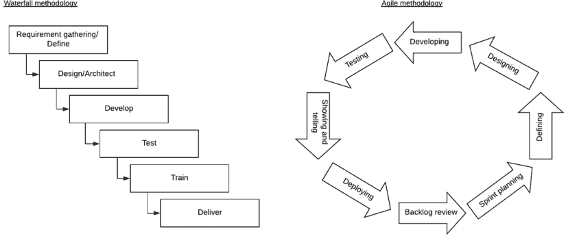
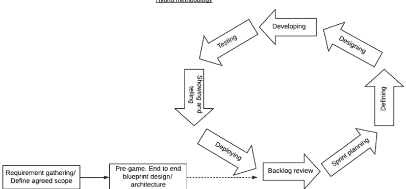
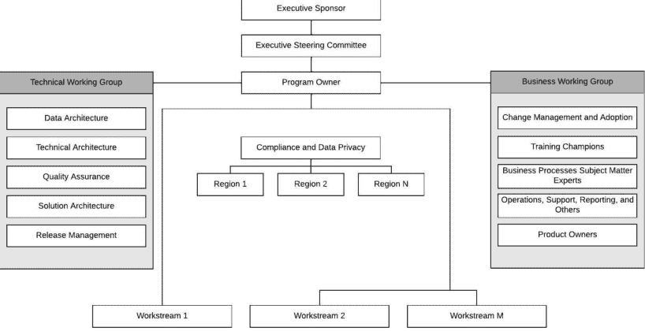
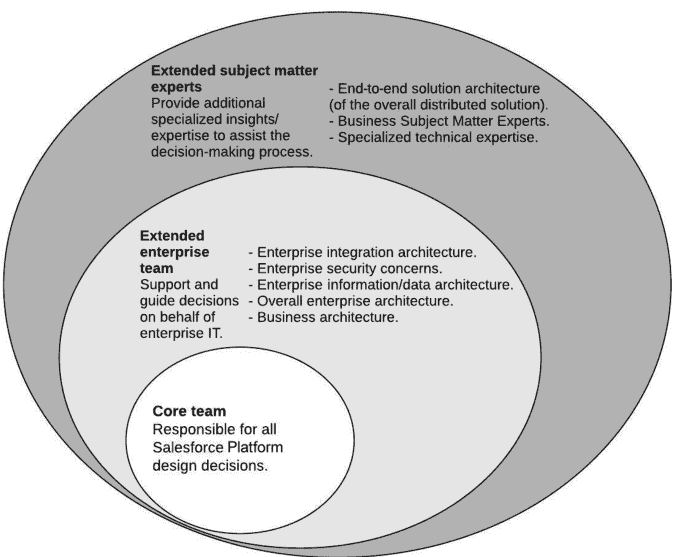
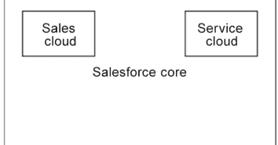
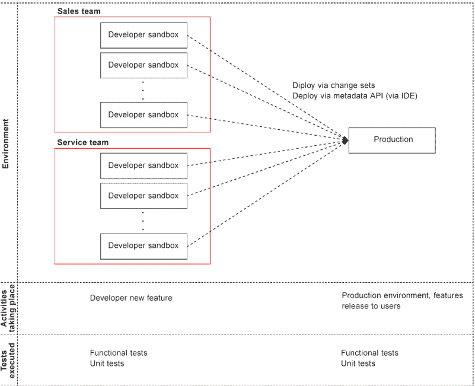
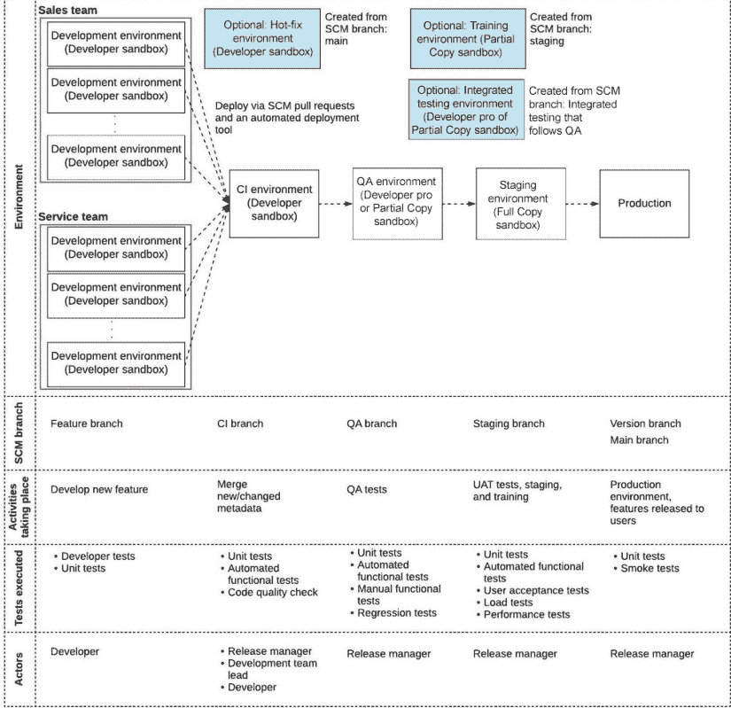

# 10 开发生命周期与部署规划

在本章中，你将继续学习 CTA 必须掌握的 Salesforce 特定知识领域。开发生命周期和部署规划是七个领域中的第六个领域的一部分。你将学习所需知识，然后为每个领域完成一个使用小型假设情景的实践练习。

在之前的章节中，你涵盖了使用 Salesforce 平台开发安全且可扩展的企业解决方案所需的若干主题。在本章中，你将了解设置企业开发环境所需的考虑因素、功能、概念、技术和工具。

企业希望确保从其 Salesforce 投资中获得最大收益。如果没有适当的治理水平，无法实现这一点，治理支持并指导整个项目过程中的开发活动。项目/计划治理应确保所开发的解决方案满足业务需求，且易于维护、可扩展、无错误且性能良好。

作为 CTA，你被期望在整个过程中担任指导角色。你应该能够帮助客户建立合适的治理机构，并指导开发团队制定开发和发布流程。这将确保 Salesforce 功能按时、按预算且无错误地交付。

在完整的评审委员会场景中，通常会有一个专门针对该领域的、包含大量要求的章节。该领域的范围定义明确，这意味着挑战通常在于所需知识的深度。在本章中，你将涵盖以下主要主题：

- 了解 Salesforce 开发生命周期与部署架构师的角色
- 介绍开发生命周期并部署一个小型假设情景 – 模型家具
- 设计项目环境和发布策略

## 了解 Salesforce 开发生生命周期与部署架构师的角色

开发生命周期与部署架构师通常是动手实践的、技术能力强的专业人员，他们设计并实现软件开发环境，包括其发布管理流程和工具。他们识别并降低项目风险，并与其他专业人员合作制定整体测试策略以解决质量问题。

这些架构师还积极参与构建治理机构，以确保为给定的业务挑战选择最佳技术解决方案。

> **注意**
>
> 根据 Salesforce 的在线文档，CTA 候选人应能够满足一套特定的目标，所有目标均可在以下链接中找到：`https://pact.link/UskVD`。

在本章结束时，你应该能够做到以下几点：

- 识别项目风险并制定缓解策略
- 识别开发方法论对工作流的影响
- 推荐测试策略以缓解项目风险
- 推荐合适的项目治理以支持技术决策
- 制定合适的环境管理策略
- 描述**持续集成**（CI）工具和源代码控制在发布管理中的价值

现在，让我们更仔细地了解每个目标。

## 识别项目风险并制定缓解策略

评审委员会情景旨在代表现实世界中的用例。在实际项目中，你会遇到许多挑战和风险。有些与平台本身相关，而其他则与其他系统、解决方案或并行项目相关。

你被期望识别这些风险并制定一组缓解策略来解决它们。风险可能包括但不限于以下内容：

- 发布周期冲突
- 流程冲突
- 采用率低且阻力大

接下来，你将详细了解每种风险。

## 发布周期冲突

你可能会在 Salesforce 平台或与 Salesforce 相关/集成的另一个平台上运行多个并行项目。当不止一个项目/平台有不同的发布周期时，通常会出现冲突，主要是由于所发布解决方案的版本之间存在不兼容性。你通常可以通过提出以下组合来解决这个问题：

- **多层环境策略**：在此策略中，功能在低级环境中开发，并且仅在通过某些测试并满足预定义的质量措施后才会提升到高级环境。这使你可以测试功能并在早期阶段检测任何冲突。测试过程通常包括验证跨系统功能，作为所谓的集成测试的一部分。
- **治理机构**：治理旨在引入流程和法规来解决和预防冲突。治理机构是一个组织结构，包括所有相关团队/项目/流程中的业务和技术成员。这将确保一个团队开发的功能为其他团队所知并获得批准。
- **活跃的发布周期**：引入流程、机制和工具，以确保所有不同的流都使用最新的代码库，这可以显著降低冲突的可能性。

有关每种策略的更多详细信息将在稍后的《推荐合适的项目治理以支持技术决策》和《制定合适的环境管理策略》部分中介绍。接下来，你将探讨在设计开发生命周期和部署策略时可能遇到的第二种最常见风险。

## 流程冲突

多区域/多国项目的关键挑战之一是各地区业务流程中缺乏纪律性。许多企业希望在这些流程中实现某种统一/标准化。但这并非易事，你通常通过以下组合来解决：

- **使用合适的组织策略**：你在第 5 章《开发可扩展的系统架构》中涵盖了这个主题。选择合适的组织策略是在标准化和自主性之间取得适当平衡的第一步。有时，在同一组织中运营多个业务单元的价值会被其可能导致的技术挑战所抵消，例如相互依赖和复杂的利益相关者管理。
- **使用治理机构**：这涉及创建一个组织结构，包括大部分或全部涉及的地区/国家/业务单元中的业务和技术成员。这个治理机构可以帮助协调所有地区收集的需求，从而使你能够设计出满足所有人需求的正确解决方案。

- **使用正确的交付方法论**：现代交付方法论拥抱变更，允许原型制作，并让客户与交付团队保持紧密协作。这将有助于您建立正确的预期并减少任何抵触情绪。

您将在 *推荐支持技术决策的正确项目治理* 部分深入了解第二和第三点。接下来，您将探索在设计开发生命周期和部署策略时可能遇到的第三种最常见风险。

## 采用率低且抵触情绪高

这是向企业引入任何新解决方案或新技术时都会面临的常见挑战。出于本能，人们往往对不了解的事物持犹豫态度。有些用户可能很难走出舒适区，使用新解决方案或全新平台。这种挑战需要一套全面的变更管理流程。这并非 Salesforce 架构师预期需要主导的工作。但是，您需要熟悉其一些原则和常见的应对方式，这些方式通常包括以下几种组合：

- **全面的沟通计划**：一个涵盖项目前、项中和项后各个阶段的全面沟通计划，并配有扎实的培训计划。

- **治理机构**：该组织结构包括业务和技术成员，并涉及各部门的技术推动者。这些推动者将在其所在部门/区域内充当项目大使。他们将在项目期间分享自己的想法、挑战和需求。他们将被纳入解决方案的制定过程中，并参与其中。这会让他们感觉自己拥有该解决方案，并且是团队的一部分。随后，这些推动者将成为首选专家，以支持其他同事并确保项目发布后的采用。

- **正确的交付方法论**：这能让客户和推动者与交付团队保持紧密协作。他们将在解决方案构建过程中理解它。因此，他们不会对结果感到惊讶。这种方法论将让他们在构建期间有机会纠正问题并提供反馈。这确保了解决方案将能够满足最终用户的需求。

您将在本章中介绍第二和第三点，但全面沟通计划超出了本书的范围。鼓励您从其他来源（例如 Emily Carr 所著的 *IT 项目的实用变更管理*）了解更多相关信息。

## 识别开发方法论对工作流的影响

作为 Salesforce CTA，您需要对 IT（尤其是 Salesforce 项目）中使用的不同开发方法论有深入的了解和经验。

主要有三种开发和交付方法论：

- **瀑布模型**：在此模型中，活动被分解为顺序阶段（尽管有些阶段可能并行进行）。每个阶段的产出是下一个阶段的输入。这提供了一种刚性且受严格控制的交付模型。

- **敏捷模型**：该模型依赖于通过跨职能团队成员与客户之间的协作来发现需求并开发合适的解决方案。其原则包括拥抱变更、演进式开发、尽早让最终用户参与、持续改进和早期交付。

产品开发被分解为称为冲刺的小型增量迭代。每个冲刺通常持续 1 到 4 周，涉及一个跨职能团队，负责规划、定义、设计、开发、测试和发布每个冲刺中包含的不同功能。

- **混合模型**：这包含瀑布模型和敏捷模型的元素。它通常在项目开始时包含一个前期/蓝图阶段，以定义总体范围并就适当级别的解决方案设计达成一致（故意避免使用“高级设计”这一术语，因为这可能错误地表明此时细节不重要）。随后是一系列源自敏捷模型的活动，其中功能被排序、进一步理解、开发、测试，并使用冲刺进行交付。

值得注意的是，适当级别的解决方案设计正是您在 CTA 评审委员会中预期提供的详细程度。您在已学习的小型场景中已经见过几个示例；这正是蓝图阶段后您的解决方案预期应达到的详细程度。

下图说明了瀑布模型和敏捷模型之间的区别：

图 10.1 – 瀑布模型和敏捷模型交付方法论

下图说明了混合方法论：

图 10.2 – 混合交付方法论

Salesforce 平台的灵活性使其非常适合敏捷方法论，因为与其他平台相比，引入变更更加容易。但是，在某些情况下，由于缺乏早期解决方案愿景，持续的设计变更会导致难以维护的解决方案。混合方法论更好地解决了这一问题。这就是为什么您看到越来越多的 Salesforce 项目采用混合方法论进行交付的原因。

## 推荐测试策略以缓解项目风险

每个软件解决方案都必须通过一组严格的测试来确保质量。您需要熟悉不同类型的测试以及执行每种测试最合适的环境。

下表有助于澄清这一点：

| 测试类型 | 目的 | 工具 |
| --- | --- | --- |
| 单元测试 | 此测试用于检查解决方案构建模块的有效性，例如 Apex 代码和不同配置。这是必备测试，不仅是为了强制执行的 Salesforce 测试覆盖率，也是为了其提供的价值。它应被视为第一道防线。每次将新代码部署到特定实例时都会执行单元测试。请注意，这可用于测试配置的功能，而不仅仅是代码。 | Apex 测试类 |
| 功能测试 | 此测试用于基于量身定制的测试场景和用例，检查特定功能行为的有效性。可以手动执行，也可以使用特定工具自动执行。自动化这些测试可确保每次需要时都执行完全相同的场景，例如在将新功能部署到环境时。 | 手动测试脚本和自动化测试工具，例如 Selenium 和 Provar |
| 集成测试 | 此测试用于检查解决方案的有效性，并确认解决方案的整体部分按预期协同工作。这包括内部部分（例如来自多个沙箱的代码更改）和外部部分（例如与其他系统的集成接口）。 | 手动测试脚本和自动化测试工具 |
| 用户验收测试 (UAT) | 此测试用于检查特定的 UAT 脚本/场景，以确保交付的功能满足业务需求。这通常与客户并行完成。 | 手动测试脚本 |
| 负载测试 | 此测试用于在正常条件下但环境加载了大量数据集后评估系统性能。这类测试对于潜在对象量较大的解决方案尤为关键。 | 手动测试脚本和自动化测试工具；数据加载使用 Informatica 等 ETL 工具 |
| 性能测试 | 此测试用于（并记录）系统在正常和边缘条件下的性能。您需要为 Salesforce 提交案例以规划此测试。这类测试对于设置复杂的解决方案尤为重要。 | 与 Salesforce 提交案例 |
| 冒烟测试 | 此测试用于确保系统的整体稳定性。它通常通过运行一组有限的测试（通常在生产环境中执行，但也可能在其他环境中进行）来验证一组基本、常见且使用最频繁的功能，持续一段预定义的时间。然后监控结果。此测试基于您在新购机器上执行的简单测试；例如，您打开它并查看是否有冒烟。 | 手动测试脚本和自动化测试工具 |

表 10.1 – 确保软件解决方案质量的不同测试类型的目的和工具

> 注意
> 
> 您可以执行不同类型的测试，例如回归测试、安全测试、渗透测试等。回归测试通常包括功能测试、集成测试和冒烟测试的组合。安全测试和渗透测试超出了本书的范围。

在 *制定正确的环境管理策略* 部分，您将探索执行这些测试最合适的环境。

接下来，您将了解项目所需的治理结构。

## 推荐支持技术决策的正确项目治理

项目治理对任何项目的成功至关重要。假设不同团队正在开发和发布不同的功能和特性。他们可能会相互覆盖彼此的工作、多次重新开发相同的功能、创建冲突的功能、修改数据模型和共享模型从而对性能或安全性产生负面影响，并创建难以变更和维护的系统。简而言之，这可能导致完全混乱。

你能想象一个情况更加复杂的实例吗？想象多个 Salesforce 团队（可能来自多个服务实施合作伙伴）正在开发和发布一系列功能和解决方案。这些解决方案涉及其他集成应用程序。一个团队正在构建一系列 Apex 类以开发点对点集成接口。另一个团队正在使用集成中间件，第三个团队决定开发他们自己版本的这些 Apex 类，因为他们不知道第一个团队的工作或由于时间限制。

当不同的团队开始引入不同的流程并带来使用 Salesforce 的不同方式（可能是为了实现相同的目标）时，这不可避免地会在组织内造成混乱。此外，这很可能会导致大量重复工作，所有企业都应尽量避免，以维持高效的设置。

这不仅是复杂实施项目的常见挑战，甚至对于更简单的项目也是如此。这正是企业创建 Salesforce 卓越中心（CoE）的原因。

Salesforce CoE 是一个中央管理机构，负责处理与 Salesforce 相关的一切事务。CoE 是一个统一的实体，负责讨论、评估、质疑并决定与 Salesforce 相关的一切事宜。它包括企业各部门的业务和技术人员。CoE 关注的主题包括以下内容：

- IT 和业务是否保持一致？
- 交付的解决方案是否满足业务需求？
- 项目是否会按时交付？
- 项目是否会在提供的预算内交付？
- 是否已做出必要的合规性考虑？
- 设计是否遵循最佳实践？
- 设计是否重用企业级组件？
- 该项目是否有适当的治理模型？
- CoE 是否有适当的人员坐在决策桌旁？
- 是否已定义架构框架？代码标准？最佳实践？
- 不同团队和利益相关者之间是否有有效的沟通？

CoE 可以包含一个子机构，负责质疑和批准所做的每个设计决策。这被称为 **设计机构 (DA)**。

以下图表说明了 Salesforce CoE 的标准结构：

图 10.3 – 提议的 CoE 结构

实际实施可能因客户而异。这绝非一种适用于所有情况的结构。您需要为客户确定合适的格式。在评审会期间，您需要根据场景提出建议。前面的图表是一个很好的起点。

DA 可能具有以下结构：

图 10.4 – 提议的 DA 结构

DA 的结构也可能因客户而异。

在评审会期间，您需要解释 CoE 的价值、涉及哪些角色，以及预期由该小组完成哪些活动和任务。所有这些都必须在场景的背景下进行，并应解决场景的挑战。

## 构建合适的环境管理策略

您需要了解 Salesforce Platform/Salesforce Core Cloud 中可用的不同环境类型。您应提出一个环境管理计划，包括合适的环境类型，解释每个环境的用途，并说明选择环境类型的依据。

在组织化的开发环境中，开发过程包含多个阶段（例如开发、QA、UAT 等）。这些阶段中的活动在不同的环境中完成。这种关注点分离消除了任何依赖，并允许其他团队并行工作。这种多层开发环境在 Salesforce 中非常常见，主要是因为创建沙箱很容易。

单体应用程序通常有三个环境（开发、测试和生产）。在 Salesforce 中，您可以创建更多层以提供更有组织的开发和发布周期。典型的安排是开发、CI 环境（也称为构建环境）、QA、暂存和生产。根据项目性质，可以添加其他层，例如集成测试、热修复和专用培训环境。

以下表格可用于帮助您为每个任务选择合适的环境组合：

| 沙箱类型 | 开发新功能 | 测试 | 集成测试/性能测试 | 暂存和 UAT |
|---|---|---|---|---|
| Scratch | 非常合适 | 良好（单元测试、功能测试、UI 自动化测试） | 不太合适 | 不太合适 |
| Developer | 非常合适 | 良好（单元测试、功能测试、UI 自动化测试） | 不太合适 | 不太合适 |
| Developer pro | 比较合适 | 功能测试非常合适；数据存储可用于有限的回归测试 | 集成测试使用有限；不适合性能测试 | 不推荐 |
| Partial copy | 确保数据子集可以与开发人员共享 | 功能测试非常合适；数据存储可用于有限的回归测试和生产调试（数据子集） | 集成测试合适（有限数据子集）；不适合性能测试 | 合适（有限数据子集） |
| Full copy | 不寻常；确保可以与开发人员共享数据 | 最适合用于生产调试 | 集成测试非常合适；性能测试理想（考虑到它与生产组织具有相同的基础架构） | 非常合适 |

表 10.2 – 不同沙箱类型针对不同任务的适用性描述

### 注意

您可以通过以下链接了解不同沙箱类型的更多详细信息：https://pactt.link/X5blZ。

以下链接包含关于不同类型沙箱功能和限制的一些信息：https://pactt.link/mEpe5。

以下表格可进一步帮助您为环境策略的每一层选择合适的环境组合：

| | Scratch | Developer | Developer pro | Partial copy | Full copy |
|---|---|---|---|---|---|
| 开发 | X | X | X | X | |
| CI/构建 | | X | X | X | |
| QA | | X | X | X | |
| 集成测试 | | | | X | X |
| 培训 | | | | X | X |
| UAT | | | | X | X |
| 负载测试 | | | | | X |
| 性能测试 | | | | | X |
| 暂存 | | | | | X |

表 10.3 – 不同沙箱类型的适用性描述，用于制定正确的环境组合策略

在本章小型场景的解决方案中，您将找到一个环境策略示例，该策略利用了某些环境类型。

## 描述持续集成（CI）工具和源代码控制在发布管理中的价值

理解这两个主题的价值对于通过此领域至关重要。这不仅仅是了解市面上不同的工具和技术，您还应该能够解释 CI 概念的价值。多层开发环境结构和自动化发布管理工具变得如此流行，以至于一些架构师忽略了创建 CI 的初衷。在评审会期间，您需要解释这些细节。您不仅需要提出拟议的发布管理方案，还应准备好解释为什么提出该方案，以及它将如何解决共同的挑战。

现在，快速查看 CI 的细节：

- CI 活动包括将开发人员的工作持续且频繁地合并到共享构建环境中。最好将此过程自动化。但这有什么价值呢？

价值主要在于预防冲突并尽可能早地发现冲突。开发人员在不同的环境中工作（除非他们使用共享开发环境，这是您应尽量避免的，因为这使得难以跟踪开发的功能并将其关联回需求）。如果他们知道其他开发人员所做的更改，冲突的机会就会减少。

定期且频繁地合并他们的工作（一些最佳实践建议每天多次这样做）可确保他们尽早意识到自己与他人之间的冲突。这项工作通常会合并到与构建环境关联的特定源代码控制的构建分支中。

- CI 还包括确保开发人员尽可能在最新的代码库上工作，从而预防冲突。如果开发人员正在使用一个 10 天前的代码库，那么在此期间，另一名开发人员很可能对平台进行了重大更改。如果代码库只有几个小时历史，这种情况的可能性就会低得多。

为此，开发人员预期会获取最新的代码库，通常在构建分支中可用。这可以以多种形式进行。可能是手动的，或使用简单脚本自动化，甚至使用自动化工具。另一种方法是使用代码库构建整个开发人员沙箱，该代码库可在源代码控制分支或构建环境本身中找到。

Scratch org 是第一种情况的一个很好示例，即每次开发人员交付新功能时，都会使用源代码控制中存储的元数据创建和构建一个新的 Scratch org。

沙箱克隆是第二种情况的一个很好示例：您可以克隆构建沙箱，使用最新的代码库创建一个新的开发环境。

您需要了解 CI 及其背后的原理。如果可能，建议您进行实践。

CI 与其对应方 **持续交付 (CD)** 伴随出现。CD 更加直接；它补充 CI，并通过自动化应用程序的测试和部署，帮助弥合开发与运维之间的差距。建立合适的多层开发环境策略、选择合适的发布管理自动化工具以及制定全面的自动化测试策略，将确保您具备 CD 的正确构建模块。

这里需要涵盖的最后一个元素，也是您 CI/CD 策略中至关重要的一部分，是源代码控制。**源代码管理 (SCM)**（也称为版本控制）为您提供轻松高效地跟踪和管理代码更改的能力。它可以帮助您检测和解决冲突，并在需要时提供回滚到早期版本的机制。**GitHub**、**Bitbucket** 和 **GitLab** 是非常流行的 SCM 解决方案。

你需要了解并在发布策略中包含的最后一部分是版本控制。每次将一组功能发布到生产环境时，都必须有一个版本名称/编号。版本号包含三个常见部分：

- A 主要版本号，每次主要版本发布时都会更改。这可能是每月或每季度发布一次，包含对解决方案的重大更改。
- A 次要版本号，每次次要版本发布时都会更改。这可能是每周或每两周发布一次，包含对解决方案的显著更改，但基本功能仍按之前的方式运行。
- A 修补程序版本号，每次向解决方案引入新修补程序时都会更改，例如热修复。

例如，版本 2.1.3 可翻译为主要版本 2、次要版本 1 和修补程序版本 3。

有些人可能会添加每日发布编号，但这仅适用于发布周期非常快的企业。

既然你已熟悉此领域的预期，让我们来看一个使用这些知识来设计平滑且可扩展的开发和部署流程的实际示例。

## 介绍开发生命周期和部署一个小型假设场景 – Modern Furniture

以下场景描述了与某个特定客户的挑战。该场景旨在聚焦于与开发生命周期及其部署相关的挑战。这是对其他领域依赖最少的领域之一。尽管如此，它对于现实中任何项目的成功都至关重要。

浏览场景以构建对所需解决方案的理解。然后，逐一查看要求并尝试自己解决，再将你的解决方案与建议方案进行比较。

熟悉本章前面提供的图表（图 10.1、图 10.2、图 10.3 和图 10.4）。其中许多可稍加修改甚至无需修改即可重用。背熟它们可以在你创建评审委员会解决方案时节省大量宝贵时间。废话不多说，让我们进入场景。

### 场景

Modern Furniture（MF）是一家在美国运营的大型家具零售商。它已使用 Salesforce Sales Cloud 和 Service Cloud 约 5 年。作为他们的可信顾问，你被要求审查其环境，特别是发布流程。他们对建议持开放态度，并希望变得更加敏捷，能快速响应市场需求。

在过去 4 年中，他们的发布策略将 Visual Studio Code (VSC) 用作 IDE 和在不同沙箱与生产环境之间部署元数据的工具。他们不时也使用变更集，尽管开发人员偏爱 VSC。

#### 当前情况

MF 的当前情况如下：

- 他们主要分为两个团队。Sales Cloud 团队每月发布一次其解决方案的新版本，而 Service Cloud 团队则每 3 个月发布一次。
- 每个团队的一半是代码开发人员。另一半是管理员或点击式开发人员。
- 目前，每个开发人员（代码或点击式）都使用自己的沙箱。
- MF 的一位高级管理层是创新的坚定支持者。他们经常需要为其团队创建单独的开发环境，以开展不同的项目。

MF 内部调查其问题并定义了一组要求。

#### 要求

MF 最近一直在与许多问题作斗争。其中一些问题可以追溯到其治理模型和发布策略。他们共享了以下要求：

- 总的来说，缺乏每个版本中已发布功能的可审计记录。
- 两个开发团队都在部署过程中报告了挑战，例如无法预测结果。在许多情况下，一个功能在沙箱中运行完美，但部署失败。
- 当前流程在两个开发团队之间造成了多个冲突。在许多情况下，他们覆盖了彼此的工作。
- 生产环境中报告的错误数量较高，尤其是部署后。这似乎呈上升趋势。
- QA 团队任务过重。他们无法跟上开发进度，并持续泄露未经测试的错误。QA 团队报告称，90% 的测试脚本都是手动的。
- 上次部署花费了 5 多个小时。实际部署时间估计不到 30 分钟。延迟被追溯到在成功部署之前经历的大量失败。
- 目前，现有环境设置方面存在许多挑战。团队不确定是应继续为每个开发人员使用开发者沙箱，还是让每个团队共享一个沙箱。

MF 正在寻求你的帮助，重新架构其当前策略，以使其能够更敏捷地响应业务需求。

## 设计项目环境和发布策略

给自己一些时间快速浏览场景，了解全局，并对解决方案产生一些初步想法。这是每个场景都必须执行的步骤。在此场景中，你会发现一些相互关联且可以归类在一起的要求。

### 了解当前情况

MF 正在使用两个不同的云。场景未指明这两个产品是否在同一环境中，但考虑到发布管理的困难，可以合理假设如此。请注意，此挑战在多组织设置中不太可能出现。

MF 使用 VSC 和变更集在环境之间部署元数据。这些信息告诉我们什么？

这很可能表示未包含源代码管理（SCM），这意味着更改无法追踪并关联回需求。此外，这可能表明环境很可能不同步。

不同步的环境在部署过程中可能成为真正的挑战。一个环境可能构建了一些依赖特定系统状态的功能，并基于此设计了所有测试。在发布到生产环境时，系统可能处于不同状态，这会导致一些测试失败，一些功能表现不规则。

你还了解到，MF 有两个主要团队，它们运行在不同的发布周期中。这通常发生在并行项目中，但可能对平台在短期和长期构成重大风险。

你还了解到每个开发人员都在使用单独的沙箱。现在，使用所有这些信息来构建你的景观架构和当前开发生命周期图。

你的景观架构可能如下所示：

图 10.5 – 景观架构

另一方面，你的开发生命周期图可能如下所示：

图 10.6 – 开发生命周期图 – 第一版

既然你了解了当前情况，请继续查看共享要求。

### 深入探讨共享要求

现在，浏览 MF 共享的要求，为每个要求制定拟议解决方案，并相应更新你的图表以帮助演示。从第一个要求开始，其开头如下：

> 总的来说，缺乏每个版本中已发布功能的可审计记录。

此要求应是你先前预期的断言。如果部署是使用变更集和 IDE 进行的，它们很可能缺乏可审计记录。当然，这可以通过非常高的自律来克服，但根据我的经验，这几乎是不可能实现的。

有一种解决方案，它多年来一直在定制软件开发中（而非 Salesforce）经受住了考验。该解决方案是 SCM。你之前在本章中了解过 SCM 的概念和价值。你的拟议解决方案可以如下：

为了解决此问题，我建议使用源代码管理解决方案来跟踪 Salesforce 中所有可追踪元数据的更改。SCM 将提供所有已开发功能的完整历史记录。

我建议使用 GitHub 等工具。我们甚至可以将 SCM 的更改关联到 MF 项目管理工具中的相关用户故事，例如 Jira。

这将使我们能够查看任何已开发的功能，并允许我们创建包含特定版本中所有新功能的发布说明。SCM 将是我们整体开发和发布策略的一部分，将在下文解释。

请注意此要求与下一个要求之间的关系：缺乏可审计记录和报告的代码冲突都可以通过合适的发布管理流程和工具来解决。你需要浏览所有这些要求，制定出适合给定业务挑战的综合解决方案，而不是通用方案。你可能决定在演示中拆分你的答案并将其映射到每个要求。但是，拟议解决方案应考虑所有要求。

另外，请注意，你需要简明扼要地解释 SCM 的价值。请记住，听众应该是客户公司的 CXO。他们知道 SCM 是什么，但你需要解释它为你的解决方案带来的价值。

现在，你可以继续处理下一个需求：

两个开发团队在部署期间都报告了挑战，例如无法预测结果。

即使没有 MF 报告，这也是你可以预测到的另一件事。当并行团队在孤岛中开发新功能时，这是一个常见的挑战。他们不知道另一个团队在构建什么，即使知道，也没有机制来确保它不会与他们正在开发的其他内容发生冲突。

这个挑战是本章前面你遇到的两个概念被创建的关键原因：多层开发环境和 CI。

你需要利用你提议的开发生命周期图来解释拟议的解决方案。

你提议的解决方案可以如下：

为满足此需求，我提出一种环境策略，即我们利用额外的环境和 SCM 更早地检测冲突的功能。在我的开发生命周期图中，你可以看到开发工作将继续在开发者沙箱中进行。一旦开发者在其本地沙箱中完成了功能的构建和测试，他们将发起拉取请求，将新增/修改的元数据与 CI 分支合并。

SCM 将检测是否存在需要解决的代码冲突。如果有任何冲突，将要求开发者进行修复。当拉取请求获得批准后，将尝试将这些更改部署到 CI 环境，同时也会运行所有单元测试。如果任何单元测试失败，部署将失败，并要求开发者解决问题。CI 环境将始终拥有来自两个团队的最新代码库，这意味着可以在发布周期中更早地检测到冲突。

一旦更改已部署到 CI 环境，随后可以按照商定的时间和流程将其提升到更高级别的环境。

你提议的开发生命周期图可能如下所示：

图 10.7 – 开发生命周期图 – 最终

这基本上回答了该需求。请注意，即使在这个阶段，该图也几乎是完整的。这张图是那种你一旦完成所有相关需求后，很可能一次性构建出来的图，不像其他图需要逐步开发。

现在，继续处理下一个需求，构建你的端到端开发和发布管理解决方案：

*当前流程正在两个开发团队之间造成多个冲突。*

你提议的解决方案可以如下：

如前所述，CI 分支和环境将包含来自两个团队的最新代码库。这意味着任何冲突都将在早期被检测并解决。然而，为了确保开发者从一开始就不会创建相互冲突的需求，我提议引入一种机制：一旦新功能合并到 CI 环境，就刷新开发者的沙箱。这将通过在合并和解决冲突后从 CI 分支获取最新代码库，并使用它来刷新开发者的沙箱来实现。刷新过程可以是自动化的，也可以作为开发者预期完成的手动步骤来引入。

简而言之，开发者将在开始处理任何新需求之前，从 CI 分支获取最新代码库并将其部署到自己的环境中。他们需要解决任何合并问题。到这一过程结束时，他们将在最新代码库上开发新功能，这将减少覆盖他人代码的可能性。

我们还可以为开发者使用 scratch orgs 而非沙箱，以使流程更加流畅。但是，我们需要先试用，并确保创建新 scratch org 所需的时间不会成为整个流程的障碍。

同样，请记住，仅仅知道理想的设置应该是什么是不够的。这可以从不同的在线资源中轻松获得。你还应该知道它最初*为什么*这样设计，并*捍卫*其背后的理由。

### **生产环境中报告的缺陷数量较高，尤其是在部署之后。**

此需求可以通过引入更结构化的测试机制来解决。你提出的多层开发环境应该自动解决其中一部分问题，因为它减少了代码冲突造成的错误数量。但为了进一步改进此流程，你可以利用自动化测试工具，并确保正确使用单元测试。你提议的解决方案可以如下：

新提议的多层环境策略应该有助于解决其中一些问题。除此之外，我提议使用 Provar 之类的自动化测试工具。发布管理需要尽可能自动化。我也提议使用 Copado 之类的工具来管理整个发布周期。Copado 可以配置为在代码成功合并到特定环境后自动启动 Provar 测试脚本。这将提高解决方案的整体质量并减少报告的问题数量。

此外，多层环境将确保大多数问题在到达生产环境之前就被发现。

除此之外，我提议利用 Apex 单元测试来创建业务逻辑级测试层，该层将在特定功能发布到环境时自动调用。Apex 测试将包括正面和反面用例的测试方法，以确保尽可能覆盖更多逻辑。

QA 团队任务过载。他们无法跟上开发进度，并且一直泄露未经测试的缺陷。

先前提出的解决方案解决了其中大部分问题。你提议的解决方案可以如下：

先前提出的解决方案已经满足此需求。Provar 将允许我们将许多手动测试转换为自动化测试，这些测试可以在各个阶段轻松且一致地调用。自动化脚本、Apex 单元测试和结构化多层开发环境方法的结合将确保减轻 QA 团队的工作负担。

现在，继续处理下一个需求，其开头如下：

上次部署花费了超过 5 小时。实际部署时间估计不到 30 分钟。

同样，先前的要点解决了其中大部分问题。你提议的解决方案可以如下：

使用多层开发环境、源代码控制、自动化发布管理和自动化测试的组合，应该减少报告的问题数量，并帮助更早地发现它们。这意味着发布到生产环境的功能已经过彻底测试。整个部署在更早阶段已完成，当时我们将新功能从 QA 环境移至暂存环境。这意味着部署到生产环境失败的可能性非常小。

接下来，处理下一个也是最后一个需求，其开头如下：

目前，关于现有环境设置存在许多挑战。

团队不确定是应该继续为每个开发者使用一个开发者沙箱，还是让每个团队共享一个单一沙箱。

这是你在先前提出的解决方案中已经解决的问题，但不要跳过任何需求。确保在演示中涵盖所有内容。你提议的解决方案可以如下：

我提议继续为每个用户使用一个开发者沙箱。我们也可以调查使用 scratch orgs 的可能性，如前所述。但是，在这两种情况下，我都不认为每个团队的成员应该共享一个单一的开发组织，因为这将使跟踪所有发生的更改并将其关联到用户故事或任务变得几乎不可能。这意味着我们将失去期望的透明度，而透明度是 MF 的主要需求之一。

这就结束了此场景。你之前创建的图表（图 10.5 和 图 10.7）仍然有效。

## 摘要

在本章中，你深入了解了 Salesforce 开发生命周期和部署领域的细节。你了解 CTA 需要覆盖的内容以及详细程度。你剖析了一些关键原则，例如 DevOps、CI/CD、多层开发环境和 SCM。然后，你了解了它们的重要性以及对开发和发布周期的影响。

如你可能已经注意到，此领域的范围是有限的。此类领域的关键挑战在于知识的深度，即理解某些最佳实践存在的原因以及如何实施它们。

然后，你处理了一个专注于开发生命周期和部署的小型假设场景，并为其提供了解决方案并制作了一些吸引人的演示提案。你开发了一个开发和发布图，可以轻松重用于其他场景（只需微小更改），并学习了如何向受众展示该图以吸引他们的注意力，并向他们提供详细的信息和建议背后的理由。

在下一章中，你将进入需要掌握的第七个也是最后一个领域，即沟通。

