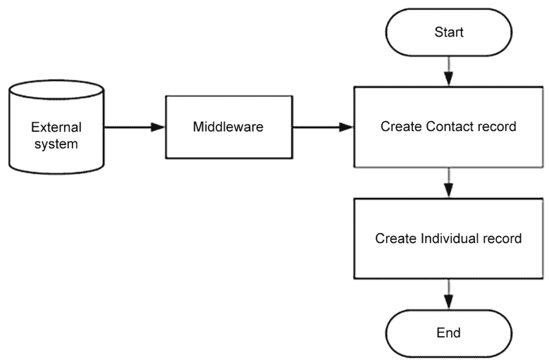
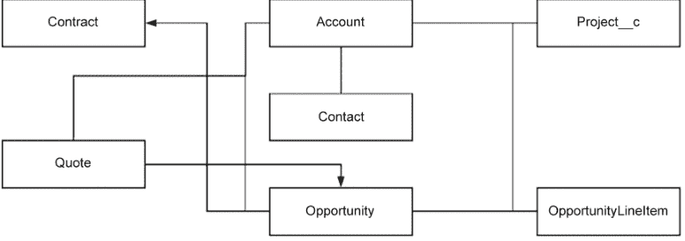
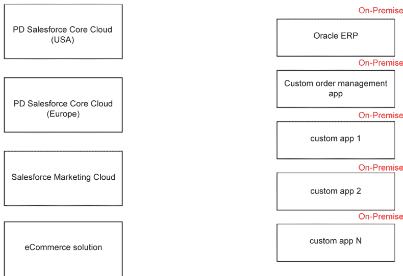
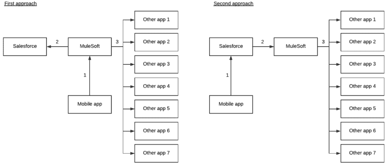
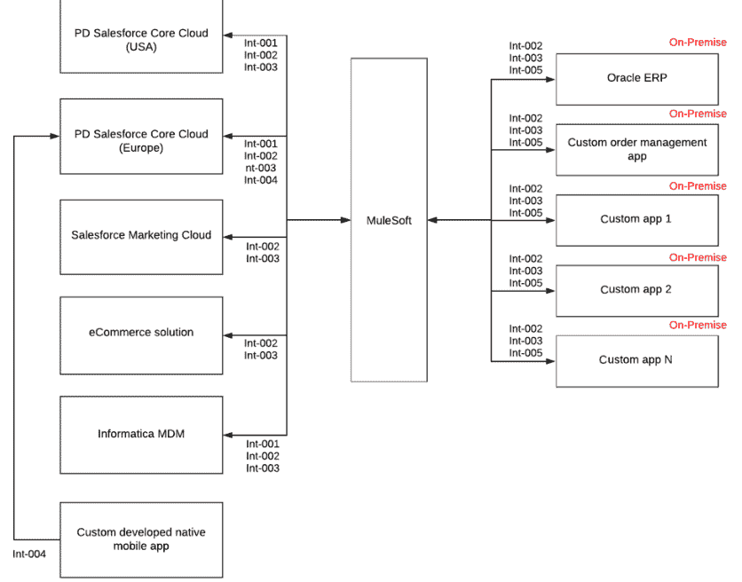

# 传播和分享你的解决方案

本章将继续探讨通过 CTA 评审委员会所需的 Salesforce 特定知识领域。这一次，你将攻克 **沟通领域**。这是 CTA 必须掌握的第七个也是最后一个知识领域。本章将为你提供通过该领域所需的知识，并教授相应的软技能。随后，你将使用一个小型假设场景完成动手练习。

沟通技能对 CTA 至关重要。这些技能能让你以清晰详细的方式阐述你的愿景，确保受众完全理解所有内容将如何协同工作。这项技能包含若干子技能，例如创建描述性图表以帮助解释你的解决方案、处理范围中出现的意外变化并相应调整解决方案的能力。

在过去的六章中，你已经练习制作演示文稿并使用图表来描述端到端解决方案。你了解到，你的演示必须引人入胜且扣人心弦；你应该在引导受众从一个要点过渡到下一个要点的同时讲述一个故事。

在本章中，你将涵盖以下主要主题：

- 了解在传达解决方案时应该做什么
- 练习传达一个小型假设场景
- 阐述你的解决方案并管理反对意见

本章结束时，你将练习处理反对意见并即时调整解决方案，并学习沟通领域的某些最佳实践。你将首先了解 CTA 要掌握该领域所需具备的条件，然后进入小型假设场景，将该知识付诸实践。

## 了解在传达解决方案时应该做什么

软技能对现代架构师至关重要，因为市场期望前所未有地高。架构师应当具备扎实的技术背景，并辅以出色的沟通能力，能够阐述解决方案的愿景、目标和依据。除此之外，架构师还应当能够引导受众了解可能的解决方案选项，突出每个选项的优缺点。

> **注意**
> 根据 Salesforce 的在线文档，你应当能够满足一组特定目标，这些目标可在以下链接中找到：https://packt.link/DGMnt

接下来，你将逐一详细了解这些目标。

## 传达设计决策和注意事项

在创建解决方案的过程中，你会遇到多种可以通过不同方式实现的用例。你在前六章开发小型假设场景的解决方案时已经见过这种情况。

在评审委员会期间，你的时间有限，需要解决大量需求。在展示拟议解决方案时，你应专注于能产生实质性影响的考量因素。这些考量因素应当指导你从一个设计决策转向另一个。

归根结底，人们对你的期望不是罗列可用选项并退后一步，而是针对给定需求提出一个精准、清晰的解决方案。你应当是项目中资深最深的 Salesforce 专家。你应该是那个自信地引导其他利益相关者做出决策的人。

> **注意**
> 请记住提供一个精准、清晰且全面的解决方案。三位 CTA 评委都是经验丰富的资深架构师。他们能察觉出缺乏自信。不要虚张声势或依赖流行词汇。这群听众不会被流行词汇打动，除非你能用扎实、深入的实践知识来支撑它们。

在演示过程中，你必须像讲述故事一样展示端到端解决方案。你必须解释你的解决方案如何解决问题。以下需求作为示例：

> *销售经理需要提交新客户记录以进行信用检查。检查完成后，经理应立即得知结果，如果检查出于任何原因失败，应收到错误通知。*

以下陈述是以枯燥、不吸引人且缺乏吸引力的方式展示解决方案的示例：

> 我将通过 Apex 调用执行信用检查。

评委将扮演代表场景中客户公司的 CXO 角色。你应当引导他们，避免对其问题给出枯燥的回答。为了帮助他们，你需要继续你的演示，首先指出或提及需求，然后解释你的拟议解决方案。例如，你可以这样开头：

> 在第三页第二段中，我们有以下需求。

然后，你可以简要描述该需求。完成后，进入解决方案部分。你的回答应当以足够的细节解释原因和方法。例如，前述陈述可以重新表述如下：

为满足此需求，我将实现一个带有按钮的 Lightning 组件，用于提交客户账户以进行信用检查。该 Lightning 组件将拥有一个 Apex 控制器。我提议使用远程过程调用请求-响应集成模式。

控制器将使用调用来调用 MuleSoft 暴露的 Web 服务。我将使用命名凭据对 Web 服务进行身份验证。身份验证将使用 OAuth 2.0 JWT 令牌流进行，集成通道将使用双向 TLS 进行保护。一旦调用 MuleSoft Web 服务，MuleSoft 将编排对信用检查提供商的调用，获取结果并将其返回到 Lightning 组件的控制器。然后，组件将向用户显示结果。

如果你是在进行虚拟评审委员会，将需求和拟议解决方案整理在 Excel 表格或 PowerPoint 幻灯片中可能是个好主意，具体取决于哪种方式对你最有效。

需要牢记的关键是，这些是你用来帮助提出端到端解决方案的工具。你不应只是浏览你的表格并把解决方案念一遍；你应该使用图表来解释和可视化解决方案，而这正是下一个目标所关注的重点。

## 展示你的可视化技能以阐述解决方案

架构师的通用语言是图表。类似于人类语言，某些图表代表着同行架构师所知悉和理解的通用语言。

在第 1 章《以 CTA 身份开启你的旅程》中，你学习了描绘端到端解决方案所需的图表以及每个图表所需的详细程度。架构师可以用来解释解决方案的其他图表包括但不限于以下几种：

- 流程图：这是一种常见的算法表示方式。它描绘了解决特定任务所需的步骤。泳道可用于提供图表的更佳可视化表现，特别是对于复杂流程。

- 数据流图：这些图表展示了数据在系统或流程中的流动情况。不要将它们与实体关系图（ERD）或对象图混淆。

- 线框图：这种图表展示了解决方案用户界面的可视化骨架框架。

这些附加图表在解释解决方案的某些方面时可能很有价值。它们在 CTA 评审委员会中很少使用，但在实际生活中很有帮助。

你特别需要避免的是创建架构图时的三大常见错误。你将在以下小节中了解这些错误。

### 混合图表

在某些情况下，架构师可能会决定将多个图表混合在一起。这可能由以下原因之一导致：

- 低估标准图表的价值：标准图表花费了多年时间才达到当前的成熟阶段。许多架构师都熟悉它们，它们代表了一种通用的架构语言。试图创建一种新语言仅仅意味着你将是唯一会说它的人。此外，新创建的图表类型很可能缺乏所需的成熟度。

- 知识缺乏：架构师可能不知道创建特定图表的标准方法。这也可能是由于缺乏标准化而造成的困惑。

- 标准图表过于复杂的错误印象：有时，想要创造简单事物的愿望可能意味着传递有价值信息时出现偏差。此外，架构图不仅是沟通工具，它们还是帮助架构师塑造和细化思路的框架。你在第 1 章《以 CTA 身份开启你的旅程》中了解过其中的一些内容。简而言之，作为架构师，你应该使用图表来创建、验证和传达你的解决方案。你不应该将图表制作为已完成工作的事后补救。

以下是混合图示的示例。架构师将**流程图**与**架构全景图**进行了混合：

图 11.1：混合图示示例

此类非标准图示混合会在多个层面造成混淆，尤其是在处理复杂流程时。它会因不必要的细节而分散和困惑读者。此外，它还会创建可能在其他地方已存在的信息的冗余版本。例如，您需要在架构全景图和流程图中同时维护集成接口列表。这可能导致某些图示中的信息过时。

## 过度简化的图示

过度简化图示的欲望可能导致创建混合图示。此外，这是图示中*信息丢失*最常见的原因之一。作为架构师，您有责任生成高质量的架构图。这既不是初级资源的职责，也不是可以推卸给他人的工作。您负责整体解决方案架构，因此需要对创建或密切监督创建所有用于传达和记录技术方案的元素负责。

这正是您在 CTA 评审委员会期间被期望开发和传达的内容：端到端的技术解决方案设计。

以下图示是过度简化的数据模型示例：

图 11.2：过度简化的数据模型示例

您可以很快看出，此图示无法帮助您了解拟议的数据共享和可见性策略。它无法帮助您检测**LDV（大数据量）**或次优关系。它甚至无法帮助您理解对象之间关系的性质或其基数。箭头甚至可能传达错误的信息。这可能是过度简化和缺乏标准化的示例（这是将要介绍的第三个常见错误）。

## 缺乏标准化

下次您想要创建图示时，尝试在 Google 上搜索，看是否存在通用标准版本。查找 Lucidchart、Visio 或 Gliffy 等专门构建的图示工具提供的模板和示例。

您很可能会找到适合您目的的标准图示。不要尝试搜索诸如解决方案架构图之类的东西，因为它不仅仅是单一图示。要描述端到端解决方案架构，您需要多个图示。您在《第一章：以 CTA 身份开启您的旅程》中接触过这些图示并了解了它们的价值。

> > **注意**
> > 创建这些图示应成为您日常工作的一部分，而不是为了通过 CTA 评审委员会而临时完成的工作。您需要在实际项目中不断展示作为 CTA 的知识、价值观和态度。每天创建这些图示。这将帮助您培养架构肌肉记忆，并在评审委员会期间更快地创建这些图示。

一份优秀的架构图可以帮助您梳理思路、发现解决方案中的差距、在问题提出前就给出答案、更透彻地解释您的解决方案，并处理异议，这正是下一目标的核心所在。

## 处理异议和意外障碍

在整本书中，您已经了解到不存在*唯一正确答案*。您可以预料到会有针对您的解决方案的挑战。其中一些挑战可能会推动必要的解决方案变更。您需要理性地为自己的解决方案辩护，但不必过于固执。如果做出了错误决策，请坦然承认。人难免犯错；即使是评审委员会的评委和该行业的架构师，在其职业生涯中也难免会犯一些错误。

您处理异议的方式是一项将被评估的技能。自信地为自己的解决方案辩护，与在接受反馈并妥善接纳而不失控时展现成熟同样重要。CTA 经常会遇到此类情况。如果您犯了错误，请承认它，并通过即时修正来展示您的技能。

评委还会在问答环节中添加或更改一些场景要求，以测试您快速且恰当地应对不断变化的要求和*即时解决方案*的能力。发生这种情况时，请务必首先理解要求。不要犹豫，寻求解释（但也不要为此浪费太多时间）。花几秒钟仔细思考，然后自信地展示您的解决方案。

您现在已经熟悉此领域的期望。接下来，请查看一个实际示例，您将在其中运用这些知识来创建引人入胜的演示并处理异议。

## 练习沟通微型假设场景

以下微型场景描述了与某个特定客户的挑战。此场景与其他场景略有不同，因为它经过调整，旨在提出可能在问答阶段被评委提问的棘手挑战。在此场景中，您不仅需要提供拟议的解决方案，还需要在假设的问答环节中适当为其辩护。

评委将挑战您提出的某些设计决策。您应预期每位评委提出的挑战类型都不同，因为他们可能拥有不同的性格、优势和弱点。

评委还会尝试在问答环节中更改某些要求。他们甚至可能引入一些新要求。这并不意味着您这边有错误。通常，评委使用这种技术来测试候选人的即时解决方案能力。要通过此领域，您需要做好处理异议的准备。这是 CTA 至关重要的软技能之一。

此外，您需要具备即时解决方案的能力。有人将此称为“即场制定解决方案”。客户可能会直接抛出一个新要求，您需要理解它、在必要时对其提出质疑，并提供能够满足该要求的详细解决方案。

> **注意**
> 当评委开始提问并深入探究要求时，请不要失去专注或自信。您缺乏自信的表现会让评委一眼看出，并降低您通过的机会。不要认为提问是因为您回答不正确或做错了什么。评委可能只是在检查您是否具备正确的软技能，并能处理现实生活中将面临的这类困难情况。

您需要浏览一遍场景，以构建所需解决方案的初步图景。然后，彻底审阅要求，尝试自行解决，随后与建议解决方案进行对比。尝试练习解释端到端解决方案，以及回答问答挑战。

废话不多说，进入场景。

### 场景

一家创新的转售商销售一系列广泛的软件服务，包括支持服务和维护。他们在欧洲范围内运营，并通过多种渠道直接向最终客户提供其产品。他们最近启动了涉及 Salesforce Marketing Cloud、Salesforce Service Cloud 和电子商务的数字化转型。他们计划将 Service Cloud 用作客户管理的系统原记录（SOR）。

### 当前情况

该公司在客户匹配、合并和去重方面有多项要求。这被认为是该计划成功的关键。

他们拥有多个后台应用程序，包括 Oracle ERP、定制开发的订单管理系统以及其他几款自主开发的应用。所有这些均部署在本地。

该公司最近收购了另一家仅在美国运营的数字服务公司。被收购公司也将 Salesforce 作为其主 CRM。该系统已针对其特定业务流程进行了调优。

### 需求

公司共享了以下需求列表：

- 其所有企业应用均需要使用客户黄金记录。他们还需要能够定期丰富其中的一些值。公司希望你提供指导，就实现此需求的最佳工具和策略提出建议，并确保随着更多品牌加入系统，该方案能够扩展。

- 公司希望实施一个专注于零售执行的新销售解决方案。该解决方案应尽可能在所有地区使用标准化的业务流程，并预留少量本地化空间。该解决方案还应与其余企业应用集成，例如订单管理系统。公司寻求你的帮助，以确定其计划的合适组织策略。

- 公司希望为其在欧洲的代表启用支持离线功能的移动应用。这应帮助代表在所有地点和地区运行。通过移动应用程序捕获的数据需要在 Salesforce 和其他七个不同的应用程序中显示。他们寻求你的指导，以确定合适的移动策略，以及他们的集成策略。

- 公司目前在自定义对象中维护发票。他们需要将此记录与查找字段中指定的用户共享。即使记录所有者发生变更，这种共享也应保持，并且只与查找字段中当前指定的用户共享该记录。

公司希望就其所有共享需求获得你的帮助和指导。

## 阐述你的解决方案并处理异议

你可能已经注意到，这个场景的细节较少。这是有意为之，以便更多地关注演示和问答活动。

给自己一些时间，快速浏览场景，了解大局，并对解决方案形成一些初步想法。完成后，你可以逐步分析场景并创建解决方案，类似于你在本书中涵盖的先前场景所做的那样。

### 了解当前情况

公司使用 Salesforce Service Cloud 作为客户管理的主要 SOR。此外，他们还收购了另一家同样使用 Salesforce 作为 CRM 的公司。但是，这是一个为满足特定需求而进行大量定制的组织。它存在数据质量问题，特别是重复管理。除此之外，他们还有几个其他应用程序需要与 Salesforce 集成。目前，公司的架构如下：

图 11.3：架构蓝图 – 初稿

现在你了解了当前情况，是时候审查需求了。

### 深入了解共享需求

你已准备好开始处理公司的需求，为每个需求制定拟议的解决方案，并相应更新图表以帮助演示。从第一个需求开始：

> 其所有企业应用均需要使用客户黄金记录。

首先，你可以考虑使用 Salesforce 的原生重复数据删除功能（使用重复规则）。这样做很有道理，因为公司指定他们正在考虑将 Salesforce Service Cloud 作为 SOR。这是特定数据（在此案例中为客户记录）的权威真相来源。

但是，公司还共享了表明他们在检测和管理重复项方面存在问题的需求。这可能是因为其匹配算法复杂，并且可能依赖于复杂的模糊逻辑。他们还报告说，对合并重复项存在顾虑。

高级匹配和数据合并不是 Salesforce 开箱即用的功能。这是 **主数据管理 (MDM)** 的领域。你在 *第 2 章，核心架构概念：数据生命周期* 中学习了各种 MDM 概念以及 MDM 工具的三种不同实现方式。

> **注意**
> 为提醒您，三种实现方式为 **注册表**、**整合** 和 **共存**。后两者支持 **黄金记录** 的概念。

为了提供所需的功能，你需要一个支持带有黄金记录概念的两种 MDM 实现方式之一的 MDM 工具。如本书中多次提到，你需要熟悉 Salesforce 生态系统中的产品名称。在此案例中，你可以提出 **Informatica MDM**。

你的拟议解决方案可以如下：

> 为了满足此需求，我建议使用支持高级重复数据删除和合并流程的 MDM 工具，例如 Informatica MDM。Informatica 将与 Salesforce Service Cloud 关联，后者将是被允许创建新客户的系统。Informatica 将使用其高级匹配功能检测重复项，并在需要时将其合并。然后，它将更新 Service Cloud 中的数据，以确保始终在 Service Cloud 中保存数据的最新版本。这满足了公司将 Service Cloud 用作 SOR 的要求。

> 其他应用程序可以直接从 Informatica 访问黄金客户记录。这也允许它们在其中更新特定属性。Informatica 随后将处理这些值所需的任何验证，并尝试将数据复制到 Service Cloud。只有在成功更新 Service Cloud 中的数据后，Informatica 才会将更改提交到黄金记录。

> 我曾考虑使用 Salesforce 重复规则来处理此需求，但我假设提到的高级重复数据删除需求超出了开箱即用的功能。此外，Salesforce 重复规则在需要时不处理记录合并。

这个解决方案看起来很好且稳健。但是，评委可能仍然想要挑战你的拟议解决方案，无论是为了确保你真正理解该主题（而不仅仅是死记硬背），还是为了测试你的沟通技巧和即兴制定解决方案的能力。

评委可能会问你以下问题：

*你建议如何处理 Salesforce Service Cloud 组织中现有的重复数据？考虑到新收购的 Salesforce 组织，你的策略是什么？*

这些问题通常清晰明了，但不要指望被喂食。如果你连续无法发现问题并正确回答，评委可能会简单地决定不给你分数。你的答案应该简洁、清晰、切中要点。在问答环节你的时间有限，应该力求充分利用。你的答案可以如下：

*关于现有数据，我计划在引入该工具后将其加载到 Informatica MDM 中。这将是工具设置的一部分。MDM 将确定重复项，并更新或合并 Service Cloud 中的现有记录，包括任何重新父级化过程。*

*我们拥有 MDM 工具这一事实让我们在与其他 Salesforce 组织打交道时更加灵活。我将在后续需求中解释我的组织策略。但是简而言之，我们可以将 MDM 工具连接到其他环境，并将其用作另一个 SOR。*

确保你的答案简洁且犀利。要自信，并将问答阶段视为在有限时间内分享你的想法和思路的机会。

更新你的图表，然后转到下一个需求：

*公司希望实施一个专注于零售执行的新销售解决方案。*

新解决方案应在所有地区使用，并引入高度标准化，同时预留少量更改空间。

但是，公司应该从哪种组织策略开始？收购的品牌有另一个 Salesforce 实例，该实例已大量定制以满足其需求。销售解决方案可以是其现有解决方案的扩展。当然，你可以假设它是对现有解决方案的完全替换，然后基于此构建你的提案。场景未指定任何细节。不同的假设可能导致完全不同的逻辑答案。无论如何，你的假设应合理，且不应过于偏离现实。

一旦决定了拟议的组织策略，你就需要想出一个允许标准化并预留修改空间的解决方案。

你的拟议解决方案可以如下：

*收购公司的 Salesforce 组织已大量定制。我假设该组织中的当前功能不包括任何零售执行相关内容。因此，新功能将是对现有功能的扩展，而不是替换。*

基于此，我建议保持这些组织分离。美国组织具有针对该地区定制的其他功能。新的零售执行解决方案将基于标准流程开发，并作为非托管包交付给两个组织。这将使解决方案能够集中管理和更新。

每当引入或更新新功能时，将提供包的新版本。部署非托管包后，目标组织可以根据其要求添加或修改它。功能和代码将包含挂钩，以允许扩展，并提供一种机制，可使用元数据配置打开或关闭某些功能。

两个组织都将使用 MuleSoft 等 ESB 连接到其余企业应用程序。这将使公司能够建立可扩展且可重用的集成架构。MuleSoft 将处理所有所需的编排、错误处理、排队和重试机制。此外，它还将允许我们将 Salesforce 等基于云的解决方案与本地托管的解决方案集成。

你的假设可能是合理的，但评委可能会决定更改或质疑你的假设，要么是因为他们觉得不令人满意，要么是因为他们想进一步测试你的技能。

评委可能会问你以下问题：

如果你假设美国组织中的定制解决方案完全关乎零售执行，那么你的解决方案会有什么变化？

在这种情况下，评委正在更改场景，以进一步检查你提出的组织策略背后的逻辑。此外，这是对你即时解决方案能力的测试。你的回答可以如下：

这将改变我对组织策略的思考方式。此前，两个组织分别服务于不同地区，拥有两套完全不同的流程。零售执行流程对两个组织来说都是新事物，我没有找到足够强的理由来提出昂贵的组织合并。

然而，如果新解决方案是美国组织定制解决方案的替代品，这将是组织合并的一个良好机会。最终，两个组织将拥有几乎相同的销售流程。合并两个组织将使引入和管理统一流程变得更加简单。这些小的更改仍然可以容纳，而不会影响解决方案的质量或稳定性。

在组织合并的情况下，所有美国用户和数据将迁移到统一组织。我还假设没有法规阻止此操作。

请记得关注秒表。之前的回答在问答环节不应超过 90 秒。尝试阅读它并用你自己的话重新表述，并计时。你可能需要重复几次，直到对结果有信心为止。

你还可能会被问及选择特定中间件的理由。在这种情况下，他们很可能是在测试你对集成领域的知识。你需要解释 ETL 和 ESB 之间的区别（这在 *第 3 章，核心架构概念：集成与加密* 中有所讲解）。

他们甚至可能会问你 MuleSoft 将如何与本地托管的应用程序通信。即使是 MuleSoft，也需要在 MuleSoft CloudHub（假设使用 CloudHub）和客户端内网之间设置 **虚拟私有网络（VPN）**。这与其他 ETL 工具使用的安全代理机制不同，该机制在 *第 9 章，构建集成解决方案* 中有所讲解。

更新你的图表并继续处理下一个要求，该要求以以下行开头：

*公司希望为欧洲的代表提供支持离线功能的移动应用。*

关键要求是向代理交付具有离线功能的移动应用。该要求未指定任何其他信息，因此你需要做出一些合理的假设。

你可以假设所需的离线功能是高级的，因此需要特定类型的移动应用来满足。

回顾 *第 5 章，开发可扩展系统架构*，你了解了可以使用 Salesforce 开发/使用的四种不同类型的移动应用：

- **Salesforce 移动应用**：这是由 Salesforce 开发和维护的标准应用。它提供一套丰富的可配置功能和现代用户界面。但是，其离线功能有限。

> **注意**
> 你可以通过以下链接了解有关 Salesforce 移动应用离线功能的更多信息：`https://packt.link/r7xTe`。
> 值得一提的是，Salesforce 移动应用可以使用 **Salesforce Mobile Publisher** 功能进行品牌定制。

- **混合应用**：这些是定制开发的跨平台移动应用程序。它们通常具有有限的离线功能。

- **HTML5 应用**：这些是使用 HTML5 开发的跨平台移动应用程序。它们天生具有非常有限的离线功能。

- **原生应用**：这些是针对特定平台（如 iOS 和 Android）使用特定编程语言定制开发的移动应用程序。你可以开发具有高级离线功能的原生移动应用程序。这些功能包括缓存大量记录的能力、将它们安全地存储在加密存储中，并在互联网连接恢复时将其同步回 Salesforce。

基于你的假设，你可以提出原生应用。或者，你也可以假设标准 Salesforce 移动功能足以满足此用例。然而，在我看来，选择前一种方法是更安全的选择，因为 Salesforce 移动应用的局限性很容易被复杂业务（如本场景中的公司）所质疑。

这将回答一半的要求。要求的其余部分表明需要将通过移动应用捕获的数据呈现到 Salesforce 和其他七个系统中。这是另一个例子，你可能有不止一个潜在解决方案。你选择的方法将决定你在问答阶段可能面临的挑战。以下两种可能的选项对此进行了说明：

- 移动应用程序可以直接与 MuleSoft 暴露的 API 层通信。这反过来将与 Salesforce 和其他七个系统通信。这可以以并行或顺序的方式进行，即更改仅在 Salesforce 中被接受和提交后才推送到其他七个系统。

提出这种方法可能会引发多个问题，包括如何对 MuleSoft API 进行身份验证？是否有避免在 MuleSoft 中缓存数据的替代方法？此外，为实现此目标所需的 MuleSoft 定制工作量很大，这可能会引发更多问题和挑战。

- 移动应用程序可以直接与 Salesforce 通信。一旦数据提交到 Salesforce，就可以通过不同方式将其复制到其他应用程序，例如使用 MuleSoft 进行批量同步、异步平台事件或更改数据捕获（CDC）。

提出这种方法可能会引发另一组问题。评委可能很好奇为什么你选择这种方法，而不是使用 MuleSoft 的 API 驱动方法，后者承诺提供更可重用的接口。他们还可能更改要求以包含美国实例，这将迫使你采用第一种方法。

以下图表说明了这两种方法：

图 11.4：显示移动应用程序两种不同方法的说明图

始终有利于使用简单的架构。架构越简单，出错的可能性就越小，除非架构无法提供所需功能或生成其次优变体。

> 注意
> 移动应用程序只会处理来自 Salesforce 的数据。移动应用不应从其他应用程序检索数据或直接将数据提交给它们，因此假设需要执行复杂编排的 API 可能是小题大做。

将捕获的数据呈现到其他系统的要求，可以简单地解释为：一旦数据提交到 Salesforce，就需要将其复制到其他系统。在解决方案中避免不必要地复杂化事情。

你提出的解决方案可以如下：

> 我假设所需的离线功能超出了 Salesforce 移动应用所能提供的范围。混合应用和 HTML5 移动应用的离线功能也有限。因此，我建议开发具有高级离线功能的原生移动应用程序。该移动应用将允许代表离线创建和更新数据，并在互联网连接恢复后同步回 Salesforce。该应用还将管理冲突，如果发现任何冲突，将通知用户。

> 一旦数据通过所有服务器端验证并提交到 Salesforce，我将使用数据复制机制通过 MuleSoft 将这些数据复制到其他七个应用程序。该场景未指定任何时间要求，因此我假设一小时的延迟是可接受的。我建议使用批量数据同步模式，在 MuleSoft 中启动定时批量作业。该作业将从 Salesforce 拉取新数据并将其复制到其他应用程序。

批量数据同步方法比近实时的"发送并忘记"模式更简单直接。当离线用户重新上线时，他们将同步数十条记录。这些记录应按正确顺序提交到 Salesforce。但是，提交大量记录将触发 Salesforce 的多个平台事件。

理想情况下，它们应按正确顺序全部进入事件队列，使用相同的顺序发送到 MuleSoft（或其他订阅者），并且不丢失地交付。但是，你可以看到这种方法可能会出现多种问题。除非近实时数据同步至关重要，否则这将是不必要的复杂性。

选择权在你，只要你能证明其合理性即可。继续处理下一个要求，该要求以以下内容开头：

> 公司目前在自定义对象中维护发票。

他们有一个需求：将此记录与查找字段中指定的用户共享。即使记录所有者发生变更，这种共享也应保持，并且只应与查找字段中指定的当前用户共享该记录。

与您之前多次所做的类似，您将首先考虑可配置功能。只有在得出标准功能无法满足需求的结论后，才会转向定制开发解决方案。

此需求无法通过可配置的平台功能来满足。然而，您知道记录所有者可以手动将记录共享给目标用户。您也可以自动化此过程，并使用 APEX 创建共享记录。在这种情况下，APEX 类将自动创建 invoice__share 记录，以将记录共享给目标用户。

您提出的解决方案可以如下：

所需功能无法通过可配置的共享机制来实现；因此，我建议使用 APEX 自动创建 invoice__share 记录。当记录创建或更新时，触发器将删除与查找字段上指定用户以外的用户关联的所有 invoice__share 记录。然后，触发器将创建一个 invoice__share 记录，并将其与查找字段中指定的用户关联（如果该记录尚不存在）。

足够好吗？答案是否定的。

在指导十几位 CTA 候选人时观察到的常见挑战之一是不小心跳过需求。候选人面临按时交付解决方案的压力。在这种情况下，候选人可能会遗漏或跳过需求，未能识别它们。

在某些情况下，这可能是对解决方案影响较低或无影响的简单需求。在其他情况下，它可能产生重大影响。这可能导致多米诺效应，即一次犹豫的解决方案变更会导致其他元素土崩瓦解。这是候选人在评审委员会可能面临的最关键风险之一。

避免这种情况的最佳方法是确保您没有遗漏任何需求。这样的不完整解决方案肯定会引来评委的一些问题，例如：

需求指出，即使记录所有者发生变更，共享也应保持。您将如何使用您的解决方案实现这一点？

这是您未能发现的需求，可能会适得其反。犹豫不决的回答可能如下：

即使在记录所有者变更时，触发器也会触发。在这种情况下，代码将继续运行，如前面所述。

犹豫不决的回答通常比这长得多，这意味着您正在浪费宝贵的 Q&A 时间。然而，这个回答可能会让情况变得更糟。评委现在可能会觉得您对记录所有者变更相关的标准行为一无所知。

当记录所有者被修改时，手动共享记录会自动删除。您可能已经知道这一点，但提供的回答并未体现此知识。此外，依赖触发器不必要地创建共享记录是一种次优解决方案，尤其是当有标准方法可以满足所需需求时。

有些候选人可能会因为错误或不完整的回答而损失超过五分钟宝贵时间，这还不包括此类回答可能引发的侧边对话。

一个良好的回答，可能会为您赢得与该需求相关的分数，可能如下：

> 我计划在 invoice 对象上定义一个自定义共享原因，然后在 APEX 共享中使用此共享原因。我知道在更改记录所有者时，手动共享记录会自动删除。但是，带有自定义共享原因的 APEX 托管共享记录在记录所有者变更时会保持不变。

如果您在最初的提议解决方案中包含该陈述，那将是理想的。这本可以节省 Q&A 时间中损失的 30 秒。

> 注意
> 
> Q&A 阶段是您的朋友。评委会提问来填补任何差距和遗漏的需求。他们还会提问，以帮助确定您是否具备通过考试所需的技能和知识。这段时间非常宝贵——请确保不浪费它。
> 
> 有些 CTA 候选人害怕 Q&A，因为他们认为这是评审委员会中最具挑战性的阶段。事实并非如此。这是给您的时间，用以弥补任何差距并证明您具备通过考试所需的能力。

这是最后一个共享需求。更新所有图表并查看效果。以下是景观架构图：

### 图 11.5：景观架构 – 最终

### 以下是集成接口：

| 接口代码 | 源/目标 | 集成层 | 集成模式 | 描述 | 安全 | 身份验证 |
| :--- | :--- | :--- | :--- | :--- | :--- | :--- |
| Int-001 | Salesforce -> MuleSoft -> Informatica MDM | 数据 | 批量数据同步 – 异步 | Informatica MDM 从 Salesforce 导入客户数据。此过程由 Informatica MDM 按需启动。执行去重和高级匹配规则以创建黄金记录。 | Salesforce 与 MuleSoft 之间的 HTTPS (双向 SSL/TLS)，MuleSoft 与 Informatica MDM 之间的 HTTPS (单向 SSL/TLS) | Salesforce 与 MuleSoft 之间带有相互身份验证的 OpenID Connect Web 服务器流（之后使用刷新令牌流）。MuleSoft 与 Informatica MDM 之间也使用相同的方式。 |
| Int-002 | Informatica MDM -> MuleSoft -> 所有应用程序 | 数据 | 批量数据同步 – 异步 | Informatica MDM 将来自 Informatica MDM 的黄金记录客户数据复制到其他系统。请求数据的系统按需检索数据。 | Salesforce 与 MuleSoft 之间的 HTTPS (双向 SSL/TLS)，MuleSoft 与 Informatica MDM 之间的 HTTPS (单向 SSL/TLS) | Salesforce 与 MuleSoft 之间带有相互身份验证的 OpenID Connect Web 服务器流（之后使用刷新令牌流）。MuleSoft 与 Informatica MDM 之间也使用相同的方式。 |
| Int-003 | 所有应用程序 -> MuleSoft -> Informatica MDM | 数据 | 远程过程调用 – 请求和响应 | 所有应用程序都可以更改黄金记录上的特定属性。这被假设为一个实时同步过程。 | Salesforce 与 MuleSoft 之间的 HTTPS (双向 SSL/TLS)，MuleSoft 与 Informatica MDM 之间的 HTTPS (单向 SSL/TLS) | Salesforce 与 MuleSoft 之间带有相互身份验证的 OpenID Connect Web 服务器流（之后使用刷新令牌流）。MuleSoft 与 Informatica MDM 之间也使用相同的方式。 |
| Int-004 | 移动应用 -> Salesforce (Europe) | 数据 | 批量数据同步 – 异步 | 一旦互联网连接恢复，将移动应用的所有脱机更改复制到 Salesforce。 | HTTPS (单向 SSL/TLS) | OpenID Connect 用户代理流（之后使用刷新令牌流）。 |
| Int-005 | Salesforce (Europe) -> MuleSoft -> 七个应用程序 | 数据 | 批量数据同步 – 异步 | 一个计划的 MuleSoft 批处理作业在特定时间运行，以从 Salesforce 拉取更改的记录并将其复制到其他七个应用程序。 | Salesforce 与 MuleSoft 之间的 HTTPS (双向 SSL/TLS)，MuleSoft 与七个应用程序之间的 HTTPS (单向 SSL/TLS) | Salesforce 与 MuleSoft 之间带有相互身份验证的 OpenID Connect Web 服务器流（之后使用刷新令牌流）。MuleSoft 与七个应用程序之间使用简单身份验证。 |

### 图 11.6：集成接口 – 最终

这就结束了该场景和解决方案。您可能已经注意到，这个场景只有少量图表。这是因为这是一个侧重于沟通的小型场景。在完整场景中，情况会有所不同。

## 摘要

在本章中，你深入了解了 Salesforce 通信领域的细节。你了解了 CTA 预期涵盖的内容以及细节程度。你学习了一些展示特定解决方案的实用示例，并理解了标准图表的重要性以及你可能遇到的常见图表类型。

然后，你处理了一个微型假设场景，并进行了假设的问答环节，以练习处理异议。你还了解了一些需要避免的陷阱，以及如何在 CTA 评审委员会和现实生活中留下正确的专业印象。

之后，你探索了处理特定需求的多种潜在方式。你了解了一条路径如何导致完全不同的一组潜在挑战，以及如何为其做好准备。你还了解了如何通过仅仅追求一个简单的解决方案（在那里出错的地方更少）来避免困难局面。

这总结了你需要掌握的七个知识领域。在下一章中，你将开始你的第一个完整假设场景。你将接触到一个全尺寸场景，你需要使用迄今为止所学的所有知识和技术来解决它。系好安全带，准备就绪！
