# Practice the Review Board: First Mock

在本章中，你将把过去章节学到的所有知识付诸实践。你将接触本书的首个完整模拟场景，该场景与你在评审委员会中可能遇到的真实场景非常接近。

阅读本章和下一章后，建议你重新阅读场景并自行设计解决方案。

你可以根据需要多次重读场景并设计解决方案，直到你对它们感到足够自信为止。请尽量遵守 *三小时解答窗口*。你将在 *附录、技巧与窍门，以及前进之道* 中学到一些实用的时间管理技巧。

在本章中，你将涵盖以下主要主题：

- 介绍完整模拟场景：**Packt Pioneer Auto (PPA)**
- 分析需求并制定端到端解决方案草案

本章结束时，你将熟悉完整模拟场景的形态、规模和复杂性，这将帮助你备考。你还将学会如何为场景中的业务流程创建端到端解决方案。废话不多说，你现在可以去查看你的第一个完整模拟场景了。

## 介绍完整模拟场景：Packt Pioneer Auto

**PPA** 是一家全球汽车租赁公司，面向美洲（AMER）、欧洲中东非（EMEA）和亚太（APAC）地区的终端客户提供服务。PPA 在 10 个不同国家的 50 个主要城市运营，包括意大利、西班牙、法国、澳大利亚、日本、美国和英国。每个城市通过 PPA 办事处平均提供 5,000 辆可出租汽车。每个城市平均设有 10 个办事处。

PPA 允许其客户最多提前三个月预订汽车租赁。此前，他们使用呼叫中心处理客户预订，但现在正在努力现代化其服务。客户也可以步入 PPA 的任何办事处，直接租赁可用汽车。

PPA 在全球拥有约一百万注册用户，年均汽车租赁量达 1000 万次。

PPA 与合作伙伴网络合作，清洁、维修和保养其汽车车队。每辆车都安装了现代 GPS 跟踪设备，能够定期发送汽车位置，此外还提供其他服务，例如检测急刹车和超速行为。

PPA 的办事处由销售和支持团队组成，负责管理客户及其与合作伙伴的关系。目前，每个国家都有用于跟踪客户和租赁信息的定制解决方案。这些解决方案以易出错且难以维护而闻名。

PPA 最近决定将 Salesforce 用作统一客户、租赁和合作伙伴流程的中心 CRM 解决方案。

## 项目概览

有五类员工需要访问系统：

- **销售代理**：负责在地区办事处值班，协助现场客户注册并预订汽车租赁。他们还负责检查归还车辆是否有损坏，并提供最终客户发票。

- **支持代理**：负责支持注册客户，解决有关租赁或汽车的报告问题。他们还通过呼叫中心支持汽车预订。支持代理在每个地区（美洲（AMER）、欧洲中东非（EMEA）和亚太（APAC））的单一支持办事处工作。

- **办事处技术员**：确保归还车辆功能齐全；他们对车辆进行深入检查，并向办事处经理提供维护报告。

- **办事处经理**：每个办事处都有一名经理，负责全方位运营业务，包括管理与合作伙伴的关系。

- **地区执行团队**：负责分析美洲（AMER）、欧洲中东非（EMEA）和亚太（APAC）地区的客户和租赁数据。

系统有两类外部用户：

- **注册客户**：需要访问一套全新的现代化服务。

- **合作伙伴**：有权访问系统以接收和更新维护请求。部分合作伙伴愿意使用 PPA 的解决方案，而另一些合作伙伴则表示有兴趣使用自己的系统，并仅与 PPA 的解决方案进行集成。

PPA 的现有架构如下。

## 当前架构

PPA 目前使用以下系统：

- 区域 ERPs：区域 ERPs 用于管理合作伙伴的会计和付款。每个 ERP 基于不同技术，且部署在本地。
- 全球跟踪系统：这是一种基于云的解决方案，用于远程控制汽车跟踪设备。该解决方案修改成本高昂，且在标准功能之外配置或扩展任何逻辑的能力有限。
- 客户和租赁管理应用程序：PPA 在全球范围内使用五种以上不同的应用程序进行客户和租赁管理。从历史上看，这些系统存在大量冗余和重复数据。PPA 计划用一个新方案替换它们全部。
- 违章数据库：PPA 从一家专门收集车辆违章数据的全球供应商处购买了基于订阅的服务。作为该订阅的一部分，PPA 可以访问一个数据库，其中包含其汽车在特定地区收到的所有违章、罚款和罚单。PPA 在美洲（AMER）、欧洲中东非（EMEA）和亚太（APAC）地区拥有三个 AWS 上托管的 Oracle 数据库的访问权限。
- 全球汽车租赁计算器：PPA 开发了一个内部应用程序，用于根据多种因素计算汽车租赁成本，例如地点、开始和结束日期、汽车型号、汽车规格等。该应用程序内置 REST API，并托管在 AWS 上。
- PPA 使用 LDAP 对所有员工进行身份验证：PPA 希望在可预见的将来继续使用 LDAP。

PPA 共享了以下业务流程需求。

## 业务流程需求

以下小节解释了 PPA 期望在新系统中实现的业务流程。

### 客户注册

PPA 要求无论客户使用什么渠道租车，都必须捕获特定客户信息。新系统必须支持以下流程：

- 客户应能够使用在线门户和移动应用程序自助注册。
- 销售代理也可以为走进 PPA 办事处的新客户进行注册。

  注册客户时必须捕获以下信息：
  - 客户全名
  - 电子邮件地址
  - 手机号码
  - 首选语言
  - 驾驶执照号码

客户还必须接受 PPA 的隐私条款和条件。客户可以选择通过电子邮件、电话或邮寄接收营销材料。

必须使用国家驾驶员和车辆管理局服务实时检查驾驶执照的有效性。

PPA 共享了预订流程的以下要求。

### 汽车预订

客户应能够通过在线服务（门户和移动应用程序）或拨打国家客户服务电话，最多提前三个月预订汽车。在线流程应使用以下步骤：

1. 客户应能够输入取车地点（城市）以及开始和结束日期。系统应显示该地点和时间的可用汽车列表。
2. 系统应计算并显示每辆汽车的租赁价格。价格可能因日期和预订总天数而异。PPA 有一项定价政策，即如果客户预订较长时间，则降低每日成本。
3. 客户应选择想要的汽车并进行在线支付。解决方案应支持 PayPal 以及所有主要信用卡。
4. 收到付款后，交易即视为完成。应向客户发送带有特定激活码的确认电子邮件。汽车应立即变为预订日期不可用状态。

使用呼叫中心时，预订流程非常相似，只有细微差别：

1. 支持代理应能够使用开始和结束日期搜索特定地点（城市）的可用汽车。
2. 支持代理随后可以口头告知客户可用汽车及其相关价格。价格计算规则在所有渠道中保持一致。
3. 客户确认汽车选择后，代理应捕获客户的付款详细信息并确认预订。
4. 收到付款后，交易即视为完成。应向客户发送带有特定激活码的确认电子邮件。汽车应立即变为预订日期不可用状态。

PPA 共享了汽车还车流程的以下要求。

### 车辆取车登记

PPA希望尽可能自动化其流程。取车登记流程应如下所示：

- 1. 每个办公室都配备多台安装特定应用程序的平板电脑，允许客户使用预订期间收到的激活码进行取车登记。输入代码后，应用程序应验证代码、预订地点和日期。如果验证成功，屏幕上将显示确认消息，并更新预订记录以指示客户已取车登记领取车辆。所有平板电脑均连接到互联网。
- 2. 客户取车登记后，销售代理可以交付车钥匙，并更新预订状态以指示他们已领取钥匙。

PPA已共享车辆还车登记流程的以下要求。

### 车辆还车登记

还车登记流程应如下所示：

- 1. 当客户归还车辆时，销售代理应收回钥匙并快速检查车辆。销售代理应输入与车辆状况变化相关的任何备注，例如凹痕或划痕。如果检测到重大损坏，应通知办公室技术人员并要求他们进一步调查车辆状况。
- 2. 此信息应发送到ERP系统，ERP系统将在72小时后生成客户发票。
- 3. 一旦生成发票，系统将向客户发送包含发票金额和结算任何剩余余额说明的通知。
- 4. 检查完成后，销售代理将预订状态更新为已关闭。

PPA已共享车辆状态更新的以下要求。

### 车辆状态更新与罚款结算

如前所述，所有车辆均安装了GPS跟踪设备。以下详细信息描述了车辆状态更新和罚款结算流程：

- 所有跟踪设备均可通过4G和3G通信。它们每30秒发送一次车辆位置。出于安全考虑，即使车辆关闭，此操作仍会继续。
- PPA希望收集描述驾驶员行为的信息，包括超速和急刹车。所有这些都应进行分析，以便PPA计算一年中的特定日期和时间的驾驶模式。
- PPA希望使用GPS跟踪设备检测可能的车辆盗窃。如果设备在车辆关闭时报告车辆位置变化，这可能是盗窃事件，支持团队应在不超过15分钟内得到通知。
- 每天应检查违规数据库。如果它们包含PPA车辆在特定日期的违规记录，系统应查询该日期车辆的驾驶员详细信息，然后将罚款金额转移到ERP以计算新发票并将其发送给客户。

PPA已共享以下数据迁移要求。

### 数据迁移要求

考虑到先前共享的当前环境信息，PPA共享了以下数据迁移要求：

- PPA希望将当前所有客户和租赁管理应用程序的数据迁移到新系统。
- PPA知道当前数据包含许多冗余和重复项，并希望获得您的指导来处理这种情况，在目标系统中实现高数据质量。
- PPA在每个当前租赁管理应用程序中约有5000万条租赁记录。其中大部分是为历史目的存储的，因为PPA希望保留租赁记录至少10年。PPA希望继续允许其销售和支持代理在新系统中访问这些记录。

PPA已共享以下可访问性要求。

### 可访问性和安全性要求

PPA正在寻求设计安全解决方案的指导；他们共享了以下要求：

- 客户账户应对全球的办公室经理、销售代理和服务代理可见。但是，技术人员只能查看其特定国家的客户。
- 支持事件应仅对支持代理及其经理可见。
- 只有办公室技术人员可以更新车辆状态以指示车辆已停用并需要维修。
- 办公室技术人员不应能查看客户的驾驶执照号码。
- 一旦检测到盗窃事件，只有接受过此类事件培训的支持代理、他们的经理以及地区高管才能查看事件详细信息。
- 地区高管团队应能访问所有地区数据，包括驾驶员行为，例如急刹车。
- 办公室经理只能查看其本国合作伙伴账户的详细信息。
- 合作伙伴应仅能使用Salesforce管理的凭据登录到Salesforce。
- 客户可以在在线门户和移动应用程序上自行注册。
- 客户还应能够使用其Facebook账户登录在线门户和移动应用程序。
- 已登录企业网络的PPA员工应能够自动登录Salesforce，无需再次提供其凭据。
- PPA员工可以使用LDAP凭据从企业网络外部登录Salesforce。但是，如果他们从网络外部登录，应提供第二因素身份验证，例如接收到的手机短信。

PPA已共享以下报表要求。

### 报表要求

PPA请求了一套丰富的报表功能，包括以下内容：

- 地区高管团队希望有一份报告，显示过去10年中客户驾驶行为与一年中的特定时间之间的关系。
- 地区高管团队希望有一份趋势月度报告，显示每次租赁的取车和还车地点，以确定其办公室之间汽车的适当分布。
- 客户应能查看其租赁预订的完整历史记录，包括过去三年的预订。
- 客户还应能查看每次已完成租赁的完整行程历史。
- 合作伙伴应能查看显示为PPA完成的维修工作的月度报告。

PPA已共享以下项目开发要求。

### 项目开发要求

考虑到PPA计划的复杂性，他们有以下项目开发要求：

- PPA计划有三个不同的服务实施者（SIs），在并行项目中交付不同的功能。PPA希望避免团队之间的冲突，例如代码覆盖或破坏彼此的逻辑。PPA需要您的帮助来定义一种管理代码库的方法，以避免此类冲突并降低破坏现有功能的可能性。
- 历史上，SIs在处理其他平台时通常遵循自己的编码标准。在许多场合，他们引入了重复功能。PPA希望了解如何在Salesforce中控制和避免这种情况，并实现更好的代码复用。
- PPA有一位新平台负责人，从另一家也使用Salesforce的公司加入。他们报告说，在多个场合，错误在UAT中被修复，但随后又在生产环境中出现。PPA希望了解此类事件的可能原因以及如何在其计划中避免。
- PPA希望先在意大利发布解决方案，然后根据预先商定的计划将相同的解决方案推广到其他国家。每个地区国家可能有特定国家的要求，需要在解决方案中定义和适配。PPA希望获得您的支持，以确定合适的开发方法和治理来实现这一目标。

PPA还共享了以下其他要求。

### 其他要求

PPA希望了解管理客户同意的最佳实践。他们共享了以下要求：

PPA希望确保开发环境中的数据始终匿名化。

假设性情景到此结束。在继续之前，请确保您已浏览假设性情景的所有页面和要求。

接下来，是时候开始识别需求并创建草稿解决方案，遵循您在解决第5-11章的特定领域模拟情景时所使用的相同方法。

## 分析需求并创建端到端草稿解决方案

给自己足够的时间来浏览情景并了解全局。您甚至可以开始添加潜在解决方案的注释。如果您计划进行现场评审委员会，您可以在单独的纸上或打印的情景本身上做笔记，而对于虚拟评审委员会，您可以使用Excel表格。您可以结合使用两者来获得两种体验；这取决于您的偏好和您感到舒适的方式。

您将在“附录、技巧与窍门，以及前进的方向”中了解准备和进行演示的两种可能方式。您还将看到解决方案和演示阶段的时间计划示例，其中需为预先计划的活动分配特定时间段。

考虑到完整场景的规模和共享需求的数量，拟议的解决方案和演示将分为两个章节。您将在本章中涵盖场景的大部分需求。在第13章“呈现与辩护：首次模拟”中，您将继续处理其余需求并创建演示推介。

继续遵循您现在熟悉的同一种方法，即增量解决方案开发。首先了解当前环境，并创建图表的初稿。

### 了解当前情况

从第一组段落开始，您会看到关于PPA业务活动和地理分布的描述。第一次通读需求时，您会遇到多个可访问性需求实例，这些需求表明需要向用户及其经理授予访问权限。

这应直接指向对角色层次结构的潜在需求。此外，当您看到多个地理位置的描述时，应预计可能需要角色层次结构和/或区域管理。

根据您目前了解的内容创建角色层次结构草稿。您知道PPA在AMER、EMEA和APAC地区运营。他们在10个国家覆盖50个城市。了解更多需求后，您可以稍后调整图表。

为角色与许可证图表创建初稿。PPA有销售代理、支持代理、办公室技术人员、办公室经理和地区高管。PPA还有客户和合作伙伴。场景对角色活动提供了初步描述。请注意，在浏览场景时，您可能会发现更多活动。这时需要返回并相应调整图表。

您甚至可以开始向不同角色分配潜在许可证。如果需要，随时可以调整。目前，请添加您对潜在许可证的最佳猜测，因为这是确保您以后不遗漏任何需求的最佳方法。

您的角色层次结构图可能如下所示：

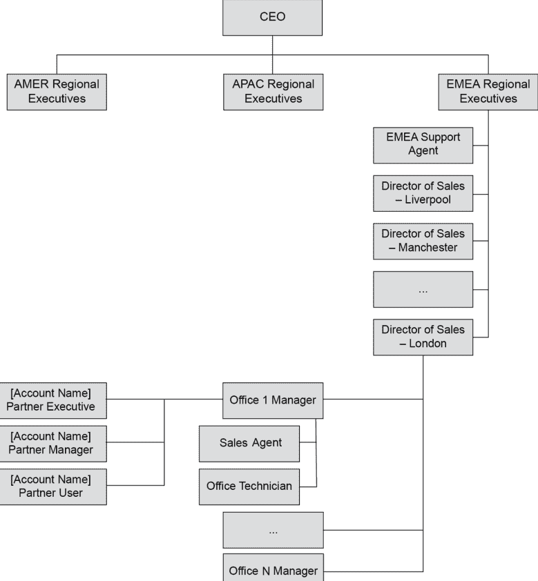

图 12.1 – 角色层次结构（初稿）

请注意，场景中未提及销售总监角色。它们在此图中被提出，旨在使角色层次结构更具结构性。您可以在解决共享和可见性需求时稍后决定是否保留它们。

您的角色与许可证图表可能类似于以下所示：

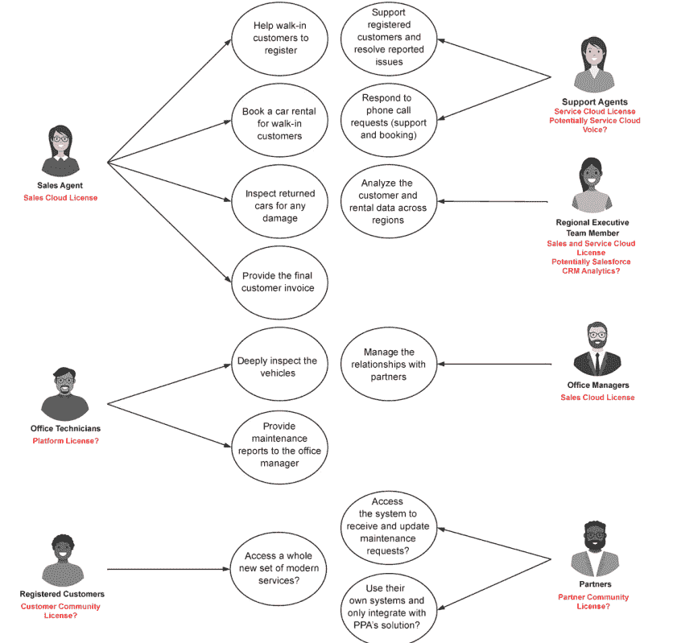

图 12.2 – 角色与许可证（初稿）

此时，建议在图表中为不太清晰的主题留下问号。这有助于您以后识别任何差距。

场景还提供了一些有趣的数据，例如5,000辆汽车、每个城市10个办公室、全球一百万注册用户以及年均1000万次汽车租赁。请关注这些数字，因为它们通常会导致一些数据挑战，例如LDV对象。请记下这些数字，将其放在纸张、笔记或表格的最上方，并在设计解决方案时不断核对。

遇到不包含与LDV相关需求的CTA评审委员会场景的可能性非常低。如果您在场景中未能识别出此类需求，强烈建议您再次通读场景，以确保完全理解需求和范围。

接着查看当前环境描述，您可以使用提供的详细信息创建草稿环境架构图。请记住，需要指明其中涉及的所有系统，包括即将退役的系统。

您的环境架构可能如下所示：

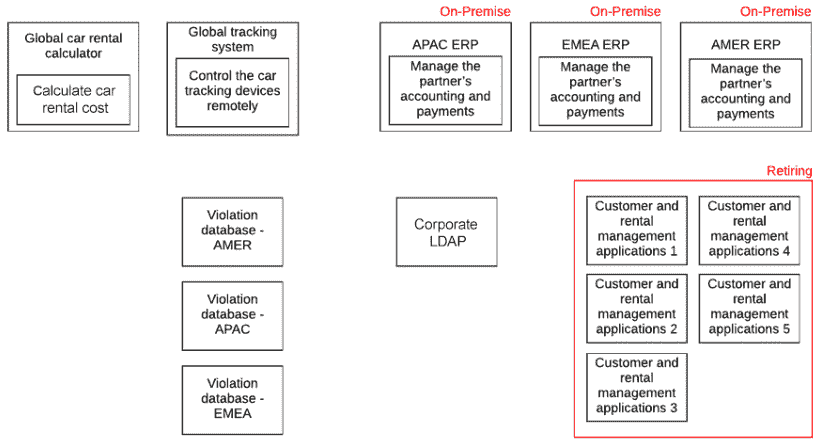

图 12.3 – 环境架构（初稿）

完整场景通常以特定方式结构化，每组相关需求都有一个章节。例如，业务流程需求章节包含解释本场景中所有关键业务流程的小节。

在“附录、技巧与窍门，以及前进的方向”中，您将更好地了解完整场景的典型结构。目前，请继续分析并着手解决共享需求的解决方案。

### 分析业务流程需求

PPA共享了五个关键业务流程，即客户注册、汽车预订、汽车办理入住、汽车办理退房以及汽车状态更新和罚金结算。场景的这部分通常包含最重要的需求部分。强烈建议您为每个流程创建业务流程图。这将帮助您发现解决方案中的棘手部分，并且还能为您在演示期间提供一个引人入胜且有吸引力的工具。现在，从第一个共享业务流程开始。

### 客户注册

PPA为客户注册流程共享了五项关键需求。您可能已经注意到，但“可访问性和安全性需求”部分中的一些要求可能会为该流程增加更多需求。这就是为什么增量解决方案开发过程特别有用，以确保您不会意外遗漏任何需求。

从该流程的第一个需求开始。

客户应能够使用在线门户和移动应用程序进行自助注册。

在Salesforce社区中可以轻松启用自助注册。但是，此需求提出了两个主要问题：

- 需要哪种社区许可证类型？
- 移动应用程序的正确策略是什么？

这是一个与客户相关的需求，因此您应在“客户社区”和“客户社区Plus”许可证之间进行选择。到目前为止，您尚未遇到任何会将您引向“客户社区Plus”许可证的可访问性需求。因此，目前最好坚持使用“客户社区”许可证，并在需要时进行修改。

> **注意**
>
> 角色名称不一定映射到拟议许可证的名称。例如，合作伙伴角色不一定映射到“合作伙伴社区”许可证，在某些场景中，使用“客户社区Plus”许可证可能更合适。您必须充分理解共享需求，并相应选择拟议的许可证类型。

“客户社区”许可证更适合处理大量最终客户，而“客户社区Plus”许可证则更适合需要复杂共享机制的用例。

您还应指定是使用指定用户许可证还是按登录计费许可证。您没有需求来帮助您决定，因此需要做出假设。例如，您可以假设客户不会频繁登录，因此Salesforce客户社区登录许可证应该是理想选择。

这就解决了需求的前半部分。接下来，您需要确定正确的移动策略。有几种选择。如您在第5章“开发可扩展系统架构”中所学，可能的选项包括Salesforce移动应用（带或不带Mobile Publisher）、原生应用、混合应用或HTML5应用。

您目前了解的场景需求可以使用所有这些选项来实现。因此，请使用最易于开发和部署的选项，即可以节省开发工作并专注于向客户交付价值的选项。Salesforce Mobile Publisher可用于创建和部署Salesforce社区的品牌化移动应用。

但是，Salesforce Mobile Publisher是最具成本效益的选项吗？如果您不考虑上市时间和投资回报率计算，那么答案可能是否定的。在评审委员会上，您应该寻找最佳技术解决方案（基于最佳实践和专家判断）。在此情况下，建议使用Salesforce Mobile Publisher是合理的。

更新您的环境架构图和角色与许可证图，然后转到下一个需求。

销售代理还可以注册走进PPA办公室的新客户。

这是Salesforce中的开箱即用功能。销售代理可以简单地为客户创建个人账户（或单独的账户和联系人；但在这种情况下，个人账户更合适），然后为其启用客户社区用户。这是一个容易得分的点；请不要在演示中未能识别或解决此类需求。现在，转到下一个需求。

注册客户时必须捕获以下信息。

同样，这是一个容易得分的点。您只需提到注册时将捕获这些字段，并将其设为必填项，以确保始终输入值。联系人对象上没有标准字段来保存驾驶执照值，因此您需要将其作为自定义字段引入。

您需要说明该字段是自定义字段；这样才能确保您捕获该问题的得分。请务必不要错失这样容易得分的点！

建议将所有自定义字段添加到数据模型中。这通常不是数据模型逻辑层面的内容，但对评审委员会特别有用。这样可以确保即使您在演示中未提及自定义字段，仍然可以得分。您的图表将替您回答问题。

创建或更新您的数据模型图，然后转到下一个需求。

客户还必须接受PPA的隐私条款和条件。

Salesforce引入了个人对象，作为丰富的同意管理对象集的一部分。当您遇到同意管理需求时，需要考虑利用标准对象来满足它。在大多数情况下，您不需要引入任何额外的自定义对象或字段。您只需确保熟悉每个标准同意管理对象的用法即可。

> **注意**
>
> 完整描述可在以下链接中找到：https://pactt.link/Q13t.Y。

在这种情况下，您可以使用个人、联系点类型同意和数据用途对象。更新您的数据模型图，然后进入下一个要求。

必须使用国家驾驶员和车辆许可机构服务实时检查驾照有效性。

此要求包含两个挑战：

- 您如何在客户自注册过程中实现所需功能？
- 您如何为为现场客户登记的销售代理实现所需功能？

为满足此要求，您需要设计与国家机构服务的集成接口。您可以假设该机构拥有公开可访问的 API。不过，您仍需决定使用哪种集成模式、该接口如何工作、是否需要中间件，以及如何处理身份验证和数据安全性。

“实时”一词应能为您提供关于集成模式的提示。所需模式应在远程系统中调用逻辑、实时获取结果并将其返回给调用者。听起来很熟悉？确实如此，因为这正是远程进程调用–请求和应答模式所要讲述的内容。

您知道此模式需要由调用者触发，然后等待响应。在在线自注册表单中，可以通过多种方式实现，例如在单击提交按钮时调用远程服务。您将不得不使用自定义注册页面，从而控制其所有行为。

您需要为销售代理引入不同的机制，因为他们将使用标准 Salesforce UI。您可以引入一个自定义验证驾照操作，触发 Salesforce 屏幕流。反过来，Flow 可以使用 Salesforce 外部服务来调用远程 Web 服务并获取结果。

即使对于如此简单的要求，中间件也能增加价值，因为它可以处理所需的任何重试机制。此外，它为 Salesforce 提供了一个统一的通信接口。幕后，它根据驾照签发国家与相应的国家机构通信。您可以假设此中间件是 MuleSoft。

从 Salesforce 到 MuleSoft 的身份验证应始终使用常见身份验证标准之一，例如 OAuth 2.0。您可以使用 Web 服务器身份验证流（首次使用，随后使用刷新令牌流）或 JWT 流。在两种情况下，数据在传输过程中将通过 Salesforce 和 MuleSoft 之间的双向 TLS 以及 MuleSoft 与机构 Web 服务之间的单向 TLS 进行保护，因为您可以安全地假设，您对机构网络安全性的控制不足，无法要求托管您的 MuleSoft 实例的数字证书。

从中间件到机构 Web 服务的身份验证取决于机构本身。您可以假设机构 Web 服务仅支持简单身份验证（用户名/密码）。

更新您的架构版图和集成接口列表。在此阶段，您还应创建第一个业务流程图。这将在演示期间为您提供很大帮助。它可能如下所示：

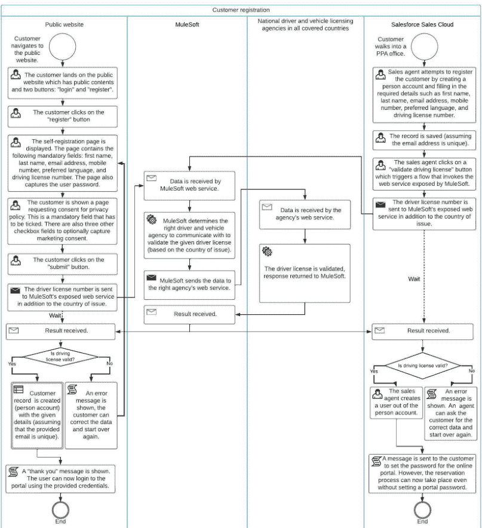

图 12.4 – 客户注册业务流程图

您可以根据需要向流程添加尽可能多的详细信息。只需记住，这将是您在演示期间讲述故事的工具。在现实生活中，此图很可能会变得更详细。

现在您已解决第一个业务流程，请进入第二个。

### 车辆预订

PPA 共享了三种车辆预订流程模式：第一种是通过在线服务（在线门户和移动应用程序），第二种是通过呼叫中心，第三种是通过亲自访问 PPA 分支机构。

从车辆预订流程的第一个要求开始。

客户应能够输入取车地点（城市）和开始及结束日期。

系统应显示该地点和时间点可用车辆列表。这将需要自定义 Visualforce 页面或 Lightning 组件。页面将根据给定参数查询可用车辆并显示结果。您这里漏掉了什么吗？实际上，是的。

您需要考虑端到端解决方案。作为本项目的首席架构师，这是您的职责。候选人可能犯下的最大错误之一，就是假设其他人会处理此事。您需要考虑以下挑战：

- 将使用哪个对象来表示汽车？
- 您将如何维护汽车的可用性？
- 您将如何按地点组织汽车？
- 哪些可访问性设置将允许客户查看汽车？

> 注意
>
> 认为准备 CTA 审查委员会的方式是参与更多预售活动，这是一种常见的误解。预售活动将显著提升您的沟通技巧，但仅此还不够。
>
> 从事预售活动时，您很少会深入到本场景中所需的细节程度。要通过 CTA 审查委员会，这种细节程度是必不可少的。您需要拥有广博的知识、顾问思维、硬核的技术深度以及丰富的软技能。将预售活动与硬核的日常实施工作相结合，将显著加速您的学习曲线。

您可以使用任何标准对象来表示汽车吗？考虑到产品对象还与您可能用于车辆预订的订单对象相关联，因此它是一个明显的选择。您可以利用价目表对象按地点对汽车进行分组。

定价无论如何都将由 PPA 的全球计算器应用程序处理（您将在下一个要求中了解更多相关信息）。您也可以使用自定义对象，但在这种情况下，您可能需要对订单对象进行一些调整。

您的产品和价目表必须对客户可见。直到 Salesforce Spring '22 版本发布之前，产品对象没有 OWD 设置，因为它们由价目表控制，但情况已经改变，您现在可以为 **产品** 配置 **OWD** 。**价目表** 具有特殊的 **OWD** 设置和共享机制。您可以从 **价目表** 页面手动将 **价目表** 对象共享给所有门户用户（目前仅受 Classic 支持）。由于易于维护，通过面向门户用户的 **价目表** 共享 **产品** 是本场景将使用的选项。

最后，页面将需要使用订单对象的 **订单开始日期** (**EffectiveDate**) 和 **订单结束日期** (**EndDate**) 字段来确定给定期间内汽车的可用性。

更新您的数据模型图，并按如下所示进入下一个要求。

### *系统应计算并显示每辆汽车租赁的价格。*

PPA 已拥有一个特定应用程序，用于根据给定参数计算每辆汽车的价格。您需要与该解决方案集成，传递正确的参数，然后在 Visualforce 页面/Lightning 组件上显示结果。这是一个新的集成接口。您现在熟悉解决方案中每个集成接口所需的详细信息。该模式是 **远程进程调用**：**请求** 和 **应答**，因为您在进行下一步（即向客户显示结果）之前需要响应。

如果评委决定将计算器应用程序从架构中移除，您的策略是什么？您将如何处理此要求？为这类挑战做好准备，因为它们可能在问答环节中提出。

目前，请更新您的架构版图和接口列表。然后进入下一个要求。

### *客户应选择所需的汽车并继续进行在线支付。*

您应该能够构建到支付网关的集成，或使用开箱即用提供该功能的产品。从技术角度来看，后者是正确的解决方案，因为它节省了您的时间和精力。此外，经过实战检验的产品通常比自定义解决方案更可靠。

您仍然需要解释产品的工作原理（高层级）以及它将如何以 PCI 合规的方式收集支付详细信息。毕竟，这将是客户在现实场景中首先询问的问题。

请尽量记住一些提供此功能的 ISV 产品名称，例如 **Bluefin** 和 **Chargent** 。更新您的架构版图，然后按如下所示进入下一个要求。

### *一旦收到付款，交易即被视为完成。*

一旦收到付款，Bluefin 可以创建与订单相关的支付记录（自定义对象）。反过来，这可以触发 Salesforce **Flow** ，更新订单状态为完成，并向客户发送电子邮件通知。

将使用“订单开始日期”和“订单结束日期”字段来确定车辆的可用性。

所有需求是否都已覆盖？实际上，还有一个次要需求被遗漏了。作为首席架构师，你需要提供包含所有必需细节的端到端解决方案。你需要解释激活码将如何创建并包含在电子邮件通知中。

这可以简单地是在 Order 对象上的一个自定义字段，其值为全局唯一标识符 (GUID)，在将订单状态更新为完成之前，使用 Apex 触发器生成并填充。

一旦该值填充到该字段中，你就可以使用合并字段将该字段的值包含在电子邮件通知中。创建的订单将链接到客户的人员账户，其余电子邮件通知值（如名、姓等）可从此处获取。现在，更新你的数据模型，它应如下所示：

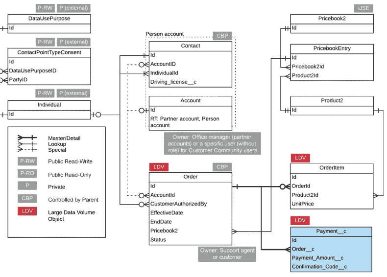

图 12.5 – 数据模型图（初稿）

到此阶段，你可能已经注意到某些对象被标记为 LDV。这是基于你在章节开头记录的数据。你需要进行计算，以确认这些对象确实应被视为 LDV。建议在起草业务流程解决方案后再执行此操作，因为到那时你会更好地理解数据模型对象的整体用途。

到此阶段，你的架构布局图应类似于以下内容：

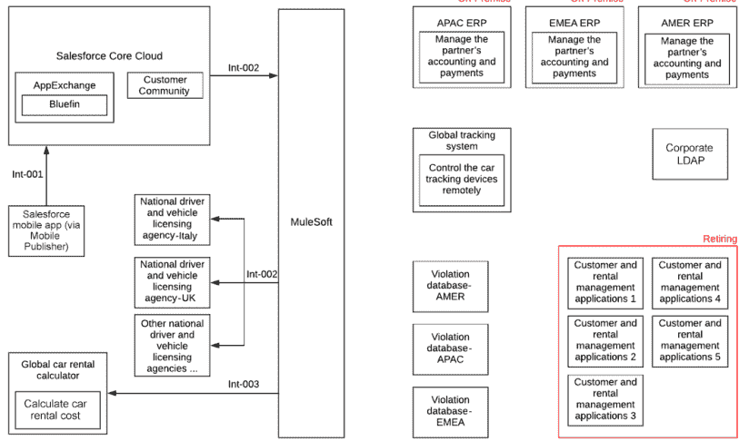

图 12.6 – 架构布局图（第二稿）

下一组需求描述的是由不同角色（支持代理人）执行的相同流程。从第一条需求开始。

支持代理人应能够使用开始日期和结束日期在特定位置（城市）搜索可用车辆。

你可以假设，为客户创建的 Visualforce 页面/Lightning 组件也可供支持代理人使用。新的 Lightning 组件可以轻松嵌入到 Salesforce 的选项卡中。你可以假设该组件具有控制其功能的设计时属性。例如，可以设置一个属性来指示内部团队将使用它。该属性控制页面特定部分的可见性，客户的人员账户可在此部分中选择。

如果你愿意，可以为页面创建线框图。如果时间充裕，这被视为你可以额外完成的工作。重要的是要解释如何将预构建的 Visualforce 页面或 Lightning 组件重新用于内部用户。

然后，支持代理人可以口头告知客户可用车辆及相关价格。

该要求将自动满足，因为支持代理人将使用面向客户的同一车辆搜索和预订页面。页面通过 MuleSoft 持续与 PPA 的计算器通信，并应跨渠道返回一致的定价。

应向客户发送带有特定激活码的电子邮件确认。

此前在此场景中曾针对不同角色（客户）提出过此要求。它将自动满足，因为支持代理人使用面向客户的同一车辆搜索和预订页面，该页面应执行相同的逻辑，包括发送电子邮件通知。

此流程的业务流程图可如下所示：

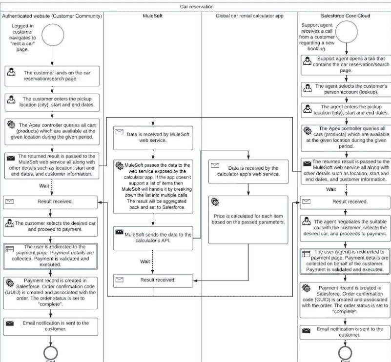

图 12.7 – 车辆预订业务流程图

在你解决完第二个业务流程后，请继续处理第三个。

### 车辆签入

PPA 为此流程共享了两个需求。

- 每个办公室都有多台平板电脑，安装了特定的应用程序，允许客户使用预订期间收到的激活码进行签入。

客户预计将通过输入激活码与办公室的平板电脑进行交互。平板电脑上安装的应用程序应对 Salesforce 进行身份验证，使用激活码查找订单记录，然后更新其状态（或子状态）以指示客户已签入。可能会设置验证以防止提前签入。

在你的解决方案中，你需要解释所使用的集成模式（远程调用）、身份验证机制（OpenID Connect 用户代理流）以及保护传输中数据的安全措施。

> **注意**
> 
> 身份验证本身无法保护传输中的数据（相互身份验证除外）。大多数身份验证标准都要求安全的 HTTPS 连接。但是，对于简单身份验证，这并非强制性。如果简单身份验证在非安全的 HTTP 连接上进行，则将没有安全措施来保护传输中的数据。您的数据将以明文格式传输，攻击者可以嗅探网络流量并访问您的数据。保护传输中数据最常见的方法是使用单向或双向 TLS。

花点时间思考在问答环节中可能引入的对该需求的更改。你可以如何增强此流程？一个可能的补充是向当前办公室班次的销售代理人发送推送通知，以告知他们签入情况。这将使流程更加顺畅。这目前不是共享需求，但请做好在问答环节中应对此类补充/更改的准备。

更新你的架构布局图、集成接口列表以及数据模型，添加所需的任何新字段（如子状态），然后继续处理下一条需求。

- 客户签入后，销售代理人可以交出车辆钥匙，并更新预订状态以指示他们已取走钥匙。

你可以假设此过程将手动进行。代理人将搜索预订，验证订单的子状态，然后交出钥匙并手动再次更新订单。问答环节可能会要求进一步自动化。所以，请做好准备。

此流程的业务流程图可如下所示：

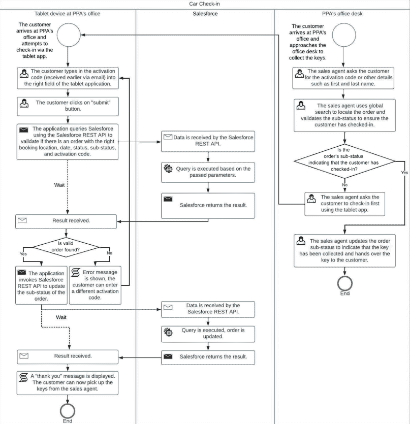

图 12.8 – 车辆签入业务流程图

在你解决完第三个业务流程后，请继续处理第四个。

### 车辆签出

将车辆归还至租赁办公室的流程更加简单。这只能由客户亲自完成。请查看第一条需求，如下所示：

当客户归还车辆时，销售代理人应收取钥匙并快速检查车辆。

销售代理人可以使用激活码或客户信息查找与这次租赁相关的订单。但是，检查详情可以存储在哪里？又如何通知技术人员进行重大损坏跟进呢？

这时你需要展示对平台功能的理解。你可以提出一套基于自定义字段和带电子邮件通知的工作流规则的解决方案。但随后你会发现自己在试图解决其他未来挑战，例如以下问题：

- 如何向整个团队发送电子邮件通知？强烈建议你不要提出基于共享邮箱模式的任何解决方案。该模式几十年前是可接受的，但当今企业希望有更加可追踪和可审计的解决方案。
- 如何确保技术人员正在处理该事件？如果他们不采取行动，将无法生成正确的发票。这将影响你正在解决的主流程。
- 如果你打算在 Order 对象上引入一组新字段，这将如何影响用户体验？如果你打算为了同样的目的引入一个全新的自定义对象，那么你是否考虑过可能提供所需功能的标准对象？

从技术角度考虑，如果你需要一个管理良好的事件管理流程，用于报告、分配、进度跟踪以及最终解决事件等需求，则应考虑使用 Case 对象。

对于此需求，销售代理人可以创建一个 case（Sales Cloud 许可证允许这样做），将其与客户的订单关联，并用其提供结构化反馈。如果满足特定条件，case 可以自动分配给该办公室的技术人员队列。一旦 case 被分配给队列，所有队列成员都将通过电子邮件警报收到通知（此功能可以开启或关闭）。

队列分配还可以授予技术人员对 case 记录的访问权限和可见性。你可以配置升级规则，以确保如果技术人员在指定期间内未采取行动，则会向更高管理层报告该 case。

这是一个可扩展且灵活的解决方案。评委可以向你发起挑战并即时更改某些需求，但你的解决方案足够灵活，可以处理这些变化。

你提出的方案必须为客户带来其他方案可能无法提供的价值。你必须真正地*相信*这一点，不同于那些仅为了达成销售目标而说教的销售人员。你是客户的可信赖顾问；当你提出解决方案时，你必须相信它，并清晰地阐述其价值。否则，你的不确定性会在演示和问答环节体现在你身上，你也无法展现出CTA所期望的自信。

*此信息应发送到ERP，ERP将在72小时后生成客户发票。*

PPA在本地部署了三个ERP，可能位于完全不同的物理位置。你如何将数据从Salesforce传输到正确的ERP系统以生成发票？你如何将像Salesforce这样的云应用程序连接到本地应用程序？

如果你的答案不是*中间件*，那么你很可能正在踏入雷区。在此提出点对点方法可能会导致集成领域的失败。第一个挑战很简单：Salesforce如何连接到防火墙保护后的系统？

提出诸如将ERP移至DMZ（这意味着它基本上暴露在外部世界）等不合理的假设，会打开你不想处理的潘多拉魔盒。做出这样的不合理假设可能会引来评委们更具挑战性的问题，而你可能无法正确回答。

鉴于你的架构中已有MuleSoft，请使用它。如果你还没有它，那么这是一个提出它的充分理由。你也可以建议其他中间件。考虑到此需要一个能够协调与多个系统调用的系统，并且此接口并非旨在处理大量数据，因此ESB是一个合理的选择。

你可以提出任何你熟悉的ESB工具，而不必仅因为MuleSoft是Salesforce产品就坚持使用它。记住，你必须相信你解决方案的价值。在此场景中，根据许多可信来源，你正在提出MuleSoft，因为它是领先的中间件。此外，假设你比其他类似中间件更熟悉它。但请随意提出你认为能提供类似功能且你感到自如的任何工具。

你仍需指定集成模式、身份验证机制以及如何在传输过程中保护数据。在演示中，你可能需要解释MuleSoft将如何与本地解决方案通信。你在*第11章：传播和推广你的解决方案*中遇到了类似的情况。

选择模式时，你需要考虑计划复制到ERP的对象。

根据你提出的数据模型，你可能需要同步*订单*、*订单项*和*案例*对象，假设*账户*和*联系人*表以及像*产品*这样的查找表已经同步。

你认为哪种模式最适合此处？可以使用哪种Salesforce功能以最小的技术负担同步所有三个对象？你可以考虑以下功能和工具：

- **外发消息**：外发消息只能包含来自一个对象的数据。但是，你可以将主对象（此处为`Order`）发送到MuleSoft，请求MuleSoft执行回调以检索其余对象，然后将它们传输到ERP。这是一个你应该列入候选名单的不错选项，尽管它需要在MuleSoft中进行一些定制开发。

- **平台事件**：可以设计为包含来自多个对象的数据。但是，你正处理一个具有一对多关系的对象。除非采用非标准解决方案（例如定义带有JSON内容的长文本字段），否则无法建模一个结合父记录和子记录数据的单个平台事件。由于相关技术挑战（创建JSON结构、填充它以及在另一端解析它），除非万不得已，否则不建议提出这种方法。

- **未来方法**：你可以开发一个Apex调用以调用MuleSoft公开的远程服务并传递数据。考虑到这需要以异步方式发生，你需要使用未来方法（或队列接口）。由于相关技术挑战（额外的定制开发、重试机制、日志机制等），除非万不得已，否则不建议提出这种方法。

- **Salesforce 流**：使用Flows，你可以使用可配置的点击式功能来调用远程Web服务。这听起来不错，但你仍需考虑所需的支持功能，例如重试和日志机制。

- **批量数据同步**：这种方法可能听起来过时，但实施起来轻松，在许多情况下对业务来说已经足够。你可以在MuleSoft中配置一个每小时运行的批量作业，从所有目标对象中选取相关记录，然后按正确顺序将其发送到ERP。这也是最具成本效益的选择之一。

对上述功能的评估取决于你试图解决的用例。例如，在其他用例中，你可能会发现平台事件是最佳选择。

数据同步到ERP后，你可以假设ERP具备在给定时间范围内生成发票所需的一切。更新你的架构图和集成接口列表，然后进入下一个需求。

生成发票后，将向客户发送包含发票金额和结算任何剩余余额说明的通知。

你可以用多种方式解决此需求。你可以假设整个过程都将在平台外进行。ERP生成发票和电子邮件，然后将其发送给客户。

或者，你可以采用完全在平台上的解决方案，其中ERP生成发票及其行项目，MuleSoft将其复制到Salesforce，然后从Salesforce发送包含发票及其详细行项目的电子邮件通知。但是，在这种情况下，你每年需要处理至少1000万张发票以及至少等量的发票行项目，且可能增长50%（假设一半的发票包含两个行项目）。这意味着你需要在LDV策略中考虑新的发票和发票行项目对象。

但是，如果你仔细阅读场景需求，你会注意到需求只是共享发票金额，可能还包含发票编号、开票日期、到期日期和少量其他属性，这些通常包含在发票表头中。

你可以将这些信息存储在与订单相关的自定义对象中，或作为订单本身的属性。只要你能清楚说明为何选择其中一种，两种选择都合理。

相关自定义对象将允许你在需要时存储多张发票，例如预付发票和最终发票。它会在数据模型中增加一个LDV，但只要你准确阐述这种方法的价值，并将此对象纳入LDV缓解策略，这没问题。

记住，没有唯一正确答案。解决问题的方法有很多，但你只需合理证明你的方法，并有扎实的技术理解来支持其相关的优缺点。

将一个新的自定义对象引入数据模型以保存发票表头详细信息。你还需要在ERP和Salesforce之间建立一个新的集成接口来复制数据。一如既往，你需要提供描述接口所需的所有信息。

更新你的数据模型、集成接口列表和架构图，然后进入下一个需求。

销售代理在检查完成后将预订状态更新为关闭。

此事件在时间上早于最后两个需求中提到的事件。然而，这在这里不是问题，因为此需求很容易实现。你只需确保在图表中绘制正确的时间顺序。预计代理将订单上的Sub_Status__c更新为关闭。请确保不要错过这种轻松的得分点。

此流程的业务流程图可如下所示：

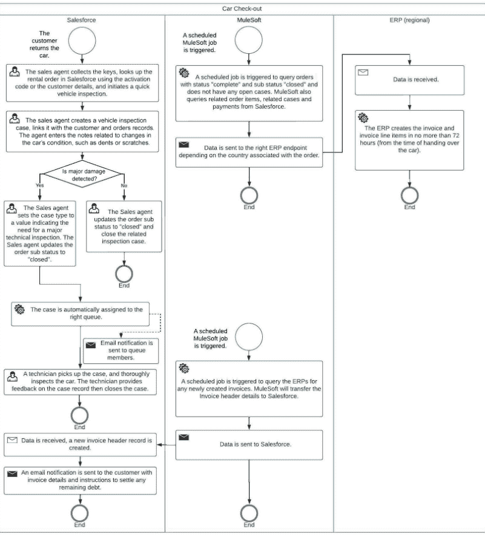

### 图 12.9 – 车辆签出业务流程图

现在您已解决第四个业务流程，请继续处理第五个也是最后一个流程。

### 车辆状态更新与罚金结算

PPA 的汽车中安装了跟踪设备；这些设备通过定期发送 GPS 坐标来追踪车辆位置。设备还会发送额外信息，例如急刹车或超速事件。

您如何称呼配备传感器和其他技术、能够通过互联网与其他设备和服务通信以交换数据的设备？没错，物联网（IoT）设备。

有一些专门为 IoT 设计的身份验证流，例如设备流和资产令牌流（后者更适合不带屏幕的 IoT 设备）。您在第 4 章“核心架构概念：身份和访问管理”中已学习过这两者。

IoT 设备往往以高频率发送小块数据。考虑到任何给定时间连接的 IoT 设备数量，这通常会产生海量数据。

经验法则，Salesforce Core Cloud（又称 Force.com）不是接收如此大量入站通信的理想平台，也不是长期存储检索数据的最佳场所。

在某些场景下，您仍可能为这一角色推荐 Salesforce Core。但如果这样做，您需要仔细计算预期的入站调用次数，并将其与目标组织可能的管理器限制进行比较。更安全的方法是利用平台外解决方案来接收和汇总结果。Salesforce Heroku 是此类场景的绝佳选择，尤其是搭配 Apache Kafka on Heroku、Postgres 和 Redis 等附加产品时。

阅读共享需求并开始构建您的解决方案。第一项要求如下：

- 所有跟踪设备均可通过 4G 和 3G 通信。它们每 30 秒发送一次车辆位置。

PPA 拥有 5,000 辆汽车（可以合理假设这一数字将会增长）。跟踪设备每 30 秒发送一条消息；出于安全原因，这日夜不停地进行。

这意味着每分钟两条消息，每小时 120 条，每天 2,880 条。总计，所有汽车每天的消息总数为 14,400,000 条。即每月超过 4.3 亿条消息。

显然，Salesforce Core 不是处理如此大量呼入操作或创建/更新操作的理想平台。但您仍需进行计算来证明您的理由。这正是您在实际项目中应做的事。

您是一名架构师，不能简单假设会有大量呼入。基于此，我提出以下解决方案。做出合理假设并进行必要的计算；数字是传达毋庸置疑信息的最佳方式。

您还需要记住，PPA 已经有一个全球跟踪系统。该系统用于远程控制汽车跟踪设备。这意味着它可用于远程配置设备，这是您可能希望保留的功能。然而，全球跟踪系统更改或修改成本高昂，且无法通过配置进行扩展。

目前为止，您尚未遇到需要扩展该系统的用例。您仍可利用全球跟踪系统接收来自汽车的消息。但请先继续处理流程需求，看看情况是否会改变。下一项要求如下：

- PPA 希望收集描述驾驶员行为的信息。

此要求表明需要存储海量数据。此外，还需要分析这些数据以创建有意义的报告和仪表板。PPA 的全球跟踪系统不具备此类能力。它可能能够存储所需数据量，但缺乏创建此类报告和仪表板的适当功能。您需要一个 BI 工具，例如 Microsoft Power BI、Tableau 或 Salesforce CRM Analytics。

在评审委员会上，您不太可能深入研究每种工具功能的细节。在实际项目中，您会采取不同的做法，届时会有更多时间进行适当的比较，很可能还会结合一些概念验证。

目前，您知道需要将其中一种工具加入架构。也欢迎提出其他类似工具。您仍不清楚哪个平台将存储这些数据，但下一项要求将帮助您做出决定。它如下所示：

- PPA 希望使用 GPS 跟踪设备检测可能的车辆盗窃。

此要求描述了基于接收到的 IoT 数据的业务流程。IoT 数据的常见用途是分析数据并检测模式，但也可根据预定义条件和机器状态触发特定操作。它甚至可以更进一步，实现机器对机器（M2M）流程，即一台机器根据特定逻辑确定是时候与另一台机器通信以触发远程事务。

此要求未涉及那么远。但仍需引入自定义逻辑。哪个平台最适合此类逻辑？您可能可以想到四个选项：

- Salesforce Core Cloud：考虑到通信数据量，该选项将被排除。
- MuleSoft：MuleSoft 可以接收消息并根据自定义逻辑进行处理。但是，它不是处理此类复杂逻辑（需要机器状态处理）的最佳平台。此外，它也不是具有丰富且用户友好型 UI 的平台。该选项将被排除。
- PPA 的全球跟踪系统：可以对其进行修改以容纳此逻辑。然而，PPA 已明确表示这是一项昂贵的工作。该选项不理想。
- 托管在可扩展 PaaS 平台上的自定义开发应用：这可能是托管在 AWS 上的自定义开发应用，或者更合理的是，托管在 Heroku 上（考虑到 Heroku 拥有与 Salesforce Core Cloud 和 Salesforce CRM Analytics 的开箱即用连接器）。Heroku 可以成为接收所有 IoT 设备发送消息的平台。自定义开发应用可以增加处理盗窃检测用例的功能。它还可以在未来扩展以处理其他用例，并且可以以可扩展且可靠的方式做到这一点。此外，Heroku Connect 可以轻松在 Heroku 和 Salesforce 之间同步数据。这允许您在检测到盗窃事件后在 Salesforce 中创建案例。案例随后可以分配给正确的队列，进而向队列成员发送电子邮件通知。考虑所有因素，此解决方案听起来是最佳选择。

您现在可以假设已针对上一项要求使用 Salesforce CRM Analytics，并使用标准连接器将数据从 Heroku 传输到 Salesforce CRM Analytics。将其添加到您的架构图中，更新集成接口列表，并继续处理下一项要求，如下所示：

- 每天都应检查违规数据库。

您有三个违规数据库。您需要检查每个数据库，并根据其数据执行统一逻辑。哪种工具可以帮助您实现这一点？

开发 Apex 批处理作业来在夜间完成此任务，在问答环节会让您陷入非常棘手的境地。您可能会感到进退维谷，即使您设法修正了解决方案，也可能会丢分。该选项主要提出了一种次优模式，需要大量自定义开发（连接到三个不同端点、异常处理、日志记录和重试机制），而忽略了您架构中已经拥有能够以更好方式完成此工作的中间件。此类错误可能反映出对中间件价值的理解不足。在问答环节被质疑这一点绝非愉快的经历。

使用您的中间件。您可以安排一个 MuleSoft 批处理作业每晚运行，从三个数据库检索记录，执行所需的过滤和查找逻辑，并将数据传输到 ERP 以生成新发票。

请记住完整描述任何新集成接口。此外，更新架构图以反映最新变更。

为提高可访问性，此流程的业务流程图已拆分为两个图表。您可以自由合并它们。汽车状态更新流程图如下：

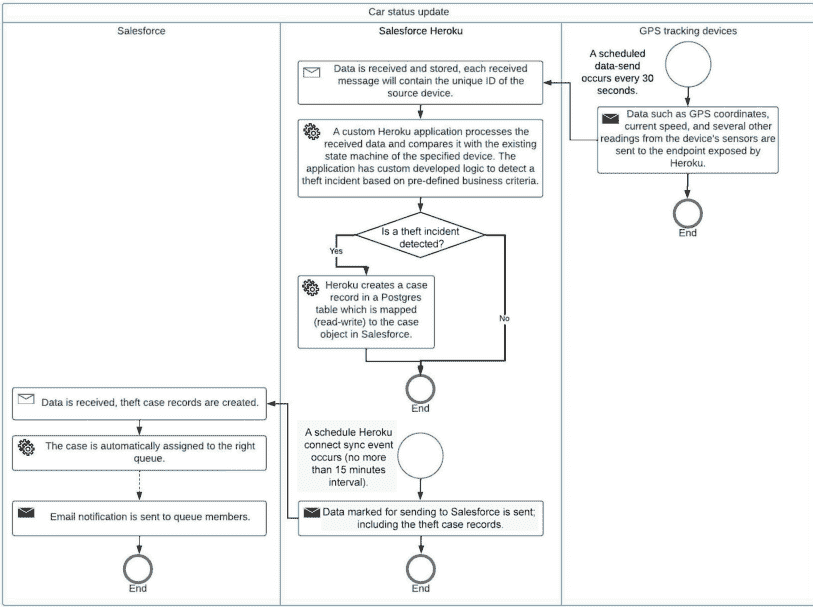

图 12.10 – 汽车状态更新业务流程图

罚金结算图如下：

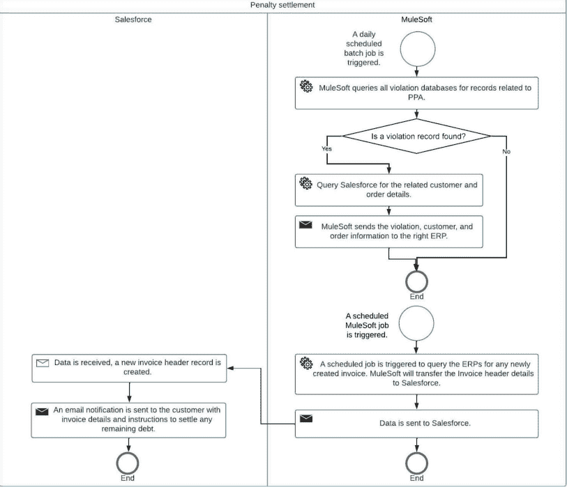

图 12.11 – 罚金结算业务流程图

请记住，如果需要，可以向这些图表添加更多细节。只要您有足够时间，这样做完全可以。

至此，第五个也是最后一个业务流程介绍完毕。在进行所有这些更新后，请查看您的图表。景观架构图如下：

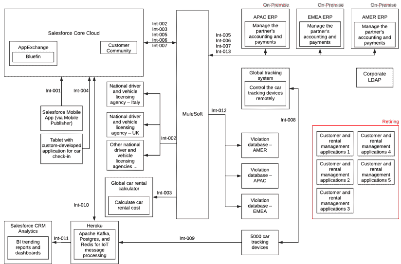

图 12.12 – 景观架构（第三稿）

集成接口如下：

| 接口代码 | 源/目标 | 集成层 | 集成模式 | 描述 | 安全性 | 身份验证 |
| :--- | :--- | :--- | :--- | :--- | :--- | :--- |
| Int-001 | Salesforce 移动应用（通过 Mobile Publisher）-> Salesforce | 数据 | 远程调用 | 客户注册及与客户社区中所有可用服务的交互。数据使用 Salesforce REST API 检索。 | HTTPS（单向 SSL/TLS） | OpenID Connect 用户代理流 |
| Int-002 | Salesforce -> MuleSoft -> 指定国家的车辆许可机构 | 业务逻辑 | 远程进程调用 - 请求和响应 - 阻塞 | 验证客户的驾驶执照。客户输入执照后使用此接口。销售代理点击启动事务的按钮，调用 MuleSoft 暴露的 Web 服务。然后 MuleSoft 确定要调用的正确许可机构，并代表 Salesforce 调用正确的 Web 服务。此过程由客户本身触发。 | Salesforce 和 MuleSoft 之间为 HTTPS（双向 SSL/TLS）。MuleSoft 和租车计算器之间为 HTTPS（单向 SSL/TLS）。 | Salesforce 和 MuleSoft 之间具有相互身份验证的 OAuth 2.0 Web 服务器流（然后刷新令牌流）。MuleSoft 与国家汽车租赁机构/全球汽车租赁计算器之间为简单身份验证。 |
| Int-003 | Salesforce -> MuleSoft -> 全球汽车租赁计算器 | | | 根据一组参数计算实际价格。在搜索和显示可用汽车时以阻塞模式调用该接口。 | | |
| Int-004 | 平板应用 -> Salesforce | 数据 | 远程调用 | 检查汽车提取。平板接受文本输入（注册号）并使用 Salesforce REST API 对其进行验证。如果验证成功，平板还将更新订单状态。 | HTTPS（单向 SSL/TLS） | OpenID Connect 用户代理流 |
| Int-005 | Salesforce <-> MuleSoft <-> ERPs | 数据 | 批量数据同步 - 异步 | 计划的 MuleSoft 批量作业，用于将客户详细信息从 Salesforce 同步到 ERP。这还包括几个其他查找/主表，例如 Product。计划作业的频率假设为 15 分钟。 | Salesforce 和 MuleSoft 之间为 HTTPS（双向 SSL/TLS）。MuleSoft 和 ERPs 之间为 HTTPS（单向 SSL/TLS）。 | Salesforce 和 MuleSoft 之间具有相互身份验证的 OAuth 2.0 Web 服务器流（然后刷新令牌流），MuleSoft 和 ERPs 之间为简单身份验证。 |
| Int-006 | | | | 计划的 MuleSoft 批量作业，用于将订单、订单项目和付款从 Salesforce 同步到 ERP。计划作业的频率假设为 15 分钟。 | | |
| Int-007 | | | | 计划的 MuleSoft 批量作业，用于将发票标头从 ERPs 同步到 Salesforce。计划作业的频率假设为一小时。 | | |
| Int-008 | 全球跟踪系统 -> 跟踪设备 | 业务逻辑 | 远程进程调用 - 请求和响应 - 阻塞 | 远程配置跟踪设备。 | HTTPS（单向 SSL/TLS） | OAuth 2.0 资产令牌流 |
| Int-009 | 跟踪设备 -> Heroku | 数据 | 远程进程调用 - 请求和响应 - 阻塞 | 例如汽车的 GPS 坐标和速度等数据从跟踪设备发送到 Heroku。 | | |
| Int-010 | Heroku <-> Salesforce | 数据 | 批量数据同步 - 异步 | 使用 Heroku Connect 在 Salesforce Core Cloud (Force.com) 和 Heroku 之间进行双向数据同步。假设对象为 Accounts 和 cases。此接口用于将盗窃事件从 Heroku 传输到 Salesforce。 | HTTPS（单向 SSL/TLS） | OAuth 2.0 Web 服务器流 |
| Int-011 | Heroku -> Salesforce CRM Analytics | | | 将犯罪事件的读数数据从 Heroku 复制到 Salesforce CRM Analytics。 | | |
| Int-012 | 违规数据库 -> MuleSoft -> ERPs | 数据 | 批量数据同步 - 异步 | 计划的 MuleSoft 批量作业，用于查询违规数据库中与 PPA 相关的任何新数据，然后将该数据传输到 ERPs 以计算新发票。计划作业的频率假设为 15 分钟。 | HTTPS（单向 SSL/TLS） | MuleSoft 与 ERPs 之间以及 MuleSoft 与违规数据库之间为简单身份验证。 |
| Int-013 | Salesforce <-> MuleSoft <-> ERPs | 数据 | 批量数据同步 - 异步 | 计划的 MuleSoft 批量作业，用于将罚款发票标头从 ERPs 同步到 Salesforce。计划作业的频率假设为一小时。 | Salesforce 和 MuleSoft 之间为 HTTPS（双向 SSL/TLS）。MuleSoft 和 ERPs 之间为 HTTPS（单向 SSL/TLS）。 | Salesforce 和 MuleSoft 之间具有相互身份验证的 OAuth 2.0 Web 服务器流（然后刷新令牌流），MuleSoft 和 ERPs 之间为简单身份验证。 |

图 12.13 – 集成接口（初稿）

数据模型图如下：

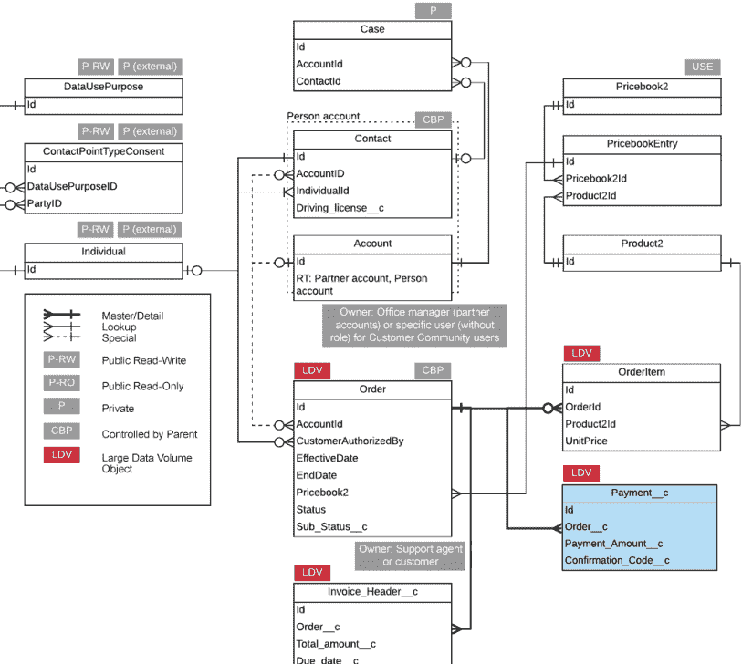

图 12.14 – 数据模型（第二稿）

您现在已涵盖与业务流程相关的所有要求。此部分通常是任何场景中最丰富的部分，因此它需要本书的一整章来介绍，这也不足为奇。

在此阶段，您已满足场景中近 60–70% 的要求。这将成为下一章的基础，您将在下一章中满足 PPA 的其余要求，然后创建演示文稿。

## 摘要

在本章中，您了解了本书中的第一个完整模拟场景。完整场景自然比小型场景更长、更全面，包含更多挑战和要求。然而，您了解到增量解决方案方法论是避免遗漏任何要求的最佳方式。

在本章中，您处理了场景的第一部分。业务流程是任何数字化解决方案的核心和灵魂。创建全面解决方案从了解每个业务流程、将其划分为易于消化的块，然后将其作为整体来解决开始，这不足为奇。

您遇到了有趣的用例和设计决策，并在知道有其他替代方案的情况下，逻辑上选择了正确的方法。您为一些潜在问题准备了现成的答案，并选择了简单但可扩展的架构，以便在需要时有空间进行更改。

您创建了多个业务流程图，在演示过程中通过可视化解决方案，这些图表将为您提供很大帮助。

在下一章中，您将继续解决场景并制作演示文稿。本章涵盖了大量内容，但下一章仍有更多内容需要涵盖。

## 展示与辩护：首次模拟

在本章中，您将为第一个完整模拟场景继续创建端到端解决方案。您已在第 12 章“练习评审委员会：首次模拟”中涵盖了场景的大部分内容，但仍有许多主题需要涵盖。在本章中，您将继续分析和解决每个共享要求，然后练习制作一些演示文稿。

为让您获得最贴近真实考试的体验，您将完成一次练习问答会议，并根据评委的反馈来辩护、证明和更改解决方案。

阅读本章后，建议您重新阅读场景并尝试独立解决它。

在本章中，您将涵盖以下主题：

- 继续分析要求并创建端到端解决方案
- 展示并证明您的解决方案

到本章结束时，您将完成第一个模拟场景。您将更熟悉完整模拟场景的复杂性，并为考试做好更充分的准备。您还将学会在有限的时间内展示解决方案，并在问答期间证明其合理性。

## 继续分析要求并创建端到端解决方案

您之前在第 12 章“练习评审委员会：首次模拟”中已涵盖业务流程要求。到该章结束时，您已对潜在数据模型和架构有了良好的了解。您已经将一些对象标记为潜在 LDV。

接下来，有一组您需要解决的数据迁移要求。完成后，您将对每个数据模型对象中的潜在数据量有更深入的了解，这将帮助您制定 LDV 缓解策略。

首先处理数据迁移要求。

## 分析数据迁移需求

本部分中的需求可能会影响您的一些图表，例如总体架构图和数据模型。

一些候选人倾向于创建图表来解释其拟议的数据迁移策略。这些图表在 CTA 评审委员会考试中被视为可选内容；因此，本书中不会创建此类图表。如果创建额外图表能帮助您组织和解释思路，请随意创建。否则，是时候从第一个共享数据迁移需求开始了。

PPA 希望将其所有当前客户和租赁管理应用程序的数据迁移到新系统。

这是一个可预测的需求，尤其是考虑到 PPA 已经表示有意停用所有五个遗留租赁管理应用程序。但请记住，这五个应用程序可能基于不同的技术，使用不同的数据库类型，并属于不同的代际。下一个需求包含更多详细信息。请转到下一个，其从以下内容开始：

PPA 知道当前数据包含许多冗余和重复项，并希望获得您的指导来处理此情况。

PPA 在数据质量方面一直存在困难，尤其是冗余问题。您如何帮助他们实现以下目标？

- 对其现有数据进行去重
- 为每条记录打质量分，以帮助识别低质量记录（例如地址详情不完整或电话号码格式不规范）
- 防止未来创建重复记录

Salesforce 原生的 **重复规则** 可以帮助防止创建重复记录。它们有其局限性，但对于简单和中等复杂度的场景来说，是一个不错的工具。

然而，这无法解决前两个需求。去重可能会变得复杂，尤其是在缺乏强属性（例如特定格式的电子邮件地址或电话号码）的情况下。地址和姓名等数据被视为弱属性，因为它们可以以多种格式提供。此外，姓名的拼写方式各不相同，并且可能包含非拉丁字符。

在这种情况下，您需要一个能够执行模糊逻辑匹配而非精确匹配的工具（Salesforce 的重复规则仅提供有限的此类功能）。您可能还需要为每个属性分配权重，以帮助合并逻辑。

此外，您需要一个能够将任何相关记录重新关联到合并后的客户记录的工具。在此情况下，这与历史租赁记录相关。如果多个客户记录合并为一条，您需要所有相关租赁记录都指向新创建的金色记录。

计算每条记录的质量也可能需要一些复杂逻辑，因为它涉及将多条记录与预定义标准进行比较并相应更新一些记录。标准可以简单到预定义的电话号码格式，也可以复杂到整个子流程。

所有这些功能都可以定制开发，前提是您有时间和预算，或者直接购买并配置。这通常可以节省大量资金（考虑整体 ROI 计算）。

作为 CTA，您被期望提出技术上最准确的解决方案。在此情况下，等待 9-18 个月直到工具定制开发并测试完成，再延迟整个项目毫无意义。提出一个经过实战检验的 MDM 工具并可配置以满足所有这些需求，才是非常合理的做法。

在评审委员会上，您被期望命名拟议的产品，就像您在实际工作中通常做的那样。您可以建议 **Informatica** 之类的工具。但是，您不一定需要指定确切的子产品名称，因为它们经常更改。

更新您的总体架构图和集成接口，以指示新的迁移接口，然后转到下一个需求。

*PPA 在其每个当前租赁管理应用程序中拥有大约 5000 万条租赁记录。*

其中大部分是出于历史目的存储的，因为 PPA 希望保留租赁记录至少 10 年。PPA 希望继续允许其销售和支持人员在新系统中访问这些记录。

PPA 在其五个旧系统中总共拥有大约 2.5 亿条租赁记录（5000 万 × 5）。将所有这些数据迁移到 Salesforce 将把 *Order（订单）* 对象转变为 LDV（大数据量对象）。更不用说，*OrderItem（订单项）* 对象将包含至少相同数量的记录。

可以合理地假设，这些租赁记录中的大部分已关闭，仅为遵守 PPA 的政策而保留。因此，您可以将活跃的 *Order（订单）* 和 *OrderItem（订单项）* 对象迁移到 Salesforce，同时将任何历史记录迁移到 Heroku。

PPA 仍然希望其销售和支持人员能够访问历史记录。然而，与其将它们复制到 Salesforce，不如使用 **Salesforce Connect** 和 **外部对象** 实时检索它们。

> **注意**
>
> Heroku 在 **Heroku Connect** 基础上提供 **Heroku External Objects** 功能，为 Heroku PostgreSQL 数据库提供易于使用的 **开放数据协议 (OData)** 封装层。

您需要将外部对象添加到数据模型中。您还需要更新总体架构图和集成接口列表，以指示新的迁移接口以及 Heroku 和 Salesforce 之间的新集成接口。

接下来，更新您的图表。您的数据模型应如下所示：

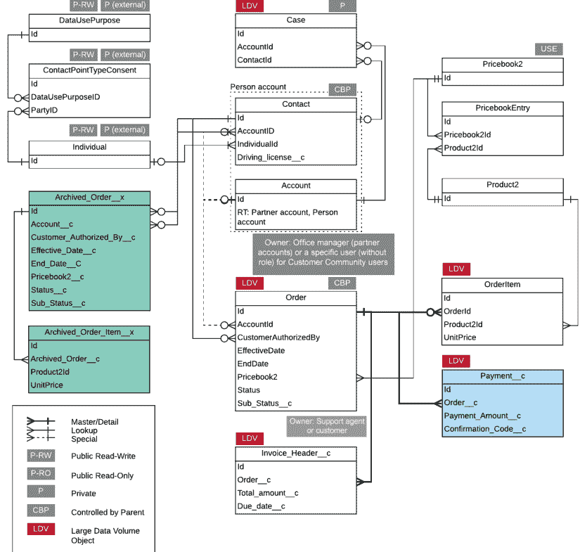

图 13.1 – 数据模型（第三版）

此需求并未专门要求解释您的数据迁移策略。尽管如此，在考试中，您仍然被期望做到这一点。您需要解释以下内容：

- 您计划如何从其数据源获取数据？
- 您最终将如何将数据加载到 Salesforce？客户需要注意哪些注意事项，以及如何降低潜在风险？例如，谁将拥有新迁移的记录？如何确保所有记录都已成功迁移？如何确保在迁移期间不违反任何控制器限制？
- 拟议的迁移计划是什么？
- 您的迁移方法是什么（大爆炸方式与持续累积方式）？为什么？

您在第 7 章“设计可扩展的 Salesforce 数据架构”中遇到过类似的挑战。您需要制定一个全面的数据迁移方案，包含在演示文稿中，以清晰回答上述所有问题。您将在本章稍后完成此操作。

在此之前，您需要审查您的 LDV 缓解策略。您已将几个对象标记为潜在 LDV，但您仍需要进行计算以确认它们是否可以被视为 LDV。一旦确认，您需要制定缓解策略。您将在接下来解决此挑战。

## 审查已识别的 LDV 并制定缓解策略

查看数据模型（图 13.1）中标记的 LDV，并验证所识别的对象是否确实符合 LDV 的标准。

您知道，PPA 在全球拥有大约一百万注册用户，每年平均租赁 100 万辆汽车。这意味着 Order 对象每年将增长 1000 万条记录。该对象符合 LDV 的标准。此外，OrderItem 对象将至少有 1000 万条更多记录。合理地推测，它可能包含更多记录，假设 50% 的租赁除了汽车租赁本身外，还会包含额外的行项目，例如保险附加项。

这意味着每年将有超过 1500 万条新记录。除此之外，Payment__c 对象每个 Order 至少包含一条记录。Invoice_Header__c 对象每个 Order 至少包含一条记录（某些租赁可能会因罚款或所需汽车维护而收到多张发票）。您还将为每个租赁创建至少一条 Case 记录（用于检查反馈）。

大量的 Order、OrderItem、Case、Payment__c 和 Invoice_Header__c 记录可能会影响 CRUD 操作的速度。它们都被视为 LDV，因此您需要制定缓解策略。

考虑到您面临的挑战与 CRUD 效率相关，像精简表这样的解决方案不会增加多少价值。自定义索引仅有助于读取操作。分区可能会有所帮助，但会增加不必要的复杂性。相比之下，在此情况下，最合适的选择是将一些非必要数据卸载到非平台存储中。

以这种方式归档数据，可确保这四个对象保持尽可能精简。您的归档策略可以包含所有已关闭的 Order 和 Case 记录。

您可以将数据归档到 Salesforce Big Objects、外部存储（例如数据仓库）或能够处理海量记录的平台（例如 AWS 或 Heroku）。您的架构中已有 Heroku。在这种情况下，决策应该很容易。您可以使用 Heroku Connect 将数据传输到 Heroku PostgreSQL 数据库，将归档数据传输到另一个通过 Heroku Connect 和 Heroku External Objects 暴露给 Salesforce Connect 的 PostgreSQL 数据库，然后从第一个 PostgreSQL 数据库和 Salesforce 中删除归档的记录。

更新您的架构图，并在 Heroku 和 Salesforce 之间添加另一个集成接口。您的架构图应如下所示：

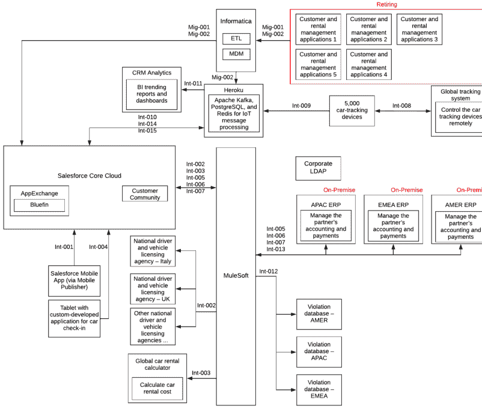

图 13.2 – 架构图（第四个草稿）

更新您的集成接口列表，然后进入下一组要求，该组要求与可访问性和安全性相关。

## 分析可访问性和安全性要求

在业务流程要求之后，可访问性和安全性部分的要求通常是第二难处理的。与业务流程要求相比，它们通常不冗长，而是更具技术挑战性。

根据可访问性和安全性要求的拟议解决方案，您可能需要调整数据模型、角色层次结构，以及可能的参与者和许可证图。好消息是，平台上可用的共享和可见性功能数量有限。您可选择的工具池较小。但是，您必须非常了解每种工具，才能选择正确的组合。

从第一个共享要求开始，该要求以以下内容开头：

*客户账户应对全球办公室经理、销售代理和服务代理可见。*

您应该花足够的时间来分析这些要求。乍一看，这些要求可能很简单，但如果您没有彻底考虑所有可能的挑战，则有可能会陷入违反总督限制的解决方案中。在问答环节即时更改此类解决方案具有挑战性。请彻底分析这些要求以避免此类情况。

考虑到该要求表明某些记录对某些用户可见而对其他用户不可见，Account 对象的组织范围默认值（OWD）应设置为私有。

这将限制对用户不拥有的账户的访问。您需要想出一种机制，将所有账户共享给上述用户集（即除技术人员之外的所有内部用户），同时仅允许技术人员访问其所在国家的客户账户。

解决此问题有多种方法。您需要选择一种易于维护、可扩展且不会威胁总督限制的方案。

基于您在第 12 章“练习：评审委员会：第一次模拟”中开发的角色层次结构，您可以提出以下解决方案：

- 1. 您可以在办公室经理下方引入两个角色，分别代表该办公室的销售代表和技术人员。
- 2. 基于所有者的共享规则依赖于账户所有者。客户账户可能由不同角色的多个用户拥有。基于条件的共享规则更适合此要求。您可以配置一组基于条件的共享规则，将所有账户共享给销售代理，这将自动授予角色层次结构中高于他们的所有用户访问客户账户的权限。
- 3. 您可以配置另一组基于条件的共享规则，将客户账户共享给特定国家的技术人员。

听起来不错？其实不然。

> **注意**
> 您可以为任何对象定义的基于条件的共享规则数量有限：每个对象最多 50 个。您可以通过以下链接查看最新限制：`https://packt.link/OoGuu`。

PPA 仅在 10 个国家运营。但是，每个国家包含多个城市，每个城市包含多个办事处。将客户账户共享给销售代理角色所需的共享规则数量可能轻松超过 50 个。

您可以计算一下，但即使数量略低于 50，您也在创建一个处于总督限制边缘的解决方案。这不能被视为可扩展的解决方案。

但是，除了角色层次结构和共享规则之外，您还可以使用另一种工具来解决此挑战。您可以为所有销售代理创建一个公共组。如果您选择将所有销售代理用户添加到该组，则难以维护（想象在用户入职或离职时添加/删除用户所需的工作量）。但是，您可以改为添加角色。

通过将所有销售代理角色添加到该组，并确保该组的 **使用层次结构授予访问权限** 复选框已选中，您将获得一个易于维护且可扩展的解决方案。您只需要一个基于条件的共享规则，即可将所有客户账户记录共享给此公共组。这将确保所有销售代理以及角色层次结构中高于他们的任何人都有权访问这些账户。

您可以为技术人员采用类似的方法，但您需要 10 个不同的公共组，每个国家一个。您还需要 10 个基于条件的共享规则。这不太具备可扩展性，但远低于总督限制。您还可以指出，如果公司继续扩展到其他国家，可能需要切换到基于 Apex 的共享。

如有需要，请更新您的角色层次结构；它现在应如下所示：

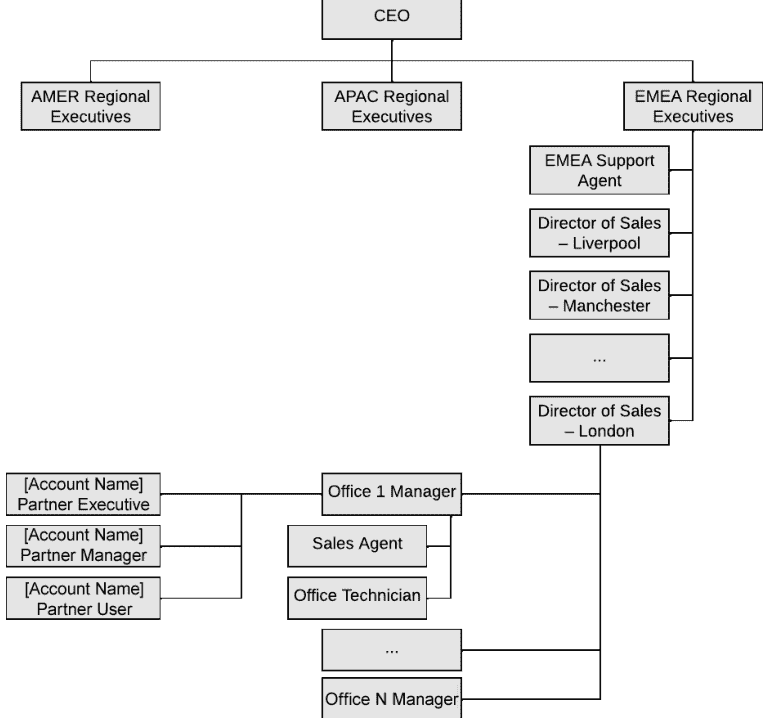

图 13.3 – 角色层次结构（最终）

现在，进入下一项要求。

> 支持事件应仅对支持代理及其经理可见。

您可以采用与前一项要求中使用的类似方法。您可以创建一个公共组，确保选中 **使用层次结构授予访问权限** 复选框，并将所有支持代理角色添加到该组。您还需要将 Case 对象的 OWD 设置为私有，然后创建一个基于条件的共享规则，将特定类型的 Case 记录共享给此公共组。请记住，一旦将 Account 对象的 OWD 设置为私有，您就别无选择，只能将 Case 对象也设置为私有。

基于条件的共享规则将授予支持代理、其经理以及角色层次结构中高于他们的所有人对 `Case` 记录的访问权限。

如果区域高管和 CEO 之间有多个其他角色，您可能需要禁用 **使用层次结构授予访问权限** 复选框，并为支持代理及其经理使用不同的公共组。

*仅办公室技术人员可以更新汽车状态，以指示该汽车已停用并需要维修。*

您已使用 `Product` 对象来建模汽车。在这种情况下，您需要添加一个自定义字段来指示汽车状态；您可以将其命名为 `car_status__c`。然后，您可以将该字段的 **字段级安全性（FLS）** 设置为所有配置文件的只读，技术人员除外，他们将获得此编辑权限。

这是一个容易得分的点。但是，没有任何图表显示 FLS 设置。因此，您需要确保在演示中提出此解决方案。

更新您的数据模型图，然后进入下一项要求。

*办公室技术人员不应能够查看客户的驾驶执照号码。*

这是另一项可以使用 FLS 解决的要求。这次，您需要让技术人员配置文件的用户完全不可访问（不可见）`Contact` 对象上的 `Driving_license__c` 字段。

进入下一项要求。

*一旦检测到盗窃事件，仅接受过该类型事件培训的支持代理、其经理以及区域高管才能查看事件详情。*

您在解决方案中使用了 `Case` 对象来建模盗窃事件。您如何根据技能将 `Case` 分配给正确的团队？

Salesforce **全渠道（Omni-Channel）** 提供 **基于技能的路由** 功能。您还可以为盗窃事件定义一个特定队列，并将所有受过培训的支持代理添加到该队列。然后，您可以使用标准 **案例分配规则** 将特定类型的 `Case` 分配到此队列。

那么，您应该遵循哪种方法？两种方法都可以实现目的；但是，您需要展示您知道从工具箱中选择最合适的工具。作为一个简单的经验法则，这两种方法的区别如下：

- **队列** 适合表示单一技能。如果您需要表示多个技能，则需要定义多个 **队列**。用户可以分配给多个 **队列**，但 `Case` 记录只会分配给其中一个 **队列**。
- **基于技能的路由** 会考虑完成特定 `Case` 所需的所有技能。然后，它会识别拥有这些技能的用户，并将 `Case` 记录分配给其中一名用户。

前一种方法设置更简单。此外，它足以满足此需求。你可以使用基于队列的分配来解决此需求。由于你的角色层级设置，角色层级较高的用户将默认获得这些记录的访问权限。

区域执行团队应能访问所有区域数据，包括驾驶员行为，例如急刹车。

区域执行团队将默认获得其区域内所有数据的访问权限，这是由于所提议的角色层级。

驾驶员行为数据存储在 Heroku 和 CRM Analytics 中。区域高管需要 CRM Analytics 许可证。你之前在图 12.2（参与者和许可证图）中已勾勒出这一点。现在，你已确认。更新你的参与者和许可证图，然后进入下一个需求。

办公室经理只应能查看其所在国家的合作伙伴账户详细信息。

办公室经理拥有合作伙伴账户。无论 OWD 设置如何，他们都可以查看自己拥有的记录。但是，此处的需求表明，他们应能查看其所在国家的所有合作伙伴账户，即使这些账户由其他办公室经理拥有。

你可以使用基于国家的公共组，就像处理其他先前需求一样，并将该国的所有办公室经理角色添加到其中。此处唯一的区别是，由于合作伙伴账户始终由办公室经理拥有，你可以使用基于所有者的共享规则。

此基于所有者的共享规则非常简单：将此公共组成员拥有的所有账户记录共享给组内所有成员。你最终将得到 10 个基于所有者的共享规则，这远低于控制器限制。

合作伙伴应仅能使用 Salesforce 管理的凭据登录 Salesforce。

你可以为客户和合作伙伴使用单个社区，但这是一种不寻常的设置。他们可能期望完全不同的 UI、服务和用户体验。

你可以为合作伙伴提议一个单独的社区，且该社区不配备外部身份验证提供程序。这将确保合作伙伴只能使用 Salesforce 管理的凭据登录 Salesforce。因此，该需求已满足。

将合作伙伴社区添加到你的架构图中，然后进入下一个需求。

客户可以在在线门户和移动应用上自行注册。

你在第 12 章“实践评审委员会：首次模拟”中已经梳理了整个客户注册业务流程。要启用客户自助注册，必须在社区设置中打开该选项。

同样，这是一个易于收集的要点。由于其简单性，也很容易被遗漏。

客户还应能够使用其 Facebook 账户登录在线门户和移动应用。

客户和合作伙伴将拥有两个独立的社区。客户社区可以配置为将 Facebook 作为 **身份验证提供程序**（Salesforce 功能的确切名称是 **Auth. Provider**）。你在描述社交单点登录解决方案时必须清晰，并提及该功能的名称。你还需要解释如何使用 **注册处理程序**来管理用户配置、更新以及与现有 Salesforce 用户的关联。

注册处理程序是一个实现 `RegistrationHandler` 接口的 Apex 类。当用户由身份验证提供程序（例如 Facebook）进行身份验证时，一个包含多个值的数据结构会被传回 Salesforce，并由与该身份验证提供程序关联的注册处理程序类接收。

该类随后可以解析此有效载荷并执行 Apex 逻辑，以确定是需要配置新用户还是需要更新现有用户。`email address` 是唯一标识用户的常见属性（在此情况下，它等同于你的社区用户的 *联合标识符*）。但是，场景可能会要求使用不同的属性，例如电话号码。在问答环节中，你也应预料到此类要求。

因此，你需要练习创建注册处理程序并尝试这些场景。你从身份验证提供程序接收到的有效载荷包含多个标准属性，但也可能包含自定义属性。这些属性可用于丰富 Salesforce 中的用户定义。在某些情况下，这些属性中的某一个可能是给定企业所需的 *联合标识符*。

不言而喻，你应准备好为该身份验证流程绘制序列图。你之前在 *第 4 章、核心架构概念：身份和访问管理* 中了解过 OAuth 2.0/OpenID Connect Web 服务器流。

> **注意**
> 
> 评委可能会要求你解释/绘制分层流程（即多个流程组合在一起）的序列，例如，社区用户从 Salesforce Mobile Publisher 应用连接并使用社交单点登录进行身份验证。在此示例中，分层流程为 OAuth 2.0（或 OpenID Connect）用户代理和 OpenID Connect Web 服务器。

通过添加新的 **单点登录 (SSO)** 接口来更新你的架构图和集成接口，然后进入下一个需求。

已登录企业网络的 PPA 员工应能够自动登录 Salesforce，而无需再次提供其凭据。

此要求应直接让你想起在 *第 4 章、核心架构概念：身份和访问管理* 中接触过的一种身份验证协议，该协议用于网络（例如本地企业网络）以提供 SSO 功能。所指的协议是 **Kerberos**。

一旦用户登录企业网络（这基本上就是员工早上打开笔记本电脑/台式机并登录域时所做的事情），将发生以下简化步骤：

- 1. 当用户从笔记本电脑/台式机登录域时，**密钥分发中心 (KDC)** 会颁发一个票据/令牌。此令牌在无需任何用户交互的情况下透明地颁发，并存储在用户的计算机上（在特定缓存中）。
- 2. 当需要向任何其他系统进行身份验证时，浏览器会使用此缓存的令牌。你需要在浏览器本身中更新一些设置来启用此功能（例如 **启用集成 Windows 身份验证**）。这些配置超出了本书的范围。

为了澄清什么是 **KDC**，在基于 Windows 的网络中，KDC 是 **域控制器 (DC)**。

例如 **PingFederate** 之类的身份验证提供程序为 Kerberos 提供 *适配器*，这使它们能够促进 Kerberos 令牌的请求、接收和验证（在 Kerberos 中，票据和令牌这两个术语可以互换使用。例如，**PingFederate IDP**（Ping Identity 产品的全称）的运作方式如下：

- 1. 当客户端通过点击深度链接（或书签）发起 SP 启动的 SSO，或通过从特定页面点击链接发起 IDP 启动的 SSO 时，会向 **PingFederate** 发送身份验证请求。
- 2. 使用 Kerberos 适配器，**PingFederate** 会将响应 `HTTP 401 Unauthorized` 将用户重定向回浏览器。
- 3. 浏览器（如果配置正确）会将 Kerberos 令牌返回给 **PingFederate**。
- 4. **PingFederate** 接收令牌后，会根据存储在 **PingFederate** 适配器中的设置验证其域。
- 5. 验证成功后，**PingFederate** 从票据中提取 **安全标识符 (SID)**、域和用户名，生成 SAML 断言，然后将其传递给 SP。
- 6. SP（在此示例中为 Salesforce）接收断言并根据其对用户进行身份验证。

值得注意的是，**PingFederate** 将与 **LDAP** 集成，根据场景，LDAP 是 PPA 的身份存储。如果 PPA 使用 **Active Directory (AD)**，你本可以使用 **ADFS**。但是，该产品目前不支持 LDAP。

以下序列图（第 4 章，核心架构概念：身份与访问管理 中 SAML SP 启动流程的修改版）说明了此流程。请注意，此图已简化，并未详细描述 Kerberos 的工作方式：

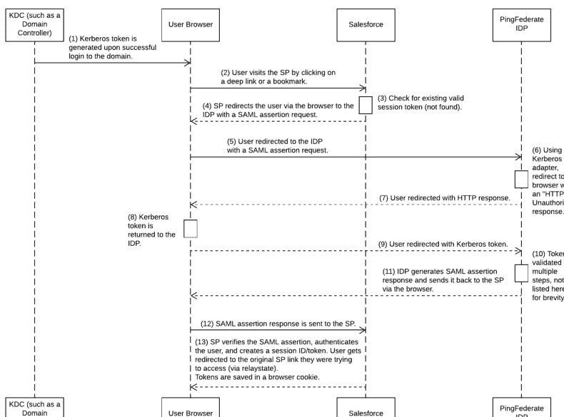

图 13.4 – 带有 Kerberos 的 SAML SP 启动流程

请准备好绘制并解释此序列图，类似于你在第 4 章，核心架构概念：身份与访问管理 中涵盖的任何其他身份验证流程。

在你的架构图和集成接口中添加另一个 SSO 接口，然后进入下一个要求，该要求从以下内容开始：

PPA 员工可以使用 LDAP 凭据从企业网络外部登录到 Salesforce。

好消息是，PingFederate 等工具支持这两项请求的功能。PingFederate 有一个名为“自适应身份验证和授权”的功能，它提供了一组功能，包括读取用户的 IP 地址以确定用户位于企业网络内部还是外部，并据此驱动不同的行为。

如果用户从企业网络范围外的 IP 登录，你可以配置 PingFederate 请求多因素身份验证（MFA）。下面的简单流程图说明了此逻辑：

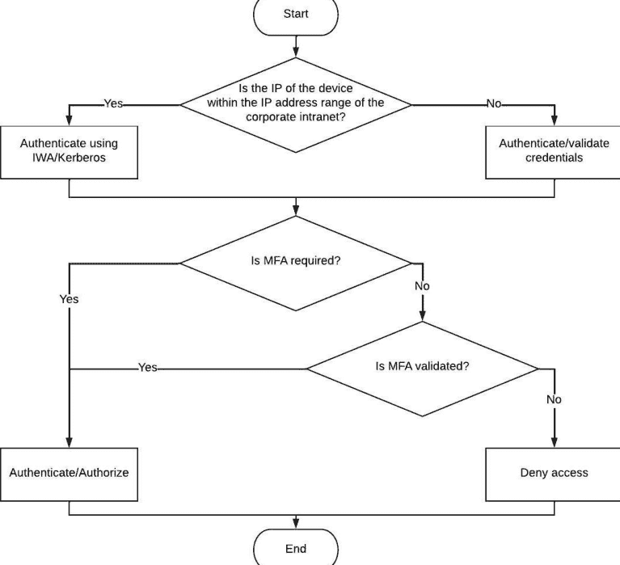

图 13.5 – 说明带有 MFA 的 PingFederate 自适应身份验证和授权的流程图

你可以使用 PingID 等移动应用程序来接收和解决第二个身份验证因素（例如，短信）。将移动应用程序添加到你的架构中。你不需要为它添加新的集成接口，因为它将与 PingFederate 而非 Salesforce 通信。

可访问性和安全性部分的要求到此结束。恭喜！你已经从复杂度角度覆盖了场景的近 85%。你仍有几个要求需要解决，但你已经通过了大部分棘手的主题。继续前进。下一个目标是报告要求。

## 分析报告要求

报告要求偶尔可能会影响你的数据模型，特别是在决定采用反范式化数据模型以减少生成的记录数量时。报告还可能推动对额外集成接口的需求，或引发对某些特定许可证的需求。逐一查看 PPA 共享的要求并逐个解决。

区域执行团队希望有一份报告，显示过去 10 年中客户驾驶行为与特定季节之间的关系。

此报告需要处理大量数据。驾驶行为的原始数据在 Heroku 中。你可以使用 CRM Analytics 等工具来创建所需的报告。你已经在架构设计中拥有了它。`Int-011` 集成接口可用于将数据从 Heroku 传输到 CRM Analytics。你可以在需要时在 Salesforce 核心云中公开仪表板。

进入下一个要求，该要求从以下内容开始：

区域执行团队希望有一份月度趋势报告，显示每次租赁的取车和还车地点。

指出需要趋势报告的报告要求应将你指向以下功能之一：

- **报告快照**：Salesforce 核心云内的一种功能，使用户能够对平台上存储的历史数据进行报告。用户可以将标准报告结果保存在自定义对象中，然后安排作业运行特定报告，并使用数据填充自定义对象上的映射字段。完成后，用户可以对包含报告结果的自定义对象进行报告，而不是对原始数据进行报告。

- **分析/商业智能工具**：这些工具旨在处理海量数据集。它们提供更大的灵活性来钻取细节并分析其模式。此外，这些工具可以处理 Salesforce 平台内外的数据。

你会为这个要求选择哪一个？

如果你选择报告快照，那么请准备好在问答环节中，如果评委决定增加挑战并要求你提供更多钻取数据的能力，或将 Salesforce 中存储的数据与存档在 Heroku 上的数据相结合，调整你的解决方案。

一个更好、更具可扩展性且更安全的选择是选择分析工具，例如 CRM Analytics。

同样，你已经在架构中拥有了 CRM Analytics 及一系列接口。你现在可以确认区域执行团队成员将需要 CRM Analytics 许可证。更新你的参与者和许可证图，然后进入下一个要求。

客户应能够查看其租赁预订的完整历史记录，包括过去三年的预订。

此报告所需的数据大部分存在于平台之外。作为提醒，未完成订单将在 Salesforce 中，而已完成订单将被存档到 Heroku。

尽量不要给自己增加复杂性，思考一个从两个来源混合数据并在单个界面上显示的自定义解决方案。采用简单的开箱即用功能。

你可以简单显示两个不同的列表：一个是未完成订单，另一个是已完成订单。前者直接从 Salesforce 检索，后者使用 **外部对象** (**Salesforce Connect**) 检索。`Int-014` 集成接口可用于此。

还有一点需要考虑；到目前为止，你一直计划为 `Int-014` 接口使用主体用户向 Heroku 进行身份验证。这意味着将返回主体用户可以访问的所有数据，这通常是所有可用数据。

要将此类接口暴露给最终客户，你需要遵循以下两种方法之一：

- 将身份验证策略切换到按用户。这将把控制谁看到什么的责任转移到 Heroku。Heroku 必须有一个全面的模块来确定每个用户可以从其数据库中查看或检索的字段、对象和记录。此方法可行，但将需要自定义开发，因为 Heroku 不带有类似 Salesforce 核心云中的高级共享和可见性模块。

- 在外部对象之上开发自定义 Lightning 组件，以使用当前用户的 ID 过滤检索到的记录。这将确保用户只能查看他们应该看到的记录。但是，这不是一种安全的方法，因为 Lightning 组件中的错误可能会泄露不应显示的记录。

此外，考虑到安全措施是由 UI 层而非数据层应用的，经验丰富的黑客有可能找到一种方法来访问他们无权访问的记录。

如果你能传达相关风险和注意事项，可以提出第二种方案。这将是你在本场景中采用的方法。你还需要解释为什么你更倾向于选择它而不是第一种方案（例如，为了节省 Heroku 上的开发工作量）。

客户还应能够查看每个已完成租赁的完整行程历史。

这是一个与之前要求相似的挑战。这是个好消息，因为你可以提出类似的解决方案。

完整的行程历史数据也存储在 Heroku 上。你可以开发一个 Lightning 组件，当用户点击特定租赁记录旁边的 **显示行程** 按钮时显示该组件。当组件显示时，它会检索外部对象的数据，按用户 ID 进行过滤，并在 UI 上显示它们。

请记住，你必须在演示中解释所有这些内容。仅仅说你将开发一个满足此要求的 Lightning 组件是不够的。你必须解释它将如何使用以及如何运行。毕竟，这就是你的客户期望你的。

现在，进入下一个也是最后一个报告要求。

*合作伙伴应能够查看 PPA 完成的修复工作的月度报告。*

这是一个直接的要求。修复工作表示为 Case。合作伙伴用户可以简单地使用标准报告和仪表板来显示他们有权访问的 Case 数据，即分配给其用户之一的 Case 记录。

报告部分的要求到此结束。场景的最后部分通常列出与治理和开发生命周期相关的要求。保持势头，迎接下一组要求。

## 分析项目开发要求

场景的这一部分通常侧重于 Salesforce 项目中用于治理开发和发布流程的工具和技术。此前，你在 *第 10 章，开发生命周期和部署规划* 中创建了一些很好的工件，例如 *图 10.3（拟议的 CoE 结构）*、*图 10.4（拟议的 DA 结构）* 和 *图 10.7（开发生命周期图（最终））*。

这些工具在这个阶段将派上用场。尝试记住它们，并熟悉绘制和解释它们。你现在将逐一查看 PPA 共享的不同要求，并看看如何将这些工具付诸行动以解决一些提出的挑战。从第一个要求开始，该要求以以下内容开始：

*PPA 计划有三个不同的服务实施商（SI），在并行项目中交付不同的功能。*

解决此类情况的最佳机制是使用多层开发环境实现源代码驱动开发。CI/CD 还将通过确保所有开发人员都在尽可能最新的代码库上工作（可能不是最新的，但也是最接近的）来减少冲突的机会。

在 *第 10 章，开发生命周期和部署规划* 中，你涵盖了此设置的依据和优势。请记住，这是你在演示中需要解释的内容。仅仅绘制图表或抛出一些热门术语而不展示足够的实际知识是不够的。

你还看到了一个示例开发生命周期图，*图 10.7（开发生命周期图（最终））*。这可以作为此类场景的基础使用。这里有三个不同的 SI，因此在图表中有三个不同的线程/团队是合理的。

您的图表可能如下所示：

| 部分 | 列 1 | 列 2 | 列 3 | 列 4 | 列 5 | 列 6 |
|---|---|---|---|---|---|---|
| **环境** | SI 团队 1：开发环境（Developer 沙箱/Scratch org） SI 团队 2：开发环境（Developer 沙箱/Scratch org） SI 团队 3：开发环境（Developer 沙箱/Scratch org） | SI 团队 1：SI QA 环境（Developer 或 Developer Pro 沙箱/Scratch org） SI 团队 2：SI QA 环境（Developer Pro 或部分副本沙箱/Scratch org） SI 团队 3：SI QA 环境（Developer Pro 或部分副本沙箱/Scratch org） | 可选：热修复环境（Developer 沙箱） | 可选：培训环境（部分副本沙箱） | 可选：集成测试环境（Developer Pro 或部分副本沙箱） | 从 SCM 分支创建：集成测试。此环境通常位于 QA 环境之后。 |
| **SCM 分支** | 功能分支 | 功能 QA 分支 | CI 分支 | QA 分支 | 预发布分支 | 版本分支 主分支 |
| **进行的活动** | 开发新功能 | 在本地测试新功能 | 合并新的/更改的元数据 | QA 测试 | UAT 测试、预发布和培训 | 生产环境，功能发布给用户 |
| **执行的测试** | • 开发者测试 • 单元测试 | • 开发者测试 • 单元测试 • 自动化功能测试 • 手动功能测试 | • 单元测试 • 自动化功能测试 • 代码质量检查 | • 单元测试 • 自动化功能测试 • 手动功能测试 • 回归测试 | • 单元测试 • 自动化功能测试 • 用户验收测试 • 负载测试 • 性能测试 | • 单元测试 • 冒烟测试 |
| **参与者** | 开发者 | 开发者 | • 发布经理 • 开发团队负责人 • 开发者 | 发布经理 | 发布经理 | 发布经理 |

### 图 13.6 – 开发生命周期图（最终）

您还需要一个自动化构建和部署工具。有开源解决方案，例如 Jenkins，以及专为 Salesforce 环境构建的工具，例如 Copado 和 AutoRABIT。选择一个并将其添加到您的环境中。另外，请记住添加自动化测试工具，例如 Selenium 或 Provar。

进入下一个要求，其开头如下：

*历史上，系统集成商在处理其他平台时习惯遵循自己的编码标准。*

这是一个有趣的要求。这里的挑战与不同 SI 团队之间缺乏标准化和沟通有关。

CI/CD 能解决这个问题吗？不太能。它可以通过自动化代码扫描和受控合并稍微改善情况，但要显著改善标准化、沟通、复用性和整体质量，您需要引入 Salesforce CoE。

汇集功能和技术资源，您甚至可以引入设计权威作为另一种组织结构，以确保在开始任何开发工作之前，讨论、验证并批准每一个需求。

在第 10 章“开发生命周期和部署规划”中，您了解了每个结构的价值和结构。图 10.3（提议的 CoE 结构）和图 10.4（提议的 DA 结构）也可帮助您可视化这两种结构。

不太可能要求您绘制 CoE 或 DA 结构，但您很可能会被问及它们的价值以及解决的挑战。如果您正在参与同时拥有这两者的项目，那真是个好消息。否则，不要害怕向您的利益相关者提出这一建议。这种结构为项目带来实实在在的好处，同时有助于培养其成员的技能。这对每个人都是双赢的。

*PPA 有一位新的平台所有者，她是从另一家也使用 Salesforce 的公司加入的。*

基于她在之前工作单位的经验，新加入的平台所有者报告称，UAT 中多次修复了错误，但随后又在生产环境中重新出现。这种令人遗憾的经历影响了许多人对平台敏捷性和采用现代发布管理概念能力的评判。通常，这最终会变成对合理概念的糟糕改编。在其他情况下，例如这一情况，显然是由于环境管理策略和发布周期不佳所致。

当 UAT 中的错误被修复时，UAT 的代码库将与较低环境中的代码库不一致。下次从较低级别的环境（例如开发环境）推广功能时，可能会轻易覆盖之前在 UAT 中所做的更改。最终，当推送到生产环境时，已解决的错误又会回来。

您可以简单地说，这种情况发生是因为客户没有使用适当的 CI/CD 发布管理策略，可能依赖于变更集等机制。然而，这不被视为足够好的回答。您不应该使用流行语，而是需要详细解释、教育和证明。这正是 CTA 在评审委员会和实际工作中应该做出的回应。

这个问题可以通过以下三种方式之一解决：

- 修复 UAT 错误后，每个较低环境都应刷新其代码库以获取此新更改。这需要高度的纪律和组织性。
- 在推广较低环境的代码时，避免覆盖 UAT 中现有的冲突功能。尝试与开发团队解决这个问题。这并不总是容易的，在处理 Salesforce Flows 等点击式配置功能时可能会变得困难。
- 在热修复分支和环境中修复错误，将分支合并到 UAT，然后将其推广到生产环境。热修复分支也用于刷新所有较低级别的环境分支。此选项听起来与第一个非常相似，但区别在于它更可追踪且更易于治理。您仍然需要适当水平的纪律和组织性。

像 Copado 这样的发布管理工具使用图形用户界面（GUI）和点击式配置功能，而不是纯命令行界面（CLI），使这一过程比通常更容易。

您必须对这类要求给出足够详细的回答，但不要过度展开。请留意时间，确保留出足够时间涵盖其他主题，无论是在演示环节还是问答环节。

进入本节的最后一个要求，其开头如下：

*PPA 希望先在意大利发布该解决方案，然后根据预先约定的时间表在其他国家推出相同的解决方案。*

您已经解释过在这些情况下 CoE 结构的价值。它是确保每个人都参与、分享想法和反馈，并了解计划功能和路线图的最佳组织结构。冲突的业务需求正是在此被发现和解决。CoE 将旨在在所有国家创建统一流程。

但是，除此之外，您还需要合适的交付方法来确保解决方案的顺利推出。CoE 和 DA 将确保以正确的方式收集、验证和实施需求，以保证高质量。此外，它们还将确保功能的开发能够适应各国之间的轻微流程差异。100% 统一的全球流程是一个难以实现的目标。您的解决方案应设计为以可扩展的方式适应并接纳轻微差异。

在选择合适的交付方法时，请考虑以下几点：

- 严格的 **瀑布方法** 将确保明确的范围和详细的端到端解决方案。然而，它也会在开发团队和最终将使用该解决方案的业务之间造成巨大的隔阂。此外，它具有更长的价值实现周期。

- **敏捷方法** 确保业务更贴近所开发的解决方案。这能提高采用率并实现快速反馈。然而，如果没有清晰的愿景，这很容易创建一个对某个国家完美契合但对其他国家不合适的解决方案。即使在短期内，这样也很难维护。

- **混合方法** 确保您在做出小幅度妥协的同时兼得两者之长。在蓝图阶段，您会获得一个相对明确的范围，并覆盖 70%-80% 范围的端到端解决方案。它不如瀑布方法那样严格和明确，但它从第一天起就能降低许多风险。

在冲刺的细化活动中，解决方案会进一步澄清。有了 DA 结构，您可以确保在开始交付之前，每个用户故事的解决方案都会被合适的人员质疑并进行技术验证。

再次强调，在解释此类要求时请留意时间。一些候选人在解释这部分时会过度展开，大多是在描述个人经历。另外，请记住您的时间非常有限。您的首要目标是通过评审委员会。

许多候选人在演示的这个阶段会精疲力竭，考虑到到目前为止所需的心理和情感努力，这完全可以理解。但是，您需要保持镇定。您离成为 CTA 很近了。还不要放松对方向盘的控制。

项目开发部分的要求到此结束。下一部分通常较有限，包含其他一般主题和挑战。保持势头，继续进行下一组要求。

## 分析其他要求

在完整的模拟场景中，其他要求部分可能包含其他部分尚未涵盖的任何其他内容的进一步要求。此部分通常包含有限数量的要求。

在这一阶段，您对 Salesforce 平台及其生态系统的经验和广泛知识将发挥至关重要的作用。接下来，探索共享要求。

_PPA 希望确保开发环境中的数据始终经过匿名化处理。_

今天，考虑到所有数据隐私法规，这是一项基本要求。作为 CTA，您不仅应准备好回答这个问题，还应主动向客户提出该问题。

并非所有用户都应或能够访问生产环境数据。即使部分用户拥有访问权限，也可能仅限于特定记录集。在不同开发沙箱中开发新功能或修复 bug 时，确保开发者和测试人员使用的是测试数据至关重要。即使在处理暂存环境（其中的数据应尽可能接近生产环境）时，您仍需确保数据经过匿名化、去标识化处理，甚至被删除。以下是对这三种选项的简要说明：

- **匿名化**：通过更改和打乱字段内容来工作，使其变得无法解释。例如，名为雷切尔·格林的联系人可能变成 hA73Hns#d$。诸如 RachelG@gmail.com 之类的电子邮件地址可能变成 JA7ehK23 之类的不可读值。

- **去标识化**：将字段转换为与原始值无关的可读值。例如，名为雷切尔·格林的联系人可能变成马克·贝茨。诸如 RachelG@gmail.com 之类的电子邮件地址可能变成 MarkBates@SomeDomain.com。

- **删除**：这更明显；此方法只是清空目标字段。

Developer 和 Developer Pro 沙箱包含您生产环境组织的元数据副本，但不包含数据。但是，Partial Copy 沙箱包含元数据和您定义的选定数据集。Full Copy 沙箱包含您所有生产数据和元数据的副本。

在此处，您的策略可以是执行以下操作：

- 确保在 Developer 和 Developer Pro 沙箱中使用的数据始终是专门创建的测试数据。

- 确保 Partial 或 Full Copy 沙箱中的任何数据都经过匿名化或去标识化处理。您可以使用 **Salesforce Data Mask**（这是一个托管包）、自定义开发的 ETL 作业、自定义开发的 Apex 代码或 **Odaseva** 或 **OQCT** 等第三方工具来实现这一点。

> > **注意**
> > 您可以在以下链接中找到有关 **Salesforce Data Mask** 的更多详细信息：https://packet.link/pTX3n.

建议为 PPA 使用该工具。将 **Salesforce Data Mask** 添加到您的景观架构图中。您的景观架构图应如下所示：

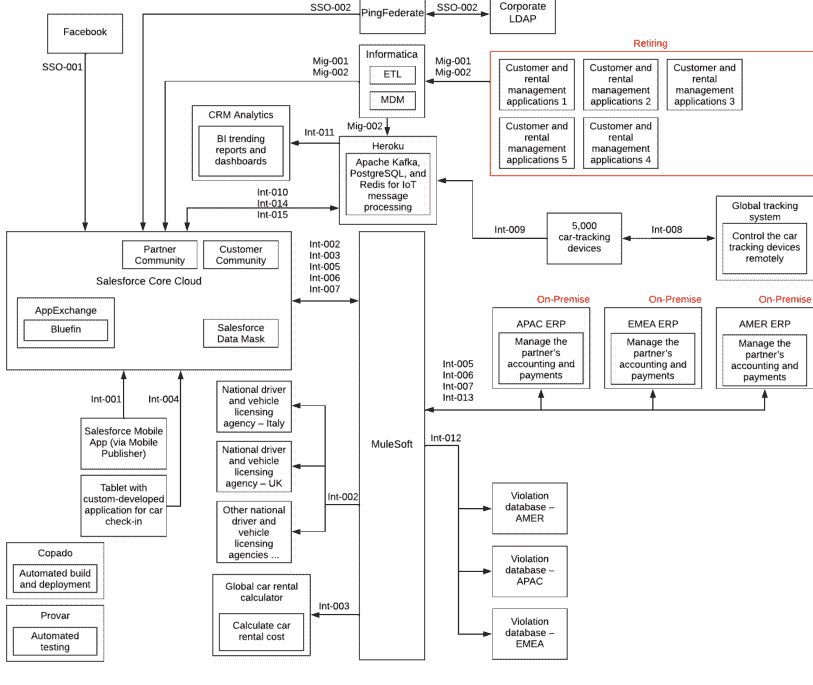

### 图 13.7 – 景观架构（最终）

### 您的集成接口列表应如下所示：

| 接口代码 | 源/目标 | 集成层 | 集成模式 | 描述 | 安全性 | 身份验证 |
| :--- | :--- | :--- | :--- | :--- | :--- | :--- |
| Int-001 | Salesforce 移动应用（通过 Mobile Publisher）> Salesforce | 数据 | 远程调用 | 客户注册和与客户社区中所有可用服务的交互。数据使用 Salesforce REST API 检索。 | HTTPS（单向 SSL/TLS） | OAuth Connect 用户代理流。 |
| Int-002 | Salesforce >> MuleSoft >> 特定国家的驾驶执照和车辆登记处 | 业务逻辑 | 远程进程调用 – 请求和答复 – 阻塞 | 验证客户的驾驶执照。此交互以实时/阻塞模式触发。销售代理点击启动事务的按钮，调用 MuleSoft 公开的 Web 服务。然后 MuleSoft 会确定要调用的正确许可机构，调用正确的端点并返回结果。客户在自助注册期间也会触发相同的流程。 | Salesforce 和 MuleSoft 之间的 HTTPS（双向 SSL/TLS） | Salesforce 和 MuleSoft 之间的 OAuth 2.0 Web 服务器流（然后是刷新令牌流），带有相互身份验证。MuleSoft 与国家许可机构/全球汽车租赁计算器之间的简单身份验证。 |
| Int-003 | Salesforce >> MuleSoft >> 全球汽车租赁计算器 | | | 根据一组参数计算估计零售价。在搜索和显示可用汽车时以阻塞模式调用该接口。 | | |
| Int-004 | 平板电脑应用 >> Salesforce | 数据 | 远程调用 | 车辆提车登记。平板电脑接受输入（激活码）并调用 Salesforce REST API 进行验证。如果验证成功，平板电脑还将更新订单状态。 | HTTPS（单向 SSL/TLS） | OAuth Connect 用户代理流。 |
| Int-005 | Salesforce << >> MuleSoft << >> ERP | 数据 | 批量数据同步 – 异步 | 安排 MuleSoft 批量作业以将客户详细信息从 Salesforce 同步到 ERP。这还包括其他几个查找/主数据表，例如 Products。计划作业的频率假设为 15 分钟。 | Salesforce 和 MuleSoft 之间的 HTTPS（双向 SSL/TLS） | Salesforce 和 MuleSoft 之间的 OAuth 2.0 Web 服务器流（然后是刷新令牌流），带有相互身份验证。MuleSoft 与 ERP 之间的简单身份验证。 |
| Int-006 | | | | 安排 MuleSoft 批量作业以将订单、订单项目和付款从 Salesforce 同步到 ERP。计划作业的频率假设为 15 分钟。 | | |
| Int-007 | | | | 安排 MuleSoft 批量作业以将发票标头从 ERP 同步到 Salesforce。计划作业的频率假设为一小时。 | | |
| Int-008 | 全球跟踪系统 >> 跟踪设备 | 业务逻辑 | 远程进程调用 – 请求和答复 – 阻塞 | 远程配置跟踪设备。 | HTTPS（单向 SSL/TLS） | OAuth 2.0 资产令牌流。 |
| Int-009 | 跟踪设备 >> Heroku | 数据 | 请求和答复 – 阻塞 | 汽车 GPS 坐标和速度等数据从跟踪设备发送到 Heroku。 | | |
| Int-010 | Heroku << >> Salesforce | 数据 | 批量数据同步 – 异步 | Salesforce Core Cloud (Force.com) 与 Heroku 上的跟踪设备之间的双向数据同步。假设对象为 Account 和 cases。此接口用于将第三方事件从 Heroku 传输到 Salesforce。 | HTTPS（单向 SSL/TLS） | OAuth 2.0 Web 服务器流（然后是刷新令牌流）。 |
| Int-011 | Heroku >> CRM 分析 | | | 将 Heroku 中聚合的传感器读数数据复制到 Salesforce CRM 分析。 | | |
| Int-012 | 违规数据库 >> MuleSoft >> ERP | 数据 | 批量数据同步 – 异步 | 安排 MuleSoft 批量作业以查询违规数据库中与 PPA 相关的任何新数据，然后将该数据传输到 ERP 以处理违规行为。计划作业的频率假设为 15 分钟。 | HTTPS（单向 SSL/TLS） | MuleSoft 与 ERP 之间的简单身份验证，用于获取违规数据库和违规数据库。 |
| Int-013 | Salesforce << >> MuleSoft << >> ERP | 数据 | 批量数据同步 – 异步 | 安排 MuleSoft 批量作业以将处罚发票标头从 ERP 同步到 Salesforce。计划作业的频率假设为一小时。 | Salesforce 和 MuleSoft 之间的 HTTPS（双向 SSL/TLS） | Salesforce 和 MuleSoft 之间的 OAuth 2.0 Web 服务器流（然后是刷新令牌流），带有相互身份验证。MuleSoft 与 ERP 之间的简单身份验证。 |
| Int-014 | Heroku >> Salesforce | UI | 数据虚拟化/混搭/OData | 存档数据使用 Salesforce Connect 在 Salesforce 中按需检索。检索的数据不会存储在 Salesforce 中。 | HTTPS（单向 SSL/TLS） | OAuth 2.0 Web 服务器流（然后是刷新令牌流）。 |
| Int-015 | Salesforce >> Heroku | 数据 | 批量数据同步 – 异步 | 使用 Heroku Connect 从 Salesforce Core Cloud (Force.com) 到 Heroku 的单向数据同步。假设对象：Order、OrderItem、Payment_C__c、Invoice_Header__c 和 Cases。此接口用于将已关闭的订单及其相关记录（例如 OrderItem）从 Salesforce 存档到 Heroku Postgres。可将其用作存档过程的一部分，以减轻这些 LVD 在 Salesforce 中的影响。 | HTTPS（单向 SSL/TLS） | OAuth 2.0 Web 服务器流（然后是刷新令牌流）。 |
| Mig-001 | 旧版租赁管理应用 >> Informatica >> Salesforce 和 Heroku | 数据 | 批量数据同步 – 异步 | 客户数据将从旧版租赁管理应用迁移到 Informatica MDM，在那里基于复杂的模糊逻辑进行去重。完成此操作后，去重后的客户数据将迁移到 Salesforce 和 Heroku。 | HTTPS（单向 SSL/TLS） | OAuth 2.0 Web 服务器流。 |
| Mig-002 | 旧版租赁管理应用 >> Informatica >> Salesforce | 数据 | 批量数据同步 – 异步 | 旧版租赁数据将从旧版租赁管理应用迁移到 Salesforce 和 Heroku。存档数据将迁移到 Heroku，而开放租赁订单将迁移到 Salesforce。 | HTTPS（单向 SSL/TLS） | OAuth 2.0 Web 服务器流。 |
| SSO-001 | 使用 Facebook Community 作为 IDP 的移动社区的 SSO（社交登录） | SSO | SSO – OpenID Connect | 使用 Facebook 作为授权服务器和身份存储的 OpenID Connect SSO。 | HTTPS（单向 SSL/TLS） | OpenID Connect Web 服务器流。 |
| SSO-002 | 使用 Ping Identity 作为 IDP 和 LDAP 作为身份存储的 Salesforce SSO | SSO | SSO – SAML 2.0 | 使用 Ping Identity 作为 IDP 和 LDAP 作为身份存储的 SAML 2.0 SSO。 | HTTPS（单向 SSL/TLS） | SAML 2.0 SP 启动的流。 |

### 图 13.8 – 集成接口（最终）

你的数据模型图应如下所示：

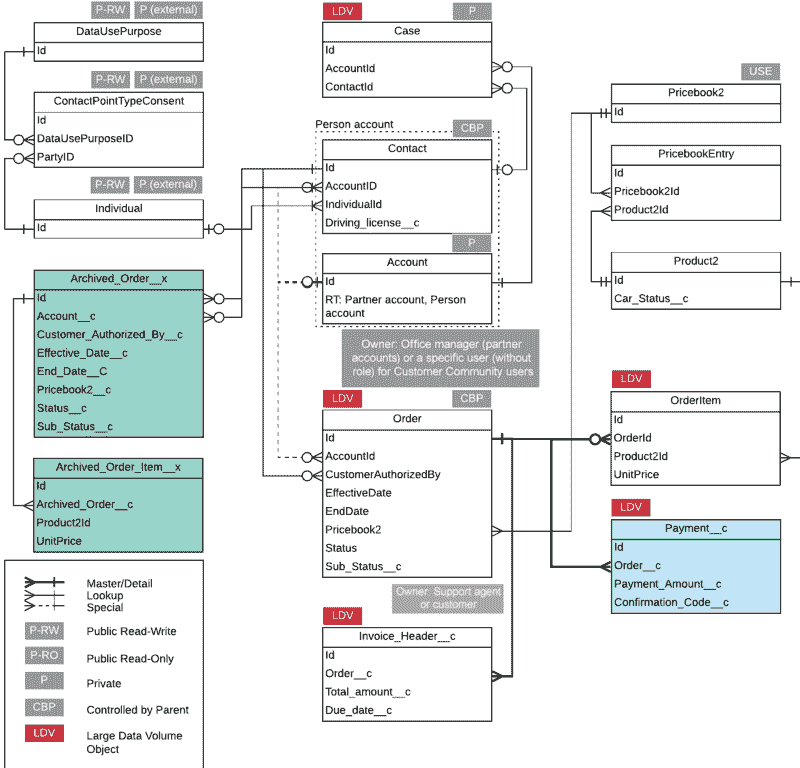

图 13.9 – 数据模型（最终）

最后，你的角色和许可证图应如下所示：

### 销售代表（Sales Cloud 许可证）
- 帮助现场客户注册
- 为现场客户预订汽车租赁
- 检查返还的汽车是否有损坏
- 提供最终客户发票

### 支持代理人（Service Cloud 许可证）
- 支持注册客户并解决报告的问题
- 响应电话请求（支持和预订）

### 区域高管团队（Sales 和 Service Cloud 许可证，CRM Analytics 许可证）
- 分析跨区域的客户租赁数据

### 办公室技术人员（Service Cloud 许可证）
- 深入检查车辆
- 向办公室经理提供维护报告

### 办公室经理（Sales Cloud 许可证）
- 管理合作伙伴关系

### 注册客户（客户社区许可证 (Login)，移动发布者用途）
- 使用在线门户自助注册
- 使用移动应用自助注册

### 合作伙伴（合作伙伴社区许可证）
- 访问系统以接收和更新维护请求？
- 使用自己的系统且仅与 PPA 的解决方案集成？

图 13.10 – 角色和许可证（最终）

注意，你已更新部分角色的暂定许可证，并将技术人员的许可证从 Salesforce Platform 许可证升级为 Salesforce Service Cloud，以便技术人员能够创建和使用 Case 对象。

恭喜你！你已经完成场景并创建了一个可扩展且安全的端到端解决方案。现在，你需要将其与一份强大、引人注目且有吸引力的演示相结合，以争取尽可能多的分数，并在问答阶段仅解决少数遗留问题。

准备好进入下一阶段了吗？继续前进。

## 演示并证明你的解决方案

现在是创建演示文稿的时刻。你将不得不在评审委员会期间即兴制作，因为创建解决方案和支持工件可能会耗费三个小时。

因此，你需要培养演示和时间管理技能，以确保在给定的时间内以足够的细节描述解决方案。你将在附录、技巧和建议以及未来方向中学习一些时间控制技巧。

在之前的章节中，你已经看到了几个深入适当细节水平的演示宣讲示例。这一次，你将专注于塑造一个实际的评审委员会演示文稿。你还将为以下主题创建演示宣讲：整体解决方案和工件介绍、一个业务流程，以及数据迁移和 LDV 缓解策略。本章将涵盖客户注册流程，因为它是最复杂且最冗长的。

随后，你将坚守立场，为你的解决方案辩护和证明，明知你可能需要根据新引入的挑战调整解决方案。首先了解演示文稿的结构和策略。

## 了解演示文稿结构

在评审委员会演示期间，你需要吸引并抓住听众的注意力。此外，你还需要帮助他们跟上你的节奏。

你可以创建一个精彩的宣讲（使用幻灯片或其他工具），从端到端描述解决方案，混合业务流程、可访问性要求和数据迁移，并以一种引人入胜但不够有条理的方式进行展示，一旦相关话题出现在你脑海中就抛出一个解决方案。

这将使评委很难跟上你的思路。你可能会先展示考试场景第 7 页上某个需求的解决方案，接着是第 3 页上某个需求的解决方案，然后再展示第 5 页上的两个需求解决方案。诚然，评委的职责是为你提供的解决方案打分，但请尽量通过更有条理地展示来帮助评委。毕竟，以有条理的方式引导听众是一项你在现实生活中真正需要的软技能。

你应该将演示文稿分为两个主要部分：

- **结构化部分**：在此部分，你将描述解决方案中特定的预先规划的元素。你通常从介绍整体解决方案和所创建的工件开始。然后，继续描述业务流程的拟议解决方案，随后解释你的 LDV 缓解和数据迁移策略。你可以根据需要向此部分添加更多元素。

在开始演示之前，你需要计划将在此部分涵盖哪些元素和需求。这将帮助你分配时间，并确保为下一部分留出足够的时间。

- **万能部分**：这是你逐一查看需求，并指出那些在第一部分未涵盖的需求的地方。这将确保你不会错过任何要点，特别是那些容易得分的点。

在以下部分中，你将为结构化部分创建示例演示宣讲。首先对解决方案和工件进行总体介绍。

在此阶段，你应当指出图表中的相关部分，以帮助评委可视化你的解决方案。即使你使用的是 PowerPoint 演示文稿，也要使用鼠标光标并在幻灯片之间切换。不要认为专业演示文稿应该单向进行。这不适用于此类演示文稿。你的宣讲可以如下所示：

PPA 正在寻求通过采用以 Salesforce 为中心的解决方案来现代化其 CRM 解决方案。他们目前在 APAC、EMEA 和 AMER 拥有区域性 ERP [在图中指出]，并在本地托管。

PPA 还在全球范围内使用五种不同的客户和租赁管理应用程序。这些应用程序将被新的以 Salesforce 为中心的解决方案所取代。

新解决方案将利用 Salesforce Sales Cloud 和 Service Cloud 作为核心系统，用于处理客户注册和预订。两个 Salesforce 社区将成为解决方案的一部分，即客户社区和合作伙伴社区。此外，我将使用一个 AppExchange 产品来处理在线支付。

该解决方案还将包括 Heroku 作为平台，用于接收和处理追踪设备接收的大量数据，以及 MuleSoft，它将是用于将 Salesforce 与其他外部和内部应用程序集成的中间件。

我选择 MuleSoft 是因为几个共享需求需要能够编排流程的中间件，例如确定目标 ERP 系统并相应地调用它。此外，使用 MuleSoft 的集成接口不会传输大量数据。正是这一点让我意识到需要 ESB 而不是 ETL。不过，我也建议使用 ETL 来处理数据迁移。

我还建议引入一个 IDP，它能够处理 PPA 共享的 SSO 需求，并支持 LDAP [在图中指出 PingFederate]。它还将处理内部用户的配置和取消配置，并支持 MFA 要求。我将很快解释这些流程。

作为解决方案的高级介绍，这应该就足够了。你已经介绍了问题和解决方案的关键元素，并为即将讨论的内容提供了一些预告。

现在，你已经引起了听众的注意。你向他们展示，你此处不是为了回答问题，而是为了就他们将投资的解决方案进行演示。请记住，他们今天是 PPA 的 CXO。

请记住在演示过程中突出你的组织策略（及其背后的理由）。然后，你可以继续解释他们需要投资的许可证。切换到角色和许可证图。如果你当面进行演示，请走动；不要只站在一个地方。你应该散发自信。走动总是奏效。你的演示可以如下所示：

我已识别出以下六位角色。根据其预期角色，他们将需要不同类型的许可证。例如，办公室经理和销售代理[在图中指向他们]将需要 Sales Cloud 许可证，因为他们需要查看预订并检查退回的汽车。他们需要创建 Cases，在我的提案中，Cases 代表检查报告。他们可以使用 Sales Cloud 或 Service Cloud 许可证，但考虑到他们的角色以及潜在的线索处理需求，我假设使用 Sales Cloud 许可证。

办公室技术人员将使用 Service Cloud 许可证，因为他们在检查过程中需要处理 Case 对象。Platform License 不支持此功能。支持代理也将使用 Service Cloud 许可证，因为他们需要处理不同类型的 Cases。

区域高管将需要 Service Cloud 和 Sales Cloud 许可证，因为他们需要访问组织中的所有数据。他们还需要 CRM Analytics 许可证，因为他们将使用该工具制作趋势报告和其他高级分析。

最后，我们有客户和合作伙伴。前者将使用 Salesforce Customer Community Login 许可证，后者将使用 Salesforce Partner Community 许可证。Customer Community 许可证非常适合一百万名 PPA 客户，考虑到它是为大量用户量身定制的。此外，我有信心可以使用共享集（sharing sets）等功能来管理他们的可访问性要求。

PPA 合作伙伴将需要 Partner Community 许可证，因为他们需要访问 PriceBooks、Products、Orders、Cases 和 Reports。此外，我们需要共享规则来控制他们的记录可见性。而且，我假设他们将需要访问 leads，这是合作伙伴的典型需求。

这就结束了整体高级方案演示。这部分从头到尾不应超过五分钟。

接下来，进入演示中最重要的部分，在那里你将解释你的解决方案如何解决共享业务流程。

## 演示业务流程的端到端解决方案

你仍处于演示的结构化部分。对于每个业务流程，你将使用你创建的相关业务流程图。此外，你还将使用景观架构图、数据模型和接口列表来解释你解决方案的细节。你可以用简短的介绍开始这部分，例如：

PPA 共享了五个业务流程。我将逐一介绍并解释解决方案如何满足每个流程。

接下来，你将浏览第一个业务流程的示例演示。

### 客户注册

你已经为此流程规划了解决方案并创建了业务流程图。查看图 12.4：客户注册业务流程图。你将使用此图来讲述故事并解释此流程的端到端解决方案。你的演示可以如下：

我将从客户注册开始。该流程可以通过两个渠道触发，即在线或通过呼叫中心。通常，PPA 会寻求跨渠道的统一体验。

我建议使用 Salesforce 社区来开发客户门户。我将配置 Customer Community 以允许用户自行注册。当客户尝试访问社区时，他们将被引导到登录页面，页面底部有一个注册新帐户的链接。点击该链接后，用户将被重定向到注册页面。

注册页面将包含一个 Lightning 组件，其中包含名、姓、电子邮件地址、密码和驾驶执照号码等输入字段。此外，客户将看到一个部分以提供隐私政策的同意。如果所有必填字段都已填写，用户可以提交页面。

点击提交按钮时，我将发起对 MuleSoft 暴露的 REST Web 服务的同步阻塞 Web 服务调用，并传递驾驶执照号码。MuleSoft 将反过来调用相应的国家驾驶员和车辆许可机构并获取结果。

如果收到的结果为正，Lightning 组件将为客户创建 Person 帐户和 Community 用户。Person 帐户将由角色层次结构之外的用户拥有，以避免所有权偏斜。我们可以使用夜间批处理作业在以后将此帐户分配给另一个用户。

Lightning 组件还将创建 Individual 和 Contact Point Type Consent 记录以保存捕获的同意。我知道我们需要使用 Future 方法或 Queueable Apex 以避免混合 DML 异常。创建 Community 用户后，客户将收到一封确认注册的通知电子邮件，并可以使用设置的密码登录。

呼叫中心的支持代理也将获得相同的体验。但是，他们将使用不同的 UI。支持代理将使用标准 Salesforce UI 来创建 Person 帐户、Individual 和 Contact Point Type Consent 记录。一旦所有数据就位，代理将点击按钮来验证驾驶执照。该按钮将调用之前描述的完全相同的同步接口。一旦返回正结果，代理可以继续创建 Community 用户。

集成接口在我的接口列表中有详细描述。
它将遵循远程进程调用——请求和应答模式。
身份验证将通过 OAuth 2.0 Web 服务器流，随后是
刷新令牌流来实现。数据将在传输过程中使用 Salesforce 和 MuleSoft 之间的双向 TLS
以及 MuleSoft 和国家机构系统之间的单向 TLS 进行保护。

你应该在你的列表中指向正确的集成接口、数据模型中的对象，
以及景观架构图中的其他不同元素，例如 MuleSoft 和
国家驾驶员和车辆许可机构系统。

你可以在演示中稍微发挥创意，并从可访问性和安全性要求部分提出一个要求。你可以添加以下内容：

稍后，有一个要求是允许用户使用其 Facebook 凭据登录。为实现此功能，我将在 Salesforce 中定义一个新的身份验证提供程序。我将其设置为 Facebook 并定义一个注册处理器类。我需要注册处理器来确定用户是否已存在，或者是否需要预配用户。完成身份验证提供程序的设置后，我将配置我的社区在其登录页面上使用它。

完成后，社区的登录页面上将显示一个标题为“使用 Facebook 登录”的新按钮。当用户点击该按钮时，将启动一个 OpenID Connect Web 服务器身份验证流程。用户将被重定向到 Facebook 进行身份验证。完成后，一个屏幕将显示一条消息，要求用户授予访问个人数据的权限。页面将有“批准”和“拒绝”按钮。一旦用户点击“批准”按钮，他们将被重定向回 Salesforce 社区。

注册处理器将接收一个包含名、姓和电子邮件地址等数据的有效负载。它将使用这些数据来确定用户是否已存在或需要创建。如果用户已存在，用户将自动登录到社区。否则，注册处理器将创建用户。

但是，在用户继续之前，我们需要捕获驾驶执照。这不是我们将从 Facebook 接收的值。因此，我们需要使用自定义登录流程来防止驾驶执照字段没有值的 Community 用户登录社区，而是显示一个自定义 VisualForce 页面来捕获驾驶执照。

页面将有一个按钮。点击按钮后，将调用之前解释的验证 Web 服务来验证驾驶执照并返回结果。如果结果为正，用户将被允许进入社区。

你已经埋下了一些问题，例如 OAuth 2.0 Web 服务器流程的完整描述。如果评委认为需要更多细节，他们将在问答环节回到这一点。

这是一段冗长的业务流程，但展示其解决方案不应超过五分钟。其他业务流程所需时间应更少。请用你自己的话练习演示，并不断练习，直到你能在五分钟内舒适地完成类似的推介。时间管理对本次考试至关重要。

进入结构化演示的下一个元素。

## 介绍 LDV 缓解策略

介绍完业务流程后，场景中的下一组要求与数据迁移有关。在继续之前，请准备好 LDV 对象缓解策略的推介：

> 我们了解到 PPA 每年平均有 1000 万次汽车租赁。
> 这意味着 Order 对象每年将增加 1000 万条记录。OrderItem、Payment__c、Case 和 Invoice_Header__c 对象也将增长，速度至少相当。这意味着它们都被视为 LDV。
>
> LDV 会影响系统中许多功能的性能。在这种情况下，最令人担忧的影响是 CRUD 效率。我考虑过使用 divisions，但我认为将数据存档到 Heroku 更简单，也更容易实现。此外，这种方法不会影响任何现有功能。
>
> 已关闭的订单将同步到 Heroku 并从 Salesforce 中移除，同时连同相关的 OrderItem、Payment__c、Case 和 Invoice_Header__c 记录一同移除。
>
> 然后，我将使用 Salesforce Connect 通过外部对象将这些记录重新暴露给 Salesforce。这意味着历史租赁记录将对内部用户和 Community 用户可用。我将确保数据仅通过 Lightning 组件对 Community 用户可见，该组件将根据当前用户 ID 过滤接收到的结果。这将确保用户只能看到他们被允许看到的内容。我考虑过使用基于用户的身份验证策略，但更倾向于这种方法，因为它更容易、更快速实现。
>
> 我不认为瘦表（skinny tables）能满足此要求，因为主要挑战在于 CRUD 操作而非报告。此外，通过这种存档策略，我们将确保这五个对象包含尽可能少的记录。我不认为需要引入任何自定义索引。

这解释了您的 LDV 缓解策略和理由。请继续介绍数据迁移策略。

## 介绍数据迁移策略

沿用前面列出的四点来解释数据迁移策略。您需要说明如何获取迁移数据、如何将数据加载到 Salesforce，以及您的迁移计划和方法是什么。开始整合这些内容：

PPA 在其即将退役的五个租赁管理系统中各拥有约 5000 万条租赁记录。总计约 2.5 亿条记录。其中许多是历史记录，理想情况下应迁移到 Heroku 而非 Salesforce。

我建议采用分阶段大爆炸（staggering big bang）方法。我们将使用大爆炸方法迁移每个即将退役租赁管理系统的记录，然后转到下一个即将退役的系统。迁移活动将在周末进行，届时除了执行迁移的人员外，整个系统将对所有用户关闭。

我们将在迁移到生产环境前三天在 Full Copy 沙箱上执行迁移预演（dry run），以发现潜在问题。在迁移数据之前，我们将禁用所有 Workflows、Flows 和其他自动化。

我们将使用 Informatica 进行数据迁移。它经过优化，可使用 Bulk API，这应该会加快迁移过程。我们可以直接将 Informatica 与源系统连接，从源数据库检索数据。但数据库类型不明确。因此，我假设 PPA 将根据与其共享的模板将数据提取为 CSV 文件。

所有新迁移的记录将由没有角色的用户拥有。这将缓解所有权倾斜（ownership skew）。之后，我们将根据计划的时间表将迁移的记录分配给其合法所有者。此过程将每晚逐步进行，以避免因计算大量共享记录而影响平台性能。

完成每个地区的迁移后，我们将运行一些测试，以确保目标系统中包含所有迁移的记录。同样，迁移将使用 Informatica 同时迁移到 Salesforce 和 Heroku，其中开放租赁记录将迁移到 Salesforce，已关闭的记录将迁移到 Heroku。

这就涵盖了数据迁移策略和计划。您必须提及这些细节才能获取该领域的分数。同样，请记住控制时间。您在结构化演示部分不应消耗 45 分钟中超过 30-35 分钟。这样您将剩下 10-15 分钟用于 catch-all 部分，这对于避免丢掉任何容易得分的点非常重要。进入该部分，看看效果如何。

## 逐一查看场景并捕获所有剩余要求

在演示的这一部分，您将逐一查看要求并确保已涵盖每一个要求。

如果您要进行现场评审委员会（review board），您将收到一份打印的场景版本。您还将可以使用一套笔和马克笔。在阅读并解决场景时，请高亮显示或下划线标注要求。如果您心中有解决方案，请将其写在旁边。这将在场景的 catch-all 部分帮助您。

如果您要进行虚拟评审委员会，您将获得场景的数字版本。您将可以使用 MS PowerPoint 和 Excel，并能够将要求复制到您的幻灯片/表格中，然后在演示中使用。演示的 catch-all 部分不具吸引力，因为感觉就像在逐一查看问题并回答它们。但这是一种务实且有效的方法，以确保您永远不会错过任何一点。同样，请记得帮助评委跟上您的进度。

接下来，您将介绍无障碍（accessibility）和安全（security）要求部分中的两个示例。

- 支持事件（support incidents）应仅对支持人员（support agents）及其经理可见。

您已为此要求创建了解决方案。您可以使用以下方式进行演示。首先，您需要通过指出要求的位置来帮助评委跟上您，例如如下所示：

> *在第 [提及页码] 页，并在无障碍和安全要求部分下方，第二个要点解释了支持事件的可见性要求。*

您不需要对每个要求都这样做。只需在您感到有必要或在转到新的一组要求时这样做即可。

照常继续演示：

> 我建议使用 Case 对象来建模支持事件。Case 对象的 OWD 将设置为私有（Private），以便控制记录的可见性。我将为支持人员创建一个公共组（public group），并确保勾选“使用层次结构授予访问权限”（Grant Access Using Hierarchies）复选框。然后，我将所有支持人员角色添加到此组。接着，我将创建一个基于条件的共享规则（criteria-based sharing rule），将特定类型的 Case 记录共享给此公共组。

> 我知道任何对象都只能创建有限数量的基于条件的共享规则。我选择这种方法是为了确保自己在限制范围内，并为未来的灵活性留出一些空间。

Case 记录还将对支持人员的经理以及角色层次结构中位于其上方的任何人可见。然而，根据所提议的角色层次结构，我们可以看到，位于上方的只有两个角色，即区域高管（regional executives）和 CEO，他们本应对整个数据组织（org）拥有访问权限。

您可以创建一个公共组，确保勾选该复选框，并将所有支持人员角色添加到该组。您还需要将 Case 对象的 OWD 设置为 **私有（Private）**，然后创建一个基于条件的共享规则，将特定类型的 Case 记录共享给此公共组。

请记住，您仍然需要从头到尾详细解释解决方案，并使用您的图表。处于 catch-all 部分并不意味着您可以跳过这一点。进入下一个示例。

只有办公室技术人员（office technicians）可以将汽车状态更新为表示汽车已停运并需要维修。

您应在不到 20 秒内解释此类要求的解决方案。可以简单如下：

我使用 Product 对象来建模汽车。我将添加一个自定义字段来捕获汽车状态，并使用 FLS（字段级安全性）确保该字段对于除技术人员外的所有配置文件均为只读，技术人员将获得编辑权限。

请用您自己的话，但保持简短简洁。

catch-all 部分将确保您永远不会错过任何要求。例如，本书故意留下了一个没有解决方案的要求。您发现了吗？

它在场景开头提到过——容易被忽略。但这种方法将确保您甚至不会错过那些容易被忽略的场景。现在请为其创建一个解决方案。

一些合作伙伴愿意使用 PPA 的解决方案，而另一些合作伙伴则表示有兴趣使用自己的系统，仅与 PPA 的解决方案进行集成。

解决方案可以简单如下：

合作伙伴将通过 Partner Community 访问新解决方案。偏好使用自己的系统并与 Salesforce 集成的合作伙伴可以利用 Salesforce API（例如 REST API）直接与 Salesforce 通信。他们将仍使用其 Partner Community 用户进行身份验证，这意味着数据可访问性、共享和可见性仍将由 Salesforce 强制执行。

我假设标准 REST API 将足以满足其所有要求。或者，我们可以通过 MuleSoft 公开一组新 API。

这就结束了演示。下一部分是问答（Q&A），即评委将提问以填补您在演示过程中遗漏或未能清晰解释的任何空白的阶段。

## 证明和捍卫你的解决方案

我们现在将进入问答环节。请放松，为迄今为止取得的成就感到骄傲。你离实现梦想已非常接近。

在问答环节，你还应预料到评委会修改某些需求，以测试你即兴制定解决方案的能力。这全都是考试的一部分。接下来，你将看到一些示例问题和解答。

评委可能决定就某个主题（例如针对 IoT 的拟议解决方案）深入了解更多细节。问题可能如下：

> 在你的提案中，跟踪设备将把数据发送到 Heroku。你还提议在 Heroku 之上开发自定义解决方案来处理盗窃事件。你能否进一步解释其背后的理由？如果你知道 PPA 计划为其他几种事件类型（例如地理围栏或达到特定里程限制）引入逻辑，你的解决方案会改变吗？

避免立即慌乱并假设最坏的情况。评委可能只是漏掉了你演示的部分内容，并希望确保你了解平台的局限性。或者，他们可能只是想给你施加压力，看看你如何应对。

确保你完全理解问题。如果不理解，请让他们重复一遍。如有需要，花几秒钟整理思路。你的回答可能如下：

> PPA 拥有 5,000 辆汽车，每辆车都装有始终在线的跟踪设备。该设备每 30 秒发送一条消息。这大约是每天 1400 万条消息。Salesforce 对并发调用数量（尽管这主要针对持续时间为 20 秒或更长的调用）以及每天的 API 调用数量都设有 Governor 限制。

> 此外，考虑到 Salesforce 是一个多租户 SaaS 平台，过多数据操作语言（DML）操作可能会导致整个组织范围内的处理性能下降。

> 我曾考虑扩展现有的 PPA 全球跟踪系统，但据报告该系统难以修改且成本高昂。因此，我考虑使用一个可以扩展以满足巨大 API 需求的 PaaS 平台。我更倾向于使用 Heroku 而不是 AWS，因为我想使用 Heroku Connect，它不消耗 Salesforce 的 API 限制。

> 我理解你关于在 Heroku 上开发自定义解决方案的顾虑。如果时间充裕，我本会寻找现有的、具有所需功能且可托管在 Heroku 上的应用程序。但我有信心，定制开发的解决方案可以具有足够的灵活性来适应未来的用例。

假设听众了解这些限制（因为他们都是 CTA），因此无需提出，这是一个常见的致命错误。你应该把自己当作向客户的 CXO 演示，而不是向 Salesforce 的 CTA 评委演示。

你不想用每天允许的 API 精确数量来打扰 CXO。但你应该清楚地传达解决方案可能违反的限制，并解释你的解决方案将如何遵守这些限制。

探讨评委提出的另一个问题：

> 你提到 PingFederate 将允许从 PPA 内部网或外部登录的用户进行单点登录。鉴于 LDAP 用户存储托管在本地，PingFederate 将如何与 LDAP 通信？

在某些情况下，你可能缺乏设置特定第三方产品的知识。但你仍然拥有广泛的通用架构知识，并能理性地想出一个有效的答案。

在第 3 章《核心架构概念：集成与密码学》中，你曾遇到过与 ETL 工具类似的挑战，而在第 11 章《传达和社会化你的解决方案》中，你又与 MuleSoft 一起遇到了该挑战。

同样的原则可以扩展到 PingFederate 或 Okta 等 IDP。通过 VPN 或代理应用程序将它们连接起来都是有效的选项（取决于每个产品的具体细节）。此外，其中一些工具提供密码同步代理，可将 LDAP（或 AD）中的密码更改同步到工具自己的数据库（请记住，密码始终是哈希处理的）。你的回答可能如下：

> 这需要与供应商进一步验证。通常，类似的工具可以使用供应商提供的特定代理应用程序或通过 VPN 连接到本地 LDAP。在某些情况下，供应商还可能提供密码同步代理应用程序，可以将 LDAP 或 AD 中的密码复制到 IDP。

你不需担心自己不知道如何配置 PingFederate 或防火墙。请记住，无人期望你知道如何配置天下所有工具。但你应当知道，没有特定安排和工具的情况下，云应用程序无法直接与托管在防火墙后面的应用程序通信。你已在第 3 章《核心架构概念：集成与密码学》中详细涵盖了这一点。

探讨评委提出的另一个问题：

> 你提到 MuleSoft 将使用 OAuth 2.0 Web 服务器流，然后是 Refresh Token 流来对 Salesforce 进行身份验证。你能为我们讲解一下这个过程吗？

这是一个预期的问题。你打算如何处理？如果你想确保拿到所有分数，就必须绘制序列图并进行解释。你已在第 4 章《核心架构概念：身份与访问管理》中详细了解了这两种流程。该图在本章中不会重复。请务必记住本书中涵盖的所有身份验证流程。

探讨评委提出的最后一个问题：

*PPA 想稍微更改注册流程。他们希望在在线注册请求中附上一份驾照副本。请求应分配给一名支持代理以验证驾照图像。在支持代理批准注册请求后，客户即可访问社区。你将如何调整解决方案以满足此要求？*

这是测试你即兴制定解决方案能力的要求之一。同时，它也考验你的平台知识。你的回答可能如下：

*我在客户注册流程中引入一个额外的强制步骤，以请求上传驾照图像。我还将修改注册 Lightning 组件的代码，使其在创建社区用户和人员账户的同时，创建特定类型的 Case 记录。代码还会将 Case 记录与新创建的人员账户关联。*

*我意识到在创建 Case 记录时需要使用 Future 或 Queueable 类，以避免混合 DML 异常。Case 记录将根据配置的 Case **分配规则**。*自动分配到正确的队列。*

*一旦 Case 被解决/批准，我将在社区用户的记录上更新一个标志，以表明其已通过验证。我将使用自定义登录流，防止新创建的社区用户在该标志设置为 true 之前登录。*

这结束了问答阶段。你经历了可能提出的不同类型的问题，并自信地捍卫了你的解决方案或在必要时进行了调整。尽量保持你的回答简短、简洁且切中要点。这将让评委有更多时间涵盖你可能遗漏的主题。

## 摘要

在本章中，你继续为你的第一个完整模拟场景开发解决方案。你遇到了更具挑战性的无障碍和安全要求。你制定了全面的 LDV 缓解和数据迁移策略。你解决了报告方面的挑战，并仔细查看了发布管理流程及其支持的治理模型。

然后，你研究了特定主题，并创建了一个引人入胜的演示文稿，从端到端描述了拟议的解决方案。你使用图表更清晰地说明了架构，并使用各种潜在问题练习了问答阶段。

在下一章中，你将处理第二个完整模拟场景。它与第一个一样具有挑战性，但数据模型稍微棘手一些。你将体验一组新的挑战并学习如何克服它们。没有比良好的练习更能让你做好准备的事情了，接下来你将有大量练习。

