# 复习委员会练习：第二次模拟

在本章中，您将运用过去章节所学的所有知识。您将接触本书的第二个完整模拟场景，该场景接近您在复习委员会中可能遇到的真实场景。

阅读本章和下一章后，建议您重新阅读场景并自行制定解决方案。

您可以根据需要重复多次，直到感到自如。请尽量坚持*三小时解题窗口*。您将在*附录、技巧与窍门*和*未来之路*中学到一些实用的时间管理技巧。

在本章中，您将涵盖以下主要主题：

- 介绍完整模拟场景：Packt Lightning Utilities
- 分析需求并创建草稿端到端解决方案

本章结束时，您将熟悉完整模拟场景的复杂性，这将帮助您为实际考试做准备。您还将学习如何为场景中的业务流程创建端到端解决方案。废话不多说，是时候来看看您的第二个完整模拟场景了。

## 介绍完整模拟场景：Packt Lightning Utilities

Packt Lightning Utilities (PLU) 是一家欧洲公用事业公司，为德国、意大利、法国、葡萄牙、比利时和英国的城市提供服务。PLU 在 40 个城市运营。他们为 B2C 客户（住宅）和中小型 B2B 客户提供服务。他们提供与电力和天然气分销相关的广泛服务。他们目前为超过 600 万家庭和超过 70 万个小型企业账户提供服务。

PLU 长期以来一直在与其现有的 CRM 解决方案作斗争，作为新的战略举措，决定转向 Salesforce。PLU 希望利用新 CRM 推出一套新的统一全球销售和服务流程。这是 PLU 为成为更以客户为中心的组织而进行的更大规模数字化转型的一部分。

新服务应提供最现代的客户体验，并保持整体低服务成本运营模式。他们还计划使用新 CRM 管理与最有价值 B2B 客户的密切特殊关系，并提升其现场销售和现场服务团队的绩效。

PLU 有一个集中式服务支持中心，为所有覆盖国家提供多语言支持。然而，过去三年服务成本一直过高，PLU 希望探索引入额外现代服务渠道的可能性。

## 项目概览

有多种类型的员工需要访问系统：

- **关键客户经理**：他们管理与关键 B2B 客户的关系，并按地区组织。每个国家包含多个地区。关键客户经理向该国关键客户副总裁汇报，后者再向全球关键客户高级副总裁 (SVP) 汇报。
- **支持代理**：他们从中央呼叫中心运营。他们服务于住宅和商业客户。代理按其支持的语言组织成团队。有些代理是多语言的。他们都向全球服务高级副总裁汇报。
- **现场销售代理**：他们在每个国家的特定地区运营，主要负责开发 B2B 业务。他们定期访问现有和潜在客户网站，并为 PLU 争取新交易和续约交易。他们向地区销售总监汇报，后者再向该国销售副总裁汇报。
- **现场服务技术人员**：他们在每个国家的特定地区运营，负责收集电表读数并修复住宅和商业客户报告的小问题。他们向该国服务副总裁汇报，后者再向全球服务高级副总裁汇报。
- **营销团队**：他们负责通过执行营销活动来吸引和保留 B2C 和 B2B 客户，从而产生更多潜在客户。他们细分客户并发送大量营销电子邮件。每个覆盖国家都有一个营销团队，向其营销副总裁汇报。营销和销售副总裁向全球销售和营销高级副总裁汇报。
- **维护合作伙伴**：PLU 与欧洲超过 500 家维护合作伙伴的网络合作。他们处理与能源供应相关的事件。每个合作伙伴与一个国家内的一个或多个地区相关联。

住宅客户每处房产最多可有两个联系人，并可能与多个房产相关联。平均而言，住宅客户每个账户/房产订阅 1.5 种不同的服务。商业客户每个账户最多可有五个联系人，通常有多个相关房产。超过 80% 的商业客户同时订阅电力和天然气。

PLU 历史上平均每年每个客户收到三个服务请求。根据法律，他们应保留两年的数据，例如电表读数和服务请求。PLU 期望其未来系统支持运营国家的本地语言。现在，您可以深入了解 PLU 的环境。

## 当前环境

PLU 目前正在使用以下系统：

- **国家 ERP**：PLU 为每个国家使用不同的 ERP 系统。除比利时的 ERP 外，所有这些系统都具有基于 SOAP 的 API。比利时的 ERP 很旧，基于扁平文件数据库。它不提供任何 API，也不支持任何数据库适配器。但是，它可以连接到 SMTP 服务器。PLU 希望保留所有 ERPs 并将新 CRM 与它们集成。
- **Power Sales**：这是一个高度定制的第三方解决方案。目前用于计算电力和天然气产品的费率、折扣和捆绑包。该系统提供的 API 较差，难以修改。然而，PLU 仍计划在未来五年使用它。它最近与供应商签订了维护合同。
- **Radar 读卡器**：这是一种用于远程读取旧一代电表的设备。它在 20 米范围内运行，并向电表发送唤醒无线电信号，指示其通电并传输数据。该设备支持有线和蓝牙通信。PLU 希望继续使用这些设备来读取旧一代电表。
- **智能电表**：这些是电表的新版本。它们可以将读数直接传输到集中式服务器。此外，它们还可以从服务器接收数据和信号。PLU 与四家不同的智能电表供应商打交道；每家都提供自己的 SaaS 基于云的解决方案来远程管理智能电表。所有智能电表平台都有 REST API。
- **旧版 CRM**：PLU 每个国家都有不同的 CRM。其中一个基于旧版 XML 文件存储系统，数据质量差。其他都基于 MS SQL Server。但是，它们具有不同的数据模型，由不同供应商开发。PLU 希望退役所有这些系统，并用统一的基于 Salesforce 的解决方案取代它们。
- **PDF 生成器**：这是一个第三方应用程序，用于生成发票的 PDF 版本。它具有定制的 PDF 生成功能并提供丰富的 API。生成的 PDF 将暂时存储在相关的 SSH *文件传输协议* (**SFTP**) 存储中。应用程序会自动删除在 SFTP 上存储超过 24 小时的文件。

PLU 分享了以下业务流程要求。

## 业务流程要求

以下各节解释了 PLU 希望在其新系统中拥有的业务流程。

### *关键客户管理*

PLU 需要与其关键业务客户保持特殊关系。新系统必须满足以下要求：

- 关键客户是年耗电量超过 50,000 kWh 的中小企业，在其一个站点。关键业务客户通常在全国范围内拥有 5 到 15 个站点/房产。
- PLU 希望系统定期识别新关键客户，并自动将其注册到特定培育计划中。如果任何站点在一年内有三个月消耗超过 5,000 kWh，则应通知注册团队。注册团队由该国关键客户副总裁和相关地区的关键客户经理组成。
- 注册团队应启动注册流程。第一阶段是定义一名主导关键客户经理，开始与客户谈判。可以向客户共享多个定制费率和方案。这些方案应由 Power Sales 生成。PLU 希望获得关于如何以不影响员工效率的方式促进此过程的建议。
- 到流程结束时，客户可以切换到不同的、更偏向业务的费率，并应签订新合同。
- PLU 希望通过引入数字签名来简化流程。一旦文件签署，合同将更新，并应开始将客户切换到新费率的流程。
- 新合同详细信息将发送到该国 ERP，以促进切换流程。这可能需要长达 48 小时。一旦流程完成，相关地区的客户和关键客户经理应得到通知。

PLU 分享了关于客户服务流程的以下要求。

### Customer Service

PLU 正在寻求扩大支持渠道的数量。此外，他们希望引入一种更受控且标准化的客户处理方式。新系统必须满足以下要求：

- 所有客户都应能够使用自助客户门户或通过呼叫中心创建咨询或投诉。这些请求应根据多种因素（包括语言、事件类型和客户类型）分配给合适的代理。
- 如果投诉在七天内未得到解决，应通知服务部高级副总裁。
- 系统应根据上个月的读数自动生成下个月的预测表计读数。
- 每个站点的预测和实际电力及燃气消耗量应在客户门户中显示。数据应涵盖过去 24 个月。客户还应能够查看其过去的发票和付款，并能够查看发票的 PDF 版本。
- 如果报告能源故障，应创建严重事件，并根据物业地址将其分配给合适的维护合作伙伴。受影响地区的所有客户应在事件创建、状态更新和事件解决时收到短信和电子邮件消息。

PLU 分享了关于计划手动表计读数流程的以下要求。

### Scheduled Manual Meter Reading

手动表计读数流程仍然适用于旧型号表计。PLU 分享了以下要求：

- 预计每季度进行一次手动读数。在某些国家，由于法规要求，这必须每月进行一次。现场服务技术人员开车或步行经过住宅或商业场所，使用雷达读取器设备识别 PLU 服务的附近兼容读取器。
- 雷达读取器设备带有一个屏幕，显示附近 PLU 服务表计的表计 ID。该设备可以与表计通信以获取其读数。雷达读取器未连接到互联网。但是，它可以与附近的蓝牙设备配对。
- PLU 希望雷达读取器设备与现场服务技术人员的手机配对，然后使用手机将读数数据发送到 Salesforce。
- PLU 正在寻求优化其现场服务技术人员的访问时间和差旅成本。
- 随时，PLU 希望能够跟踪其现场服务技术人员的位置。

PLU 分享了关于计划自动表计读数流程的以下要求。

### Scheduled Automatic Meter Reading

自动表计读数流程在不同站点/物业中最常用。PLU 分享了以下要求：

- 智能表计在所覆盖的国家广泛使用。但是，在过去三年中，PLU 与四家不同的供应商合作过。每家供应商提供并安装了他们自己的智能表计设备。每家供应商都有一个不同的基于云的平台，用于控制和与表计通信。过去三个月的表计读数也存储在这些平台上。PLU 目前已订阅所有四个基于云的平台。
- 智能读取器必须每月读取。两种设备型号可以定期将数据推送到服务器。所有型号都支持拉取操作。PLU 正在寻求统一从所有供应商检索智能表计数据的方式。所有四个平台都提供一组丰富的 SOAP 和 REST API。它们提供可用于从智能表计拉取表计读数的 Web 服务。此外，其中两个平台还提供 pub/sub 接口，允许实时接收表计读数。

PLU 分享了关于客户注册流程的以下要求。

### Customer Registration

客户门户是 PLU 现代化客户服务战略的重要组成部分。他们分享了关于客户注册的以下要求：

- 客户无法在社区中自行注册，除非通过邀请。B2C 客户访问门户的权限应在注册 PLU 服务后生成。
- PLU 希望通过公共网站向未经身份验证的用户展示其产品。用户可以通过提供家庭户数、预计电力消耗和地址详情等信息在线订阅 PLU 的服务。系统应自动为客户确定并显示正确的费率。PLU 预计这将通过与 Power Sales 集成实现。UI 应对浏览器和手机都具有响应性。
- 客户应能够确认费率。这应在 Salesforce 中生成存储客户和合同详情所需的对象。此外，应创建客户门户的用户访问权限。
- 在创建用户访问权限后，客户应收到设置密码的电子邮件通知。密码必须满足严格的复杂性要求。
- 登录后，客户应能够查看其联系信息和合同详情。客户还应能够使用 PLU 品牌的移动应用程序登录门户。
- 客户应能够邀请更多联系人加入门户，以共同管理特定物业和合同。

PLU 分享了关于现场销售流程的以下要求。

### Field Sales

现场销售流程对发展 B2B 业务至关重要。PLU 分享了以下要求：

- 现场销售代理访问潜在 B2B 线索，并使用手持平板电脑向其介绍可用的不同报价。PLU 希望跟踪与客户进行的所有活动，即使客户决定不使用 PLU 的服务。
- 完成访问后三天，应向 B2B 客户的主要联系人发送电子邮件调查。应使用两种不同的调查模板，一种用于成功签订的交易，另一种用于流失的交易。如果现场销售代理的得分低于 10 分中的 3 分，应自动创建一个案例并分配给现场销售代理的经理。

PLU 分享了以下数据迁移要求。

### Data Migration Requirements

考虑到之前共享的当前现状信息，PLU 分享了以下数据迁移要求：

- PLU 在其旧 CRM 中拥有超过 8000 万客户。数据预计包含大量重复项。唯一活跃客户的数量可能在 600 万左右。PLU 希望仅将活跃客户迁移到 Salesforce。PLU 希望了解如何对迁移的记录进行去重，并将它们与相应的 ERP 记录关联，已知同样的重复也存在于 ERP 中。目前没有计划在 ERP 中进行任何重大数据清理。
- 旧 CRM 拥有超过 2 亿个表计的详细信息。记录数量庞大是由于显著的记录冗余。预计要迁移的表计实际数量将少于 1000 万。PLU 希望清理数据并为每个表计保留单一记录，以构建资产的 360 度视图。

PLU 分享了以下无障碍要求。

### Accessibility and Security Requirements

PLU 正在寻求设计安全解决方案的指导。他们分享了以下要求：

- 关键客户及其表计读数仅对管理该客户的关键客户经理及其经理可见，支持代理除外，支持代理可以查看组织中的所有账户。
- 关键客户经理应能够在特定时期内将客户账户的可见性委派给另一名经理。一旦该期限结束，该记录不应再对被委派经理可见。
- 投诉仅对处理该投诉的代理及其经理可见。PLU 还希望定义一组超级用户，超级用户可以查看系统中的所有投诉。
- 咨询应对所有支持代理可见。
- 维护合作伙伴记录应仅对支持代理可见。但是，它们应仅对管理与该合作伙伴直接关系的支持代理可编辑。
- B2B 客户应能够管理与其账户相关的所有物业和表计。
- B2C 客户应能够管理其所有相关物业。B2C 客户与多个物业关联是常见情况。

PLU 分享了以下报告要求。

### Reporting Requirements

PLU 请求了一套丰富的报告功能，包括以下内容：

- 全球服务高级副总裁希望一份报告，显示特定年份由维护合作伙伴处理的服务请求与过去四年数据的对比。
- 全球服务高级副总裁希望一个仪表板，显示按国家和地区划分的接收和解决的咨询及投诉数量。仪表板应指示在目标时间范围内解决的事件数量与超时事件数量的对比。
- 关键客户经理希望一组商业智能报告，显示将关键客户从之前的费率切换到新费率所获得的业务改进。
- PLU 希望为客户提供一个仪表板，显示过去两年其消耗量的变化。

PLU 分享了以下项目开发要求。

### 项目开发要求

考虑到 PLU 计划的复杂性，他们提出了以下项目开发要求：

- PLU 希望快速实现价值，并尽快获得 Salesforce 功能。
- 维护 ERP 的团队采用六个月发布周期，且无法修改其时间表以适应本项目。
- 从历史上看，客户支持团队习惯于高效率的系统，并且有监管要求，必须在 10 分钟内处理通话。他们希望在 Salesforce 中获得类似的体验。
- PLU 希望获得识别潜在项目风险的支持。
- PLU 希望有一种清晰、可追溯的方式来跟踪项目生命周期中开发的功能。
- PLU 正在寻找合适的环境管理策略建议，以确保在每个阶段都能执行适当的测试。PLU 非常渴望了解如何确保其集成接口的可靠性。
- PLU 正在寻找合适的方法论来管理项目交付并确保适当的技术治理。

PLU 还共享了以下其他要求。

### 其他要求

PLU 的业务正在增长，他们希望拓展可再生能源业务。他们共享了以下要求：

- PLU 最近收购了一家从事可再生能源工作的公司。该公司制造和安装太阳能系统面板以及电池。被收购的公司也在使用 Salesforce 作为其中央 CRM。PLU 想知道是否应该计划将此 Salesforce 实例与他们自己的合并，还是保持分离，并希望在此决策上获得您的支持。

假设场景到此结束。在继续之前，请确保您已浏览假设场景的所有页面和要求。

开始识别要求并创建草稿解决方案，遵循您在以前场景中使用的相同方法论。

## 分析要求并创建端到端草稿解决方案

给自己足够的时间来浏览场景并了解全局。您甚至可以开始添加潜在解决方案的笔记。

类似于您在 _第 12 章，练习评审委员会：第一次模拟_ 和 _第 13 章，展示和辩护：第一次模拟_ 中所经历的，解决方案制定和演示文稿创建活动将分为两个章节。这是由于完整场景的规模和共享要求的数量。您将在本章中涵盖业务流程要求。然后，在下一章中，您将继续处理其余要求并创建演示提案。

就像您在以前的所有模拟中所做的那样，首先了解当前环境并创建图表的第一个草稿。

### 了解当前情况

从第一段开始，您可以找到 PLU 的活动和地理位置描述。您还将遇到参与者、他们的活动以及他们向谁汇报的描述。

仅通过遵循本节中的描述，您就可以了解潜在的角色层次结构。您也可以考虑使用 _企业区域管理_。但是，对于本场景来说，使用角色层次结构要简单得多。最好始终避免复杂化。

> **注意**
> 您可以通过以下链接了解有关 **企业区域管理** 的更多信息：`https://packt.link/URbEf`。
> 您可以通过以下链接了解有关使用 **角色层次结构** 的更多信息：`https://packt.link/lzXl5`。

在这个阶段，您可能能够创建以下角色层次结构草稿：

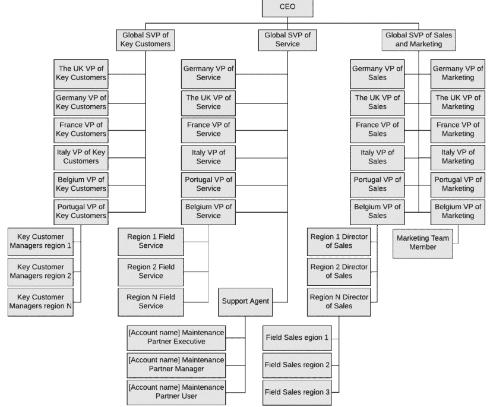

图 14.1 – 角色层次结构（初稿）

考虑到共享的信息，您还可以为参与者规划一些有针对性的许可证。下一节对此进行了说明。

### 确定参与者和许可证

PLU 共享了预期参与者及其活动的简要描述。您可以利用此信息生成其所需许可证的早期草稿。在演示过程中，您还需要解释建议许可证的依据。对于本场景，这可能类似于以下内容：

- **现场销售**：考虑到他们需要处理 B2B 客户并创建新交易和续约交易，他们可能需要使用账户、机会和合同对象。Sales Cloud 许可证似乎很合适。

- **支持代理**：考虑到他们需要处理不同的事件，并且您可能最终会使用 `Case` 对象来建模事件，他们可能需要 **Service Cloud** 许可证。事实上，许多其他许可证可以与 `Case` 对象一起使用。但是，场景中还提到支持代理根据其技能划分为不同的团队。这可以通过队列或 **Omni-Channel** 实现。如果您最终使用 **Omni-Channel**，支持代理将需要 **Service Cloud** 许可证。因此，暂时假设使用此许可证。呼叫中心可能还需要一些 CTI 功能。为支持代理暂定 **Service Cloud Voice** 许可证。

- **服务高级副总裁**：这些参与者可能需要与支持代理相同的许可证，因为他们需要访问相同的对象。

- **营销团队**：考虑到他们需要生成和培育潜在客户，他们需要 **Sales Cloud** 许可证。他们还需要对客户进行细分并向他们发送批量电子邮件。向 600 万客户发送批量电子邮件的功能无法使用 **Salesforce Core** 来解决。有几种其他批量电子邮件工具。Salesforce Marketing Cloud 与 **Salesforce Core Cloud** 集成得很好。为营销团队成员也假设使用 **Marketing Cloud** 许可证。

- **销售和营销高级副总裁**：关于此角色活动的细节不多。但是，假设此角色需要访问销售和营销团队使用的相同对象和工具，它将需要 **Sales Cloud** 和 **Marketing Cloud** 许可证。

- **关键客户经理**：考虑到此参与者需要与 B2B 客户互动并与他们生成新交易，可能需要与 `Opportunity` 对象进行交互。**Sales Cloud** 许可证似乎很合适。

- **关键客户高级副总裁**：假设此角色需要访问关键客户经理使用的相同对象，您可以假设它也将需要 **Sales Cloud** 许可证。

- **现场服务**：此参与者需要读取读数并修复小问题。这里的问题可能是事件的另一种名称，您可能会将其与 `Case` 对象一起使用。假设此参与者将需要 **Service Cloud** 许可证。您还应该注意 `field` 参与者，因为他们可能表明需要额外的解决方案来帮助他们执行现场访问，例如 **Salesforce Field Service**。暂定该许可证，如果需要，稍后再调整。

- **维护合作伙伴**：合作伙伴通常不使用任何内部 Salesforce 许可证。在大多数情况下，他们需要 **Partner Community** 或 **Customer Community Plus** 许可证。在这个阶段，您无法确定哪一个更合适。暂时假设使用 **Partner Community** 许可证。

- **客户**：客户需要访问一个在线门户，在那里他们可以管理自己的账户详细信息。考虑到您大约有 600 万客户，对于所需的许可证您不应有任何犹豫。此参与者将使用 **Customer Community** 许可证，无论是基于登录的还是基于命名用户的许可证。

您的参与者和许可证图表可能如下所示：

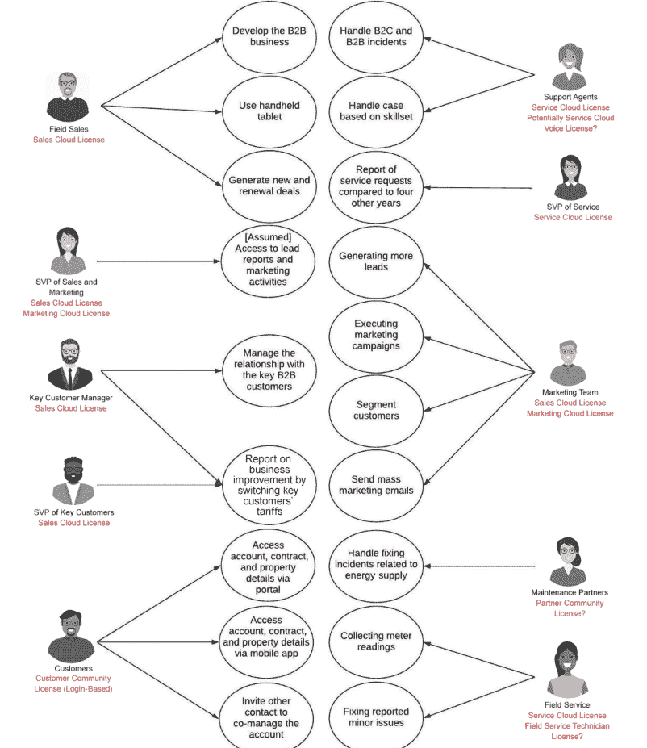

图 14.2 – 参与者和许可证（初稿）

您对可能最终使用的一些对象有了良好的了解。利用此信息来创建草稿数据模型。

### 创建草稿数据模型

PLU 分享了一条有趣的陈述，表明需要一个复杂的账户模型来实现这种行为。该陈述始于以下内容：

*住宅客户每处房产最多可有两个联系人，并且可与多处房产相关联。*

这表明同一客户可以链接到多处房产。此外，最多两个客户也可以与同一房产相关联。鉴于您计划使用 **客户社区** 许可，并了解其有限的共享功能，您面临以下挑战：

- 您将如何建模房产？您将使用 `Account` 对象还是 `Custom` 对象？
- 您将如何建模客户？很容易假设使用 **个人账户**，但如何将多个人户与多处房产关联？
- 您如何确保可以使用 **共享集**（适用于 **客户社区** 许可的共享机制）来控制用户可见性？您尚未达到该要求，但显然客户只应能看到他们关联的房产。
- 您如何建模其他数据，例如 `Contract`、`Meters` 和 `Meter readings`，以便它们对有权访问 `Property` 记录的用户可见？

其中一些问题可能会影响您解决其他问题的潜在方式。

这是一个关键要求。如果一开始就没有解决好，这是那些可能会让事情变得更棘手的要求之一。

Salesforce 在过去几年中做出了许多改进来支持此类用例。它引入了 `AccountContactRelation` 对象，允许将联系人与多个账户关联。它还更新了 **共享集**，以允许基于 `AccountContactRelation` 对象进行记录共享。这在当时对 Communities 的共享模型是一次巨大的提升。

基于此，您可以利用 `Person Accounts`、`AccountContactRelation` 和 `Account` 对象的自定义记录类型来建模数据，以表示 `Property`。这将使您能够使用 `Contract` 和 `Asset` 对象来描述与客户的特定交易以及相关的启用服务（例如，电力）。

以下图表示了 B2C 客户账户结构的数据示例：

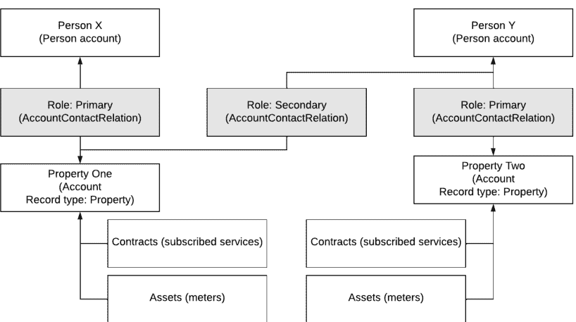

图 14.3 – B2C 账户结构数据示例

当您遇到如此关键的数据建模要求时，请毫不犹豫地查看 *可访问性和安全性要求* 部分，以确保您的模型将满足与 Community Cloud 用户相关的要求。

在该部分，您还会注意到 B2B 客户需要管理多处房产的需求。遵循相同的原则，您可以为 B2B 用户提出以下建议账户结构的数据示例：

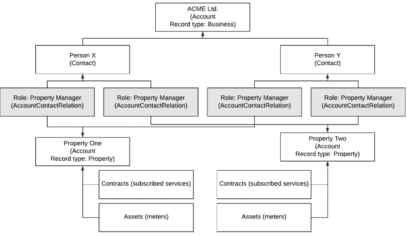

图 14.4 – B2B 账户结构数据示例

为您的演示创建此类支持图表很有好处。您可以创建任何有助于进一步解释您解决方案的图表。只需记住在创建任何其他图表时遵循标准。数据示例图表可以帮助您梳理思路并想象解决方案的样子。

现在您已理清思路，请使用您计划使用的对象创建草稿数据模型：

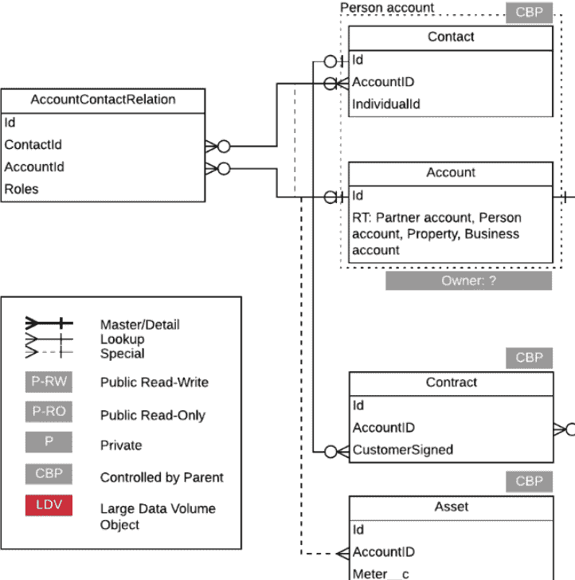

图 14.5 – 数据模型图（首个草稿）

在这个阶段，您只是在创建草图和草稿。不必担心整理您的图表。您可以稍后处理。另一个有趣的段落始于以下内容：

> 平均而言，住宅客户每个账户/房产订阅 1.5 种不同的服务。
>
> 注意
> 记下这些数字并密切关注它们。到此时，您应该了解此类数字在场景中的重要性。

最后，查看一下架构全景。

### 编译当前架构全景

这部分很简单。PLU 分享了一组当前使用的系统。您知道 **Salesforce 核心云**（也称为 Force.com 平台）将处于提议解决方案的中心。如果将所有内容整合在一起，您将得到以下图表：

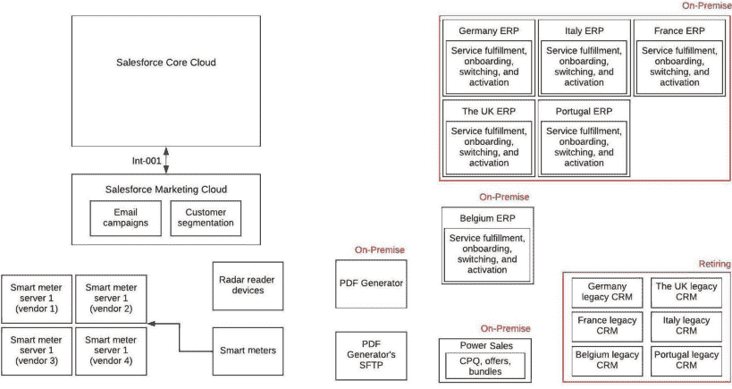

图 14.6 – 架构全景（首个草稿）

现在您已经了解了当前情况和潜在解决方案，请继续分析和解决共享的需求。

### 分析业务流程需求

PLU 分享了六个关键业务流程。场景的这部分通常包含最重要的需求量。强烈建议您为这些流程中的每一个创建业务流程图。这将帮助您发现解决方案中的棘手部分，还能在演示过程中提供一个引人入胜且有吸引力的工具。

从第一个共享的业务流程开始。

### 关键客户管理

PLU 为 **关键客户管理** 流程分享了五个关键需求，因为第一个项目只是此类客户的定义。您将逐一审查每个共享需求并对其进行分析和解决。到本练习结束时，您将拥有一个业务流程图，可帮助您解释端到端的解决方案。现在，从第一个需求开始。

PLU 希望系统能够定期识别新的关键客户，并自动将他们注册到一个特殊的培育计划中。

您脑海中可能立即浮现的三个问题如下：

- 您如何执行流程来定期扫描和评估客户消耗量？
- 您如何建模月度消耗量？考虑到有 600 万 B2C 客户和 70 万 B2B 客户。您不知道每个组有多少房产，但您知道关键客户拥有 5 到 15 个地点/房产。
- 注册流程是怎样的？他们将使用哪些对象？

第一个问题最简单，您可以简单地使用 Batch Apex 类或 Schedule-Triggered Flow。但是，取决于您如何建模数据，即使是 Batch Apex 在处理如此大量的数据时也可能性能不佳。

第二个问题至关重要。这是另一个数据模型相关的设计决策示例，可能会影响许多其他事情。请对这类需求给予额外关注。首先探索将月度消耗量建模为标准化第三范式（3NF）这一常见且最直接的选项。作为提醒，您在第 2 章 核心架构概念：数据生命周期 中学习了三个主要范式。以下图说明了数据的样子：

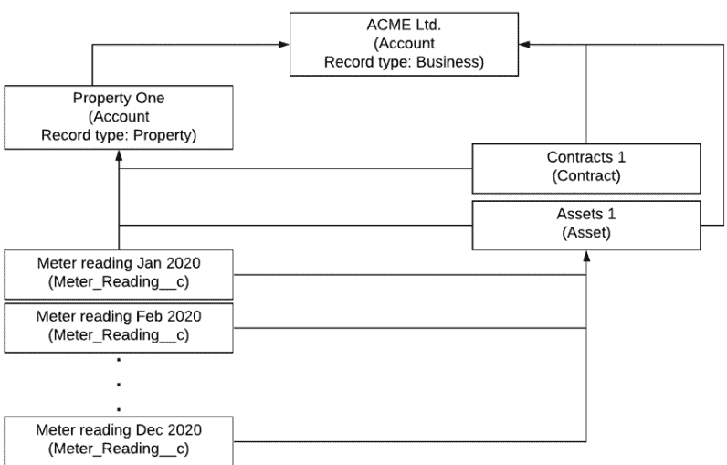

图 14.7 – 使用 3NF 建模电表读数

您可以看到，在这里使用 3NF 每年会为每个资产创建 12 条记录。您需要通过进行一些计算来验证此设计。

有 600 万 B2C 客户。平均而言，其中一半同时订阅了电力和天然气。这是 900 万个潜在资产（基于您计划使用 Asset 对象来表示客户通过电表订阅服务）。

还有 70 万 B2B 客户。您不知道其中有多少是关键客户，因此需要假设一个合理的百分比。假设 25% 的 B2B 客户是关键客户，即 175,000 个。

您知道 80% 的 B2B 客户同时注册了电力和天然气。此外，您知道关键客户平均将有 10 处房产。这意味着您大约有 3,150,000 个用于 B2B 的资产（约 945,000 个用于常规 B2B 客户和 2,205,000 个用于 B2B 关键客户）。总计，您大约有 12,150,000 个资产。

在 3NF 中，您每年每个资产将得到 12 条记录。这将近 1.46 亿条记录。其中大约 3800 万条属于 B2B 客户。任何试图处理如此数量记录的批处理作业都将遇到性能挑战。

一个潜在解决方案是将所有电表读数数据转移到外部平台（如 Heroku），并在该处开发触发注册流程的逻辑。但随后您将遇到与数据可见性和访问管理相关的其他挑战。

另一种解决方案是使用非规范化对象来存储每个电表的月度读数（或者，如果业务有最大限制，甚至针对多个电表）。以下图表是一个说明性数据示例：

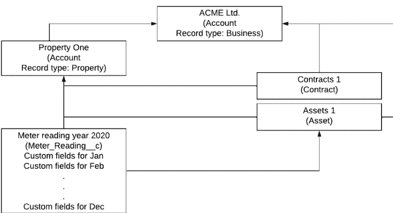

图 14.8 – 使用非规范化对象建模电表读数

你甚至可以使用这些额外字段扩展 `Asset` 对象，除非你想在 Salesforce 中保存超过一年的数据（此处正是这种情况，因为系统有一项要求：保留最多两年的数据）。你还可以通过在 `Meter_Reading__c` 对象上引入公式字段，使批量查询更简单，该字段用于判断一年中的三个抄表读数是否存在高于给定阈值的情况。

非规范化对象有其局限性和挑战，但也有其优势和有用的用例。如果你有合理的理由，可以提出这种方法。

现在，来看第三个问题，即如何建模注册流程。

Salesforce 中是否有标准对象允许你与现有客户运行涉及多个阶段和活动的销售流程？也就是说，是否存在一个对象，能够启用一套与销售相关的功能，例如销售团队、报表和预测？

你猜对了！你可以使用 `Opportunity` 对象来建模此类销售流程。

如果你将此解决方案整合起来，你计划使用批量作业来查询新的非规范化 `Meter_Reading__c` 自定义对象。如果满足某些条件，则创建一个 `Opportunity`，并根据相关区域为其分配合适的 `Opportunity` 团队成员。这项任务看起来太复杂，不适合使用 Flow，因此你可以使用 Batch Apex（复杂度证明了其合理性）。

更新你的数据模型和业务流程图，然后进入下一项要求，该要求以以下内容开头：

注册团队应启动注册流程。

确定主要关键客户经理可以手动完成。到该流程结束时，该用户将拥有客户账户记录。该要求还表明需要与客户协商不同的报价和资费。这是 `Quote` 对象的常见用例，整个要求非常适合使用 Configure, Price, Quote (CPQ)。这里的挑战是 PLU 坚持使用 Power Sales 作为 CPQ 引擎。

在评审委员会上，你不能假设能说服 PLU 使用不同的 CPQ 解决方案。这主要是因为场景明确表明 PLU 有意继续使用 Power Sales。PLU 正在寻求建议，即以何种方式最好地促进其用户使用 Power Sales，同时不影响其效率。

你通常可以建议以下方法之一：

- 在 Salesforce 和 Power Sales 之间建立 SSO。用户预计需要在系统之间来回切换并跳转以完成任务。
- 使用 Salesforce Canvas 在 Salesforce 内查看 Power Sales UI。这简化了来回切换的过程，但你仍需处理身份验证。
- 与 Power Sales 开发完全集成，并在其之上构建自定义 UI。

第三种选择最具吸引力，但通常成本较高。在另一系统的业务逻辑之上构建完全新的 UI 并非易事，绝不可低估。

如果这是唯一与 Power Sales 相关的要求，前两种方法都可以采用。但是，你会在场景中后面遇到多个其他要求，其中需要与 Power Sales 集成并在其之上开发自定义 UI，例如客户注册业务流程中的要求。因此，也为本流程使用相同的集成接口和 UI 是合理的。自定义 UI 可以是一组 Lightning 组件。

在完成此要求的解决方案之前，你需要解决与 Power Sales 集成的挑战。你已经知道它提供的 API 质量差，难以修改。你不能基于这种质量差的 API 开发自定义 UI。你需要一种方法，除了其 API 之外，还能直接连接到 Power Sales 的数据库，并在其之上创建一组细粒度的 API。

这非常适合使用 MuleSoft 等中间件。场景中还有几个其他要求证明了需要 ESB，例如协调与多个本地 ERP 系统的通信。

整合此解决方案后，你将使用 MuleSoft 在与 Power Sales 的集成之上开发自定义 UI。你将使用该接口在 Salesforce 中生成并填充 `Quote` 对象。随后，可以使用 `Quote` 对象生成并与客户共享 PDF。

确定主要关键客户经理将是一个手动过程，最终将账户所有权分配给选定的用户。

更新你的环境架构图、数据模型和集成列表。然后，进入下一项要求，该要求以以下内容开头：

*在流程结束时，客户可以切换到不同的、更偏向业务的资费，并应签订新合同。*

这是一个常见要求。一旦 `Opportunity` 状态为 closed-won，你可以自动使用其数据创建 `Contract`。你可以使用 Salesforce Flows 实现此功能。`Contract` 状态将显示为草稿，并等待客户签名。

值得注意的是，`Contract` 对象与 `Asset` 对象没有开箱即用的关系。`Service Contract` 对象有（通过命名令人困惑的 `ContractLineItem` 对象）。不过，`Service Contract` 对象不可用于 **客户社区** 用户。因此，你需要使用自定义对象扩展 `Contract` 对象，使其能够与 `Assets` 关联。

`Assets` 将代表与电表的关系，而不是电表本身。这样做的原因是便于多个客户使用同一电表，例如在租赁房产中，而不会丢失对前客户的追踪。这形成了 `Asset` 的360度视图，通常是公用事业公司所期望的。

你将引入两个自定义对象：`Meter__c` 和 `Contract_Line_Item__c`。

值得注意的是，你可以使用 Salesforce Industries（原 **Vlocity**）的 **能源与公用事业云数据模型**，只要你能解释其对象、用途以及如何识别和缓解任何 LDV 对象。同样，如果你计划使用其他基于 Vlocity 的功能，例如 **OmniScript**、**DataRaptor** 或 **FlexCards**，则要准备好解释其工作原理并证明其使用的合理性。

> **注意**
> 
> 如果你对 Salesforce 垂直产品缺乏足够经验，请坚持使用你知道可行的解决方案。这也适用于 Salesforce Field Service 等专用解决方案。
> 
> 简而言之，如果你计划使用这些产品中的任何一种，你必须确保自己对其拥有相当多的了解：为什么使用它、如何使用它（高层次）、其数据模型是什么，以及需要注意的陷阱是什么。
> 
> Salesforce Field Service 正越来越成为 CTA 应了解的产品之一。

更新你的数据模型，然后进入下一项要求。

PLU 希望通过引入数字签名来*简化流程*。

有许多第三方产品可以捕获数字签名。其中大多数还可以触发 Salesforce 中的逻辑或更新记录。

你可以提议使用 **DocuSign** 之类的产品。一旦捕获签名，DocuSign 可以更新 `Contract` 状态，从而启动切换流程。更新你的环境架构图以包含 DocuSign。

根据下一项要求，切换流程由 ERP 完成。进入下一项要求并进一步阐明解决方案的其余部分。

新合同详细信息将发送到国家 ERP，以促进切换流程。

此过程最多可能需要 48 小时。流程完成后，应通知客户和相关区域的关键客户经理。

该要求未指定将合同详细信息发送到 ERP 的预期时间框架。你可以假设这可以通过 MuleSoft 的批量同步作业来实现。你还可以利用 **平台事件** 等功能将近实时负载发送到 MuleSoft，然后由 MuleSoft 将其发送到正确的 ERP。你还可以考虑使用 **外发消息** 实现相同目的，因为你只需从一个对象（`Contract`）发送详细信息。

**平台事件** 提供一种通常被忽视的出色附加功能。顾名思义，它们触发平台本身可以订阅的事件。这使你能够在平台内开发松耦合、可扩展的事件驱动架构。

你可能会问自己，签署是否被视为你希望基于其执行特定平台逻辑的事件，例如创建 **Chatter** 帖子或更新其他对象上的某些字段。如果答案是 *是的* 或 *可能在不久的将来*，那么 **平台事件** 是一个不错的选择。此功能会触发可从平台内部或外部订阅的平台事件。

在这种情况下，考虑到公用事业业务高度依赖其与客户的合同状态，这可能是一个有价值的功能。在签署合同时触发平台事件，可以帮助你满足多项其他未来需求。这将是使用它来解决此需求的依据。

一旦 ERP 完成切换过程，它将发起向 Salesforce 的入站调用以再次更新合同状态。完成此操作后，你可以启动 **Flow** 来创建 **Chatter** 帖子，通知属于 **Opportunity** 团队的关键客户经理，并发送电子邮件提醒以通知客户。

为了使其更易读，你已将业务流程图拆分为两部分。第一部分可能如下所示：

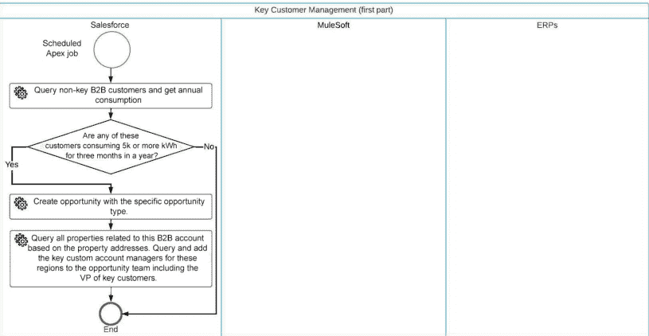

### 图 14.9 – 关键客户管理业务流程图（第一部分）

第二部分解释了流程中较长的部分，可能如下所示：

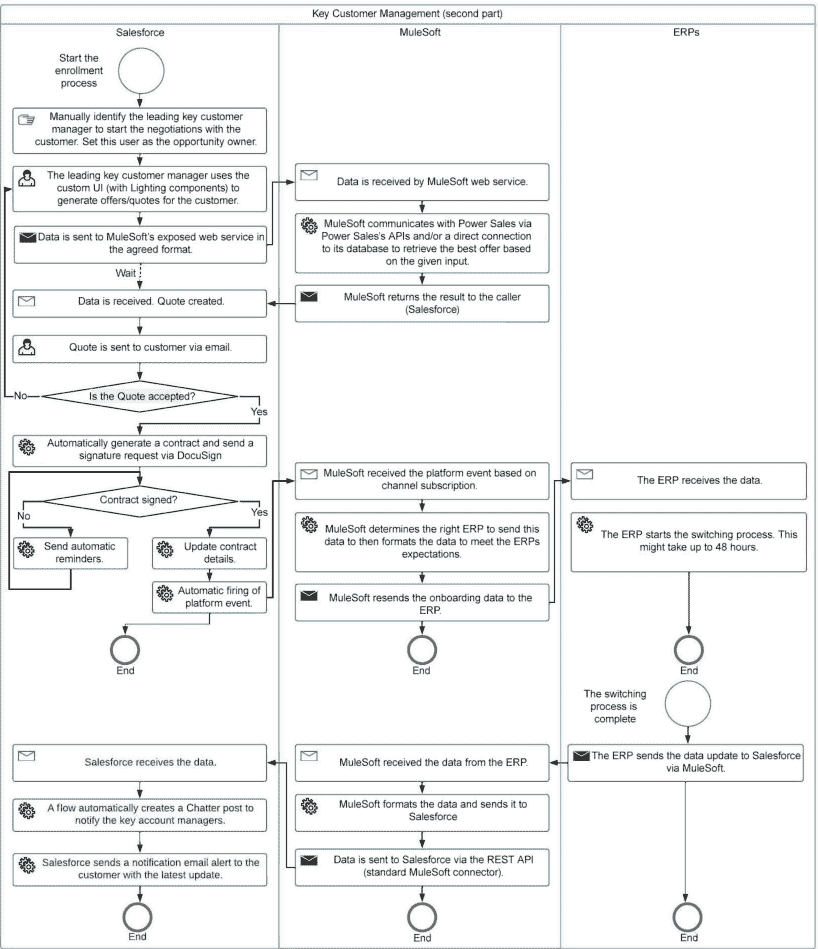

### 图 14.10 – 关键客户管理业务流程图（第二部分）

一个有趣的挑战将是与比利时 ERP 的集成。你知道它不提供任何 API，它基于平面文件数据库，并且不支持数据库适配器。

MuleSoft 可以连接并与平面文件通信。它们通常是简单的文本或基于 XML 的。向其写入不应该是一个挑战。然而，比利时 ERP 是一个无法使用 API 的旧系统。但它可以与简单邮件传输协议（SMTP）服务器通信。这样一来，一旦切换过程完成，它就可以发送一封电子邮件。你可以开发自定义 Apex Email 服务来接收电子邮件、解析它们，然后相应地更新相关记录。

这结束了第一个业务流程。更新你的系统架构图和集成接口列表，然后继续下一个业务流程。

### 客户服务

PLU 为客户服务流程共享了五个关键需求。你将逐一查看这些共享需求并进行分析和制定解决方案。从第一个需求开始，它以如下内容开头：

所有客户都应能够使用自助服务客户门户或致电呼叫中心来创建询问或投诉。

客户将能够使用客户社区提出询问和投诉。你可以使用带有多个记录类型的 Case 对象来表示询问和投诉。

该场景未指定 PLU 是否希望以软电话和 CTI 功能来现代化其呼叫中心，但你可以假设如此，并将 Service Cloud Voice 添加到系统架构图中。

你在第 13 章“呈现与辩护：第一次模拟”中学习了队列与 Salesforce Omni-Channel 之间的区别，并了解到队列适用于表示单个技能。此需求需要实现基于技能的路由，它将考虑履行特定案例所需的所有必要技能，这是 Salesforce Omni-Channel 提供的功能。

更新系统架构图以包含客户社区和 Omni-Channel，然后继续下一个需求。

如果投诉在七天内未得到解决，应通知服务高级副总裁。

此需求可以使用案例升级规则来满足。你可以配置升级规则，在满足上述条件时向服务高级副总裁发送电子邮件。

系统应根据上个月的读数自动生成下个月的预测表计读数。

你使用反范式化自定义对象对年度表计读数进行了建模。此需求可以通过引入 12 个额外字段来满足，以表示给定年份的预测每月读数。

在第 2 章“核心架构概念：数据生命周期”中，你学习了经典 RDBMS 与 Salesforce 之间的一些区别，包括在 Salesforce 中，为特定用例创建带有许多字段（列）的对象（表）是可以接受的。

你可以拥有一个定时 Flow，以便每月自动填充正确的预测字段。或者，你可以使用 **Before-Save Flow** 在更新实际读数值时更新预测字段值。例如，Flow 可以在 **Jan_Actual__c** 字段更新后自动填充 **Feb_Forecasted__c** 字段的值。考虑到系统中将拥有大量 **Meter_Reading__c** 记录，这将更高效。

更新你的数据模型，然后继续下一个需求，它以如下内容开头：

*每个站点的预测和实际电力及燃气消耗量应在客户门户中显示。*

数据应涵盖最后 24 个月。客户还应能够查看其过去的发票和付款，并能够查看其发票的 PDF 版本。

根据此需求，**Meter_Reading__c** 对象应对特定账户的客户社区用户可见。你可以通过使用主从关系将 **Meter_Reading__c** 对象与 **Asset** 对象关联来实现这一点。这样，任何有权访问 **Asset** 记录的用户都能查看其相关的 **Meter_Reading__c**。客户社区用户将能够访问其有权访问的 **Accounts** 记录相关的 **Assets**，包括任何 **Property** 记录。

这是你在此场景中首次遇到与发票和付款相关的需求。可以合理假设这些对象将存在于 ERPs 中。你可以随后使用 **Salesforce Connect** 将其在 Salesforce 中公开。

> **注意**
> 如果你使用与 ERPs 的直接连接，你最终会得到六个外部发票对象。此外，一些 ERPs 是旧系统，无法提供 **OData-compatible** 接口。

你可以使用 MuleSoft 连接到所有 ERPs，检索发票，并将它们聚合并作为 Salesforce 可以订阅的 **OData** 接口公开。假设你将分别将发票标头、行项目和付款检索为独立的外部对象。现在，更新你的数据模型以包含新的外部对象。

**PLU's PDF Generator** 应用程序应生成 PDF。该应用程序接收输入数据并生成存储在 SFTP 上的 PDF。这意味着它不会提供即时生成 PDF 的交互式用户体验。PDF 需要预先生成并存储在客户社区用户可访问的位置。

**PLU** 没有 DMS。你可以建议他们开始使用一个，或者使用 Salesforce Files。后一种选择足够好，考虑到这些文件的内容在生成后不会更改。不需要高级文档管理功能。

要生成这些 PDF，你可以假设一个每月运行的 MuleSoft 批处理作业，从 ERPs 检索发票详细信息，并将其传递给 PDF Generator 系统以生成 PDF。然后 MuleSoft 将检索存储在 SFTP 上的所有文件并将其传输到 Salesforce。你可以使用包含账户 ID 的特定文件命名约定。这将允许 MuleSoft 将文件附加到正确的 Account 记录。

将 Content Document 对象添加到你的数据模型中。你的数据模型现在可能如下所示：

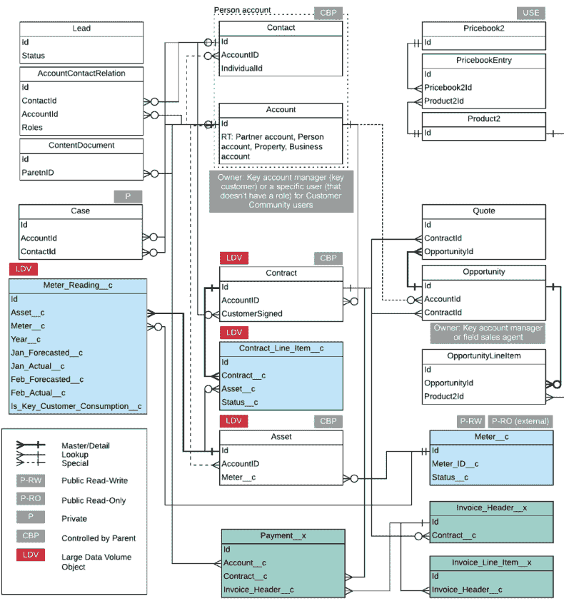

图 14.11 – 数据模型（第二份草稿）

您的景观架构图可能如下所示：

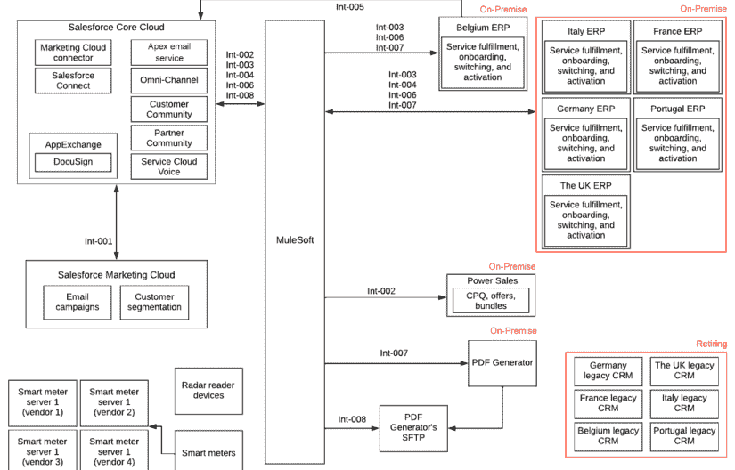

图 14.12 – 景观架构（第二稿）

您的接口列表可能如下所示：

| 接口代码 | 源/目标 | 集成层 | 集成模式 | 描述 | 安全性 | 身份验证 |
|---|---|---|---|---|---|---|
| Int-001 | Salesforce -> Marketing Cloud | 数据 | 批量数据同步 – 异步 | 使用 Marketing Cloud Connector 在 Salesforce 与 Marketing Cloud 之间同步联系人和潜在客户等数据。 | HTTPS（单向 SSL/TLS） | OAuth 2.0 客户端凭据流（用于向 Marketing Cloud 进行身份验证），OAuth 2.0 Web 服务器流（用于向 Salesforce 进行身份验证）。 |
| Int-002 | Salesforce -> MuleSoft -> Power Sales | 业务逻辑 | 远程进程调用 – 请求和响应 – 阻塞 | 调用多个方法并从 Power Cloud 获取报价详细信息。API 可以使用 Salesforce 自定义 UI 中的按钮调用。单击按钮后，Apex 控制器会调用 MuleSoft API。调用后，MuleSoft 将确定是调用 Quote-to-Cash Sales API 还是直接连接到其数据库以执行逻辑（例如创建报价）。返回结果后，Apex 控制器会创建 Salesforce Quote 记录并将其链接到相关机会。 | Salesforce 与 MuleSoft 之间使用 HTTPS（双向 SSL/TLS） MuleSoft 与 Power Sales 之间使用 HTTPS（单向 SSL/TLS） | OAuth 2.0 Web 服务器流（然后是刷新令牌流），Salesforce 与 MuleSoft 之间使用相互身份验证。MuleSoft 与 Power Sales 之间使用简单身份验证。 |
| Int-003 | Salesforce -> MuleSoft -> The right ERP | 数据 | 远程进程调用 – 发送并遗忘 | 从 Salesforce 触发平台事件。MuleSoft 将订阅该事件。MuleSoft 将使用平台事件中的数据来确定要将数据发送到的正确 ERP。 | HTTPS（单向 SSL/TLS） | OAuth 2.0 JWT 持有者令牌流。 |
| Int-004 | ERPs (except Belgium’s) -> MuleSoft -> Salesforce | 数据 | 远程调用 | ERP 将向 MuleSoft 发送消息以指示切换过程完成。然后 MuleSoft 将调用标准 Salesforce REST API 以更新相关记录。 | Salesforce 与 MuleSoft 之间使用 HTTPS（双向 SSL/TLS） MuleSoft 与 ERP 之间使用 HTTPS（单向 SSL/TLS） | OAuth 2.0 Web 服务器流（然后是刷新令牌流），Salesforce 与 MuleSoft 之间使用相互身份验证。MuleSoft 与 ERP 之间使用简单身份验证。 |
| Int-005 | Belgium ERP -> Salesforce | 数据 | 远程调用（电子邮件） | 比利时 ERP 使用 SMTP 服务器发送的电子邮件，由 Salesforce 自定义 Apex 电子邮件服务接收。 | HTTPS（单向 SSL/TLS） | 无（到 Salesforce）。与 SMTP 服务器进行简单身份验证。 |
| Int-006 | MuleSoft -> Salesforce | UI | 数据虚拟化/混搭/OData | 使用 Salesforce Connect 在 Salesforce 中显示发票、发票行项目和付款。MuleSoft 从相关 ERP 获取数据并使用 OData 接口将其聚合。 | HTTPS（单向 SSL/TLS） | OAuth 2.0 Web 服务器流（然后是刷新令牌流）。 |
| Int-007 | MuleSoft -> ERPs MuleSoft -> PDF Generator | 业务逻辑 | 远程进程调用 – 请求和响应 – 阻塞 | 计划的 MuleSoft 作业检索新发票数据并将其传递给 PDF 生成器以生成 PDF 发票。 | HTTPS（单向 SSL/TLS） | 简单身份验证。 |
| Int-008 | MuleSoft -> SFTP MuleSoft -> Salesforce | 数据 | 批量数据同步 – 异步 | 计划的 MuleSoft 作业从 SFTP 检索 PDF 发票并将其传输到 Salesforce。 | Salesforce 与 MuleSoft 之间使用 HTTPS（双向 SSL/TLS） MuleSoft 与 SFTP 之间使用 HTTPS（单向 SSL/TLS） | OAuth 2.0 Web 服务器流（然后是刷新令牌流），Salesforce 与 MuleSoft 之间使用相互身份验证。MuleSoft 与 SFTP 之间使用简单身份验证。 |

图 14.13 – 集成接口（第一稿）

进入此业务流程的下一个也是最后一个要求，其始于以下内容：

> 如果报告能源故障，应根据物业地址创建严重事件并将其分配给正确的维护合作伙伴。

受影响地区的所有客户在事件创建、状态更新和事件解决时都应收到短信和电子邮件。

您可以使用 Winter ’22 版本中引入的 **事件** 对象。**案例** 对象和 **事件** 对象之间存在多个差异，包括多个 **案例** 可以链接到单个 **事件**，但反之则不行。**事件** 最适合用于处理影响多个客户且通常需要整个团队协作才能解决的中断。相比之下，**案例** 最适合用于服务代理处理的一次性客户询问或投诉。

您还可以设计解决方案，使用特定的 **案例** 记录类型来表示事件。Salesforce Partner Community 允许读取 **事件** 对象的访问权限，但不允许编辑。因此，**案例** 对象更适合此场景。在您的解决方案中，严重事件将是另一种 **案例** 记录类型。您可以使用 **案例分配规则** 将其分配给正确的 Salesforce 社区合作伙伴用户或队列，前提是您有一个指示相关 **案例** 区域的字段。

您可以使用 **保存前流** 根据相关 **属性**（**账户**）详细信息设置该字段的值。

完成此操作后，您需要识别该特定地区的所有客户并向他们全部发送短信通知。这是一种群发短信，Salesforce 平台原生不提供此功能。您可以使用 **SMS-Magic** 等第三方，或直接使用 **Marketing Cloud**，前提是 PLU 拥有所需许可证。

您可以使用 **Marketing Cloud 事务性消息 API** 发送事务性电子邮件和短信。这是一个基于 REST 的 API，可用于发送即时的非推广消息。它非常适合此用例。

此 API 无法使用连接器调用。需要执行以下逻辑：

- 1. 基于报告的严重 **案例**，根据其物业地址创建需要通知的客户唯一列表。
- 2. 使用这些数据调用 **Marketing Cloud 事务性消息 API**。

您如何同时实现这两点？

您始终需要意识到自己拥有的 _所有工具_。避免仅使用 Salesforce Core 来解决所有问题。您在这本书中已经遇到过多个示例，其中使用其他平台（如 Heroku 和 MuleSoft）更为合适。

在这种情况下，您可以使用 MuleSoft 来处理这两项任务。您可以从 Salesforce 向 MuleSoft 触发带有必要 **案例** 详细信息的 **平台事件**。然后 MuleSoft 可以查询 Salesforce 以找出相关客户，再调用 **事务性消息 API**。MuleSoft 可以以可扩展且高性能的方式编排整个过程。如果您选择使用自定义 Apex 进行开发，应该预计在问答环节会遇到许多挑战。

更新您的景观架构图和集成接口列表。无需为此流程创建业务流程图，因为它足够简单，无需图表即可解释。第二个业务流程到此结束。现在，进入下一个业务流程。

### 计划手动抄表

PLU 共享了五个要点来解释此业务流程（在“计划手动抄表”部分）。前两个要点提供了有关所用流程和技术的信息，其余三个要点提供了详细要求。

逐一查看这三个要点并分析和解决它们，从第一个要求开始。

PLU 希望雷达读取器设备与现场服务技术人员的移动电话配对，然后使用手机将读数数据发送到 Salesforce。

现场服务技术人员使用的移动应用必须能够通过 Bluetooth 与雷达读取器通信。此要求应帮助您确定移动策略。混合应用不太可能支持此功能。因此，需要原生应用。但在做出最终决定之前，请查看接下来的两个要求。

PLU 希望优化其现场服务技术人员的访问时间和差旅成本。

Salesforce 中有两个现成的功能可用于优化访问时间和差旅成本，即 Salesforce Maps 和 Salesforce Field Service。后者具有更高级的功能，更侧重于现场服务要求和活动，例如基于技能的分配、班次管理和团队管理。

选择后者以满足此要求。您需要将相关的现场服务对象添加到数据模型中。熟悉标准现场服务对象，并准备好解释它们的使用方法。

> **注释**
> 您可以在以下链接中找到有关现场服务对象的更多详细信息：https://packt.link/K6cBm。

为保持简单，仅将 WorkOrder 和 ServiceAppointment 对象添加到数据模型中。

更新您的数据模型和景观架构，然后进入下一个要求。

PLU 随时希望跟踪其现场服务技术人员的位置。

您知道 Salesforce Field Service 有一个特定的移动应用，原生提供此功能。可以使用该应用满足此要求。但是，您能扩展 Salesforce 移动应用以通过 Bluetooth 与雷达读取器通信吗？

您可以更改移动应用上的某些配置。但是，即使您不了解该应用的全部限制，假设它可以扩展以覆盖如此复杂的要求也是有风险的。

你可以提议开发另一个原生移动应用程序来处理与雷达读取器的通信。在你的演示中，你可以解释这是一种你确信有效的方法，并且你打算为实际项目进一步调查这一点。

更新你的架构图和集成列表。由于该过程简单，无需为此过程创建业务流程图。

### 计划自动抄表

PLU 为计划自动抄表流程分享了两个关键要求。逐一查看并分析并解决它们。从第一个要求开始，它始于以下内容：

*智能电表在所覆盖的国家广泛使用。*

这一段落本身并不包含明确的要求。但它描述了一种情况，即你需要以某种方式统一与四个不同云平台的交互方式。这让你想起什么了吗？听起来是 MuleSoft 的领域。继续查看下一个要求以了解更多信息。

*智能读取器必须每月读取。*

此要求的关键点是 PLU 对统一的渴望。他们追求一种获取抄表数据的统一机制。这些系统中唯一共同支持的集成能力是能够*拉取*抄表数据的 Web 服务。

你可以提议在 MuleSoft 中开发一个每月运行的计划作业，从所有这些不同平台拉取抄表数据，将它们合并，然后使用合并后的数据集更新 Salesforce。

开发完成后，你可以通过引入一个支持按需数据拉取的 MuleSoft Web 服务来扩展此解决方案。目前不需要此功能，但拥有灵活且可扩展的设计以满足当前和未来的需求是好的。

由于该过程简单，无需为此过程创建业务流程图。更新你的架构图和接口列表，然后进入下一个业务流程。

### 客户注册

PLU 为客户注册流程分享了六个关键要求。逐一查看并分析并解决它们。

*客户除非通过邀请，否则无法在社区中自行注册。B2C 客户的门户访问权限应在其注册 PLU 服务后生成。*

要求的第一部分有点令人困惑。这里提到的邀请是指什么？Salesforce 中没有标准的邀请流程。问题是否可能指的是手动将 *联系人* 启用为社区用户的过程？这部分不清楚，直到你阅读完此业务流程的第六个要求之前都将不清楚。实际场景可能会提出此类问题；因此，在开始累积式解决方案之前，至少在开始时完整阅读一遍场景非常重要。

继续处理其余要求。你发现需要在客户注册 PLU 服务后自动生成 B2C 客户门户用户。这可以使用 `Contract` 触发器轻松实现自动化。触发器将检查相关客户是否已有社区用户，如果没有找到，则触发器创建新用户。

这听起来不错吗？再次查看描述的流程，识别在处理快乐路径场景（即所有所需数据均已提供且流程预期能正确运行的场景）时可能面临的潜在挑战。你是否发现有什么缺失或可能出错的地方？没错！

对 Salesforce 设置对象（如 `User`）进行**数据操作语言 (DML)** 操作，不能在同一事务中与其他对象（如 `Account`、`Contact` 和 `Contract`）上的 DML 操作混合。

换句话说，你无法在更新 `Contract` 记录的同一事务中创建用户记录。在当前条件下，你的解决方案将失败。这是评委在问答环节会注意到并指出的一点。他们会提出更多问题，以了解你是遗漏提及这一点，还是对这一挑战完全不知情。

你可以通过将事务分为同步和异步部分来克服此挑战。你可以在 `Contract` 触发器中启动一个 future/queueable 方法来创建 **客户社区** 用户。在演示中，请务必强调此解决方案将帮助你避免 *混合 DML 异常*。

进入下一个要求，它始于以下内容：

*PLU 希望通过公共网站向未经身份验证的用户展示其产品。*

此要求的核心是将你的 CPQ 解决方案公开给公众。你已经提议开发一个自定义 UI（基于 Lightning 组件），位于一个与 Power Sales 通信的 MuleSoft 公开 API 之上。你可以将此组件的使用扩展到公共 **客户社区** 页面。响应性可以使用 **Salesforce Lightning Design System (SLDS)** 来保证。

进入下一个要求，它始于以下内容：

*客户应能够确认资费。*

这意味着面向公众的 Lightning 组件应能够在 Salesforce 中创建启动客户 `Contract` 所需的所有对象记录。可以使用正确的用户权限来确保这一点。值得注意的是，此组件对于未经身份验证的用户将在 `Guest User` 上下文下运行。你可以授予访客用户访问字段和对象的权限，但请确保遵循 *最小数据访问原则*。

在创建用户访问权限后，客户应收到一封设置密码的电子邮件通知。

这是标准功能。你可以使用 `Site.createPersonAccountPortalUser` 方法创建与 **人员账户** 关联的客户社区用户。

### 注意

你可以通过以下链接了解此方法的更多详细信息：https://packt.link/yKVYN。

用户将收到一个自动生成的密码，必须在首次登录时更改。你可以使用配置文件设置强制执行严格的密码复杂性规则。你可以将客户社区用户配置文件上的 `Password complexity requirement` 字段设置为所需值，例如必须包含以下三项：数字、大写字母、小写字母、特殊字符。

登录后，客户应能够查看其联系人和合同详细信息。

这将通过拟议的数据可访问性和共享模型来实现。**共享集** 将确保社区用户可以访问相关 **房产账户**。**合同** 的可见性由 **父级**（父级 **房产账户** 记录）控制。这意味着记录级可访问性已覆盖。你需要确保社区用户拥有查看所有必需字段的正确对象级和字段级权限。这可以使用 **配置文件** 和 **权限集** 来控制。

PLU 还要求允许其客户使用品牌移动应用程序登录社区。你可以提议使用 **Salesforce 移动出版器**。这是一种快速且简单的方法，可将 Salesforce Lightning 社区转换为移动应用程序。你可以通过以下链接了解有关 **移动出版器** 的更多信息：https://packt.link/ampDr。

### 注意

你尚未遇到任何证明开发原生应用甚至混合应用是合理的高级功能要求。当然，你可以使用两者开发完全品牌化的移动应用，但这将花费时间和精力。始终考虑客户的投资回报率 (ROI)。

更新你的架构图和接口列表，然后进入下一个也是最后一个要求。

*客户* 应能够邀请另一个联系人到门户来共同管理特定房产和合同。这里，你回到了此业务流程中第一个要求提到的 *邀请* 要求。

你可以配置客户社区用户创建其他 Contact 记录，但客户社区用户无法将新创建的联系人转换为用户。此外，B2C 的数据模型基于 **人员账户**，它们通过 **AccountContactRelation** 对象与 **Properties**（另一种 **Account** 记录类型）相关联。

这些要求表明你需要自定义此功能，同时牢记第一个要求，即社区用户除非受 *邀请*，否则无法自行注册。

你可以使用一个新的自定义对象来解决这个问题，该对象包含向电子邮件地址发送唯一邀请所需的所有信息。此外，自定义对象还应包含将新创建的 **社区用户** 与正确的 **房产** 记录关联所需的所有必要信息。

你可以配置 **社区用户的配置文件** 以允许创建邀请自定义对象 **Community_Invitation__c**。你可以通过触发器中的自定义验证控制允许创建的记录数量，或者使用依赖于自定义 *汇总字段* 值的自定义验证规则。你可以选择第一个选项（尽管它基于代码），以避免消耗有限的汇总字段数量之一，这些字段可以引入到像 **Account** 这种敏感对象中（在此案例中代表 **房产**）。

邀请流程可能如下所示：

- 1. 已登录的现有社区用户创建 **Community_Invitation__c** 记录并设置所需值，例如电子邮件地址和相关 **房产**。
- 2. 一旦创建了 **Community_Invitation__c** 记录，即可使用 Salesforce Flows 发送电子邮件警报。电子邮件警报模板将包含唯一邀请代码（这可能只是 **Community_Invitation__c** 记录 ID）以及用于在社区中自行注册的链接。
- 3. 链接本身将包含邀请代码作为参数。当用户点击该链接时，他们将被重定向到带有 **Lightning 组件** 的社区自助注册页面。邀请号将作为参数传递到页面，允许页面在字段中向客户显示该号码以及其他常用字段，例如名、姓和电子邮件地址。
- 4. 客户点击提交按钮后，Lightning 组件的 Apex 控制器验证邀请号。如果成功，它将创建一个客户社区用户并启动异步 queueable 作业以创建所需的其他记录（例如 AccountContactRelation），以便该用户能够访问 **房产** 详细信息。
- 5. 新创建的用户在异步作业完成之前将无法查看相关 **房产** 详细信息。你无法保证这需要多长时间，但可以事先告知需要几分钟。

相应地更新你的数据模型图。使用业务流程图会更容易解释这个业务流程的解决方案。该图可能如下所示：

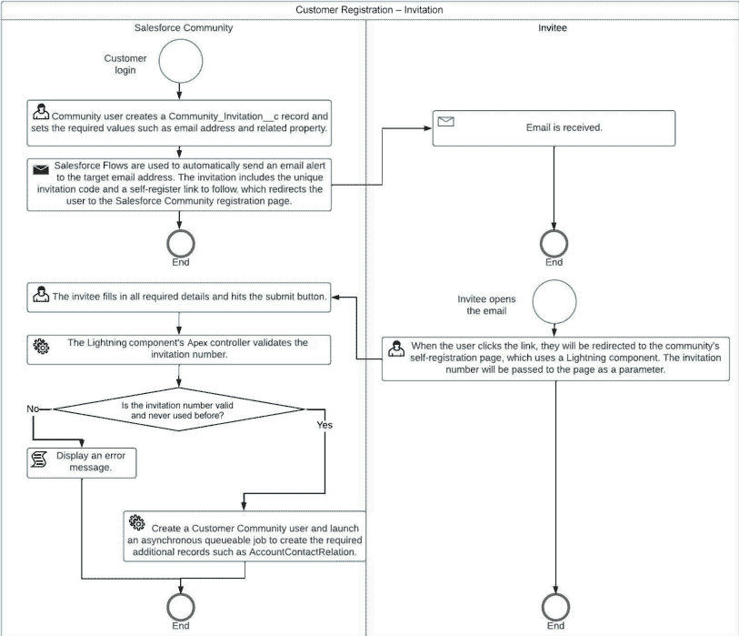

图 14.14 – 客户注册业务流程图——邀请子流程

至此，该业务流程结束。进入第六个也是最后一个业务流程。

### 现场销售

PLU 共享了现场销售流程的两个关键需求。逐一分析并解决它们。从第一个需求开始，它以如下内容开头：

现场销售代理人访问潜在的 B2B 线索，并向其介绍不同的产品方案。

你在此场景中之前遇到过类似的需求，但渠道不同。你决定在 MuleSoft 暴露的 API 基础上开发自定义 UI，这些 API 与 Power Sales 集成。该 UI 基本上是一组 **Lightning 组件**。

现场销售代理人可以在他们的平板电脑上使用相同的组件，前提是他们使用 **Salesforce 移动应用**。新版 Salesforce 移动应用支持 Lightning 应用页面，你可以合理推断自定义 UI 将使用这些页面。

更新你的架构图和接口列表，然后进入下一个需求，它以如下内容开头：

*访问完成后三天，应向 B2B 客户的主要联系人发送电子邮件调查。*

应使用两个不同的调查模板，一个用于成功签约的交易，另一个用于丢失的交易。如果 **现场销售** 代理人的评分低于 10 分中的 3 分，应自动创建一个 **案例** 并分配给现场销售代理人的经理。

如今，这一要求越来越常见，因为越来越多的公司试图更贴近客户，并向他们表明他们的意见很重要。你有三种潜在方法可以解决这一要求：

- 基于自定义对象和自动化开发自定义调查模块。
- 使用诸如 **SurveyMonkey** 之类的第三方工具。
- 使用 **Salesforce 调查**。

Salesforce 产品附带 Salesforce 的常规承诺，即它们会定期更新，并会持续加入新功能。此外，它们是专为 Salesforce 设计的产品，因此与其他产品相比，它们与平台的集成方式更加直接，并且通常简化其他非功能性要求，例如数据驻留。

在某些情况下，Salesforce 产品可能缺乏某些功能，这证明考虑第三方替代方案是合理的。此处并非这种情况。所述要求可以使用 Salesforce 调查来满足。

与其他扩展产品（例如 **Salesforce 现场服务** 和 **Vlocity**）类似，你需要知道产品的工作原理并很好地理解其组件。你最需要熟悉的常见元素是数据模型。将你计划从 Salesforce 调查中使用的关键对象添加到数据模型图中。

**注意**
你可以在以下链接中找到更多信息：`https://packt.link/DWKUy`。

你仍需要添加一些自定义以提供某些功能，例如安排发送调查、将发送的调查链接到正确的对象（在此示例中为线索），以及处理反馈以确定是否需要创建案例并将其分配给现场销售代理人的经理（如果现场销售代理人的评分低于 10 分中的 3 分）。

如果使用 Salesforce 流开发，此自动化可能会变得复杂。因此，你可以提出一种基于 Apex 的解决方案。

> 注意
> 使用 Apex 而非 Salesforce 流来交付复杂逻辑更为合适。极其复杂的流比 Apex 更难调试或阅读。流仍然非常适合解决许多其他挑战，但仍不完全是 Apex 的替代品。

更新你的数据模型图。你的架构图现在可能如下所示：

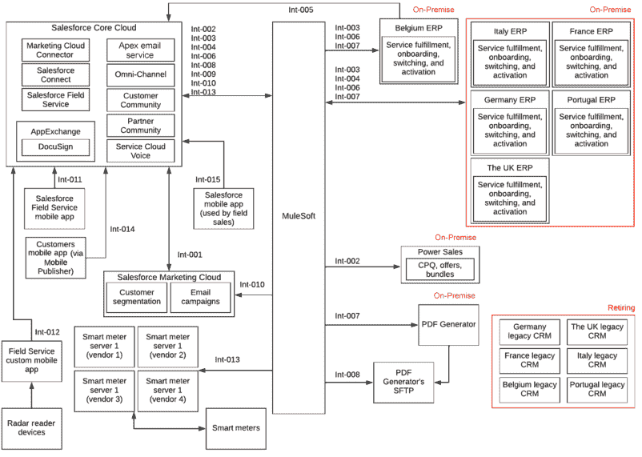

你的集成接口列表可能如下所示：

| 接口代码 | 源/目标 | 集成层 | 集成模式 | 描述 | 安全 | 身份验证 |
| :--- | :--- | :--- | :--- | :--- | :--- | :--- |
| Int-001 | Salesforce <-> Marketing Cloud | 数据 | 批量数据同步 – 异步 | 使用 Marketing Cloud 连接器同步 Salesforce 与 Marketing Cloud 之间的联系人和线索等数据。 | HTTPS (单向 SSL/TLS) | OAuth 2.0 客户端凭据流（用于向 Marketing Cloud 进行身份验证）。OAuth 2.0 Web 服务器流（用于 MuleSoft 托管的集成流）。 |
| Int-002 | Salesforce -> MuleSoft -> Power Sales | 业务逻辑 | 远程进程调用 – 请求和响应 – 阻塞 | 调用多个方法并从 Power Cloud 获取报价详细信息。API 可以在 Salesforce 的自定义 UI 中使用按钮调用。单击按钮后，将调用一个暴露给外部世界的 Apex 控制器。MuleSoft 将确定是调用 Power Sales 的某个 API 还是直接连接到其数据库以在内部执行逻辑。将触发一个集成流，Apex 控制器创建 Salesforce 报价记录并将其链接到相关机会。 | Salesforce 和 MuleSoft 之间使用 HTTPS (双向 SSL/TLS)。MuleSoft 和 Power Sales 之间使用 HTTPS (单向 SSL/TLS) | Salesforce 和 MuleSoft 之间使用带有相互身份验证的 OAuth 2.0 Web 服务器流（随后是刷新令牌流）。MuleSoft 和 Power Sales 之间使用简单身份验证。 |
| Int-003 | Salesforce -> MuleSoft -> The Right ERP | 数据 | 远程进程调用 – 发送后忘记 | 从 Salesforce 触发平台事件。这将消耗 MuleSoft 暴露的数据。MuleSoft 将使用平台事件中的数据来确定将数据发送到哪个 ERP。 | HTTPS (单向 SSL/TLS) | OAuth 2.0 JWT 持有者令牌流。 |
| Int-004 | ERPs (比利时除外) -> MuleSoft -> Salesforce | 数据 | 远程调用 | ERPs 将向 MuleSoft 发送消息以指示切换过程的完成。MuleSoft 随后将调用标准 Salesforce REST API 来更新相关记录。 | ERPs 和 MuleSoft 之间使用 HTTPS (双向 SSL/TLS)。MuleSoft 和 ERPs 之间使用 HTTPS (单向 SSL/TLS) | Salesforce 和 MuleSoft 之间使用带有相互身份验证的 OAuth 2.0 Web 服务器流（随后是刷新令牌流）。MuleSoft 和 ERPs 之间使用简单身份验证。 |
| Int-005 | 比利时 ERP -> Salesforce | 数据 | 远程调用 (电子邮件: smtp) | 比利时 ERP 使用 SMTP 服务器发送的电子邮件，由 Salesforce 自定义电子邮件服务接收。 | HTTPS (单向 SSL/TLS) | 无 (对 Salesforce)。与 SMTP 服务器进行简单身份验证。 |
| Int-006 | MuleSoft -> Salesforce | UI | 数据可视化/混搭/ODA | 使用 Salesforce Connect 在 Salesforce 中显示发票、发票行项目和付款。发票将数据触发到相关 ERPs，并使用 OData 接口对其进行聚合。 | HTTPS (单向 SSL/TLS) | OAuth 2.0 Web 服务器流（随后是刷新令牌流）。 |
| Int-007 | MuleSoft -> ERPs MuleSoft -> PDF Generator | 业务逻辑 | 远程进程调用 – 请求和响应 – 阻塞 | 定时 MuleSoft 作业检索新的发票数据并将其传递给 PDF Generator 以生成 PDF 发票。 | HTTPS (单向 SSL/TLS) | 简单身份验证。 |
| Int-008 | MuleSoft -> SFTP MuleSoft -> Salesforce | 数据 | 批量数据同步 – 异步 | 定时 MuleSoft 作业从 SFTP 检索 PDF 发票并将其传输到 Salesforce。 | Salesforce 和 MuleSoft 之间使用 HTTPS (双向 SSL/TLS)。MuleSoft 和 SFTP 之间使用 HTTPS (单向 SSL/TLS) | Salesforce 和 MuleSoft 之间使用带有相互身份验证的 OAuth 2.0 Web 服务器流（随后是刷新令牌流）。MuleSoft 和 SFTP 之间使用简单身份验证。 |
| Int-009 | Salesforce -> MuleSoft | 数据 | 远程进程调用 – 发送后忘记 | 从 Salesforce 为任何新创建的关键事件 (案例) 触发平台事件。MuleSoft 将订阅此事件。MuleSoft 将使用平台事件中的数据查询 Salesforce 以获取更多详细信息。 | HTTPS (单向 SSL/TLS) | OAuth 2.0 JWT 持有者令牌流。 |
| Int-010 | MuleSoft -> Salesforce MuleSoft -> Marketing Cloud | 业务逻辑 | 远程进程调用 – 请求和响应 – 阻塞 | MuleSoft 查询 Salesforce 中受关键事件 (案例) 影响的客户记录。MuleSoft 将在 Salesforce 中创建案例以发布事务性消息 API 并向这些客户发送 SMS 通知。 | Salesforce 和 MuleSoft 之间使用 HTTPS (双向 SSL/TLS)。MuleSoft 和 Marketing Cloud 之间使用 HTTPS (单向 SSL/TLS) | OAuth 2.0 Web 服务器流（随后是刷新令牌流）。 |
| Int-011 | Salesforce 现场服务移动应用 -> Salesforce | 数据 | 远程调用 | 移动应用将调用 REST API 来查询、创建或更新记录。 | HTTPS (单向 SSL/TLS) | OpenID Connect 用户代理流（随后是刷新令牌流）。 |
| Int-012 | 自定义移动应用 -> Salesforce | 数据 | 远程调用 | 移动应用通过 Bluetooth 与 Radar 读取器通信，读取值，创建客户，然后使用 REST API 将其传输到 Salesforce。 | HTTPS (单向 SSL/TLS) | OpenID Connect 用户代理流（随后是刷新令牌流）。 |
| Int-013 | MuleSoft -> 智能电表平台 MuleSoft -> Salesforce | 数据 | 远程调用 | 定时 MuleSoft 作业从不同平台检索表计读数。然后将数据转换为统一结构并合并。合并后的数据集随后用于更新 Salesforce。 | Salesforce 和 MuleSoft 之间使用 HTTPS (双向 SSL/TLS)。MuleSoft 和 Salesforce 之间使用 HTTPS (单向 SSL/TLS) | Salesforce 和 MuleSoft 之间使用带有相互身份验证的 OAuth 2.0 Web 服务器流（随后是刷新令牌流）。MuleSoft 和 Salesforce 之间使用简单身份验证。 |
| Int-014 | Salesforce 移动应用 (通过 iOS Mobile Publisher) -> Salesforce | 数据 | 远程调用 | 移动应用将调用 REST API 来查询、创建或更新记录。 | HTTPS (单向 SSL/TLS) | OpenID Connect 用户代理流（随后是刷新令牌流）。 |
| Int-015 | Salesforce 移动应用 -> Salesforce | 数据 | 远程调用 | 移动应用将调用 REST API 来查询、创建或更新记录。 | HTTPS (单向 SSL/TLS) | OpenID Connect 用户代理流（随后是刷新令牌流）。 |

图 14.16 – 集成接口 (第二稿)

### 你的数据模型图可能如下所示：

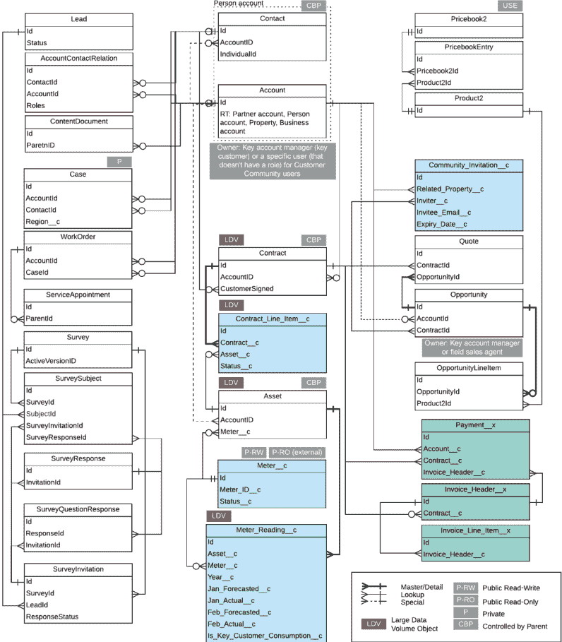

### 图 14.17 – 数据模型（第三稿）

在此阶段，你已解决了场景约 60–70% 的需求。这将是下一章的基础，在下一章中，你将继续解决其余 PLU 需求，然后制作演示文稿。

## 总结

在本章中，你了解了第二个完整模拟场景。你现在对完整场景的性质更加熟悉。与迷你场景相比，完整场景更长、更全面，包含的挑战也多得多。

在本章中，你处理了场景的第一部分。业务流程需求通常是场景中最核心的部分。这也是你开始创建综合解决方案的部分。你首先要了解每个业务流程，然后将其分解为易于消化的块，并将其作为一个整体来解决。

你遇到了引人注目的用例和设计决策，包括支持 B2B 和 B2C 的复杂数据模型。你创建了多个业务流程图，它们将在演示过程中通过可视化你的解决方案来提供帮助。

在下一章中，你将继续解决该场景，然后制作演示文稿。在本章中，你已经涵盖了相当大的一部分内容，但在下一章中，你仍有大量内容需要覆盖。

## 展示与辩护：第二次模拟

在本章中，你将继续为你的第二个完整模拟场景创建端到端解决方案。你已在第 14 章“练习评审委员会：第二次模拟”中涵盖了场景的大部分内容，但你仍有许多主题需要覆盖。在本章中，你将继续分析并解决每个共享需求，然后练习制作一些演示文稿。

为了让你尽可能接近真实考试的体验，你将参加一次练习问答环节，并根据评委的反馈来辩护、论证和修改解决方案。

阅读本章后，建议你重新阅读场景，并尝试独立解决它。在本章中，你将涵盖以下主要主题：

- 继续分析需求并创建端到端解决方案
- 展示并论证你的解决方案

到本章结束时，你将完成第二个模拟场景。你将更加熟悉完整模拟场景的复杂性，并更好地为考试做准备。你还将学会如何在有限时间内展示你的解决方案，并在问答环节中对其进行论证。

## 继续分析需求并创建端到端解决方案

你已在第 14 章“练习评审委员会：第二次模拟”中较早地覆盖了业务流程需求。在该章结束时，你已对潜在数据模型和环境有了良好的了解。你已经将一些对象标记为潜在 LDV。

接下来，有一组数据迁移需求需要你解决。完成后，你将对每个数据模型对象中的潜在数据量有更好的了解，这将有助于你制定 LDV 缓解策略。现在，你可以先从数据迁移需求开始。

## 分析数据迁移需求

本节的需求可能会影响你的一些图表，例如架构全景图或数据模型。

*该公司在其旧版 CRM 中拥有超过 8000 万客户。预计数据中包含大量重复项。*

分析此需求后，你可以识别以下需求：

- 对旧版 CRM 中的客户进行去重，以便每个客户只保留一条记录。
- 仅迁移活跃客户。预计生成的数据集将包含近 600 万客户。
- 将迁移的活跃唯一客户与 ERP 中的相关记录关联起来。这必须在 *不* 对 ERP 数据进行重大更改的情况下完成。

始终牢记 *可用于解决客户需求的所有工具*。你可以将前三个需求理解为以下内容：

- 需要对旧版 CRM 客户进行去重，并为公司所有客户创建一个 *黄金记录*。
- 需要从这些客户中选择一个 *子集*（仅活跃客户）。
- 需要在 ERP 中识别客户，并 *在其记录与唯一客户黄金记录之间构建关系*。这将确保你可以跨所有系统创建客户 360 度视图，尽管所有 ERP 都存在冗余。

在 *第 2 章“核心架构概念：数据生命周期”* 中，你了解了三种不同的 MDM 实现风格：

- **注册表式**：这种风格通过运行匹配、使用清洗算法，并为匹配的记录分配唯一全局标识符，来发现各连接系统中的重复项。
- **整合式**：在这种风格中，数据通常从多个来源收集并在中心进行整合，以创建单一版本的真相，有时也称为 *黄金记录*。
- **共存式**：这种风格与整合式相似，因为它也会创建黄金记录，但主数据更改可以在 MDM 中心或数据源系统中进行。

现在你已重新了解了这三种 MDM 风格，请花点时间再次思考你的数据策略，并考虑共享需求。请记住，你 *可以* 组合多种 MDM 风格，可能分阶段实施。你心中制定了计划吗？将其与以下内容进行交叉核对。

使用实现整合式风格的 MDM 工具可以对源记录进行去重，从而创建整合的、唯一的黄金记录。考虑到去重可能会变得复杂，尤其是在缺乏强属性（例如特定格式的电子邮件地址或电话号码）的情况下，你需要能够执行模糊逻辑匹配而非精确匹配的工具。

这听起来熟悉吗？你在 *第 13 章“展示与辩护：第一次模拟”* 中遇到了同样的挑战。对于解决方案的这一部分，你可以建议使用 **Informatica MDM**。Informatica 的 ETL 功能也将很有用，可帮助你识别和选择将要迁移到 Salesforce 的 *活跃客户*。

你终于来到了需求的最后部分，需要将唯一客户与 ERP 中的重复和冗余客户记录关联起来。为此，你需要支持 **注册表式** 的 MDM 工具。

该工具将拥有自己的模糊逻辑匹配，并使用它来识别所有 ERP 中客户的不同表示形式。然后，它不会将记录合并以创建黄金记录，而只是生成一个 **全局 ID** 并将其分配给所有相关系统中的客户记录。完成后，你可以使用全局 ID 跨所有系统获得客户的 360 度视图，尽管存在数据冗余。**Informatica MDM** 支持 MDM 注册表式风格。还有其他一些知名工具，例如 **Talend** 和 **IBM InfoSphere**。**Salesforce 客户 360 度数据管理器**（自 2021 年 2 月 1 日起停用）也是这些工具之一。

### 注意

避免仅因为产品是新的就提出建议，并假设它们能解决所有问题和挑战。许多挑战可以使用上市多年的工具来解决。基于你的知识和经验，提出你知道可行的工具。

图 15.1 说明了 **整合式** 和 **注册表式 MDM 风格** 之间的区别：

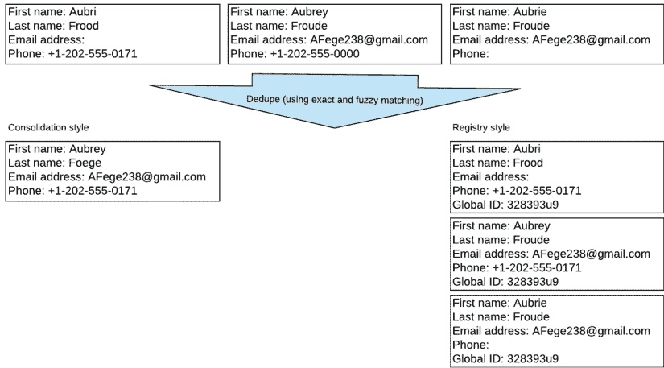

图 15.1 – 说明 MDM 整合式和注册表式风格之间区别的示例

你现在对所提议的解决方案已经很清楚了。为了让沟通更加容易，你可以创建一个简单的图表，例如：

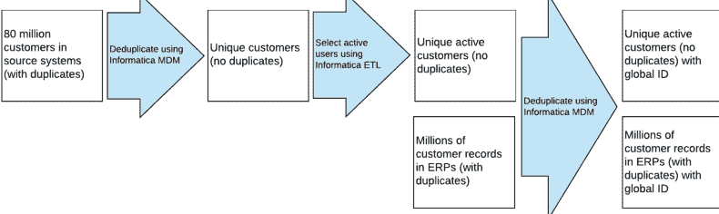

图 15.2 – 建议的数据迁移阶段

图表将使展示解决方案更加容易，并使受众更容易理解。随意在图表中添加其他详细信息，例如预期输入（例如 CSV 文件）。你仍然需要解释迁移方法、计划和注意事项。但请先继续下一个需求，以便更好地了解范围。

*旧版 CRM 系统包含超过 2 亿个电表的详细信息。海量记录主要是因为记录存在大量冗余。*

预计需要迁移的实际电表记录数量将少于 1000 万条。公司希望清理数据，并为每个电表维护单条记录，以便构建 360 度资产视图。

这是另一个去重需求。不过，这有所不同，因为电表始终通过电表 ID 强标识。MDM 工具仍需整合输入记录，为每个电表创建唯一的黄金记录。

幸运的是，您已拥有一个能够提供 MDM 整合功能的 MDM 工具。请更新景观架构图，以包含迁移接口。同时，更新集成接口列表。您的景观架构图可能如下所示：

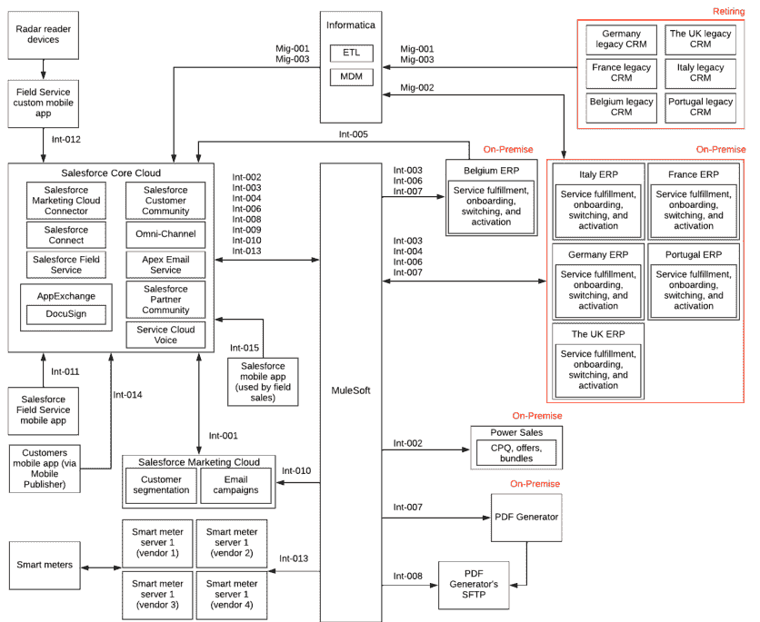

图 15.3 – 景观架构（第四版）

数据迁移接口列表如下所示：

| Interface Code | Source/Destination | Integration Layer | Integration Pattern | Description | Security | Authentication |
| :--- | :--- | :--- | :--- | :--- | :--- | :--- |
| Mig-001 | Legacy CRM apps >> Informatica MDM >> Salesforce | 数据 | 批量数据同步 -> 异步 | 客户数据将从旧版 CRM 加载到 Informatica MDM，该工具将识别重复记录，并为唯一标识的记录分配全局方 ID。Informatica MDM 将使用模糊逻辑和复杂匹配算法。这些数据最终将加载到 Salesforce。 | HTTPS（单向 SSL/TLS） | OAuth 2.0 Web 服务器流 |
| Mig-002 | ERPs >> Informatica MDM >> ERPs | 数据 | 批量数据同步 -> 异步 | 客户记录将从 ERPs（已知存在重复项）中提取并加载到 Informatica MDM。您已在 Mig-001 中加载客户记录。Informatica MDM 将识别重复记录，并为唯一标识的记录分配全局方 ID。Informatica MDM 将使用模糊逻辑和复杂匹配算法。所有输入数据都将标记生成的全局方 ID。然后，这些数据将用于更新 ERPs 中的记录。此活动将确保客户的全局 ID 附加到 ERPs 中的所有相关记录。 | HTTPS（单向 SSL/TLS） | OAuth 2.0 Web 服务器流 |
| Mig-003 | Legacy CRM apps >> Informatica MDM >> Salesforce | 数据 | 批量数据同步 -> 异步 | 电表记录将从旧版 CRM 迁移到 Informatica MDM，并在其中根据电表 ID 进行去重。完成此操作后，去重后的电表记录将加载到 Salesforce。 | HTTPS（单向 SSL/TLS） | OAuth 2.0 Web 服务器流 |

图 15.4 – 数据迁移接口（最终版）

您在第 13 章“展示与辩护：首次模拟”中了解到，需要回答以下问题：

- 您计划如何从数据源获取数据？
- 您最终将如何将数据加载到 Salesforce？客户需要注意哪些注意事项，您将如何降低潜在风险？
- 拟议的迁移计划是什么？
- 您的数据迁移方法是什么（一次性大切换与持续累积方法相比）？为什么？

您将在本章后面制定数据迁移演示文稿时涵盖这些主题。目前，您需要审查 LDV 缓解策略。您在数据模型中已初步将几个对象列为潜在 LDV，但仍需进行计算以确认它们是否确实是 LDV。确定最终 LDV 集后，您需要制定缓解策略。您将在下一节应对这一挑战。

## 审查已识别的 LDV 并制定缓解策略

浏览场景后，您可以识别几个可能为 LDV 的对象。列出所有对象并进行计算，以确定它们是否是 LDV。您可以使用如下表格：

| Object | Expected number of records | Is it an LDV? | Mitigation strategy |
| :--- | :--- | :--- | :--- |
| Account | 6,700,000 条客户记录（B2B 和 B2C）。公司物业（特定账户记录类型）数量假设比客户数量多 25%（部分客户与多个物业相关），即近 850 万条记录。总计，您可以假设近 1520 万条记录。 | 是。 | 您需要尽可能通过存档非活跃客户来保持此对象的精简。`Accounts` 将使用 Salesforce Big Objects 进行存档。 |
| Contact | 每个 `Person Account` 占用一个账户记录和一个联系人记录。这意味着您有近 600 万条 B2C 客户联系人。每个 B2B 账户最多可有五个联系人，即近 140 万条记录。总计，您有近 740 万条记录。 | 是。虽然记录数量不算庞大，但该对象将直接受 `Account` 存档策略的影响。 | 您需要尽可能通过存档非活跃 `Contacts` 来保持此对象的精简。`Contacts` 将使用 Salesforce Big Objects 进行存档。 |
| Asset | 有 600 万个 B2C 客户。平均而言，1.5 个这样的客户同时订阅电力和天然气。 80% 的 B2B 客户同时注册电力和天然气。关键客户平均有 10 个物业。 您大约总共有 1215 万个资产。 | 是。 | 您需要尽可能通过存档非活跃资产来保持此对象的精简。 资产将使用 Salesforce Big Objects 进行存档。 |
| Contract_Line_Item__c | 此对象的大小将与 Asset 对象相似。它将包含大约 1215 万条合同行项目。 | 是。 | 与 Asset 对象类似。此对象将使用 Salesforce Big Objects 进行存档。 |
| Contract | 您可以假设每个客户有一个活跃合同（涵盖一个或多个产品）。这意味着您大约有 670 万条潜在记录。 | 是，尽管记录数量不算庞大。 | 此对象与 Asset 和 Contract_Line_Item__c 对象紧密相关。应以类似方式使用 Salesforce Big Objects 进行存档。 |
| Meter__c | 此对象中有 1000 万条记录。 | 否。 | 此对象大小增长不大；因此，不被视为 LDV。 |
| Meter_Reading__c | 每年有 2450 万条记录。 | 是。 | 应使用 Salesforce Big Objects 存档所有超过两年的电表读数。 |
| Quote | 每个新的在线注册流程都会生成一个报价。预计每年将有不到 100 万条记录。 | 否。 | 不适用 |
| Opportunity | Opportunity 对象仅用于 B2B 交易。预计每年将有不到 50 万条记录。 | 否。 | 不适用 |
| Case | 公司平均每个客户每年有三个案例。这几乎有 2000 万条记录，不包括其他类型的案例（例如报告故障）。 | 是。 | 应使用 Salesforce Big Objects 存档所有超过一年的案例。 |
| AccountContactRelation | 此对象将被大量用于控制记录可见性。您可以假设有超过 1000 万条记录（基于 850 万个物业和 670 万个客户；有些与多个物业相关）。 | 是。 | 此对象与 Account（人员账户、物业）和 Contact 对象紧密相关。应以类似于这些对象的方式进行存档。AccountContactRelation 对象将使用 Big Objects 存档（仅出于数据完整性考虑，因为它不再驱动任何记录可见性）。 |

表 15.1 – 主要对象和已识别的 LDV

你已识别出多个 LDV 对象，其中许多无法转移到异平台解决方案，因为你需要数据存在于 Salesforce 中以执行业务逻辑（例如自动续约和线索生成）。

你可以通过确保这些对象尽可能精简并在可能时归档记录来减轻其 LDV 影响。场景中已共享一些业务规则，你也可以假设其他一些规则。该公司目前没有数据仓库来归档记录。你可以提出一个数据仓库，将记录归档到 **Heroku**，或归档到 **Salesforce Big Objects**。

你目前在架构中还没有 Heroku，但不要让此阻止你提出它。数据归档是足以证明其合理性的充分理由。不过，请记住，Salesforce Big Objects 也可用于此类用例。你在 *第 7 章，设计可扩展的 Salesforce 数据架构* 中了解到 Salesforce Big Objects 与 Heroku PostgreSQL 归档的对比。对于此场景，你可以选择 Salesforce **Big Objects**。

你可以使用 Apex 填充 Big Objects，但有一个更具可扩展性且更易于管理的方法。你在架构中已有 ETL 工具，可以加以利用。Informatica 将处理所有从 **sObjects** 到 **Big Objects** 的归档作业。

ERP 中管理的对象，如 `Invoice_Header__x`、`Invoice_Line_Item__x` 和 `Payment__x`，无需考虑，因为数据存储在 Salesforce 平台之外。更新你的架构图、接口列表和数据模型。你的数据模型可能如下所示：

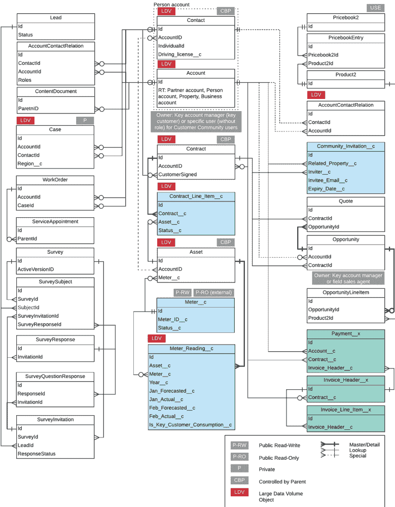

### 图 15.5 – 数据模型（第四版）

继续前进，开始分析可访问性和安全性要求，这通常是考试场景中第二棘手的部分。

## 分析可访问性和安全性要求

可访问性和安全性部分的要求通常在业务流程要求之后是第二难以处理的。与业务流程要求相反，它们往往不会冗长，而是更具技术挑战性。

你可能需要调整数据模型、角色层级，以及可能的角色和许可证图。好消息是，平台内可用的共享和可见性功能数量有限。你可选择的工具池较小。不过，你必须非常了解每个工具，才能选择正确的组合。现在，从第一个共享要求开始。

- 关键客户及其读表数据仅对关键客户经理可见。

在 *第 14 章，练习评审委员会：第二次模拟* 中针对关键客户管理流程的拟议解决方案中，你设计解决方案，使关键客户经理最终拥有关键客户的业务账户。你还指出，其他相关关键客户经理将被添加到账户团队。这将确保这些用户及其经理可以访问所需的 Account 记录。

Account 对象的 OWD 为私有，这意味着其他用户无法访问这些记录。你可以使用基于条件的共享规则授予支持代理可见性。支持代理需要访问所有账户，包括关键客户。你可以创建一个共享规则，将所有 Account 记录共享给支持代理角色及层级上方的所有人。

`Meter_Reading__c` 对象通过主从关系与相关资产关联，而该资产又与属性（一种特殊的 Account 记录类型）相关。为满足要求，你需要确保属性记录仅对正确的用户可见。

父级账户关系不足以授予记录可见性。一种可能的方法是将账户团队成员复制到所有相关属性。你可以依赖 Lightning 流来完成工作，但需要一个条件来控制它。该条件可以简单地依赖于业务账户上的 `Is_Key_Customer__c` 标志。

选中该标志后，Salesforce 流将把所有账户团队成员复制到相关属性。每次向业务账户添加或移除新的账户团队成员时，该流也将执行。

你还需要另一个流，在将属性关联到业务账户时触发，以自动将账户团队成员复制到新连接的属性记录。更新你的数据模型图，进入下一个要求，该要求以以下内容开始：

- 关键客户经理应能够在特定时期内将客户账户的可见性委派给另一位经理。

- 一旦指定的可见性期限过期，记录应不再对被委派的经理可见。

Salesforce 提供了一种将审批委派给其他用户的方式，但它并未开箱即用提供所需功能。如果你不知道有第三方产品（例如，来自 AppExchange）提供此类功能，那么你需要自行设计。

你可以以多种方式提出此做法，包括以下几种：

- 定义一个新的 **账户团队角色**，其名称指示预定义时长（例如，**临时管理员 – 七天**）。**关键客户经理**可以使用该角色添加新的 **账户团队成员**。这将授予用户对 `Account` 记录的访问权限。然后，你可以设置一个定时作业，根据创建日期和名称查询记录（例如，查询创建时间超过七天且具有 **临时管理员 – 七天** 角色的所有 `AccountTeamMember` 记录）并将其删除。这将确保被委派用户不会获得超出允许期限的访问权限。

- 使用新自定义对象创建类似逻辑。你可以在该自定义对象上定义确切的开始和结束日期。批处理作业将根据自定义对象中的设置创建或删除 **账户团队成员** 条目。你甚至可以将此解决方案扩展到 `Account` 对象之外，包括其他标准或自定义对象。在这种情况下，你将不使用 **账户团队**。相反，你将通过 Apex 创建 **共享** 记录。

此解决方案提供更多定制功能，并支持更高级的用例，例如为特定对象的所有记录定义基于时间的委派共享。

选择第二个选项，因为它更具灵活性且更具前瞻性。只要时间允许，在演示过程中请不要犹豫，解释这两个选项。

现在，引入新自定义对象 `Delegated_Record_Access__c`，将其添加到数据模型中，并进入下一个要求。

- 投诉仅对正在处理它的代理及其经理可见。

在你的解决方案中，投诉被建模为案例。这意味着 `Case` 对象的 OWD 将是 **私有**。处理投诉的代理也将拥有它，使记录默认对代理及其经理可见。

最后，你可以简单地将超级用户组在 `Case` 对象上的 **查看所有** 权限授予他们。但这将授予他们对所有类型案例的可见性，而不仅仅是投诉。或者，你可以创建一个公共组，将指定用户添加到其中，然后创建一个 **基于条件的共享规则** 将所有投诉共享给该组。

在提出依赖 **查看所有** 或 **修改所有** 对象权限的解决方案时要小心。使用这些权限的优点是，它们允许用户在不评估记录共享设置的情况下访问记录。这提高了性能。但是，它们可能会授予用户不应拥有的更多访问权限。除非有正当理由证明使用它们的必要性，否则建议避免使用它们。你之前在 *第 6 章，制定 Salesforce 安全架构* 中已介绍过这一点。

- 询问应对所有支持代理可见。

在你的解决方案中，询问被建模为案例。你可以创建一个基于条件的共享规则，将所有询问共享给支持代理角色。

- 维护合作伙伴的记录应仅对支持代理可见。

所有支持代理都可以查看维护合作伙伴账户记录，但不可编辑。你可以通过创建基于条件的共享规则来实现这一点，将相关账户共享给支持代理角色。共享规则上的访问级别可以设置为 **只读**。

与合作伙伴建立直接关系的支持代理也将拥有合作伙伴的 `Account` 记录。因此，支持代理默认拥有编辑权限。

- B2B 客户应能够管理其账户相关的所有属性和计量器。

你在 *第 14 章，练习评审委员会：第二次模拟* 的数据模型设计中已解决此要求。你利用 **共享集** 和 `AccountContactRelation` 记录的组合来实现所需行为。

值得注意的是，过去共享集仅适用于 **客户社区** 许可，但 Salesforce 在 2018 年夏季将该功能扩展到了 **合作伙伴社区** 和 **客户社区 Plus** 许可（当时，它正处于公开测试阶段）。

> **注意**
> 你可以在以下链接中找到有关为 **合作伙伴社区** 许可启用共享集的更多详细信息：`https://pact.link/4N3Di`。

现在，进入下一个也是最后一个要求。

- B2C 客户应能够管理其所有相关属性。B2C 客户关联多个属性的情况很常见。

你已在 *第 14 章，练习评审委员会：第二次模拟* 中作为拟议数据模型的一部分解决了此要求。你使用 Person Accounts 来表示 B2C 客户。你利用共享集和 `AccountContactRelation` 记录的组合，允许社区用户访问多个属性（一种 `Account` 记录类型）。

这结束了可访问性和安全性部分的要求。到目前为止，你已覆盖了场景中近 80%–85% 的复杂度。你还有几个要求需要解决，但你已解决了大多数棘手的主题。继续前进，因为下一个目标是报告要求。

## 分析报告要求

在第 13 章“呈现与辩护：第一次模拟”中，你了解到报告要求有时会影响你的数据模型，尤其是在决定采用反规范化数据模型以减少生成的记录数量时。

报告还可能影响你的景观架构、集成列表或与参与者相关的许可证。请逐一处理公司共享的要求并逐一解决。

*服务全球副总裁希望有一份报告，显示维护合作伙伴在特定年份处理的服务请求，并与其他四个年份的数据进行对比。*

在拟议的解决方案中，维护请求被建模为案例，其中所有超过一年的案例都将被归档。尽管数据在技术上仍然存在于平台上（在 Big Objects 中），但你仍然无法使用标准报告和仪表板来报告这些数据。有两种潜在方式来满足此要求：

- 使用 **Batch Apex** 提取聚合数据：你可以使用 **Batch Apex**（或 **Bulk API**）来提取和聚合归档数据，并将其加载到自定义对象中。然后，你可以使用该对象的标准报告和仪表板。在过去，也可以使用 **Async SOQL** 来进行提取和聚合，但 Salesforce 已宣布计划在 Summer’23 版本中退役 **Async SOQL**。
- 使用诸如 **CRM Analytics** 之类的分析工具：此选项将允许更大的灵活性以及深入查看仪表板背后数据的能力。CRM Analytics（以前称为 **Einstein Analytics** 和 **Tableau CRM**）有一个连接器，可以从 Big Objects 中检索数据。

第二种方法不需要自定义开发，并提供更多灵活性来适应未来的要求。这是使用它的一个合理理由。相应地更新你的景观架构和集成接口列表，然后转到下一个要求。

*服务全球副总裁希望有一个仪表板，显示按国家和地区划分的已收到和已解决的询问和投诉数量。*

使用标准报告和仪表板即可满足此要求，假设过去一年的数据就足够了。SVP 已经可以访问所提及的数据。问题没有指定数据的时间范围。不要为自己把事情复杂化，只需假设过去一年的数据足以满足期望。现在，转到下一个要求。

*关键客户经理希望获得一组商业智能报告，显示将关键客户从旧资费转换到新资费所带来的业务改进。*

指示 *商业智能* 的报告要求通常超出了标准平台功能的范围。标准 **报告和仪表板** 无法满足此类要求，除非你投资开发一个自定义解决方案来创建可报告的聚合数据。

对于此类要求，你应该考虑诸如 CRM Analytics 之类的分析和商业智能工具。幸运的是，你的景观架构中已经有它了。你也可以使用它来满足此要求。确保在演示中提出这一点。

公司希望为其客户提供一个仪表板，显示过去两年消费量的变化。

你可以使用自定义 Meter_Reading__c 对象在平台上保存两年的读表数据。你可以轻松开发一个报告，使用该对象显示消费量的变化。

你是否遗漏了什么？是的，Customer Community 用户无法访问标准报告和仪表板，但 Customer Community Plus 用户可以。你是否应该调整拟议的解决方案，对 B2C 和 B2B 客户都使用 Customer Community Plus 许可证？

答案是否定的。你基于坚实的逻辑选择了 B2C 许可证。你有数百万客户，需要一种适合那么多用户的许可证。不要因为此类要求而对自己的逻辑失去信心。坚持你的立场，并思考一个潜在的解决方案。

你可以轻松开发一个自定义 Lightning 组件，配合一个不错的图表来显示用户消耗量。这确实需要自定义开发（通常最好在 Salesforce 生态系统中尽量避免），但这是完全合理的。

切换到 Customer Community Plus 许可证将对解决方案产生更大的影响。影响不仅来自成本角度，更重要的是来自技术角度。Customer Community Plus 用户会占用门户角色，而门户角色数量有限。你在第 6 章“在 Salesforce 中制定安全架构”中已详细涵盖了这一点。

坚持使用拟议的 Customer Community 许可证，并使用自定义开发的 Lightning 组件来满足此要求。基于所需用户数量和 Customer Community Plus 许可证的限制，理由非常明确，因此设计决定是合理的。

报告部分的要求到此结束。场景的最后部分通常会列出与治理和开发生命周期相关的要求。保持这种势头，继续处理下一组要求。

## 分析项目开发要求

场景的这部分通常关注用于管理 Salesforce 项目开发和发布流程的工具和技术。如前面在第 13 章“呈现与辩护：第一次模拟”中提到的，你在第 10 章“开发生命周期和部署规划”中创建的工件，例如图 10.3（拟议的 CoE 结构）、图 10.4（拟议的 DA 结构）和图 10.7（开发生命周期图（最终）），对于解决场景的这部分很有帮助。

你需要充分理解并 *相信* **CoE** 或 **设计机构（DA）** 等组织结构所带来的价值。你需要知道客户 *为什么* 应该考虑 CI/**CD**——而不仅仅是市场炒作，而是这些技术对开发和发布策略所带来的实际 *价值*。

接下来，浏览不同的公司要求，并找出如何将这些工件付诸实践以解决提出的一些挑战。从第一个要求开始。

*公司希望能够快速实现价值，并尽快获得 Salesforce 功能。*

这一要求代表了当今企业世界的一个普遍趋势。企业都急切地想要以更敏捷的方式采用产品。企业无法等待数年才开始实现投资的价值。他们愿意踏上一段可以理解的漫长旅程，在整个企业范围内全面推出新系统，但他们希望尽快开始获得部分价值。

因此，**最小可行产品（MVP）** 的概念在过去几年中获得了广泛关注。MVP 概念承诺以最小的努力（因此也是最小的财务风险）快速获得价值。MVP 包含最终产品将包括的核心功能。这些核心功能允许在未来的时间里围绕其开发并扩展更多功能。

可以这样想。只要你的新房子处于可居住状态，理论上就可以开始享受它的好处。你可以稍后通过添加装饰、整理花园、建好漂亮的车库等方式，让它变得美丽。

MVP 允许企业在不等到项目结束的情况下就开始获得收益。这有效地降低了整体风险，因为用户将在几周或几个月内而不是数年开始使用新系统。

**注意**
确定 MVP 范围包含哪些内容、哪些内容不包含在内的技巧不在本书范围之内，并且是现代 **产品管理** 的核心。你可以在其他书籍中阅读更多相关内容，例如 Mangalam Nandakumar 的 *Lean Product Management*。

仅靠扎实的产品管理不足以开发出可扩展的 MVP 解决方案。在现实生活中，你需要将其与正确的技术指导（由 DA 提供）、整体治理由（由 CoE 提供）以及正确的交付方法相结合。否则，你可能会冒开发出一个无法很好地扩展或规模化的 MVP 的风险。

这一点对 Salesforce 项目尤其相关，主要是因为该平台灵活、动态且充满现成的功能，这可能会诱人快速搭建一个 MVP 解决方案，但如果没有适当的规划和治理，很容易错失其未来潜力。

回到公司的需求，可以通过采用 MVP 风格的产品设计和开发来满足。在你的演示中，你需要简要解释什么是 MVP 解决方案，它带来的价值，以及如何确保它满足未来潜力。转到下一个需求。

维护 ERP 的团队采用六个月发布周期，他们无法修改时间表以适应此项目。

这可能是一个潜在风险。你需要在演示中提出任何预见的风险。考虑到 ERP 的发布周期，你可能会遇到 Salesforce 发布被推迟到下一次 ERP 发布的情况。这意味着需要在任何版本中仔细管理和选择发布的 Salesforce 功能。

此外，你应该拥有合适的环境结构来控制功能开发，以及合适的集成策略以实现松耦合。

提议的环境结构和开发生命周期策略应满足这些要求，并清楚说明它们将如何解决此风险。你将在本章后面的演示推介中介绍这一点。

历史上，客户支持团队习惯于高效率系统，并且有法规要求在不超过 10 分钟内处理呼叫。

你可以使用 **Service Cloud Console**（也称为 **Lightning Service Console**）来提高客户支持团队的生产率。控制台还允许配置一些快捷方式以满足公司的期望。此外，**Service Cloud Voice** 允许根据来电者电话号码自动查找联系人。**Salesforce** 宏也可用于加速一些重复性任务（例如，单击即可向客户发送电子邮件并更新案例记录）。

所有这些功能将进一步提高客户支持团队的生产率和响应时间。

公司希望在识别潜在项目风险方面获得支持。

你已经遇到三个潜在风险：

- 设计和管理 MVP 解决方案
- 将 ERP 相对较慢的发布周期与 Salesforce 采用的快速发布周期相协调
- 在与高效率桌面应用程序相比切换到云端/基于浏览器的解决方案时管理用户期望和性能

你需要在演示中逐一提出这些风险，并清楚说明你计划如何缓解每个风险。你将在本章后面这样做。

*公司希望有一种清晰、可追溯的方式来跟踪项目生命周期中开发的功能。*

在第 10 章“开发生命周期和部署规划”中，你学习了几种管理发布周期的技术，包括跟踪开发的功能。

你还了解到，在 Salesforce 中处理此类情况的最佳机制是使用多层开发环境实施源代码驱动开发。

**源代码驱动开发**将允许你维护可追溯的审计跟踪，显示项目生命周期中任何给定时间开发的功能。此要求还与下一个要求相关。查看该要求以帮助你为两者制定全面的回复。下一个要求如下：

*公司正在寻求关于合适环境管理策略的建议，以确保在每个阶段执行适当的测试。*

此问题可能以多种不同的方式提出。答案将始终指向你在第 10 章“开发生命周期和部署规划”中学到的内容。应使用多层开发环境、自动化发布管理以及测试自动化工具和技术来满足此要求。

你在第 10 章“开发生命周期和部署规划”图 10.7（开发周期生命周期图（最终））中看到了一个示例开发生命周期图，你将其用作第 13 章“演示与辩护：第一次模拟”中拟议的环境管理和开发生命周期图的基础。你也将使用相同的图表作为本场景的基础。在此情况下，你可以假设一个开发流。你的图表可能如下所示：

| 环境 | 开发环境（开发者沙箱/ Scratch org） | QA 环境（开发者或开发者专业版沙箱/ Scratch org） | CI 环境（开发者沙箱） | QA 环境（开发者专业版或部分复制沙箱） | 暂存环境（完整复制沙箱） | 生产环境 |
|---|---|---|---|---|---|---|
| SCM 分支 | 功能分支 | 功能 QA 分支 | CI 分支 | QA 分支 | 暂存分支 | 版本分支 主分支 |
| 进行的活动 | 开发新功能 | 在本地测试新功能 | 合并新/更改的元数据 | QA 测试 | UAT 测试、暂存和培训 | 生产环境，向用户发布功能 |
| 执行的测试 | 开发者测试 单元测试 | 开发者测试 单元测试 单元测试 自动化功能测试 手动功能测试 | 单元测试 自动化功能测试 代码质量检查 | 单元测试 自动化功能测试 手动功能测试 回归测试 | 单元测试 自动化功能测试 用户验收测试 负载测试 性能测试 | 单元测试 冒烟测试 |
| 参与者 | 开发者 | 开发者 | 发布经理 开发团队负责人 开发者 | 发布经理 | 发布经理 | 发布经理 |

图 15.6 – 开发生命周期图（最终）

你会注意到，你在 CI 环境前后仍然有一个 CI 沙箱（也称为构建沙箱）和 QA 沙箱。你可能会想为什么需要它们。毕竟，只有一个开发流，环境越少事情应该越简单，对吧？并非如此。

你的发布策略应具有前瞻性。它绝不应该短视到只覆盖近期需求。你的策略应能够扩展并容纳多个并行开发新/更新功能的项目流，即使这目前不是紧急需求。

在大多数 Salesforce 项目中，任何给定时间至少会有两个并行流。一个流负责构建和开发新功能，另一个流负责维护生产组织以及修复和修补遇到的任何错误。理想情况下，所有代码更改都应合并到 CI 环境中以遵循设计的管道（除少数例外情况外）。你的环境策略应能够满足这一需求及更多。

本地 QA 环境帮助开发团队在功能进一步推进之前进行测试。共享 QA 环境通常由专门的测试团队管理，他们确保一切协同工作并按预期运行。

随着环境增加，事情确实会变得更加复杂，除非你有合适的工具提供支持。这就是为什么源代码控制管理 (SCM) 和自动化构建和发布管理工具对于任何企业级 Salesforce 项目的成功至关重要。

对于公司的场景，你需要建议一个自动化构建和发布工具。你可以提出诸如 Copado 之类的工具。你还需要添加一个自动化测试工具，例如 Provar。请记住，你仍然需要解释你的单元测试将如何与 Provar 并行工作以提供全面的测试体验。你将在本章后面制作演示推介时介绍这一点。将 Copado 和 Provar 添加到你的架构图中，然后转到下一个也是最后一个要求。

公司正在寻找一种适当的方法论来管理项目交付并确保适当的技术治理。

这是一个组合要求，你可以使用关于各种开发方法论和在第 10 章“开发生命周期和部署规划”中了解到的不同治理机构的知识来解决。

你需要一种能够支持 MVP 解决方案的交付方法论，即一种包含蓝图阶段的方法论，以规划计划的成果并定义如何实现，最好附带一些概念验证。但是，该方法论也应足够灵活，以容纳和接受 MVP 阶段之外的其他要求。所有这些都应指向混合方法论。

为确保技术治理，你需要一个治理机构，能够在正确的时间召集正确的人员做出决策，由高管赞助授权，并得到企业各方面专业知识的支持。这就是 CoE 的用途所在。

此外，你需要有一个持续的活动，以在项目交付过程中验证、挑战和批准每个设计决策，这正是 DA 旨在做的事情。MVP 解决方案会随着时间的推移而积累更多功能并变得更加复杂。有了 DA 结构，你可以确保在开始交付之前，每个用户故事的解决方案都会由正确的人员进行挑战和技术验证。

这总结了项目开发部分的要求。下一部分通常比较有限，包含其他一般性主题和挑战。保持势头，继续下一组要求。

## 分析其他要求

在完整模拟场景中，其他要求部分可能包含其他部分尚未涵盖的任何其他内容的进一步要求。此部分通常包含有限数量的要求。

你在 Salesforce Platform 及其生态系统方面的经验和广泛知识将在此时发挥至关重要的作用。继续探索共享要求。

*该公司最近收购了一家从事可再生能源业务的公司。*

被收购公司生产并安装太阳能电池板以及电池。该公司也使用 Salesforce 作为其核心 CRM。该公司想知道是否应该计划将此 Salesforce 实例与自己的合并，还是保持分离。他们正在寻求你对此决策的支持。

组织策略是你在遇到的每个评审委员会场景中都需要考虑的内容。你应该提出明确的建议，并给出决定提出单组织还是多组织的有效依据。你在 *第 5 章，开发可扩展的系统架构* 中了解了每种方案的一些优缺点。

在此场景中，你会遇到一个用例，其中已经存在一个通过公司收购继承的第二个组织。将此 Salesforce 组织与主公司组织合并的努力应该被考虑，并且永远不应被低估。

此外，新收购的公司从事略有不同的业务。可以理解的是，制造、分销和安装太阳能电池板及电池将拥有完全不同的一组销售和服务流程及活动。在这种情况下，你通常会发现两家企业之间的互动有限。

被收购公司很可能有自己的一套支持系统，例如 ERPs 和 HR 解决方案。保持两家公司的财务分开或启动三到五年的过渡期也是常见的。

基于所有这些原因，假设多组织策略更安全。全球报告要求（如果有）可以使用 CRM Analytics 等商业智能工具来满足。

由于你对这个新组织了解不多，不会将其包含在架构图中。你可以在演示中简单解释拟议的组织策略及其背后的理由。你的架构图现在可能如下所示：

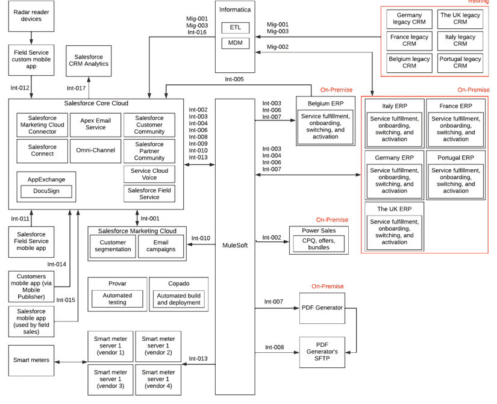

### 图 15.7 – 架构（最终）

为了提高可读性，集成接口列表已分为两个图表。集成接口列表的第一部分可能如下所示：

| Interface Code | Source/Destination | Integration Layer | Integration Pattern | Description | Security | Authentication |
| :--- | :--- | :--- | :--- | :--- | :--- | :--- |
| Int-001 | Salesforce -> Marketing Cloud | 数据 | 批量数据同步 - 异步 | 使用 Marketing Cloud Connector 在 Salesforce 和 Marketing Cloud 之间同步联系人和潜在客户等数据，反之亦然。 | HTTPS（单向 SSL/TLS） | OAuth 2.0 客户端凭据流（用于向 Marketing Cloud 身份验证），OAuth 2.0 Web 服务器流（用于向 Salesforce 身份验证） |
| Int-002 | Salesforce -> MuleSoft -> Power Sales | 业务逻辑 | 远程进程调用 - 请求和响应 – 阻塞 | 调用多个方法并从 Power Cloud 获取报价详细信息。可以在 Salesforce 的自定义 UI 中使用按钮调用该 API。单击按钮后，Apex 控制器会调用 MuleSoft API。调用后，MuleSoft 将根据 API 请求有效载荷或逻辑（例如创建报价）确定是调用 Power Sales 的哪个 API 或连接器。返回结果后，Apex 控制器会创建 Salesforce 报价记录并将其链接到相关机会。 | Salesforce 与 MuleSoft 之间为 HTTPS（双向 SSL/TLS），HTTPS（单向 SSL/TLS） | Salesforce 与 MuleSoft 之间带有相互身份验证的 OAuth 2.0 Web 服务器流（然后是刷新令牌流），MuleSoft 与 Power Sales 之间的简单身份验证 |
| Int-003 | Salesforce -> MuleSoft -> 合适的 ERP | 数据 | 远程进程调用 – 发射后即忘 | 从 Salesforce 触发平台事件。MuleSoft 将订阅此类型的平台事件。MuleSoft 将使用平台事件中的数据来确定要将数据发送到的合适 ERP。 | HTTPS（单向 SSL/TLS） | OAuth 2.0 JWT 持有者令牌流 |
| Int-004 | ERPs（比利时除外） -> MuleSoft -> Salesforce | 数据 | 远程调用 | ERPs 将向 MuleSoft 发送消息以指示切换过程的完成。MuleSoft 将调用标准 Salesforce REST API 来更新相关记录。 | Salesforce 与 MuleSoft 之间为 HTTPS（双向 SSL/TLS），MuleSoft 与 ERPs 之间为 HTTPS（单向 SSL/TLS） | Salesforce 与 MuleSoft 之间带有相互身份验证的 OAuth 2.0 Web 服务器流（然后是刷新令牌流），MuleSoft 与 ERPs 之间的简单身份验证 |
| Int-005 | 比利时 ERP -> Salesforce | 数据 | 远程调用（电子邮件） | 比利时 ERP 使用 SMTP 服务器发送电子邮件，由 Salesforce 自定义 Apex 电子邮件服务接收。 | HTTPS（单向 SSL/TLS） | 无（对 Salesforce），与 SMTP 服务器的简单身份验证 |
| Int-006 | MuleSoft -> Salesforce | UI | 数据虚拟化/混搭/OData | 发票、发票行项目和付款使用 Salesforce Connect 在 Salesforce 中显示。MuleSoft 从相关 ERPs 获取数据并使用 OData 接口对其进行汇总。 | HTTPS（单向 SSL/TLS） | OAuth 2.0 Web 服务器流（然后是刷新令牌流） |
| Int-007 | MuleSoft -> ERPs, MuleSoft -> PDF 生成器 | 业务逻辑 | 远程进程调用 – 请求和响应 – 阻塞 | 计划的 MuleSoft 作业检索新发票数据并将其传递给 PDF 生成器以生成 PDF 发票。 | HTTPS（单向 SSL/TLS） | 简单身份验证 |
| Int-008 | MuleSoft -> SFTP, MuleSoft -> Salesforce | 数据 | 批量数据同步 - 异步 | 计划的 MuleSoft 作业从 SFTP 检索 PDF 发票并将其传输到 Salesforce。 | Salesforce 与 MuleSoft 之间为 HTTPS（双向 SSL/TLS），MuleSoft 与 SFTP 之间为 HTTPS（单向 SSL/TLS） | Salesforce 与 MuleSoft 之间带有相互身份验证的 OAuth 2.0 Web 服务器流（然后是刷新令牌流），MuleSoft 与 SFTP 之间的简单身份验证 |

### 图 15.8 - 集成接口（第一部分 – 最终）

集成接口列表的第二部分可能如下所示：

| Interface Code | Source/Destination | Integration Layer | Integration Pattern | Description | Security | Authentication |
|---|---|---|---|---|---|---|
| Int-009 | Salesforce -> MuleSoft | 数据 | 远程进程调用 - 发射后即忘 | 为 Salesforce 中新创建的任何关键事件（Case）触发平台事件。MuleSoft 将订阅此类型的平台事件。MuleSoft 将使用平台事件中的数据来查询 Salesforce 以获取更多详细信息。 | HTTPS（单向 SSL/TLS） | OAuth 2.0 JWT 持有者令牌流 |
| Int-010 | MuleSoft -> Salesforce -> MuleSoft -> Marketing Cloud | 业务逻辑 | 远程进程调用 – 请求和响应 – 阻塞 | MuleSoft 查询 Salesforce 中受关键事件（Case）影响的客户记录。然后，它涉及 Marketing Cloud 事务消息 API 向这些客户发送 SMS 通知。 | Salesforce 与 MuleSoft 之间为 HTTPS（双向 SSL/TLS），MuleSoft 与 Marketing Cloud 之间为 HTTPS（单向 SSL/TLS） | OAuth 2.0 Web 服务器流（然后是刷新令牌流） |
| Int-011 | Salesforce Field Service 移动应用 -> Salesforce | 数据 | 远程调用 | Salesforce Field Service 移动应用程序使用 REST API 从 Salesforce 读取和写入数据。 | HTTPS（单向 SSL/TLS） | OpenID Connect 用户代理流（然后是刷新令牌流） |
| Int-012 | 自定义移动应用 <-> Salesforce | 数据 | 远程调用 | 移动应用程序通过 Bluetooth 与 Radar 读取器通信，读取值，将其本地缓存，然后使用 REST API 将其传输到 Salesforce。 | HTTPS（单向 SSL/TLS） | OpenID Connect 用户代理流（然后是刷新令牌流） |
| Int-013 | MuleSoft -> 智能电表平台, MuleSoft -> Salesforce | 数据 | 远程调用 | 计划的 MuleSoft 作业从不同平台检索电表读数。然后将数据转换为统一结构并合并。合并的数据集随后用于更新 Salesforce。 | Salesforce 与 MuleSoft 之间为 HTTPS（双向 SSL/TLS），MuleSoft 与平台之间为 HTTPS（单向 SSL/TLS） | Salesforce 与 MuleSoft 之间带有相互身份验证的 OAuth 2.0 Web 服务器流（然后是刷新令牌流），MuleSoft 与平台之间的简单身份验证 |
| Int-014 | Salesforce 移动应用（通过 Mobile Publisher）-> Salesforce | 数据 | 远程调用 | 移动应用程序将调用 REST API 来查询、创建或更新记录。 | HTTPS（单向 SSL/TLS） | OpenID Connect 用户代理流（然后是刷新令牌流） |
| Int-015 | Salesforce 移动应用 -> Salesforce | 数据 | 远程调用 | 移动应用程序将调用 REST API 来查询、创建或更新记录。 | HTTPS（单向 SSL/TLS） | OpenID Connect 用户代理流（然后是刷新令牌流） |
| Int-016 | Informatica -> Salesforce | 数据 | 远程调用 | Informatica 将处理将所有识别的 LDV 对象存档到 Big Objects。Informatica 还将从 sObjects 中硬删除所有存档记录。 | HTTPS（单向 SSL/TLS） | OAuth 2.0 Web 服务器流（然后是刷新令牌流） |
| Int-017 | Salesforce -> CRM Analytics | 数据 | 批量数据同步 – 异步 | Salesforce 标准、自定义和 Big Objects 中选定的一组数据被复制到 CRM Analytics 以启用历史和趋势报告。数据使用 CRM Analytics 连接器从 Salesforce 中拉取/检索。 | HTTPS（单向 SSL/TLS） | OAuth 2.0 Web 服务器流（然后是刷新令牌流） |

### 图 15.9 – 集成接口（第二部分 – 最终）

你的参与者和许可图可能如下所示：

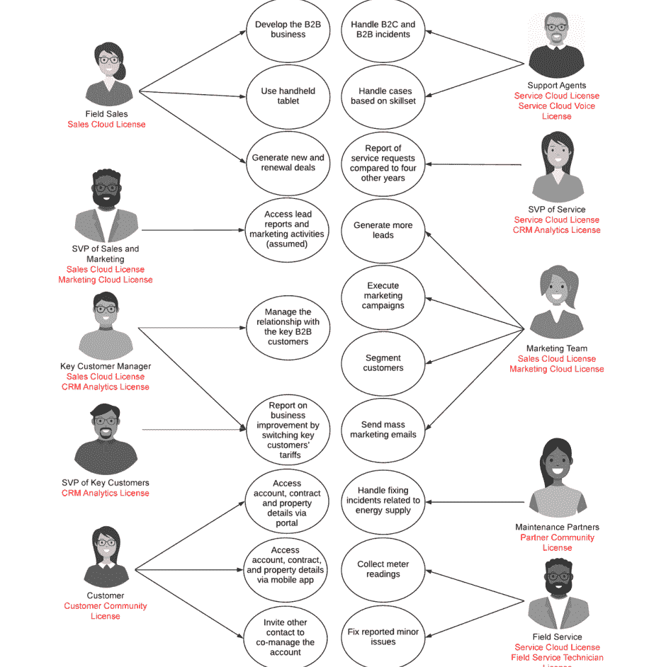

图 15.10 – 参与者和许可（最终）

你的数据模型图可能如下所示：

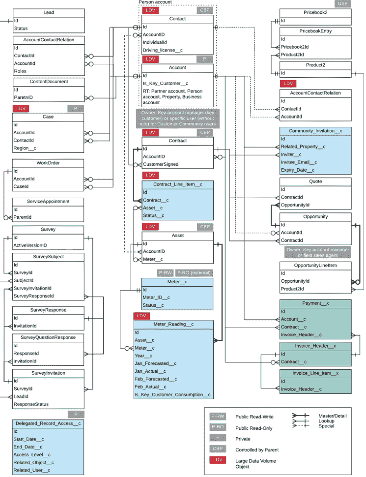

图 15.11 – 数据模型（最终）

角色层次结构图未发生变化。

恭喜！你已成功完成第二个完整场景。你创建了一个可扩展且安全的端到端解决方案。现在你需要将其与一个强大、引人入胜且有吸引力的演示相结合，以尽可能多地拿分，并将问答阶段仅用于填补几个缺口。

准备好进入下一阶段了吗？继续前进。

## 展示并证明你的解决方案

现在是时候创建你的演示文稿了。在评审委员会期间，你可能需要即兴完成这一任务，因为你可能会花掉全部三个小时来创建解决方案和支持工件。

如你在第 13 章“展示与辩护：首次模拟”中所学，你需要提前规划演示，并运用时间管理技能，确保在给定时间内以足够的细节描述解决方案。你将在附录“技巧与窍门，以及前进之路”中学习一些计时技巧。

你现在已熟悉委员会演示的结构。你从演示的结构化部分开始，然后切换到兜底模式。作为提醒，这两个不同的演示阶段包括以下内容：

- 结构化部分：在这一部分，你将描述解决方案中特定的预先规划元素，从整体解决方案介绍开始，包括对所创建工件的简要演练。然后，你逐一处理业务流程，利用图表和工件解释你的解决方案将如何满足它们。之后，你需要描述你的 LDV 缓解和数据迁移策略。

你可以根据需要添加更多主题，前提是你已为此规划并预留了足够的时间。

- 兜底部分：在这里，你将逐一审查要求，并指出第一部分中未涵盖的要求。这样做是为了确保你没有遗漏任何要求，特别是那些简单明了的要求。

在本章中，你将为以下主题创建演示提案：整体解决方案和工件介绍、一个业务流程以及项目开发要求。客户服务流程将被使用，因为它是最复杂且冗长的。

随后，你将捍卫你的立场，为你提出的解决方案辩护和证明，知道你可能需要根据新引入的挑战调整解决方案。

在以下部分中，你将为结构化部分创建示例演示提案。从解决方案和工件的整体介绍开始。

### 介绍整体解决方案和工件

与你在第 13 章“展示与辩护：首次模拟”中所做的类似，先自我介绍；这不应超过一个段落。它应该像下面这样简单：

我叫 [你的姓名]，今天来这里是为了介绍 [场景中公司名称] 的拟议解决方案。

然后，接着写一段简短的文字，简要描述公司的业务。这将有助于你进入演示状态并破冰。你可以直接使用场景中第一段的缩写版本，例如：

该场景描述了一家欧洲公用事业公司，在德国、意大利、法国、葡萄牙、比利时和英国的多个城市提供服务。该公司在 40 个城市运营。它既向 B2C 客户（住宅）也向中小型 B2B 客户提供服务。

记住，自我介绍并设定场景不应超过一分钟。现在你可以开始用一段简短的文字解释公司的关键需求，例如：

该公司多年来一直在为现有的 CRM 解决方案苦苦挣扎，并作为一项新的战略举措，决定切换到 Salesforce。它希望利用新的 CRM 推出一套全球统一的新销售和服务流程。

现在是时候解释当前和未来的架构图了。使用并展示你的架构图来引导受众了解它；绝不要只是站在旁边单调地讲话。你应该能够查看图表并描述现状和未来的架构。你的提案可以如下：

该公司使用六种不同的 ERP 系统。它们用于服务履行、客户入职、切换和激活。计划是保留所有这些系统，并通过其 API 将新解决方案与之集成。值得注意的是，比利时 ERP 不提供 API。

数据将在 Salesforce 和这些系统之间双向流动。为了构建可扩展且灵活的架构，我们应该致力于在 Salesforce 和 ERP 系统之间建立统一的通信接口。MuleSoft 等中间件将提供这种能力。它还将提供编排这些系统之间数据流并处理任何遇到的异常的能力。

MuleSoft 还将能够通过其内置连接器直接与比利时 ERP 所基于的平面文件数据库通信。MuleSoft 不会传输大量数据。这正是让我意识到需要 ESB 而非 ETL 的原因。然而，我还建议使用 ETL 来处理数据迁移。

该公司使用一个高度定制的 CPQ 解决方案，并计划保留它。我们将使用 MuleSoft 暴露的精细 API 与该解决方案集成，因为该解决方案本身提供的 API 较差。Power Sales 将在适当阶段被调用，以计算定制报价的价格。

该公司还依赖需要支持的电力和燃气智能电表以及常规雷达式电表。MuleSoft 将再次在此发挥关键作用，作为统一的集成中间件。

拟议解决方案将取代目标国家的一组传统 CRM 解决方案。我们将稍后解释数据迁移策略，但我们建议使用 Informatica 等 ETL 工具来促进这一过程。

拟议解决方案基于单个 Salesforce 组织。理解公司最近收购了一家也将 Salesforce 作为其核心 CRM 解决方案的新公司。但我认为这两家业务不同，可能需要不同的业务流程集。此外，我假设被收购的公司将在未来几年内继续独立运营。

基于此，我认为我们可以从单个组织开始来满足公司的需求。该组织将托管本场景中描述的所有功能。被收购的 Salesforce 组织将继续独立运行，MuleSoft 将用于将该组织与其他系统连接起来。

拟议解决方案还将利用 Marketing Cloud 进行客户细分、电子邮件和移动通信。我们还将使用 AppExchange 上的一些第三方应用程序，例如 DocuSign。

我已创建所需集成接口及其各自身份验证机制的完整列表。我还创建了一个数据模型图，我将在本次演示中进一步解释。

你已经设定了场景并简要解释了你的解决方案。请记住在演示中指出你的组织策略（及其背后的理由）。现在你可以继续解释他们需要投资的许可证。切换到参与者和许可图表并继续你的提案。请记住使用肢体语言在舞台上走动来确立你的权威（如果你是现场演示）。你的演示可以如下：

我已识别出以下参与者。他们将根据预期角色需要不同类型的许可证。例如，现场销售代理 [在图表上指向他们] 将需要 Sales Cloud 许可证，因为他们需要管理客户的新商机和续约机会。

服务代理将使用 Service Cloud 许可证，因为他们需要处理 Case 对象（该对象代表事件和查询）。Case 将根据所需技能分配给合适的代理。将使用 Salesforce Omni-Channel 来完成此操作，这也解释了对 Service Cloud 许可证的需求。服务代理还将使用 Service Console 和 Salesforce Service Cloud Voice 来接听支持呼叫。

SVPs 将使用授予其访问团队可访问的所有对象的许可证。他们还需要 CRM Analytics 许可证来访问一些趋势报告，这些报告依赖于 Salesforce 标准或自定义对象中不存在的数据。

关键客户经理将使用 Sales Cloud 许可证，因为他们需要使用 Opportunity 对象来管理与关键客户的交易。

营销团队将需要 Sales Cloud 和 Marketing Cloud 许可证，以便在两个系统中创建和培育潜在客户。此外，他们将使用 Marketing Cloud 执行营销活动并发送批量电子邮件。

现场服务团队将使用 Service Cloud 和 Salesforce Field Service 许可证。他们需要访问 Salesforce Field Service 功能，例如移动应用程序、Field Service 数据模型和优化的调度功能。

维护合作伙伴将使用 Partner Community 许可证。除了处理能源供应事件之外，我们对他们的任务没有太多详细信息。我假设他们需要一些高级共享功能和对某些机会的可见性。

最后，客户将使用 Salesforce Customer Community Login 许可证。考虑到该公司拥有近六百万客户，这将是一个很好的选择。该许可证专为大量用户量身定制。我们可以使用共享集等功能来管理其可访问性要求。

这就结束了整体高级解决方案演示。此部分应在结束后花费五到六分钟来介绍。当然，您可以使用自己的措辞，但需要调整语速，以确保在给定时间内介绍完所有所需信息。继续练习，直到您能够做到这一点。时间管理对本次考试至关重要。

现在，进入演示中最重要的部分，您将在其中解释您的解决方案将如何解决共享业务流程。

## 呈现业务流程的端到端解决方案

您仍处于演示的结构化部分。如果您已为某个业务流程创建了业务流程图，那么现在是使用它的时候了。此外，您通常会使用景观架构图、数据模型和接口列表来解释您的端到端解决方案。您可以用一段简短的介绍来开启此部分，例如：

*公司共享了六个业务流程。我将逐一介绍，并解释解决方案如何满足每个流程。*

您将为客户服务业务流程创建一个示例演示。

## 客户服务

与您在第 13 章“演示和辩护：第一次模拟”中所做的类似，您将尝试讲述一个故事，解释如何使用新系统实现其流程。您的推介可以如下：

*我现在将解释拟议的解决方案将如何满足客户服务流程要求。*

*客户可以使用在线门户或拨叫呼叫中心号码来提出询问和投诉。询问和投诉将使用标准 Case 对象进行建模。我建议使用 Salesforce Omni-Channel，根据所需技能（例如语言）将 Case 记录分配给合适的代理。需要评估多个技能。因此，我决定使用 Omni-Channel。*

*将使用 Salesforce 社区来创建在线门户。如前所述，客户将使用 Customer Community Login 许可证。*

*可以使用 Salesforce Service Cloud Voice 为呼叫中心设置电话号码。Service Cloud Voice 还将与 Service Cloud Console 集成，并提供代理可以用来接听电话并创建案例的软电话。*

*我将使用案例升级规则来升级七天内未解决的投诉。服务 SVP 将在投诉升级后收到一封电子邮件。*

*共享要求之一指出，系统应根据上个月的读数自动生成下个月的预测电表读数。考虑到系统中的客户和电表数量，以及每个月每个电表需要捕获两个数据（即预测和实际消耗），我估计需要大约 1.46 亿条记录来存储这些数据。*

*这个数字非常巨大，将直接影响目标对象的 CRUD 操作性能。它还将消耗大量数据存储，并且可能基于查询偏斜产生其他性能影响。*

我将稍后解释所有已识别的 LDV 以及我计划如何缓解它们。

电表读数将存储在自定义非规范化对象中。这将显著减少捕获每月预测和实际消耗所需的记录数量 [请在数据模型图中指向 Meter_Reading__c 对象]。

我将使用前保存流，在捕获上个月的实际消耗后填充下个月的预测消耗。例如，一旦 Jan_Actual__c 字段更新，流将自动填充 Feb_Forecasted__c 字段的值。

Meter_Reading__c 对象将使用主从关系与 Asset 对象关联。这样，任何有权访问 Asset 记录的用户都能查看其关联的 Meter_Reading__c。Customer Community 用户将获得其有权访问的 Account 记录关联资产的访问权限；因此，他们将能够查看其相关的 Meter_Reading__c 记录。

我假设发票和付款存储在 ERP 中。我建议使用 Salesforce Connect 将其在 Salesforce 中向客户公开。MuleSoft 连接到所有 ERP，检索发票，并将其聚合并作为 Salesforce 可以订阅的 OData 接口公开。我已将以下外部对象添加到我的数据模型中 [请在数据模型图中指向 Payment__x、Invoice__x、Invoice__Header__x 和 Invoice__Line_Item__x 对象]。

发票 PDF 将通过每月运行的批量 MuleSoft 作业生成，该作业从 ERP 中检索发票详细信息，并将其传递给 PDF 生成器系统来生成 PDF [请在景观图和接口列表中指向 Int-007]。然后 MuleSoft 将检索存储在 SFTP 上的所有文件并将其传输到 Salesforce [请在景观图和接口列表中指向 Int-008]。我们可以使用包含帐户 ID 的特定文件命名约定。这将使 MuleSoft 能够将文件附加到正确的 Account 记录。PDF 将使用 Salesforce Files 存储 [请在数据模型图中指向 Content Document 对象]。

接下来，我们有一项要求：在发生能源故障时创建关键事件，并根据房产地址将其分配给合适的维护合作伙伴。关键事件将是另一种 Case 记录类型。我将使用案例分配规则将关键事件案例分配给合适的合作伙伴用户或队列，假设我们有一个指示相关案例区域的字段。

完成此操作后，我们需要识别该特定区域的所有客户，并向他们所有人发送 SMS 通知。这是一次批量 SMS 发送，Salesforce 平台开箱即用的功能中没有此功能。因此，我将使用 Marketing Cloud 来满足此要求。

*我们将使用 Marketing Cloud 事务消息 API 发送事务电子邮件和 SMS。*

*一旦创建关键事件案例，我们将从 Salesforce 向 MuleSoft 触发带有必要案例详细信息的平台事件 [请在景观图和接口列表中指向 Int-009]。然后 MuleSoft 将查询 Salesforce 以找出相关/受影响的客户，然后调用 Marketing Cloud 的事务消息 API [请在景观图和接口列表中指向 Int-010]。MuleSoft 可以以可扩展且高性能的方式编排整个过程。*

*Salesforce 和 MuleSoft 之间的所有通信将使用双向 TLS 进行保护，并使用 OAuth 2.0 Web 服务器流进行身份验证（最初使用，随后使用刷新令牌流）。*

这是一个冗长的业务流程，但介绍其解决方案应花费五到六分钟。其他业务流程应花费更少时间。使用您自己的措辞练习演示，并继续练习，直到您能够在六分钟以内轻松完成类似的推介。

还植入了一些问题，例如 OAuth 2.0 Web 服务器流的完整描述。如果评委觉得需要更多详细信息，他们将在问答环节回到此点。

### 注意

您已在演示的上下文中包含了假设。您可以使用此方法，也可以简单地事先列出所有假设。前者更可取，因为它更自然、更具吸引力。

您不会为 LDV 缓解策略创建推介。但是，您可以使用本章前面创建的表格（*图 15.4*）。它包含所有已识别 LDV 对象的列表、预期记录数和缓解策略。

进入结构化演示的下一个元素。

## 呈现项目开发和发布策略

此时，您可能已消耗分配给您的*结构化演示*的大部分时间。请继续进行您的简洁项目开发和发布策略推介：

*公司希望尽快开始实现价值。为实现这一目标，我建议在定义每个版本中包含的功能时遵循 MVP 的概念。MVP 使企业能够在无需等到项目结束的情况下开始获得收益。这有效地降低了整体风险，因为用户将快速开始使用新系统，并通过增量版本获得额外功能。*

我在本项目中识别出至少三个潜在风险。首先是 MVP 解决方案的设计与治理。为缓解这一风险，我们将采用由两部分组成的治理机构：一是卓越中心（CoE），确保在所有利益相关者参与的情况下做出战略决策；二是设计权威（DA），负责解决日常项目挑战，并基于最佳实践提出合理且可审计的解决方案。

接下来是将 ERP 相对缓慢的发布周期与 Salesforce 采用的快速发布周期进行对齐。我们将使用多层开发环境，并将其与合适的 ERP 环境集成，以缓解这一问题。我们将使用 MuleSoft 在系统之间建立松耦合集成，这将使我们能够利用双速架构概念。双速架构将允许集成系统以自己的节奏进行开发，彼此之间依赖最少。项目中透明的待办列表将确保每个人都知道正在开发的功能。CoE 将确保为正确的发布选择正确的功能。

最后一个风险是，在从高生产力桌面应用程序切换到云端/浏览器端解决方案时，管理用户期望和性能。为缓解这一风险，重要的是确保已建立合适的变更管理流程，包括沟通活动、培训、定义先锋用户/超级用户，以及高管团队的持续支持。我们将使用性能与桌面应用程序高度匹配的工具。

我们将使用基于多层开发环境的源代码驱动开发。源代码驱动开发将允许您维护可追踪的审计轨迹，显示项目生命周期中任何给定时间开发的功能。

在此图表 [指向开发生命周期图] 中，您可以看到，我们最初将只有一个开发流。

该流中的团队将使用开发沙箱开发新功能。他们将使用另一个开发者沙箱来测试开发的功能，而不会受到任何开发活动的干扰。还将有一个沙箱，用于从所有流中持续合并新开发的功能。

除此之外，还将有一个由测试团队管理的 QA 环境沙箱、一个预发布环境和一个生产环境。热修复可以在单独的沙箱中进行，然后部署到 CI、预发布和生产环境。此设置将允许未来的流并行工作，并确保所有团队始终使用最新的代码库并避免冲突。

我建议使用自动化部署和发布管理工具，例如 Copado，以及自动化测试管理套件，例如 Provar。Apex 单元测试仍将用于测试所有关键功能，此外还要测试无法使用基于 UI 的自动化测试进行测试的功能。

每次将某个功能从一个环境部署到另一个环境时，都将调用所有 Apex 单元测试。自动化测试脚本也将自动调用。两者共同确保执行所有回归测试，并且新开发的功能符合所有验收标准。当然，仍将有手动测试，但我们应该力求自动化最关键的用例。

评委在问答环节很可能会询问与该领域相关的问题，例如 CoE 的结构、拟议的开发方法、CI 环境的依据、SCM 中分支的使用、如何保持所有开发环境处于最新状态，以及如何确保测试持续被调用。

您在这里也预埋了一些问题。例如，您简要提到 CI 设置将使团队避免冲突，但您没有准确说明如何做到。您将在本章后面解决那个问题。进入演示的兜底阶段。

通读场景并捕获所有剩余需求。

在演示的这一部分，您将逐一过一遍需求，确保已覆盖每个方面。

您在第 13 章“Present and Defend: First Mock”中了解过这种方法的优势，它帮助您发现并解决了遗漏的需求。即使您创建了结构完美的演示文稿，也建议留出一些时间再次过一遍需求，确保没有遗漏。

如果您进行现场评审会，将收到场景的打印版。您还可以使用一组钢笔和记号笔。在阅读和解决场景时，请突出显示或加下划线标记需求。如果您心中有解决方案，请将其写在需求旁边。这将在场景的兜底部分为您提供帮助。

如果您进行虚拟评审会，将获得场景的数字版。您可以使用 MS PowerPoint 和 Excel，并可以将要求复制到幻灯片/电子表格中，然后在演示期间使用。

演示结束。下一部分是问答环节，评委将在此阶段提问，以填补演示期间您遗漏或未能清晰解释的任何空白。

## 证明并捍卫您的解决方案

接下来，进入问答环节，这个环节应该是您的朋友。放松一下，为迄今为止取得的成就感到骄傲。您离实现梦想很近了。

在问答环节，您还应预料到评委会更改一些要求，以测试您临场解决问题的能力。这都是考试的一部分。接下来，探索一些示例问题和答案。

评委可能会决定质疑您提出的某个解决方案。这不一定意味着它是错误的。即使语气暗示如此，也要相信自己和您的解决方案。要辩护，但不要过度辩护。如果您发现自己犯了错误，请谦虚接受并纠正您的解决方案。评委会感激这一点。

例如，评委可能会提出以下问题：

> 您提议在解决方案中引入集成接口，从设备中拉取智能电表读数。这意味着在可能的情况下，我们无法获取电表的实时读数。您为什么提议这个解决方案，是否有其他替代方案可以为我们提供实时数据？

在回答此类问题时，请确保您的回答犀利且切中要点。不要试图混淆视听并侥幸逃脱。您的回答可以如下所示：

> 问题表明，只有两个系统可以将电表读数推送到服务器（via pub/sub）。而且，要求是每月读取这些电表一次。PDU 非常希望开发一种统一机制，以从其所有供应商处检索智能电表数据。

> 因此，我想到在 MuleSoft 中开发一个定期每月的 MuleSoft 作业，从所有这些平台拉取电表读数，然后用读数更新 Salesforce。

> 或者，我们可以研究是否要在不支持它的两个系统之上引入一个 pub/sub 层。这可以通过将 MuleSoft 连接到它们的数据库并定期检查更改来实现，前提是这些系统可以提供一种检索更改数据增量的机制，类似于 CDC 概念。

> 如果这些系统不支持此功能，我们可以考虑以两种不同的方式与这些系统集成。第一种是统一拉取接口，第二种是使用 MuleSoft 订阅两个系统提供的 pub/sub 频道。这样，我们就可以从四个系统中的两个系统实时获取更新。不过，这将违背公司的原始要求。

> 我倾向于拉取机制，因为它确保我们不会不必要地更新 Salesforce 记录。这将确保我们遵守治理限制并避免任何性能挑战。

您的回答不应超过三分钟。请记住，问答时间有限，您必须确保为评委留出提问尽可能多问题的时间。问答阶段是您的朋友。

Next, explore another question raised by the judges:

> *你们提到 MuleSoft 将使用 OAuth 2.0 Web 服务器流，随后使用刷新令牌流来对 Salesforce 进行身份验证。是否有其他可使用的身份验证流，以及在什么情况下会使用每种流？*

MuleSoft 正在对 Salesforce 进行身份验证并与其通信。这是一种服务器到服务器或机器到机器的身份验证。本可以使用 JWT 流来实现，JWT 流常用于类似场景，并且两个平台都支持。您的回答可以如下：

我本可以使用 OAuth 2.0 JWT 流。它是一种支持机器到机器身份验证的流。两种流都可以满足此要求。但是，使用上下文用户（context user）而非命名主体/集成用户/服务用户（named principal/integration user/service user）进行身份验证时，JWT 流更为有用。我们可以通过上下文用户身份验证与 JWT 的组合，启用更高级的审计功能并支持不同的访问权限。

Web 服务器流（随后使用刷新令牌流）并不最适合基于上下文用户的深度机器到机器身份验证，因为它涉及每个用户的手动身份验证步骤。使用单个命名主体进行身份验证时，这不是问题。考虑到我们不需要在两端交换和托管多个 TLS 证书，Web 服务器流对于命名主体来说可能更容易设置。因此，我为公司选择了此方案。

请准备好为所有这些身份验证流绘制序列图。您可能需要解释其中一种或多种。描述它们没有比使用序列图更好、更全面的方法了。您可以在第 4 章“核心架构概念：身份和访问管理”中找到这些图。

> **注意**
> 
> 有些候选人了解序列图，但觉得使用它们有点大材小用。请记住，您需要在三位资深 CTA 面前详细解释流程。序列图是实现这一目标的最佳工具。

Explore another question raised by the judges:

法官提出的另一个问题：

In your environment and release strategy, can you explain further who would be moving the metadata between the environments and how? Can you also explain how the conflicts will be detected and resolved, and by whom?

在您的环境和发布策略中，您能否进一步解释谁将在环境之间移动元数据以及如何移动？您还能解释冲突将如何被检测和解决，以及由谁来解决吗？

This is a question you have seeded during the presentation. You should be ready to answer it:

这是您在演示过程中预埋的问题。您应准备好回答它：

The developers would be working on a new feature branch for every developed feature. Once they are done, they can initiate a pull request to merge this branch with the CI/build branch.

开发人员将为每个开发的功能在新功能分支上工作。完成后，他们可以发起拉取请求，将此分支与 CI/构建分支合并。

The pull request will notify the release manager (who is sometimes known as the DevOps admin). The release manager will validate the pull request and detect any conflicts. SCMs provide mechanisms and tools for that. The release manager will attempt to resolve minor conflicts (such as changes in page layouts) and revert the pull request for more complicated conflicts. The developer will have to fix it and initiate another pull request.

拉取请求将通知发布经理（有时也称为 DevOps 管理员）。发布经理将验证拉取请求并检测任何冲突。SCM 提供用于此目的的机制和工具。发布经理将尝试解决次要冲突（例如页面布局更改），并对更复杂的冲突撤销拉取请求。开发人员将需要修复它并发起另一个拉取请求。

Once the pull request is accepted, the automated build tool will attempt to deploy the code base in the SCM to the build environment. The release manager will deploy these functionalities to upper environments in due time based on predefined criteria (such as being accepted by the QA team).

拉取请求被接受后，自动化构建工具将尝试将 SCM 中的代码库部署到构建环境。发布经理将根据预定义的标准（例如 QA 团队的接受）适时将这些功能部署到上层环境。

Remember not to get carried away with too many details. Keep an eye on the ticking clock. That concludes the Q&A stage. You covered a different set of questions than what you came across in Chapter 11, Communicating and Socializing Your Solution, and Chapter 13, Present and Defend: First Mock. But, as you would expect, there is a vast number of possible questions. However, you have now learned how to handle them.

请注意不要过分深入细节。时刻关注时钟。问答阶段到此结束。您涵盖的一组问题与您在第 11 章“传达和社会化您的解决方案”和第 13 章“展示并辩护：首次模拟”中遇到的不同。但正如您所料，可能的问题数量庞大。不过，您现在已经学会了如何应对它们。

Understand the questions, accept being challenged, defend and adjust your solution if needed, and answer with enough details without losing valuable time. Enjoy being challenged by such senior and talented architects. Cherish it as this is a worthwhile experience that you may not encounter many times in your career.

理解问题，接受挑战，在需要时辩护并调整您的解决方案，并在不浪费宝贵时间的情况下提供足够的细节来回答。享受被这些资深且才华横溢的架构师挑战的过程。珍惜这次经历，因为这是您职业生涯中可能不会多次遇到的宝贵经历。

## 摘要

## 

In this chapter, you continued developing the solution for the second full mock scenario. You explored more challenging data modeling, accessibility, and security requirements. You also created comprehensive LDV mitigation and data migration strategies. You tackled challenges with reporting and had a good look at the development and release management process and its supporting governance model.

在本章中，您继续为第二个完整模拟场景开发解决方案。您探索了更具挑战性的数据建模、可访问性和安全性要求。您还制定了全面的 LDV 缓解和数据迁移策略。您解决了报告方面的挑战，并仔细审视了开发和发布管理流程及其支持的治理模型。

You then dived into specific topics and created an engaging presentation pitch that described the proposed solution from end to end. You used diagrams to help explain the architecture more thoroughly and practiced the Q&A stage using various potential questions.

然后，您深入研究了特定主题，并创建了一个引人入胜的演示提案，从端到端描述了拟议的解决方案。您使用图表来更彻底地解释架构，并使用各种潜在问题练习了问答阶段。

Congratulations! You have now completed two full mock scenarios. You can practice solving these scenarios as many times as possible. You can also try to add or remove requirements to them to make things more challenging. The mini-scenarios you used in this book are also handy to practice a shorter version from time to time.

恭喜！您现在已经完成了两个完整的模拟场景。您可以尽可能多次地练习解决这些场景。您也可以尝试为它们添加或删除要求，以增加挑战性。您在这本书中使用的小型场景也适合不时练习较短版本。

In Appendix, Tips and Tricks, and the Way Forward, you will go through some tips and tricks that can help you pass the review board. You will learn about some best practices and lessons learned. Finally, you will explore some potential next steps.

在附录“技巧和窍门以及前进之路”中，您将了解一些可帮助您通过评审委员会的技巧和窍门。您将了解一些最佳实践和经验教训。最后，您将探索一些潜在的后续步骤。
