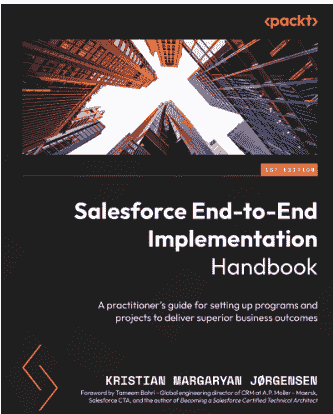
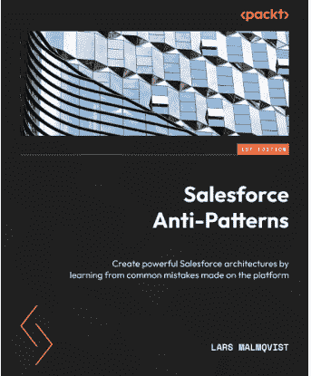
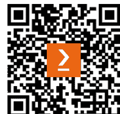

# 索引

## A

- 访问：1-2, 4, 15, 27-29, 32, 34, 37, 45, 60, 63-64, 69, 75-76, 81-84, 87, 91, 94, 96, 99-104, 106-107, 110-111, 113-117, 120, 122-142, 144, 151, 153, 156, 165, 168, 174, 178-186, 189-190, 192, 197, 199, 201-202, 205, 208, 212, 215, 218-219, 227-228, 230-231, 233-234, 259, 263, 269, 271, 286, 288, 291, 294-295, 335, 348-349, 352, 355, 368, 370, 375, 387, 391-398, 401-402, 407, 415-417, 420-421, 424, 428, 432, 438, 440, 446, 453, 457, 459-462, 480-484, 499, 501, 504, 506, 509, 517  
- 账户：1-2, 7, 27-28, 37, 39, 42, 48-50, 56, 61, 63-64, 97, 140, 145, 157, 165, 175, 181, 183-185, 188, 191, 193, 197, 199-202, 210, 218-219, 221, 223, 226, 233-234, 270, 277, 282-283, 290-291, 295, 327, 360, 365-366, 371, 391-393, 395, 416, 424, 429-430, 434, 437-438, 440-443, 447-450, 453-454, 457, 460-462, 480-482, 501  
- AI 驱动：43  
- 算法：41, 64, 83-85, 87-92, 118, 327, 335  
- 算法：34, 41, 43, 84-91, 93, 110, 470  
- 始终在线：422  
- 分析：44, 49, 52, 78, 148-149, 151, 153, 167-168, 233, 235, 246, 376-377, 395, 400, 415, 483-484, 491, 499  
- 匿名化：36  
- 已匿名化：354, 406-407  
- Anypoint：83  
- Apache：70, 79, 110, 151, 375  
- 基于 Apex：234, 245, 255, 392, 465  
- Apigee：78  
- API 优先：76, 79, 82-83, 339  
- apttus：257  
- 架构师：2-5, 7-8, 12, 28, 31, 35-36, 39, 42-43, 45-48, 64, 68, 71, 76-79, 84, 91, 99, 104, 111, 113, 115, 147-148, 177-178, 196, 207-208, 222, 241, 243-244, 255, 271-273, 301-302, 304, 326-329, 363, 365, 375, 522-525  
- aqwaqcpqzc：116  
- 非对称：85-87, 90-93  
- 原子：30, 52, 277-278  
- 可审计：316, 319, 370  
- 审计：506  
- 授权码：127  
- autorabit：403  
- AWS 托管：349  

## B

- 适得其反：341, 514  
- 积压工作：503  
- 备份：34-35, 220, 257  
- 生物识别：101, 108-109  
- Bitbucket：314  
- -bit-long：85  
- 停电期：219, 235  
- 阻塞者：74  
- 阻塞：186, 275, 292, 416  
- 块：81, 85, 87, 314  
- 虚张声势：514  
- 模糊：3, 36  
- 违规：14, 227  
- 违规事件：34, 38  
- 制动：348, 351-352, 375, 395  
- 缓冲：517  
- 缓冲：78  
- 内置：31-32, 35, 44-45, 76-77, 107, 136, 160, 164, 182-183, 216, 220, 233, 235, 349, 497  
- 按钮：38, 114, 186, 200, 327, 361, 401, 416-417, 462  
- 按钮：114, 417  
- 旁路：184-185, 220, 264  

## C

- 缓存：69, 116-117, 397  
- 缓存：339  
- 计算：14, 72, 110, 219, 247, 349-352, 364, 375, 429, 498  
- 计算器：349, 363-364, 366  
- 回调：134, 276, 372  
- 呼入：275, 277, 368  
- 呼入：375  
- 调用：276, 292, 327, 372  
- 调用：276-277  
- CA 签名：86, 92  
- 捕获所有：413, 419-421, 496, 504, 512, 517, 520  
- chargent：364  
- 图表：520  
- 复选框：32, 392-394, 420-421  
- 检查：92, 106, 123-126, 129, 132, 134, 136-137, 150, 183, 186, 351, 368  
- 校验和：88  
- Chrome：120  
- 密码：84-87, 91-93  
- 密文：84-88  
- Citrix：78  
- 类：183, 246, 273, 276, 309  
- 客户端：43, 71, 76, 78-79, 92-94, 112-114, 116-120, 126-136, 139-141, 147-149, 153, 156, 167, 188-189, 221, 223, 226, 243, 248-249, 257-258, 267, 273-274, 281, 301, 304-305, 310-311, 315, 319, 327, 331, 338, 351, 364, 370-373, 389, 397, 402, 404, 407, 416, 423, 433, 448, 461, 470, 474  
- 克隆：314  
- 已赢：249, 258-259, 448  
- CloudHub：94, 338  
- Cloudingo：254  
- 基于代码：245  
- 编码：4, 18, 354, 404  
- cometd：83  
- Comodo：86  
- 控制：22, 24, 41, 85, 366  
- Cookie：71, 78, 110  
- Copado：323, 403, 405, 489, 503  
- Cordova：151  
- CouchDB：31  
- ctasignup：177  


## D

- 仪表板: 1, 27, 63, 434, 483-484
- 数据级: 293
- dataraptor: 449
- 数据集: 33, 41, 49, 51, 149, 212, 218, 276-277, 459, 470
- 数据存储: 68
- 解密: 85
- 解耦: 83
- 去重: 386
- DevOps: 80-81, 324, 507
- 开发者工具: 120
- DocuSign: 247, 257-258, 449, 498
- 加密狗: 102
- 停机时间: 31

## E

- 生态系统: 3, 147, 166, 247, 257, 335, 406, 484, 490
- ElGamal: 91
- 端到端: 2-5, 17, 22-23, 25, 171, 178, 185, 200, 215, 240, 243, 263, 274-275, 282, 292-293, 295, 322, 325-327, 329-330, 332, 347, 354, 363, 365, 385, 406, 412, 415-416, 427, 436, 444, 469, 496, 500, 512, 519-520, 522
- 端点: 75, 112, 129-130, 133-134, 137
- 端点: 83, 377
- 企业: 3-4, 25, 29, 32-34, 37, 40, 43-46, 64-66, 68-71, 74, 76, 78-83, 85, 94, 99-100, 104, 106, 110, 115, 122, 147, 153, 164, 178, 188, 216, 247, 271-273, 282, 284, 301, 304, 309, 333-334, 337, 396-397, 436, 485, 489
- 可扩展: 247

## F

- 功能: 14, 35, 45, 74, 107, 162, 182, 198, 201, 216, 220, 228, 230, 232, 235, 243, 248, 255, 259, 261, 265, 267, 276-277, 314, 320, 322, 370, 387, 398, 404, 450, 458, 482, 486, 507
- 功能: 28, 32, 42-43, 45, 67, 109, 147-151, 178, 183, 185, 194, 209, 212, 234, 244, 263, 267, 276-279, 301, 305, 308, 319-320, 323, 337, 349, 398, 405, 407, 435, 464, 485-487, 489, 503-504, 511, 513
- FeedItem: 231
- 基于文件的: 29
- 文件系统: 34
- 归档: 29
- 防火墙: 76, 273-274, 292, 294, 371, 423
- 触发: 412, 450
- 已标记: 211
- 闪卡: 1, 27, 59-61, 63, 95-97, 143-145, 173-175, 268-270
- 扁平文件: 429, 451, 497
- FlexCards: 449
- 翻页图表: 13
- 流程图: 329, 399
- 足迹: 70
- fwpmejf: 118

## G

- gdbkuuaj: 482
- 地理围栏: 422
- GeoTrust: 86
- GitHub: 314, 319, 524
- GitLab: 314
- Gliffy: 330
- 粒度: 111

## H

- 黑客: 401
- 处理: 65, 73, 77-78, 106, 126, 163-164, 216, 235, 325, 331, 336-337, 345, 376-377, 390, 414, 431, 460, 478, 499
- 哈希: 86-89
- HelloSign: 258
- Heroku: 31, 79, 160, 167, 213-215, 228-233, 235, 375, 377, 387, 390, 395, 400-401, 414, 418-419, 422, 446, 457, 478
- 层次结构: 12, 20-21, 184, 190, 192-199, 204-205, 219, 259-260, 288-289, 355-356, 391-395, 416, 421, 436-437, 480, 495, 510, 519
- 高级: 17, 84, 92, 120, 219, 275-277, 303, 305, 414-415, 499
- HMACMD: 89
- HMACSHA: 89
- 热修复: 74, 312, 315
- 混合: 18, 79, 151, 165, 305-306, 338, 340, 359, 406, 458, 461, 489

## I

- 标识符: 29, 41, 56, 102-104, 115, 117-119, 136, 163, 365, 396
- iframe: 71
- ijo xnte: 118
- ikpvg: 118
- ikpxvcj: 118
- 指标: 222, 232, 275, 283, 291
- 指标: 208, 293
- 摄入: 31
- 已摄入: 44
- 摄入: 47
- 已集成: 4, 17-18, 43, 48, 64-70, 73-74, 76, 83, 94, 100, 115, 156, 159, 163-164, 226, 254, 271-273, 281-283, 303, 309, 333, 338, 397, 464, 503, 514
- 集成商: 78
- 接口: 18, 59, 67, 69-71, 78, 95, 104, 143-144, 166, 173-174, 232, 268-269, 272, 274, 279, 282, 291, 293-296, 298-299, 339, 361, 364, 371, 373, 387, 390, 396, 398-401, 405, 416-417, 432, 448, 453, 497, 501, 505, 514
- 接口: 3, 17-18, 20, 64, 70, 77, 100, 149, 151, 159-161, 163, 165, 171, 203, 209, 228, 238, 271, 284, 295, 297, 299, 309, 329, 344, 362, 364, 368, 372-373, 377, 381, 387, 390, 396, 398, 400, 409, 414-415, 417, 435, 448, 452, 456-457, 459, 461, 464, 466, 473-474, 478, 483, 492-493, 498, 500-502
- 调用: 68, 70, 73, 275-277, 293, 327, 361, 372, 416-417, 457, 502
- 已调用: 70, 73, 276, 323, 327, 457, 498, 504
- 调用: 67, 140, 186, 213
- 调用中: 68, 275-277, 361, 414

## J

- JavaScript: 113, 133, 151
- jxplorer: 110
- 法官: 5, 7, 14-15, 38, 167, 200, 286, 292-293, 326-327, 331-332, 335-337, 339, 341-342, 364, 370-371, 385, 396, 412, 414, 417, 420-424, 460, 469, 502, 504-507, 513-514, 518-521

## K

- Kerberos: 112, 115, 142, 397-398
- 密钥哈希: 89
- 键值对: 119

## L

- 已租赁: 155
- 租赁: 370
- 库: 29, 45, 136
- 许可证: 14-15, 21, 112, 149, 151-152, 166, 168, 177, 181-182, 197, 199, 227-228, 233, 251, 257, 262, 288, 350, 352, 359-361, 370, 394-395, 400, 411, 415-417, 424, 437-438, 440, 484, 498-500
- 许可证: 12, 14-15, 20-21, 107, 147, 152-153, 157-158, 168-169, 172, 182, 192, 195-196, 199, 203, 226-228, 233, 239, 250-251, 254, 257, 262, 265, 288, 290, 355, 357, 359-360, 391, 395, 400, 411, 414-415, 437-439, 457, 480, 482-484, 494, 498-499
- 许可: 151, 350, 361, 416-417
- 生命周期: 247
- liiwiwf: 118
- LinkedIn: 183
- 已加载: 44
- 加载器: 76, 263
- 加载: 75, 216, 220, 235, 278, 292
- 低级: 303
- LucidChart: 7, 330

## M

- 已掩码: 36
- 掩码: 34-36
- mdiyfq: 118
- 元数据: 33, 39, 42-43, 140, 246, 277, 314, 316-317, 319-320, 337, 407, 507
- 中间件: 18, 44, 71, 77, 79, 94, 107, 127, 163-164, 222, 257, 273-274, 277, 284, 292, 298, 309, 338, 361, 371, 377, 414, 448, 497-498
- 最小化: 33, 67, 217, 219
- 最小化: 241
- 缓解: 4, 37, 213, 302, 306, 419, 449, 474, 478, 487, 501, 503
- 已缓解: 389
- 缓解: 218, 406
- 缓解: 209
- 缓解: 4, 16, 207-210, 213, 215, 217, 220, 241, 302, 373, 385, 389, 412-413, 418, 425, 470, 474-475, 496, 502, 508, 511, 513
- 混合: 20, 329, 412
- 已建模: 452, 481-483, 500
- 建模: 12, 47-48, 51, 58, 66, 208, 217, 445-446, 508
- 模型: 3, 48, 77, 156, 282-283, 288, 430-432
- 现代化: 283, 285, 348, 414, 432, 452
- 货币化: 83
- 货币化: 78
- MongoDB: 31
- mpoeop: 84
- MuleSoft: 18, 76, 78, 83, 94, 127, 164, 222, 226, 229, 231-232, 292, 294-296, 327, 337-340, 361, 366, 371-373, 376-377, 414, 416-417, 421, 423, 448-449, 452-454, 457, 459, 464, 497-498, 501-503, 505-506
- 多组织: 150, 162-164, 191, 317, 491
- 多组织: 490
- 多步骤: 216
- mydomain: 115, 286
- mywebsite: 126, 140

## N

- 指定用户: 199, 438
- ndooln: 36
- NetSuite: 104
- 网络: 30, 74, 76, 91, 107, 115, 138, 147, 154, 188, 338, 348, 353, 361, 368, 396-399, 429, 511
- 网络: 67, 78, 100, 115, 182-183, 397
- niisnr: 118
- 非键: 54-55
- 非拉丁: 386
- non-ldv: 209
- 已规范化: 49-52, 217, 445

## O

- 对象: 15-17, 29, 31-32, 41, 48, 56-57, 83, 102, 149, 177-179, 181, 183-185, 194, 197-198, 201, 208-214, 217-219, 224, 226, 228, 230-231, 234-235, 245, 257, 259-260, 263-264, 287-288, 290-291, 294-295, 328, 333, 340, 342, 360, 363-365, 370-373, 387, 389, 391-394, 400, 411, 415, 418, 420-421, 438, 440, 446-449, 452-454, 457, 462, 465, 480-481, 483-484, 499-501, 518
- 卸载: 213, 329, 389
- 已集成: 190, 201, 233-234
- 入职引导: 22, 77, 79, 497
- 单向: 71, 86, 88-89, 93-94, 294, 361, 368, 417
- OmniScript: 449
- 现场: 5, 39
- OpenID: 24, 112, 114, 117, 119-120, 127, 129, 163, 166, 182, 186, 200, 227, 285-286, 294, 368, 396, 417
- OpenLDAP: 110
- 优化: 431, 458
- 已优化: 76, 208, 248-249, 251-252, 254-255, 261-262, 359, 419, 499
- 优化器: 210, 212, 216
- Oracle: 104, 332, 349
- OrderItem: 291, 371, 387, 389, 418
- 组织ID: 31
- 组织级: 179-180
- 组织范围: 16, 181, 422

## P

- PacktPub: 92, 118
- 参数: 85-86, 124, 129, 131, 134, 462
- 参数: 68, 117, 129, 131, 133-134, 141, 363-364
- 解析: 372
- 模式: 14, 18, 272, 274-279, 282, 291-294, 296, 327, 340, 361, 364, 368, 370-372, 377, 417
- 模式: 4, 41, 68, 85, 217, 219, 271, 274-275, 277, 279, 281-282, 292, 294, 299, 351, 376, 400, 510
- 打补丁: 246, 489
- 有效载荷: 118, 396, 417, 449
- 有效载荷: 38, 221, 350
- p-based: 74
- 每次登录: 199, 359
- 每用户: 110, 401, 418
- 网络钓鱼: 100
- PhoneGap: 151
- 选项列表: 259
- PingID: 399
- 明文: 84-85, 87-89, 368
- plu-served: 431
- PostgreSQL: 167, 231, 375
- PostgreSQL: 213, 387, 390, 478
- PowerPoint: 13-14, 327, 414, 420, 504, 520
- 价格表: 245, 287-288, 363-364
- 价格表: 287-288, 415
- 特权: 100, 102, 107, 111, 114, 181, 185, 394, 421
- 特权: 99, 101-104, 107, 185, 506
- 监考: 5
- 配置文件: 2-3, 5, 25, 107, 128, 131-132, 134-136, 157, 165, 185, 200-201, 264, 394, 461-462
- 配置文件: 107, 111, 149-150, 181, 185, 228, 246, 394, 421, 461, 511
- 程序: 33, 71, 301, 304, 332, 353-354, 387, 430, 435, 445, 485, 489, 502
- provar: 323, 403, 489, 503

## R

- RabbitMQ: 79
- rachel: 36, 407
- rachelg: 36, 407
- Rackspace: 213
- RDBMSs: 43, 452
- Redshift: 44, 76
- 冗余: 49, 51-52, 56, 217, 433, 473
- 回归: 150, 308, 504
- RelayState: 124-126
- 仓库: 43-44, 68, 85, 94, 100, 104, 106, 524
- 保留: 47, 59, 95, 143, 173, 214, 268
- RingLead: 254
- 基于风险: 101, 110
- 基于角色: 101, 107, 182
- rqkrrc: 116
- RSA-SHA: 91

## S

- 加盐: 86
- 沙箱: 312-314, 316-317, 320, 322-324, 419, 489, 503
- Selenium: 403
- SharePoint: 45, 153, 156, 162-163
- 银色: 42
- 单组织: 149-151
- 略读: 157, 287
- 智能手机: 109, 117
- SMS-Magic: 457
- 快照: 18, 69
- 基于 SOA: 80
- 基于 SOAP: 429
- sObjects: 478
- 软电话: 452, 500
- somedomain: 36, 407
- 溢出: 65
- 旋转: 275
- 分割: 51, 56
- 转向: 406
- 子集: 54, 210, 212, 470
- 子技能: 325
- 子状态: 368
- 子类型: 190, 198
- 子类型: 190, 197
- 超集: 77
- 超级用户: 481, 503
- Symantec: 86

## T

- Talend: 76, 471
- 关税: 430, 432, 448, 460
- 关税: 429-430, 434, 447, 483
- 分类法: 46
- testemail: 118
- 限流: 82
- 时间范围: 84, 372, 412, 434, 449, 483
- 基于时间: 246, 294-295, 481
- 工时表: 181
- 令牌: 37, 84, 101, 106, 112-117, 119-120, 127, 129, 131-132, 134, 138, 140, 142, 186
- 工具集: 151
- 传输: 34, 94, 282-283, 361, 368, 371, 417
- 过渡: 47, 245, 491
- 触发器: 56, 69, 75, 83, 231, 234, 245, 252, 254, 263, 291, 294, 341-342, 364-365, 376, 449, 460, 462
- 已触发: 361, 416
- 触发器: 75, 220, 235, 246, 361, 446
- 修剪: 118


## W

- 截断：41
- 双因素：106, 201
- 双向：84, 91-94, 292, 294, 327, 361, 368, 417, 502
- 类型感知：32

## U

- 仓库：43-44, 277, 390, 478
- WebMethods：78
- 捕鲸攻击：100
- 通配符：35
- 线框图：366
- 线框图：328
- 工作流：45, 56, 256, 370
- 工作流：42, 44, 218, 220, 235, 246-247, 291, 294-295, 419
- 工单：458

## V

- 基于 UI 的：503
- UI 级：70-71, 293
- 英国 GDPR：37
- 用户代理：24, 114, 127, 129, 133-135, 163, 166, 368, 396
- 基于用户的：506
- 乌特勒支：523

## X

- 版本控制：44, 82, 315
- 违规：349, 352, 377
- 违规：349
- Vlocity：449, 464
- VMware：78
- 卷：4, 16, 48, 51, 149, 208, 219, 232, 510
- 卷：211, 277, 330, 385, 470, 511
- 基于 XML 的：452

订阅我们的在线数字图书馆，即可完整访问超过 7,000 本书和视频，以及行业领先的工具，帮助您规划个人发展并推进职业生涯。如需更多信息，请访问我们的网站。

## 为什么订阅？

- 利用超过 4,000 位行业专家提供的实用电子书和视频，减少学习时间，增加编码时间
- 通过专为您定制的技能计划，提升学习效果
- 每月获赠一本免费电子书或视频
- 全文可搜索，轻松获取重要信息
- 支持内容复制粘贴、打印和加书签

在 www.packtpub.com 上，您还可以阅读一系列免费技术文章，订阅多种免费通讯，并获取 Packt 图书和电子书的独家折扣和优惠。

## 您可能还喜欢的其他图书

如果您喜欢这本书，可能会对 Packt 的这些其他图书感兴趣：



## Salesforce 端到端实施手册

Kristian Margaryan Jørgensen

ISBN: 978-1-80461-322-1

- 了解 Salesforce 实施中的关键活动
- 解决实施 Salesforce 时面临的常见问题
- 探索适当的交付方法论
- 了解变更管理策略的重要性
- 在 Salesforce 实施的所有阶段进行治理
- 了解持续改进阶段的关键活动
- 利用 Customer 360 进行分析、AI 和自动化



## Salesforce 反模式

Lars Malmqvist

ISBN: 978-1-80324-193-7

- 通过识别平台内外功能与接口中的常见错误，构建平衡的系统架构
- 避免 Salesforce 平台上反模式引发的安全问题
- 发现常见的数据架构问题，并探索直观的解决方法
- 在解决方案架构中避免过度定制和定制不足的双重陷阱
- 探索部署设置、测试策略和架构治理中的常见错误
- 了解为何糟糕的沟通模式在架构中经常被忽视

## 分享您的想法

现在您已读完《成为 Salesforce 认证技术架构师，第二版》，我们很乐意听听您的想法！如果您在 Amazon 上购买了本书，请单击此处直接前往本书的 Amazon 评论页面，分享您的反馈或在购买网站上留下评论。

您的评论对我们和技术社区非常重要，将帮助我们确保提供优质内容。

## 下载本书免费 PDF 副本

感谢您购买本书！

您是否喜欢随时随地阅读，却无法随身携带纸质书？您的电子书购买是否与您选择的设备不兼容？

不用担心，现在购买每一本 Packt 图书，即可免费获得该图书无 DRM 的 PDF 版本。

随时随地、任何设备上阅读。直接从您喜爱的技术图书中搜索、复制并粘贴代码到您的应用程序中。

福利不止于此，您每天还可在收件箱中独家获取折扣、通讯和优质免费内容。

按照以下简单步骤即可获取这些福利：

1. 扫描二维码或访问以下链接：



```
https://packt.link/free-ebook/9781803239439
```

2. 提交您的购买证明。

3. 完成！我们会将免费 PDF 和其他福利直接发送到您的邮箱。

