## 第 1 章：探索蓝图编辑器

欢迎来到使用虚幻引擎 5 进行游戏开发的精彩世界。在本书中，我们将学习如何使用由 Epic Games 为虚幻引擎创建的蓝图可视化脚本语言在虚幻引擎中开发游戏。

在学习蓝图之前，需要采取的第一步是准备开发环境。虚幻引擎可免费下载。我们将学习如何安装虚幻引擎 5 并创建新项目。之后，我们将学习一些蓝图的基本概念并探索蓝图编辑器的每个面板。

在本章中，我们将涵盖以下主题：

- 安装虚幻引擎
- 创建新项目和使用模板
- 蓝图可视化脚本
- 蓝图类编辑器界面
- 向蓝图添加组件

### 安装虚幻引擎

要使用虚幻引擎，您必须首先安装 Epic Games 启动器：

1. 访问 https://www.unrealengine.com 网站。
2. 注册并下载 Epic Games 启动器。
3. 安装并启动启动器。
4. 单击左侧边栏的虚幻引擎选项卡。
5. 单击屏幕顶部出现的 **库** 选项卡。
6. 单击 **引擎版本** 旁边的 + 按钮，向启动器添加一个虚幻引擎版本。您可以使用最新可用版本。
7. 单击 **安装** 按钮。启动器将开始下载安装所需的文件，可能需要很长时间才能完成。
8. 单击 **启动** 按钮以启动已安装的版本。可以在同一台计算机上安装多个虚幻引擎版本——只需将其中一个设置为当前版本即可。启动器右上角的 **启动** 按钮将启动当前版本。

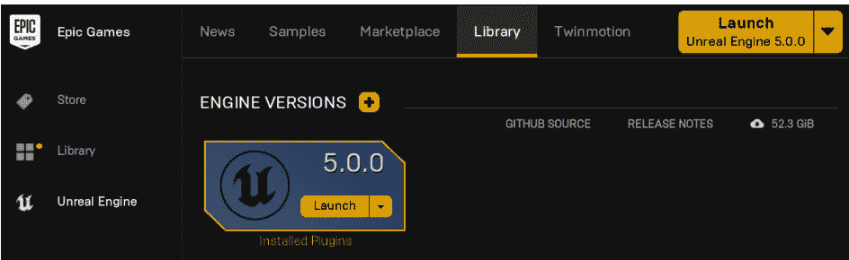

图 1.1 – 启动虚幻引擎

蓝图可视化脚本系统已经是一项成熟且稳定的技术。本书使用 5.0.0 版本，但本书中创建的示例应该在以后的版本中也能正常工作。

### 创建新项目和使用模板

启动虚幻引擎编辑器后，将出现 **虚幻项目浏览器**。左上角的 **最近项目** 框用于打开现有项目，左侧的其他框是用于创建新项目的模板类别。以下屏幕截图显示了游戏类别的模板。

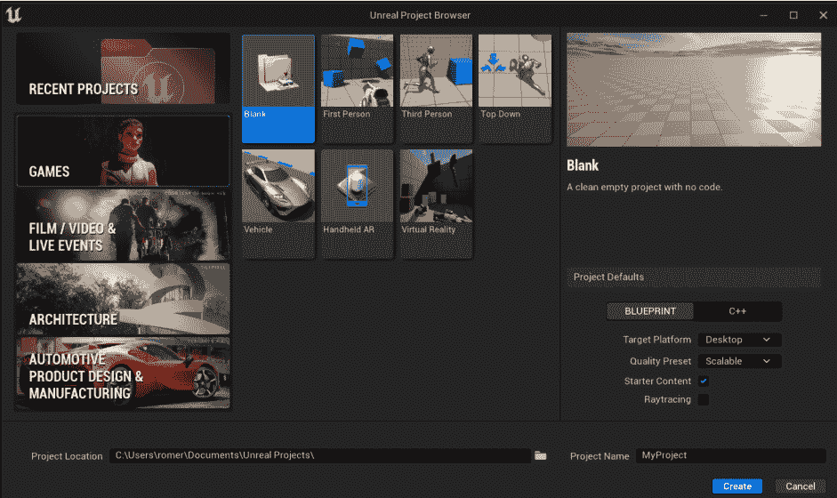

图 1.2 – 游戏类别下的模板

模板是带有一些关键文件和关卡的基本容器，为不同类型的项目提供基本起点。它们对于快速原型设计或学习特定类型项目的基本机制很有用。使用模板是可选的。所有模板都可以在空白模板中简单重新创建。以下是游戏类别中每个模板的描述：

- **第一人称**：适用于第一人称视角的游戏。此模板包含一个玩家角色，由一双配备枪支的手臂表示，该枪支发射简单的球形弹丸。角色可以使用键盘、控制器或触摸设备上的虚拟摇杆在关卡中移动。

- **手持 AR**：适用于 Android 和 iOS 设备的增强现实应用程序。此模板包含用于切换 AR 模式的运行时逻辑

开启和关闭，并附带一些用于命中检测和光照估算处理的示例代码。

- **第三人称：** 包含一个可操作的角色，并附带一个跟随角色的摄像机。摄像机位于角色后方并略高于角色。该角色具有行走、奔跑和跳跃动画，可以使用键盘、控制器或触摸设备上的虚拟摇杆在关卡中移动。

- **俯视图：** 包含一个由鼠标控制的角色，其上方远处设有摄像机。玩家角色使用鼠标或触摸屏点击所需目的地进行控制，并在移动到目的地时使用导航系统避开障碍物。这种俯视视图常用于动作角色扮演游戏。

- **虚拟现实：** 包含虚拟现实游戏的基本功能。此模板具有传送移动、可抓取对象、交互对象和 VR 旁观摄像机。该模板包含一个玩家可以在其中移动的关卡，并包含可抓取和交互的对象。

- **车辆：** 包含普通车辆和带悬挂系统的复杂车辆。此模板的关卡包含简单的赛道和障碍物。

在 **Unreal 项目浏览器** 的右下角，有适用于所选模板的 **项目默认设置**，其中包含项目配置选项。在本书的示例中，我们将使用屏幕截图中选定的值。这些选项稍后可以在项目中修改，如下所示：

- **蓝图/C++：** 有使用 **蓝图** 或 C++ 编程语言制作的模板。在本书中，我们将只使用 **蓝图** 模板。Unreal Engine 5 中的项目可以使用 **蓝图**、C++ 或两者的组合进行开发。您可以将 C++ 代码添加到 **蓝图** 项目，并将 **蓝图** 添加到 C++ 项目。

- **目标平台：** 桌面版或移动版。如果您正在为计算机或游戏主机开发项目，请使用 **桌面版**。如果您的项目将在移动设备上查看，请选择移动版。在本书中，我们将使用桌面版选项。

- 质量预设：可缩放或最大。这些选项会影响项目的性能。可缩放选项会禁用某些复杂功能，而最大选项将启用目标平台上的所有可用功能。在本书中，我们将使用可缩放选项。

- 初始内容：如果选中此复选框，项目将包含初始内容。初始内容是一个包含简单网格、材质和粒子效果的内容包。本书的示例假设正在使用初始内容。

- 光线追踪：如果选中此复选框，项目将使用实时光线追踪，这是一个性能开销大的功能。本书的示例将不使用光线追踪。

选择第三人称模板，选择一个位置文件夹，并填写项目的名称字段。选择前面列表中提到的项目默认设置，然后单击创建按钮。项目加载后，将显示 Unreal 引擎关卡编辑器，如下图所示：

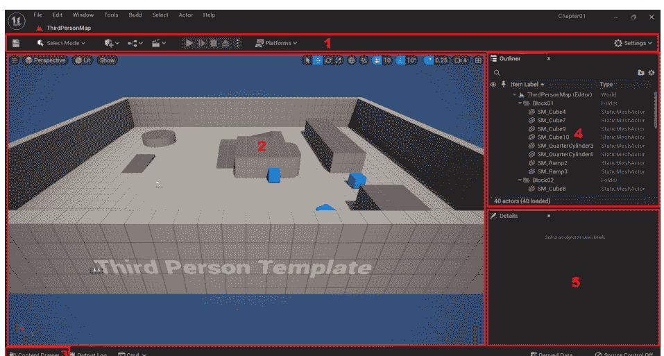

### 图 1.3 – Unreal 引擎关卡编辑器

以下是关卡编辑器的主要面板：

- 1. **工具栏**：位于关卡编辑器的顶部。它包含常用操作的按钮。工具栏按钮分为四组。从左边开始的第一组提供快速访问保存工作和向项目添加各种对象和代码等功能。第二组按钮用于更改关卡编辑器的编辑模式。第三组可让您运行当前关卡，并提供各种特定于平台的选项。最右侧的最后一个 **设置** 按钮可轻松访问项目设置。

- 2. **视口**：位于关卡编辑器的中心。它显示正在创建的关卡。您可以使用 **视口** 面板在关卡中移动并向关卡添加对象。按住鼠标右键的同时，移动鼠标以旋转摄像机，并使用 WASD 键进行移动。

- 3. **内容浏览器**：可以通过单击位于关卡编辑器左下角的 **内容抽屉** 按钮来访问。它用于管理项目的资产。资产是 Unreal Engine 项目中的一段内容。例如，**材质**、**静态网格** 和 **蓝图** 都是资产。如果您将资产从 **内容浏览器** 拖放到关卡中，编辑器将创建资产的副本并将其放置在关卡中。

- 4. **大纲视图**：位于关卡编辑器的右侧。它列出关卡中的对象。

- 5. **详细信息**：位于关卡编辑器的右侧，在 **大纲视图** 下方。它显示在 **视口** 中选定对象的可编辑属性。

现在我们已经了解了 Unreal 引擎关卡编辑器的概览，让我们专注于蓝图可视化脚本。

### 蓝图可视化脚本

您首先应该问的问题是：什么是蓝图？

在 Unreal Engine 中，蓝图一词有多种含义。首先，它是 Epic Games 为 Unreal Engine 创建的可视化脚本语言的名称。其次，它可以指使用蓝图语言创建的一种新类型的游戏对象。

蓝图主要有两种类型：关卡蓝图和蓝图类。游戏中的每个关卡都有自己的关卡蓝图，且无法创建单独的关卡蓝图。另一方面，蓝图类用于为游戏创建交互对象，并可以在任何关卡中重复使用。

### 打开关卡蓝图编辑器

要打开关卡蓝图编辑器，请单击 Unreal 编辑器工具栏中最左侧按钮组中的蓝图按钮。然后，从下拉菜单中选择打开关卡蓝图选项，如下图所示：

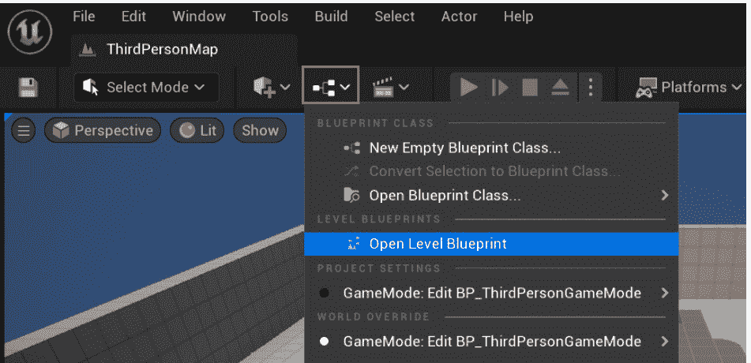

图 1.4 – 打开关卡蓝图

编辑器将打开当前关卡的 **关卡蓝图** 。**关卡蓝图编辑器** 比 **蓝图类编辑器** 更简单，因为它只有 **我的蓝图** 面板、**详细信息** 面板和 **事件图表** 编辑器。下图显示了 **关卡蓝图编辑器**：

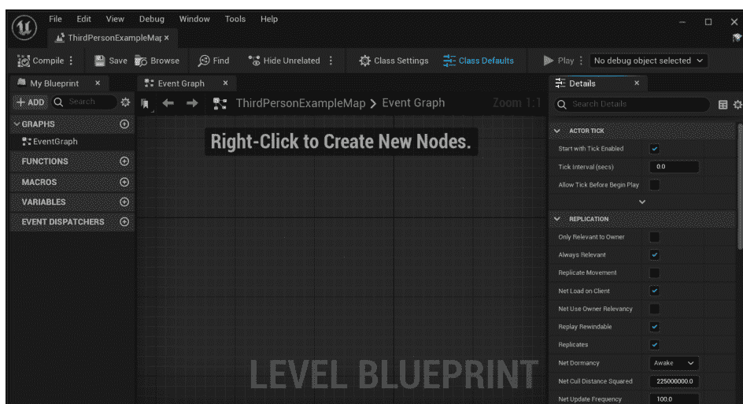

图 1.5 – 关卡蓝图编辑器

目前，我们不会对 **关卡蓝图** 做任何操作。我们打开它是为了初步了解界面。关闭 **关卡蓝图编辑器** 以返回 **关卡编辑器** 窗口。现在，我们将创建一个 **蓝图类** 以打开 **蓝图类编辑器** 并查看所有可用面板。

### 创建蓝图类

创建蓝图类有三种方法：

- 1. 单击工具栏中与打开 **关卡蓝图** 时使用的相同的 **蓝图** 按钮。然后，在下拉菜单中单击 **新建空蓝图类** 按钮。

- 2. 单击 **内容抽屉** 按钮打开 **内容浏览器**，然后单击 **添加** 按钮并在创建基本资产类别下选择 **蓝图类**。

- 3. 在内容浏览器的空白区域右键单击，并从出现的菜单中选择蓝图类。

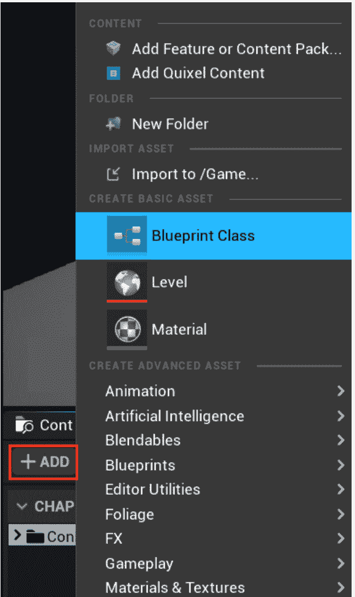

图 1.6 – 创建蓝图类

在下一个窗口中，您必须为新蓝图选择父类。暂时可以将父类视为蓝图类型。该窗口显示最常见的 **常用** 类，但如果您需要选择其他父类，只需展开 **全部类** 选项即可。选择父类后，该窗口将关闭，并且新的蓝图资产将出现在 **内容浏览器** 中以供重命名。您可以单击 **取消** 按钮，因为我们只是熟悉此过程。

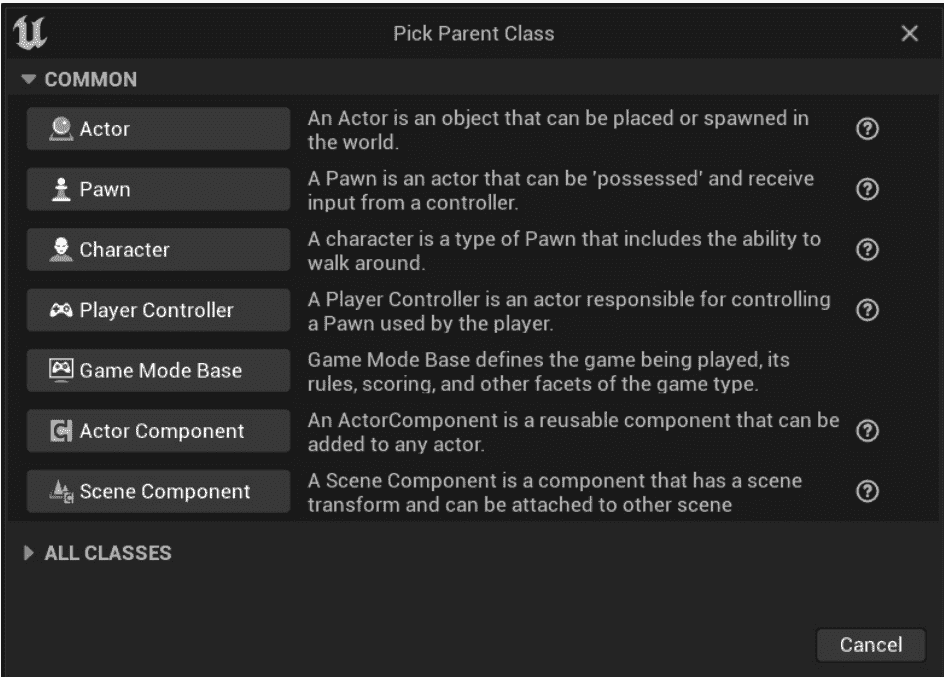

图 1.7 – 蓝图父类

现在我们已经学习了如何打开当前关卡蓝图以及如何创建蓝图类，我们将探索蓝图类编辑器的面板。您可以通过在 **内容浏览器** 中右键单击蓝图资产并选择 **编辑**，或双击蓝图资产来打开蓝图类编辑器。

### 蓝图类编辑器界面

蓝图类编辑器包含多个面板。每个面板用于编辑蓝图的一个方面。蓝图类编辑器通常简称为蓝图编辑器。蓝图编辑器的主面板列表如下：

- 工具栏
- 组件
- 我的蓝图
- 详情
- 视口
- 事件图表

这些面板可以在下一张截图中找到。我们将以第三人称模板中的 BP_ThirdPersonCharacter 蓝图为例。它位于 ThirdPerson/Blueprints 文件夹中。双击 BP_ThirdPersonCharacter 蓝图以打开蓝图类编辑器。

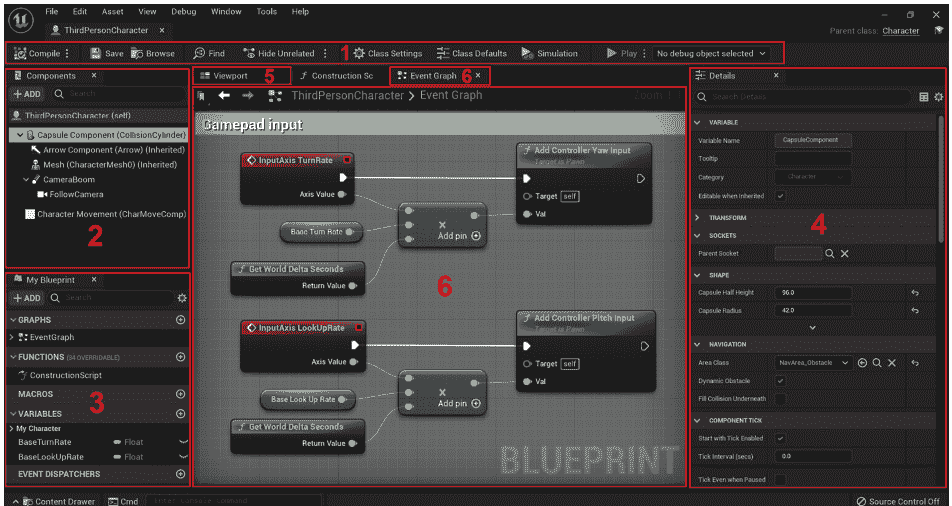

图 1.8 – 蓝图编辑器面板

### 工具栏面板

工具栏面板位于蓝图类编辑器的顶部，包含一些用于编辑蓝图的必要按钮：

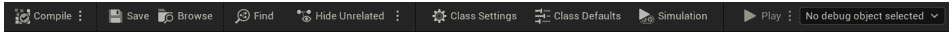

图 1.9 – 工具栏面板

按钮说明如下：

- **编译**：将蓝图脚本转换为可执行的较低级别格式。这意味着蓝图必须在运行游戏之前编译，否则所做的更改不会生效。单击此按钮以编译当前蓝图。如果没有错误，将出现一个绿色的对勾图标。
- **保存**：保存对当前蓝图所做的所有更改。
- **浏览**：在 **内容浏览器** 中显示当前的 **蓝图类**。
- **查找**：在蓝图中搜索。
- **隐藏无关项**：启用时，隐藏与所选节点无关的节点。
- **类设置**：允许在 **详情** 面板中编辑类的设置。**类设置** 选项包含 **描述**、**类别** 和 **父类** 等属性。
- **类默认值**：允许在 **详情** 面板中编辑 **类默认值** 。**类默认值** 是蓝图变量的初始值。
- **模拟**：允许在蓝图编辑器内执行蓝图。
- **游玩**：允许你游玩当前关卡。
- **调试对象**：此下拉菜单允许选择要调试的对象。如果未选择任何对象，它将调试使用当前蓝图类创建的任何对象。

### 组件面板

**组件** 面板显示当前蓝图中包含的所有组件。

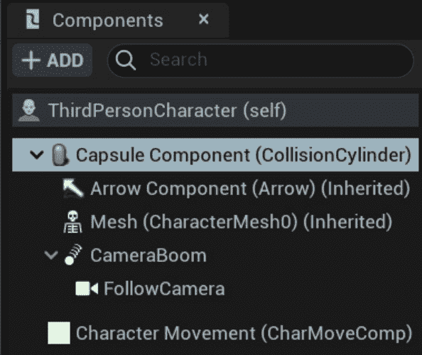

图 1.10 – 组件面板

组件是可以添加到蓝图的即用型对象。为此，请单击组件面板上的添加按钮。蓝图可以仅通过使用组件即可创建各种功能。

选定组件的属性可以在 **详情** 面板中编辑，并且某些组件的可视化表示可以在 **视口** 面板中查看。

静态网格体、灯光、声音、盒体碰撞、粒子系统和相机是组件面板中找到的组件示例。

### 我的蓝图面板

我的蓝图是一个面板，我们可以在其中为蓝图创建变量、宏、函数和图表：

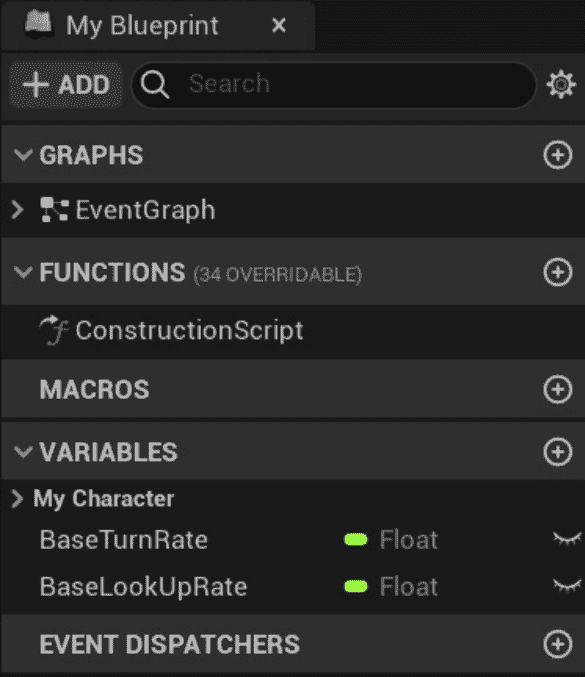

图 1.11 – 我的蓝图面板

可以通过单击面板顶部的 **添加** 按钮，或每个类别旁边的 + 按钮来添加新元素。

选定元素的属性可以在 **详情** 面板中编辑。

### 详情面板

**详情** 面板允许你编辑蓝图中选定元素的属性。选定元素可以是 **组件**、**变量**、**宏** 或 **函数** 元素。**详情** 面板中显示的属性按类别组织。

下一张截图显示了 **胶囊体组件** 的属性。面板顶部有一个 **搜索** 框，可用于筛选属性。

### 详情

### 变量

- **变量名称**：CapsuleComponent
- **提示**：
- **类别**：角色
- **继承时可编辑**：[x]

### 变换

### 插座

- **父插座**：

### 形状

- **胶囊体半高度**：96.0
- **胶囊体半径**：42.0

### 导航

- **区域类**：NavArea_Oil
- **动态障碍物**：[x]
- **填充下方碰撞**：[ ]

### 组件刻帧

- **启用刻帧时启动**：[x]

图 1.12 – 详情面板

### 视口面板

**视口** 面板显示蓝图及其组件的可视化表示。**视口** 面板具有与关卡编辑器类似的控件，可用于操作组件的位置、旋转和缩放。

下面的截图显示了 **视口** 面板。有一个 **骨骼网格体** 组件表示玩家，一个 **摄像机** 组件定义玩家的视图，以及一个 **胶囊体** 组件用于碰撞检测。

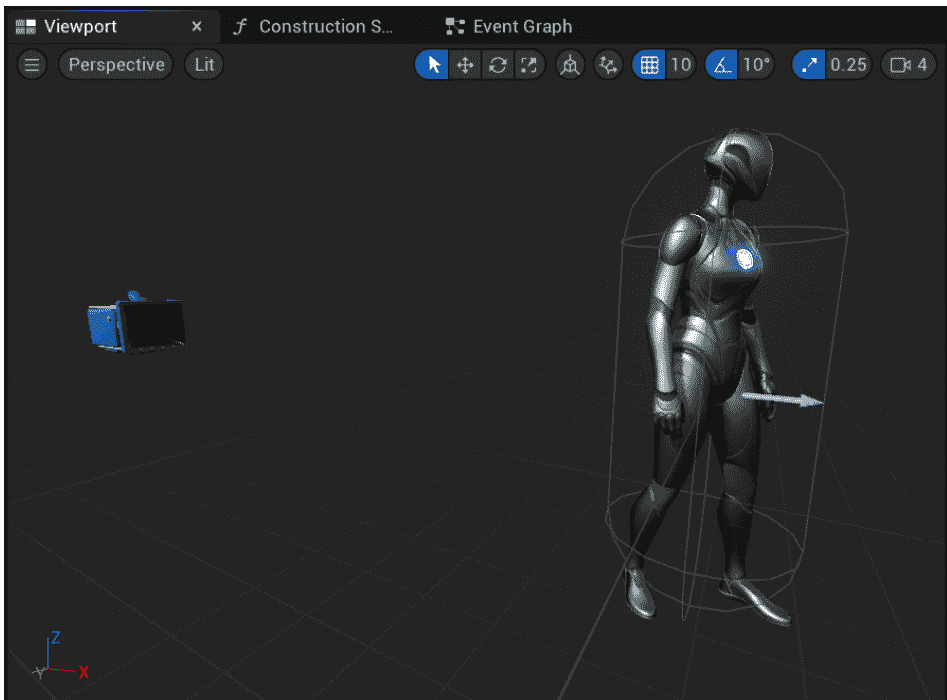

图 1.13 – 视口面板

### 事件图表面板

我们将在 **事件图表** 面板中编程蓝图的行为。**事件图表** 包含 **事件** 和 **动作** ，它们由节点表示并通过电线连接。

事件由红色节点表示，并由游戏玩法事件触发。蓝图可以具有多个动作，这些动作将在响应事件时执行。下一张截图显示了两个事件：**输入轴 转向速率** 和 **输入轴 视角上抬速率**：

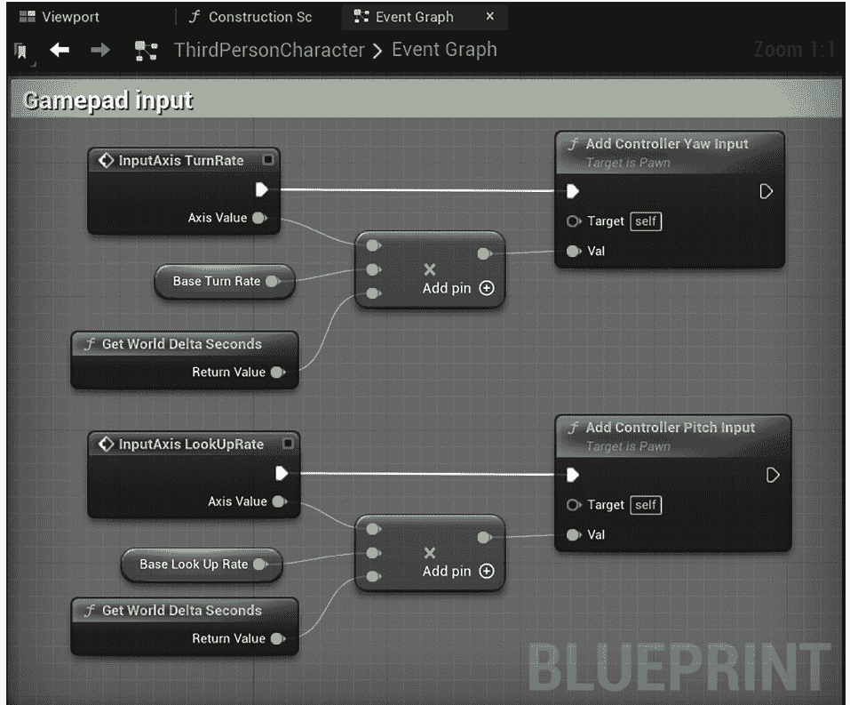

图 1.14 – 事件图表面板

你可以通过右键单击并拖动事件图表来移动，以查看其他事件。

其他节点是表示函数、运算符和变量的动作。我们将在第 2 章“使用蓝图进行编程”中了解这些元素。

在概述了蓝图编辑器面板后，我们现在可以创建第一个蓝图了。关闭蓝图类编辑器并返回关卡编辑器。

### 向蓝图添加组件

现在，让我们创建第一个蓝图。它将是一个非常简单的蓝图，仅包含组件。目前，我们不会使用事件或动作：

- 单击内容抽屉按钮打开内容浏览器，然后单击添加按钮并选择蓝图类。
- 在下一个屏幕上，选择 Actor 作为父类。
- 将刚刚创建的蓝图重命名为 BP_RotatingChair。
- 蓝图名称中不能有空格，并且有将蓝图名称以 BP_ 开头的惯例。
- 双击此蓝图以打开蓝图编辑器。
- 在组件面板上，单击添加按钮并选择静态网格体，如下面的截图所示。此静态网格体将以可视化形式表示此蓝图。

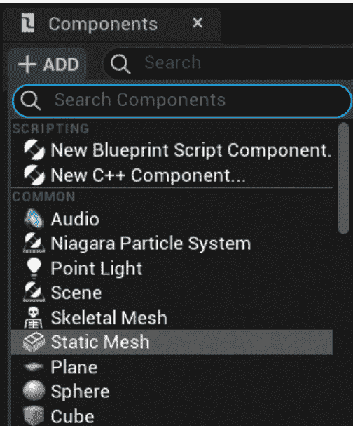

图 1.15 – 添加静态网格体组件

- 在 **详情** 面板中，有一个名为 **静态网格体** 的属性，带有下拉输入。单击下拉菜单并选择名为 **SM_Chair** 的 **静态网格体** 属性。此 **静态网格体** 是入门内容的一部分。下面的截图显示了选定的 SM_Chair：

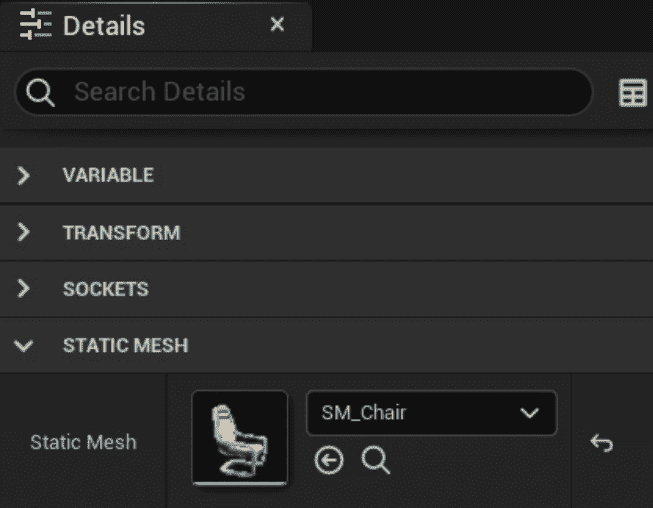

图 1.16 – 选择静态网格体资产

- 让我们添加另一个组件。单击 **组件** 面板的 **添加** 按钮，并在 **搜索** 框中输入 `rotating movement`。
- 单击 **旋转运动** 组件以添加它。默认情况下，此组件将围绕 z 轴旋转蓝图，因此我们不需要更改其属性。
- 单击 **编译** 按钮并保存蓝图。
- 在关卡编辑器中，将 **BP_RotatingChair** 蓝图从 **内容浏览器** 拖动到关卡中的某个位置。
- 按下关卡编辑器的 **游玩** 按钮以查看旋转椅子。你可以使用 *WASD* 键移动角色，并使用鼠标旋转摄像机。你可以按下 *Esc* 键退出正在游玩的关卡。下面的截图显示了示例的运行情况：

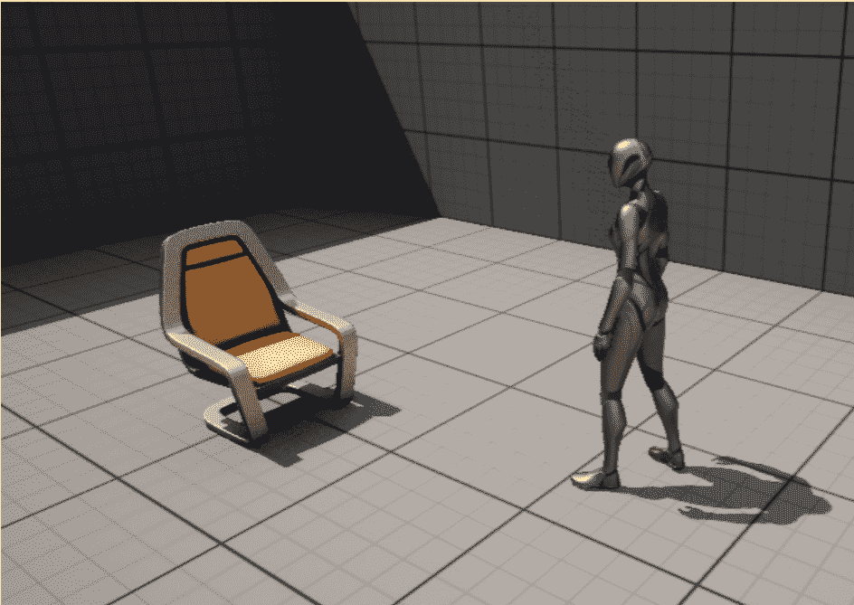

**图 1.17 – 旋转椅**

### 摘要

在本章中，我们学习了如何安装虚幻引擎，并使用可用模板创建新项目。我们了解到，蓝图有两种主要类型：关卡蓝图和蓝图类。

然后，我们探索了蓝图编辑器中包含的不同类型的面板。熟悉这些面板将有助于使用蓝图进行开发。最后，我们还仅使用组件创建了一个简单的蓝图。

在下一章中，我们将学习如何使用事件和操作来编程蓝图的行为。

### 测验

- 1. 您的计算机上可以安装多个版本的虚幻引擎。
  - a. 正确
  - b. 错误

- 2. 关卡蓝图编辑器的面板比蓝图类编辑器多。
  - a. 正确
  - b. 错误

- 3. 哪种类型的蓝图适合创建可以在任何关卡中重复使用的对象？
  - a. 关卡蓝图
  - b. 蓝图类

- 4. 蓝图编辑器中的哪个面板可以添加事件和操作？
  - a. 组件面板
  - b. 事件图表面板
  - c. 我的蓝图面板
  - d. 详情面板

- 5. 蓝图编辑器中的哪个面板显示当前蓝图的变量和函数？
  - a. 详情面板
  - b. 组件面板
  - c. 我的蓝图面板
  - d. 事件图表面板
