## 第 2 章：使用蓝图进行编程

本章介绍了蓝图中使用的基本编程概念。编程本质上是编写计算机能够理解和执行的指令的一种方式。大多数编程语言都是基于文本的，但蓝图通过使用基于节点的界面，提供了一种不同的可视化编程形式。

当某些编程语言存在于特殊环境中或具有明确定义的目的时，它们被称为脚本语言。例如，蓝图是虚幻引擎的可视脚本语言。

在本章中，我们将涵盖以下主题：

- 在变量中存储值
- 使用事件和操作定义蓝图的行为
- 使用运算符创建表达式
- 使用宏和函数组织脚本

### 在变量中存储值

变量是一种编程概念。它由指向可存储值的内存位置的标识符组成。例如，游戏中的角色可能拥有用于存储其生命值、速度和弹药数量的变量。

一个蓝图可以拥有多种类型的多个变量。蓝图的变量列在我的蓝图面板中。单击变量类别中的 + 按钮可创建变量：

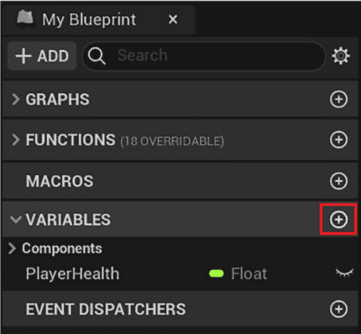

**图 2.1 – 创建变量**

变量的类型定义了变量可以存储的内容。
蓝图是一种强类型语言。这意味着您必须在创建变量时定义变量类型，并且该类型在程序执行期间无法修改。

当您创建变量时，其属性会显示在详情面板中。
变量的第一个属性是其名称，第二个属性是其类型。各种类型如下：

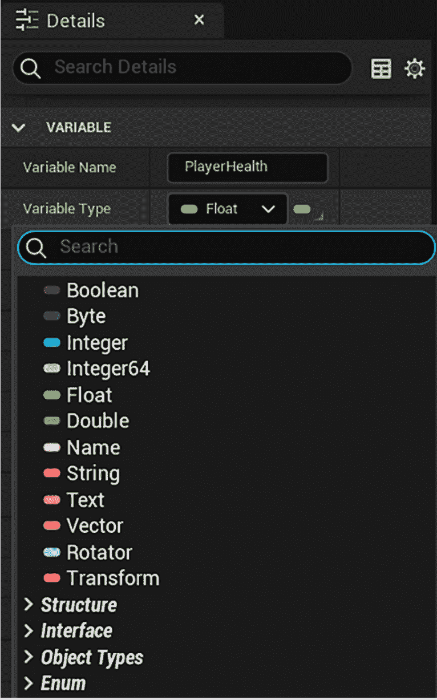

**图 2.2 – 变量类型**

每种类型都用一种颜色表示。以下是变量类型：

- **布尔型**：只能保存 true 或 false 值。
- **字节型**：这是一个 8 位数字。它可以存储 0 到 255 之间的整数值。
- **整型**：这是一个 32 位数字。它可以存储 −2,147,483,648 到 2,147,483,647 之间的整数值。
- **整型 64**：这是一个 64 位数字。它可以存储 −9,223,372,036,854,775,808 到 9,223,372,036,854,775,807 之间的整数值。
- **浮点型**：这是一个 32 位浮点数。它可以存储带有小数部分的数值，精度为七位小数。
- **双精度型**：这是一个 64 位浮点数。它可以存储带有小数部分的数值，精度为 16 位小数。
- **名称型**：用作对象标识符的文本片段。
- **字符串型**：可以存储一组字母数字字符。
- **文本型**：此类型用于将进行本地化的文本，这意味着它允许更轻松地实现翻译成不同语言。
- **向量**：包含 X、Y 和 Z 浮点值，代表 3D 向量。
- **旋转器**：包含 X（滚转）、Y（俯仰）和 Z（偏航）浮点值，代表 3D 空间中的旋转。
- **变换**：可以存储位置、旋转和缩放。

还有与 **结构**、**接口**、**对象类型** 和 **枚举** 相关的其他变量类型。我们将在即将到来的章节中了解这些类型。

以下屏幕截图显示了 **详情** 面板，其中包含可在 **变量** 中修改的属性：

### 详情

搜索详情

### 变量

| 属性 | 值 |
|---|---|
| 变量名 | PlayerHealth |
| 变量类型 | Float |
| 实例可编辑 | |
| 蓝图只读 | |
| 提示 | |
| 生成时公开 | |
| 私有 | |
| 公开至序列 | |
| 类别 | Default |
| 滑块范围 | -- |
| 数值范围 | -- |
| 复制 | None |
| 复制条件 | None |

### 默认值

**图 2.3 – 变量属性**

这些属性可以单独描述如下：

- **变量名**：这是变量的标识符。
- **变量类型**：这指定了可以存储在此变量中的值的类型。
- **实例可编辑**：选中此框后，放置在关卡中的此蓝图的每个副本都可以在此变量中存储不同的值。否则，相同的初始值由所有副本共享，称为 **实例**。
- **蓝图只读**：如果选中，则变量不能由蓝图节点更改。
- **提示**：这包含在光标悬停在变量上方时显示的信息。
- **生成时公开**：如果选中，则在生成蓝图时可以设置该变量。
- **私有**：如果选中，子蓝图无法修改它。
- **公开至序列**：如果选中，则该变量将公开至 Sequencer。
- **类别**：这可以用于组织蓝图中的所有变量。
- **滑块范围**：这设置了将由 **用户界面 (UI)** 滑块用于修改此变量的最小值和最大值。
- **数值范围**：这设置了此变量允许的最小值和最大值。
- **复制和复制条件**：它们用于网络游戏。
- **默认值**：这包含变量的初始值。在您设置默认值之前，必须编译蓝图。

变量用于表示蓝图的当前状态，但行为由事件和操作定义，将在下一节中讨论。

### 使用事件和操作定义蓝图的行为

大多数情况下，我们将使用蓝图创建新角色。在虚幻引擎中，角色是可以添加到关卡的游戏对象。

虚幻引擎使用事件来告知角色的游戏状态。我们通过使用操作来定义角色对事件的响应。事件和操作都由 **事件图表** 面板中的节点表示。

### 事件

要向蓝图添加事件，请使用 **事件图表** 面板。右键单击 **事件图表** 面板以打开 **上下文菜单**，其中列出了可用的事件和操作。如果您需要在 **事件图表** 面板中获得更多空间，可以右键单击并拖动将其移动到 **事件图表** 的空区域。**上下文菜单** 有一个 **搜索** 栏，可用于筛选节点列表。还有一个 **上下文敏感** 复选框，它根据选定的节点筛选可能的操作。以下屏幕截图显示了 **上下文菜单** 和一些可用的事件：


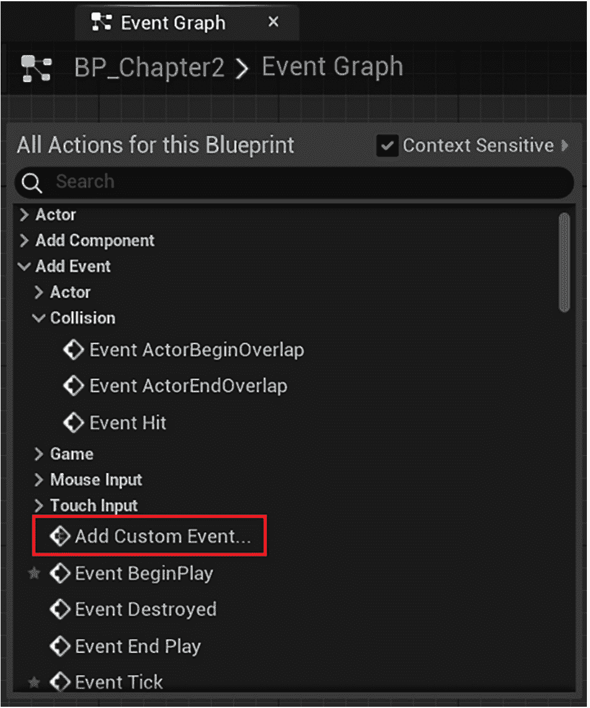

图 2.4 – 上下文菜单中的事件

您可以在 **事件图表** 面板中添加多个事件，但每个事件只能添加一次。除了虚幻引擎提供的事件外，您可以通过单击 **添加自定义事件**... 来创建自己的事件。下一张截图显示了一个 **自定义事件** 节点及其 **详细信息** 面板，您可以在其中重命名自定义事件并添加输入参数。我们将在本章后面的 *创建宏* 主题中了解参数：

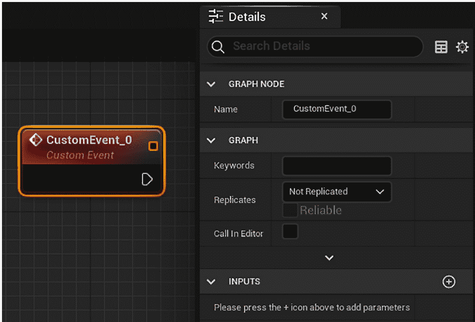

图 2.5 – 创建自定义事件

以下是一些可用的事件：

- **碰撞事件**：当两个 Actor 碰撞或重叠时执行。
- **输入事件**：由输入设备触发，例如键盘、鼠标、触摸屏和游戏手柄。
- **事件 BeginPlay**：对于关卡编辑器中已存在的 Actor，在游戏开始时执行；如果在运行时生成 Actor，则在 Actor 生成后立即执行。
- **事件 End Play**：在运行时即将移除 Actor 时执行。
- **事件 Tick**：每帧游戏时调用。例如，如果游戏以每秒 60 帧运行，则该事件每秒将被调用 60 次。

我们将学习如何创建连接到事件的操作。

### 操作

触发事件时，我们使用操作来定义蓝图将如何响应该事件。您可以使用操作来获取或设置蓝图变量中的值，或调用修改蓝图状态的函数。

以下截图显示了蓝图的 **事件 BeginPlay** 事件。在此示例中，蓝图有一个名为 **机器人名称** 的字符串变量：

- 1. **设置** 操作将 **Archon** 值分配给 **机器人名称** 变量。
- 2. 下一个操作 **打印字符串** 将在屏幕上显示接收到的 **输入字符串** 引脚上的值。这些传递给函数的值称为参数。
- 3. **输入字符串** 引脚连接到 **机器人名称** 变量的 **获取** 节点，该节点返回 **机器人名称** 变量的值并将其传递给 **打印字符串** 函数：

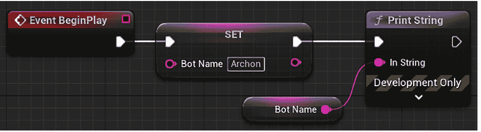

图 2.6 – 带有一些操作的 **事件 BeginPlay**

- 4. 要将变量的 **获取** 和 **设置** 操作添加到事件图表，只需将变量从 **我的蓝图** 面板拖动到 **事件图表** 以显示 **获取** 和 **设置** 选项。

其他函数（如 **打印字符串**）从右键单击 **事件图表** 面板时出现的 **上下文菜单** 中添加。**获取** 和 **设置** 操作也可以在 **上下文菜单** 中搜索。

连接操作的白线也称为执行路径。

### 执行路径

节点的白色引脚称为 **执行引脚**。其他彩色引脚称为 **数据引脚**。蓝图中节点的执行从红色事件节点开始，然后沿着从左到右的白线进行，直到到达最后一个节点。

有些节点控制蓝图的执行流程。这些节点根据条件确定执行路径。例如，**分支** 节点有两个名为 **真** 和 **假** 的输出执行引脚。将被触发的执行引脚取决于 **条件** 输入参数的布尔值。以下截图显示了 **分支** 节点的示例：

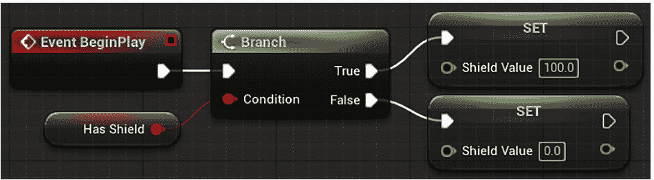

图 2.7 – 具有两个执行路径的 **分支** 节点

在此示例中，当 **事件 BeginPlay** 触发时，**分支** 节点将评估 **是否有护盾** 布尔变量的值。如果值为 **真**，则将执行 **真** 引脚，并将值 `100.0` 设置在 **护盾值** 变量中。如果为 **假**，则将值 `0.0` 设置在 **护盾值** 变量中。

我们了解了如何使用操作修改变量的值。下一步是学习如何使用变量创建表达式。

### 使用运算符创建表达式

运算符用于使用变量和值创建表达式。这些运算符位于 **实用程序 | 运算符** 类别的 **上下文菜单** 中。

运算符的主要类型为算术运算符、关系运算符和逻辑运算符。

### 算术运算符

算术运算符 (+, -, x, 和 /) 可用于在蓝图中创建数学表达式。以下截图显示了蓝图中的等效节点。这些运算符在左侧接收两个输入值，并在右侧给出操作结果。算术运算符可以有多个输入参数；只需单击节点上的 **添加引脚** 按钮即可添加另一个输入参数。输入值可以从数据线获取，或直接在节点中输入：

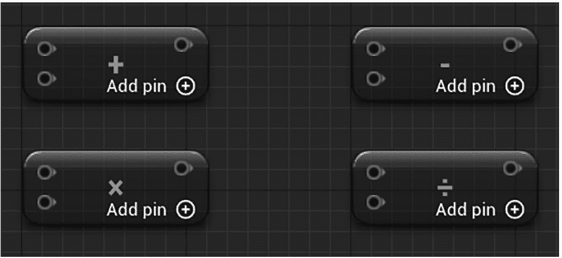

图 2.8 – 算术运算节点

### 注意

* 符号是编程语言中的乘法运算符。蓝图也将 * 识别为乘法运算符，但使用字母 X 作为乘法节点的标签。在 **上下文菜单** 中搜索乘法节点时，需要使用 * 符号或写入单词 multiply。

以下截图显示了一个简单的算术表达式。截图上的数字显示了节点完成的顺序。执行从 **事件 BeginPlay** 开始。**设置** 节点为 **魔法值** 变量分配新值，但该值必须使用连接到乘法节点输出的数据线获取，而乘法节点需要使用另一条数据线获取 **意志力** 变量的值并乘以 `20.0`：

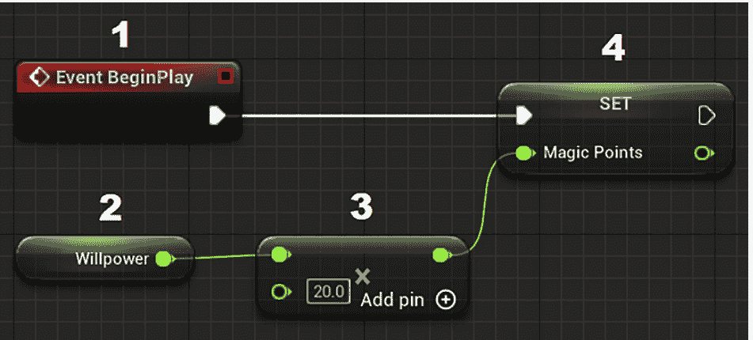

图 2.9 – 乘法操作

### 关系运算符

关系运算符对两个值进行比较，并返回布尔值（**真** 或 **假**）作为比较结果。以下截图显示了蓝图中的关系运算符：

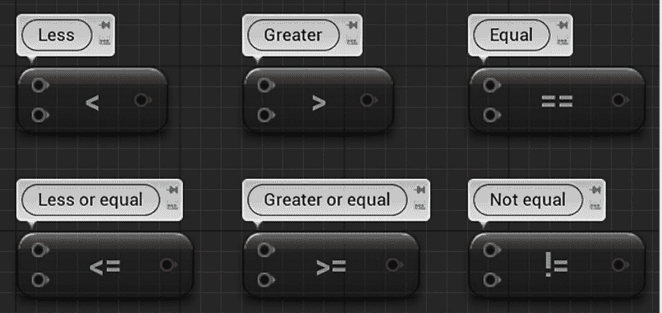

图 2.10 – 关系运算节点

以下截图显示了一个使用关系运算符的示例，假设当游戏对象受到伤害时执行这些操作。将使用 **分支** 节点来测试 **生命值** 变量的值是否小于或等于 `0.0`。如果返回 **真**，则将销毁此游戏对象。如果返回 **假**，则不会发生任何事情，因为 **假** 执行分支上没有连接任何操作。

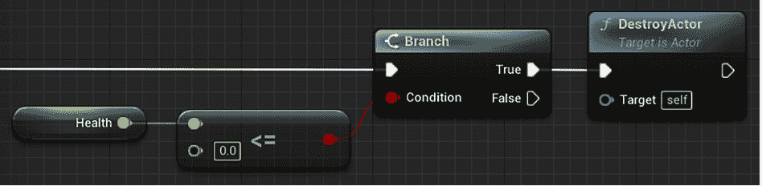

图 2.11 – 使用关系运算符测试条件

### 逻辑运算符

逻辑运算符对布尔值执行操作，并返回布尔值（True 或 False）作为操作结果。以下截图显示了蓝图中的逻辑运算符：

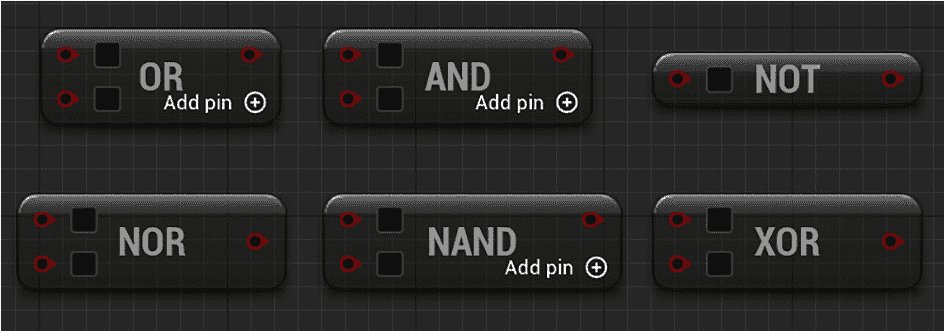

图 2.12 – 逻辑运算节点

以下是这些运算符的描述：

- 或：如果任何输入值为 True，则返回 True。
- 与：仅当所有输入值均为 True 时，才返回 True。
- 非：仅接收一个输入值，结果将为相反的值。
- 或非：这是非和或运算符的组合。如果两个输入均为 False，则返回 True，否则返回值为 False。
- 与非：这是非和与运算符的组合。如果两个输入均为 True，则返回 False，否则返回值为 True。
- 异或：此运算符称为异或或“独占或”。如果两个输入不同（一个为 True，另一个为 False），则返回 True。如果两个输入相同，则返回值为 False。

以下截图显示了使用 与 运算符的示例。打印字符串 节点仅在 生命值 大于


大于 70.0 且护盾值大于 50.0：

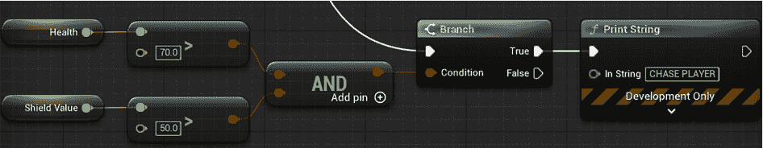

图 2.13 – 使用 AND 运算符测试条件

我们已经知道如何使用操作和运算符；下一步是学习如何将它们组织在宏和函数中。

### 使用宏和函数组织脚本

在创建 Blueprint 脚本时，有时一组操作会在 Blueprint 中的多个位置使用。这些操作可以转换为宏或函数，简化初始脚本，因为这组操作将被仅一个节点取代。另外，如果需要更改此组操作中的某项，该更改只会在宏或函数中实现，而不必在每个使用过这组操作的位置进行搜索。这是一种良好的编程实践，因为它简化了代码和调试。

### 创建宏

要创建宏，请使用 My Blueprint 面板，并在 MACROS 类别中单击 + 按钮。以下截图显示了带有名为 SetupNewWave 的宏的 My Blueprint 面板：

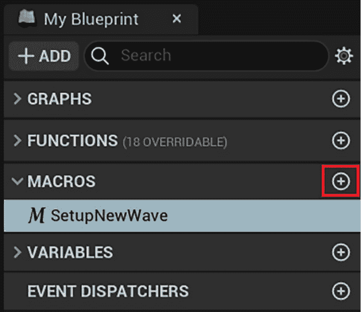

图 2.14 – 创建宏

创建宏后，会在与 Event Graph 相同的位置打开一个新选项卡。这个选项卡看起来像 Event Graph，但仅包含与宏相关的节点。你将在此选项卡中添加宏操作。你可以关闭 Macro 选项卡，要再次打开它，请双击 My Blueprint 面板上的宏名称。你可以单击 Event Graph 选项卡返回到 Event Graph：

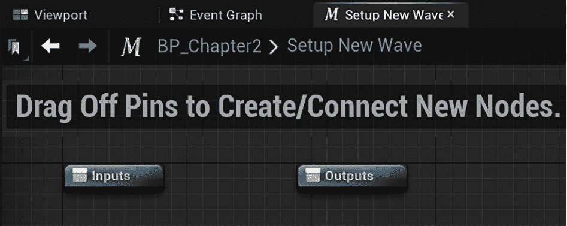

图 2.15 – 宏选项卡

宏的属性显示在 **详细信息** 面板中。在此面板中，你可以定义输入和输出参数。输入参数是传递给宏/函数的值。输出参数是从宏/函数返回的值。以下截图显示了带有两个输入参数和一个输出参数的 `SetupNewWave` 宏的 **详细信息** 面板。在宏中，白色执行引脚被定义为类型 **执行** 的输入/输出参数，因此你可以添加任意数量的引脚。在以下示例中，我们创建名为 **输入** 的输入执行引脚和名为 **输出** 的输出执行引脚：

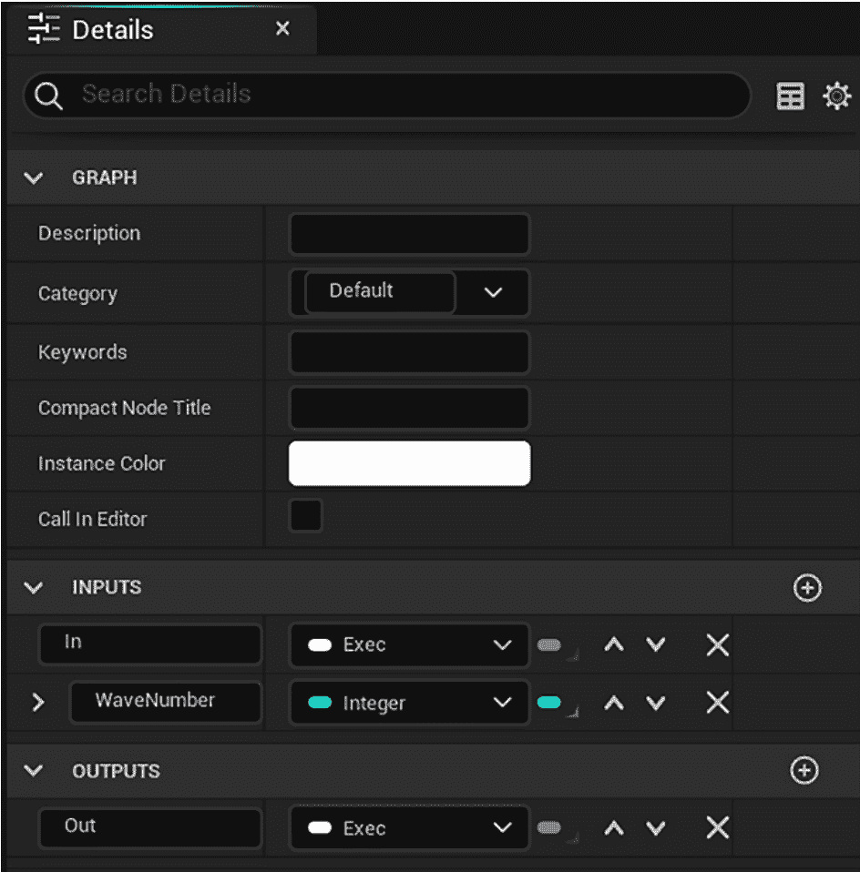

图 2.16 – 宏属性

以下截图显示了 `SetupNewWave` 宏的内容。这个宏的目的是为游戏中的下一波敌人设置一些变量。它将当前 **波数** 作为输入参数，将此值存储在 **当前波** 变量中，并通过将当前 **波数** 乘以 5 来确定敌人数量：

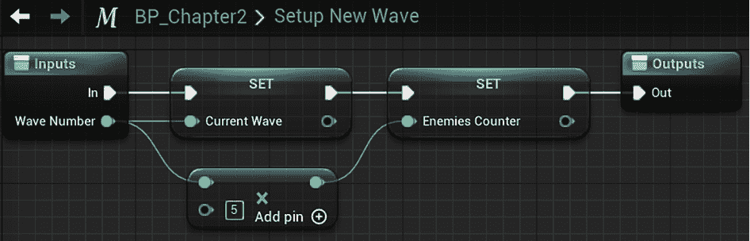

图 2.17 – 宏示例

要将宏添加到 **事件图表**，请从 **我的蓝图** 面板拖动宏名称并将其放入 **事件图表**，或在 **上下文菜单** 中查找它。当宏执行时，其中的操作将被执行。以下截图显示 `SetupNewWave` 宏在 **开始游戏时** 中被调用，其中 **波数** 输入参数的值为 `1`。

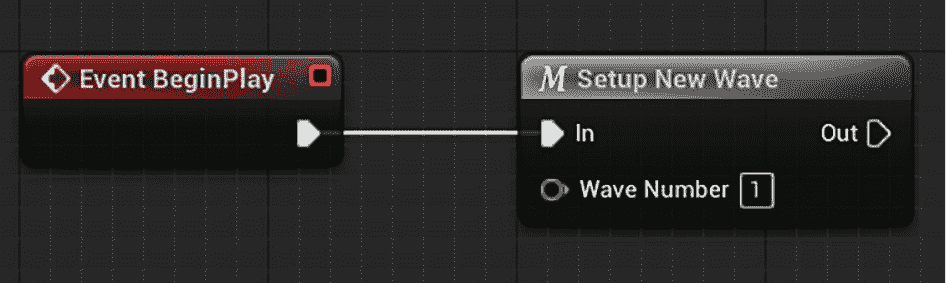

图 2.18 – 调用宏

### 创建函数

函数的一个优点是，在一个蓝图中创建的函数可以从另一个蓝图中调用。要创建函数，请使用 **我的蓝图** 面板，并在 **函数** 类别中单击 + 按钮。以下截图显示了带有名为 `CalculateWaveBonus` 函数的 **我的蓝图** 面板：

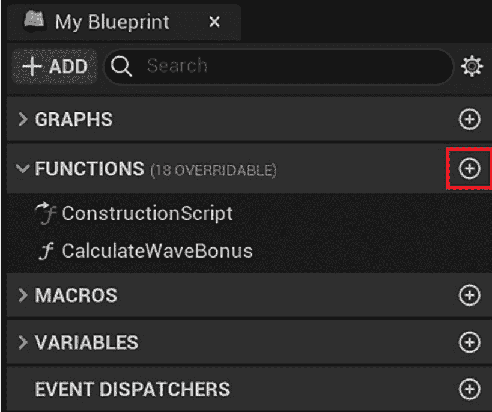

图 2.19 – 创建函数

与宏类似，函数的属性显示在 **详细信息** 面板中，可以在其中定义输入和输出参数。以下截图显示了 `CalculateWaveBonus` 函数的 **详细信息** 面板，包含两个输入参数和一个输出参数：

| 组 | 属性 | 值 |
| :--- | :--- | :--- |
| 图表 | 描述 | |
| 图表 | 类别 | 默认 |
| 图表 | 关键字 | |
| 图表 | 紧凑节点标题 | |
| 图表 | 访问说明符 | 公开 |
| 图表 | 纯 | [ ] |
| 图表 | 在编辑器中调用 | [ ] |
| 输入 | WaveNumber | 整数 |
| 输入 | TimeLeft | 整数 |
| 输出 | BonusPoints | 整数 |

图 2.20 – 函数属性

创建函数时，我们可以定义它是否为 **纯**。为此，请检查上一个截图中显示的 **纯** 属性。**纯** 函数没有执行引脚；因此，它可以用于表达式。**纯** 函数不应修改其蓝图的变量，因此它们大多用作 **获取类型** 函数，即仅返回值的函数。以下截图显示了标准函数和 **纯** 函数之间的视觉差异：

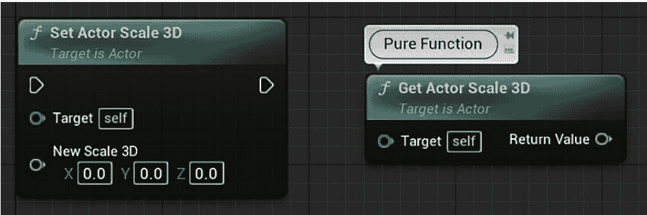

图 2.21 – 标准函数和纯函数

以下截图显示了 `CalculateWaveBonus` 函数的内容。该函数基于 **波数** 和 **剩余时间** 计算一波的奖励点数。找到的值通过 **奖励点数** 输出参数返回：

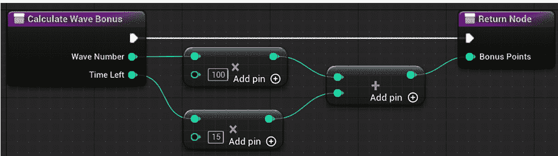

图 2.22 – 函数示例

以下截图显示了表示 `CalculateWaveBonus` 函数的节点。可以通过右键单击 **事件图表** 或将函数名称从 **我的蓝图** 面板拖动并放入 **事件图表**，从上下文菜单将其添加到 **事件图表** 面板中：

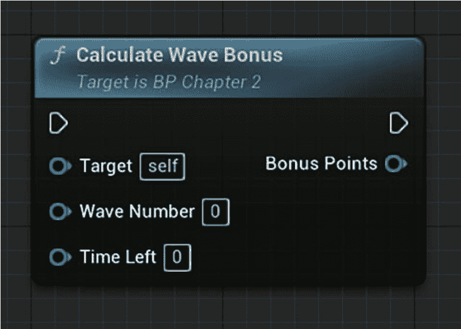

图 2.23 – 函数节点

### 分步示例

让我们逐步创建一个函数并执行它以查看实际效果。函数名为 CalculatePower。它将玩家等级作为输入参数，并使用以下表达式返回其力量值：

```
PowerValue = (PlayerLevel x 7) + 25
```

- 1. 单击 **内容抽屉** 按钮打开 **内容浏览器**，然后单击 **添加** 按钮并选择 **蓝图类**。
- 2. 在下一屏幕中，选择 **角色** 作为父类。
- 3. 将创建的蓝图重命名为 `FunctionExample`。
- 4. 双击此蓝图以打开 **蓝图编辑器**。

- 5. 在 **我的蓝图** 面板中，单击 **函数** 类别中的 + 按钮以创建函数。将函数名称更改为 `CalculatePower`。

- 6. 使用此函数的 **详细信息** 面板创建名为 `PlayerLevel` 的 **整数** 类型输入参数和名为 `PowerValue` 的 **整数** 类型输出参数。

- 7. 在为 **CalculatePower** 函数创建的选项卡中，创建以下截图中显示的表达式。你可以通过右键单击图表打开 **上下文菜单** 并搜索 add 和 multiply 来添加运算符节点。要连接节点，请单击其中一个引脚，拖动鼠标并将其放置在另一个引脚上。不要忘记在运算符节点中插入值 7 和 25。编译蓝图。

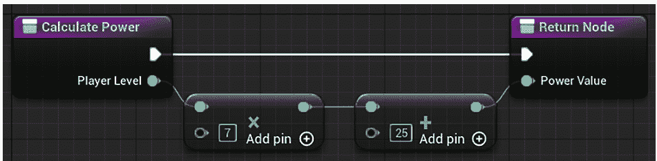

图 2.24 – CalculatePower 函数

- 8. 在 **事件图表** 中，有一个 Event BeginPlay 节点显示为灰色，因为它没有连接任何操作。当你将任何节点连接到它时，Event BeginPlay 节点将亮起。创建下一个截图中显示的节点。在 **计算功率** 节点的 **玩家等级** 参数中插入值 3。这些节点将使用值 3 作为玩家等级来计算 PowerValue。

- 9. 单击 **打印字符串** 节点的箭头以查看更多输入参数。

- 10. 单击 **文本颜色** 参数右侧的颜色方块。这将打开 **颜色选择器** 面板。在颜色轮上单击任何红色，然后单击 **确定** 按钮以关闭 **颜色选择器** 面板。

- 11. 将 **持续时间** 参数更改为 10.0。


12. 将 **功率值** 引脚连接到 **追加** 节点的 **B** 引脚，以自动创建从整数到字符串的转换节点。在 **A** 参数中，键入 `POWER:`，并在冒号后加一个尾随空格。

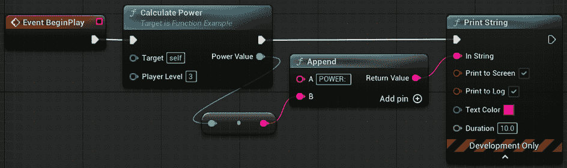

图 2.25 – 开始游戏时事件

13. 编译并保存蓝图。在关卡编辑器中，将 **函数示例蓝图** 拖放到关卡中。

14. 开始关卡，查看屏幕上打印的功率值。

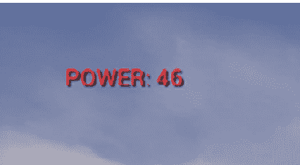

图 2.26 – CalculatePower 函数的结果

### 宏与函数与事件

有时，不清楚何时应创建宏、函数或自定义事件，因为它们具有多个共同特征。下表显示了它们之间的比较，以帮助您为自己的需求选择最合适的选项：

| | 宏 | 函数 | 事件 |
|---|---|---|---|
| 输入参数 | 是 | 是 | 是 |
| 输出参数 | 是 | 是 | 否 |
| 多个执行路径（输入/输出） | 是 | 否 | 否 |
| 可由另一个蓝图调用 | 否 | 是 | 是 |
| 延迟动作（例如，延迟） | 是 | 否 | 是 |
| 时间轴节点 | 否 | 否 | 是 |

### 摘要

在本章中，我们学习了如何在蓝图的变量中存储值，以及如何使用动作来定义蓝图对事件的响应。之后，我们了解了如何使用运算符创建表达式，并使用宏和函数来组织脚本。这些是定义蓝图在游戏中应如何表现所需的关键元素。

在下一章中，我们将了解游戏性框架，这是一组用于游戏开发的具有通用功能的类。

### 测验

- 1. 哪种类型的变量只能保存 true 或 false 值？
  - a. 双精度浮点数
  - b. 文本
  - c. 布尔值
  - d. 字节

- 2. 以下哪个事件不是碰撞事件？
  - a. Hit
  - b. Tick
  - c. ActorBeginOverlap
  - d. ActorEndOverlap

- 3. 分支节点可用于创建不同的执行路径。
  - a. 正确
  - b. 错误

- 4. 以下哪个逻辑运算符仅在所有输入值均为 `true` 时才返回 `true`？
  - a. NOT
  - b. OR
  - c. AND

- 5. 以下哪项不能被另一个蓝图调用？
  - a. 宏
  - b. 函数
  - c. 自定义事件
