## 第 3 章：面向对象编程与游戏性框架

蓝图基于 **面向对象编程** (**OOP**) 的原则。OOP 的目标之一是将编程概念更贴近现实世界。

虚幻引擎游戏性框架涵盖了视频游戏所需的所有核心系统，例如游戏规则、玩家输入和控制、摄像机以及用户界面。

在本章中，我们将学习以下主题：

- 熟悉 OOP 概念
- 管理 Actor
- 探索游戏性框架类

### 熟悉 OOP

让我们了解 OOP 的一些基本概念，例如类、实例和继承。这些概念将帮助您了解蓝图可视化脚本的各种元素。

### 类

在 OOP 中，类是创建对象的模板，用于提供状态（变量或属性）的初始值以及行为（事件或函数）的实现。

即使是独一无二的现实世界对象，也可以以相同的方式来思考。举个非常简单的例子，我们可以考虑一个人类类。在这个类中，我们可以拥有姓名和身高等属性，以及移动和进食等动作。使用人类类，我们可以创建该类的多个对象。每个对象代表一个具有不同姓名和身高属性值的人。

当我们创建一个蓝图时，我们正在创建一个新类，该类可用于在游戏关卡中创建对象。如下图所示，创建新蓝图资源时出现的选项是 **蓝图类**：

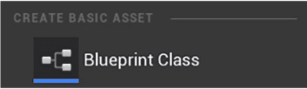

图 3.1 – 创建蓝图类

**封装** 是另一个重要概念。它允许我们从另一个类的角度查看类时隐藏其复杂性。蓝图类的变量和函数可以是 **私有** 的，这意味着它们只能在创建它们的蓝图类中访问和修改。 **公共** 变量和函数是指可以由其他蓝图类访问的那些。

### 实例

从类创建的对象也称为该类的 **实例**。每次您从 **内容浏览器** 拖动蓝图类并将其放入关卡时，您就会创建该蓝图类的一个新实例。

所有实例都使用与蓝图类中定义的相同的默认值创建其变量。但是，如果将变量标记为 **实例可编辑**，则可以在关卡中更改每个实例的变量值，而不会影响其他实例持有的值。

例如，假设创建了一个蓝图来表示游戏中的一种角色类型。下图显示将该蓝图类的三个实例添加到了关卡中：

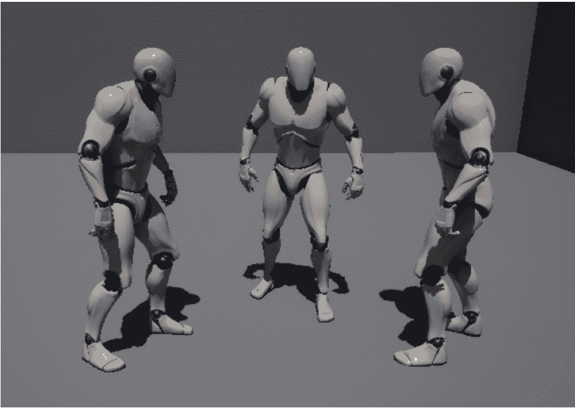

图 3.2 – 蓝图类的实例

### 继承

在 OOP 中，类可以从其他类继承变量和函数。在创建蓝图时，我们必须做的第一件事是选择该蓝图的父类。蓝图类只能有一个父类，但可以有多个子类。父类也称为超类，而子类称为子类。

作为使用继承的示例，假设我们正在创建表示游戏中不同类型武器的几个蓝图。我们可以创建一个名为 `Weapon` 的基础蓝图类，其中包含游戏中所有武器共有的内容。然后，我们可以使用 `Weapon` 类作为父类来创建表示每种武器的蓝图。下图显示了这些类之间的层次结构：

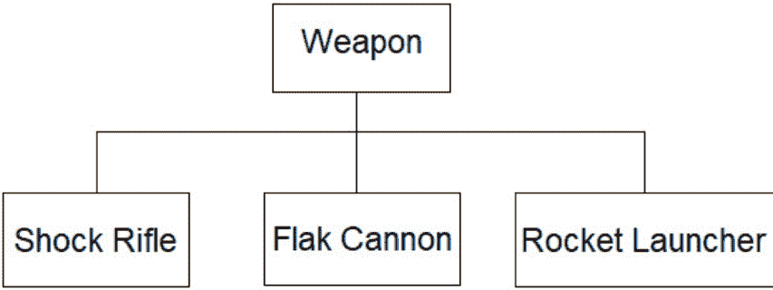

图 3.3 – 类层次结构

继承的一个优点是，我们可以在父类中创建一个函数，并在子类中以不同的实现对其进行覆盖。例如，`Weapon` 父类中可以有一个名为 `Fire` 的函数。子类继承 `Fire` 函数，因此 `Shock Rifle` 类使用发射能量束的版本覆盖 `Fire` 函数，而 `Rocket Launcher` 类使用发射火箭的版本覆盖 `Fire` 函数。在运行时，如果我们有对 `Weapon` 类的引用并调用 `Fire` 函数，将识别实例类以运行其 `Fire` 函数的版本。

继承还用于定义类的类型，因为它会累积其父类的所有类型。例如，我们可以说 `Shock Rifle` 类的实例既是 `Shock Rifle` 类型，也是 `Weapon` 类型。因此，如果我们有一个带有 `Weapon` 输入参数的函数，它可以接收 `Weapon` 类的实例或其任何子类的实例。

这些 OOP 的基本概念将帮助我们理解游戏性框架。虚幻引擎有一些用于游戏开发的基本类。这些类是游戏性框架的一部分。游戏性框架的主类是 **Actor**。

### 管理 Actor

Actor 类包含对象在关卡中存在所需的所有功能。因此，Actor 类是所有可在关卡中放置或生成的对象的父类。换句话说，任何可在关卡中放置或生成的对象都是 Actor 类的子类。我们将创建的大多数蓝图都将基于 Actor 类本身或其子类。因此，本节中我们将探讨的功能对这些蓝图很有用。

### 引用 Actor

integer、float 和 Boolean 等变量类型称为原始类型，因为它们只存储指定类型的简单值。在使用对象或 Actor 时，我们使用一种称为 **对象引用** 的变量。蓝图中的引用允许不同的对象相互通信。我们将在 _第 4 章，了解蓝图通信_ 中更详细地探讨这种通信。

例如，下图表示内存中两个蓝图类的实例。`BP_Barrel` 蓝图类的实例具有一个名为 `Hit Counter` 的整数变量，当前值为 `2`。另一个变量名为 `BP_Fire`，是一个对象引用，引用了 **蓝图效果 火** 的实例。我们可以使用对象引用变量访问另一个蓝图的公共变量和函数：

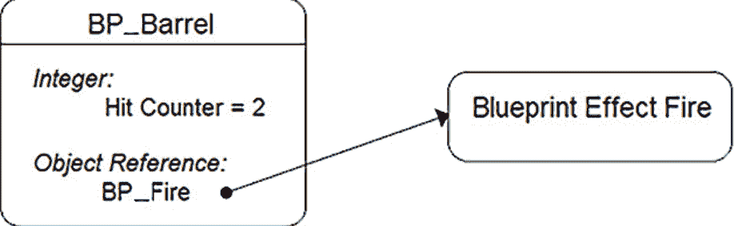

图 3.4 – 对象引用

在蓝图中，我们可以创建引用其他对象/角色的变量。让我们创建一个分步功能示例，以查看此概念在实际中的应用：

- 1. 基于带有入门内容的第一人称模板创建项目。
- 2. 单击 **内容抽屉** 按钮打开 **内容浏览器**，然后单击 **添加** 按钮并选择 **蓝图类**。
- 3. 在下一屏幕中，选择 **角色** 作为父类。
- 4. 将蓝图命名为 `BP_Barrel` 并双击它以打开蓝图编辑器。
- 5. 在 **组件** 面板中单击 **添加** 按钮并选择 **静态网格** 组件。在 **详情** 面板中，选择 Shape_Cylinder 静态网格：

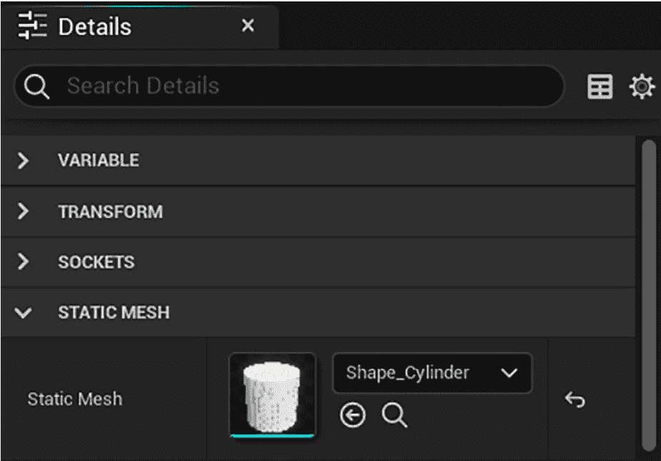

图 3.5 – 设置静态网格

- 6. 在 **我的蓝图** 面板中，创建一个名为 BP_Fire 的变量。在 **详情** 面板中，单击 Variable Type 参数的下拉菜单。Object Types 类别列出了虚幻引擎中可用的类以及我们在项目中创建的蓝图类。搜索 fire，然后将鼠标悬停在 Blueprint Effect Fire 上以显示子菜单，然后选择 **对象引用**：

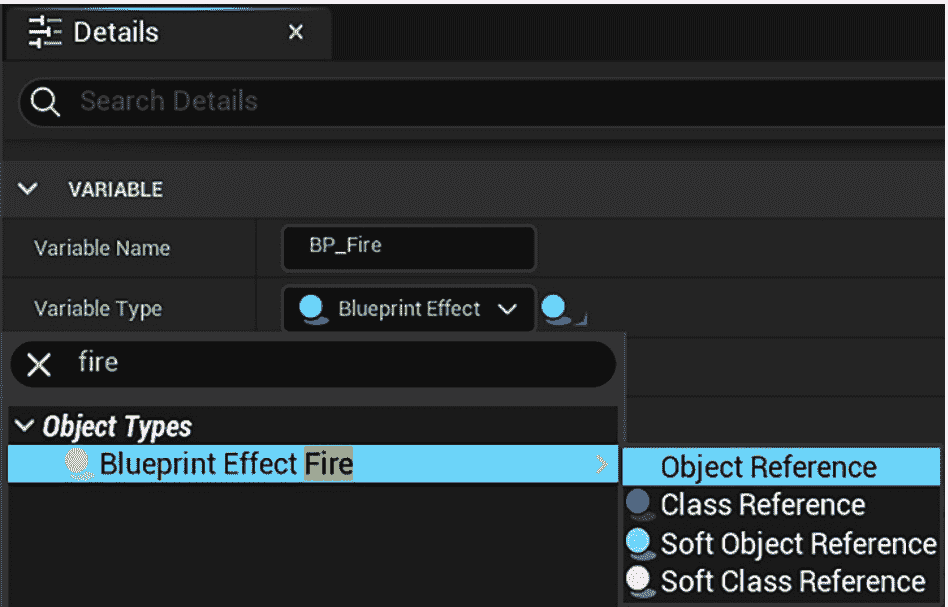

图 3.6 – 创建对象引用

- 7. **对象引用** 变量的默认值是 **空**（也称为 null），这意味着该变量未引用任何实例。我们可以在关卡编辑器中将实例分配给此变量。为此，请检查变量的 **实例可编辑** 属性，以便在关卡编辑器中访问它。

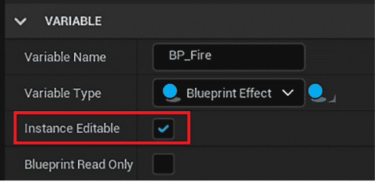

图 3.7 – 使放置在关卡中的实例中的变量可编辑

- 8. 将 `BP_Fire` 变量从 **我的蓝图** 面板拖动并放入 **事件图**。选择 **获取 BP_Fire** 选项以创建节点。从 **BP_Fire** 节点的蓝色引脚拖动并放置在图表中以打开 **上下文菜单**。搜索 `hidden` 并选择 **在游戏中设置隐藏 (P_Fire)** 函数：

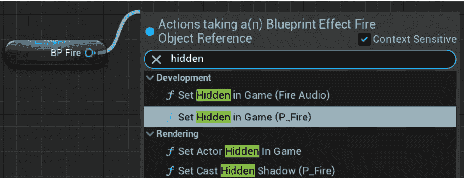

图 3.8 – 在上下文菜单中搜索函数

- 9. 右键单击 **事件图** 并添加 **事件命中**。将 **事件命中** 节点连接到 **在游戏中设置隐藏 (P_Fire)** 节点。 **新隐藏** 参数必须取消选中。这些操作将在 `BP_Barrel` 蓝图的实例被击中时，取消隐藏由 `BP_Fire` 引用的实例的粒子系统组件：

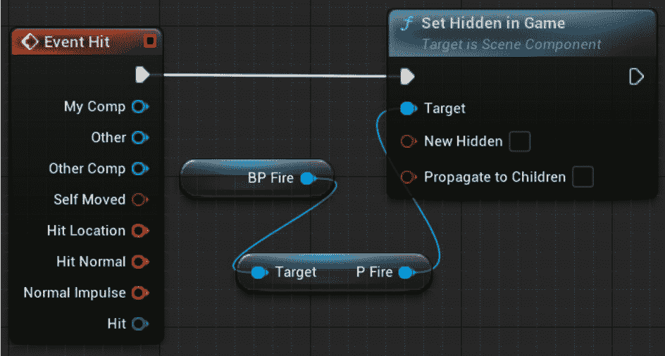

图 3.9 – 事件命中的操作

- 10. 编译蓝图并返回到关卡编辑器。将 BP_Barrel 蓝图从内容浏览器拖动并放入关卡。
- 11. 在内容浏览器中，转到 内容 | 入门内容 | 蓝图 文件夹，拖动 Blueprint_Effect_Fire，并将其放置在添加到关卡中的 BP_Barrel 蓝图之上：

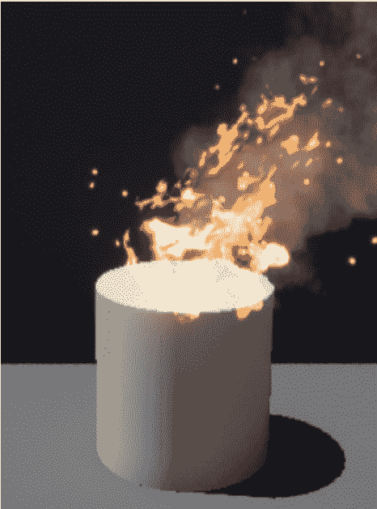

图 3.10 – BP_Barrel 和 Blueprint_Effect_Fire

- 12. 在 `Blueprint_Effect_Fire` 实例的 **详情** 面板中，选择 **P_Fire** 组件，搜索 `hidden`，并检查 **游戏中隐藏** 属性：

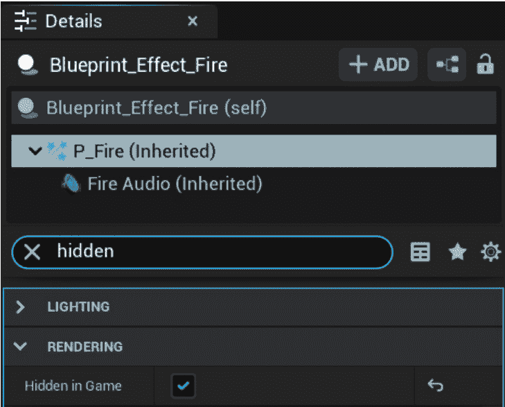

图 3.11 – 隐藏 Blueprint_Effect_Fire 的粒子系统

- 13. 在 `BP_Barrel` 实例的 **详情** 面板中，单击 `BP_Fire` 变量的下拉菜单，以列出关卡中为 `Blueprint_Effect_Fire` 实例的角色。选择我们放置在 `BP_Barrel` 上方的实例，以将其实例分配给 `BP_Fire` 变量。

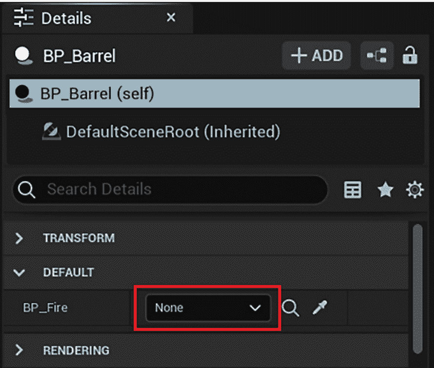

图 3.12 – 在关卡编辑器中分配实例

- 14. 单击关卡编辑器的播放按钮以测试关卡。朝我们在关卡中放置的 BP_Barrel 实例方向看。Blueprint_Effect_Fire 实例是隐藏的。使用左键射击 BP_Barrel 实例。当 BP_Barrel 实例被击中时，Blueprint_Effect_Fire 实例将出现。

### 生成和销毁角色

有一个名为 **通过类生成角色** 的函数，用于创建角色实例。要将此函数添加到事件图，请右键单击事件图面板以打开上下文菜单，在搜索框中写入 spawn 以筛选结果，然后单击函数名。

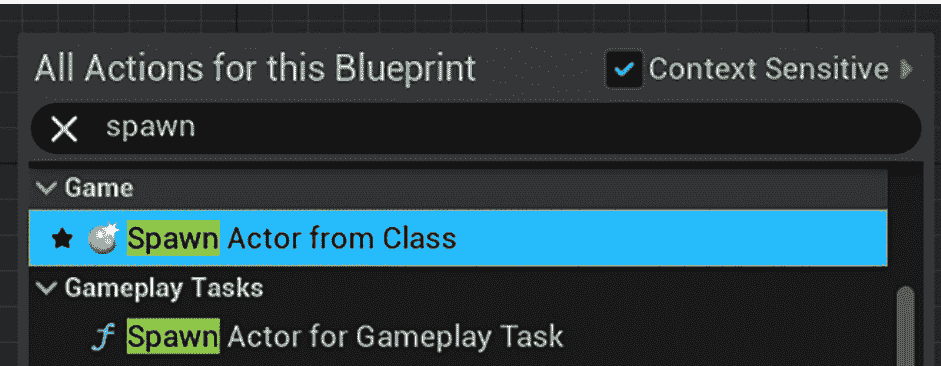

图 3.13 – 上下文菜单中的 **通过类生成角色** 函数

此函数接收角色的类和 **转换** 作为输入参数。 **转换** 定义了新角色将使用的位置、旋转和缩放。另一个名为 **碰撞处理覆盖** 的输入参数定义了创建时如何处理碰撞。新实例的引用可在 **返回值** 输出参数中使用，并可以存储在变量中。

要从关卡中移除角色实例，请使用 **销毁角色** 函数。 **目标** 输入参数指示将移除哪个实例。以下屏幕截图显示了使用 **通过类生成角色** 和 **销毁角色** 函数的示例。

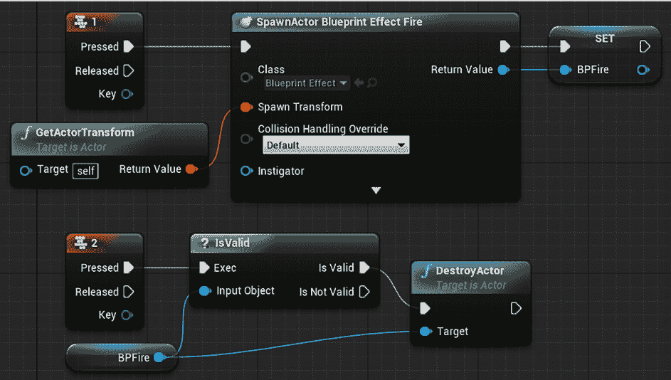

图 3.14 – 创建和销毁实例

- 要添加 _1_ 键输入事件，请右键单击事件图，并在搜索框中键入 _1_。 _1_ 键输入事件可在 **输入 > 键盘事件** 中找到。
- 按下 _1_ 键将使用包含此脚本的蓝图实例的相同 **转换** 创建 **蓝图效果火** 的实例。例如，如果将前面的代码添加到 `ThirdPersonCharacter`（位于第三人称模板中的 `Content | ThirdPersonBP | Blueprints`）的事件图中，那么一旦游戏启动，键盘上按下 _1_ 将在玩家角色的当前位置创建火焰效果。
- 新 **蓝图效果火** 实例的引用存储在 `BPFire` 变量中。如果没有变量来存储实例，则可以轻松地将 **生成角色** 函数的返回值提升为变量，这会自动为其分配正确的变量类型。为此，请从 **返回值** 引脚拖动并放置在事件图上以打开 **上下文菜单**，然后选择 **提升为变量**：

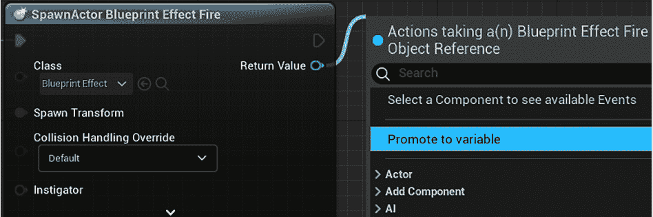

图 3.15 – 将返回值提升为变量

- 当您按下 2 键时，将使用 **是否有效** 宏检查 `BPFire` 变量是否引用有效实例。此检查是必要的，以避免使用空引用调用函数。如果 `BPFire` 的值为 **空**，则无效。如果有效，则它将调用 **销毁角色** 函数，该函数接收 `BPFire` 变量作为 **目标** 输入参数，并销毁先前创建的 **蓝图效果火** 实例。
- 请注意，按下 2 键仅删除最后创建的 **蓝图效果火** 实例。如果在删除前创建多个火焰实例，其他实例将保留在关卡中，因为在创建 **蓝图效果火** 实例时 `BPFire` 变量会被覆盖。

### 构造脚本

蓝图编辑器中的一个面板称为 **构造脚本**，如以下屏幕截图所示。 **构造脚本** 是所有 Actor 蓝图在蓝图首次添加到关卡时、在关卡编辑器中更改其属性时，或在运行时生成此蓝图的实例时执行的特殊函数：

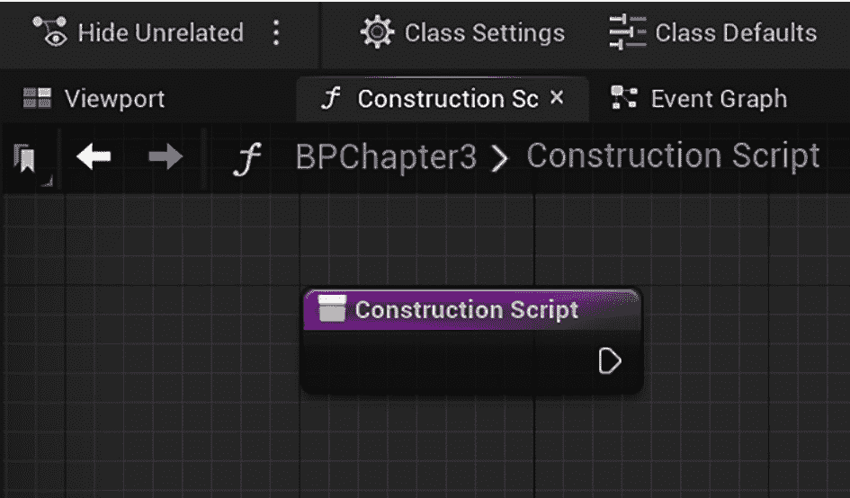

图 3.16 – 构造脚本面板

**构造脚本** 非常有助于创建灵活的蓝图，允许关卡设计师在关卡编辑器中配置这些蓝图实例的一些功能。

作为示例，让我们创建一个带有 **实例可编辑静态网格** 的蓝图，以便我们可以为关卡上蓝图的每个实例选择不同的静态网格：

- 1. 创建或使用带有入门内容的现有项目。
- 2. 在 **内容浏览器** 中单击 **添加** 按钮，并选择 **蓝图类** 选项。
- 3. 在下一屏幕中，选择 **角色** 作为父类。
- 4. 将蓝图命名为 `BPConstruction` 并双击它以打开蓝图编辑器。
- 5. 在 **组件** 面板中单击 **添加** 按钮并选择 **静态网格** 组件。将组件重命名为 `StaticMeshComp`，如以下屏幕截图所示：

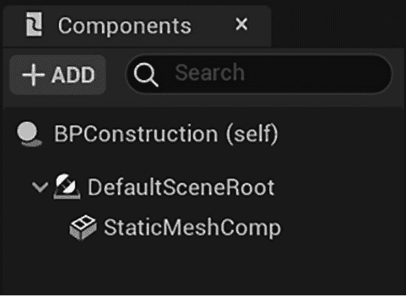

图 3.17 – 添加静态网格体组件

- 6. 在 **My Blueprint** 面板中，创建一个名为 **SM_Mesh** 的新变量。在 **Details** 面板中，单击 **Variable Type** 下拉菜单并搜索 `Static Mesh`。将鼠标悬停在 **Static Mesh** 上以显示子菜单，然后选择 **Object Reference**。选中 **Instance Editable** 属性，如下图所示：

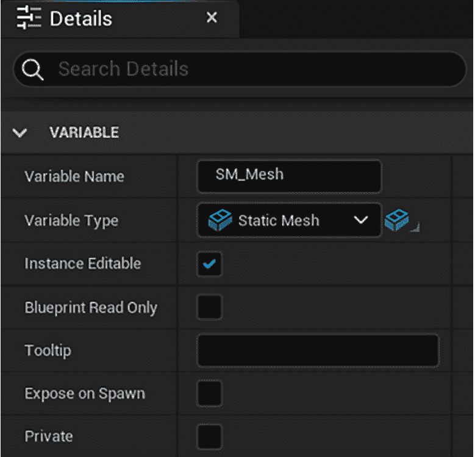

图 3.18 – SM_Mesh 变量的详细信息

### 重要说明

**Object Reference** 变量也可以引用在运行时创建的实例。

- 7. 按下工具栏上的 **Compile** 按钮。在 **Details** 面板底部为 **SM_Mesh** 变量定义一个初始静态网格体。单击 **Default** 值属性的下拉菜单，然后选择 **SM_TableRound** 静态网格体。

- 8. 单击 **Construction Script** 面板。将 `StaticMeshComp` 组件从 **Components** 面板拖动并放入 **Construction Script** 图表中以创建节点。

- 9. 单击 StaticMeshComp 节点的蓝色引脚，然后在图表中拖放以打开上下文菜单。搜索 set static mesh 并选择同名函数，如下图所示：

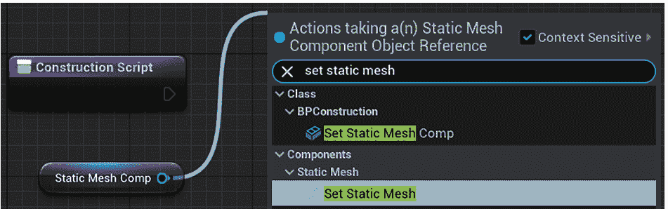

图 3.19 – 在上下文菜单中选择函数

- 10. 将 SM_Mesh 变量从 My Blueprint 面板拖动，放入 Construction Script 图表中，并在出现的菜单中选择 Get SM_Mesh 选项。将 SM_Mesh 节点引脚连接到 Set Static Mesh 函数的 New Mesh 引脚。Construction Script 应类似于下图所示。当 Construction Script 执行 Set Static Mesh 函数时，它将从 SM_Mesh 变量获取静态网格体并将其设置到 Static Mesh Comp 组件上：

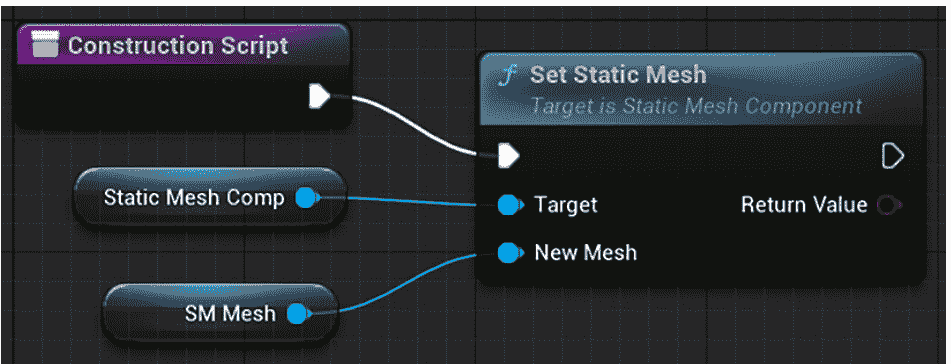

图 3.20 – Construction Script 操作

- 11. 编译蓝图。在关卡编辑器中，将 BPConstruction 从内容浏览器拖动并放入关卡以创建实例。再次拖放 BPConstruction 以创建另一个实例。在关卡中选择一个实例，并在关卡编辑器的 Details 面板中，检查 SM_Mesh 变量是否可见且可编辑，如下图所示：

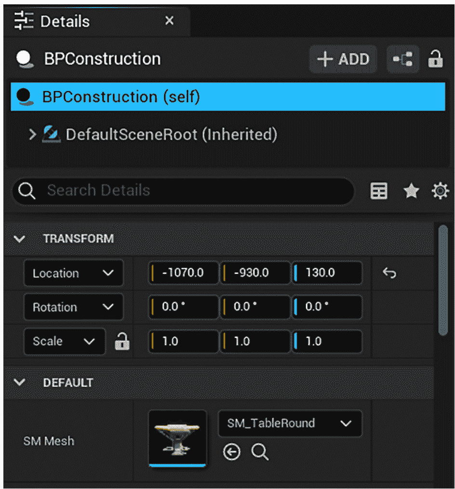

图 3.21 – BPConstruction 实例详细信息

- 12. 单击 **SM_Mesh** 变量的下拉菜单并选择另一个静态网格体，例如 **SM_Couch**。Construction Script 将立即执行并更改所选实例的静态网格体。下图显示了 `BPConstruction` 类的两个实例。截图左侧的实例使用默认静态网格体，但右侧实例的静态网格体已修改为 **SM_Couch**：

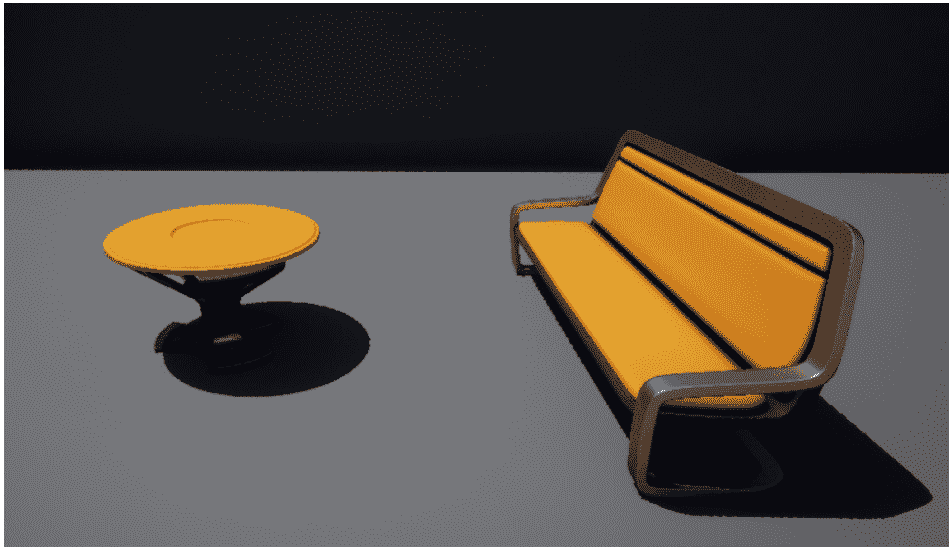

图 3.22 – BPConstruction 的两个实例

`Actor` 类是 Gameplay Framework 的主类，但还有其他用途的类我们需要了解。

### 探索其他 Gameplay Framework 类

创建新蓝图时的第一步之一是选择将用作模板的父类。下图显示了用于选择父类的面板。按钮上显示的类称为 **Common Classes**，是 Gameplay Framework 的一部分。要使用另一个类作为父类，请展开 **All Classes** 类别并搜索所需的类：

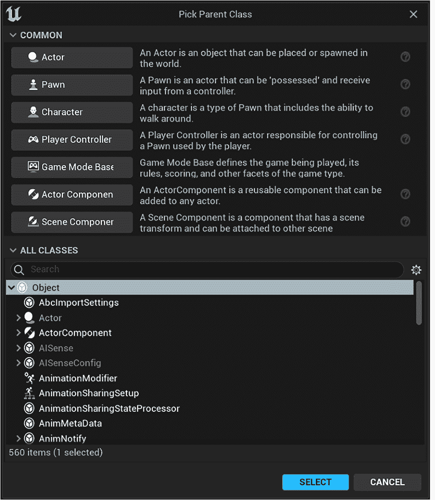

图 3.23 – 选择父类

下图显示了 **Common Classes** 的层次结构。在 Unreal Engine 中，有一个名为 **Object** 的父类。类继承其上方类（即其父类）的特征。基于 OOP 的继承概念，我们可以说 **Character** 类的实例是 **Character** 类型、**Pawn** 类型和 **Actor** 类型：

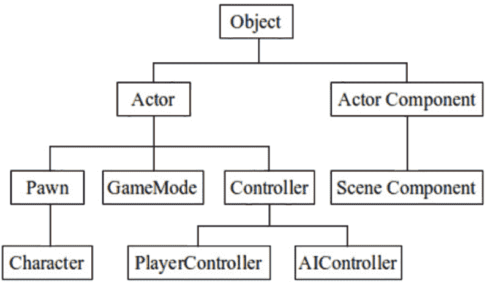

图 3.24 – Common Classes 层次结构

通过分析此层次结构，我们可以看出 **Actor Component** 和 **Scene Component** 类不是 Actor。这些类用于创建可以添加到 Actor 的组件。组件的两个示例是 `Static Mesh Component` 和 `Rotating Movement Component`，我们在之前的示例中使用过它们。我们将在 _第 18 章，创建蓝图库和组件_ 中介绍组件的创建。

让我们更仔细地查看一些 **Common Classes**。

### Pawn

**Pawn** 是 **Actor** 的子类。**Pawn** 是可以被游戏中 **Controller** 拥有的 **Actor**。 **Controller** 类表示玩家或 **人工智能** (AI)。概念上，**Pawn** 类的实例是游戏角色的物理身体，而拥有它的 Controller 类实例是一种大脑，允许角色在关卡中移动并执行其他操作。

基于 Pawn 类创建蓝图并单击 Class Defaults 按钮以在 Details 面板中显示它。从 Pawn 类继承的参数在下图中显示：

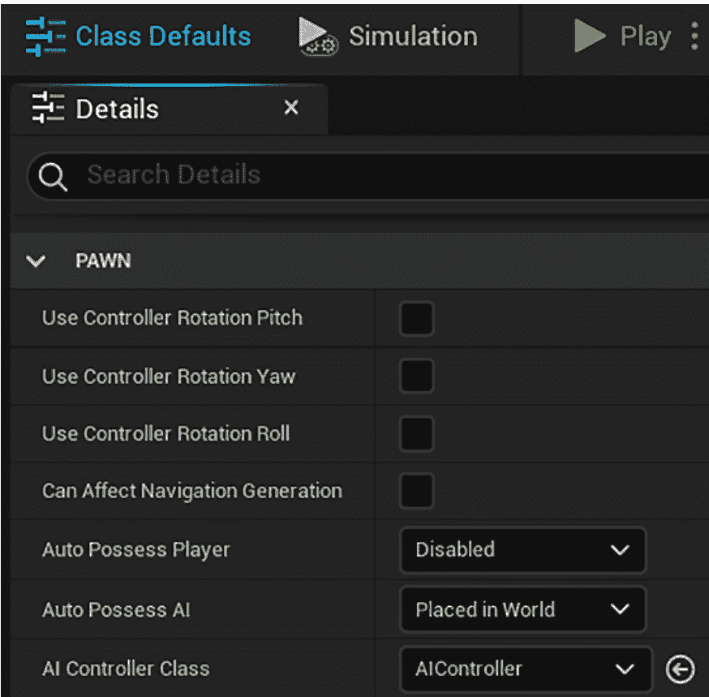

图 3.25 – Pawn 类默认值

某些参数显示 Pawn 类可以使用拥有它的 Controller 类的旋转值。其他参数指示 Pawn 类必须如何被 Controller 类拥有。

**Pawn** 的两个主要子类是 **Character** 和 **WheeledVehicle**。

### Character

**Character** 类是 **Pawn** 类的子类；因此，**Character** 类的实例也可以被 **Controller** 类的实例拥有。此类旨在表示可以行走、奔跑、跳跃、游泳和飞行的角色。

基于 **Character** 类的蓝图将继承以下特定于角色的组件：

  - * **CapsuleComponent**：用于碰撞测试。
  - * **ArrowComponent**：指示角色的当前方向。
  - * **Mesh**：此组件是骨骼网格体，以可视方式表示角色。**Mesh** 组件的动画由动画蓝图控制。
  - * **CharacterMovement**：此组件用于定义各种类型的角色移动，例如行走、奔跑、跳跃、游泳和飞行。

这些组件在下图中显示：

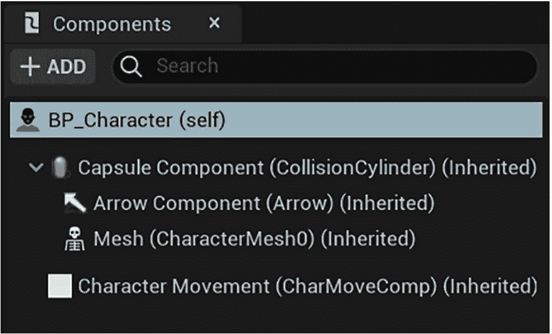

图 3.26 – Character 类组件

**CharacterMovement** 组件处理移动以及多人游戏中的复制和预测。它包含许多定义角色各种移动类型的参数：

| 设置 | 值 |
| :--- | :--- |
| Gravity Scale | 1.0 |
| Max Acceleration | 2048.0 |
| Braking Friction Factor | 2.0 |
| Braking Friction | 0.0 |
| Crouched Half Height | 40.0 |
| Use Separate Braking Friction | [ ] |
| Mass | 100.0 |
| Default Land Movement Mode | Walking |
| Default Water Movement Mode | Swimming |

图 3.27 – Character Movement 变量

### PlayerController

**Controller** 类有两个主要子类：**PlayerController** 和 **AIController**。 **PlayerController** 类由人类玩家使用，而 **AIController** 类使用 AI 来控制 **Pawn**。

**Pawn** 和 **Character** 类的实例只有在被 **PlayerController** 实例拥有时才能接收输入事件。输入事件可以放在 **PlayerController** 或 **Pawn** 的事件图表中。将输入事件放在 **PlayerController** 中的优势在于这些事件独立于 **Pawn**，使得更改由 **Controller** 类拥有的 **Pawn** 类更加容易。无论您选择哪种方式，请在项目中保持一致。

下图显示了如何在游戏中更改由 **PlayerController** 拥有的 **Pawn**，并展示了 **Possess** 函数的使用。在此示例中，关卡中有两个角色，玩家可以通过按 **1** 或 **2** 键来控制它们。只有当前被拥有的 **Character** 实例接收 **PlayerController** 命令：

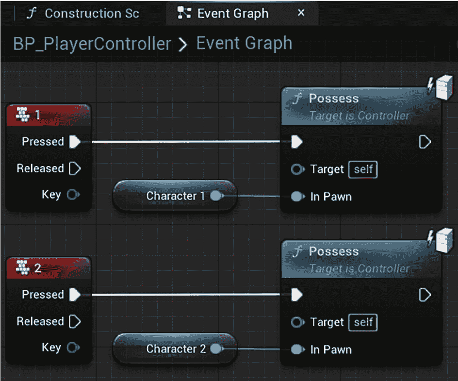

图 3.28 – 控制一个 Pawn

### 游戏模式基类

**游戏模式基类**是创建**游戏模式**的父类。**游戏模式**类用于定义游戏规则，并指定用于创建**Pawn**、**玩家控制器**、**游戏状态基类**、**HUD**及其他类的默认类。要在**游戏模式**中更改这些类，请单击**类默认值**按钮以在**详情**面板上显示它们，如以下屏幕截图所示：

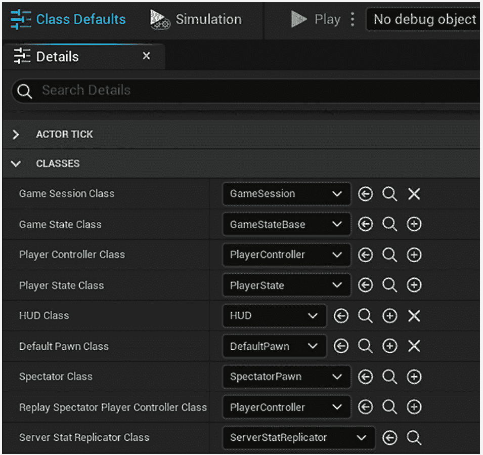

图 3.29 – 游戏模式类默认值

要在关卡编辑器中指定项目的默认游戏模式类，请单击**编辑 | 项目设置**.... 然后，在项目类别中，选择地图与模式选项。在默认游戏模式属性的下拉菜单中选择游戏模式，如以下屏幕截图所示。在选定的游戏模式类别中，您可以替换默认游戏模式使用的一些类：

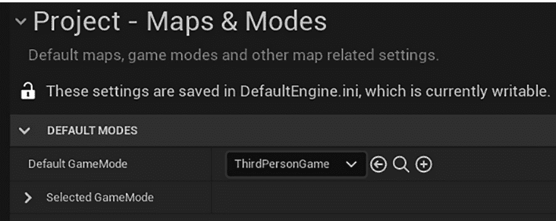

图 3.30 – 指定项目的游戏模式

每个关卡可以有不同的**游戏模式**。关卡的**游戏模式**会替换项目的**默认游戏模式**。要指定关卡的**游戏模式**，请单击关卡编辑器中的**设置**按钮并选择**世界设置**选项。在**游戏模式覆盖**属性的下拉菜单中选择**游戏模式**，如以下屏幕截图所示：

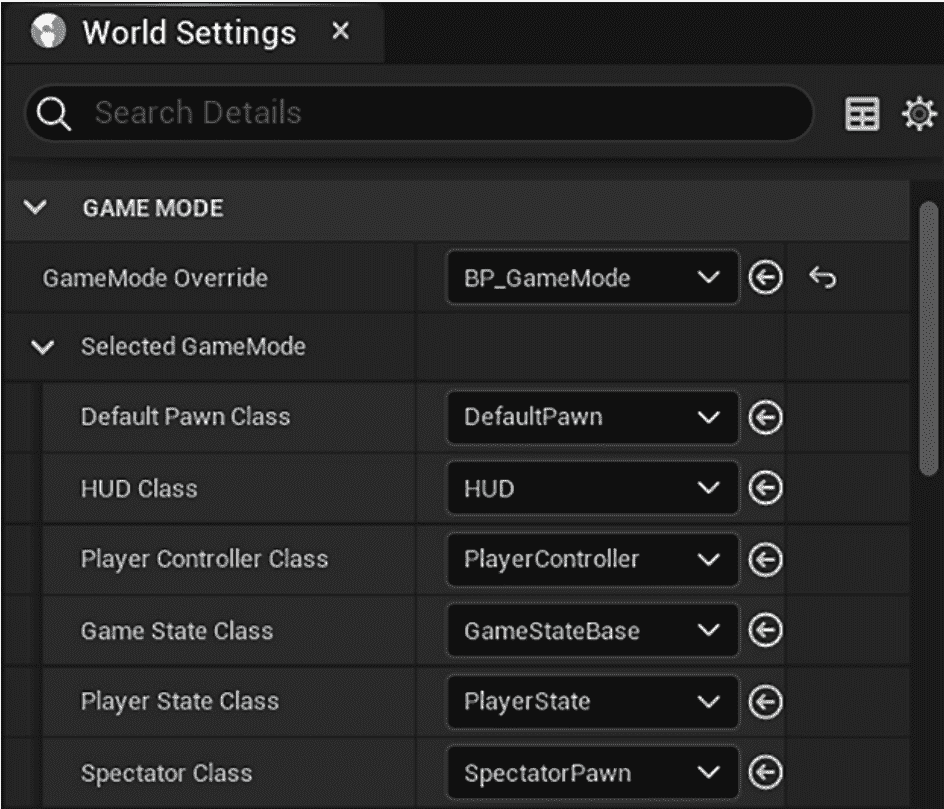

图 3.31 – 指定关卡的游戏模式

### 游戏实例

**游戏实例**不是**常用类**之一，但了解此类的存在很重要。**游戏实例**类及其数据在关卡之间保持不变，因为**游戏实例**类的实例在游戏开始时创建，仅在关闭游戏时移除。

关卡中所有Actor和其他对象在每次加载关卡时都会被销毁并重新生成。因此，如果需要在关卡切换时保留某些变量值，**游戏实例**类是一个可选方案。

要为游戏分配**游戏实例**类，请在关卡编辑器中通过**编辑 | 项目设置 | 地图与模式**修改项目设置，如以下屏幕截图所示：

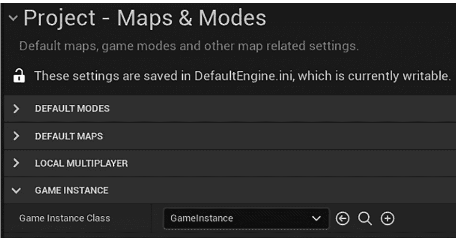

图 3.32 – 指定游戏实例类

### 摘要

在本章中，我们学习了有助于理解蓝图工作原理的一些面向对象编程原则。我们了解到Actor类是用于可放置或生成到关卡中的对象的父类。

我们还了解到游戏框架包含用于表示某些游戏元素的类，并学习了如何基于某些**常用类**创建蓝图。

我们的下一步是学习我们的蓝图如何相互通信，这将在下一章中介绍。

### 测验

- 1. 用于创建Actor实例的函数名称是什么？
- a. 创建 Actor
- b. 从类生成 Actor
- c. 生成 Actor 实例

- 2. 构造脚本在关卡开始运行时执行。
- a. 正确
- b. 错误

- 3. 角色类是Actor类的子类。
- a. 正确
- b. 错误

- 4. Pawn类的实例代表大脑，Controller类的实例代表物理身体。
- a. 正确
- b. 错误

- 5. 下列哪个类应用于定义游戏规则？
- a. 游戏实例
- b. 游戏会话
- c. 游戏模式
- d. 游戏状态
