## 第 4 章：理解蓝图通信

本章介绍**蓝图通信**，它允许一个蓝图访问另一个蓝图的信息，并调用另一个蓝图的函数和事件。在本章中，我们将解释**直接蓝图通信**并向您展示如何在关卡蓝图上引用Actor。强制转换的概念将被深入解释，因为它是蓝图通信的重要组成部分。我们还将学习**事件分派器**，它能够实现蓝图类与关卡蓝图之间的通信，以及如何绑定事件。

对于每个主题，我们将进行逐步示例，以帮助理解概念并练习创建蓝图脚本。

本章将涵盖以下主题：

- 直接蓝图通信
- 蓝图中的强制转换
- 关卡蓝图通信
- 事件分派器
- 绑定事件

### 直接蓝图通信

直接蓝图通信是蓝图/Actor之间的一种简单通信方法。其用法是创建一个对象引用变量，用于存储对另一个Actor/蓝图的引用。然后，我们可以使用该对象引用变量作为这些操作的**目标**输入参数来调用操作。

例如，让我们创建一个名为BP_LightSwitch的蓝图。BP_LightSwitch蓝图具有一个点光源类型的对象引用变量，用于引用关卡中放置的点光源。当玩家在关卡中与BP_LightSwitch蓝图重叠时，它将切换点光源的可见性。

要创建蓝图，请执行以下步骤：

- 1. 打开您创建的任何包含入门内容的现有项目，或根据需要创建一个新项目。
- 2. 单击内容抽屉按钮打开内容浏览器，然后单击添加按钮并选择蓝图类。
- 3. 在下一屏幕中，选择Actor作为父类。
- 4. 将蓝图命名为BP_LightSwitch，然后双击它打开蓝图编辑器。
- 5. 在组件面板中单击添加按钮并选择静态网格体组件。在详情面板中，选择SM_CornerFrame静态网格体，如以下屏幕截图所示。此静态网格体是我们灯开关的简单可视化表示。此外，将碰撞预设更改为OverlapAllDynamic，以便静态网格体不会阻挡玩家的移动：

| 区段 | 属性 | 值 |
|------|------|-----|
| 变量 | | |
| 变换 | | |
| 插座 | | |
| 静态网格体 | 静态网格体 | SM_CornerFrame |
| 材质 | | |
| 组件 tick | | |
| 物理 | | |
| 碰撞 | 模拟生成命中事件 | |
| 碰撞 | 物理材质覆盖 | 无 |
| 碰撞 | 生成重叠事件 | |
| 碰撞 | 角色可跨越 | 是 |
| 碰撞 | 碰撞预设 | OverlapAllDynamic |

图 4.1 – 选择静态网格体

- 6. 在**我的蓝图**面板中，创建名为`Light`的新变量：

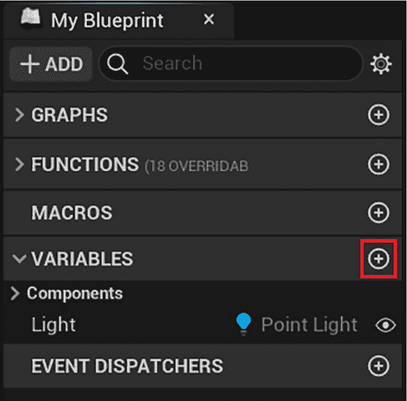

图 4.2 – 创建变量

- 7. 在**详情**面板中，单击**变量类型**下拉菜单并搜索`Point Light`。将鼠标悬停在**点光源**上以显示子菜单，然后选择**对象引用**。检查**实例可编辑**属性，如以下屏幕截图所示：

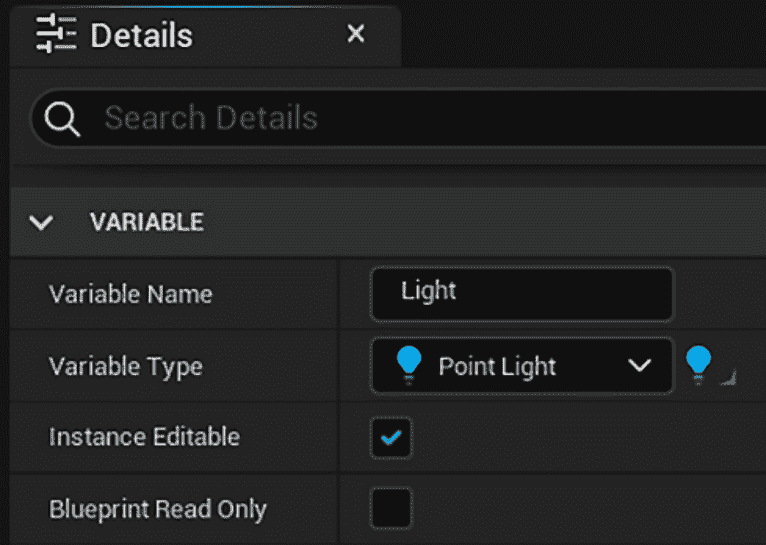

图 4.3 – 创建点光源类型的变量

- 8. 将`Light`变量从**我的蓝图**面板拖动到**事件图**中。
- 9. 选择**获取 Light**选项以创建节点。从**Light**节点的蓝色引脚拖动并放置在图表上以打开**上下文菜单**。确保已勾选**上下文敏感**，以显示可用于**点光源**对象引用的**操作**。

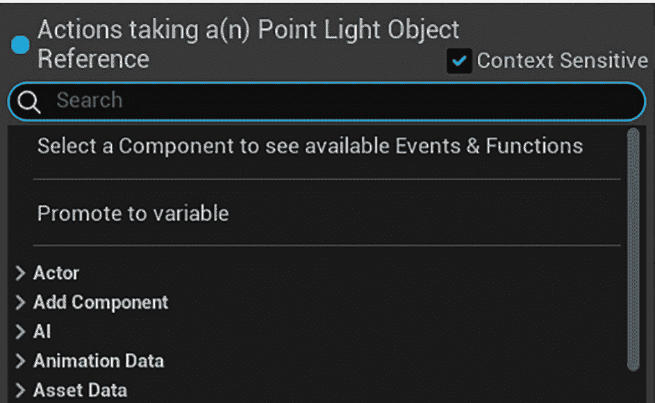

图 4.4 – 上下文菜单

- 10. 搜索`toggle`并选择名为**切换可见性 (点光源组件)**的函数，如以下屏幕截图所示：

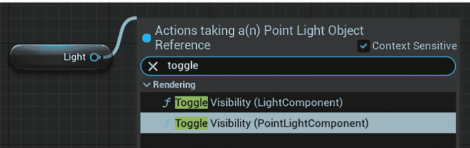

图 4.5 – 添加切换可见性函数

- 11. 右键单击**事件图**并添加**事件 ActorBeginOverlap**。从`Light`节点的蓝色引脚拖动并放置在图表上以打开**上下文菜单**，并添加**是否有效**宏，即带有白色问号的那个。此宏用于测试`Light`

变量正在引用一个实例。连接节点，如以下屏幕截图所示。编译此蓝图：

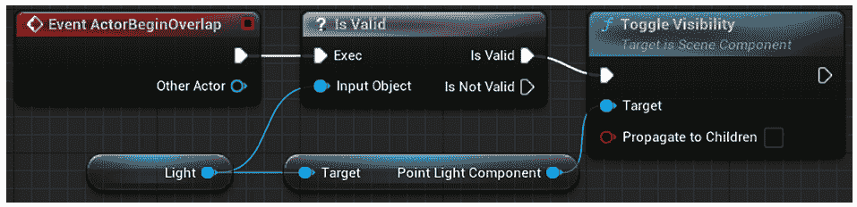

### 图 4.6 – Event ActorBeginOverlap 的操作

### 重要提示

在使用对象引用变量执行函数之前，请务必先使用 Is Valid 宏。该变量可能因多种原因而无效。使用无效变量执行函数会在运行时导致错误。

- 12. 在关卡编辑器中，单击工具栏上的 **创建** 按钮。将鼠标悬停在 **灯光** 上以显示子菜单，并拖动 **点光源** 并将其放置在关卡中的某个位置以创建实例：

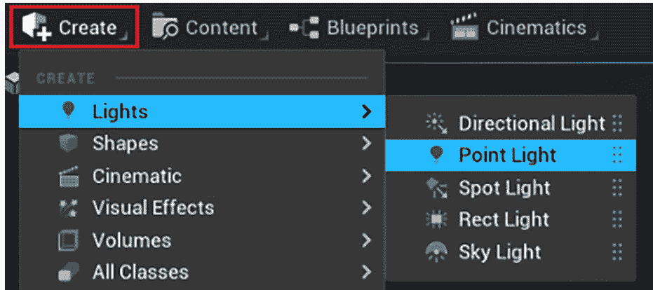

### 图 4.7 – 创建点光源

13. 在 **详情** 面板中，单击 **点光源** 实例的名称，并将名称更改为 `Lamp`。将 **移动性** 属性设置为 **可移动**，以便能够在运行时更改光照属性。

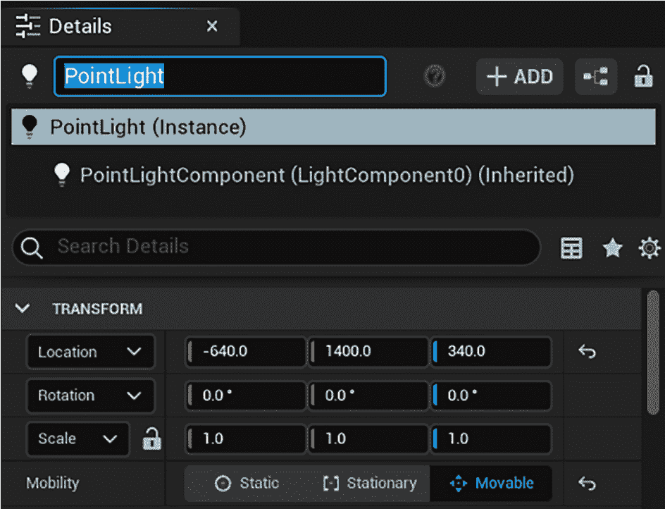

### 图 4.8 – 点光源实例的详情面板

14. 将 `BP_LightSwitch` 蓝图类从 **内容浏览器** 拖放到关卡中靠近我们添加到关卡的 **点光源** 实例的位置。下一张屏幕截图显示了 `BP_LightSwitch` 的 **详情** 面板。`Light` 变量出现在 **详情** 面板中是因为我们勾选了 **实例可编辑** 属性。单击 `Light` 变量的下拉菜单，以显示关卡中所有 **点光源** 实例，并选择我们在前一步中重命名为 `Lamp` 的 **点光源** 实例。本质上，这是直接蓝图通信。`BP_LightSwitch` 对另一个 Actor/蓝图具有对象引用，并可以调用其 **操作**：

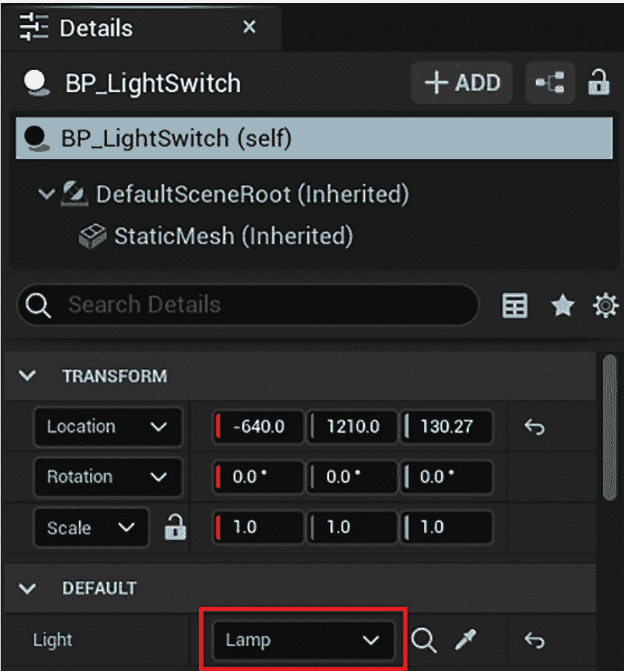

### 图 4.9 – 引用关卡中的实例

15. 单击 **播放** 按钮以查看 `BP_LightSwitch` 蓝图的实际运行效果。每次您的角色与 `BP_LightSwitch` 实例重叠时，它都会切换所选 **点光源** 的可见性。以下屏幕截图显示了使用 **第三人称** 模板的示例。**点光源** 变量位于墙上，`BP_LightSwitch` 蓝图位于地板上：

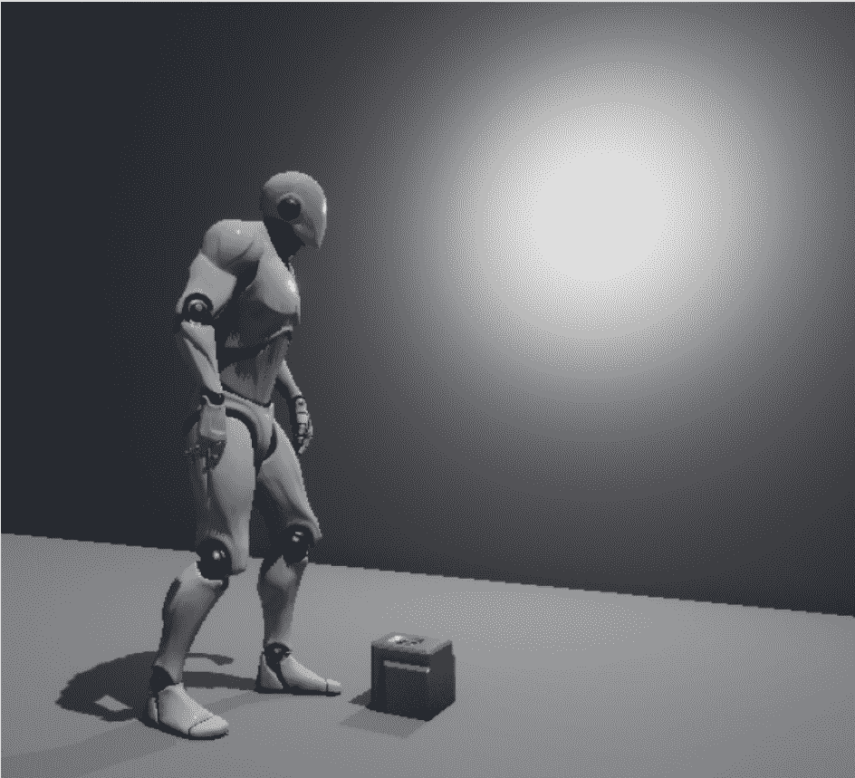

### 图 4.10 – 触摸 BP_LightSwitch 以打开灯光

在本节中，我们学习了如何创建引用另一个蓝图实例的变量。但有时我们需要访问被引用实例的子类属性。在这种情况下，我们需要对引用进行类型转换。

### 蓝图中的类型转换

存在一个名为 Cast To 的节点，它尝试将引用变量类型转换为新指定的类型。要理解类型转换，有必要回忆类之间的继承概念，我们在 *第 3 章，Actor 和游戏框架* 中介绍过。

以下图表示一个名为 `BP_GameModeWithScore` 的蓝图。**游戏模式基类** 是此蓝图的父类。根据继承概念，我们可以使用 **游戏模式基类** 对象引用类型的变量来引用 `BP_GameModeWithScore` 的实例。但是，此变量无法访问 *子类*（例如 `BP_GameModeWithScore` 蓝图中定义的子类）的变量和函数，因为 **游戏模式基类** 引用只知道 **游戏模式基类** 类中定义的变量和函数：

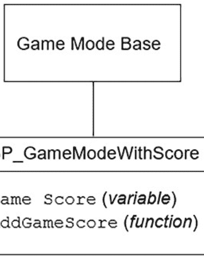

### 图 4.11 – BP_GameModeWithScore 继承自游戏模式基类

因此，如果我们有一个 **游戏模式基类** 对象引用，可以尝试使用 `Cast To BP_GameModeWithScore` 函数对该引用进行类型转换。如果该实例是 `BP_GameModeWithScore` 类型，则 **类型转换** 将成功并返回一个 `BP_GameModeWithScore` 对象引用，我们可以使用该引用来访问 `BP_GameModeWithScore` 的变量和函数。

**类型转换** 节点的另一个用途是安全地测试对象引用是否为所需类型，这个逐步示例将说明这两种用例：

- 1. 创建或使用基于第三人称模板且包含入门内容的现有项目。
- 2. 在 **内容浏览器** 中单击 **添加** 按钮，并选择 **蓝图类** 选项。
- 3. 在下一屏幕上，选择 **游戏模式基类** 作为父类。
- 4. 将蓝图命名为 `BP_GameModeWithScore`，并双击它以打开蓝图编辑器。
- 5. 在 **我的蓝图** 面板中，创建名为 `GameScore` 的整数类型变量，并创建名为 `AddGameScore` 的函数：

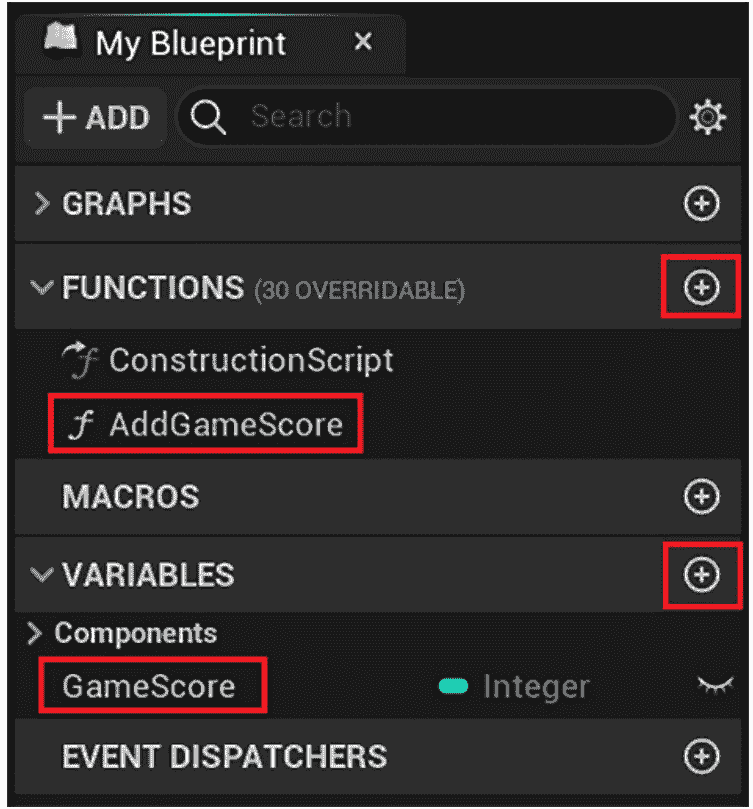

### 图 4.12 – 创建变量和函数

6. 在 `AddGameScore` 函数的 **详情** 面板中，添加名为 `Score` 的整数类型 **输入参数**。该函数用于向 `GameScore` 变量添加分数：

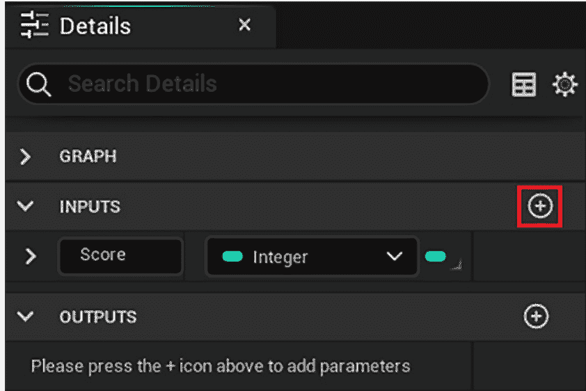

### 图 4.13 – 添加输入参数

- 7. 在函数图表中，添加以下屏幕截图中显示的 **操作**。要添加 **游戏分数** 变量的 **获取** 和 **设置** 节点，只需拖动变量，将其放置到图表中，然后选择 **获取** 或 **设置**。 **打印字符串** 函数用于在屏幕上显示 **游戏分数** 变量的当前值：

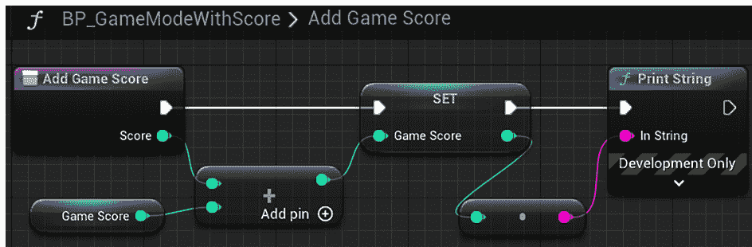

### 图 4.14 – Add Game Score 函数的操作

### 重要提示

位于 **设置** 和 **打印字符串** 之间的节点是一个转换器。要创建它，只需将 **设置** 的输出参数连接到 **打印字符串** 的 **输入字符串** 输入参数。由于参数类型不同，转换器会自动创建。

- 8. 编译并保存 `BP_GameModeWithScore` 蓝图。下一步是设置关卡以使用 `BP_GameModeWithScore` 作为 **游戏模式**。

- 9. 在关卡编辑器中，单击工具栏右侧的 **设置** 按钮，并选择 **世界设置**：

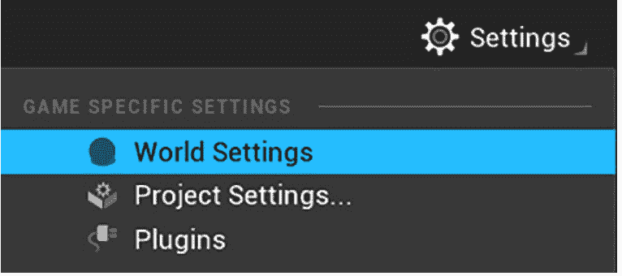

### 图 4.15 – 访问世界设置

- 10. 在 **游戏模式覆盖** 属性中，单击下拉菜单并选择 `BP_GameModeWithScore`，如以下屏幕截图所示：

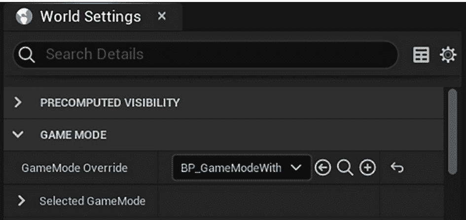

### 图 4.16 – 更改关卡使用的游戏模式

- 11. 创建一个蓝图并使用 Actor 作为父类。将其命名为 BP_Collectable，并在蓝图编辑器中打开它。

- 12. 单击组件面板中的 **添加** 按钮并选择 **静态网格组件**。在 **详情面板** 中，选择 SM_Statue 静态网格，在 **材质** 中，转到 Element 0 并选择 M_Metal_Gold。此外，将碰撞预设更改为 OverlapAllDynamic，如以下屏幕截图所示：

| 属性组 | 具体设置 |
|--------|----------|
| 静态网格 | 静态网格: SM_Statue |
| 材质 | Element 0: M_Metal_Gold Element 1: M_Statue |
| 组件勾选 | — |
| 物理 | — |
| 碰撞 | 模拟生成命中事件 物理材质覆盖: 无 生成重叠事件 角色可跨越: 是 碰撞预设: OverlapAllDynamic |

### 图 4.17 – 设置静态网格

- 13. 右键单击 **事件图表** 并添加 **事件 ActorBeginOverlap**。 **其他 Actor** 是与 `BP_Collectable` 蓝图重叠的实例。从 **其他 Actor** 的蓝色引脚拖动并将其放置到图表中以打开 **上下文菜单**。

- 14. 选择 **类型转换为 ThirdPersonCharacter** 操作，如以下屏幕截图所示。 **ThirdPersonCharacter** 是表示第三人称模板中玩家的蓝图。我们正在使用 **类型转换** 操作来测试 **其他 Actor** 引用的实例是否为玩家：

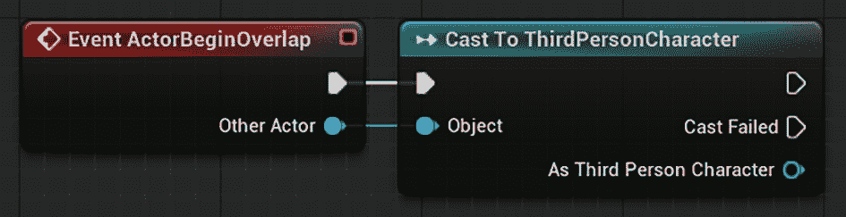

### 图 4.18 – 对其他 Actor 引用进行类型转换

- 15. 右键单击 **事件图表** 并添加 **获取游戏模式** 函数。从 **返回值** 的蓝色引脚拖动并将其放置到图表中以打开 **上下文菜单**。选择 **类型转换为 BP_GameModeWithScore** 操作。

- 16. 从 **作为 BP 游戏模式与分数** 的蓝色引脚拖动，将其放置到图表中，并在 **上下文菜单** 中选择 **添加游戏分数** 操作。在 **分数** 输入参数中输入 `50`。

- 17. 右键单击 **事件图表** 并添加 **销毁 Actor** 函数。连接节点的白色引脚。 **事件 ActorBeginOverlap** 的内容显示在以下屏幕截图中：

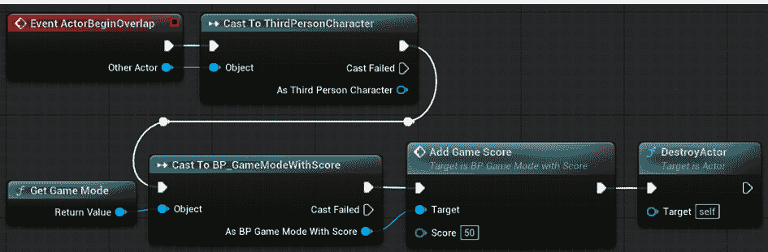

图 4.19 – ActorBeginOverlap 事件的操作

### 重要提示

**获取游戏模式** 函数返回当前关卡所使用的 **游戏模式** 的引用。但返回值的类型是 **游戏模式基类**。使用此类型的变量时，我们无法访问 **添加游戏得分** 函数。因此，有必要使用 **转换为 BP_GameModeWithScore**。

- 18. 编译 `BP_Collectable`。在关卡编辑器中，将 `BP_Collectable` 的一些实例拖放到关卡中。单击 **播放** 按钮来测试关卡。使用你的角色收集雕像，并在屏幕上查看当前得分。

### 重要提示

前一张截图中出现的两个白色连接引脚称为 **重路由节点**。可以从 **上下文菜单** 中添加它们，用于帮助组织蓝图。

此实际示例展示了使用 **转换为** 节点的两种常见方法。一种方法是测试实例是否为特定类型。另一种方法是访问子类的变量和函数。现在我们知道如何使用 **转换为**，让我们学习如何在关卡蓝图中添加角色的引用和事件。

### 关卡蓝图通信

虚幻引擎有一种特殊的蓝图，称为 **关卡蓝图**。游戏中的每个关卡都有一个默认的关卡蓝图。它们用于创建仅在当前关卡中发生的事件和动作。要访问关卡蓝图，请单击关卡编辑器工具栏上的 **蓝图** 按钮，并选择 **打开关卡蓝图** 选项，如下图所示：

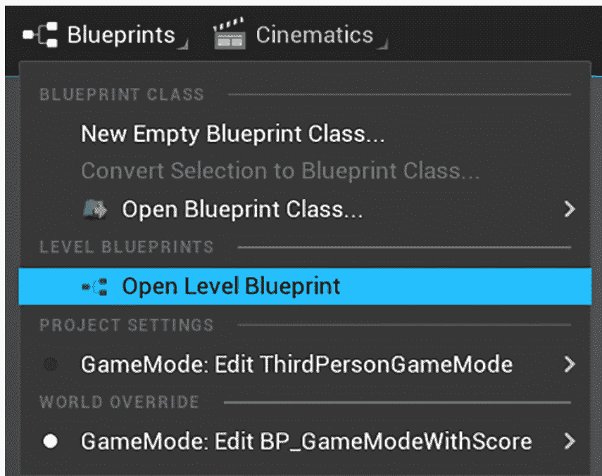

图 4.20 – 打开关卡蓝图

在关卡蓝图中，我们可以轻松创建关卡中角色的引用。为了实际演示，让我们创建一个示例，将 **Box Trigger** 添加到关卡中。当角色与触发器重叠时，**Blueprint_Effect_Sparks** 被激活，产生火花效果：

- 1. 创建或使用基于第三人模板且带有入门内容的现有项目。

- 2. 在关卡编辑器中，单击工具栏上位于 **创建** 按钮。在 **基本** 类别中，有一个 **Box Trigger**，如下图所示。将 **Box Trigger** 拖到关卡中的某个位置并放下：

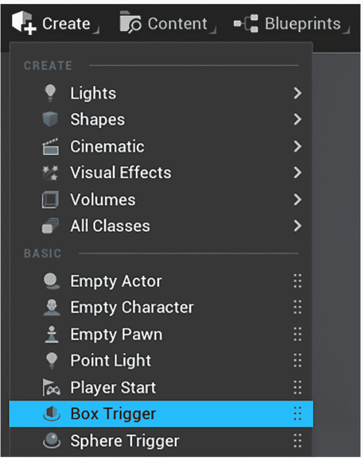

图 4.21 – 创建 Box Trigger

- 3. 调整 **Box Trigger** 的大小，并将其放置在关卡中玩家必须经过的位置。下图显示了一个示例。**Box Trigger** 在游戏中是隐藏的：

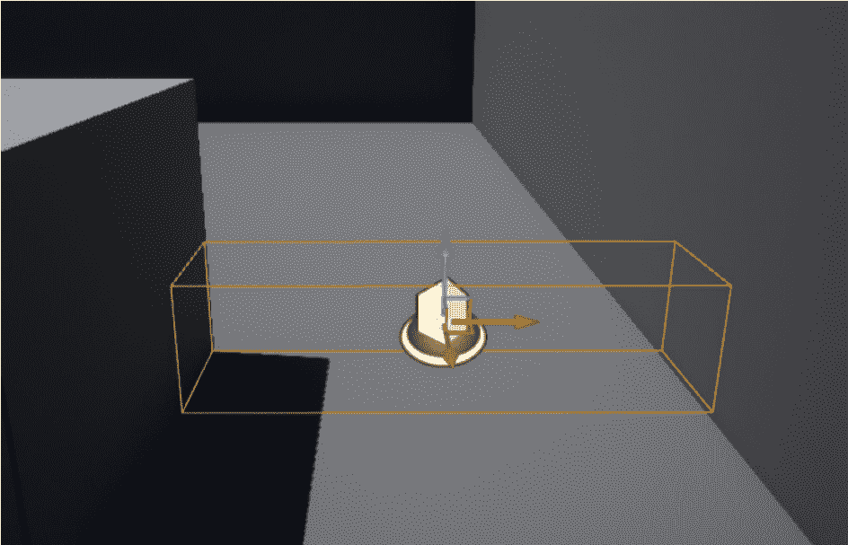

图 4.22 – 调整大小并放置 Box Trigger

- 4. 确认 **Box Trigger** 已被选中，通过单击关卡编辑器工具栏上的 **Blueprints** 按钮并选择 **Open Level Blueprint** 来打开关卡蓝图。

- 5. 右键单击 **Event Graph** 并添加位于 **Add Event for Trigger Box 1** 类别中、标记为 **Add OnActorBeginOverlap** 的事件，如下图所示：

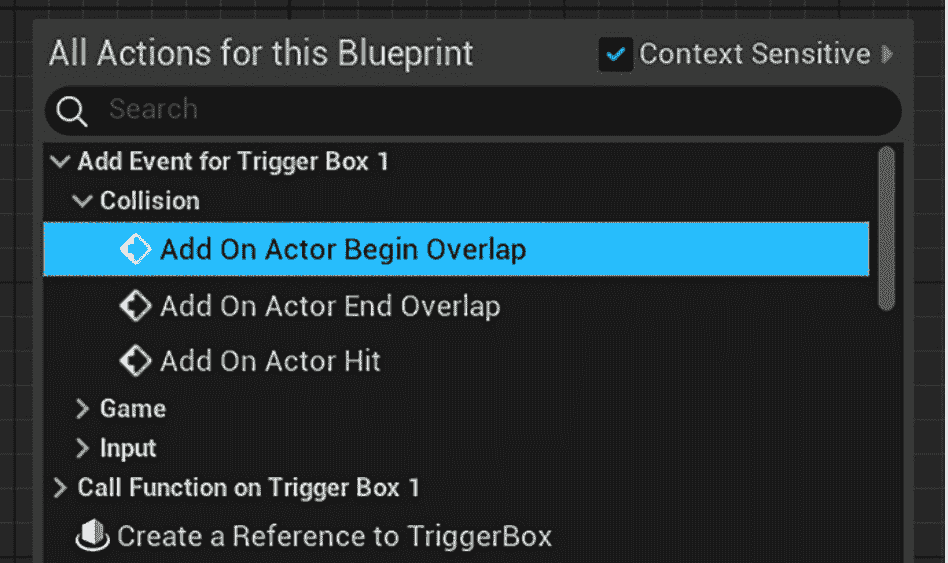

图 4.23 – 为触发框添加事件

- 6. 返回关卡编辑器。在内容浏览器中，转到 Content | StarterContent | Blueprints 并打开 Blueprint_Effect_Sparks。

- 7. On the Components tab, select the Sparks Component and in the Details tab, search for the auto activate attribute and uncheck it, as shown in the following screenshot. We did this so that the Sparks starts inactive so we can activate it at runtime. Compile Blueprint_Effect_Sparks：

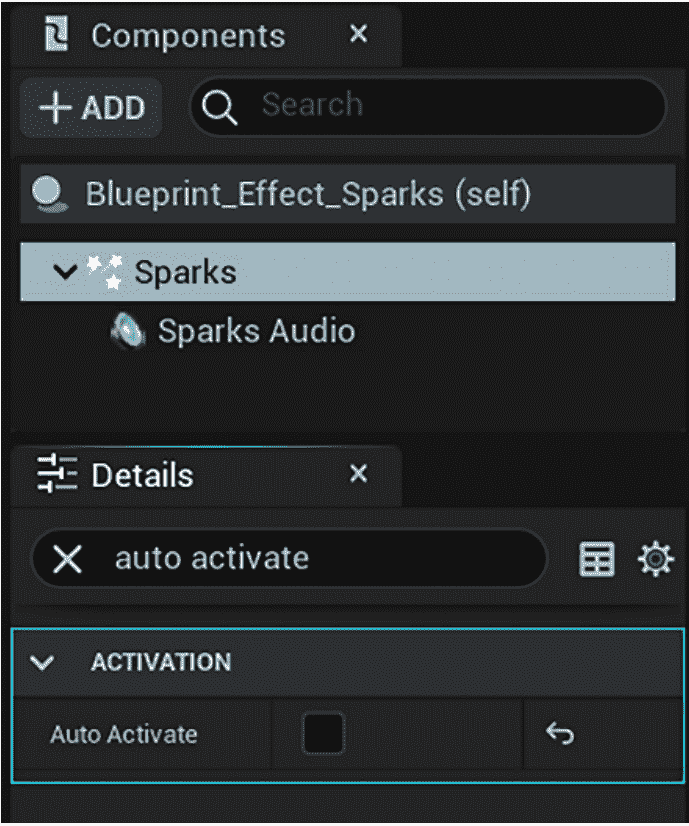

图 4.24 – 禁用火花组件的自动激活

- 8. 在关卡编辑器中，将 **Blueprint_Effect_Sparks** 从 **Content Browser** 拖放到关卡中靠近 **Box Trigger** 的位置以创建实例。

- 9. Confirm that **Blueprint_Effect_Sparks** is selected and open the Level Blueprint. Right-click on **Event Graph** and select **Create a Reference to Blueprint_Effect_Sparks**，如下图所示：

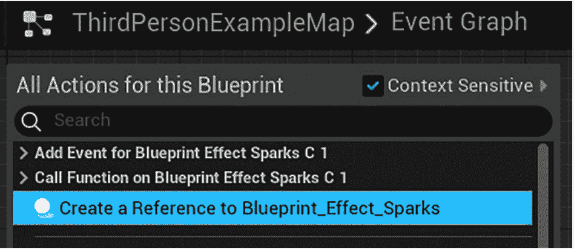

图 4.25 – 创建蓝图效果火花的引用

- 10. Drag from the **Blueprint_Effect_Sparks** blue pin of the node and drop it in the graph to open **Context Menu**。搜索 `activate` 并选择 **Activate (Sparks)**。Connect the white pin of the **OnActorBeginOverlap (TriggerBox)** event to the white pin of the **Activate** function，如下图所示：

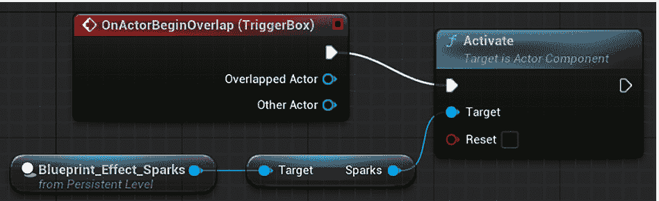

图 4.26 – 重叠触发框时激活火花

- 11. Compile the Level Blueprint and click the **Play** button of the Level Editor to test the Level. Move your character to the location of the **Box Trigger** to activate the sparks.

在本示例中，我们了解了如何在关卡蓝图中添加角色的引用和事件。这就是 **关卡蓝图通信** 的精髓。

蓝图和关卡蓝图之间还存在另一种通信形式，称为事件分派器。

### 事件分派器

**事件分派器** 允许一个 **蓝图** 在 **事件** 发生时通知其他蓝图。**关卡蓝图** 和其他蓝图类可以监听此 **事件**，并且在 **事件** 触发时可能有不同的 **动作** 运行。

我们在 **My Blueprint** 面板中创建事件分派器。作为示例，让我们创建一个名为 BP_Platform 的蓝图。当角色与 BP_Platform 蓝图重叠时，它会调用一个名为 PlatformPressed 的事件分派器。关卡蓝图正在监听 PlatformPressed 事件，并在触发该事件时生成一个爆炸：

- 1. 创建或使用基于第三人模板且带有入门内容的现有项目。
- 2. 创建一个蓝图并使用角色作为父类。将其命名为 BP_Platform 并在蓝图编辑器中打开它。
- 3. Click the Add button in the Components panel and choose the Static Mesh Component. In the Details panel, choose the Shape_Cylinder Static Mesh and change the Z value of the Scale attribute to 0.1. Also, change Collision Presets to OverlapAllDynamic, as shown in the following screenshot：

| 属性 | 值 |
|----------|-------|
| 缩放 Z | 0.1 |
| 静态网格 | Shape_Cylinder |
| 碰撞预设 | OverlapAllDynamic |

图 4.27 – 设置静态网格

- 4. Compile the Blueprint. In the **My Blueprint** panel, create an **Event Dispatcher** and name it `PlatformPressed`。An Event Dispatcher can have input parameters. Let's create one to send a reference of the `BP_Platform` instance that was overlapped. In the **Details** panel, create a new parameter in the **Inputs** category, name it `BP_Platform`，并将其设置为 `BP Platform` 类型的对象引用，如下图所示：

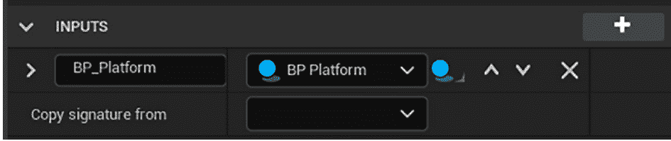

图 4.28 – 创建输入参数

- 5. Right-click **Event Graph** and add **Event ActorBeginOverlap**。Drag the `PlatformPressed` Event Dispatcher and drop it in **Event Graph**。Choose **Call** in the submenu。Right-click **Event Graph**，search for `self`，and select the **Get a reference to self** action。The **Self Action** returns a reference of the current instance。Connect the **Actions**，如下图所示：

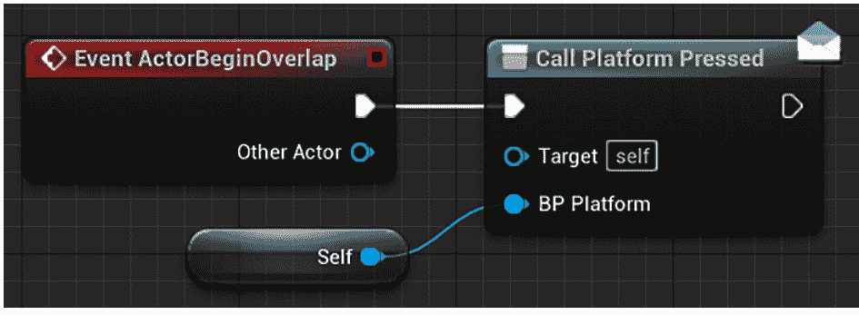

图 4.29 – 调用 Platform Pressed 事件分派器

- 6. Compile the Blueprint。In the Level Editor，drag BP_Platform from Content Browser and drop it in the Level to create an instance。

- 7. Make sure the BP_Platform instance is selected and click the **Blueprint** button at the toolbar of the Level Editor and choose Open Level Blueprint。Right-click Event Graph and select Add Platform Pressed，如下图所示：

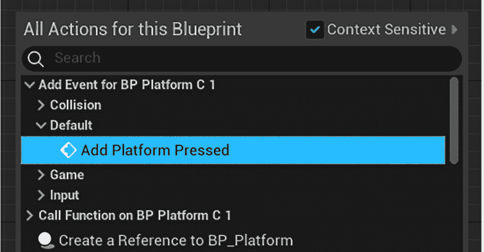

图 4.30 – 在关卡蓝图中添加 Platform Pressed

- 8. Right-click Event Graph，search for spawn actor，and select Spawn Actor from Class。Click the drop-down menu in the Class parameter and select Blueprint Effect Explosion。Drag from the blue pin of the PlatformPressed (BP_Platform) Event，drop it in the graph to open Context Menu，and choose the GetActorTransform Action。Connect the nodes，如下图所示：

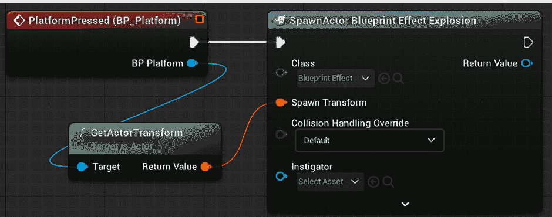

图 4.31 – 生成蓝图效果爆炸的实例

- 9. 编译关卡蓝图，并单击关卡编辑器的 **Play** 按钮来测试关卡。将角色移动到 `BP_Platform` 所在位置。当角色与其重叠时，关卡蓝图会在同一位置生成一个爆炸：

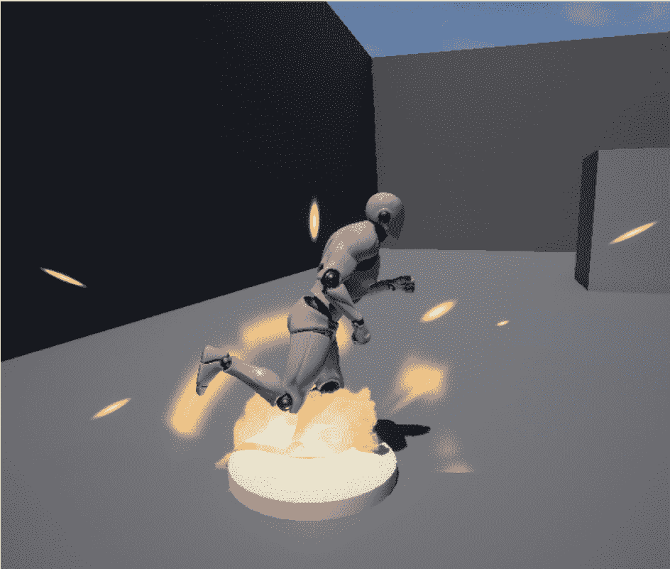

图 4.32 – 触碰 BP_Platform 以生成爆炸

我们了解到关卡蓝图可以监听事件分发器，但也可以通过绑定事件，让一个蓝图监听另一个蓝图的事件分发器。

### 绑定事件

有一个 **Bind Event** 节点，可将一个事件绑定到另一个事件或事件分发器上，后者可能位于另一个蓝图中。当调用某个事件时，所有绑定到它的其他事件也会被调用。

例如，让我们创建 **Blueprint_Effect_Sparks** 的子蓝图类。这个新蓝图将一个事件绑定到我们在上一个示例中创建的 `BP_Platform` 蓝图的 `PlatformPressed` 事件分发器上：

- 1. 打开事件分发器示例中使用的项目。
- 2. 创建一个蓝图，展开 **所有类** 菜单，搜索 **Blueprint_Effect_Sparks**（将其用作父类），将其命名为 `BP_Platform_Sparks`，并在蓝图编辑器中打开它。
- 3. 在 **组件** 选项卡上，选择 **火花** 组件，在 **详情** 选项卡中搜索 `auto activate` 属性，如果已勾选则取消勾选。由于我们之前已在 **Blueprint_Effect_Sparks** 中更改此项，因此它应当已经是未勾选状态。
- 4. 在 **我的蓝图** 面板中，创建名为 `BP_Platform` 的 `BP_Platform` 类型对象引用变量。在 **详情** 面板中勾选 **实例可编辑** 属性：

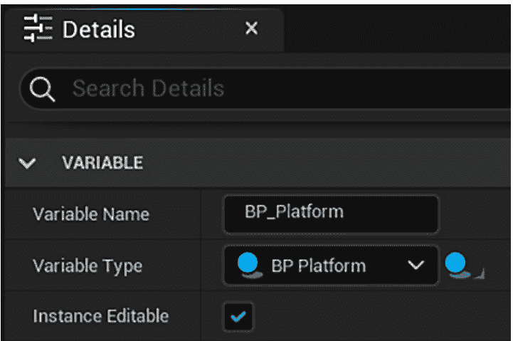

图 4.33 – 创建 BP_Platform 类型的变量

- 5. 右键单击 **事件图表** 并添加 **开始播放时**。将 `BP_Platform` 变量从 **我的蓝图** 面板拖放到 **事件图表** 中。选择 **获取** 选项以创建节点。
- 6. 从 **BP 平台** 节点的蓝色引脚拖线并放置到图表中以打开 **上下文菜单**。添加 **是否有效** 宏以测试 `BP_Platform` 变量是否引用了一个实例。将 **开始播放时** 的白色引脚连接到 **是否有效** 宏的 **Exec** 引脚。
- 7. 再次从 **BP 平台** 节点的蓝色引脚拖线并添加 **绑定事件到 PlatformPressed** 操作。将 **是否有效** 引脚连接到 **绑定事件** 节点的白色引脚：

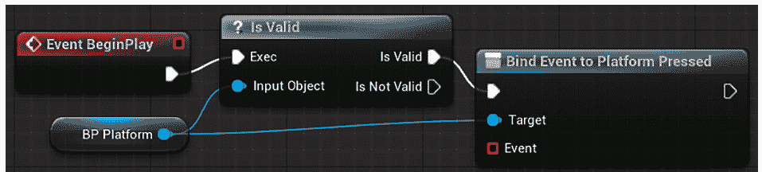

图 4.34 – 绑定事件到 Platform Pressed 的操作

- 8. 从 **绑定事件** 节点的红色引脚拖线，将其放置到图表中，并选择 **添加自定义事件**。
- 9. 将 **火花** 组件从 **组件** 面板拖到图表中。从 **火花** 节点的蓝色引脚拖线，将其放置到图表中，并选择 **激活**。
- 10. 如下图所示连接节点，并编译 `BP_Platform_Sparks`：

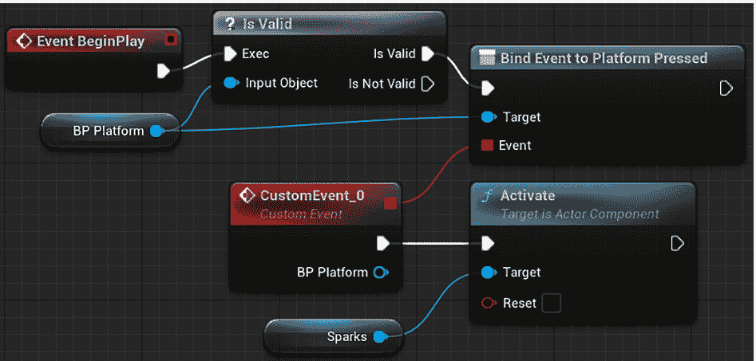

图 4.35 – 绑定到 Platform Pressed 的自定义事件

- 11. 在关卡中已有的 BP_Platform 实例附近添加一个 BP_Platform_Sparks 实例。在关卡编辑器的 **详情** 面板中，单击 BP_Platform 变量的下拉菜单并选择一个实例。

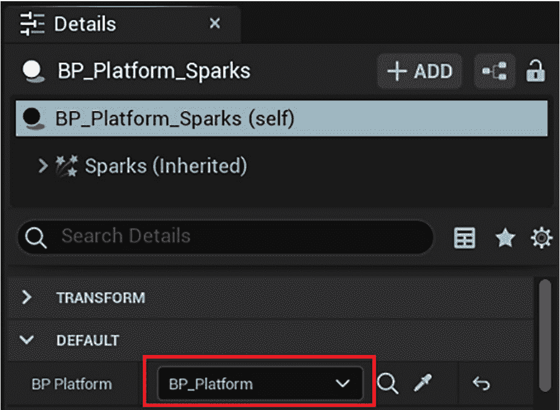

图 4.36 – 引用关卡中的实例

- 12. 单击关卡编辑器的 **Play** 按钮来测试关卡。将角色移动到 `BP_Platform` 的位置。当角色与其重叠时，`PlatformPressed` 事件分发器会被触发，`BP_Platform_Sparks` 的自定义事件会被执行，从而激活火花：

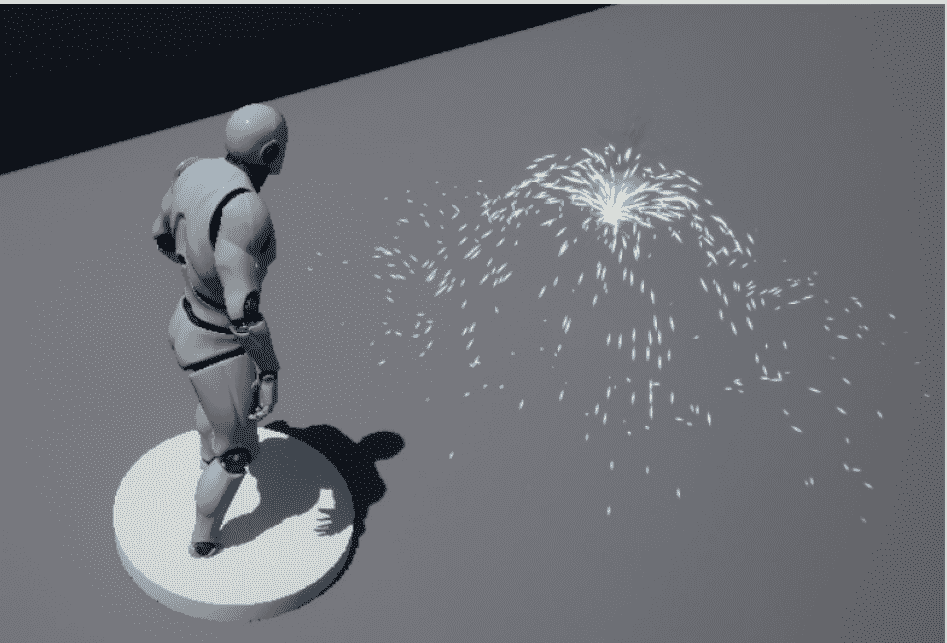

图 4.37 – 触碰 BP_Platform 以激活火花

### 总结

本章非常实用。我们为每种蓝图通信类型创建了分步示例。我们了解到如何使用直接蓝图通信让一个蓝图引用另一个蓝图，以及如何在关卡蓝图中引用角色。我们学习了如何使用类型转换来访问子类的变量和函数，以及如何测试实例引用是否属于某个特定类。

我们了解到如何使用事件分发器在事件发生时通知我们，以及如何在关卡蓝图中响应此事件分发器。我们还了解到可以将另一个蓝图的事件绑定到事件分发器上。

本章结束了第 1 部分。我们现在已经掌握了在虚幻引擎 5 中开始编写游戏和应用程序脚本所需的蓝图基础知识。

在第 2 部分，我们将从零开始通过分步教程构建一款第一人称射击游戏。在下一章中，我们将创建项目，向关卡添加对象，操作对象的材质，并添加移动。

### 测验

- 1. 可以使用对象引用变量调用另一个蓝图的函数。
  - a. 正确
  - b. 错误

- 2. 类型转换节点用于将对象引用转换为任何其他蓝图类的引用。
  - a. 正确
  - b. 错误

- 3. 在关卡蓝图中，可以创建指向关卡中角色的引用。
  - a. 正确
  - b. 错误

- 4. 关卡蓝图无法监听蓝图类的事件分发器。
  - a. 正确
  - b. 错误

- 5. 可以使用绑定事件节点将一个蓝图的事件绑定到另一个蓝图的事件分发器上。
  - a. 正确
  - b. 错误
