## 第 5 章：使用蓝图进行对象交互

在着手开发游戏时，探索您的想法的首要步骤之一是构建原型。幸运的是，虚幻引擎 5 和蓝图使快速让核心游戏功能运行起来比以往任何时候都更容易，因此您可以更早地开始测试您的想法。我们将首先使用一些默认资源和几个蓝图来原型化简单的游戏机制。

在本章中，我们将涵盖以下主题：

- 创建新项目和关卡
- 在关卡中放置对象
- 通过蓝图更改对象的材质
- 使用蓝图在世界中移动对象

本章结束时，我们将学习如何创建一个蓝图目标，当它被击中时会更改其材质，并在两点之间定期来回移动。关卡中蓝图目标的每个实例都可以设置不同的速度、方向和改变方向的时间。

### 创建项目和第一个关卡

在本节中，我们将首先使用虚幻引擎的一个模板创建项目。然后我们将探索该模板，查看它提供哪些游戏元素。

我们的游戏将是一款第一人称射击游戏。因此，让我们使用 **第一人称** 模板创建项目，该模板位于 **游戏** 类别中：

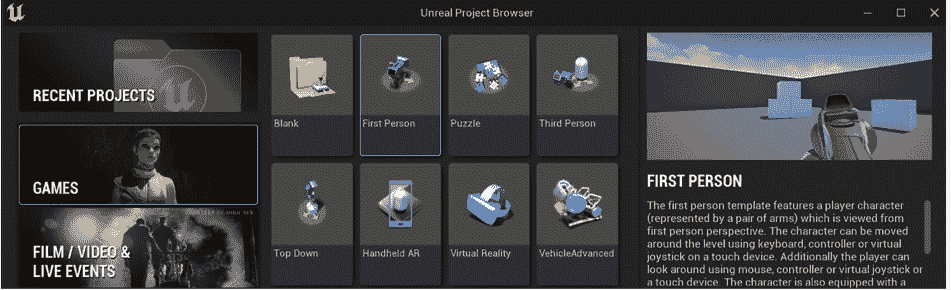

图 5.1 – 选择第一人称模板

在游戏模板下方，您可以看到一个文件夹路径字段，用于指定要存储项目的位置。您可以使用默认文件夹或选择您偏好的文件夹。下一张截图显示了本项目中应使用的项目默认设置。这些 **项目默认设置** 选项在 _第 1 章：探索蓝图编辑器_ 中已有说明。还有一个 **项目名称** 字段，用于输入项目将使用的名称。我将项目命名为 `UE5BpBook`，如本截图所示：

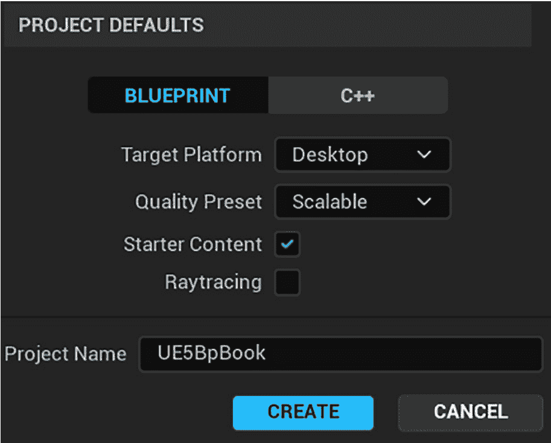

图 5.2 – 我们游戏中使用的项目默认设置

现在我们已选择模板并按喜好配置项目设置，即可创建项目。具体步骤如下：

- 1. 单击蓝色的 **创建** 按钮。引擎完成资源初始化并设置好项目后，**虚幻编辑器**将打开**关卡编辑器**。

- 2. 按 **开始** 按钮，尝试第一人称模板内置的默认游戏玩法。必须单击视口，游戏才能开始响应输入。

可使用 W、A、S、D 键移动玩家角色，并通过移动鼠标环顾四周。可使用左键发射炮弹。炮弹会影响关卡中的一些物理对象。尝试向关卡中散落的白色方框射击，并观察它们移动。

- 3. 在 **开始** 模式下，**开始** 按钮将被 **暂停** 按钮、**停止** 按钮和 **弹出** 按钮替换。可按 _Shift + F1_ 调出鼠标光标并单击 **暂停** 按钮以暂时停止游戏会话，当你想要探索在游戏过程中刚刚遇到的交互或 **参与者** 的属性时，这很有用。

单击 **停止** 按钮将结束游戏会话并返回编辑模式。单击 **弹出** 按钮将相机与玩家分离，允许你在关卡中自由移动。在继续之前，请先试着玩一下游戏。

### 向关卡中添加对象

现在，我们要开始向关卡中添加自己的对象。目标是创建一个简单的目标 **参与者**，当使用随附的枪支和炮弹射击它时，它会改变颜色。可按以下步骤创建一个简单的 **参与者**：

- 1. 在 **关卡编辑器** 中，单击工具栏上的 **创建** 按钮。将鼠标悬停在 **形状** 上以显示子菜单，并将 **圆柱体** 拖动到关卡中的某个位置并释放，以创建实例：

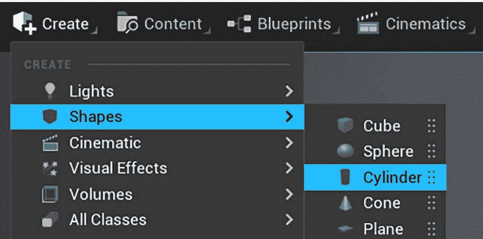

图 5.3 – 向关卡中添加圆柱体形状

此操作将创建一个新的 **圆柱体** 参与者并将其放置在我们的关卡中。你可以通过拖放随意重新定位圆柱体。你应该在视口以及 **世界大纲** 面板中看到该参与者，默认情况下它被命名为 **圆柱体**：

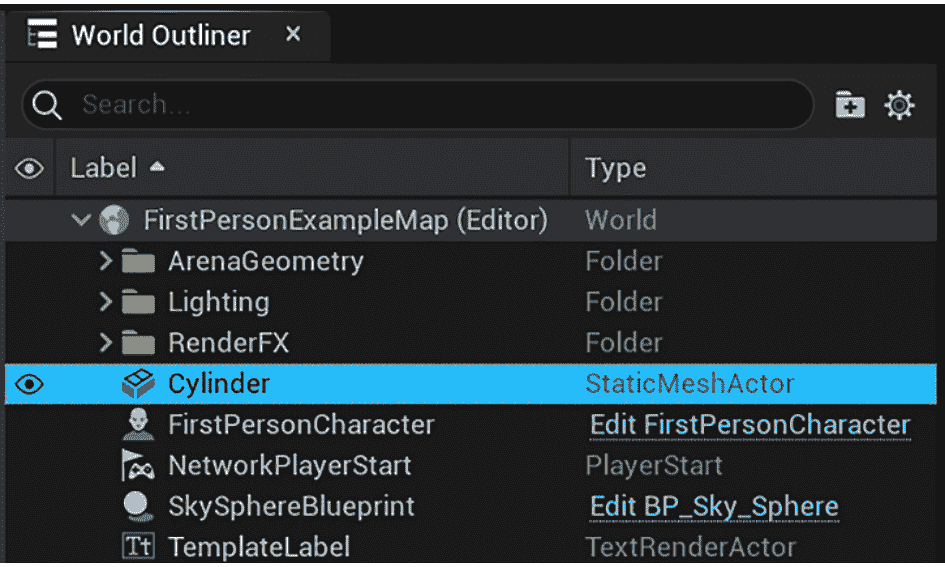

图 5.4 – 世界大纲显示添加的圆柱体

- 2. 在 **详细信息** 面板中，将 **圆柱体** 实例的名称更改为 `CylinderTarget`，如下所示：

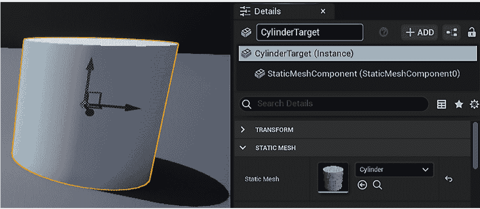

图 5.5 – 圆柱体形状的详细信息面板

我们已向关卡中添加一个将用作目标的参与者；现在我们将学习如何创建要应用到参与者的 **材质**。

### 探索材质

此前，我们设定了在圆柱体被炮弹击中时更改其颜色的目标。为此，需要更改参与者的 **材质**。材质是一种可添加到参与者网格以创建其外观的资源。你可以将材质视为涂在参与者网格或形状上的油漆层。由于参与者的材质决定其颜色，更改参与者颜色的一种方法是将其材质替换为不同颜色的材质。为此，我们先自行创建一个材质，它会使参与者呈现红色。

### 创建材质

按以下步骤创建材质：

- 1. 单击 **内容浏览器** 按钮打开内容浏览器，然后单击 `FirstPersonBP` 文件夹以访问它。单击 **添加** 按钮，选择 **新建文件夹**，并将其命名为 `Materials`。此步骤非必须，但保持项目文件层级整洁是良好做法。

- 2. 导航到新建文件夹，在内容浏览器的空白处右键单击，选择 **材质** 以创建材质资源。将其命名为 `M_TargetRed`：

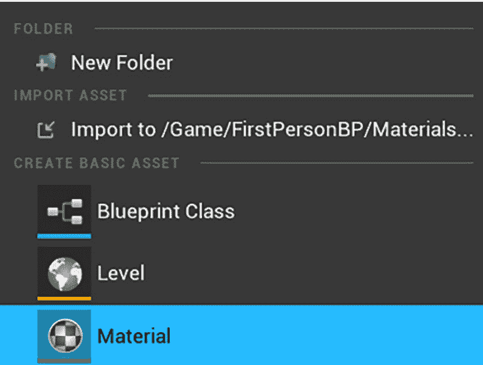

图 5.6 – 创建材质资源

### 材质属性与节点

现在，让我们打开 **材质编辑器** 并学习如何使用修改材质的节点。

以下是定义简单材质外观的步骤：

- 1. 双击 `M_TargetRed` 以打开用于编辑材质的新编辑器窗口，如下所示：

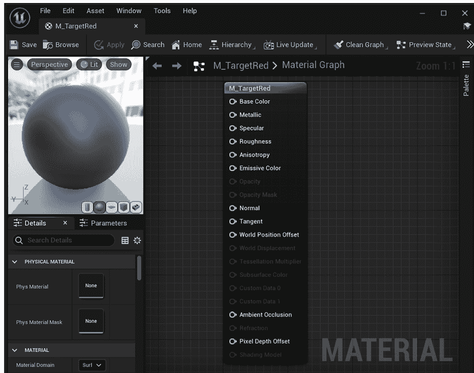

图 5.7 – 材质编辑器

你现在正在查看材质编辑器，它与蓝图共享许多功能和惯例。屏幕中央称为图表，我们在此放置定义材质逻辑的所有节点。图表中央带有材质名称的节点称为材质的结果节点。如上一个屏幕截图所示，该节点有一系列输入引脚，其他材质节点可以附加到这些引脚上以定义材质的属性。

- 2. 为材质赋予颜色，需要创建一个节点，将颜色信息提供给该节点上标记为 **基础颜色** 的输入。为此，在节点附近的空白处右键单击。将出现一个带有搜索框和长长的可展开选项列表的弹出窗口：

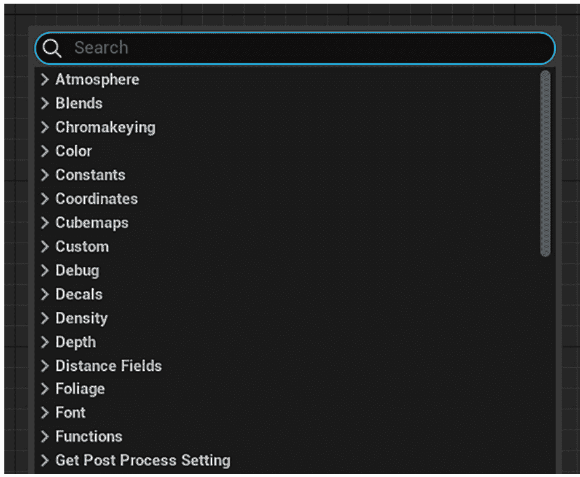

图 5.8 – 材质节点菜单

此操作显示所有可添加到该材质的材质节点选项。搜索框具有上下文感知功能，因此如果你开始输入有效节点名称的前几个字母，你会看到搜索字段下方的列表缩小，只包含名称中带有这些字母的节点。我们要找的节点称为 **矢量参数**，因此在搜索框中输入该名称，并单击 **矢量参数** 结果将该节点添加到图表中：

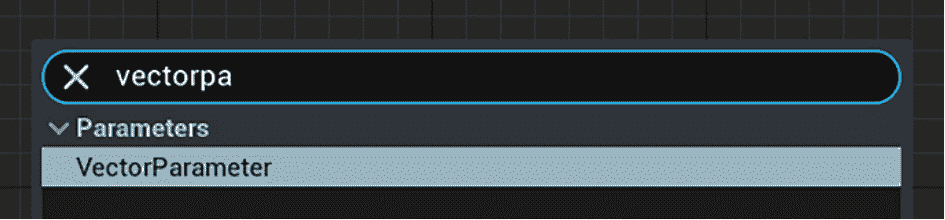

图 5.9 – 添加矢量参数节点

- 3. 将添加的节点重命名为 `Color`。材质编辑器中的矢量参数允许我们定义颜色，然后可以将其附加到高大的材质定义节点上的 **基础颜色** 输入。

- 4. 首先需要为节点提供颜色选择。双击节点中间的黑色方块以打开 **颜色选择器**。我们希望目标被击中时呈现明亮的红色，因此可将颜色轮中的中心点拖动到红色区域，或手动填写 RGB 或十六进制值。选定要使用的红色色调后，单击 **确定**。你会注意到矢量参数节点中的黑色方框现已变为红色：

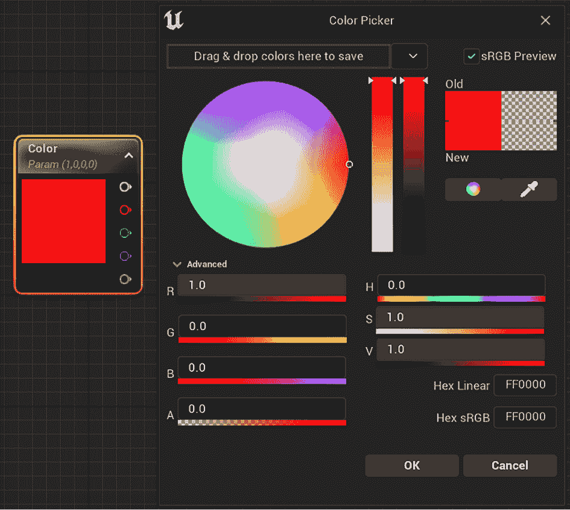

图 5.10 – 颜色选择器面板

最后一步是将我们的颜色矢量参数节点链接到基础材质节点。与蓝图类似，可以通过从一个节点的输出引脚单击并拖动到另一个节点来连接两个节点。输入引脚位于节点左侧，而输出引脚始终位于右侧。对于我们的材质，需要从 **颜色** 节点的顶部输出引脚单击并拖动一根线到材质节点的 **基础颜色** 输入引脚，如下一个屏幕截图所示：

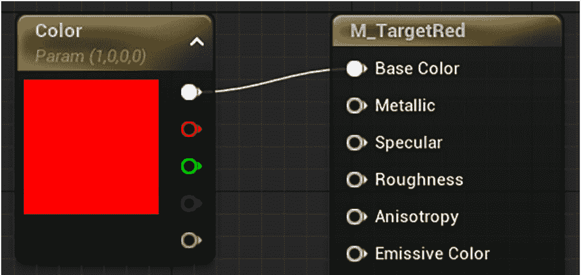

图 5.11 – 设置材质的基础颜色

可使用 **基础颜色** 输入引脚定义简单材质。接下来我们将看到如何使用材质节点的其他输入引脚。

### 为材质添加质感

可选择利用材质定义节点上的其他一些输入引脚为材质添加一些精修效果。应用平面单色材质时，3D 对象看起来不真实，但通过设置材质的 **金属度** 和 **粗糙度** 输入值，可以增加额外的反射率和深度。具体步骤如下：

- 1. 在空白网格区域右键单击，并在搜索框中键入 `scalarpa`。我们要找的节点称为 **标量参数**：

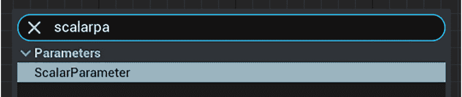

图 5.12 – 添加标量参数节点

- 2. 拥有 **标量参数** 节点后，选中它并转到 **详情** 面板。**标量参数** 接受单个浮点值。将 **默认值** 设置为 `0.1`，因为我们希望对 Material 的任何附加效果都要微妙。

- 3. 将 **参数名称** 更改为 **金属度**，然后将 **金属度** 节点的输出引脚拖动到 Material 定义节点的 **金属度** 输入引脚上。

- 4. 让我们为 **粗糙度** 参数添加一个额外连接，因此右键单击刚创建的 **金属度** 节点并选择 **复制**。这会生成该节点的副本，但不带线连接。

- 5. 选中这个副本 **金属度** 节点，然后将 **详情** 面板中的 **参数名称** 字段更改为 **粗糙度**。为该节点保持相同的默认值 `0.1`。

- 6. 单击并拖动 **粗糙度** 节点的输出引脚到 Material 定义节点的 **粗糙度** 输入引脚。

我们的 Material 效果应如下所示：

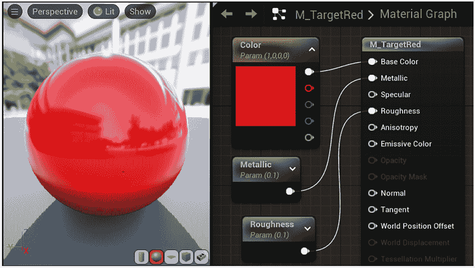

图 5.13 – M_TargetRed Material 的结果

我们现在已制作出一个闪亮的红色 Material，确保我们的目标在被击中时显眼突出。单击编辑器左上角的 **保存** 按钮以保存资产。关闭 Material Editor 以返回 Level Editor。

我们已学习如何使用 Material Editor 通过 **基础颜色**、**金属度** 和 **粗糙度** 输入引脚创建简单 Material。在下一部分，我们将了解如何在运行时更改角色的 Material。

### 创建目标 Blueprint

我们现在在世界中有一个圆柱体，以及希望在圆柱体被击中时应用到圆柱体上的 Material。交互的最后部分是游戏逻辑，它会评估圆柱体是否被击中，然后将圆柱体上的 Material 更改为我们的新红色 Material。要创建此行为，我们必须将圆柱体转换为 Blueprint。为此，请执行以下步骤：

- 1. 确保在 **关卡** 中选中了 `CylinderTarget` 对象。在 **详情** 面板中，单击 **添加** 按钮右侧的图标：

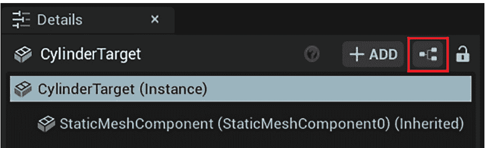

图 5.14 – 从 **关卡** 中的角色创建 Blueprint

- 2. 随后将出现标题为 **根据选择创建 Blueprint** 的窗口。将 Blueprint 重命名为 `BP_CylinderTarget`。在 **路径** 字段中，选择 `/Game/FirstPersonBP/Blueprints` 文件夹。在创建方法中，使用 **新子类** 选项。**静态网格 Actor** 父类已被选中，因为它是 **圆柱体** 角色的父类。单击 **选择** 按钮以创建 Blueprint：

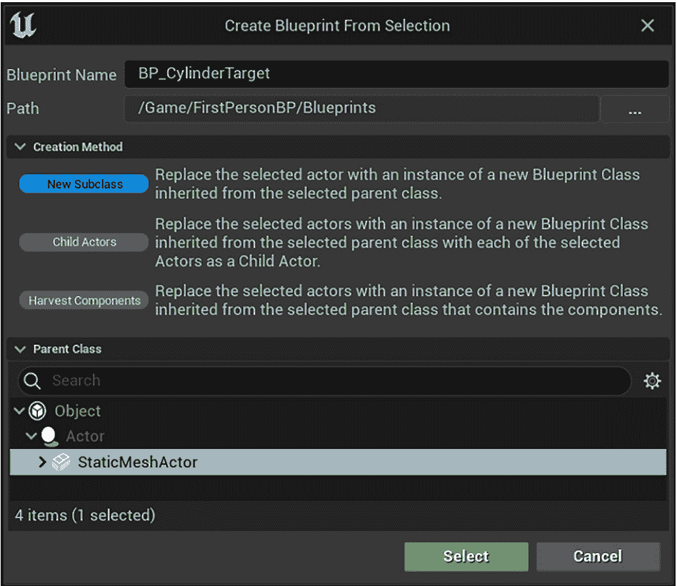

图 5.15 – 从 **关卡** 中的角色创建 Blueprint

Blueprint Editor 将在 **视图** 选项卡中打开 `BP_CylinderTarget`。您可以看到，该 Blueprint 已经有一个分配了圆柱体网格的静态网格组件。

我们将在 *第 6 章：增强玩家能力* 中探讨组件的使用；目前，我们希望创建一个能响应击中的简单 Blueprint。为此，请单击 **事件图表** 选项卡。

### 检测命中

要创建命中检测机制，请执行以下步骤：

- 1. 要创建命中检测事件，请在事件图表的空白处右键单击，并在搜索框中输入 `hit`。我们要找的是 **事件命中** 节点，因此当它出现在搜索结果中时请选中它。**事件命中** 每当另一个角色撞击此 Blueprint 控制的角色时都会触发：

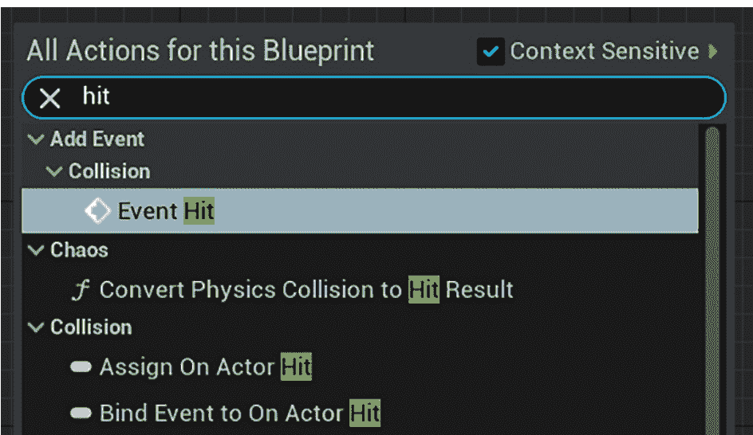

图 5.16 – 添加 **事件命中**

现在我们有了 **事件命中** 节点，需要找到一个操作，以便我们可以更改角色的 Material。

- 2. 从 **事件命中** 节点的白色执行引脚拖动一根线到空白处以打开上下文菜单。在搜索框中输入 `set material`。我们要选择的节点称为 **设置材质 (StaticMeshComponent)**：

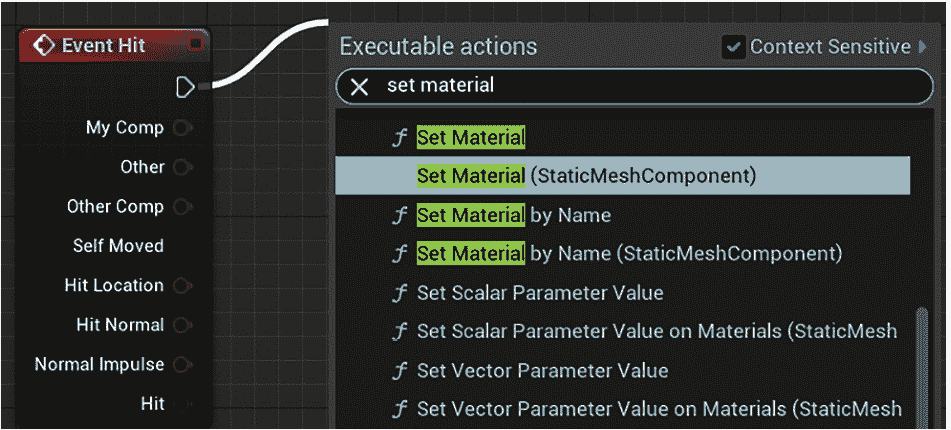

图 5.17 – 添加 **设置材质** 节点 (StaticMeshComponent)

### 重要信息

如果在 **上下文敏感** 搜索中找不到要查找的节点，请尝试取消选中 **上下文敏感**，以便从完整的节点选项列表中查找。即使在 **上下文敏感** 搜索中找不到该节点，仍有可能该节点可与您尝试附加的节点配合使用。

我们已添加 **设置材质** 节点，但现在需要调整其输入参数。

### 更换 Material

放置 **设置材质** 节点后，请注意它已通过其输入执行引脚连接到 **事件命中** 节点的输出执行引脚。现在，每当该 Blueprint 的角色撞击另一个角色时，此 Blueprint 就会触发 **设置材质** 操作。但是，我们尚未设置在调用 **设置材质** 操作时将使用的 Material。如果不设置 Material，该操作会触发，但不会对圆柱体目标产生任何可观察的效果：

- 1. 要设置将使用的材质，请单击设置材质节点内材质下方标记为“选择资产”的下拉字段。在出现的资产查找器窗口中，在搜索框中输入 `red` 以查找我们之前创建的 M_TargetRed 材质。单击该资产会将其附加到设置材质节点内的材质字段：

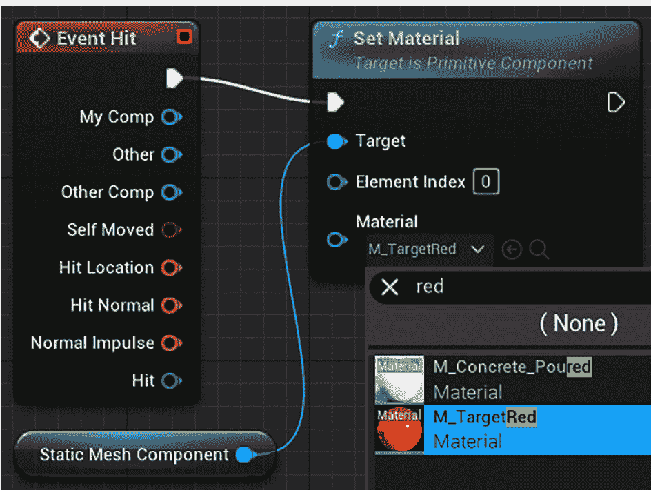

图 5.18 – 选择 M_TargetRed 材质

- 2. 我们现在已使用此 Blueprint 完成了将目标圆柱体变红所需的所有操作。编译并保存 Blueprint。

现在我们已设置好基本的游戏交互，明智的做法是测试游戏，以确保一切都按我们想要的方式进行。您可以单击 Blueprint Editor 的播放按钮来测试游戏。尝试射击并撞击您创建的 `BP_CylinderTarget` 角色：

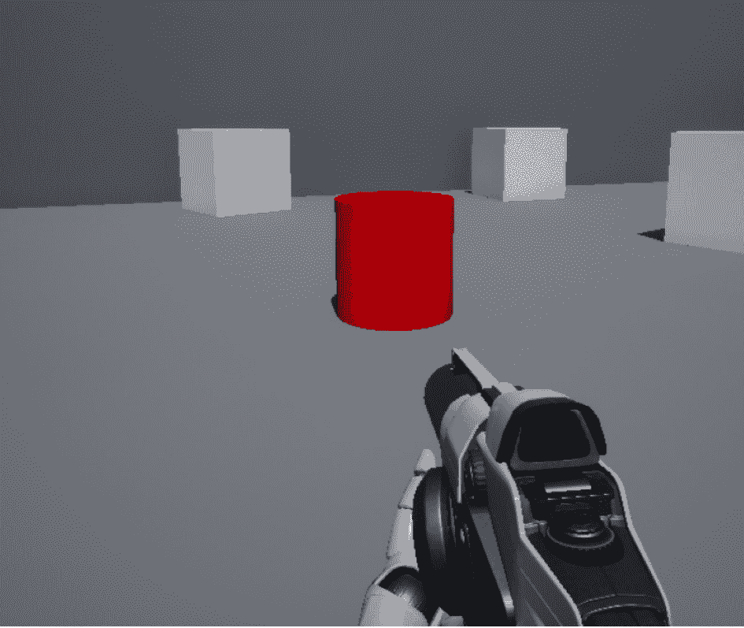

图 5.19 – 如果有东西撞击它，圆柱体会变红

在下一部分，我们将探讨如何改进 `BP_CylinderTarget` Blueprint。

### 改进 Blueprint

运行游戏时，我们看到当玩家枪支发射的弹丸击中圆柱体目标时，它会改变颜色。这是一种可用于让敌人响应玩家操作的游戏框架的开端。但是，您可能也注意到，当玩家直接撞击圆柱体目标时，它也会改变颜色。请记住，我们希望圆柱体目标仅在被玩家弹丸击中时变红，而不因任何其他物体与其碰撞而变红。在涉及脚本编写时，这类意外结果很常见，而避免这些结果的最佳方法是在构建过程中尽可能经常通过游玩来检查您的工作。

要修复我们的 Blueprint，使圆柱体目标仅在响应玩家弹丸时改变颜色，请返回 **BP_CylinderTarget** 选项卡并再次查看 **事件命中** 节点。

**事件命中** 节点上的其余输出引脚是存储事件数据的变量，这些数据可传递给其他节点。引脚的颜色表示它们传递的数据变量类型。蓝色引脚传递对象（例如角色），而红色引脚包含布尔值（`true` 或 `false`）变量。

标记为 **其他** 的蓝色输出引脚包含对撞击圆柱体目标的另一个角色的引用。这对我们很有用，可以确保圆柱体目标仅在被玩家发射的弹丸击中时改变颜色，而不是因为任何可能撞上它的其他角色而改变颜色。

让我们做一个更改，以确保我们仅在响应玩家弹丸击中时触发圆柱体目标。将 **事件命中** 节点向左拖动以给另一个节点腾出空间，然后从 **其他** 输出引脚单击并拖动一根线到空白处。在上下文菜单中，输入 `projectile`。您应该能看到类似于以下屏幕截图的一些结果。我们要找的节点称为 **转换为 FirstPersonProjectile**：

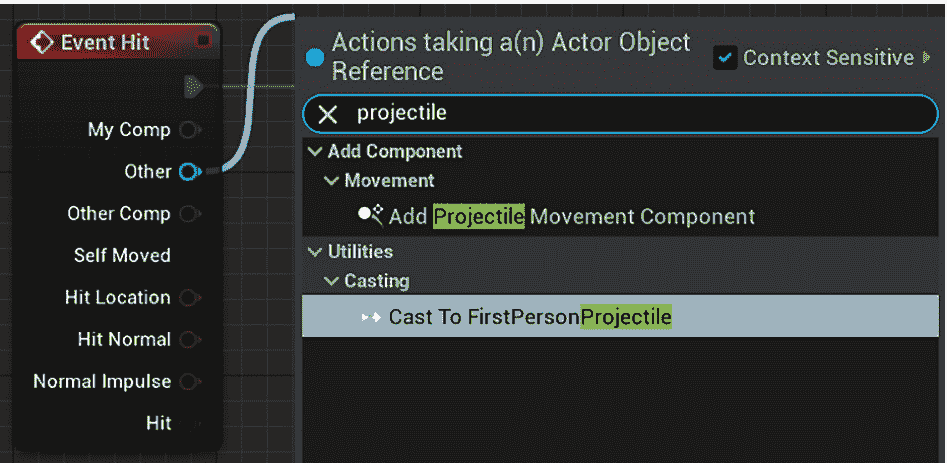

图 5.20 – 添加 Cast To 节点

FirstPersonProjectile 是包含在 Unreal Engine 5 **第一人称** 模板中的 Blueprint，用于控制从枪支发射的弹丸的行为。`Cast` 节点用于确保，仅当击中圆柱体目标的 Actor 是 `FirstPersonProjectile` 的实例时，附加到该节点执行引脚上的 Action 才会发生。

节点出现后，您应该已经能看到 **事件 Hit** 节点的 **Other** 输出引脚与转换节点的 **Object** 引脚之间有一条蓝色连线。将 **事件 Hit** 的白色执行引脚连接到 **转换为 FirstPersonProjectile** 节点的执行引脚，并将 **转换为 FirstPersonProjectile** 节点的输出执行引脚连接到 **设置材质** 节点的执行引脚：

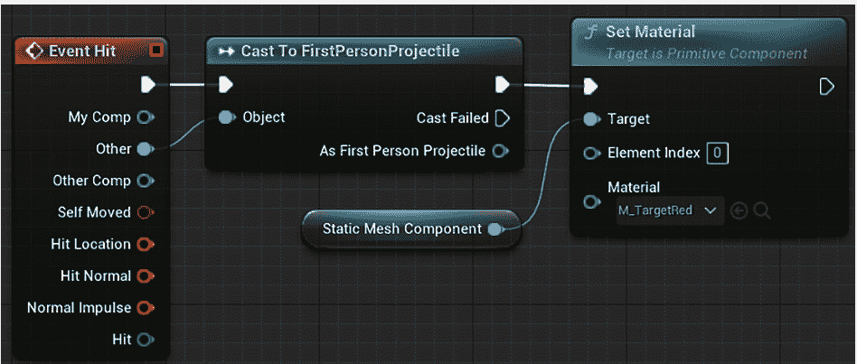

图 5.21 – 事件 Hit 操作

现在，编译、保存，然后单击 **播放** 按钮再次测试游戏。
这次，当您走上前去触摸圆柱体目标时，应该会注意到它保留默认颜色；
但如果您退后开枪射击它，它会变成红色。

我们学习了如何使用 **转换为 FirstPersonProjectile** 节点，以确保只有当与 Blueprint 交互的实例属于特定类时，才会执行某些 Action。在下一节中，我们将使圆柱体目标在关卡中移动。

### 添加移动

现在我们有了一个对玩家射击做出反应的目标，可以添加某种挑战，让我们的项目开始像一款游戏。实现此目的的简单方法是为目标添加一些移动。为此，我们首先必须声明目标 Actor 是一个旨在移动的对象，然后需要在 Blueprint 中设置逻辑来管理其移动方式。我们的目标是让圆柱体目标在关卡中来回移动。

### 更改 Actor 的移动性和碰撞设置

为了让目标移动，我们首先必须将其移动性设置更改为 **可移动**。这样在游戏过程中就可以操纵 Actor。执行以下步骤：

### 重要信息

默认情况下，放置在世界中的基础 Actor 设置为 **静态**。**静态**意味着对象在游戏过程中无法移动或被操纵。**静态**对象的渲染资源消耗显著较低，对于非交互对象，这应是我们的默认选择，以便最大化帧率。

1. 再次打开 BP_CylinderTarget。在 **组件** 面板中，选择 Static Mesh 组件。在 **详细信息** 面板中，将位于 **变换** 属性下方的 **移动性** 切换开关从 **静态** 切换为 **可移动**：

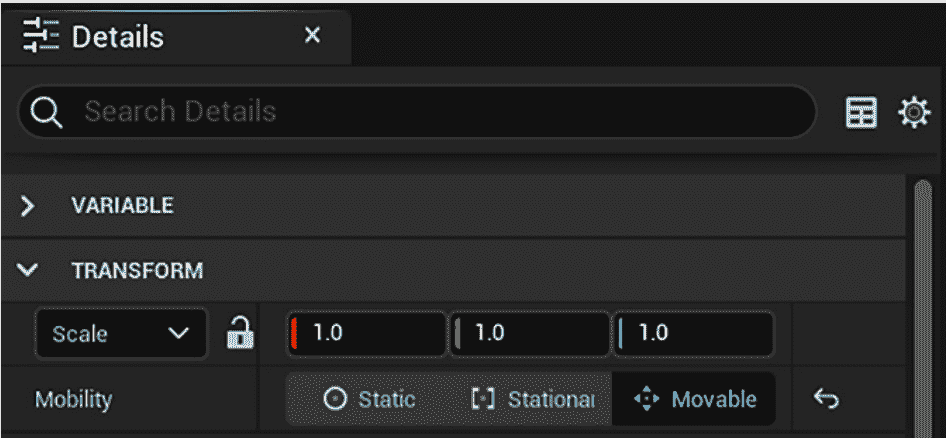

图 5.22 – 将移动性更改为 **可移动**

因为我们想用枪瞄准此对象，还需要确保目标可被碰撞，以便子弹不会穿过它。

2. 在 **详细信息** 面板中，找到名为 **碰撞** 的类别，并在下拉菜单中查找 **碰撞预设**。此下拉菜单中有许多其他选项，选择 **自定义** 选项后，您甚至可以分别设置对象与不同对象类型的碰撞交互。出于我们的目的，只需确保此下拉菜单设置为 BlockAllDynamic：

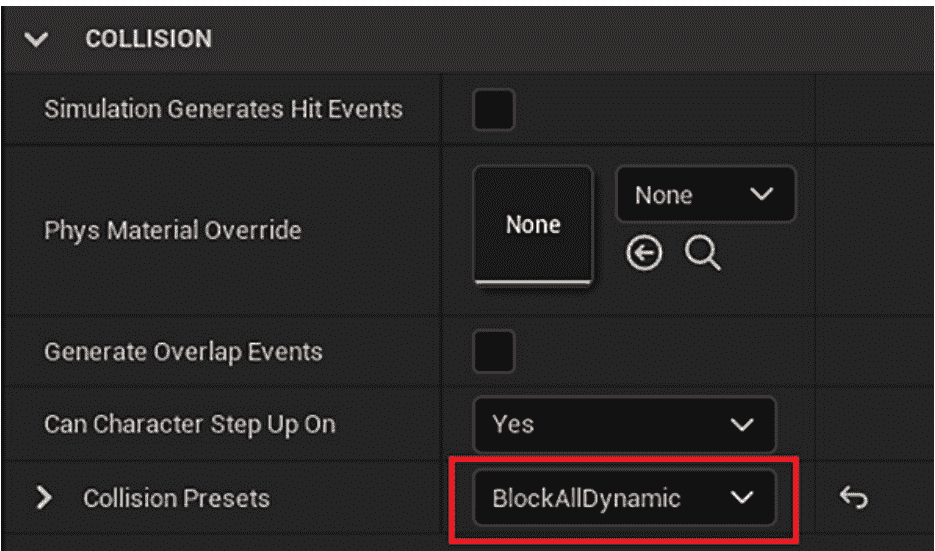

图 5.23 – 碰撞预设必须为 BlockAllDynamic

### 分解目标

现在我们已使目标可移动，可以设置告诉圆柱体如何移动的 Action 了。要移动圆柱体，我们需要四个数据：

- 圆柱体当前位于何处？
- 它应该朝哪个方向移动？
- 移动速度应为多少？
- 何时在方向之间切换？

我们将使用一个函数来获取当前位置，该函数返回圆柱体在世界中的坐标。速度、方向和更改方向的时间是我们提供给 Blueprint 的值，但需要一些计算才能将这些值转换为 Blueprint 可用于移动对象的信息。

执行以下步骤：

1. 在 **我的蓝图** 面板中，创建名为 `speed` 的变量。此变量将保存一个数字，表示 `BP_CylinderTarget` 的移动速度。在 **详细信息** 面板中，将 **变量类型** 更改为 **浮点数** 并勾选 **可实例编辑** 属性：

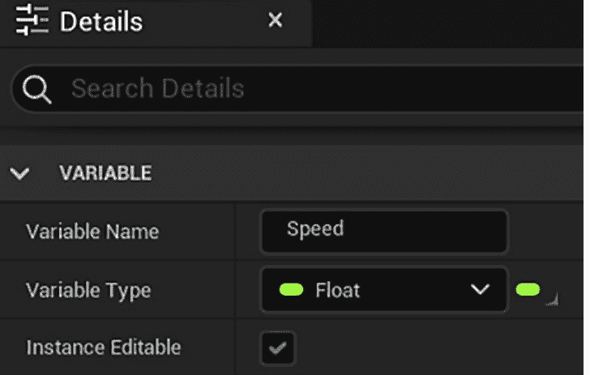

图 5.24 – `Speed` 变量

2. 编译 Blueprint 以便设置默认值。将 **默认值** 设置为 200.0：

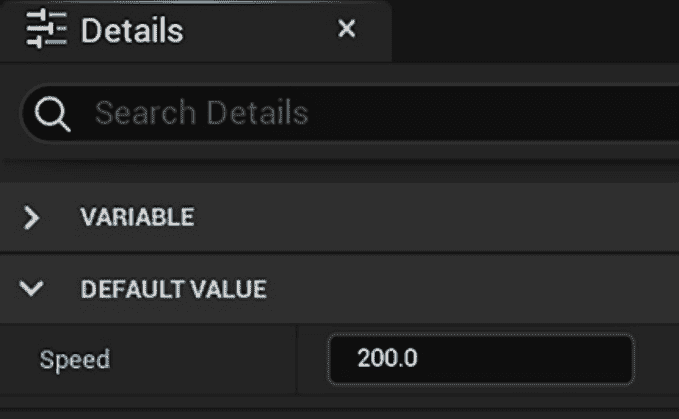

图 5.25 – `Speed` 变量的默认值

3. 在 **我的蓝图** 面板中，创建另一个 **浮点数** 变量并命名为 `TimeToChange`。勾选 **可实例编辑** 属性。编译 Blueprint 并将 **默认值** 设置为 `5.0`。这意味着圆柱体将在 5 秒后更改方向：

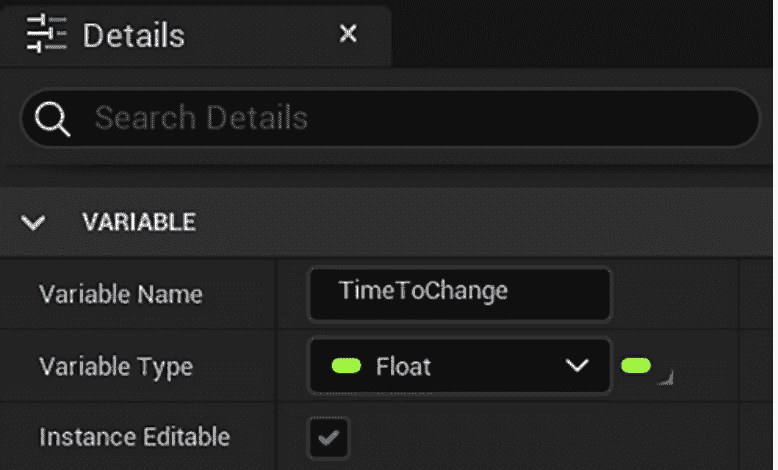

图 5.26 – `TimeToChange` 变量

4. 在 **我的蓝图** 面板中，创建另一个名为 Direction 的变量。在 **详细信息** 面板中，将 **变量类型** 更改为 **向量** 并勾选 **可实例编辑** 属性：

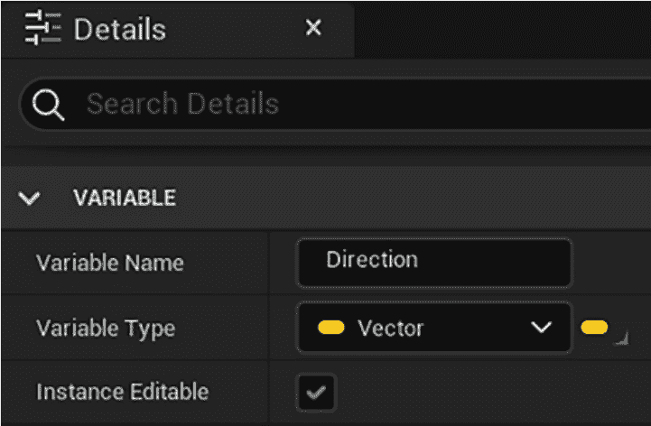

图 5.27 – **向量** 类型的 Direction 变量

5. 向量包含 X、Y 和 Z 浮点数值。编译 Blueprint 并将 Y 轴的 **默认值** 设置为 1.0。这意味着它将沿 Y 轴正方向移动：

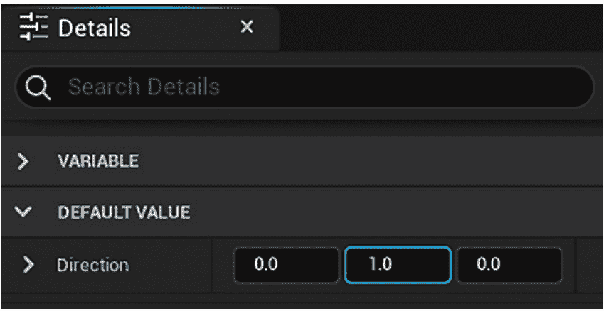

### 为计算做好方向准备

现在，让我们探索获取所需信息以提供移动指令所需的步骤。乍看之下可能令人生畏，但我们将逐一分析每个部分，并了解每个节点如何融入更大的目标。

我们需要执行的第一个计算是获取方向的向量值并将其归一化。归一化是向量数学中的常见过程，可确保向量转换为长度为 1 个单位的向量，从而使其与其余计算兼容。幸运的是，有一个 Blueprint 节点可以为我们处理此问题：

1. 将 `Direction` 变量从 **我的蓝图** 面板拖动并放置到 EventGraph 中。选择 **获取方向** 选项以创建节点。

2. 从 **Direction** 节点的输出引脚拖动并放置到图表中以打开上下文菜单。搜索 `normalize` 并选择 **向量** 类别下方的 **归一化** 节点。这会将我们的 **Direction** 变量连接到一个节点，该节点会自动为我们执行归一化计算：

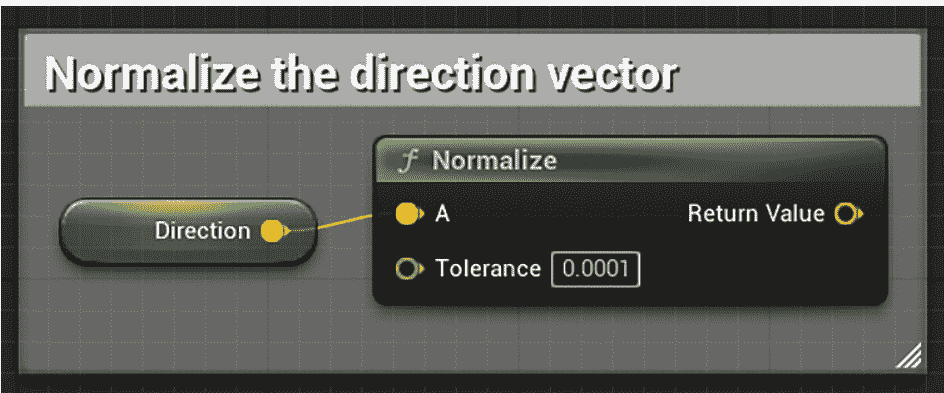

图 5.29 – 归一化向量

### 重要信息

在创建 Blueprint 时，为其添加注释是一种良好的做法。注释可以帮助描述某组 Blueprint 旨在完成的任务，如果您一段时间后返回某个 Blueprint 并需要理解之前的工作，这将非常有用。要为 Blueprint 添加注释，请单击并拖动选择框围绕您希望添加注释的节点以选中它们。然后，在选定的节点上单击右键，并选择底部选项 **根据选择创建注释**。

### 使用 delta time 获取相对速度

**增量时间** 是上一帧绘制时间与当前帧之间的时间差。使用 **增量时间** 是因为游戏帧之间所花的时间可能不同。通过将速度值乘以 **增量时间**，我们可以确保对象移动的速度相同，无论游戏帧率如何：

1. 将 **速度** 变量从 **我的蓝图** 面板拖动并放置到 EventGraph 中。选择 **获取速度** 选项以创建节点。
2. 在 EventGraph 的空白处单击右键以打开上下文菜单并搜索 `delta`。选择 **获取世界增量秒** 选项。
3. 从 **速度** 节点的输出引脚拖动并放置到空白处。在搜索字段中输入星号（*）（大多数计算机上为 Shift + 8），然后选择 **乘法** 节点：

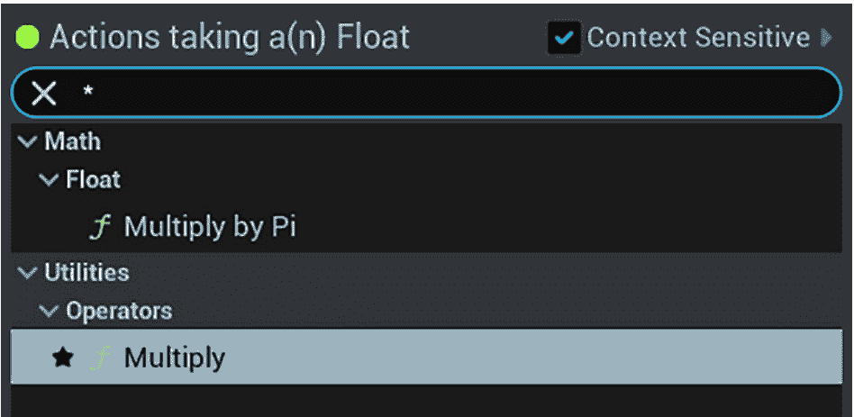

图 5.30 – 添加 Multiply 节点

- 4. 从 **Get World Delta Seconds** 节点的输出引脚拖动，并放置到 **Multiply** 节点的另一个输入引脚上，以相乘这两个值，如下所示：

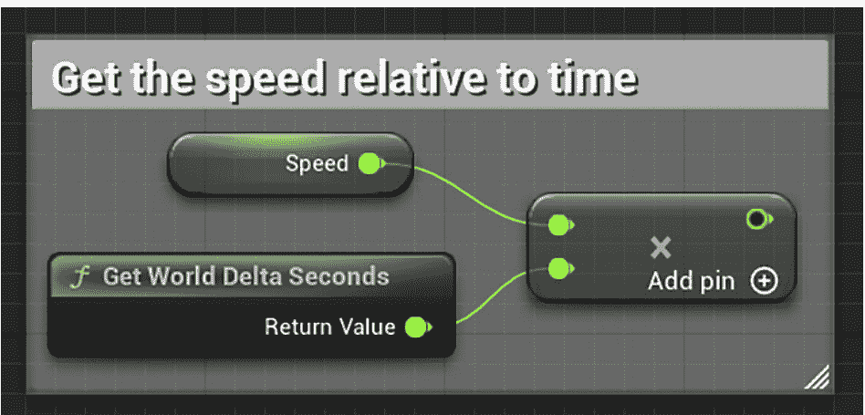

图 5.31 – 将速度与增量秒数相乘

### 更新位置

现在我们有了归一化的向量方向和相对于时间的速度值，需要将这两个值相乘并添加到当前位置：

- 1. 从 **Normalize** 节点的输出引脚拖动并放置到空白区域。在搜索字段中输入星号 (*) 并选择 **Multiply** 节点。

- 2. 上一步创建了一个 **Vector x Vector** 节点，但我们需要将向量与浮点数相乘。因此，右键单击第二个输入引脚，悬停在 **Convert Pin...** 上，并选择 **Float**：

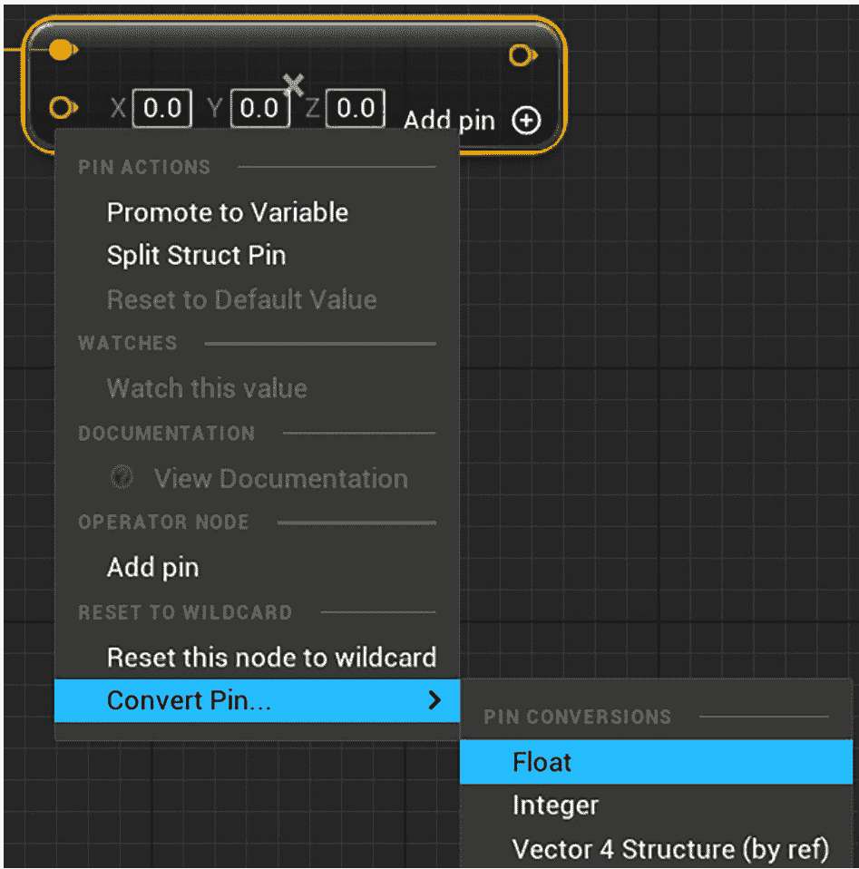

图 5.32 – 转换乘法输入引脚

- 3. 将 Float x Float 节点的输出引脚连接到我们转换的 Float 输入引脚，如下屏幕截图所示：

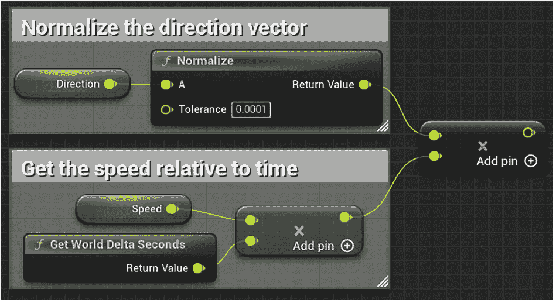

图 5.33 – 将向量与浮点数相乘

- 4. 我们将使用 **Event Tick** 来更新圆柱体的位置。在 EventGraph 的空白区域右键单击以打开上下文菜单并搜索 `tick`。选择 **Event Tick** 选项。

- 5. 要移动 Actor，我们将使用 **AddActorWorldOffset** 节点。该节点有一个名为 **Delta Location** 的输入参数，它是一个表示 Actor 位置变化的向量。右键单击以打开上下文菜单，搜索并添加 **AddActorWorldOffset** 节点。将 **Event Tick** 连接到 **AddActorWorldOffset** 节点：

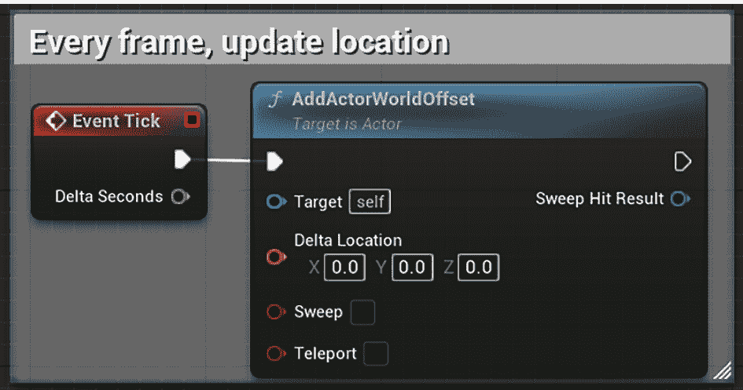

图 5.34 – 使用 Event Tick 更新位置

- 6. 将 Vector x Float 节点的输出引脚连接到 Delta Location 输入引脚。已完成，Event Tick 如下所示：

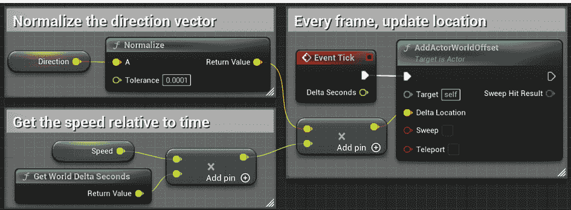

图 5.35 – Event Tick 的所有操作

在本节中，我们学习了如何使用归一化向量、增量时间和速度来移动我们的圆柱体目标。现在编译蓝图，保存，并运行游戏。请注意，圆柱体目标会在游戏开始时立即根据定义的速度和方向移动。但是，由于我们没有任何导致目标停止移动的指令，它将在游戏运行期间始终沿同一方向前进，甚至会穿过对象并移出我们创建的关卡。为避免此问题，在下一节中，我们将使圆柱体目标定期更改其方向。

### 更改方向

在本节中，我们将实现定期更改目标方向的逻辑。这将导致目标在两点之间定期来回移动，很像射击场目标：

- 1. 在 EventGraph 的空白区域右键单击以打开上下文菜单并搜索 `custom event`。选择 **Add Custom Event** 选项。将事件重命名为 `ChangeDirection`：

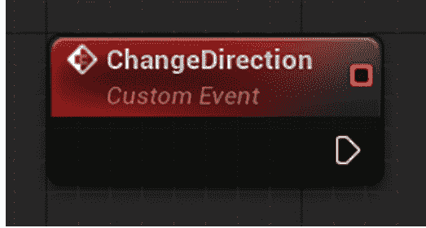

图 5.36 – 创建自定义事件

- 2. 我们将通过将 **Direction** 向量乘以 -1 来反转它：

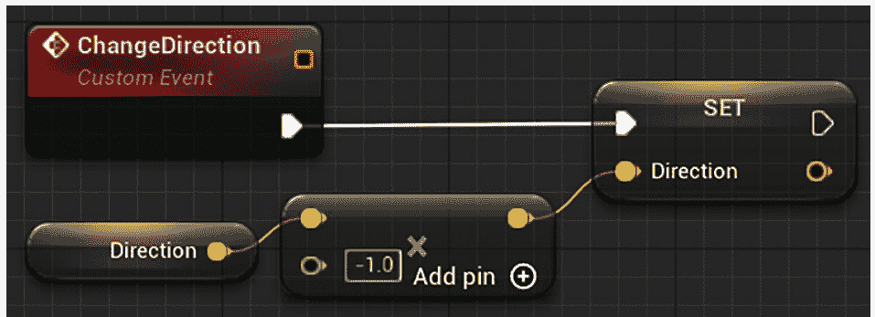

图 5.37 – 通过将向量乘以 -1 来反转向量的方向

- 3. 从 **My Blueprint** 面板拖动 **Direction** 变量并将其放置到 EventGraph 中。选择 **Get Direction** 选项以创建节点。

- 4. 从 **Direction** 节点的输出引脚拖动并放置到空白区域。在搜索字段中输入星号 (*) 并选择 **Multiply** 节点。

- 5. 上一步创建了一个 **Vector x Vector** 节点，但我们需要将向量与浮点数相乘。因此，右键单击第二个输入引脚，悬停在 **Convert Pin...** 上，并选择 **Float**。在 **Float** 参数中插入 `-1`。

- 6. 从 **My Blueprint** 面板拖动 `Direction` 变量并将其放置到 EventGraph 中。现在，选择 **Set Direction** 选项以创建节点。将 **Set Direction** 节点连接到 **Multiply** 节点的输出引脚和 **ChangeDirection** 事件。这完成了 **ChangeDirection** 事件。

- 7. 我们将使用 **timer** 定期运行 **ChangeDirection** 事件。在 EventGraph 的空白区域右键单击以打开上下文菜单并搜索 `timer_event`。选择 **Set Timer by Event** 选项。检查 **Looping** 参数：

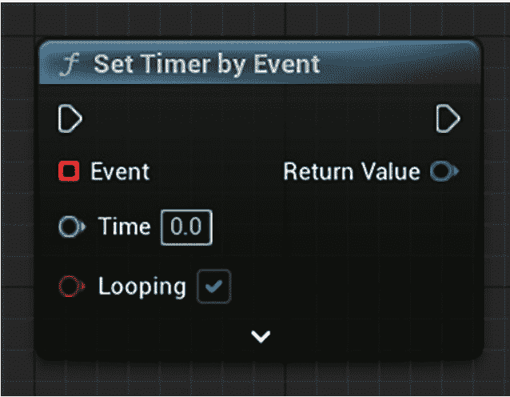

图 5.38 – 添加 Set Timer by Event 节点

- 8. 右键单击以打开上下文菜单并添加 Event BeginPlay。从 My Blueprint 面板拖动 TimeToChange 变量并选择 **Get TimeToChange** 选项。如下屏幕截图所示连接节点：

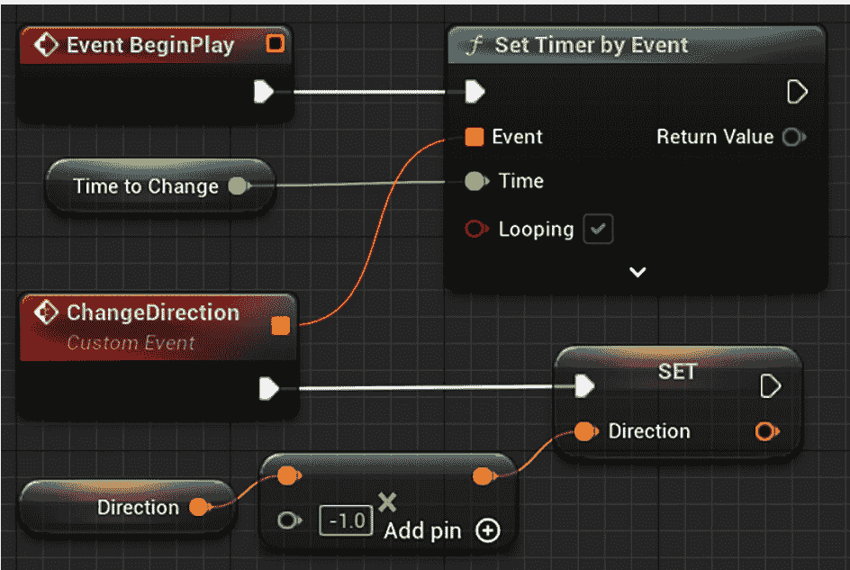

图 5.39 – 计时器将定期运行 ChangeDirection 事件

- 9. 编译并保存蓝图。

### 测试移动目标

现在我们已更新蓝图，可以测试以确保 BP_CylinderTarget 实例按预期移动。首先，必须将 BP_CylinderTarget 实例放置在允许其沿 y 轴移动而不会碰到其他对象的位置。我使用的坐标是 x 轴上 220，y 轴上 -600，z 轴上 220。

请注意，这些值仅相对于 **First Person** 模板关卡的默认布局有效。如果您已调整关卡，则可以调整关卡中圆柱体的位置，或更改实例可编辑变量的值，例如速度、更改时间或方向，如下屏幕截图所示，并测试直到找到合适的巡逻点。单击 **Play**。如果蓝图正常工作，则将看到圆柱体以恒定速度在两点之间来回移动：

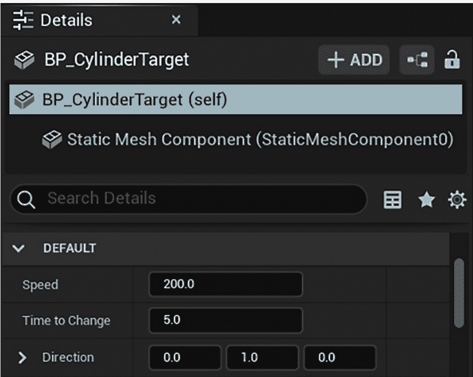

图 5.40 – 这些变量可在实例中编辑

您可以添加其他 `BP_CylinderTarget` 实例并尝试其他方向，例如沿 *x* 轴或上下（即 *z* 轴）。

### 摘要

在本章中，我们使用第一人称射击模板创建了一个项目和初始关卡。然后，我们设置了一个目标对象，它会通过改变外观来响应玩家的枪击。最后，我们设置了一个蓝图，使我们能够快速创建移动目标。在此学到的技能将为构建后续章节中更复杂的交互行为，甚至您自己制作的整个游戏，奠定坚实基础。

您可能希望花些额外时间修改原型，以包含更具吸引力的布局或具有更快移动目标的功能。在继续构建游戏体验时，请记住，您始终可以停留在某个部分并尝试自己的功能或自定义。蓝图可视化脚本最大的好处之一是测试新想法的速度，而您学到的每一项额外技能都将为您可以探索和原型化的游戏体验解锁指数级更多可能性。

在下一章中，我们将更深入地了解随 **First Person** 模板提供的玩家控制器。我们将扩展管理玩家移动和射击的现有蓝图，使用一款根据我们喜好调整的枪支，产生更有趣的视觉效果和音效。

### 测验

- 1. 不能使用蓝图脚本更改网格的材质。
  - a. 正确
  - b. 错误

- 2. 您可以使用关卡中的 Actor 创建蓝图类。
  - a. 正确
  - b. 错误

- 3. Normalize 函数的结果向量是长度等于 1 的向量。
  - a. 正确
  - b. 错误

- 4. 计时器等待执行事件的时间称为增量时间。
  - a. 正确
  - b. 错误

- 5. Event Tick 在每一帧执行。
  - a. 正确
  - b. 错误

