## 第 6 章：增强玩家能力

在本章中，我们将通过对玩家角色 Blueprint 进行修改，来扩展在第 5 章“使用 Blueprints 进行对象交互”中创建的核心射击交互。First Person 模板附带的玩家角色 Blueprint 起初看起来很复杂，尤其是与我们从头开始创建的相对简单的 Cylinder 目标 Blueprint 相比。我们将深入研究这个 Blueprint 并将其拆解，以了解其各个部分如何为玩家体验做出贡献，并使他们能够控制角色并射击枪支。

直接使用现成可用的资产固然快速简便，无需花时间去了解其实现功能的方式。然而，我们希望确保能够在问题出现时及时修复，同时更好地扩展玩家控制功能以满足我们的需求。因此，在将任何外部资产引入正在构建的项目之前，花些时间去调查和了解它们总是明智的。

在本章结束时，我们希望成功修改玩家角色，以便添加冲刺、缩放视图的能力，并能够配合令人愉快的爆炸和音效摧毁我们射击的物体。在实现这些目标的过程中，我们将涵盖以下主题：

- 玩家输入和控制
- 视野（FOV）
- 时间轴和分支逻辑
- 向对象交互添加音效和粒子效果

### 添加跑步功能

我们将通过添加简单功能来开始探索 `FirstPersonCharacter` Blueprint，这将为玩家在关卡中移动提供更多战术选择。目前，玩家仅能以单一速度移动。我们将调整 Blueprint，当玩家按下 _左 Shift_ 键时增加 **角色移动** 组件的移动速度，但首先，让我们了解 `FirstPersonCharacter` 的 **事件图** 中存在哪些 **动作**。

### 拆解角色移动

首先，打开 `FirstPersonCharacter` Blueprint。在 **内容浏览器** 中，访问 `Content | FirstPersonBP | Blueprints` 文件夹并双击 `FirstPersonCharacter` Blueprint。您将打开 **事件图** 并看到一大系列 Blueprint 节点。您可以通过右键点击图表并拖动来浏览 **事件图**。我们将要查看的第一组节点由 **事件图** 中标记为 **摇杆输入** 的注释框限定，如下所示：

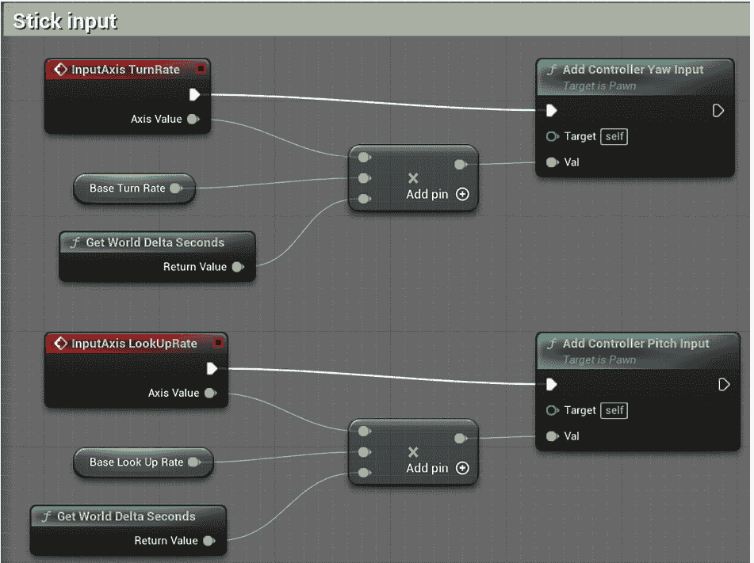

### 图 6.1 – 摇杆输入 事件

红色 Event 节点会在每一帧触发，并传递来自控制器输入的 **转向速率** 和 **观察速率** 的 **轴值**。这些值通常映射到模拟摇杆的左/右和上/下轴触发器。请注意，只有两个轴触发器。检测向下看或向左转的 Event 由这些节点本身覆盖，并在传递的 **轴值** 中表示为负数。

接着，来自两个轴触发器的值分别乘以一个变量，该变量表示玩家预期能够转身或向上/向下观察的基础速率。这些值还会乘以世界增量秒数，以针对不同帧率进行归一化，尽管触发器每帧都会被调用。将所有三个输入相乘所得的值随后传递给 **添加控制器俯仰输入** 和 **添加控制器偏航输入** 函数。这些函数用于在控制器输入与玩家相机效果之间添加转换。

在 **摇杆输入** Blueprint 节点组下方，还有一个名为 **鼠标输入** 的注释块，它看起来与 **摇杆输入** 组非常相似：

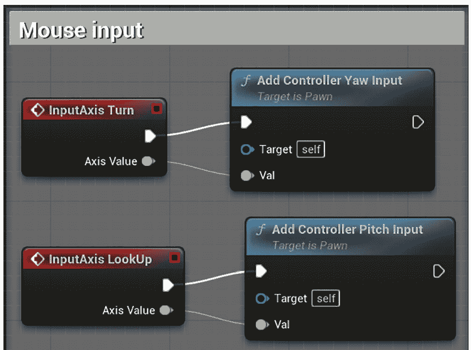

### 图 6.2 – 鼠标输入 事件

鼠标输入将鼠标移动（与控制器轴摇杆不同）的输入转换为数据，然后将这些值直接传递给相应的相机偏航和俯仰输入函数，而无需进行类似于模拟输入所需的计算。

现在，让我们来看看管理玩家移动的节点组，如该屏幕截图所示：

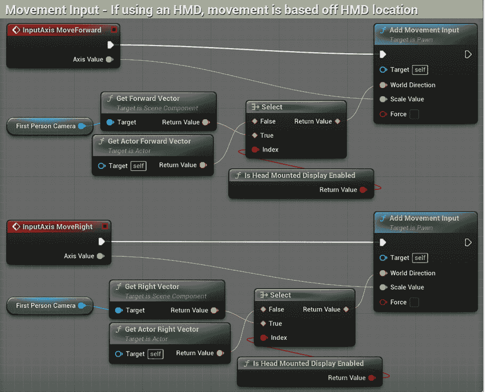

### 图 6.3 – 移动输入 事件

**选择** 节点用于测试玩家是否正在使用 **虚拟现实头戴式显示器（VR HMD）**。如果启用了 VR HMD，则使用的矢量来自 **第一人称相机**；否则，使用的矢量来自 Actor 根组件。

从功能上讲，其他节点的设置与 **摇杆输入** 和 **鼠标输入** 组类似。轴值来自控制器或键盘上的前进和右侧移动轴输入。同样，这些节点也表示向后和向左的移动，形式为 **轴值** 输出中的负值。移动转换中显著的区别在于，我们需要知道 Actor 将要移动的方向，以便将移动幅度应用到正确方向。方向从 **获取 Actor 矢量** 节点（前进和右侧）获取，并连接到 **添加移动输入** 节点的 **世界方向** 输入。

最后要查看的与移动相关的节点组是包含在标记为 **跳跃** 的注释块中的节点组。该组仅由一个触发节点组成，用于检测映射到跳跃的按键的按下和释放，并在按钮按下到释放期间应用 *跳跃* 函数。

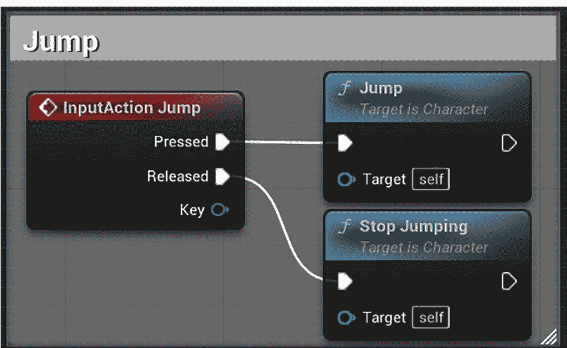

### 图 6.4 – 跳跃输入 事件

我们查看了控制角色移动的 *第一人称角色* 的 **动作**。现在我们将学习如何将按键映射到 **动作**。

### 自定义控制输入

我们已了解 **第一人称** 模板如何将某些玩家输入 **动作**（例如前进或跳跃）映射到 Blueprint 节点，以产生 **动作** 的行为。要创建新的行为类型，我们需要将新的物理控制输入映射到其他玩家 **动作**。为此，请执行以下步骤：

- 1. 要更改游戏的输入设置，请单击工具栏最右侧的 设置 按钮，并选择 项目设置 选项：

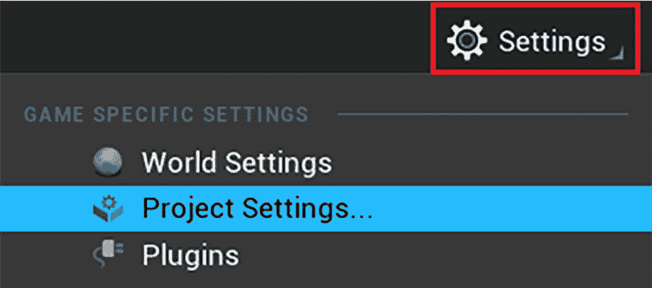

### 图 6.5 – 访问 项目设置

- 2. 在出现的窗口左侧，查找 Engine 类别并选择 Input 选项。

- 3. 在 Engine 类别中，在 Input Settings 菜单下，您会看到 Bindings 类别下的两个部分，称为 **动作映射** 和 轴映射。单击每个部分左侧的 > 符号以显示现有映射。

**动作映射** 是触发玩家 **动作** 的按键和鼠标单击 Event。轴映射 映射玩家移动以及具有范围的 Event，例如 W 键和 S 键都会影响 向前移动 **动作**，但处于范围的两端。我们的 冲刺 和 缩放 函数都是简单的 **动作**，要么处于活动状态，要么处于非活动状态，因此我们将它们添加为 **动作映射**：

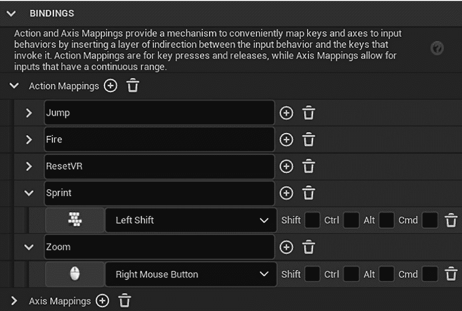

### 图 6.6 – 创建 动作映射

- 4. 在 **动作映射** 旁边单击两次 + 号以添加两个新的 **动作映射**。

- 5. 为第一个 **动作** 命名为 冲刺，并从下拉菜单中选择 Left Shift 键，将该键映射到您的 冲刺 Event。为第二个 **动作** 命名为 缩放，并将其映射到右鼠标按钮。

关闭窗口时，更改将被保存。

### 添加冲刺能力

现在我们已基本了解移动输入节点如何获取控制器输入并将其应用于游戏内角色，我们将通过添加冲刺能力来扩展该功能。我们将在 FirstPersonCharacter Blueprint 中设置一组新的节点。它们将如下所示：

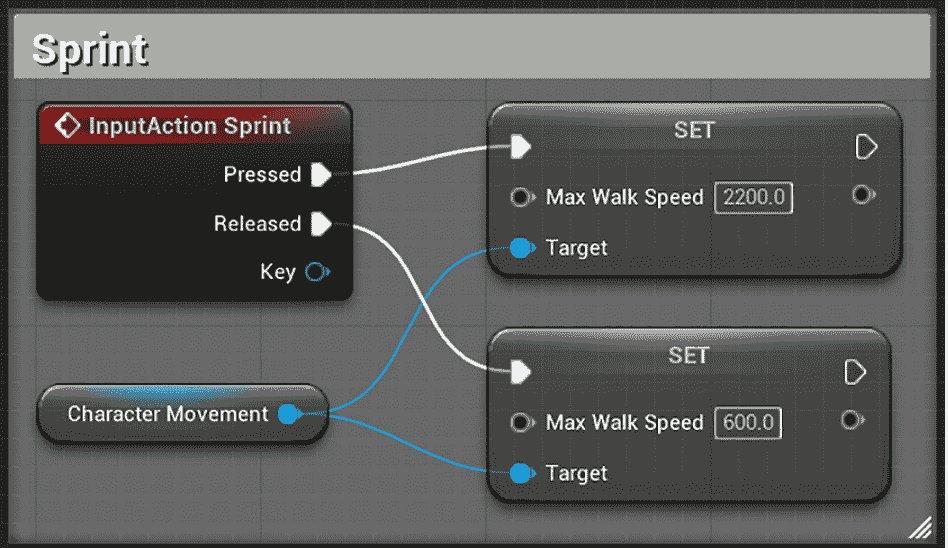

图 6.7 – 实现冲刺能力

首先，我们需要添加用于激活我们 **Sprint** 动作的 事件。回顾一下，我们之前已将 **Sprint** 动作映射到 *Left Shift* 键。要添加 事件，请执行以下步骤：

- 1. 右键单击其他移动函数左侧的空白网格区域，搜索 `sprint`。选择 **Sprint** 事件以放置节点。

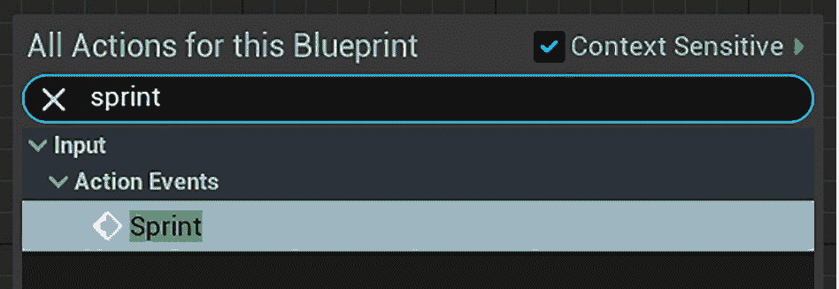

图 6.8 – 添加输入动作 Sprint 事件

- 2. 查看 Blueprint 编辑器的 **组件** 面板，并选择 **Character Movement (CharMoveComp) (Inherited)**。**详细信息** 面板将更改为显示与移动相关的一长串变量，如下一张屏幕截图所示：

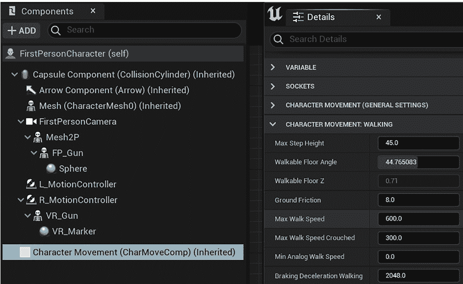

图 6.9 – 角色移动变量

在此变量列表中，您可以在 **行走** 类别中找到 **最大步行速度**。这是决定玩家可移动最大速度的值，应是我们 **冲刺** 函数的目标。但是，将 **详细信息** 面板中的值从默认的 600 更改，将无论是否按下 **Left Shift** 键都始终修改玩家的移动速度。相反，我们希望将此值从 **角色移动** 组件中提取出来，放入我们蓝图的 **事件图** 中。

- 3. 为此，单击 **组件** 面板中的 **角色移动** 组件，并将其拖放到 **事件图** 上，靠近我们的 **输入动作 Sprint** 事件。这将生成一个 **角色移动** 节点，如本屏幕截图所示：

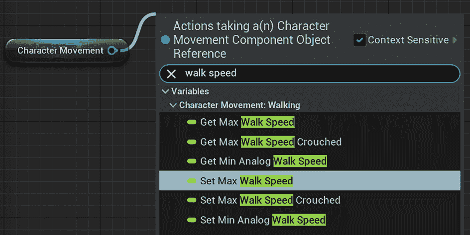

图 6.10 – 角色移动节点

- 4. 从 **角色移动** 节点的输出引脚单击并拖动到空白网格区域，然后输入 `walk speed`。选择 **设置最大步行速度** 选项。它将 **角色移动** 节点连接到新节点，以设置最大步行速度值。

- 5. 将 **输入动作 Sprint** 触发器的 **按下** 输出执行引脚连接到 **设置最大步行速度** 节点的输入执行引脚，以便您可以按下 **Left Shift** 键来修改最大移动速度。

- 6. 最后，将节点中的 **最大步行速度** 值从 `0.0` 更改为 `2200`，相对于默认值 `600` 提供良好的速度提升。

我们还需要确保在释放 *Shift* 键后玩家再次减速。

- 7. 为此，再次从 **角色移动** 节点拖动输出引脚，然后搜索并选择另一个 **设置最大步行速度** 节点将其放置在 **事件图** 上。这次，将 **输入动作 Sprint** 节点的 **释放** 输出执行引脚连接到新节点的输入执行引脚。然后，将 **最大步行速度** 值从 `0.0` 更改为默认值 `600`。为了保持良好的注释实践，单击并绘制选择框围绕所有四个节点，右键单击其中一个选中的节点，然后选择 **从选择创建注释**，然后将节点组标记为 `Sprint`。

- 8. 现在编译、保存并按 **开始游戏** 来测试你的工作。如果你按下 *Left Shift* 键，应该会注意到速度明显提升。

我们学习了如何将按键映射到动作并修改角色的最大速度以模拟冲刺能力。我们的下一步是给玩家添加一种能力，使其能够获得目标的更近视图。

### 制作缩放视图动画

现代第一人称射击游戏的核心元素之一是可变 **视角 (FOV)**，它允许玩家透过枪口瞄准镜以获得目标的更近视图。这对现代射击游戏提供的准确性和控制感起着重大贡献。让我们在原型中添加这种简单的功能。为此，请执行以下步骤：

- 1. 在网格旁边靠近 **鼠标输入** 节点的空白区域，右键单击，搜索 `zoom`，然后添加 **缩放** 事件节点。

- 2. 我们想要修改包含在 **第一人称相机组件** 中的 FOV 值，因此请转到 **组件** 面板，并将 **第一人称相机** 拖放到 **事件图** 上。

- 3. 将 **第一人称相机** 节点的输出引脚拖动到空白网格区域，搜索 **设置视角** 节点并放置。降低 FOV 会产生将屏幕中心区域缩小到更窄范围的效果。由于 `Default` FOV 值设置为 `90`，对于我们的缩放，让我们在设置节点中将 FOV 设置为 `45`，如下所示：

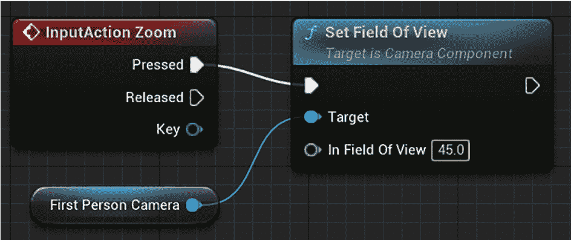

图 6.11 – 更改视角

- 4. 单击并拖动 **输入动作 缩放** 节点的输出执行引脚到 **设置视角** 节点的输入执行引脚。

编译、保存，然后单击 **开始游戏**。

当您玩游戏并按下鼠标右键时，您会注意到 FOV 会立即变为窄、放大的视图。主相机从一个位置瞬间切换到另一个位置的任何情况对玩家来说都可能令人不安，因此我们需要进一步修改此行为。此外，FOV 在按键释放后不会恢复。我们将使用时间轴解决这两个问题。

### 使用时间轴平滑过渡

要平滑地更改 FOV，我们需要创建显示随时间逐渐变化的 Actor 的动画。为此，请返回 `FirstPersonCharacter` 蓝图的 **事件图** 实例，并执行以下步骤：

- 1. 按下 **Alt** 并单击 **输入动作 缩放** 节点的 **按下** 输出执行引脚以断开连接。

- 2. 从 **按下** 向空白网格区域拖动一根新线。搜索并选择 **添加时间轴** 以添加时间轴节点：

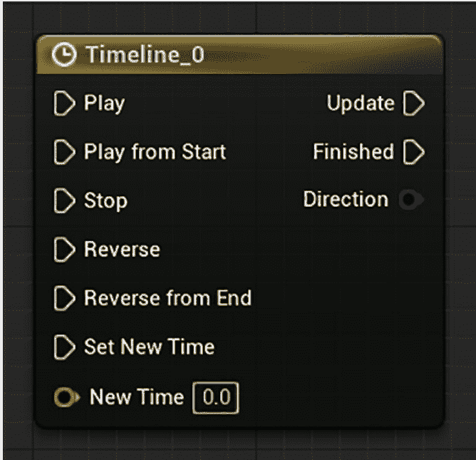

图 6.12 – 时间轴节点

### 重要说明

在虚幻引擎 5 中，制作动画有多种不同的方法。时间轴非常适合简单的值更改，例如门的旋转。对于更复杂的、基于角色的或电影动画，您可能需要查看 **Sequencer**，这是引擎的内置动画系统。**Sequencer** 和复杂动画超出了本书的范围，但有许多专门的学习资源可用于使用 **Sequencer**。我建议从虚幻文档开始，该文档可在 [虚幻引擎 Sequencer 文档](https://docs.unrealengine.com/en-us/Engine/Sequencer)。

- 3. 时间轴将允许我们更改一个值（例如相机上的 FOV）在指定的时间段内。要更改时间轴内的值，请双击 **Timeline_0** 节点。

这将打开 **时间轴编辑器**。您将在 **编辑器** 左上角看到四个按钮。每个按钮都会添加一种不同的可随时间更改的值。由于 FOV 由数值表示，我们将单击带有 f 标签的按钮（添加浮点轨道）。这样会将轨道添加到时间轴，并提示您为此轨道命名。

- 4. 让我们将其标记为 视角。我们现在必须编辑不同时间间隔上的值，如下所示：

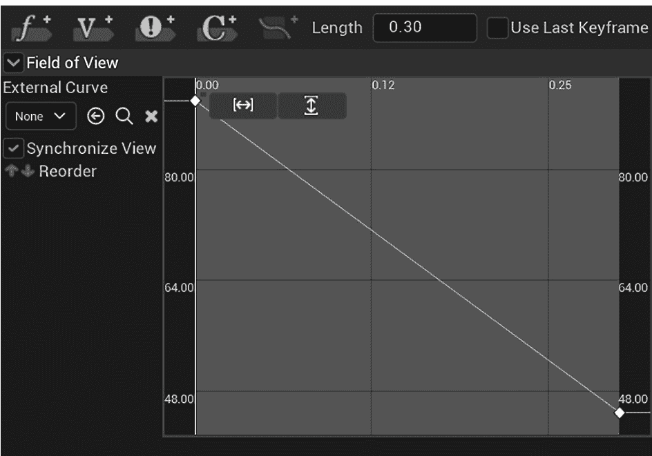

图 6.13 – 时间轴编辑器

- 5. 为此，按住 Shift 并单击图表上接近 0.0 点的位置。您将看到如图 6.14 所示，时间和值 字段出现在图表左上角。

这些功能允许对时间轴进行精确调整。确保时间设置为确切的 0.0，并将值设置为 90，即我们的默认 FOV。如果点从视图中消失，您可以使用图表左上角的两个小按钮来放大图表，以便点变得可见。这些按钮位于图 6.14 的红色矩形内。

- 6. 我们希望缩放动画很快，因此在时间轴编辑器顶部，找到 长度 旁边的字段并将值更改为 0.3，以将动画范围限制为 0.3 秒。

- 7. 现在，按住 Shift 并单击图表右侧浅灰色区域的末端。将时间字段调整为 0.3，值字段调整为 45：

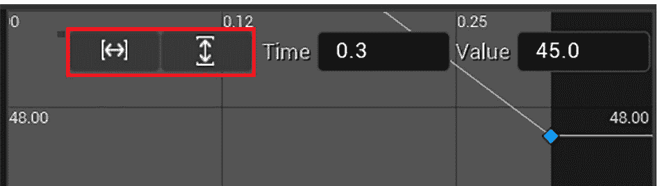

图 6.14 – 第二个点的时间和值

注意表示值的线如何从 90 度逐渐下降到 45 度。这意味着调用此动画时，玩家的 FOV 将从缩出平滑过渡到缩进，而不是在这两个值之间生硬切换。这是使用时间轴而非直接用设置值蓝图更改值的优势。

- 8. 现在，返回 事件图。我们希望将我们的时间轴连接到设置 FOV 操作，就像本屏幕截图所示：

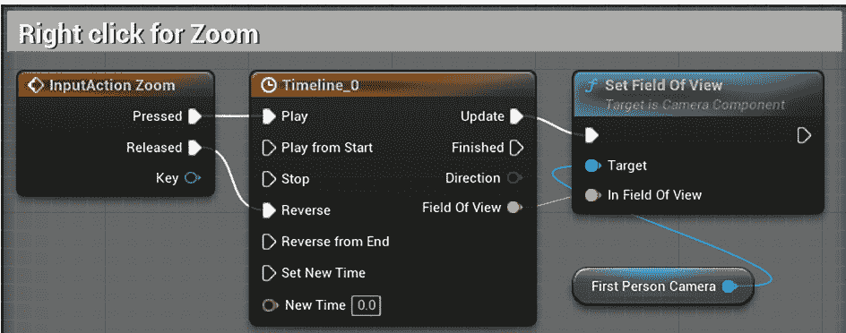

图 6.15 – 使用时间轴修改 FOV

- 9. 你会注意到 Timeline_0 节点现在有一个名为 Field Of View 的新输出引脚。将此引脚连接到 Set Field of View 节点的 In Field Of View 输入引脚。现在，将 Timeline_0 节点的 Update 输出执行引脚连接到 Set Field of View 节点。

这会设置好相关功能，使得每当 FOV 值更新时，就会将新值传递给 Set Field Of View 功能。由于我们的时间轴设置，90 到 45 之间的许多值都会传递给 set，从而在 0.3 秒内在两个极端之间实现平滑过渡。

- 10. 最后，我们希望在释放右键时结束缩放。为此，请将 InputAction Zoom 节点的 Released 引脚拖动到 Timeline 节点的 Reverse 引脚。

这将导致在释放右键时时间轴动画以反向顺序播放，从而确保平滑地过回正常的相机视图。另外，请记得为节点组添加注释，以便日后重访时记得此功能的作用。

- 11. 现在，编译、保存，然后单击 **开始游戏**，通过按住右键来测试缩放视图的进入和退出过渡。

这些步骤完成了我们用于制作缩放视图动画的实现。现在，让我们对 FirstPersonProjectile 蓝图进行一些调整。

### 提高射弹速度

既然我们已为玩家角色提供了一个在世界中导航的新游戏选项，我们的注意力将重新回到射击机制上。目前，控制器上的枪发射的子弹是缓慢在空中划过弧线的球体。我们希望更好地模拟我们从传统射击游戏中习惯看到的快速移动的子弹。

要更改 Projectile 的属性，我们需要打开名为 FirstPersonProjectile 的蓝图，它位于 Content/FirstPersonBP/Blueprints 文件夹中。打开后，查看 组件 面板并单击 Projectile。这是 FirstPersonProjectile 蓝图中添加的一种弹道移动组件，用于定义球体在世界中创建后的运动方式：

- 1. 在 详情 面板中，你会看到 Projectile 拥有大量描述其运动的变量。目前我们只关注其中少数几个：

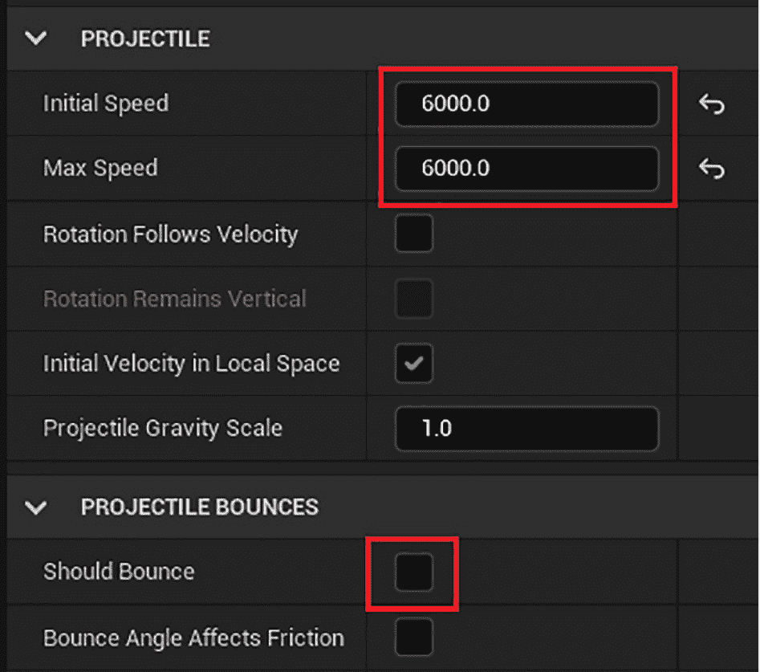

图 6.16 – 弹道体变量

首先，找到 **初始速度** 和 **最大速度** 字段，当前两者均设置为 3000。**初始速度** 决定弹道体在枪口首次创建时移动的速度，**最大速度** 决定在施加额外力后它能达到的最大速度。如果我们有一枚火箭，可能希望在其发射后施加加速度以表示助推器启动。但由于我们要表现的是从枪口发出的子弹，因此将其初始速度设定为子弹将达到的最快速度更合理。将 **初始速度** 和 **最大速度** 都调整为原始值的两倍：6000。

让我们将 **弹道体重力比例** 从 `1.0` 更改为 `0.1`。这样一来，子弹看起来非常轻，因此几乎不受重力影响。

此外，你可能已经注意到，当前的弹道体撞击墙壁和物体后会像皮球一样反弹。不过，我们希望模拟一种更坚硬、撞击力度更强的弹道体。要去除反弹效果，请在 **详情** 面板中查找 **弹道体反弹** 部分，并取消勾选 **是否反弹** 旁边的复选框。其他数值仅决定在 **是否反弹** 被勾选时弹道体反弹的方式，因此无需调整它们。

在 **事件图** 中要做的最后一项更改是，将 **分支** 节点的 **False** 引脚连接到 **销毁角色** 函数，这样弹道体在与任何东西碰撞时都会始终被 `Destroyed`：

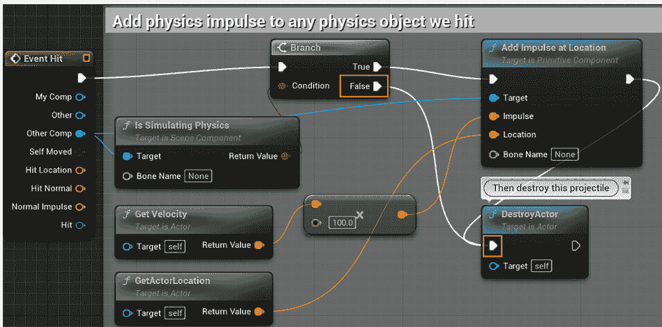

图 6.17 – 弹道体事件图

现在，编译、保存，然后单击 **开始游戏**。你会发现开枪后射出的弹道体射程更远，且不再会弹离墙壁。

我们修改了弹道体的速度并取消了反弹属性，使弹道体表现得像子弹一样。接下来我们要修改的蓝图是 `BP_CylinderTarget`，以在其被销毁时模拟爆炸效果。

### 添加音效与粒子效果

既然玩家的移动和射击已经按我们的意愿运行，现在让我们把注意力转向敌人目标。目前，射击某个目标圆柱体只会使其颜色变为红色。然而，玩家目前无法直接摧毁目标。

我们可以通过创建蓝图逻辑来增加敌人交互的动态效果：当目标被射击超过一次时将其销毁，并在目标被销毁时产生令人满意的声音和视觉效果，从而增加玩家的奖励。

### 使用分支更改目标状态

由于我们希望根据应用于目标圆柱体的状态变化来生成触发的效果，因此必须确保此逻辑包含在我们的 BP_CylinderTarget 蓝图中，该蓝图位于 Content/FirstPersonBP/Blueprints 文件夹。打开蓝图并查看连接到 Event Hit 的节点组。目前，当我们的弹道体击中圆柱体对象时，这些节点会指示其切换到红色材质。为了在圆柱体被多次射击时改变其行为，我们需要在蓝图中添加一个检查，以查看圆柱体是否已经被击中，然后根据其状态触发不同的结果。

我们将使用分支节点来帮助处理此场景：

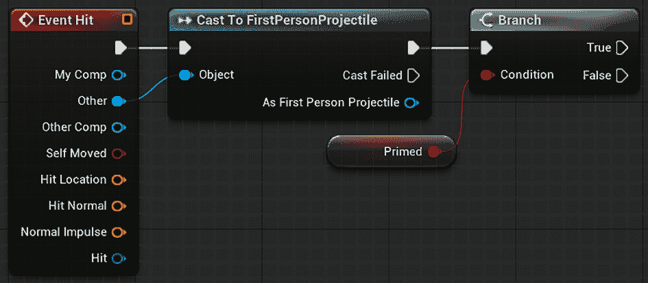

图 6.18 – 使用分支节点检查圆柱体是否已被击中

分支节点接受一个布尔变量作为输入。由于布尔值只能为 True 或 False，分支节点只能产生两种结果。通过将其他节点链接到两个输出执行引脚，可以执行这两种结果，分别代表 True 路径和 False 路径。

创建分支的第一步是确定你的布尔值将代表什么，以及什么会导致条件值从 False 变为 True。在本例中，我们想要创建一个 预备 变量，以显示目标已经被击中，并且可以通过第二次射击将其摧毁。让我们继续创建一个 预备 布尔变量：

- 1. 在 My Blueprint 面板中，单击 Variables 类别旁的 + 按钮以添加新变量。将 Variable Type 设置为 Boolean，并为新变量命名为 预备。

- 2. 编译并保存蓝图。由于我们不希望目标在首次被击中之前处于 预备 状态，因此我们将变量的默认值保留为 False（由未勾选的复选框表示）。

- 3. 现在你已经有了一个 预备 布尔变量，请将其从 My Blueprint 面板拖动到 Event Graph，并在将变量放置到 Event Graph 上时，从出现的子菜单中选择 Get 选项。

- 4. 单击并拖动一根从新建 **预备** 节点输出引脚到 **事件图** 空白网格区域的线。搜索并添加 **分支** 节点。

- 5. 最后，我们可以将 **分支** 添加到我们的 **击中事件** 蓝图组中。按住 _Alt_ 键并单击其中一个执行引脚，以断开 **转换为第一人称弹道体** 和 **设置材质** 节点之间的连接。

- 6. 暂时将 **设置材质** 节点移开，然后将 **转换为** 节点的输出执行引脚连接到 **分支** 节点的输入执行引脚。现在，每当目标圆柱体被弹道体击中时，此蓝图都会调用 **分支** 计算。

既然我们已经设置好 **分支** 节点，就需要向目标圆柱体提供每种状态下应执行的操作指令。也就是说，首次被击中时（**预备** 变量为 **False**）应发生什么，以及第二次被击中时（**预备** 变量为 **True**）应发生什么。

让我们先处理目标首次被击中的情况。在这种情况下，我们必须将 **材质** 更改为 **目标红色**。此外，我们还必须将 **预备** 布尔变量设置为 **True**。这样一来，当目标再次被击中时，**分支** 节点就会将行为路由到 **True** 执行引脚。**False** 执行序列中的节点将如下所示：

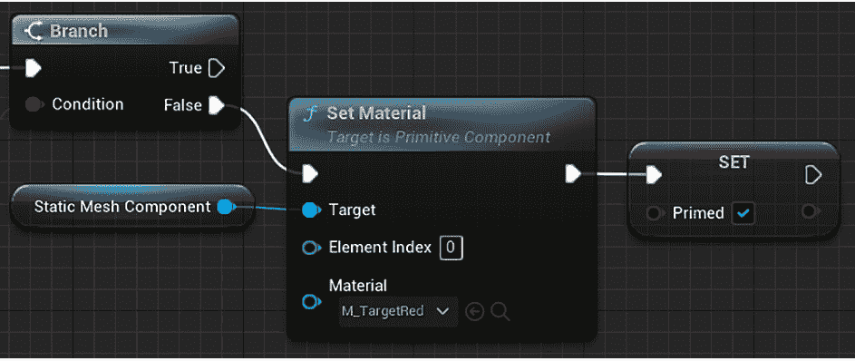

### 图 6.19 – 首次命中时切换为红色材质

- 7. 将先前移开的 **设置材质** 节点拖到 **分支** 节点的右侧，然后将 **分支** 节点的 **False** 输出执行引脚连接到 **设置材质** 节点的输入执行引脚。

- 8. 现在，将 **我的蓝图** 面板中的 **预备** 变量拖到 **事件图表**，并选择 SET 选项。将此节点连接到 **设置材质** 节点的输出执行引脚，并单击 SET 节点中 **预备** 旁边的复选框。这样可确保下次 **目标** 被命中时，**分支** 求值为 **True**。

我们定义了 **分支** 节点 **False** 路径的操作。下一步是定义将从 **分支** 节点的 **True** 路径触发的操作序列。

### 触发音效、爆炸和销毁

销毁目标时我们希望完成三件事：听到爆炸声、看到爆炸，以及从游戏世界中移除目标对象。我们将从令人满意的游戏体验中常被低估但始终至关重要的元素——声音——开始。

我们可以用声音设计的最基本交互是在游戏世界中的某个位置一次性播放一个 .wav 声音文件，这完全符合我们的目的。将一根线从 **分支** 节点的 **True** 执行节点拖到空白网格区域，并搜索 **在位置处播放声音** 节点：

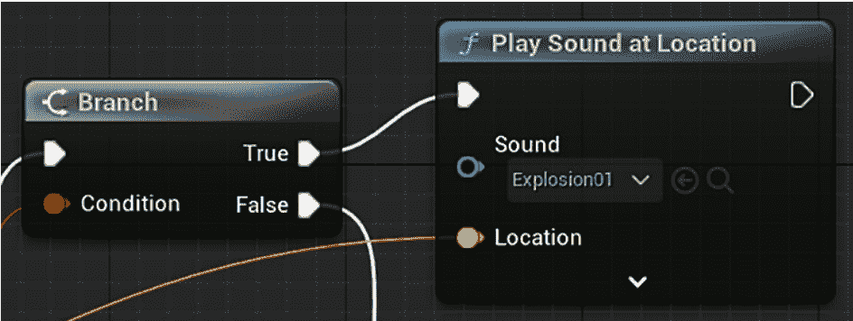

### 图 6.20 – 播放爆炸声音

**在位置处播放声音** 是一个简单节点，它接受 **声音** 文件输入和 **位置** 输入，然后——如你所料——在该位置播放声音。我们引入该项目的 **入门内容** 中包含多个声音文件，可以通过单击 **声音** 输入下方的下拉菜单查看这些文件列表。查找并选择 **Explosion01** 以设置爆炸 **声音** 效果。

现在我们已设置 **声音**，需要确定声音在哪里播放。我们可以使用类似设置 FOV 的过程：获取圆柱体目标的静态网格组件，提取其位置值，然后将该位置向量直接链接到我们的 **声音** 节点。但是，**事件命中** 触发器会使此过程更加容易。

**事件命中** 节点的许多输出引脚中有一个名为 **命中位置**。该引脚包含由 **事件命中** 评估的两个对象在空间中相互碰撞的位置。我们的弹丸击中目标的位置是生成爆炸效果的一个完全合理的位置，因此请从 **事件命中** 节点的 **命中位置** 拖一根线到 **在位置处播放声音** 上的 **位置** 输入引脚。

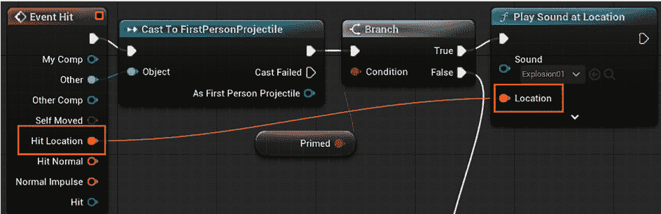

### 图 6.21 – 使用命中位置

编译、保存并运行以测试蓝图。射中一个移动目标一次会使其变红。此后的每次命中都应产生爆炸音效。

现在我们已设置爆炸音效，让我们按照以下步骤添加视觉效果并销毁圆柱体：

- 1. 从 **在位置处播放声音** 的输出执行节点拖一根线到空白网格区域。搜索并选择 **在位置处生成发射器** 节点。

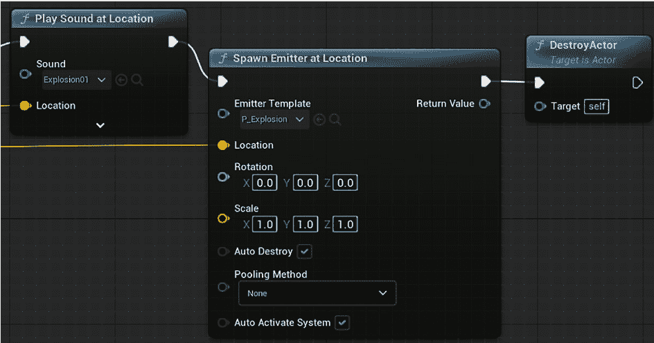

### 图 6.22 – 生成粒子效果

### 重要说明

发射器是一个在特定位置产生粒子效果的对象。粒子效果是一组小对象的集合，它们结合起来创建流体、气体或其他无形物体（如瀑布冲击、爆炸或光束）的视觉效果。

**在位置处生成发射器** 节点看起来与我们正在附加的 **声音** 节点类似，但具有更多输入参数和 **自动销毁** 切换开关。

- 2. 在 **发射器模板** 下方的下拉菜单中，查找并选择 **P_Explosion** 效果。这是随我们拉入项目的 **入门内容** 一起提供的另一项资产，无论其发射器附加在哪里，都会产生令人满意的爆炸效果。

- 3. 由于我们希望爆炸在爆炸声音的同一位置生成，我们将单击并拖动 **事件命中** 节点的相同 **命中位置** 引脚到 **在位置处生成发射器** 的 **位置** 引脚上。

爆炸是一种 3D 效果，从所有角度看都一样，因此我们可以保持 **旋转** 输入不变。**自动销毁** 切换开关决定发射器是否可以触发多次。一旦创建此粒子效果，我们将销毁包含此发射器的 Actor，因此可以保持复选框已选中。

- 4. 最后，在播放声音和视觉爆炸效果后，我们希望从游戏世界中移除目标圆柱体。将 **在位置处生成发射器** 节点的输出执行引脚拖到空白网格区域。搜索并添加 **DestroyActor** 节点。此节点只接受单个 **Target** 输入，默认值为 **self**，即对当前实例的引用。

- 5. 扩展围绕整个 **事件命中** 节点序列的注释框，并更新文本以描述新序列的功能。我选择了 `When hit, turn red and set to primed.` 如果已预备，则销毁自身。此节点链的结果应如下截图所示：

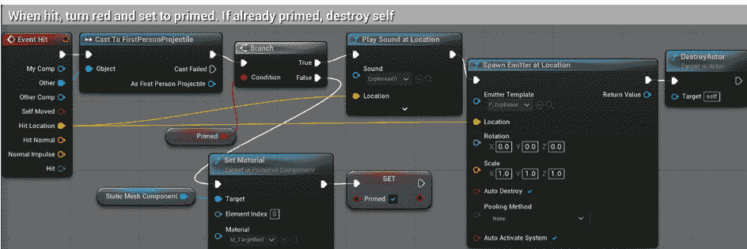

### 图 6.23 – 事件命中操作

在蓝图节点周围留下有用注释后，编译、保存并点击 Play 以测试新交互。当玩家的枪射击圆柱体两次时，你应该能看到并听到它们爆炸。

我们了解了如何根据代表圆柱体当前状态的 **预备** 变量使用 **分支** 节点来决定执行流程。我们还学习了如何使用蓝图节点播放声音和生成粒子效果。

### 总结

我们现在已经开始着手让游戏对玩家来说更具满足感。我们添加了音效和视觉效果、具有现代射击游戏大部分预期功能的玩家角色，以及会对玩家交互做出反应的目标。前几章所涵盖的技能已结合起来，开始创建越来越复杂和有趣的行为。

在本章中，我们创建了一些自定义玩家控件，以允许冲刺和使用枪支瞄准。在此过程中，我们探索了移动控制器如何将玩家输入的信息转化为游戏体验。我们还利用时间轴为创建简单动画打开了大门。随后，通过向敌方目标附加爆炸效果和声音，并增加它们必须被两个弹丸击中的要求，为玩家与环境的交互添加了更多反馈。

在下一章中，我们将探索向游戏添加 UI，以向玩家提供其相对于世界状态的反馈。

### 测验

- 1. 动作和轴映射由 **事件图表** 中的红色 **事件** 节点表示。
- a. 正确
- b. 错误

- 2. 设置视野是 **角色移动组件** 的一个函数。
- a. 正确
- b. 错误

- 3. 时间轴节点可用于创建简单动画。
- a. 正确
- b. 错误

- 4. 可以使用 **在位置处生成发射器** 函数在运行时添加粒子效果。
- a. 正确
- b. 错误

- 5. 名为 Play Sound 的函数在给定位置播放声音。
- a. 正确
- b. 错误
