## 第 7 章：创建屏幕 UI 元素

任何游戏体验的核心在于游戏设计师用来向玩家传达游戏目标和规则的方法。这种方法在各种形式的游戏中都很常见，即使用 **图形用户界面 (GUI)** 向玩家显示和广播重要信息。在本章中，我们将设置一个 GUI 来跟踪玩家的生命值和耐力，并设置计数器来显示消除的目标数量和玩家的弹药量。你将学习如何使用 Unreal 的 GUI 编辑器设置基本 **用户界面 (UI)**，并使用蓝图将该界面与游戏值绑定。我们将使用 **虚幻运动图形 (UMG) UI 设计器** 创建 UI 元素。

在此过程中，我们将涵盖以下主题：

- 使用 UMG 创建简单的 UI 计量表
- 将 UI 值连接到玩家变量
- 跟踪弹药和消除的目标

本章结束时，你将知道如何使用 UMG 编辑器创建显示生命值和耐力状态的进度条，并知道如何显示消除的目标数量和玩家的弹药量。

### 使用 UMG 创建简单 UI 计量表

在本节中，我们将学习如何使用 UMG 编辑器创建游戏中将使用的 UI 元素，以及如何将它们定位在

屏幕。

UMG Editor 是一个可视化 UI 制作工具。我们可以使用 UMG Editor 创建菜单和 **抬头显示器 (HUD)**。HUD 是一种透明显示器，可在不要求用户移开主视图的情况下提供信息。它最初是为军事航空开发的。HUD 这个缩写在游戏中很常见，因为信息显示在游戏屏幕上。我们希望在 HUD 上显示表，显示玩家当前拥有的健康值和耐力值。这些出现在 HUD 上的表被称为 **UI 表**。

健康值和耐力值 UI 表将如下所示：

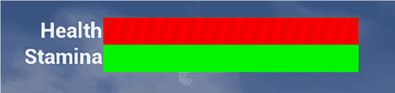

图 7.1 – 健康和耐力 UI 表

消灭的目标数量和玩家的弹药将使用文本显示：

图 7.2 – 消灭的目标和弹药计数器

要创建一个用于显示健康值和耐力值 UI 表的 HUD，我们首先需要在玩家角色中创建可以跟踪这些值的变量。我们还将创建用于计算消灭的目标数量和玩家弹药的变量。

按照以下步骤创建变量：

- 1. 在 Content Browser 中，访问 `/Content/FirstPersonBP/Blueprints` 文件夹并双击 `FirstPersonCharacter` Blueprint。
- 2. 在 Blueprint Editor 中找到 **我的 Blueprint** 面板的 **变量** 类别。单击 + 号添加变量，将其命名为 `PlayerHealth`，并将 **变量类型** 更改为 **浮点数**。
- 3. 再次执行相同步骤，创建第二个 **浮点数** 变量，命名为 `PlayerStamina`。
- 4. 接下来，创建第三个变量，但这次，将 **变量类型** 选择为 **整数**，并将其命名为 `PlayerCurrentAmmo`。
- 5. 最后，创建第二个 **整数** 变量并将其命名为 `TargetsEliminated`。变量列表应如下所示：

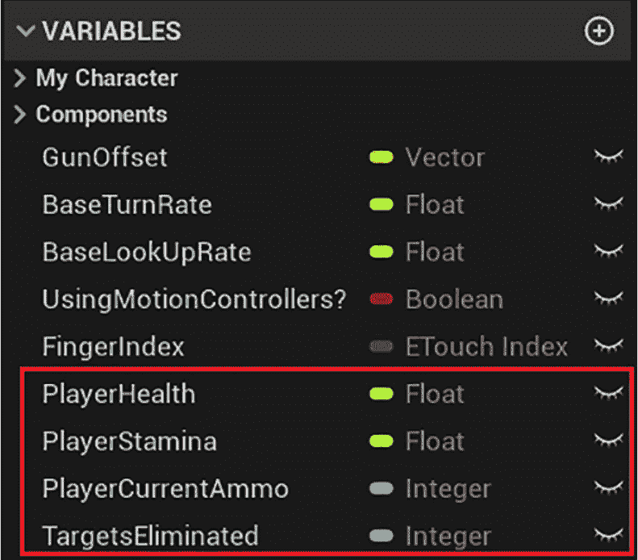

图 7.3 – FirstPersonCharacter 变量

6. 编译 `FirstPersonCharacter` Blueprint。选择 **PlayerCurrentAmmo** 变量，并在 **详细信息** 面板中，将 DEFAULT VALUE 设置为 30：

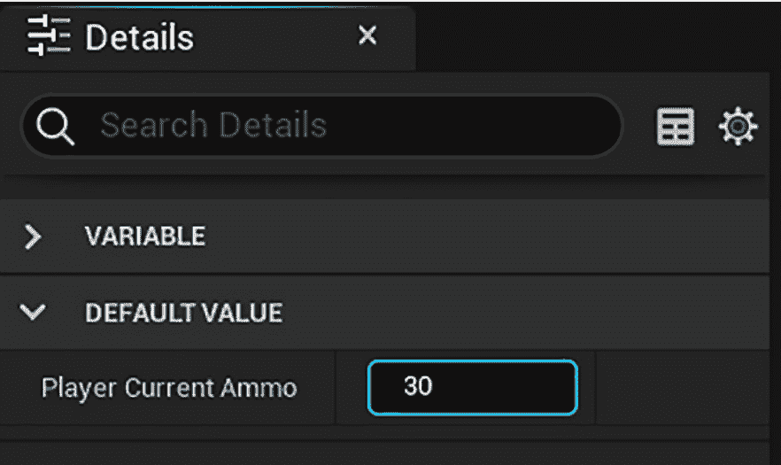

图 7.4 – 设置变量的默认值

7. 将 **PlayerHealth** 和 **PlayerStamina** 的 DEFAULT VALUE 设置为 `1.0`。此值用于 UI 表，用于显示介于 `0.0` 和 `1.0` 之间的填充程度。编译时 **TargetsEliminated** 的 DEFAULT VALUE 自动设置为 `0.0`，这是适当的值，因此无需调整。

8. 编译、保存并关闭 Blueprint Editor。

现在，我们将学习如何绘制代表 UI 表的形状。

### 使用 Widget Blueprint 绘制形状

UMG Editor 使用一种称为 **小部件蓝图** 的特殊 Blueprint 类型。由于 **第一人称** 模板默认没有 UI 元素，我们应该创建一个新文件夹来存储我们的 GUI 工作。按照以下步骤创建文件夹和 Widget Blueprint：

- 1. 在 Content Browser 中，访问 `/Content/FirstPersonBP/` 文件夹。在文件夹列表旁边的空白处右键单击，选择 新建文件夹 选项。将文件夹命名为 `UI`：

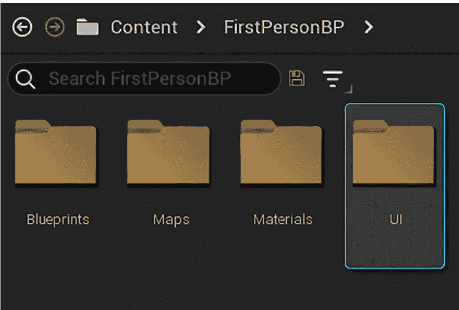

图 7.5 – 创建 UI 文件夹

- 2. 打开刚创建的 UI 文件夹，然后在空白文件夹空间中右键单击。转到 用户界面 | Widget Blueprint，并将生成的 Blueprint 命名为 `HUD`：

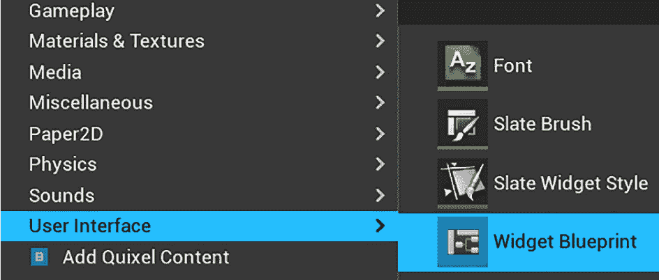

图 7.6 – 创建 Widget Blueprint

- 3. 双击此 Blueprint 以打开 UMG Editor。我们将使用此工具来定义 UI 在屏幕上的显示方式。
- 4. 在 UMG Editor 中，找到名为 **调色板** 的面板。在其中，打开名为 **面板** 的类别。您将看到一系列可用于组织 UI 信息的容器：

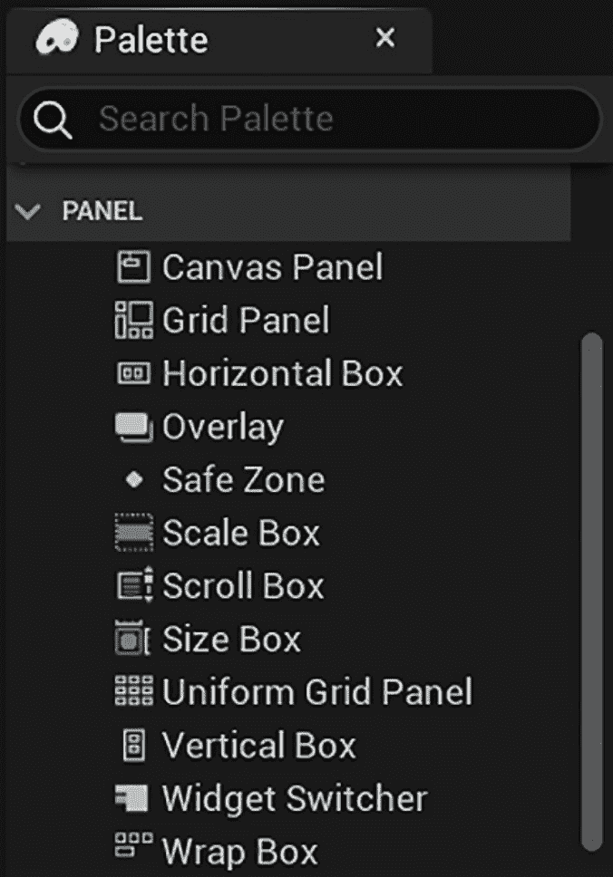

图 7.7 – UMG Editor 面板小部件

- 5. 将 **水平盒** 从 **调色板** 面板拖放到 **层级结构** 面板，释放在 **画布面板** 对象之上。单击 **画布面板** 下的 **水平盒** 将其选中。在编辑器右侧的 **详细信息** 面板中，将 **水平盒** 的名称更改为 `Player Stats`：

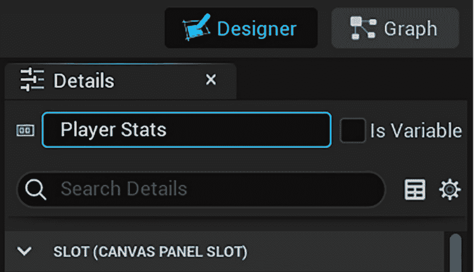

图 7.8 – 更改水平盒的名称

- 6. 您现在应该在 **层级结构** 面板中看到嵌套在 **画布面板** 对象下方的 **Player Stats** 水平盒。我们的目标是使用垂直盒、文本和进度条的组合创建两个带标签的 **Player Stats** 条。设置将如下所示：

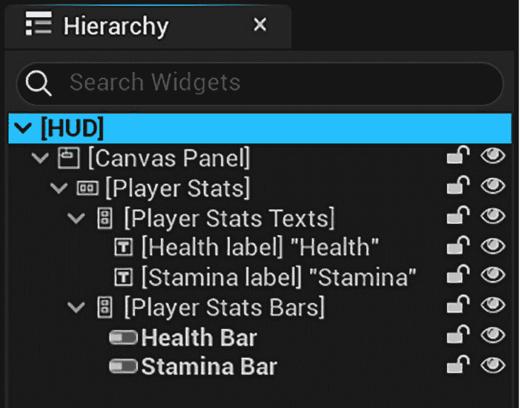

图 7.9 – Player Stats 层级结构

- 7. 两个垂直盒将包含健康值和耐力值的文本和进度条。再次查看 **调色板** 面板中的 **面板** 类别，然后将 **垂直盒** 对象拖放到 **层级结构** 中的 **Player Stats** 水平盒上，并将其名称更改为 `Player Stats Texts`。再执行一次，使两个垂直盒对齐在 **Player Stats** 下方。将第二个 **垂直盒** 对象的名称更改为 `Player Stats Bars`。
- 8. 现在，在 **调色板** 面板的 **常用** 类别下查找创建 UI 所需的文本框和进度条。将两个 **文本** 对象拖放到 **Player Stats Texts**，将两个 **进度条** 对象拖放到 **Player Stats Bars**，如 *图 7.9* 所示。我们已拥有将在 HUD 中显示 **Player Stats** 的 UI 元素。下一步是调整它们在屏幕上的外观和位置。

### 自定义表的外观

现在，我们需要调整 UI 元素并在屏幕上组织它们。**图形** 视图中的大型矩形轮廓表示玩家将看到的屏幕边界，称为 **画布**。这是位于 **层级结构** 最顶层的 **画布面板** 对象。定位在画布左上角的元素将显示在游戏内屏幕的左上角：

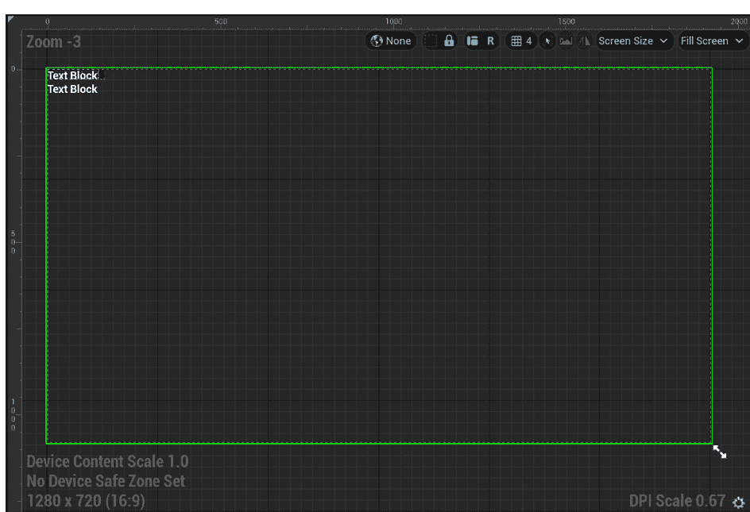

图 7.10 – 画布面板

这些是设置健康值和耐力值 UI 元素的下一步：

- 1. 从 **层级结构** 选择 **Player Stats**，并查看中央图形面板。您将看到一些大小控件，允许使用鼠标操纵所选对象的大小。我们将在 **详细信息** 面板中设置 **Player Stats** 水平盒的位置和大小。将位置 X 设置为 50.0，位置 Y 设置为 30.0，大小 X 设置为 500.0，大小 Y 设置为 80.0：

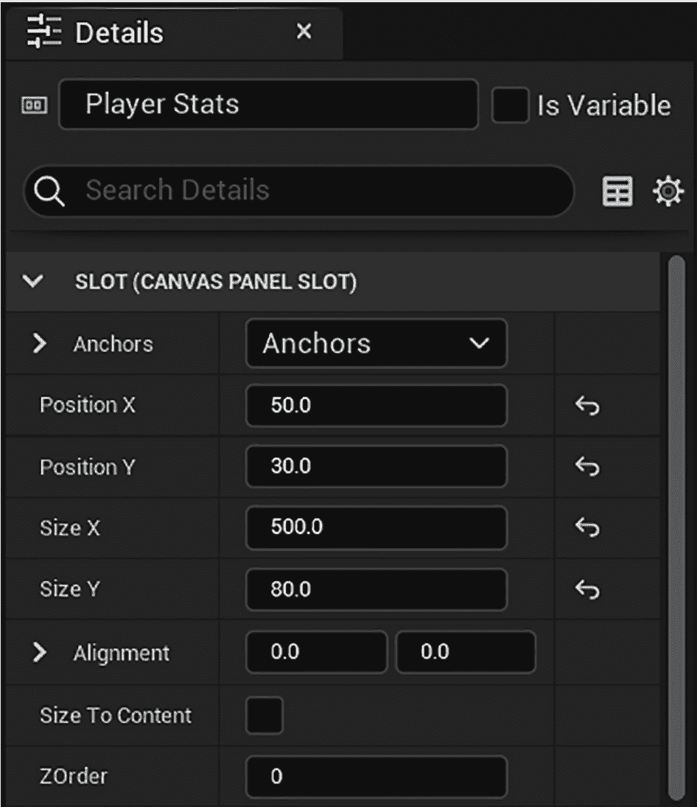

图 7.11 – Player Stats 的大小和位置

- 2. 在 **层级结构** 面板中，选择 **Player Stats Bars** 下方的第一个进度条。在 **详细信息** 面板中，将名称更改为 `Health Bar`。然后，在 **插槽** 类别下的 **大小** 切换中，单击 **填充** 按钮以调整条的垂直高度：

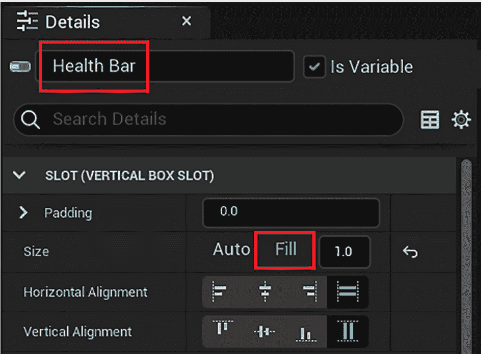

图 7.12 – 将健康条大小设置为 Fill

- 3. 在 **外观** 类别下查找 **填充颜色** 和 **不透明度**，单击彩色矩形以打开 **颜色选择器**，然后选择任何红色：

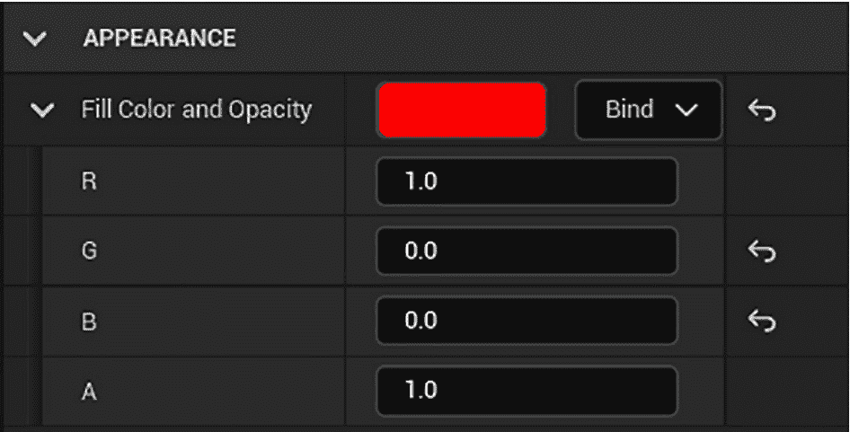

图 7.13 – 设置健康条的颜色

- 4. 现在，让我们为玩家的耐力重复相同的步骤。在 *层级结构* 面板中，单击第二个进度条。在 *详细信息* 面板中，将名称更改为 `Stamina Bar` 并单击 **填充** 按钮。在 **填充颜色和不透明度** 中，选择任何绿色。
- 5. 在 *层级结构* 面板中，单击 **Player Stats Bars** 垂直盒，并在 *详细信息* 面板中单击 **填充** 按钮以缩放两个条的水平大小。
- 6. 我们的表现在看起来如我们所愿，因此现在让我们调整文本标签。在 *层级结构* 面板中，单击 **Player Stats Text** 下方的第一个文本对象。在 **详细信息** 面板中，将名称更改为 `Health label`。
- 7. 单击 **水平对齐方式** 旁边的 **右对齐** 按钮，将文本定位在条上。将 **内容** 类别下的 **文本** 字段更改为 `Health`。如果您希望更改字体大小或样式，可以从 **外观** 类别下的 **字体** 下拉菜单和字段中进行调整：

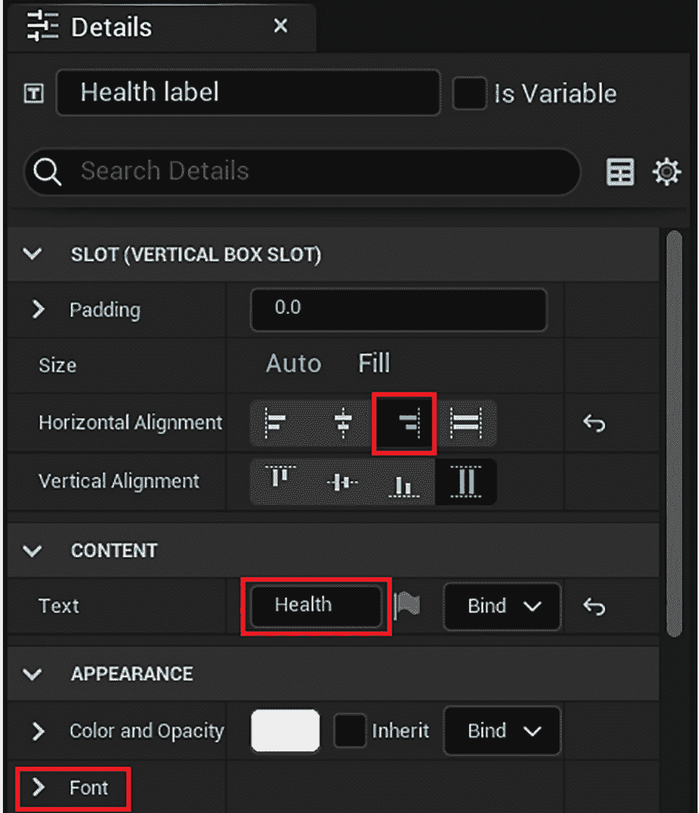

### 图 7.14 – 设置健康条的颜色

- 8. 为耐力标签重复相同的步骤。在 **层级** 面板中，单击第二个文本对象。

- 9. 在 **详细信息** 面板中，将名称更改为 `Stamina label`，并单击 **水平对齐** 旁边的 **右对齐** 按钮。将此项的 **文本** 字段更改为 `Stamina`，如有需要，调整字体大小和样式。

需要进行的最后一点调整是将 UI 计量条锚定到屏幕的一侧。由于屏幕尺寸和比例可能不同，我们希望确保 UI 元素在屏幕上保持相同的相对位置。**锚点** 用于定义小部件在画布上的所需位置，无论屏幕尺寸如何。

- 10. 为我们的计量条建立锚点，选择 **玩家统计** 顶级对象，并在 **详细信息** 面板中，单击 **锚点** 下拉菜单。选择出现的第一个选项，该选项显示屏幕左上角的灰色矩形：

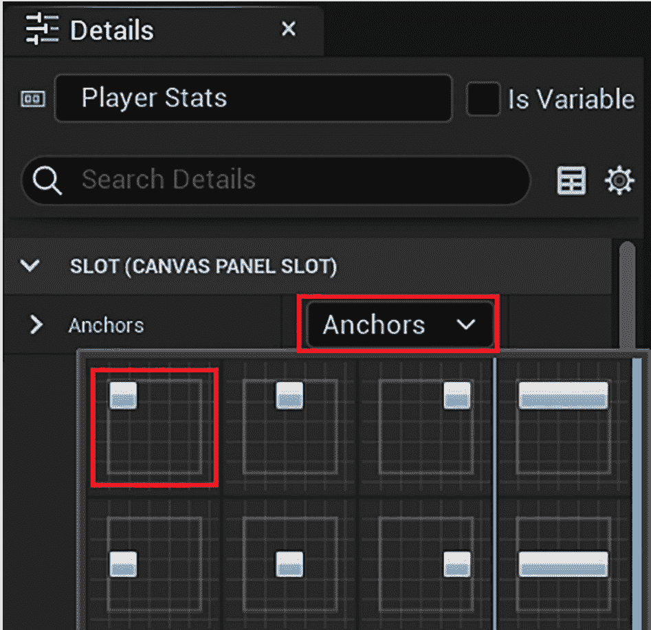

### 图 7.15 – 设置玩家统计的锚点

这将把我们的计量条锚定在左上角，确保无论分辨率或比例如何，它们始终出现在该角落。

目前，您可以通过更改 **进度** 类别中的 **百分比** 属性来尝试进度条。**百分比** 值的范围是 `0.0`（空）到 `1.0`（满）：

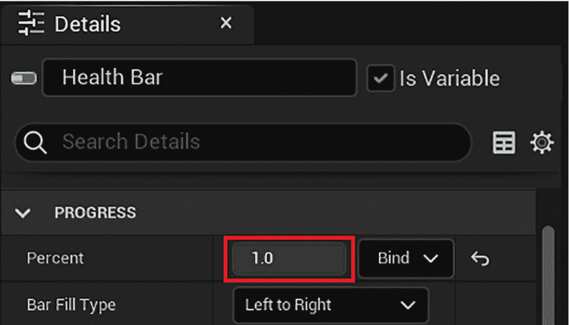

### 图 7.16 – 百分比确定进度条的填充位置

以下截图显示 **百分比** 设置为 1.0 的进度条：

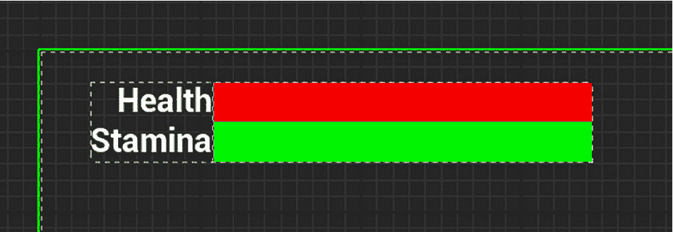

### 图 7.17 – 进度条的最终外观

这就完成了健康和耐力 UI 元素的自定义。下一步是创建一些 UI 文本元素来显示弹药和消灭目标的计数器。

### 创建弹药和消灭目标的计数器

弹药和消灭目标的计数器显示将以类似于我们玩家统计表格的方式工作，区别在于我们希望通过文本而非连续表格来表示其值。新 UI 元素的层次结构如下：

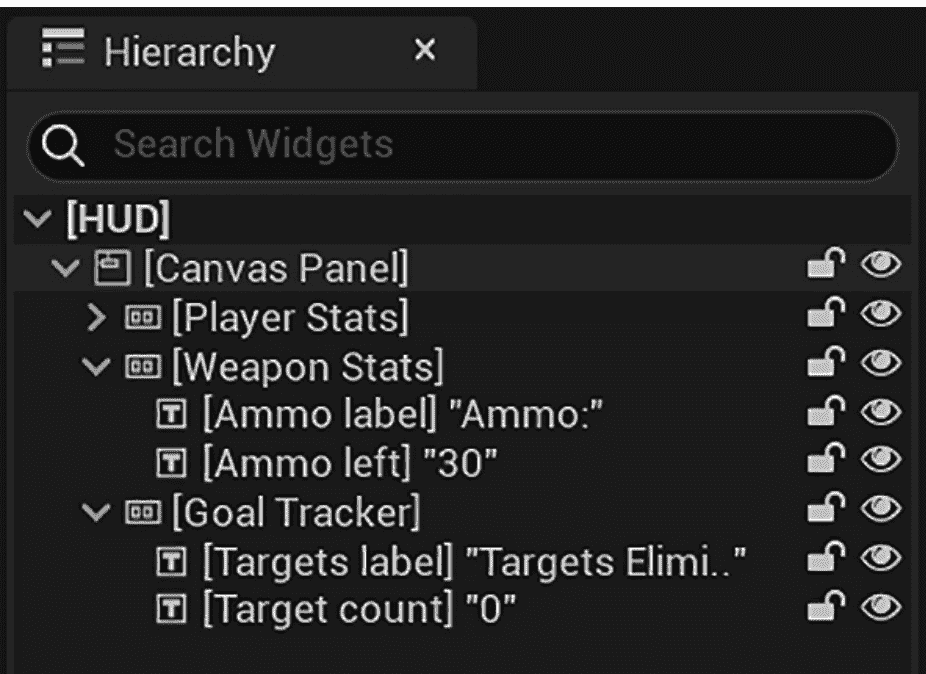

### 图 7.18 – 武器统计和目标追踪器层次结构

**玩家统计** 已最小化，因此我们可以专注于 **武器统计** 和 **目标追踪器** 元素。

按照以下步骤创建这些 UI 元素：

- 1. 选择并拖动 **水平框** 从 **调色板** 面板拖到 **层级** 面板，将其释放到 **画布面板** 对象上方。在 **详细信息** 面板中，将 **水平框** 的名称更改为 Weapon Stats。

- 2. 我们将把 **武器统计** 水平框放置在屏幕右上角。在 **详细信息** 面板中，单击 **锚点** 下拉菜单并选择第三个选项。将 **位置 X** 设置为 `-200.0`，**位置 Y** 设置为 `30.0`，**尺寸 X** 设置为 `160.0`，**尺寸 Y** 设置为 `40.0`：

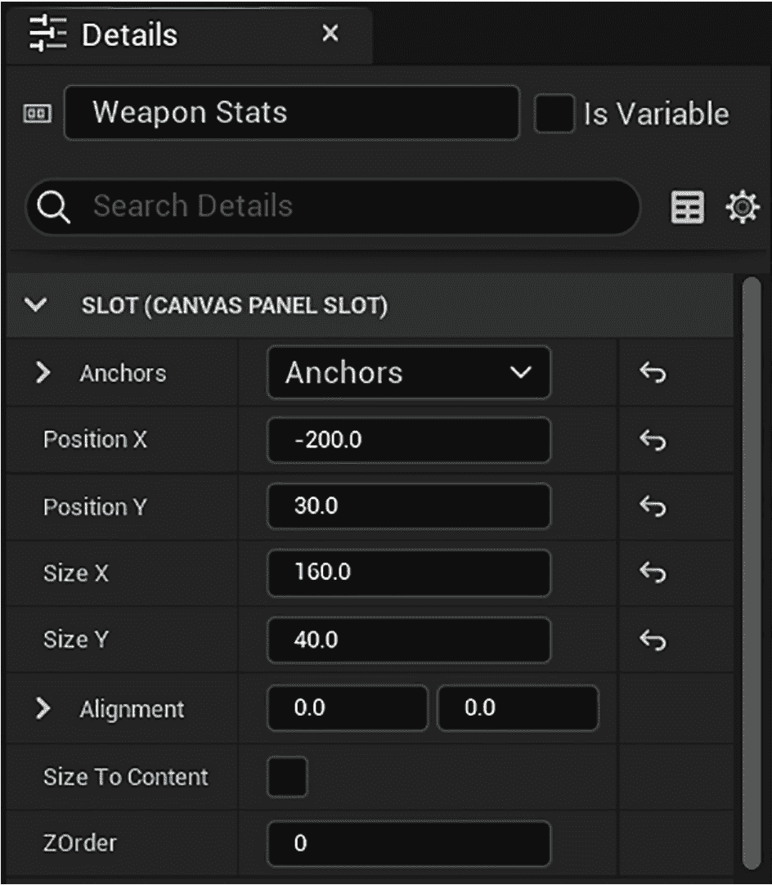

### 图 7.19 – 武器统计的尺寸和位置

- 3. 将一个文本对象拖到 Weapon Stats 上。在 **详细信息** 面板中，将名称更改为 `Ammo_label`。将 **内容** 类别下的 **文本** 字段更改为 `Ammo:`（包括冒号）。

- 4. 将另一个 **文本** 对象拖到 **武器统计** 上。在 **详细信息** 面板中，将名称更改为 `Ammo left`。该元素的值将随弹药使用而变化，但我们可以给它一个默认值以在 UMG 编辑器中进行可视化。由于我们已将玩家蓝图中弹药变量的默认值设置为 `30`，请继续将 **Ammo left** 的 **文本** 值也更改为 `30`。

- 5. 在 **层级** 面板中选择 **武器统计**。看起来像花朵的图标是 **锚点徽章**，它表示所选元素在画布面板上的锚点位置：

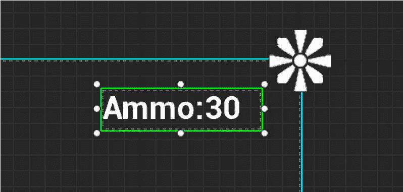

### 图 7.20 – 武器统计的锚点徽章

- 6. 我们将重复这些步骤用于目标追踪器。选择并拖动 **水平框** 从 **调色板** 面板拖到 **层级** 面板，将其释放到 **画布面板** 对象上方。在 **详细信息** 面板中，将 **水平框** 的名称更改为 `Goal Tracker`。

- 7. 我们将把 **目标追踪器** 水平框放置在屏幕顶部中央。在 **详细信息** 面板中，单击 **锚点** 下拉菜单并选择第二个选项。将 **位置 X** 设置为 `-100.0`，**位置 Y** 设置为 `50.0`。检查 **根据内容调整大小** 属性，因此我们不需要更改 **尺寸 X** 和 **尺寸 Y** 的值。此水平框的大小将根据其子元素的大小自动调整：

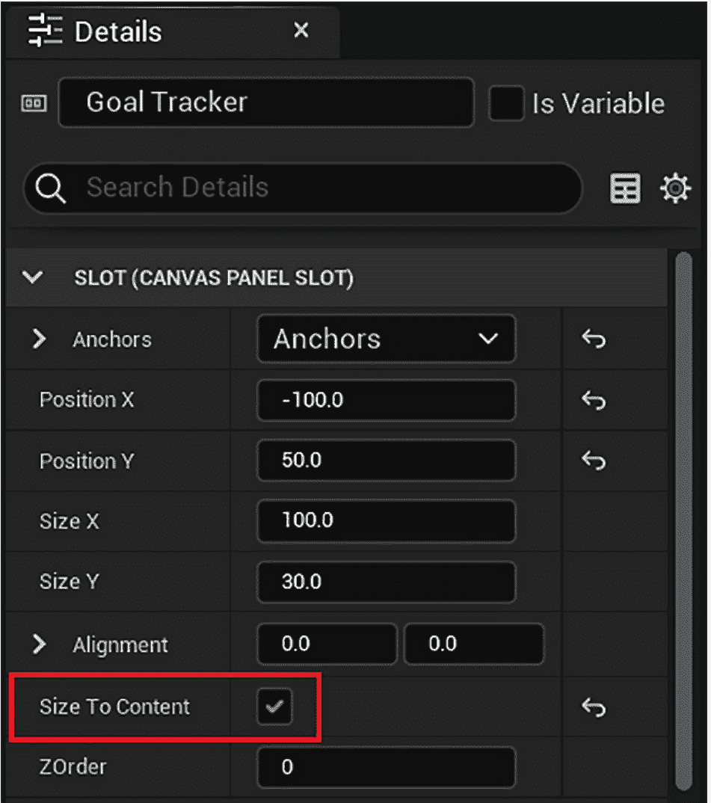

### 图 7.21 – 目标追踪器使用根据内容调整大小属性

- 8. 将一个 **文本** 对象拖到 **目标追踪器** 上。在 **详细信息** 面板中，将名称更改为 `Targets label`。将 **内容** 类别下的 **文本** 字段更改为 `Targets Eliminated:`（包括冒号）。

- 9. 我们将增加目标追踪器的文本对象使用的字体大小，以便在屏幕上突出显示。在 **外观** 类别中，将字体大小更改为 32：

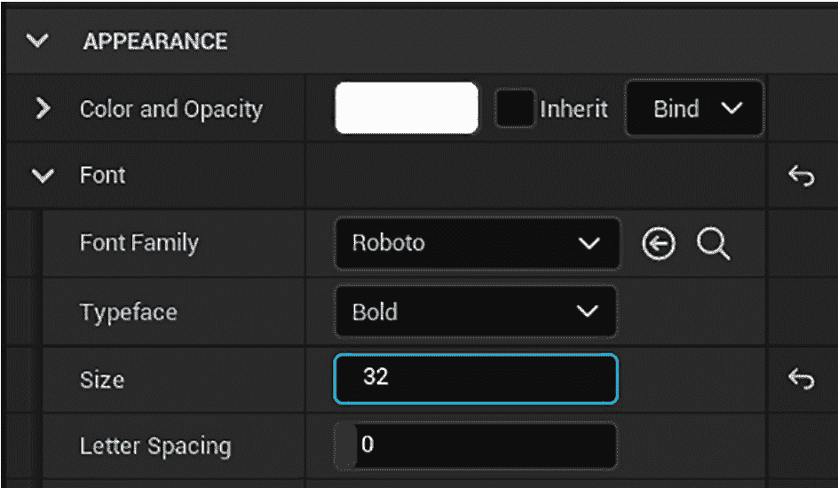

### 图 7.22 – 更改字体大小

- 10. 将另一个文本对象拖到目标追踪器上。在 **详细信息** 面板中，将名称更改为 `target_count`。将 **内容** 类别下的 **文本** 字段更改为 `0` 并将字体大小设置为 32。目标追踪器将如下所示：

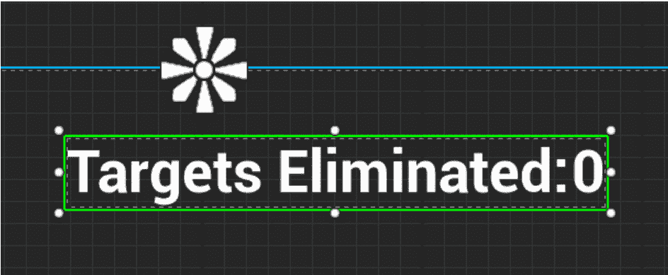

### 图 7.23 – 顶部中央锚定的目标追踪器

- 11. 编译、保存并关闭 HUD 部件蓝图。

当 UI 元素按我们想要的方式排列后，我们现在需要确保游戏实际上知道如何显示 HUD。为此，我们需要重新查看角色蓝图。

### 显示 HUD

要在游戏中显示 HUD，请按照以下步骤操作：

- 1. 在内容浏览器中，访问 /Content/FirstPersonBP/Blueprints 文件夹并双击 FirstPersonCharacter 蓝图。

- 2. 我们将修改 **事件开始游戏**。在事件图表中查找事件有一种简单的方法。查找 **我的蓝图** 面板中的 **图表** 类别，然后双击 **事件开始游戏**。编辑器将移动到事件图表中 **事件开始游戏** 已放置的位置：

### 我的蓝图

### 图表

### 事件图表

- 输入动作 Jump
- 输入轴 Turn
- 输入轴 LookUp
- 输入轴 MoveForward
- 输入轴 MoveRight
- 输入触摸
- 输入动作 Fire
- 输入轴 TurnRate
- 输入轴 LookUpRate
- **事件开始游戏**
- 输入动作 ResetVR
- 输入动作 Sprint
- 输入动作 Zoom

### 图 7.24 – FirstPersonCharacter 的事件

- 3. 删除之前连接到 **事件开始游戏** 的节点，因为它们处理在 VR 中游玩游戏的情况，而我们不会在此示例游戏中使用 VR。

### 重要信息

在大多数情况下，一旦游戏开始，**事件开始游戏** 就会调用随后的操作。如果在游戏开始时蓝图实例不存在，则它将在实例生成时触发。由于 `FirstPersonCharacter` 玩家实例在游戏开始时即存在，因此将显示逻辑附加到此事件会立即创建 HUD。

- 4. 从 **事件开始游戏** 的输出执行引脚拖出一条线，并添加一个 Create Widget 节点。在节点中，您会看到一个标记为 Class 的下拉菜单。这是我们使用已创建的部件蓝图的机会。请回顾，我们将部件蓝图命名为 HUD。如果单击下拉菜单，您将看到 HUD 选项。选择它，以便玩家角色蓝图生成您创建的 UI 元素。以下截图显示与我们的 HUD 部件蓝图关联的 Create HUD Widget 节点：

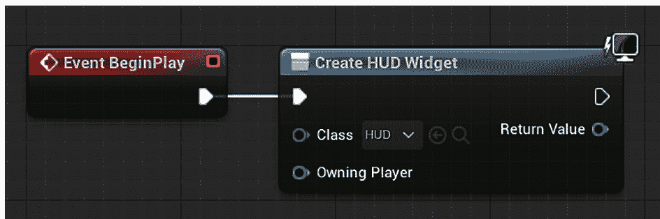

### 图 7.25 – 基于 HUD 部件蓝图创建实例

- 5. 虽然游戏启动时我们现在已经有一个生成的 Widget，但要使包含我们 UI 元素的 Widget 出现在屏幕上，仍需要完成最后一步。将 **返回值** 输出引脚拖入空白网格区域并添加一个 **添加到视口** 节点。

- 6. 在三个节点周围创建一个注释。将注释标记为 `Draw HUD on Screen`。节点应显示如下：

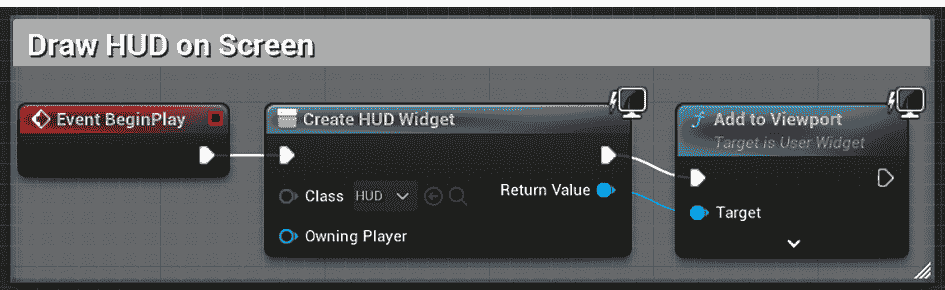

图 7.26 – 添加到视口节点在屏幕上显示 Widget Blueprint

- 7. 现在，编译、保存，然后单击 **开始游戏** 以测试游戏。

我们已学习如何在 UMG 编辑器中创建文本元素和进度条。我们还学习了如何使用容器（例如水平和垂直框）来组织屏幕上的 UI 元素。

玩游戏时，您应该能看到两个表示玩家生命值和耐力的计量表，以及弹药和已消灭目标的数值计数器。但是，当您从枪支射击时，可能会注意到一个非常重要的问题——UI 数值没有任何变化！我们将在下一节中解决这个缺失的组件。

### 将 UI 数值连接到玩家变量

为了让 UI 元素能够从玩家变量中获取数据，我们需要重新打开 HUD Widget Blueprint。为了使 UI 随玩家数据更新，我们将创建一个 **绑定**。绑定使我们能够将 Blueprint 的变量或函数关联到 Widget。每当变量或函数更新时，该更改会自动反映在 Widget 中。

因此，无需在玩家受到伤害时每次都手动更新玩家的生命值数据和我们的 Widget（以便生命值表显示发生变化），我们可以将计量表绑定到 `PlayerHealth` 玩家变量。这样，只需更新一个值即可。

### 为生命值和耐力创建绑定

要创建 `PlayerHealth` 和 `PlayerStamina` 变量与进度条 UI 的绑定，请执行以下步骤：

- 1. 在内容浏览器中，访问 `/Content/FirstPersonBP/UI` 文件夹并双击 **HUD** Widget Blueprint。

- 2. 在 **HUD** UMG 编辑器中，找到 **层级** 面板，然后单击嵌套在 **玩家属性条** 对象下方的 **生命值条** 对象。

- 3. 在选中 **生命值条** 后，在 **详细信息** 面板的 **进度** 类别中找到 **百分比** 字段。单击 **百分比** 旁边的 **绑定** 按钮并选择 **创建绑定**，如下屏幕截图所示：

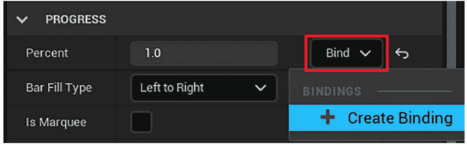

图 7.27 – 为生命值条创建绑定

- 4. UMG 编辑器将从 **设计器** 视图切换到 **图表** 视图。已创建一个新函数，允许我们在计量表和 `PlayerHealth` 变量之间编写连接。在图表中任何空白处右键单击并添加 **获取玩家角色** 节点。

- 5. 从新节点的 **返回值** 输出引脚拖动一根线到空白处，并添加 **转换为第一人称角色** 节点。

- 6. 断开 **获取生命值条百分比 0** 和 **返回节点** 节点之间的执行引脚连接，改为将 **获取生命值条百分比 0** 连接到我们的转换节点，如下所示：

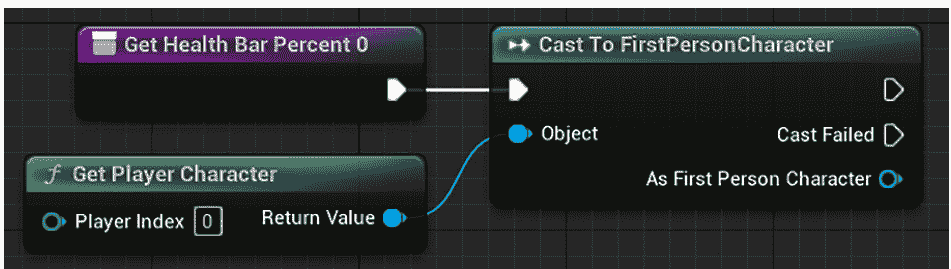

图 7.28 – 获取 FirstPersonCharacter 实例的引用

- 7. 接下来，从 **作为第一人称角色** 输出引脚拖动一根线到空白网格区域，并添加 **获取玩家生命值** 节点。最后，将 **转换为第一人称角色** 节点的执行引脚连接到 **返回节点**，如下屏幕截图所示：

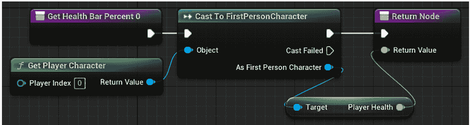

图 7.29 – 玩家生命值变量的值将用作生命值条的百分比

- 8. 将 **玩家生命值** 连接到 **生命值条** UI 所需的步骤就这些。我们需要对玩家的耐力执行相同的操作。单击屏幕右上角标记为 **设计器** 的按钮以返回到 **画布** 视图：

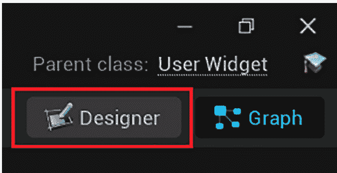

图 7.30 – 更改 UMG 编辑器模式的按钮

- 9. 在 **层级** 面板中选择 **耐力条**。按照之前为 **生命值条** 概述的步骤，创建一个将 **玩家耐力** 变量连接到计量表的绑定：

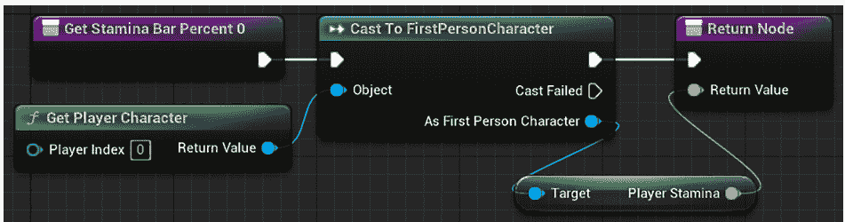

图 7.31 – 玩家耐力变量的值将用作耐力条的百分比

- 10. 编译并保存您的工作。

下一步是将弹药和目标计数器的绑定连接起来。

### 为弹药和已消灭目标计数器创建文本绑定

弹药和已消灭目标计数器将由 HUD 上的文本表示。按照以下步骤绑定计数器：

- 1. 单击 **设计器** 按钮再次返回到画布界面。这一次，我们要在 **层级** 中选择 **武器属性** 下方的 **剩余弹药** 文本对象。

- 2. 在 **详细信息** 面板中，找到 **文本** 字段旁边的 **绑定** 按钮并创建一个新绑定，如下所示：

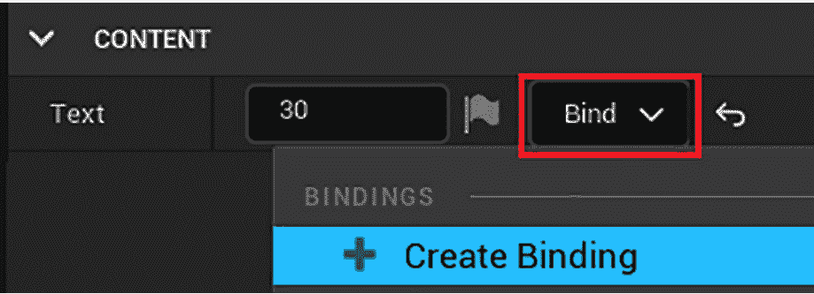

图 7.32 – 为剩余弹药创建绑定

- 3. 我们将对该绑定遵循与生命值和耐力相同的模式。在出现的 **获取剩余弹药文本 0** 图表视图中，创建 **获取玩家角色** 节点，使用 **转换为第一人称角色** 节点进行转换，然后从 **作为第一人称角色** 引脚拖动以添加 **获取玩家当前弹药** 节点。

- 4. 最后，将转换节点和 **玩家当前弹药** 节点都附加到 **返回节点**。您会注意到，当将 **玩家当前弹药** 输出引脚附加到 **返回值** 输入引脚时，会自动创建并链接一个新的 **ToText（整数）** 节点。

这是因为虚幻引擎知道，要在屏幕上以文本形式显示数值，首先需要将数字转换为 Widget 知道如何显示的文本格式。转换节点已自动连接，因此无需进行进一步修改。以下屏幕截图显示了绑定中使用的节点：

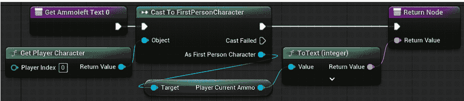

图 7.33 – 玩家当前弹药变量的值将用作剩余弹药的文本

- 5. 要创建的最后一个绑定是用于目标计数。返回到设计器视图，在层级中选择目标跟踪器下的目标计数对象。单击详细信息面板中文本字段旁边的绑定按钮。按照前面的步骤，创建获取玩家角色、将其转换为转换为第一人称角色节点，并将已消灭目标变量连接到转换节点和返回节点的蓝图节点。与弹药计数一样，会自动为您生成并连接一个用于转换的 ToText (integer) 节点。结果应如下所示：

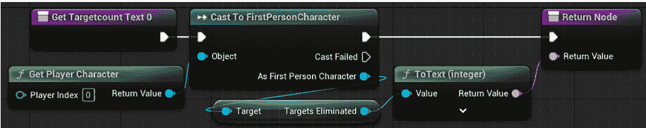

图 7.34 – 已消灭目标变量的值将用作目标计数的文本

我们现在已成功将所有 UI 元素绑定到玩家变量。现在是编译并保存工作的好时机。由于我们的绑定，UI 现在将执行响应游戏中发生的事件的任务。但是，我们仍需创建将触发我们已连接变量更改的事件。在下一节中，我们将根据玩家在游戏中执行的操作来修改玩家变量。

## 跟踪弹药和已消灭目标

为了使 UI 能够响应玩家与环境的交互，我们需要修改玩家和目标蓝图。让我们先从弹药计数器开始，当玩家从枪支开火时使其减少。

### 减少弹药计数器

我们需要修改玩家开火逻辑，以便在玩家开枪时减少弹药计数器。请执行以下步骤：

- 1. 在内容浏览器中，访问 /Content/FirstPersonBP/Blueprints 文件夹并双击 FirstPersonCharacter 蓝图。

- 2. 在生成投射物注释块中查找包含的蓝图节点的大系列。我们希望确保跟踪玩家当前弹药数的计数器在玩家每次开火时减少一。为此所需的蓝图脚本如下：

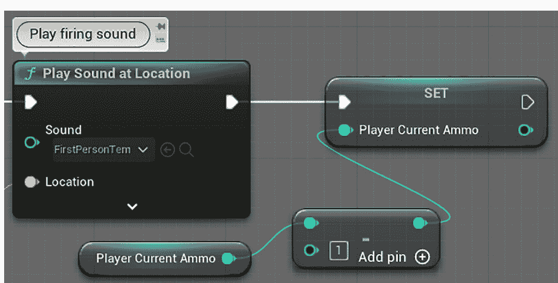

Figure 7.35 – Decreasing Player Current Ammo

- 3. Find the final node in the chain, **Play Sound at Location**. Drag a wire from the output execution pin of this node to empty grid space and add a **SET Player Current Ammo** node.
- 4. Drag a wire from the **Player Current Ammo** input pin to empty space and create a **Subtract** node.
- 5. Drag a wire from the top input pin of the **Subtract** node and add a **GET Player Current Ammo** node.
- 6. In the bottom field of the **Subtract** node, enter a value of `1`. This sequence translates to the following: _after playing the firing sound, set the player's current ammo count to the existing ammo count minus one._
- 7. Compile, save, and press **Play** to see your ammo counter decrease every time you fire a shot from your gun. Note that we are not preventing the player from shooting when they are out of ammo, and the ammo counter will continue to register negative numbers. We will fix it in _Chapter 8, Creating Constraints and Gameplay Objectives_.

### Important Note

The **SET Player Current Ammo** node and the subtract node of the previous screenshot can be replaced by the **Decrement Int** node, which subtracts `1` from the input variable and sets a new value in it. There is also the **Increment Int** node, which adds `1` to the input variable.

### Increasing the targets eliminated counter

Now, we want to increase our targets eliminated counter by `1` every time a target Cylinder is destroyed. These are the steps:

- 1. In the Content Browser, access the `/Content/FirstPersonBP/Blueprints` folder and double-click on the `BP_CylinderTarget` Blueprint.
- 2. We will add our new nodes close to the end of **Event Hit**, after all the nodes except **DestroyActor**. There must not be other nodes after a **DestroyActor** node whose **Target** is **self** because this node removes the current instance from the Level.
- 3. Break the link between the **Spawn Emitter at Location** and **DestroyActor** nodes, and then move **DestroyActor** to the right to make room for the new Blueprint nodes.
- 4. The goal is to create a series of nodes that will access the **Targets Eliminated** variable from the player character and increase it by one, before going on to destroy the Actor. The result will look like this:

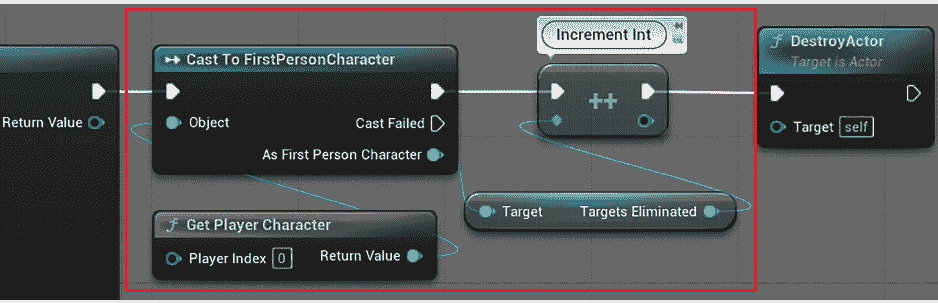

Figure 7.36 — Increasing Targets Eliminated

- 5. Right-click on any empty graph space and add a **Get Player Character** node.
- 6. Drag a wire from the **Return Value** output pin of the **Get Player Character** node and add the **Cast To FirstPersonCharacter** node.
- 7. Drag a wire from the **As First Person Character** pin and add a **GET Targets Eliminated** node.
- 8. Drag a wire from the output of **Targets Eliminated** and add the **Increment Int** node, which will add 1 to the **Targets Eliminated** variable.
- 9. Finally, connect the execution pins of the **Cast To FirstPersonCharacter**, **Increment Int**, and **DestroyActor** nodes, ensuring that **DestroyActor** is the final node in the chain.
- 10. Compile, save, and play the game to see the **Targets Eliminated** counter on the screen increase every time you destroy a Cylinder target:

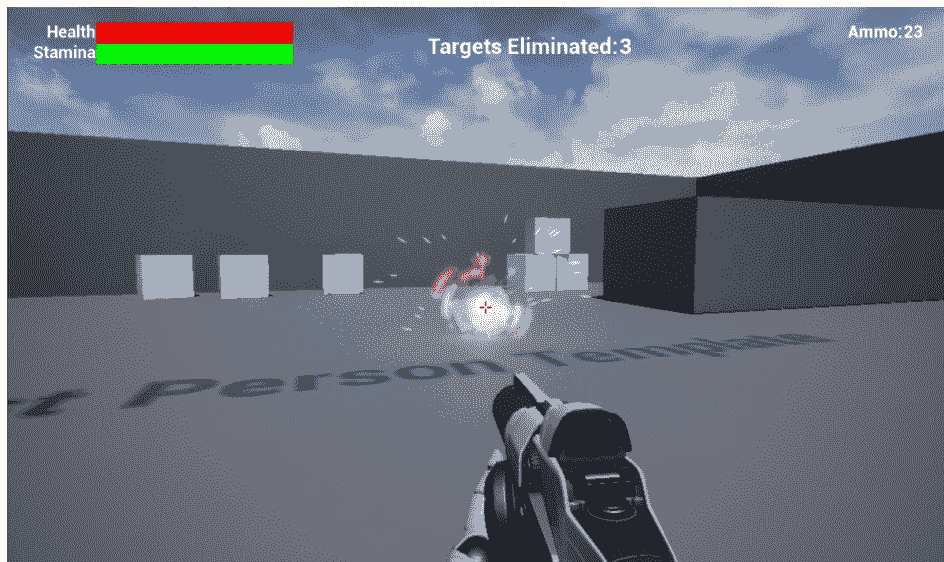

Figure 7.37 – Destroying the Cylinder target to increase the Targets Eliminated counter

Now, the ammo and targets eliminated counters are being modified by events that occur within our game, and the updated values are displayed immediately in the HUD. The script to modify the health and stamina meters will be implemented in the next chapters.

### Summary

In this chapter, we enhanced the player experience by adding a HUD that tracks the player's interaction with the environment. In doing so, we developed another conduit through which we can communicate information to the player of our game. We now have the skeletal structure of a first-person shooter, including guns that shoot, targets that explode, and a UI that exposes the state of the world to the player. We have already come a long way from the initial test scene, which featured minimal player interaction.

In the next chapter, we will begin transitioning from building the foundation of our game structure to constructing the design of our game. The core of any game is made up of the rules that the player must follow to create a fun experience. While the game, in its current form, features some basic rules that define how the targets react to being shot, the overall experience lacks a goal for the player to achieve. We will rectify this by establishing a `win` condition for the player, as well as providing additional constraints that make the experience holistic and consistent.

### Quiz

- 1. What is the name of the specialized type of Blueprint used to create a UI?
  - a. UMG Blueprint
  - b. Widget Blueprint

- 2. The `Percent` property determines the fill position of a progress bar.
  - a. True
  - b. False

- 3. The X and Y values of an element's position in a canvas are always relative to the top-left corner of the screen.
  - a. True
  - b. False

- 4. We can bind a property of a Widget to a function to retrieve the updated value of a variable.
  - a. True
  - b. False

- 5. To create an instance of a Widget Blueprint and show it on the screen, you need to use the `Create Widget` and `Add to Viewport` nodes.
  - a. True
  - b. False
