## Chapter 8: Creating Constraints and Gameplay Objectives

In this chapter, we'll define a ruleset for our game, which will guide the player through the gameplay experience. We want to give the player the ability to start the game and immediately identify what they must do to win the game. In its most basic form, a game could be defined by the win condition and the steps the player can take to reach that win condition. Ideally, we want to ensure that each step the player takes toward that goal is fun.

We'll begin by applying some constraints to the player to increase the level of difficulty. A game without a challenge quickly becomes boring, and we want to ensure that every mechanic in our game provides the player with an interesting choice or challenge. We'll then set up a goal for the player to achieve, along with the necessary adjustments to our enemy targets to make that goal challenging to reach.

In this process, we'll work to accomplish the following:

- Reducing stamina while the player is sprinting and regenerating it when the player is not sprinting
- Preventing the player's gun from firing if they run out of ammo
- Creating ammo pickups that allow the player to regain ammo
- Defining a win condition based on the number of targets eliminated
- Creating a menu that allows the player to replay or quit the game upon winning

By the end of the chapter, we will have a game with constraints and goals that make the gameplay more interesting. We will learn how to create collectible objects and how to create a menu system.

### Constraining player actions

One important consideration to make when adding enhanced capabilities for the player is the impact that they have on both the challenge and feel of the game experience. Recall that we added the ability for the player to sprint in Chapter 6, Enhancing Player Abilities, by holding down the Shift key. As it currently stands, holding down the Shift key while moving provides a significant increase in the speed at which the player can move. Without constraints applied to this ability, such as an enforced waiting period between uses, there would be nothing discouraging the player from always holding down the Shift key as they move.

This goes against the goal we set out to accomplish by adding a sprint functionality, which was to provide more options to the player. If an option is so attractive that the player feels compelled to always utilize it, then it doesn't increase the number of interesting choices available to the player. From the player's perspective, the result would be the same if we just increased the base speed of the player to the sprint speed.

We can rectify this, and other issues currently faced by our game prototype, by adding constraints that limit a player's abilities, to increase decision making.

### Draining and regenerating stamina

To add a constraint to the sprinting ability of the player, we'll need to return to the player character Blueprint where we originally defined the ability. We need to create some variables that will keep track of whether the player is sprinting, how much stamina sprinting should cost, and the stamina recharge rate. We are going to create a custom event to drain the player's stamina at a consistent rate while they are sprinting and to recharge the stamina when they are not sprinting. Also, we will create other variables and macros to organize the script.

These are the variables that we will create:

| 变量 | 类型 |
|---|---|
| IsSprinting | 布尔型 |
| StaminaManagerName | 字符串 |
| SprintCost | 浮点型 |
| StaminaRechargeRate | 浮点型 |
| StaminaDrainAndRechargeTime | 浮点型 |
| SprintSpeed | 浮点型 |
| WalkSpeed | 浮点型 |

图 8.1 – 用于耐力系统的变量

我们将创建以下宏来组织耐力系统：

- 宏
- StartSprinting
- StopSprinting
- ManageStaminaDrain
- ManageStaminaRecharge

图 8.2 – 用于耐力系统的宏

### 创建变量

按照以下步骤创建新耐力系统所需的变量：

- 1. 在 **内容浏览器** 中，访问 `/Content/FirstPersonBP/Blueprints` 文件夹并双击 `FirstPersonCharacter` 蓝图。

- 2. 在 **我的蓝图** 面板的 **变量** 类别中，单击 + 按钮添加变量。在 **详情** 面板中，将变量命名为 `IsSprinting`，并将 **变量类型** 更改为 **布尔值**：

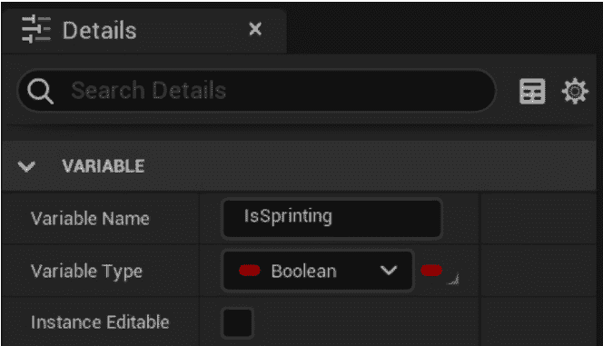

图 8.3 – IsSprinting 布尔变量

- 3. 在我的蓝图面板中创建另一个变量。在详情面板中，将变量命名为 StaminaManagerName，并将变量类型更改为字符串。编译蓝图，并将默认值设置为 ManageStamina。此变量存储耐力自定义事件的名称，我们将在启动和停止计时器时使用它。创建此变量是为了避免因手动输入名称时可能出现的拼写错误而导致的错误：

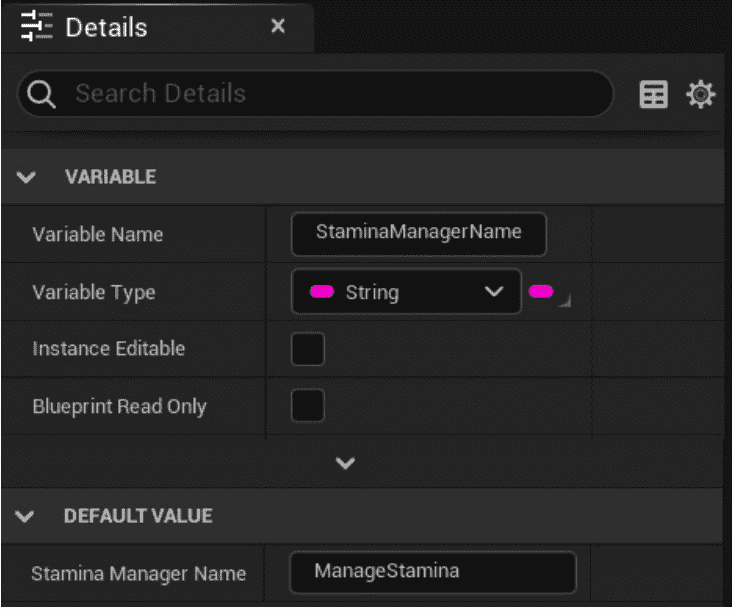

图 8.4 – StaminaManagerName 字符串变量

- 4. 现在我们开始创建 **浮点型** 变量。在 **我的蓝图** 面板的 **变量** 类别中，单击 + 按钮添加变量。在 **详情** 面板中，将变量命名为 `SprintCost`，并将 **变量类型** 更改为 **浮点型**。编译蓝图，并将 **默认值** 设置为 `0.05`：

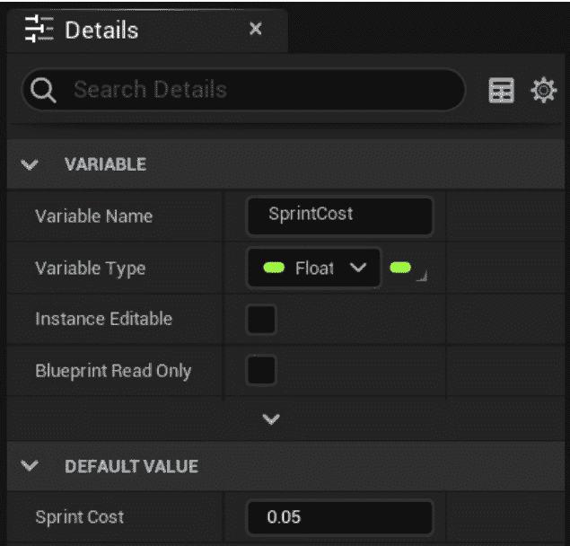

图 8.5 – SprintCost 浮点型变量

- 5. 再次执行相同步骤，创建第二个名为 StaminaRechargeRate 的浮点型变量。编译蓝图，并将默认值设置为 0.01。
- 6. 创建另一个名为 StaminaDrainAndRechargeTime 的浮点型变量。编译蓝图，并将默认值设置为 0.2。
- 7. 创建另一个名为 SprintSpeed 的浮点型变量。编译蓝图，并将默认值设置为 2200。
- 8. 创建另一个名为 WalkSpeed 的浮点型变量。编译蓝图，并将默认值设置为 600。我们创建 SprintSpeed 和 WalkSpeed 变量，以便可以在一个位置修改速度值，而无需在脚本中查找使用这些值的各个位置。

### 创建 StopSprinting 宏

现在，让我们创建第一个宏。我们将从最简单的宏开始：`StopSprinting`。

创建宏的步骤如下：

- 1. 在 **我的蓝图** 面板的 **宏** 类别中，单击 + 按钮创建宏。将宏的名称更改为 `StopSprinting`：

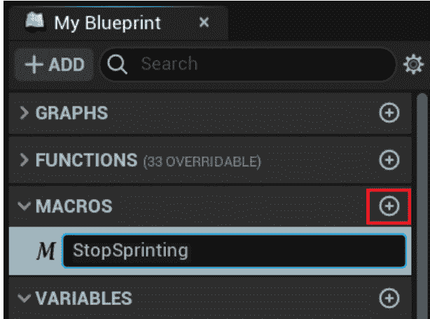

图 8.6 – 创建宏

- 2. 默认情况下，宏没有执行引脚。我们需要将其作为参数添加。使用宏的 **详情** 面板创建一个名为 `In` 的 **Exec** 类型输入参数，以及一个名为 `Out` 的 **Exec** 类型输出参数：

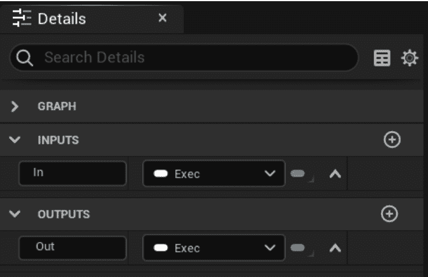

图 8.7 – 在宏中添加执行引脚

- 3. 在为 **StopSprinting** 宏创建的选项卡上，添加以下截图中显示的节点。它只需将 **Is Sprinting** 设置为 `false`，并将 **Max Walk Speed** 恢复为 **Walk Speed** 变量中存储的值：

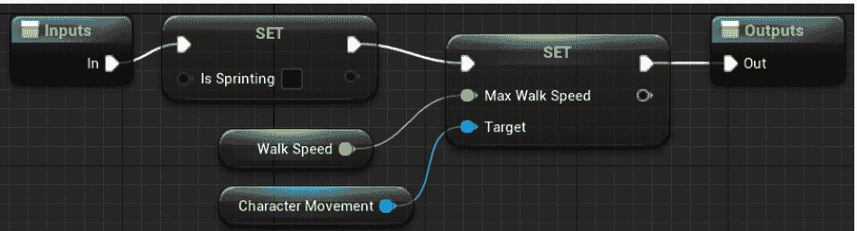

图 8.8 – StopSprinting 宏

- 4. 从 **Inputs** 节点的 **In** 引脚拖出一条线，并添加 **SET Is Sprinting** 节点。保持 **Is Sprinting** 输入参数未勾选。

- 5. 在 **组件** 面板中单击 **Character Movement** 组件，并将其拖动到 **事件图表** 上：

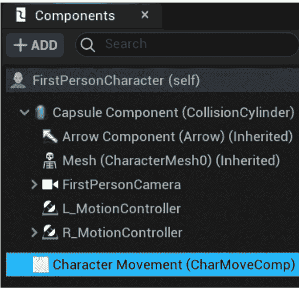

图 8.9 – 将 Character Movement 组件拖动到事件图表

- 6. 从 **Character Movement** 节点的输出引脚拖出一条线，并添加 **SET Max Walk Speed** 节点。

- 7. 从 **SET Max Walk Speed** 的输入引脚拖出一条线，并添加 **GET Walk Speed** 节点。

- 8. 连接 **SET Is Sprinting**、**SET Max Walk Speed** 和 **Outputs** 节点的白色执行引脚。编译蓝图。

### 创建 StartSprinting 宏

`StartSprinting` 宏包含设置冲刺所需的操作。

按照以下步骤创建宏：

- 1. 在 **我的蓝图** 面板的 **宏** 类别中，单击 + 按钮。将宏的名称更改为 `StartSprinting`。

- 2. 在宏的 **详情** 面板中，创建一个名为 `In` 的 **Exec** 类型输入参数，以及一个名为 `Out` 的 **Exec** 类型输出参数，如图 8.7 所示。

- 3. 在为 **StartSprinting** 宏创建的选项卡上，添加以下截图中显示的节点。**StartSprinting** 宏的前半部分几乎与 **StopSprinting** 相同，只是数值适当不同。**Branch** 节点检查我们是否已经有 **Stamina Manager** 计时器在运行。如果有，宏执行完毕，我们可以退出。如果计时器尚不存在，我们将设置它：

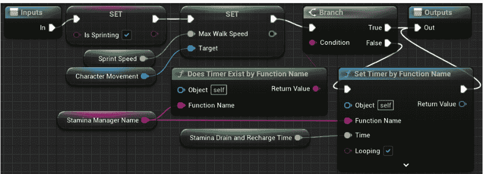

图 8.10 – StartSprinting 宏

- 4. 从 **Inputs** 节点的 **In** 引脚拖出一条线，并添加 **SET Is Sprinting** 节点。勾选 **Is Sprinting** 输入参数。

- 5. 在 **组件** 面板中单击 **Character Movement** 组件，并将其拖动到 **事件图表** 上。

- 6. 从 **Character Movement** 节点的输出引脚拖出一条线，并添加 **SET Max Walk Speed** 节点。

- 7. 从 **SET Max Walk Speed** 节点的输入引脚拖出一条线，并添加 **GET Sprint Speed** 节点。

- 8. 连接 **SET Is Sprinting** 和 **SET Max Walk Speed** 节点的白色执行引脚。

- 9. 从 **SET Max Walk Speed** 节点的白色输出引脚拖出一条线，并添加 **Branch** 节点。

- 10. 从 **Branch** 节点的 **True** 输出引脚拖出一条线，并将其连接到 **Outputs** 节点的 **Out** 引脚。

- 11. 从 **Branch** 节点的 Condition 输入引脚拖出一条线，并添加 **Does Timer Exist by Function Name** 节点。

- 12. 从 **Does Timer Exist by Function Name** 节点的 Function Name 引脚拖出一条线，并添加 **GET Stamina Manager Name** 节点。

- 13. 从 **Branch** 节点的 **False** 输出引脚拖出一条线，并添加 **Set Timer by Function Name** 节点。将 **Set Timer by Function Name** 节点的白色输出引脚连接到 **Outputs** 节点的 **Out** 引脚。

- 14. 从 **GET Stamina Manager Name** 拖出一条线，并将其连接到 **Set Timer by Function Name** 节点的 Function Name 引脚。

- 15. 从 **Set Timer by Function Name** 节点的 Time 引脚拖出一条线，并添加 **GET Stamina Drain and Recharge Time** 节点。

- 16. 勾选 **Set Timer by Function Name** 节点的 Looping 输入参数。由于 Stamina Drain and Recharge Time 变量的值为 0.2，此计时器将每秒调用五次该函数/事件。编译蓝图。

### 创建 ManageStaminaDrain 宏

ManageStaminaDrain 宏会消耗玩家耐力，并检查停止冲刺的条件。

创建宏的步骤如下：

- 1. 在我的蓝图面板的宏类别中，单击 + 按钮创建另一个宏。将宏的名称更改为 ManageStaminaDrain。

- 2. 在宏的详情面板中，创建一个名为 In 的 Exec 类型输入参数，以及一个名为 Out 的 Exec 类型输出参数，如图 8.7 所示。

- 3. 在为 ManageStaminaDrain 宏创建的选项卡上，添加以下截图中显示的节点。有两个条件用于

the player to keep sprinting and draining stamina: the player needs to be moving and **Player Stamina** must be greater than zero.

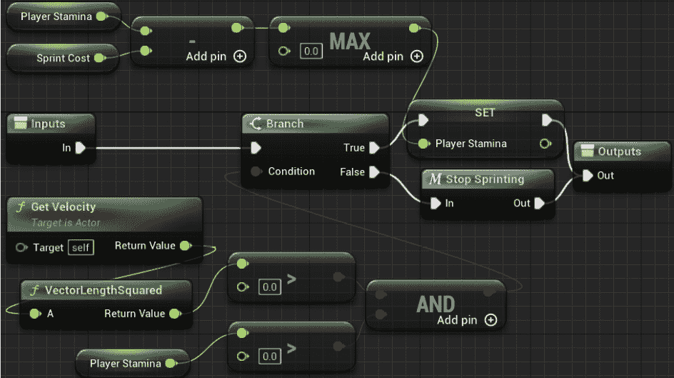

Figure 8.11 – The ManageStaminaDrain macro

- 4. Drag a wire from the **In** pin of the **Inputs** node and add a **Branch** node.
- 5. Drag a wire from the **Condition** input pin of the **Branch** node and add an **AND** Boolean node.
- 6. Drag a wire from the top input pin of the **AND** node and add a **Greater** node.
- 7. Right-click on the empty space of **Event Graph** and add a **Get Velocity** node.
- 8. Drag a wire from the **Return Value** pin of the **Get Velocity** node and add a **VectorLengthSquared** node. If the return value of the **VectorLengthSquared** node is greater than zero, then the player is moving. As in our case, we only want to know if the velocity is greater than zero, we use **VectorLengthSquared** instead of **VectorLength** to avoid a square root.

- 9. Drag a wire from the Return Value pin of the VectorLengthSquared node and connect it to the top input pin of the Greater node.
- 10. Drag a wire from the bottom input pin of the AND node and add a Greater node.
- 11. Drag a wire from the top input pin of the Greater node and add a Get Player Stamina node.
- 12. Drag a wire from the True output pin of the Branch node and add a Set Player Stamina node. Connect the white output pin of the Set Player Stamina node to the Out pin of the Outputs node.
- 13. Drag a wire from the input pin of Set Player Stamina and add a Max (float) node. This node returns the highest value of the input parameters. We use this node to ensure that Player Stamina will never be less than 0.0.
- 14. Drag a wire from the top input pin of the Max (float) node and create a Subtract node.
- 15. Drag a wire from the top input pin of the Subtract node and add a Get Player Stamina node.
- 16. Drag a wire from the bottom input pin of the Subtract node and add a Get Sprint Cost node.
- 17. Drag a wire from the False output pin of the Branch node and add the Stop Sprinting macro node. Connect the white output pin of the Stop Sprinting node to the Out pin of the Outputs node.

### Creating the ManageStaminaRecharge macro

The ManageStaminaRecharge macro recharges Player Stamina until it is full.

Follow these steps to create the macro:

- 1. In the **My Blueprint** panel, click the + button in the **MACROS** category to create another macro. Change the name of the macro to `ManageStaminaRecharge`.
- 2. In the **Details** panel of the macro, create an input parameter named `In` of the **Exec** type and an output parameter named `Out` of the **Exec** type as shown in *Figure 8.7*.
- 3. On the tab created for the **ManageStaminaRecharge** macro, add the nodes seen in the following screenshot. If **Player Stamina** is full (nearly equal to `1.0`), we clear the timer for **Stamina Manager**. If **Player Stamina** isn't full, we increment it.

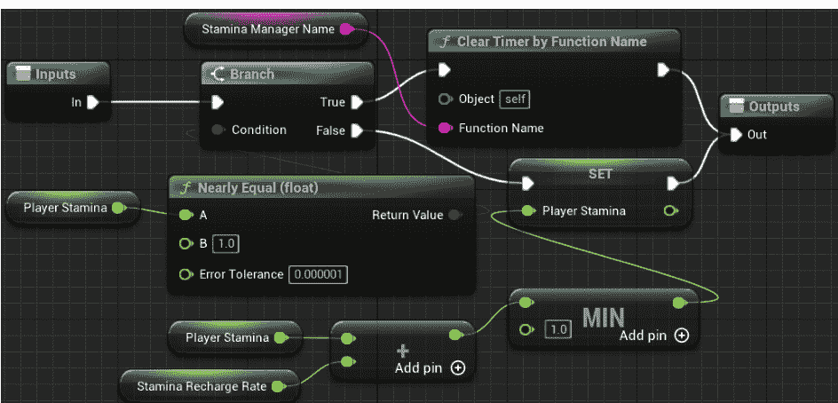

Figure 8.12 – The ManageStaminaRecharge macro

- 4. Drag a wire from the **In** pin of the **Inputs** node and add a **Branch** node.
- 5. Drag a wire from the **Condition** input pin of the **Branch** node and add a **Nearly Equal (float)** node. Enter the value `1.0` in the **B** input parameter of the **Nearly Equal (float)** node. We are using the **Nearly Equal (float)** node because it has an **Error Tolerance** property that is needed to compare values with floating-point precision.
- 6. Drag a wire from the **A** input parameter of the **Nearly Equal (float)** node and add a Get Player Stamina node.
- 7. Drag a wire from the True output pin of the Branch node and add a Clear Timer by Function Name node.
- 8. Drag a wire from the Function Name parameter of Clear Timer by Function Name and add a Get Stamina Manager Name node.
- 9. Connect the white output pin of Clear Timer by Function Name to the Out pin of the Outputs node.
- 10. Drag a wire from the False output pin of the Branch node and add a Set Player Stamina node. Connect the white output pin of Set Player Stamina to the Out pin of the Outputs node.
- 11. Drag a wire from the input pin of Set Player Stamina and add a Min (float) node. Enter the value 1.0 in the second input parameter of the Min (float) node. This node returns the lowest value of the input parameters. We use this node to ensure that Player Stamina will never be greater than 1.0.
- 12. Drag a wire from the top input pin of the Min (float) node and create an Add node.
- 13. Drag a wire from the top input pin of the Add node and add a Get Player Stamina node.
- 14. Drag a wire from the bottom input pin of the Add node and add a Get Stamina Recharge Rate node.

### Updating the InputAction Sprint event

We need to modify the InputAction Sprint event to use the new stamina system.

Follow these steps:

- 1. Look in the GRAPHS category of the My Blueprint panel and double-click on InputAction Sprint. The editor will move to the position in Event Graph where InputAction Sprint is already placed:

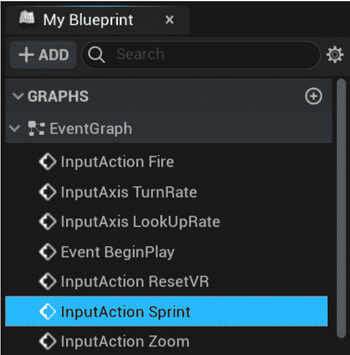

Figure 8.13 – Finding the InputAction Sprint event

- 2. Delete the previous nodes that were connected to **InputAction Sprint**. We will add the nodes seen in the following screenshot. When the *Shift* key is pressed, the game checks whether there is enough stamina to begin sprinting, that is, whether the current **PlayerStamina** amount is greater than or equal to **SprintCost**. If the player has enough stamina to start sprinting, the **Start Sprinting** macro is called. When the *Shift* key is released, the **Stop Sprinting** macro is called.

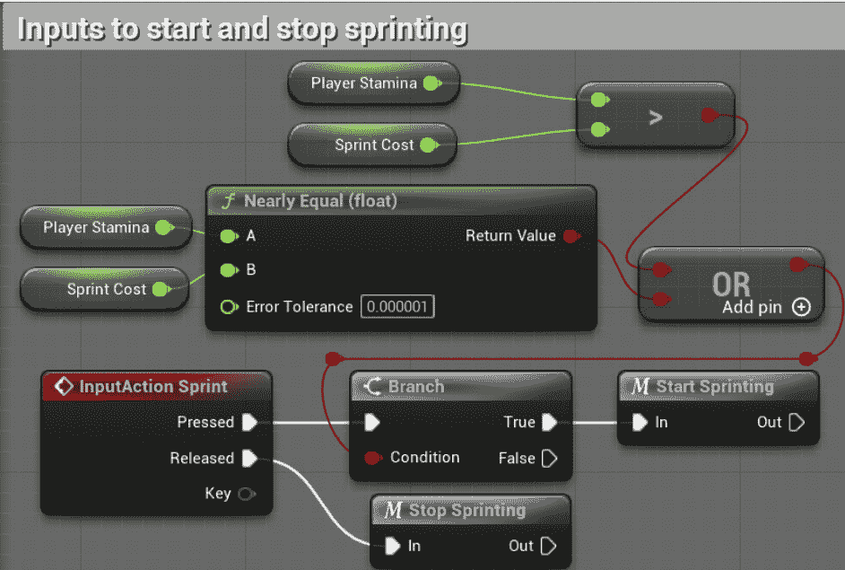

Figure 8.14 – The new version of the InputAction Sprint event

- 3. Drag a wire from the **Pressed** output pin of the **InputAction Sprint** node and add a **Branch** node.
- 4. Drag a wire from the **Condition** input pin of the **Branch** node and add an **OR** Boolean node.
- 5. Drag a wire from the top input pin of the **OR** node and add a **Greater** node. We cannot use the **Greater Equal** node because we need to use the **Nearly Equal (float)** node to verify that the two **Float** variables are equal.
- 6. Drag a wire from the top input pin of the **Greater** node and add a Get Player Stamina node.
- 7. Drag a wire from the bottom input pin of the **Greater** node and add a Get Sprint Cost node.
- 8. Drag a wire from the bottom input pin of the **OR** node and add a **Nearly Equal (float)** node.
- 1. Drag a wire from the A input pin of the Nearly Equal (float) node and add a Get Player Stamina node.
- 2. Drag a wire from the B input pin of the Nearly Equal (float) node and add a Get Sprint Cost node.
- 3. Drag a wire from the True output pin of the Branch node and add the Start Sprinting macro node.
- 4. Drag a wire from the Released output pin of the InputAction Sprint node and add the Stop Sprinting macro node.
- 5. Change the label of the comment box to Inputs to start and stop sprinting.

### Creating the ManageStamina custom event

We will now create the custom ManageStamina event, which checks whether the player is sprinting and calls the appropriate macro to drain or recharge the stamina.

These are the steps to create the custom event:

- 1. Right-click on the empty space of Event Graph. Search for custom event and select Add Custom Event... Rename the custom event to ManageStamina.

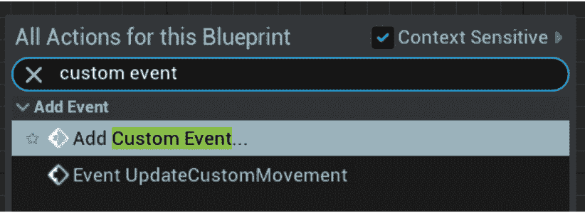

Figure 8.15 – Adding a custom event

- 2. Add the nodes shown in the following screenshot. This checks whether the player is sprinting and calls the appropriate macro:

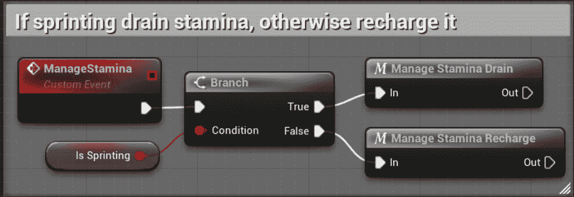

Figure 8.16 – The ManageStamina custom event

Compile, save, and test the game. As you sprint around the level, you should see your stamina meter running out if you're holding the left Shift key, and the stamina recharging when it's not held down and the player is walking or at rest.

We've completed the actions needed to manage stamina and sprinting, and our next step is to implement a constraint related to the player's ammunition.

### Preventing firing actions when out of ammo

For the next constraint that we'll place on the player's abilities, we need to restrict the player from firing their gun when they reach an ammo count of 0. We will add a Branch node right after the InputAction Fire event:

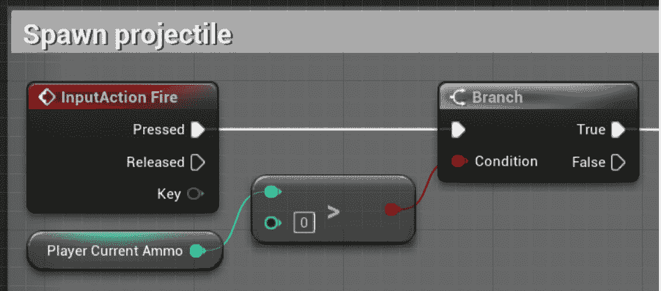

图 8.17 – 测试玩家是否有弹药

要执行此操作，请执行以下步骤：

- 1. 在 **我的蓝图** 面板的 **图表** 类别中，双击 **输入动作 开火** 事件，移动到 **事件图** 中已放置 **输入动作 开火** 的位置。
- 2. 从 **输入动作 开火** 的 **按下** 引脚拖动并释放到空白处以打开 **上下文菜单**。添加一个 **分支** 节点。**分支** 节点将自动连接到 **输入动作 开火** 和链中的下一个节点。
- 3. 从 **分支** 节点的 **条件** 输入引脚拖出一根线到空白处并添加 **大于** 节点。
- 4. 从 **大于** 节点的顶部输入引脚拖出一根线并添加 **获取玩家当前弹药** 节点。将 **大于** 节点的底部输入字段保留为默认值 0。

现在，编译、保存并测试您的游戏。您应该发现，当弹药计数器达到 0 时，枪不再发射。

我们已完成玩家限制，现在需要一个新蓝图为玩家提供弹药。

### 创建可收集对象

限制玩家在弹药耗尽时开枪，迫使玩家考虑其在游戏中尝试射击的准确性。然而，如果没有获取更多弹药的方式，限制弹药将过于苛刻。我们不希望弹药像体力值一样自然充能。相反，我们将创建一个可收集的弹药拾取物，以允许玩家通过探索和穿越关卡来恢复弹药。

要创建 BP_AmmoPickup 蓝图，请执行以下步骤：

- 1. 在内容浏览器中，访问 /Content/FirstPersonBP/Blueprints 文件夹。单击添加按钮并选择蓝图类。
- 2. 在下一个屏幕上，选择 **角色** 作为父类。
- 3. 将蓝图命名为 BP_AmmoPickup 并双击它以打开蓝图编辑器。
- 4. 在组件面板中单击添加按钮并选择静态网格组件。在详细信息面板中，选择 Shape_Pipe 静态网格，并在材质中，转到元素 0 并选择 M_Door。将比例属性的 X、Y 和 Z 值更改为 0.5，如以下屏幕截图所示：

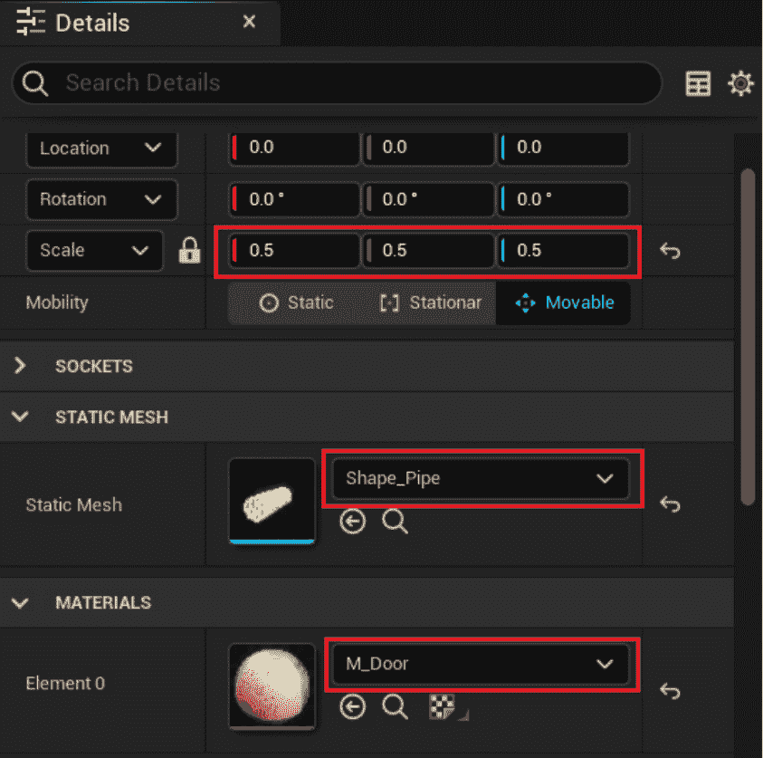

图 8.18 – 设置静态网格

- 5. 将 **静态网格** 的碰撞预设更改为 **重叠全部动态**：

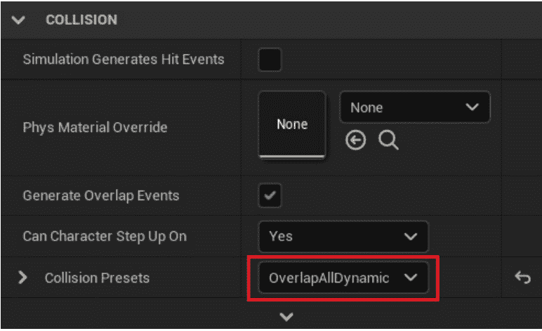

图 8.19 – 设置碰撞预设

### 重要说明

在制作游戏原型时，利用现成的资源而不是花时间从头创建每个资源通常是非常有用的。这使您能够将时间和精力集中在确定哪些机制能带来最佳游戏体验上，而不是花时间创建可能在机制从设计中移除后被丢弃的美术资源。

- 6. 我们将创建 `AmmoPickupCount` 变量来存储玩家收集弹药拾取物时将获得的弹药量。在 **我的蓝图** 面板的 **变量** 类别中，单击 + 按钮添加变量。在 **详细信息** 面板中，将其命名为 `AmmoPickupCount`，将 **变量类型** 更改为 **整数**，并检查 **实例可编辑** 属性：

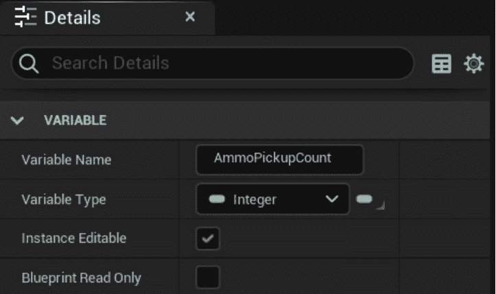

图 8.20 – AmmoPickupCount 变量

- 7. 编译蓝图，然后将 AmmoPickupCount 默认值设置为 15。
- 8. 我们将使用 BP_AmmoPickup 的事件 ActorBeginOverlap 来检查是否是玩家（第一人称角色）正在重叠 BP_AmmoPickup 的实例，并增加玩家当前弹药值。我们将使用以下节点：

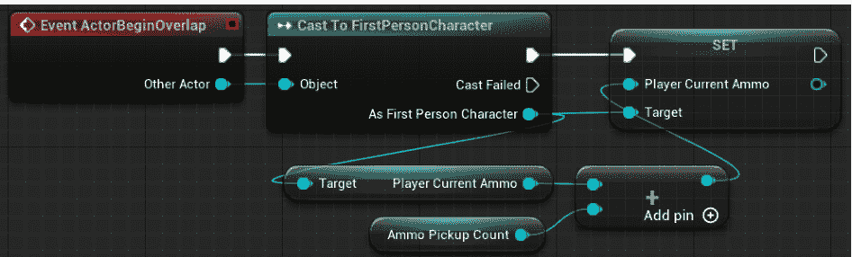

图 8.21 – 增加玩家弹药

- 9. 在事件图的空白处右键单击并添加事件 ActorBeginOverlap。
- 10. 从 **事件 ActorBeginOverlap** 节点的 **其他角色** 输出引脚拖出一根线并添加 **转换为第一人称角色** 节点。
- 11. 从 **作为第一人称角色** 引脚拖出一根线并添加 **设置玩家当前弹药** 节点。
- 12. 从 **作为第一人称角色** 引脚拖出另一根线并添加 **获取玩家当前弹药** 节点。
- 13. 从 **获取玩家当前弹药** 输出引脚拖出一根线到空白处并创建 **添加** 节点。
- 14. 从 **添加** 节点的底部输入引脚拖出一根线并添加 **获取弹药拾取数量** 节点。
- 15. 将 **添加** 节点的输出引脚连接到 **设置玩家当前弹药** 节点的输入引脚。
- 16. 以前的步骤完成了 *图 8.21* 中显示的节点。接下来，当可收集物被拾取时，让我们播放声音并销毁实例，如以下屏幕截图所示：

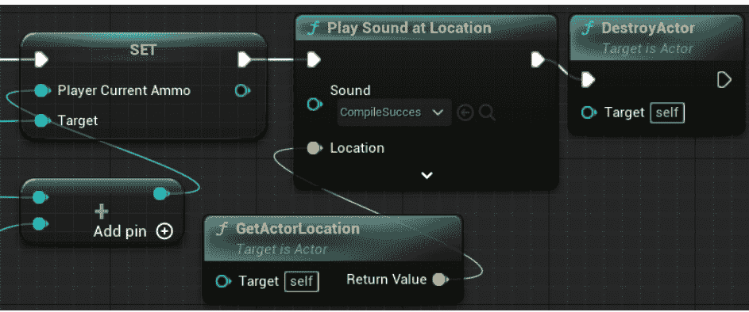

图 8.22 – 播放声音并销毁实例

- 17. 从 **设置玩家当前弹药** 节点的白色输出引脚拖出一根线到空白处并添加 **在位置播放声音** 节点。
- 18. 对于我们的原型，我们将使用来自 **引擎内容** 的声音波形。单击 **声音** 下拉菜单，然后单击齿轮图标以访问 **视图** 选项。检查 **显示引擎内容** 选项，并从列表中选择 **编译成功** 声音波形：

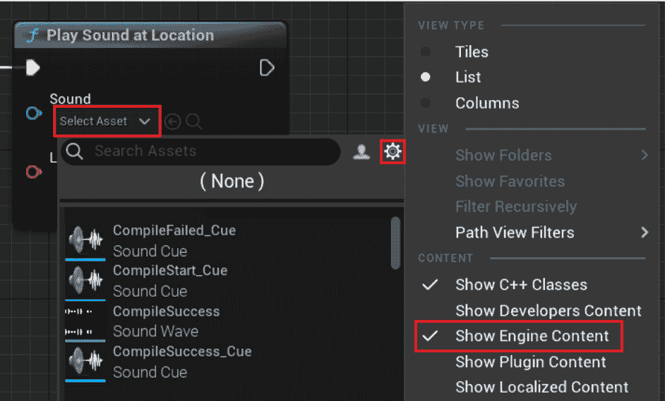

图 8.23 – 在资产列表中显示引擎内容

- 19. 从 **位置** 输入引脚拖出一根线到空白处并添加 **获取 Actor 位置** 节点。
- 20. 从 **在位置播放声音** 节点的白色输出引脚拖出一根线到空白处并添加 **销毁 Actor** 节点，以确保每个可收集物只能被拾取一次。
- 21. 编译并保存 **BP_AmmoPickup** 蓝图。
- 22. 现在，返回关卡编辑器，将 **BP_AmmoPickup** 蓝图从 **内容浏览器** 拖到关卡中以创建实例。在关卡周围的不同位置添加更多实例，以在区域中散布弹药拾取物。保存关卡并单击 **播放** 以测试游戏。您应该发现，每次踩到弹药拾取物时，弹药计数器都会增加。

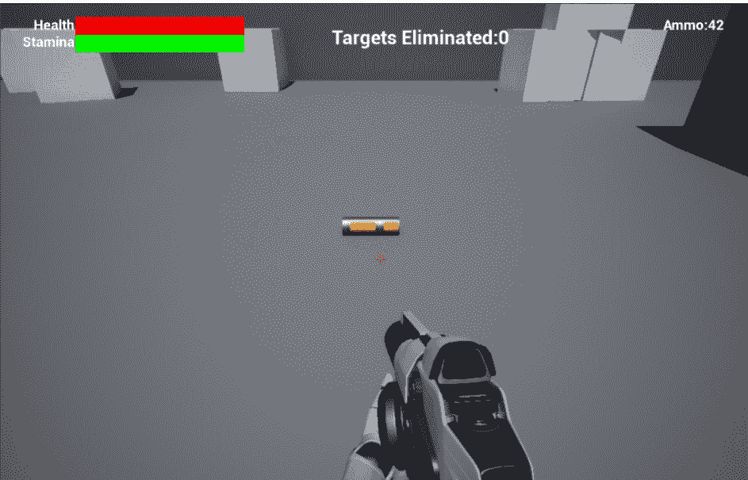

图 8.24 – 收集弹药拾取物以增加弹药计数器

我们已了解如何为拾取物创建蓝图，以便在收集时修改玩家状态。我们需要执行的最后几个步骤之一是创建玩家获胜的条件。我们将在下一部分中介绍此内容。

### 设置游戏玩法胜利条件

我们将修改 **抬头显示** 蓝图和玩家角色蓝图，以考虑玩家必须努力达到的目标目标。我们将在抬头显示中将目标目标显示在目标计数旁边，以便玩家可以轻松查看需要摧毁多少个目标才能达到目标。

我们还将创建另一个表示胜利菜单屏幕的小部件蓝图，当玩家达到目标时将向其显示该屏幕。最后，我们将实现检查玩家是否获胜并显示胜利菜单屏幕所需的逻辑。

### 在抬头显示中显示目标目标

首先，我们需要在 **第一人称角色** 蓝图中创建一个变量，以确定我们要求玩家摧毁多少个目标才能赢得游戏。然后，我们需要在 **抬头显示** 蓝图中向玩家显示此信息。

按照以下步骤显示目标目标：

- 1. 在内容浏览器中，访问 /Content/FirstPersonBP/Blueprints 文件夹并双击 **第一人称角色** 蓝图。
- 2. 在 **我的蓝图** 面板的 **变量** 类别中，单击 + 号添加变量，将其命名为 **目标目标**，并将 **变量类型** 更改为 **整数**。
- 3. 编译 **第一人称角色** 蓝图，暂时将 **默认值** 设置为 2：

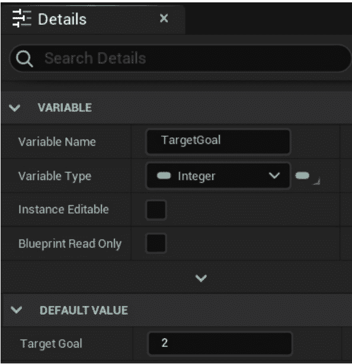

### 图 8.25 – TargetGoal 整数变量

- 4. 编译、保存并关闭蓝图编辑器。

- 5. 在内容浏览器中，访问 /Content/FirstPersonBP/UI 文件夹，然后双击 HUD 蓝图以打开 UMG 编辑器。我们将按照以下截图所示，向 Goal Tracker 添加两个文本对象：

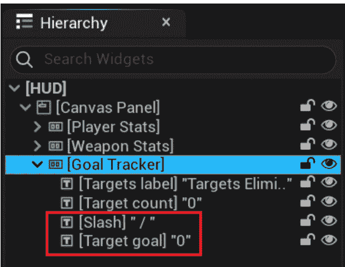

### 图 8.26 – 带有新元素的 HUD Goal Tracker

- 6. 在设计器视图中，从调色板面板拖动一个文本对象到层级面板中的 Goal Tracker 对象。

- 7. 在详情面板中，将名称更改为 Slash。将 Content 类别下的 Text 字段更改为 /（包括斜杠前后的空格），并将字体大小设置为 32。

- 8. 将另一个文本对象拖动到 Goal Tracker 上。在详情面板中，将名称更改为 Target goal。将 Content 类别下的 Text 字段更改为 0，并将字体大小设置为 32。新的 Goal Tracker 将如下所示：

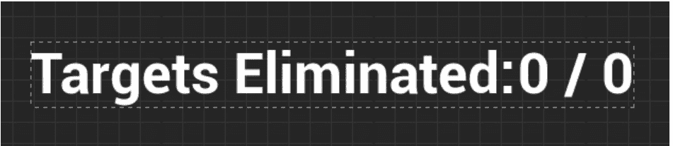

### 图 8.27 – Goal Tracker 显示目标计数和目标目标

- 9. 现在我们需要将 HUD 的 `Target goal` 绑定到 **FirstPersonCharacter** 蓝图的 `TargetGoal` 变量。在 **详情** 面板中，找到 **Text** 字段旁边的 **Bind** 按钮并创建新绑定，如下所示：

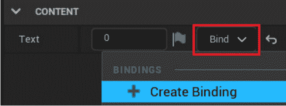

### 图 8.28 – 为 Target goal 创建绑定

- 10. 我们将遵循与在 _第 7 章，创建屏幕 UI 元素_ 中创建的其他 HUD 绑定相同的模式来处理此绑定。添加一个 **获取玩家角色** 节点，使用 **转换为 FirstPersonCharacter** 节点进行转换，然后从 **作为第一人称角色** 引脚拖动以添加 **获取目标目标** 节点。最后，将 **转换为** 节点和 **目标目标** 节点都附加到 **返回节点**：

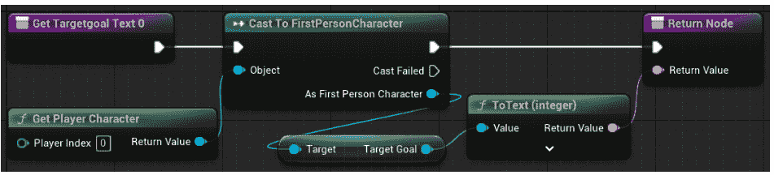

### 图 8.29 – Target Goal 变量的值将显示在 HUD 上

- 11. 编译、保存并运行游戏。

您应该会看到，随着目标被销毁，目标计数会递增。目标计数右侧显示的 Target Goal 不会改变。现在，我们需要确保当玩家达到目标目标时获得反馈。

### 创建胜利菜单屏幕

为了在玩家赢得游戏时提供反馈，我们将创建一个 **WinMenu** 屏幕，该屏幕将在销毁所需数量的目标时出现。要创建此 **WinMenu**，我们需要另一个蓝图小部件，就像我们为 HUD 创建的那个一样：

- 1. 在 **内容浏览器** 中，访问 `/Content/FirstPersonBP/UI` 文件夹，然后在空文件夹空间上右键单击。转到 **用户界面 | 小部件蓝图** 并将生成的蓝图命名为 `WinMenu`：

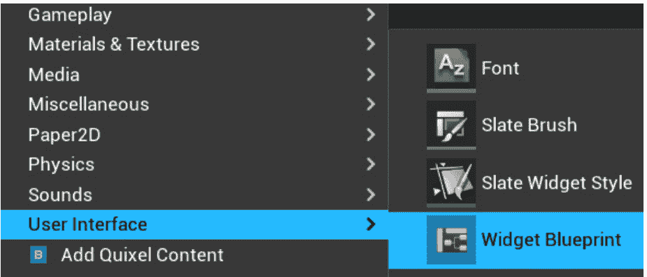

### 图 8.30 – 创建小部件蓝图

- 2. 双击此蓝图以打开 UMG 编辑器。我们将为这个菜单屏幕设置三个元素。第一个将是一个简单的 `text` 对象，它会向玩家广播 `You Win!`。其他两个元素将是按钮，允许玩家重新启动游戏或退出游戏：

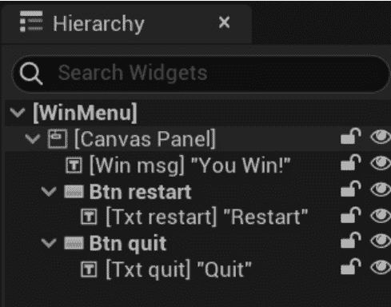

### 图 8.31 – WinMenu 小部件蓝图的元素

- 3. 将 **调色板** 面板中的文本对象拖动到 **层级** 面板中的 **CanvasPanel** 对象上。在 **详情** 面板中，将名称更改为 `Win msg`，单击 **锚点** 下拉菜单，并选择屏幕中心带有锚点的选项：

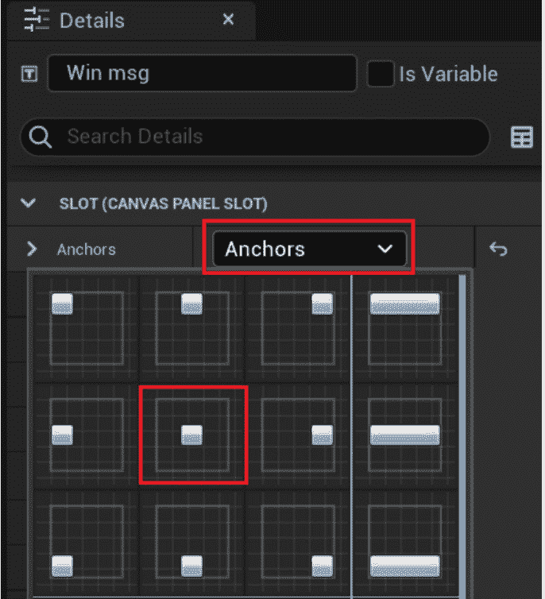

### 图 8.32 – 此对象的锚点位于屏幕中心

- 4. 将位置 X 设置为 -190.0，位置 Y 设置为 -250.0。检查“根据内容调整大小”属性，因此我们无需调整尺寸 X 和 尺寸 Y 的值：

| 属性 | 值 |
| :--- | :--- |
| SLOT (画布面板槽位) | |
| 锚点 | 锚点 v |
| 位置 X | -190.0 |
| 位置 Y | -250.0 |
| 尺寸 X | 100.0 |
| 尺寸 Y | 30.0 |
| 对齐方式 | 0.0 0.0 |
| 根据内容调整大小 | [x] |
| ZOrder | 0 |

### 图 8.33 – 对象的位置相对于其锚点

- 5. 将 CONTENT 类别下的 Text 字段更改为你赢了！。在 APPEARANCE 类别中，将字体大小设置为 72，并在 颜色和不透明度 中，单击彩色矩形以打开颜色选择器并选择任意绿色：

| 类别 | 设置 |
| :--- | :--- |
| CONTENT | |
| 文本 | 你赢了！ |
| APPEARANCE | |
| 颜色和不透明度 | [绿色方块] |
| 字体 | |
| 字体系列 | Roboto |
| 字型 | 粗体 |
| 尺寸 | 72 |

### 图 8.34 – 设置文本、颜色和字体大小

- 6. 从调色板面板拖动一个按钮对象到层级面板中的 CanvasPanel 对象上。在详情面板中，将名称更改为 Btn restart，单击锚点下拉菜单，并选择屏幕中心带有锚点的选项。

- 7. 将位置 X 设置为 -180.0，位置 Y 设置为 -50.0，尺寸 X 设置为 360.0，尺寸 Y 设置为 100.0：

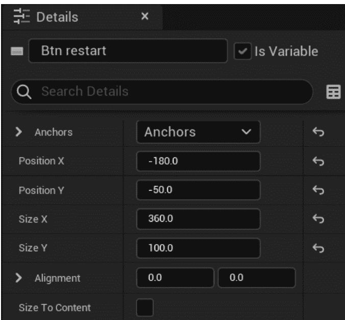

### 图 8.35 – 设置按钮的位置和尺寸

- 8. 从调色板面板拖动一个文本对象到层级面板中的 Btn restart 对象上。在详情面板中，将名称设置为 Txt restart，将 Content 类别下的 Text 字段更改为 重新开始，并将字体大小设置为 48。

- 9. 从调色板面板拖动另一个按钮对象到层级面板中的 CanvasPanel 对象上。在详情面板中，将名称更改为 Btn quit，单击锚点下拉菜单，并选择屏幕中心带有锚点的选项。

- 10. 将位置 X 设置为 -180.0，位置 Y 设置为 150.0，尺寸 X 设置为 360.0，尺寸 Y 设置为 100.0。

- 11. 从调色板面板拖动一个文本对象到层级面板中的 Btn quit 对象上。在详情面板中，将名称设置为 Txt quit，将 Content 类别下的 Text 字段更改为 退出，并将字体大小设置为 48。

WinMenu 小部件蓝图在 UMG 编辑器中应如下所示：

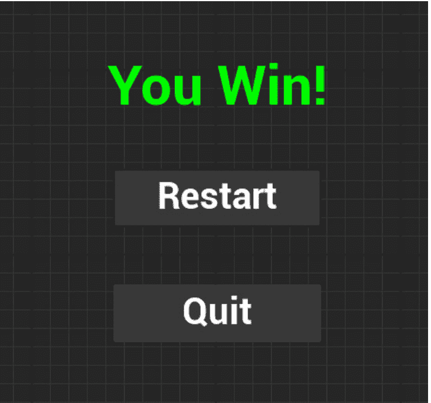

### 图 8.36 – WinMenu 元素

- 12. 现在，我们需要添加在按下重新开始按钮时执行的操作。单击 Btn restart 对象，向下滚动到详情面板底部，然后单击 On Clicked 事件旁边的 + 按钮。这将添加一个在单击按钮时触发的事件：

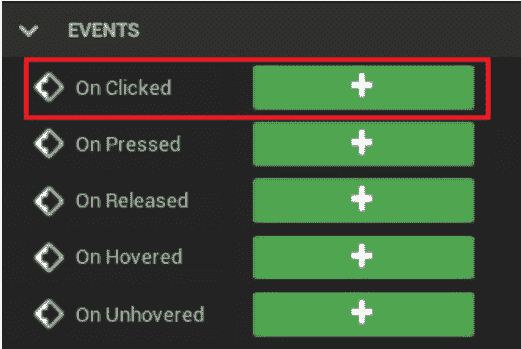

### 图 8.37 – 添加按钮事件

- 13. 将进入 图表 视图，其中将出现 On Clicked (Btn restart) 节点。从 On Clicked (Btn restart) 节点的输出引脚拖动到 图表 上，并添加一个 Open Level (by Object Reference) 节点。在 Level 参数中，选择我们正在使用的关卡，即 FirstPersonExampleMap。当玩家单击按钮时，该节点将重新加载关卡，重置关卡的所有方面，包括目标、弹药收藏品和玩家。

- 14. 从 Open Level (by Object Reference) 节点的输出引脚拖动到 图表 上，并添加一个 Remove from Parent 节点。此节点将从视图中移除 WinMenu 小部件。我们希望在关卡重置后菜单消失：

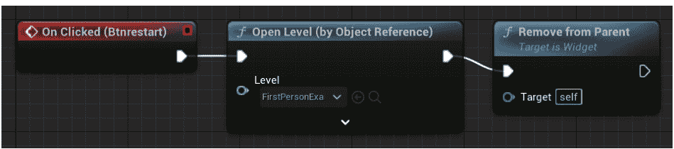

### 图 8.38 – 重新开始按钮的操作

- 15. 我们将为 **退出** 按钮执行类似步骤。返回到 **设计器** 视图并单击 **Btn quit** 对象，向下滚动到 **详情** 面板底部，然后单击 **On Clicked** 事件旁边的 + 按钮以添加事件。

- 16. 将进入 **图表** 视图，其中将出现 **On Clicked (Btn quit)** 节点。从 **On Clicked (Btn quit)** 节点的输出引脚拖动到 **图表** 上，并添加一个 **Quit Game** 节点，以便玩家可以通过单击 **退出** 按钮关闭游戏：

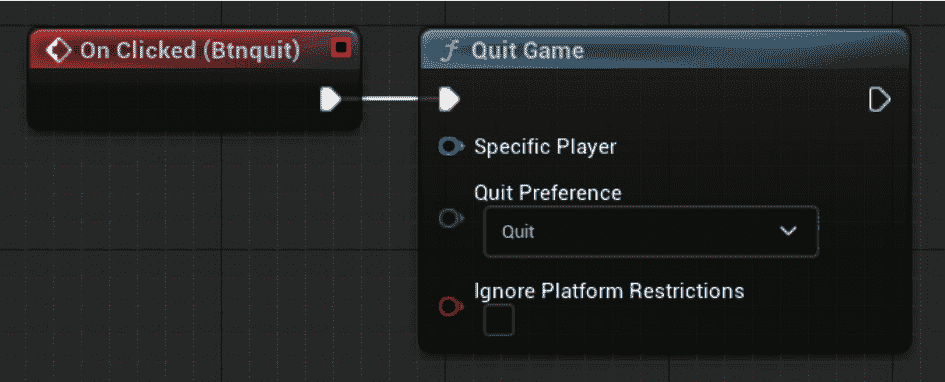

### 图 8.39 – 退出按钮的操作

- 17. 编译、保存并关闭 UMG 编辑器。

现在我们已经创建了 **WinMenu**，需要告诉游戏何时向玩家显示它。

### 显示 WinMenu

与我们对 **HUD** 小部件蓝图所做的一样，我们将从 **FirstPersonCharacter** 蓝图内部显示 **WinMenu**。我们将创建一个名为 **结束游戏** 的自定义事件，该事件将在游戏结束时调用。

按照以下步骤操作：

1. 在 **内容浏览器** 中，访问 `/Content/FirstPersonBP/Blueprints` 文件夹并双击 `FirstPersonCharacter` 蓝图。

2. 右键单击 **事件图表** 并添加自定义事件。将其重命名为 `End Game`：

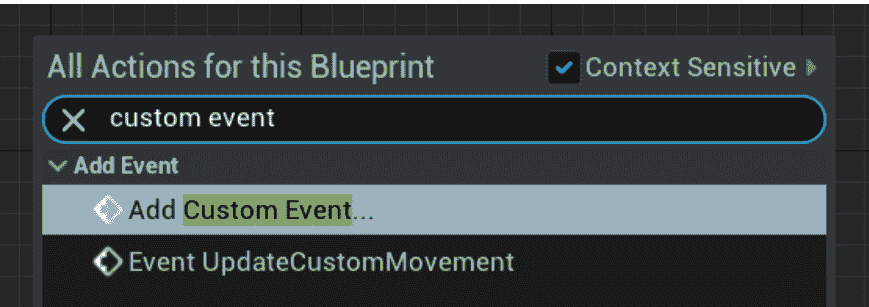

图 8.40 – 添加自定义事件

3. 从 **结束游戏** 的输出执行引脚拖出一根线，添加 **设置游戏暂停** 节点，并选中 **暂停** 复选框。当玩家在 **胜利菜单** 中选择选项时，此节点将暂停游戏：

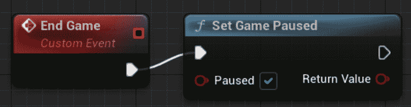

图 8.41 – 暂停游戏

4. 右键单击 **事件图表** 并添加 **获取玩家控制器** 节点。从 **返回值** 输出引脚拖出一根线并添加 **设置显示鼠标光标** 节点。选中 **显示鼠标光标** 旁边的复选框，并将此节点附加到 **设置游戏暂停** 的输出执行引脚。这样，游戏暂停后玩家就可以重新控制鼠标光标了：

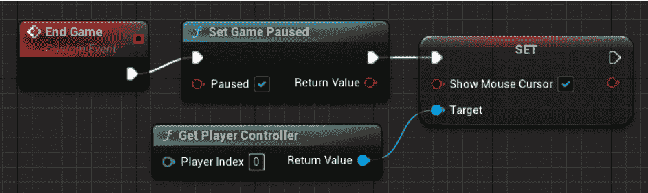

图 8.42 – 显示鼠标光标

5. 从 **设置显示鼠标光标** 节点的输出执行引脚拖出一根线并添加创建小部件节点。在类参数中，选择胜利菜单。

6. 从创建小部件节点的返回值输出引脚拖出一根线并添加添加到视口节点：

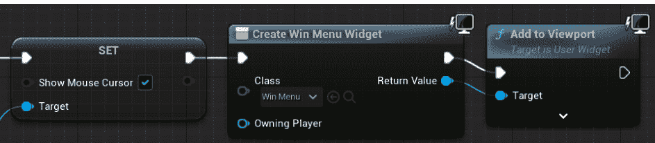

图 8.43 – 创建并显示胜利菜单

7. 在结束游戏事件的节点周围创建注释。将注释标记为 End Game: Shows Win Menu。编译并保存蓝图。

最后一步是确定将触发结束游戏自定义事件的条件。

### 触发胜利

我们希望当玩家销毁足够数量的圆柱体目标以达到目标数量时，结束游戏 事件发生。我们将在 **第一人称角色** 蓝图中创建一个名为 **检查目标** 的自定义事件，每当销毁一个目标时，BP_CylinderTarget 都会调用该事件。

我们将创建的 **检查目标** 自定义事件的操作如下：

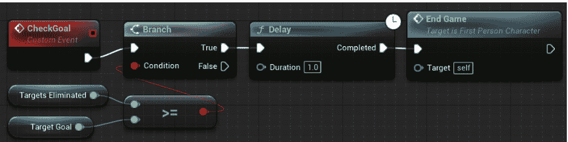

图 8.44 – 检查是否已达成目标

为此，请执行以下步骤：

- 1. 右键单击 **第一人称角色** 蓝图的事件图表并添加自定义事件。将其重命名为 `CheckGoal`。
- 2. 从 **检查目标** 节点的白色输出引脚拖出一根线到空网格区域并添加 **分支** 节点。
- 3. 从 **分支** 节点的 **条件** 输入引脚拖出一根线到空白区域并添加 **大于等于** 节点。
- 4. 从 **大于等于** 节点的顶部输入引脚拖出一根线并添加 **获取已消除目标数** 节点。
- 5. 从 **大于等于** 节点的底部输入引脚拖出一根线并添加 **获取目标数量** 节点。
- 6. 从 **分支** 节点的 **真** 输出引脚拖出一根线并添加 **延迟** 节点。在 **持续时间** 参数中输入 `1.0`。此节点用于在显示 **胜利菜单** 前等待 1 秒。
- 7. 从 **延迟** 节点的 **完成** 输出引脚拖出一根线并添加 **结束游戏** 节点。此节点将调用我们创建的 **结束游戏** 自定义事件以显示 **胜利菜单**。
- 8. 编译、保存并关闭蓝图编辑器。

现在，我们将修改 **BP_CylinderTarget**，以便在每次销毁目标时调用 **检查目标** 事件：

- 1. 在 **内容浏览器** 中，访问 `/Content/FirstPersonBP/Blueprints` 文件夹并双击 **BP_CylinderTarget** 蓝图。
- 2. 将 **事件图表** 移至 **事件命中** 操作的末尾。将 **销毁角色** 节点向右拖动，为另一个节点腾出空间。
- 3. 从 **强制转换** 节点的 **作为第一人称角色** 输出引脚拖出一根线并添加 **检查目标** 节点。将 `++` 节点的白色输出引脚连接到 **检查目标** 节点的白色输入引脚，并将 **检查目标** 节点的输出引脚连接到 **销毁角色** 节点的白色输入引脚：

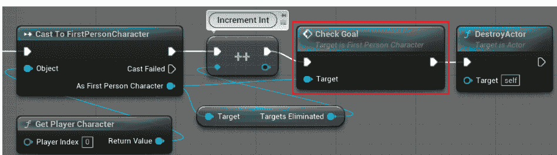

图 8.45 – 调用检查目标事件

- 4. 编译、保存并运行游戏。如果所有蓝图都设置正确，那么当你销毁第二个目标时，应该会看到游戏暂停且 **胜利菜单** 出现。单击 **重启** 按钮将重新加载关卡，单击 **退出** 将关闭会话：

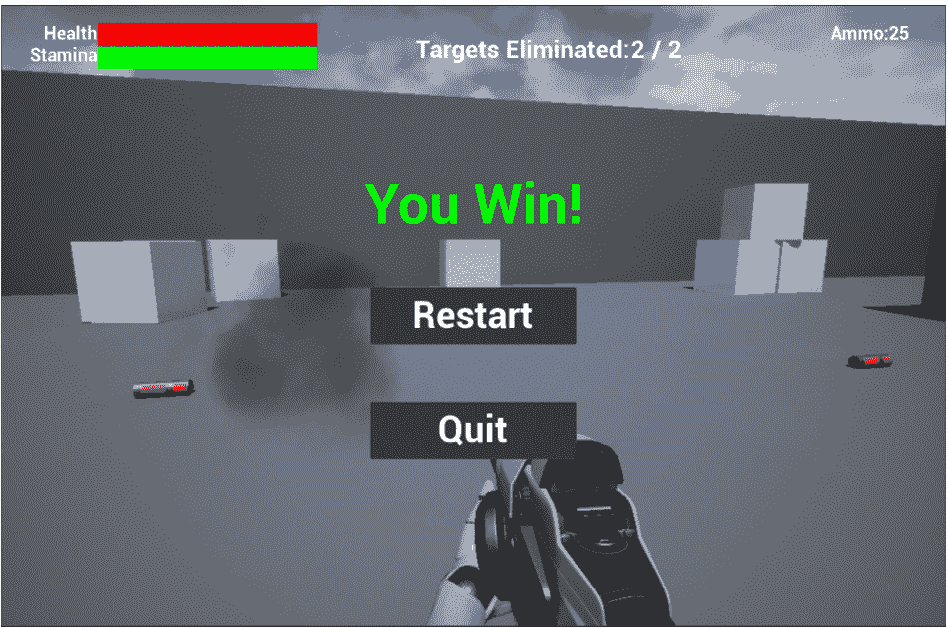

图 8.46 – 在游戏中显示胜利菜单

我们为玩家创建了一个目标数量，并创建了一个 **胜利菜单** 小部件蓝图，当玩家达成目标时会显示该小部件。**胜利菜单** 在玩家完成游戏时提供反馈和一些可供选择的选项。

### 总结

在本章中，我们通过对玩家能力添加限制并为玩家设定目标，增强了游戏体验。在此过程中，你学习了如何使用计时器重复操作、如何在游戏世界中创建可收集物体，以及如何创建菜单系统。

本章结束了 *第 2 部分*。构成视频游戏体验基础的元素已存在于我们构建的游戏中。如果你愿意，可以复制项目，增加目标数量，并花些时间自定义关卡布局，以创建独一无二的、适当具有挑战性的游戏体验。

在 *第 3 部分* 中，我们将开始探讨蓝图脚本和游戏开发的更高级主题：**人工智能（AI）**。我们还将为游戏添加新功能，并了解如何构建和发布游戏。

在下一章中，我们将用可以在点之间巡逻并在关卡中追踪玩家的智能敌人取代我们的圆柱体目标。

### 测验

- 1. 应该避免使用宏，因为它们会使脚本变得混乱。
  
  - a. 正确
  - b. 错误

- 2. 可以使用计时器作为事件刻度的替代方案，因为可以为操作设置较低的重复率。
  
  - a. 正确
  - b. 错误

- 3. 在我们的示例游戏中，可以为关卡中 BP_AmmoPickup 的每个实例定义不同数量的弹药，因为 AmmoPickupCount 变量被设置为 **实例可编辑**。
  
  - a. 正确
  - b. 错误

- 4. 同一时间只能向视口添加一个小部件蓝图。
  
  - a. 正确
  - b. 错误

- 5. 小部件蓝图可以带有在单击时触发事件的按钮。
  
  - a. 正确
  - b. 错误
