## 第 9 章：使用人工智能构建智能敌人

在本章中，我们将通过制作对玩家构成威胁的敌人，为我们的游戏玩法增加另一个挑战。为此，我们将放弃圆柱体目标，改用具有 AI 行为的敌人。我们希望设置具有潜在威胁、能够分析周围世界以做出决策的敌人。为了实现这一目标，我们将学习虚拟引擎内置的处理 AI 行为的工具，以及这些工具如何与我们的蓝图脚本交互。在此过程中，我们将涵盖以下主题：

- 设置敌方角色以进行导航
- 创建导航行为
- 让 AI 追逐玩家

本章结束时，我们将能够创建一个处理关卡中敌人导航的行为树，并在敌人处于视线范围内时让它们追逐玩家。

### 设置敌方角色以进行导航

到目前为止，我们的目标一直由基本圆柱体几何体表示。这非常适合制作非响应式目标，仅作为玩家的瞄准挑战。但是，一个会四处移动并对玩家构成威胁的敌人需要可识别的外观，至少要向玩家指示其移动方向。幸运的是，Epic 为虚拟引擎创建了一个免费可用的资产包，我们可以使用它将人形模型添加到我们的游戏中——这非常适合我们的新敌人类型。

在以下部分中，我们将学习如何从 Marketplace 导入资产包、扩展游玩区域、使用导航网格，以及创建敌人使用的 AI 资产。

### 从 Marketplace 导入

首先，我们将走出 Unreal Engine 编辑器，专注于 Epic Games 启动器。

按照以下步骤从 Marketplace 导入免费资产包：

- 1. 打开 Epic Games 启动器，然后单击窗口左侧的 Unreal Engine 部分。
- 2. 单击顶部的 **市场** 选项卡，并搜索 `animation starter pack`。
- 3. 单击 **动画入门包** 的 **添加到购物车** 按钮：

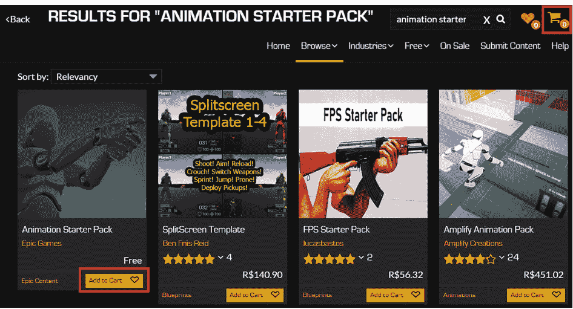

图 9.1 – Unreal Engine 市场

- 4. 单击位于右上角的 **购物车** 图标。
- 5. 在 **购物车** 面板中单击 **结账** 按钮。
- 6. 面板关闭后，单击 **动画入门包** 的图片以打开资产页面。
- 7. 单击 **添加到项目** 按钮，然后选择你一直用来构建游戏的项目。名为 `AnimStarterPack` 的文件夹将添加到项目的 `Content` 文件夹中。

**动画入门包** 包含我们用来表示敌人所需的资产。现在，我们需要为玩家和敌人提供更大的游玩区域。

### 扩展游玩区域

为我们的智能敌人追逐玩家提供有趣的环境，我们需要对默认第一人称示例地图布局进行一些更改。现有布局虽然适合射击目标，但对玩家来说太拥挤，无法躲避追赶他们的敌人。

为快速为游戏增添一些多样性，我们将把游玩区域扩大至早先的两倍宽度。我们还将创建一个可通过斜坡供玩家和敌人进入的高台区域。以下截图显示了新的关卡布局：

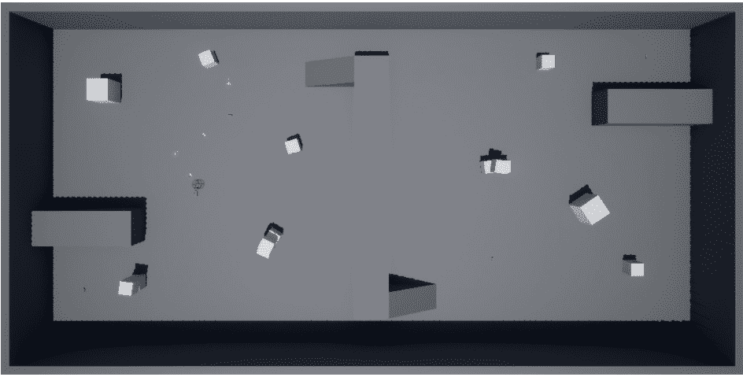

图 9.2 – 新的关卡布局

按照以下步骤修改关卡布局：

- 1. 在 Unreal 编辑器中打开项目。
- 2. 移除 **第一人称模板** 标签。同时，从关卡中移除所有 **BP_圆柱体目标** 实例。你可以通过单击视口中的实例或在世界大纲中查找它们来进行选择。
- 3. 单击 **地板** 将其选中。按住 **Alt** 键，单击并拖动 Y 轴箭头以复制 **地板**。沿 Y 轴移动 **地板** 副本，直到游玩区域宽度变为原来的两倍：

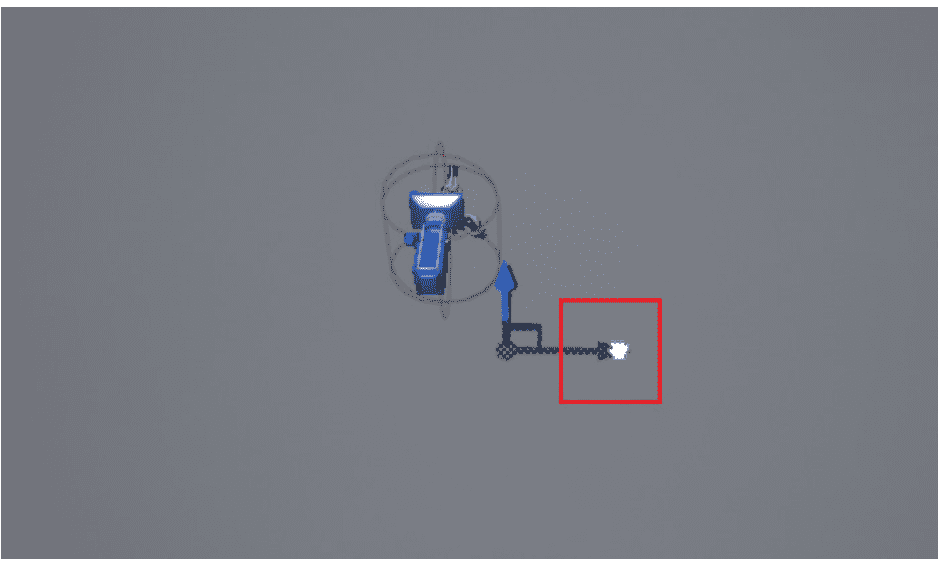

图 9.3 – 按住 Alt 键并单击拖动以复制 地板 网格

- 4. 我们需要缩放 **光照重要性体积** 和 **后处理体积** 以覆盖新的游玩区域。这些体积用于光照和效果：

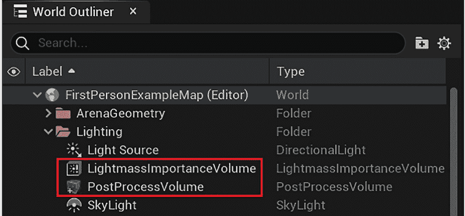

图 9.4 – 这些体积必须覆盖游玩区域

- 5. 在 **世界大纲** 面板中，单击 **光照重要性体积**。然后，在 **详情** 面板中，单击 **缩放** 属性的 **锁定** 图标将其解锁，并将 **缩放** 的 *Y 轴*（绿色）值设置为 `2.0`。
- 6. 接下来，在关卡编辑器中，沿 *Y 轴* 移动 **光照重要性体积**，直到其覆盖游玩区域：

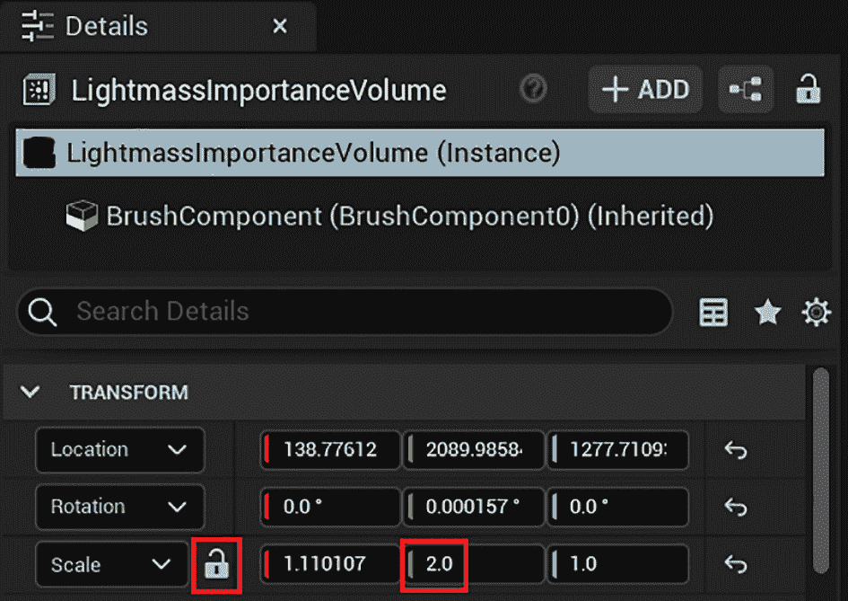

图 9.5 – 增加 光照重要性体积 的 Y 轴缩放

- 7. 在世界大纲面板中，单击 PostProcessVolume，然后在详情面板中，将 Scale 的 Y 轴（绿色）值设置为 44.0。完成后，转到关卡编辑器，沿 Y 轴移动 PostProcessVolume，直到其覆盖游玩区域：

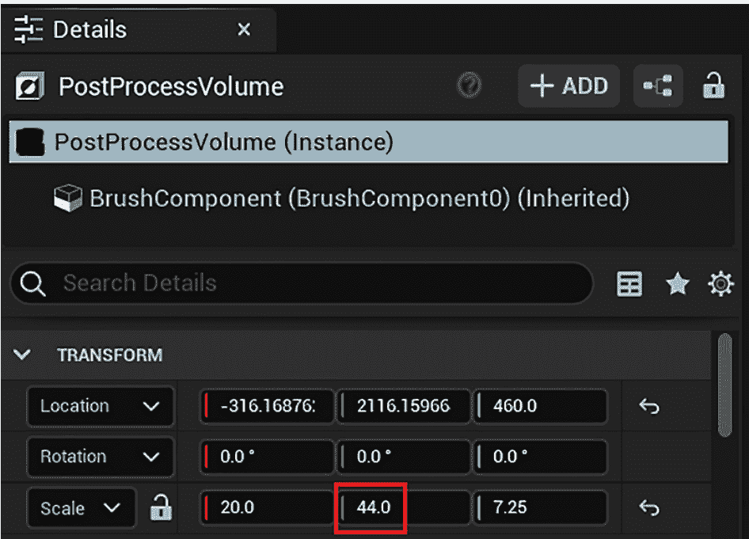

图 9.6 – 增加 PostProcessVolume 的 Y 轴缩放

- 8. 在关卡编辑器中，单击位于游玩区域中央的名为 **Wall3** 的墙体。在 **详情** 面板中，将 **位置** 的 Y 轴（绿色）值设置为 5945.0。
- 9. 接下来，单击名为 **Wall1** 的墙体。按住 *Alt* 键并单击拖动 Y 箭头以复制墙体。在 **详情** 面板中，将 **位置** 的 Y 轴（绿色）值设置为 4000.0。
- 10. 然后，单击名为 **Wall2** 的墙体。按住 *Alt* 键并单击拖动 Y 箭头以复制墙体。在 **详情** 面板中，将 **位置** 的 Y 轴（绿色）值设置为 4000.0。以下截图显示了当前的游玩区域外观：

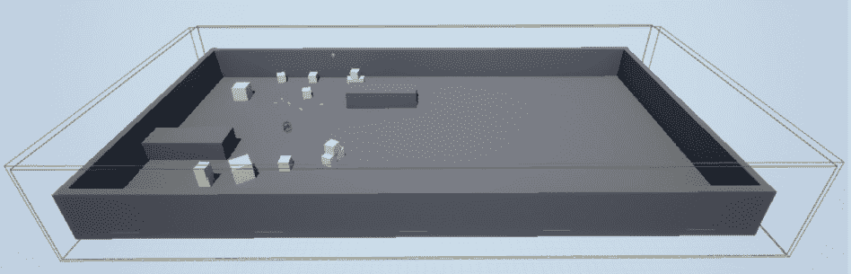

图 9.7 – 现在游玩区域宽度已加倍

- 11. 单击名为 **BigWall2** 的墙体部分。按住 *Alt* 键并单击拖动 *Y* 箭头以复制墙体。在 **详情** 面板中，将 **位置** 的 *Y 轴（绿色）* 值设置为 `5295.0`：

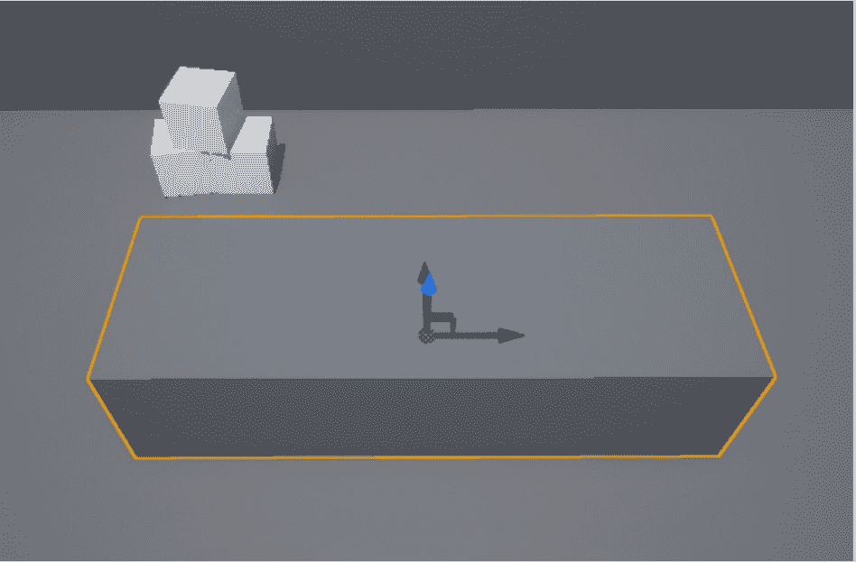

图 9.8 – 复制 BigWall2 并向右移动

- 12. 我们将变换 **BigWall2** 以在游玩区域中央创建一个更大的墙体。单击 **BigWall2** 将其选中。在 **详情** 面板中，将 **位置** 设置为 \(X = -280\)、\(Y = 2000\) 和 \(Z = 322\)，将 **缩放** 设置为 \(X = 30\)、\(Y = 4\) 和 \(Z = 3\)：

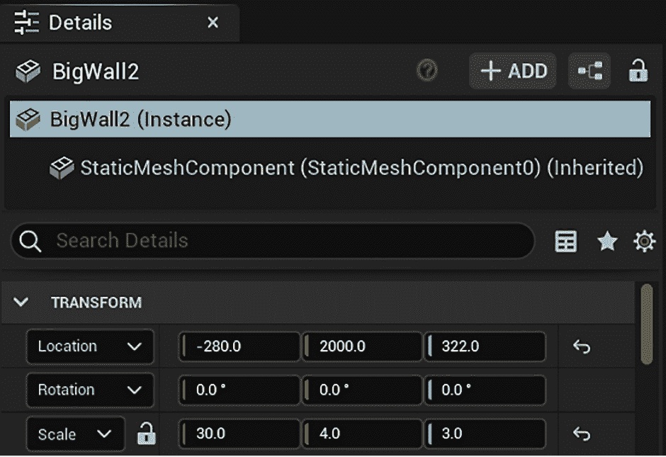

图 9.9 – 修改 BigWall2 的变换

- 13. 现在，我们将添加一个斜坡以进入高台区域。在内容浏览器中，访问 `Content/StarterContent/Shapes` 文件夹。拖动 `Shape_Wedge_B` 资产并将其放入关卡。在 **详情** 面板中，将 **位置** 设置为 \(X = -1630\)、\(Y = 2500\) 和 \(Z = 170\)，**旋转** 设置为 \(X = 0\)、\(Y = 0\) 和 \(Z = 90\)，**缩放** 设置为 \(X = 6\)、\(Y = 3\) 和 \(Z = 3\)：

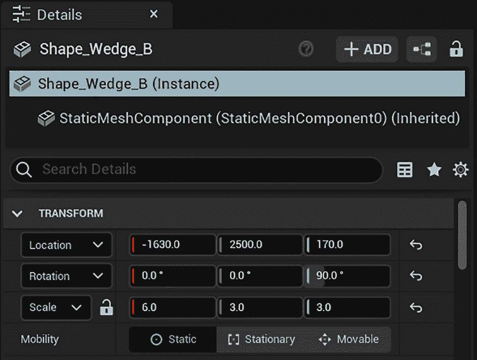

图 9.10 – 使用 *Shape_Wedge_B* 创建斜坡

- 14. 在 **材质** 下，将 **元素 0** 从 *Shape_Wedge_B* 更改为灰色 **CubeMaterial** 材质：

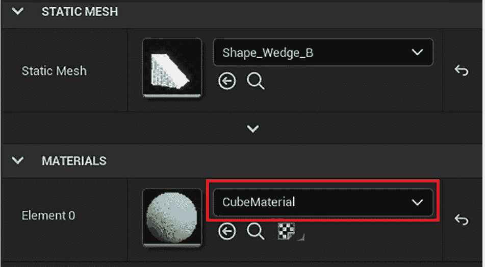

图 9.11 – 更改 Shape_Wedge_B 材质

- 15. 我们将创建另一个斜坡以进入高台区域。单击关卡中的 Shape_Wedge_B 实例。按住 Alt 键并单击拖动 X 箭头以复制斜坡。在详情面板中，将 Location 设置为 X= 1070、Y= 1500 和 Z= 170，Rotation 设置为 X= 0、Y= 0 和 Z= -90：

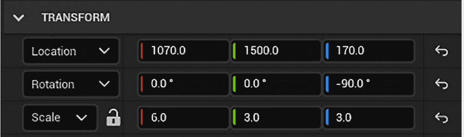

图 9.12 – 更改第二个斜坡的位置和旋转

我们的高台区域应该如下所示：

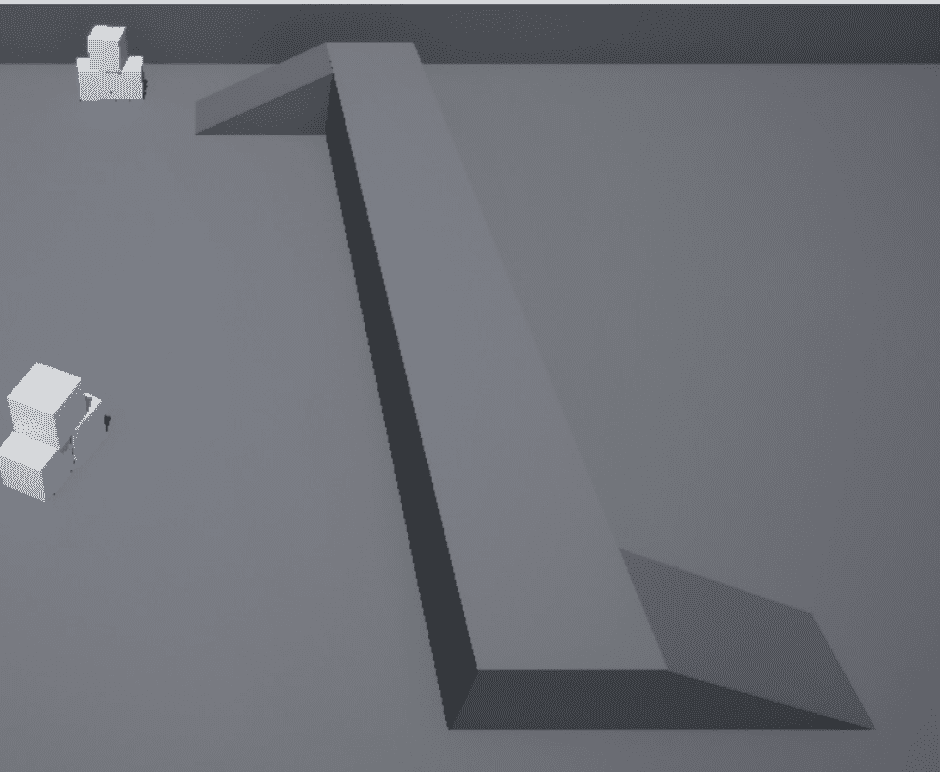

图 9.13 – 高台区域可通过斜坡进入

- 16. 抓取关卡一侧的一些白色箱子，并将其分布到另一侧。
- 17. 在关卡中添加更多 BP_AmmoPickup 实例。

我们已创建一个在玩家与敌人之间提供更多动作空间的关卡布局。现在，我们将创建敌人在关卡中移动所需的 NavMesh。

### 使用 NavMesh 资产使关卡可通行

为了创建允许敌人穿越关卡的 AI 行为，我们需要创建一个 AI 能够读取并用于导航的环境地图。这种地图是使用称为 **NavMesh** 的资产创建的，它是 **导航网格** 的缩写。

按照以下步骤为我们的游玩区域创建 NavMesh：

- 1. 在关卡编辑器中，单击工具栏上的 **创建** 按钮。将鼠标悬停在 **体积** 上以显示子菜单，然后单击 **导航网格体积**：

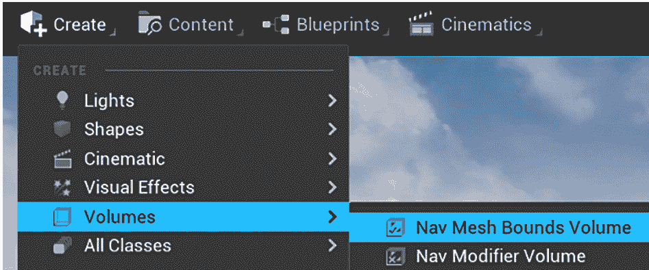

图 9.14 – 向关卡添加 NavMesh

- 2. 现在，我们需要移动并缩放 **导航网格体积** 对象，直到关卡的整个可行走空间都包含在其中。在 **详情** 面板中，将 **位置** 设置为 X = -316、Y = 2116 和 Z = 460，将 **缩放** 设置为 X = 20、Y = 44 和 Z = 7：

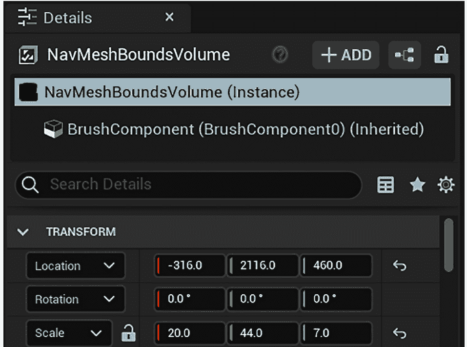

图 9.15 – 修改 NavMesh 的变换

- 3. 按键盘上的 P 键，查看 NavMesh 是否放置正确。如果是，你会在楼层上方看到一个绿色网格，如以下截图所示：

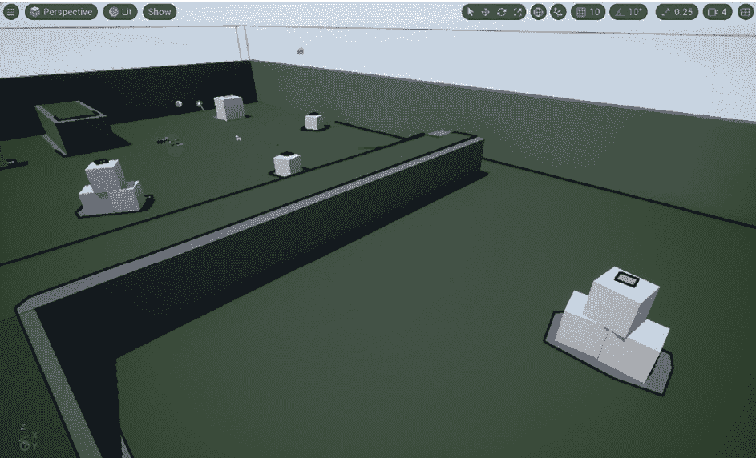

图 9.16 – 按 P 键切换 NavMesh 可见性

既然游戏区域和 NavMesh 已经设置好，我们可以将注意力重新放回创建敌人及其 AI 上。

### 创建 AI 资产

我们需要创建四种类型的资产，它们将共同协作来管理敌人的行为：

- 角色：表示关卡中敌人角色的蓝图类。
- AI 控制器：作为角色和行为树之间连接的蓝图类。它将行为树中生成的信息和操作路由到角色，角色将执行这些操作。
- 行为树：行为树是决策逻辑的来源，它将指导我们的敌人在什么条件下执行哪些操作。
- **黑板**：黑板是 AI 控制器和行为树之间共享的所有决策所用数据的容器。

以下是创建这四个资产的步骤：

1. 在内容浏览器中，访问 `/Content/FirstPersonBP/` 文件夹。在文件夹列表旁边的空白处右键单击，并选择 **新建文件夹** 选项。将新文件夹命名为 `Enemy`。

2. 打开您创建的 `Enemy` 文件夹，然后在空文件夹空间中右键单击并选择 **蓝图类**。

3. 在弹出窗口底部打开 **所有类** 组，并在搜索栏中输入 `ASP_`。选择 `Ue4ASP_Character` 类以创建新的角色蓝图。这是我们在章节开始时添加到项目中的 **动画入门包** 的基础角色类：

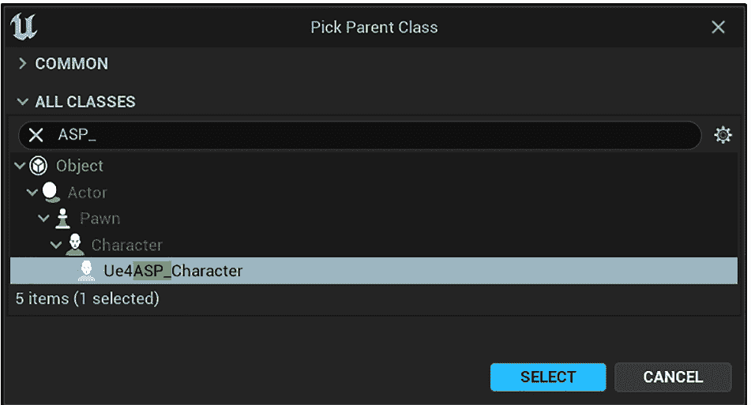

图 9.17 – 选择 EnemyCharacter 蓝图的父类

4. 将蓝图重命名为 `BP_EnemyCharacter`。

5. 现在，我们将创建 **AIController** 子类。在 `Enemy` 文件夹的空白处右键单击并选择 **蓝图类**。

6. 在弹出窗口底部打开 **所有类** 组，并在搜索栏中输入 `AIController`。选择 **AIController** 类，并将生成的蓝图命名为 `BP_EnemyController`。

7. 要创建 **行为树** 资产，在 `Enemy` 文件夹的空白处右键单击，将鼠标悬停在 **人工智能** 上以显示子菜单，并选择 **行为树**：

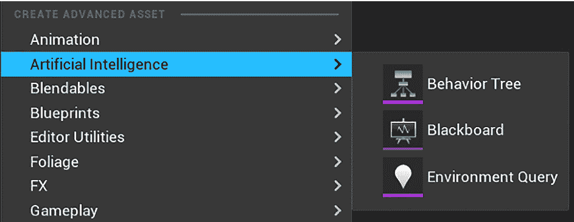

图 9.18 – 人工智能资产

8. 将 **行为树** 资产重命名为 `BT_EnemyBehavior`。

9. 最后，要创建 **黑板** 资产，在 `Enemy` 文件夹的空白处右键单击，将鼠标悬停在 **人工智能** 上以显示子菜单，并选择 **黑板**。将其命名为 `BB_EnemyBlackboard`。

10. 以下屏幕截图显示了 `Enemy` 文件夹的资产：

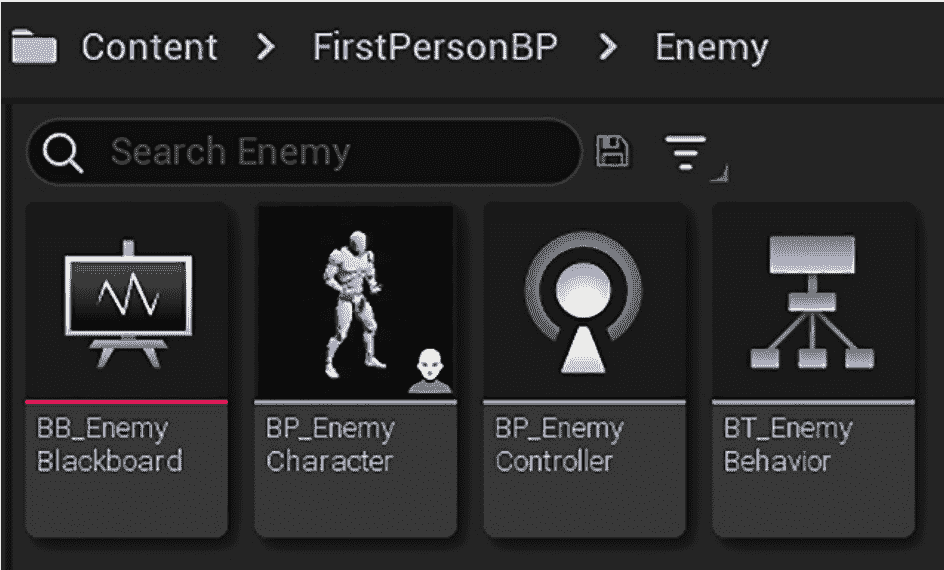

图 9.19 – Enemy 文件夹的资产

这些是我们将用于实现敌人角色 AI 的资产。接下来，我们需要对 `BP_EnemyCharacter` 蓝图进行一些修改。

### 设置 BP_EnemyCharacter 蓝图

由于我们将 `BP_EnemyCharacter` 创建为 `Ue4ASP_Character` 的子类，它继承了我们为导入的动画包创建的角色的所需网格、纹理和动画信息。我们希望保留其中一些信息，例如网格和动画。但是，我们需要确保 `BP_EnemyCharacter` 知道如何由正确的 AI 控制器控制。我们还将更改 `BP_EnemyCharacter` 的材质，并隐藏游戏中显示的胶囊体组件。

### 注意

当您打开没有任何脚本的蓝图时，将显示一个简单的编辑器，仅用于编辑默认值。您需要单击顶部的 **打开完整蓝图编辑器** 链接才能查看通常的布局。

按照以下步骤进行调整：

1. 打开 `BP_EnemyCharacter` 蓝图。

2. 单击工具栏上的 **类默认值** 按钮：

图 9.20 – 访问类默认值

3. 在 **详细信息** 面板中，找到 **PAWN** 类别。该类别的最后一个元素是 **AI 控制器类** 的下拉列表。将此下拉列表的选择更改为我们的新 **BP_EnemyController** 类：

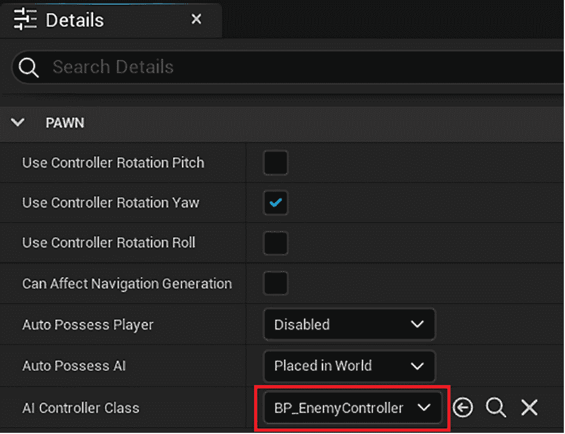

图 9.21 – 设置 AI 控制器类

4. 在 **组件** 面板中，单击 **网格 (CharacterMesh0)** (**已继承**)。然后，在 **详细信息** 面板中，找到 **材质** 类别，并将 **元素 0** 更改为我们创建的 **M_TargetRed** 材质：

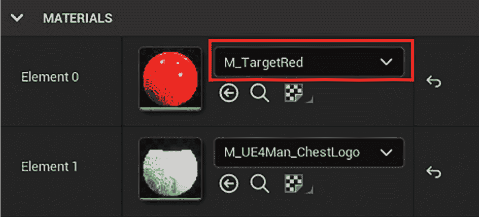

图 9.22 – 更改网格材质

5. 在 **组件** 面板中，单击 **胶囊体组件 (CollisionCylinder)** (**已继承**)。在 **详细信息** 面板中，将 **碰撞预设** 更改为 **BlockAllDynamic**，并在 **渲染** 类别中，检查 **游戏中隐藏** 属性：

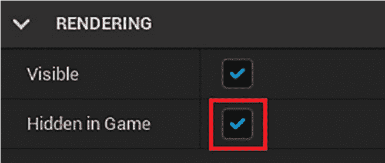

图 9.23 – 隐藏胶囊体组件

6. 编译蓝图并将 `BP_EnemyCharacter` 蓝图拖放到关卡中，以在我们的游戏区域中创建敌人的实例。

在本节中，我们学习了如何从市场导入资产。我们扩展了关卡，并使用 NavMesh 使其可遍历。我们创建了 AI 资产，现在准备实现敌人的导航行为。

### 创建导航行为

我们敌人的第一个目标是让它在地图上我们创建的点之间导航。为了实现这一点，我们需要在地图上创建敌人将要导航到的点，然后我们需要设置行为，使敌人循环移动到每个点。

### 设置巡逻点

让我们先创建 AI 要巡逻的路径。我们将使用 **球体触发器** 来表示巡逻点，因为它会生成重叠事件并且在游戏中隐藏。关卡上至少需要两个巡逻点，因为 `BP_EnemyCharacter` 的每个实例都可以在两个巡逻点之间导航。

按照以下步骤创建巡逻点：

1. 在关卡编辑器中，单击工具栏上的 **创建** 按钮，然后单击 **球体触发器**。将球体触发器放置在地板上的任何位置：

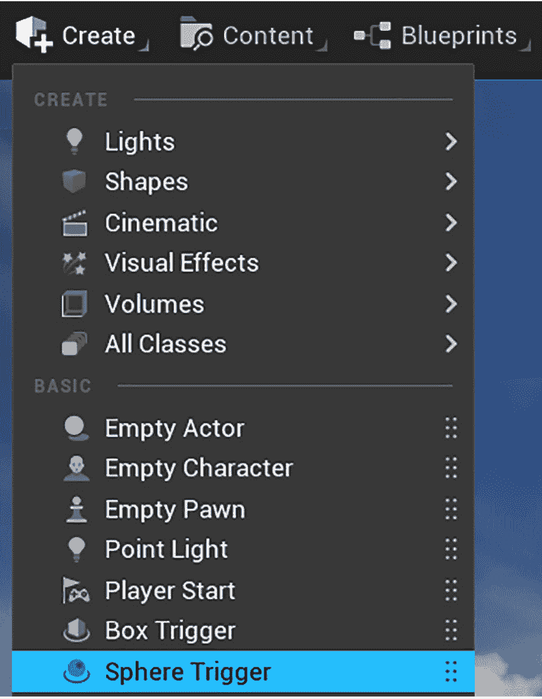

图 9.24 – 创建球体触发器

2. 在 **详细信息** 面板中，将球体触发器重命名为 `PatrolPoint1`。

3. 创建另一个球体触发器并将其命名为 `PatrolPoint2`。将其放置在距离第一个巡逻点较远的位置，以便两点之间的移动明显。

已建立巡逻点后，我们可以继续构建敌人的智能。

### 创建黑板键

黑板使用键和值来存储信息。
`BB_EnemyBlackboard` 将有两个键，一个用于存储当前巡逻点，另一个用于存储对玩家角色的引用。此信息将由行为树引用。

以下是创建键的步骤：

1. 从内容浏览器中打开 `BB_EnemyBlackboard`。

2. 单击 **新建键**，并将 **键类型** 选择为 **对象**。

3. 将此新键命名为 `CurrentPatrolPoint`。

4. 单击 **键类型** 旁边的展开箭头，并使用下拉列表将 **基类** 更改为 **演员**：

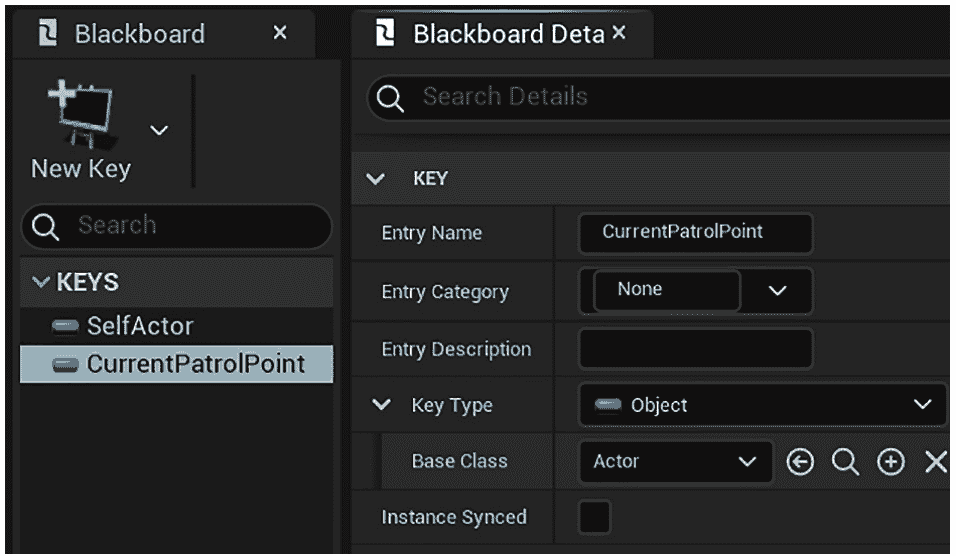

图 9.25 – 创建 CurrentPatrolPoint 键

5. 现在，让我们为玩家角色创建键。单击 **新建键**，并将 **键类型** 选择为 **对象**。

6. 将此新键命名为 `PlayerCharacter`。单击 **键类型** 旁边的展开箭头，并将 **基类** 更改为 **角色**：

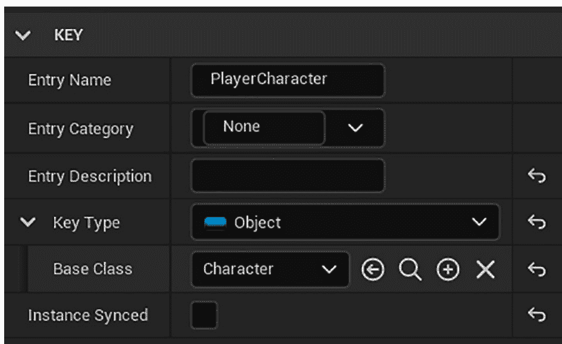

图 9.26 – 创建 PlayerCharacter 键

现在，我们需要将 **黑板** 中 **CurrentPatrolPoint** 键的值设置为关卡中的实际巡逻点。我们可以从 `BP_EnemyCharacter` 蓝图中执行此操作。

### 在 BP_EnemyCharacter 中创建变量

我们将在 `BP_EnemyCharacter` 中创建变量，以存储巡逻点和黑板的键名。

按照以下步骤创建变量：

- 1. 打开 `BP_EnemyCharacter` 蓝图。
- 2. 在 **我的蓝图** 面板的 **变量** 类别中，单击 + 按钮添加变量，并将其命名为 `PatrolPoint1`。
- 3. 在 **详细信息** 面板中，单击 **变量类型** 下拉菜单并搜索 `Actor`。将鼠标悬停在 **演员** 上以显示子菜单，然后选择 **对象引用**。检查 **实例可编辑** 属性：

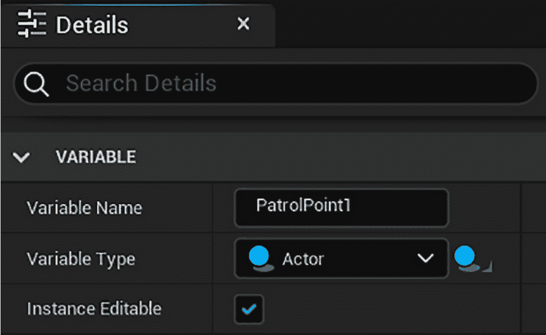

图 9.27 – 创建引用演员实例的变量

- 4. 按照相同步骤创建第二个名为 `PatrolPoint2` 的 **演员** 变量。
- 5. 创建另一个名为 `CurrentPatrolPoint` 的 **演员** 变量。这次，保持 **实例可编辑** 属性未选中。
- 6. 这些是我们创建的变量。睁开的眼睛图标表示该变量是 **实例可编辑** 的，因此 **PatrolPoint1** 和 **PatrolPoint2** 变量的引用将在关卡编辑器中设置：

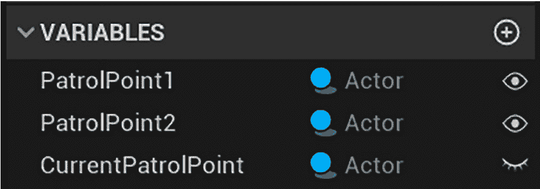

图 9.28 – 巡逻点变量

- 7. 在 **我的蓝图** 面板中创建另一个变量。在 **详细信息** 面板中，将变量命名为 `PatrolPointKeyName`，并将 **变量类型** 更改为 **名称**。编译蓝图并将 **默认值** 设置为 `CurrentPatrolPoint`：

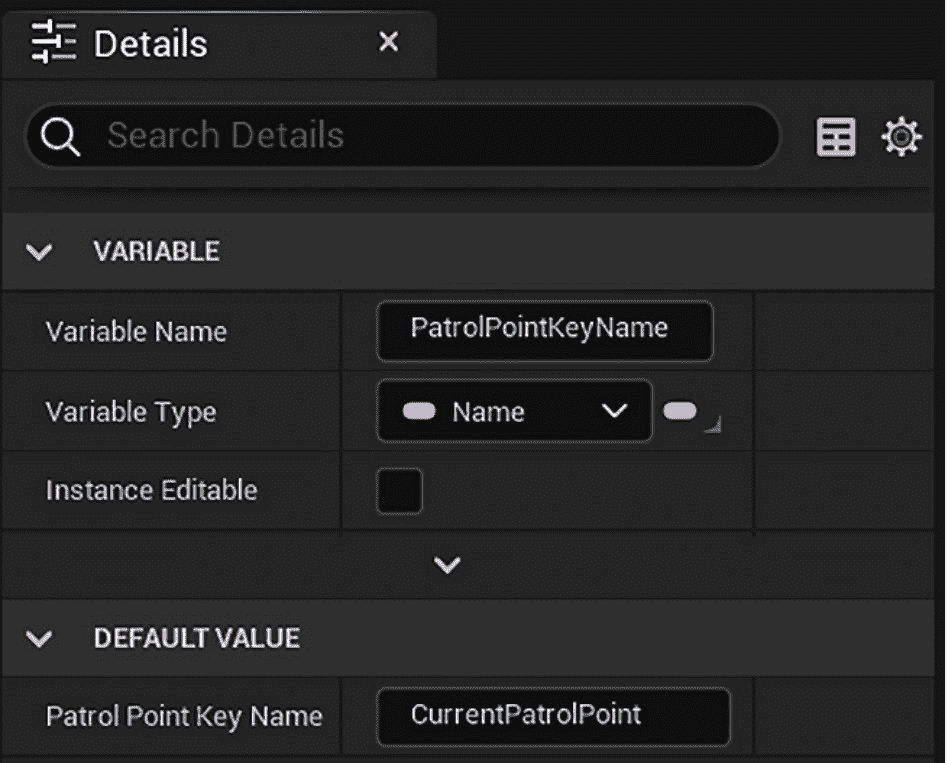

图 9.29 – 此变量存储黑板键名称

现在，我们可以使用这些变量更新 BB_EnemyBlackboard 上的值。

### 更新当前巡逻点键

我们将创建一个宏来更新 BB_EnemyBlackboard 的 CurrentPatrolPoint 键，因为它将在多个位置使用。

以下是创建宏的步骤：

- 1. 在 **我的蓝图** 面板中，单击 **宏** 类别中的 + 按钮以创建宏。将宏的名称更改为 UpdatePatrolPointBB：

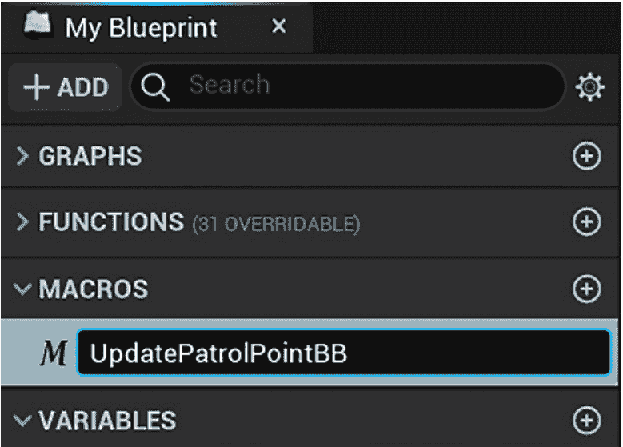

图 9.30 – 创建宏

- 2. 在宏的 **详细信息** 面板中，创建名为 `In` 的输入参数和名为 `Out` 的输出参数，两者的类型均为 **执行**：

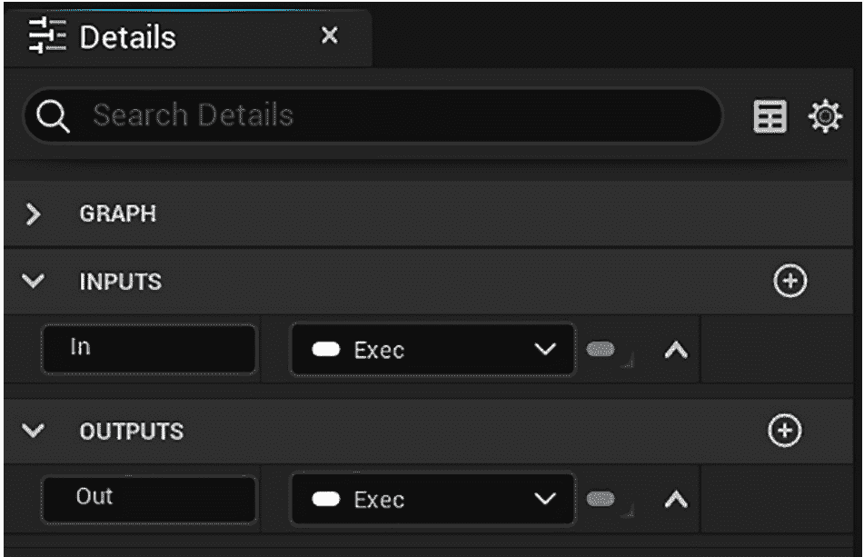

图 9.31 – 在宏中添加执行引脚

- 3. 在为 **UpdatePatrolPointBB** 宏创建的选项卡上，添加以下屏幕截图中所示的节点：

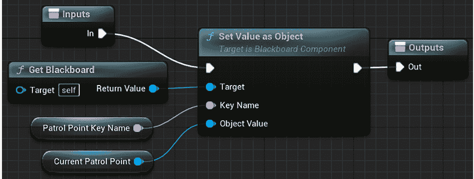

图 9.32 – UpdatePatrolPointBB 宏

- 4. 在图表上右键单击并添加 **获取黑板** 节点。这是一个实用函数，用于查找 AI 控制器正在使用的黑板。
- 5. 从 **获取黑板** 节点的 **返回值** 引脚拖出一根线，并添加 **设置为对象** 节点。
- 6. 从 **设置为对象** 节点的 **键名称** 引脚拖出一根线，并添加 **获取巡逻点键名称** 节点。
- 7. 从 **设置为对象** 节点的 **对象值** 引脚拖出一根线，并添加 **获取当前巡逻点** 节点。
- 8. 连接 **输入**、**设置为对象** 和 **输出** 节点的白色执行引脚。编译蓝图。

接下来，我们需要检查 `BP_EnemyCharacter` 实例何时与巡逻点重叠，以更新 `BB_EnemyBlackboard` 的 **CurrentPatrolPoint** 键。

### 与巡逻点重叠

我们将使用 **Event ActorBeginOverlap** 来验证 `BP_EnemyCharacter` 实例何时到达其两个巡逻点中的一个，然后交换实例正在移动到的巡逻点。每次更新 **CurrentPatrolPoint** 变量时，都需要调用 **UpdatePatrolPointBB** 宏。

在 **开始游戏时** 中，我们将把初始巡逻点设置为 **CurrentPatrolPoint** 并调用 **UpdatePatrolPointBB** 宏。

按照以下步骤创建事件：

- 1. 在 `BP_EnemyCharacter` 的 **事件图** 中，从 **开始游戏时** 的白色执行引脚拖出一根线，并添加 **设置当前巡逻点** 节点。
- 2. 从 **设置当前巡逻点** 节点的输入引脚拖出一根线，并添加 **获取巡逻点 1** 节点。
- 3. 从 **设置当前巡逻点** 节点的白色输出引脚拖出一根线，并添加 UpdatePatrolPointBB 宏节点：

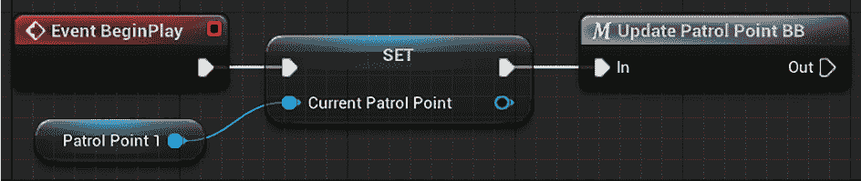

图 9.33 – 设置初始巡逻点

- 4. 现在，让我们创建 Event ActorBeginOverlap 事件，该事件用于交换巡逻点。该事件首先检查敌人是否与巡逻点 1 重叠。如果为真，则该事件将巡逻点 2 设置为当前巡逻点。如果为假，则该事件检查敌人是否与巡逻点 2 重叠。在这种情况下，该事件将巡逻点 1 设置为当前巡逻点：

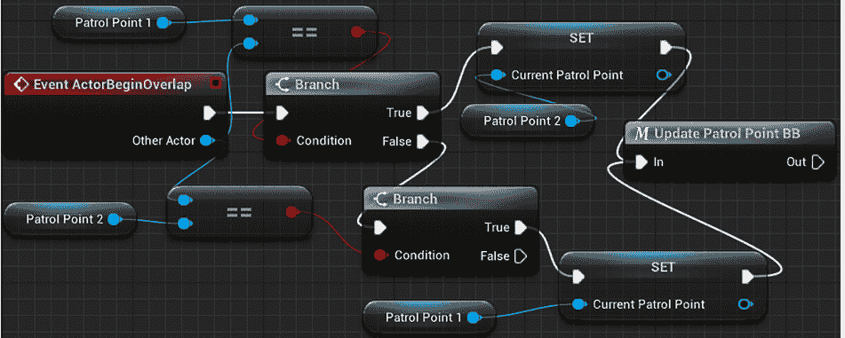

图 9.34 – 交换巡逻点

- 5. 步骤 5–8 的节点用于检查敌人是否与巡逻点 1 重叠。从 Event ActorBeginOverlap 节点的白色执行引脚拖出一根线，并添加 **分支** 节点。
- 6. 从 **分支** 节点的 **条件** 输入引脚拖出一根线，并添加 **相等** 节点。
- 7. 从 **相等** 节点的顶部输入引脚拖出一根线，并添加 **获取巡逻点 1** 节点。
- 8. 将 **相等** 节点的底部输入引脚连接到 Event ActorBeginOverlap 节点的 **其他演员** 输出引脚。
- 9. 步骤 9–11 的节点将 **巡逻点 2** 设置为 **当前巡逻点**。从 **分支** 节点的 **真** 输出引脚拖出一根线，并添加 **设置当前巡逻点** 节点。
- 10. 从 **设置当前巡逻点** 节点的输入引脚拖出一根线，并添加 **获取巡逻点 2** 节点。
- 11. 从 **设置当前巡逻点** 节点的白色输出引脚拖出一根线，并添加 **UpdatePatrolPointBB** 宏节点。
- 12. 步骤 12–15 的节点用于检查敌人是否与 **巡逻点 2** 重叠。从 **分支** 节点的 **假** 输出引脚拖出一根线，并添加另一个 **分支** 节点。
- 13. 从第二个 **分支** 节点的 **条件** 输入引脚拖出一根线，并添加 **相等** 节点。
- 14. 将 **相等** 节点的顶部输入引脚连接到 Event ActorBeginOverlap 节点的 **其他演员** 输出引脚。
- 15. 从 **相等** 节点的底部输入引脚拖出一根线，并添加 **获取巡逻点 2** 节点。
- 16. 步骤 16–18 的节点将 **巡逻点 1** 设置为 **当前巡逻点**。从第二个 **分支** 节点的 **真** 输出引脚拖出一根线，并添加 **设置当前巡逻点** 节点。
- 17. 从新的 **设置当前巡逻点** 节点的输入引脚拖出一根线，并添加 **获取巡逻点 1** 节点。
- 18. 将 **设置当前巡逻点** 节点的白色输出引脚连接到 **UpdatePatrolPointBB** 节点的输入引脚。
- 19. 编译并保存蓝图。

这些是在 `BP_EnemyCharacter` 蓝图中处理巡逻点所需的操作。下一步是修改 `BP_EnemyController` 蓝图以运行行为树。

### 在 AI 控制器中运行行为树

AIController 类具有一个名为 Run Behavior Tree 的函数。它将行为树资产作为参数接收。我们使用 AIController 作为父类创建了 BP_EnemyController 蓝图，以运行我们的 BT_EnemyBehavior 行为树。

以下是运行行为树的步骤：

- 1. 打开 BP_EnemyController 蓝图。
- 2. 在事件图中，从 **开始游戏时** 的白色执行引脚拖出一根线，并添加 **运行行为树** 节点。
- 3. 将 BTAsset 输入参数设置为 BT_EnemyBehavior：

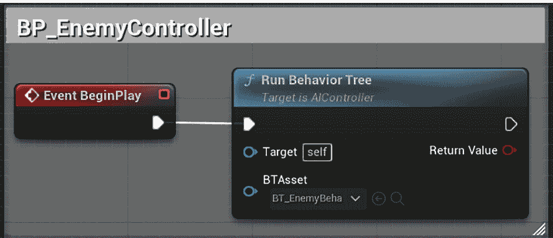

图 9.35 – 运行行为树

- 4. 编译并保存蓝图。

我们已完成蓝图中导航巡逻点所需的操作。现在可以进入 AI 的核心——行为树。

### 使用行为树教 AI 行走

行为树是用于模拟角色行为的工具。它具有控制流节点和任务节点。

你将使用的两个主要控制流节点是 **选择器** 和 **序列** 宏节点。**选择器** 节点会从左到右运行其下连接的每个节点（称为其 **子节点**），但一旦某个子节点成功运行，它就会成功并停止运行。因此，如果 **选择器** 节点有三个子节点，那么第三个子节点运行的唯一方式是前两个子节点因附加条件为 `false` 而未能执行。**序列** 节点正好相反。它也会从左到右依次运行所有子节点，但 **序列** 节点只有在所有子节点都成功时才会成功。第一个失败的子节点会导致整个序列失败，结束执行并中止序列。

按照以下步骤创建我们的第一个行为树：

- 1. 在内容浏览器中，双击 `BT_EnemyBehavior` 资产以打开行为树编辑器。
- 2. 在 **详细信息** 面板中，单击 **行为树** 类别并选择 **BB_EnemyBlackboard** 作为 **黑板资产**。 **BB_EnemyBlackboard** 的 **键** 下拉菜单将出现在底部的 **黑板** 面板中：

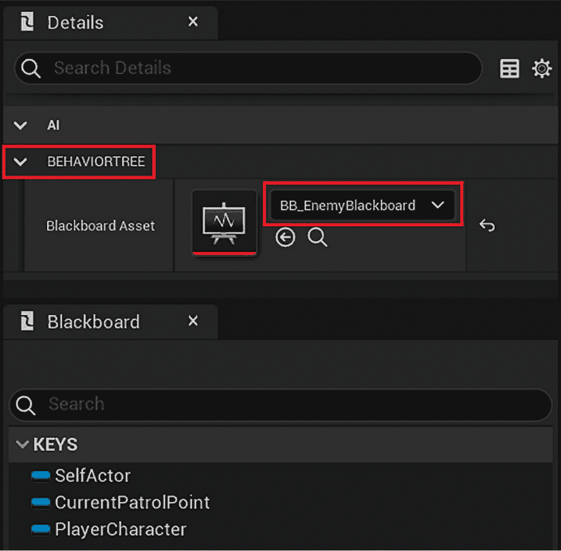

图 9.36 – 选择行为树使用的黑板资产

- 3. 查看 **行为** 树图。逻辑树的顶层始终是 **根节点**，它仅用于指示逻辑流的起始位置。行为树节点底部较深的线是节点之间的连接点：

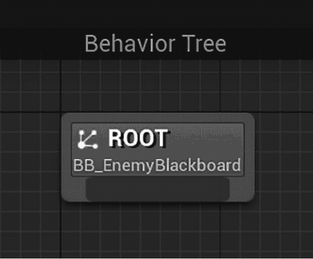

图 9.37 – 逻辑流从根节点开始

- 4. 从 **根节点** 底部的深色区域点击并拖动一根线，将其放置到空白图表区域以打开选择菜单弹出窗口。选择 **序列** 选项：

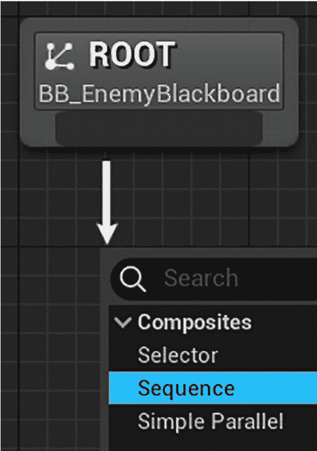

图 9.38 – 添加序列节点

- 5. 在 **详情** 面板中，将 **节点名称** 更改为 `Move to Patrol`。

- 6. 从 **移动到巡逻** 节点向下拖动一根线并添加一个 **移动到** 节点。这种节点是 **任务节点**，具有紫色，并且始终是行为树中最底部的节点。因此，你会注意到任务节点底部没有用于附加其他节点的连接点：

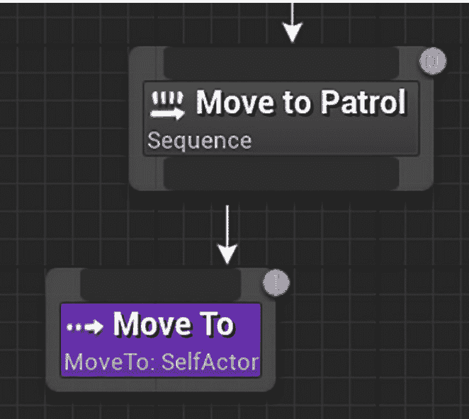

图 9.39 – 移动到节点是任务节点

- 7. 在 **移动到** 任务节点的 **详情** 面板中，将 **黑板键** 更改为 **CurrentPatrolPoint**。此黑板键决定了角色将被移动到的位置：

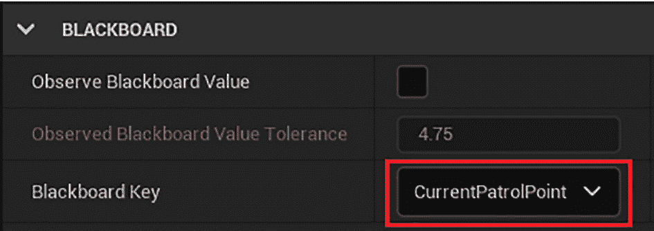

图 9.40 – 此黑板键决定了目的地

- 8. 从 **移动到巡逻** 序列节点向下拖动一根线并添加一个 **等待** 节点。

- 9. 在 **等待** 节点的 **详情** 面板中，将 **等待时间** 设置为 `3.0` 以在巡逻之间添加 3 秒的暂停。将 **随机偏差** 设置为 `1.0` 以添加 1 秒的变化。这将导致暂停时间在 2 到 4 秒之间随机：

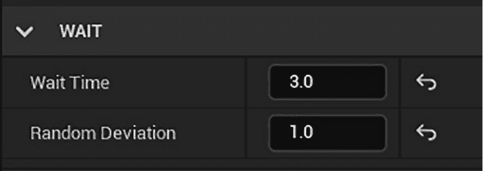

图 9.41 – 调整等待时间

- 10. 保存行为树。运行游戏时，行为树将执行 **移动到** 任务节点，直到敌人到达目的地。发生这种情况时，将执行 **等待** 任务节点：

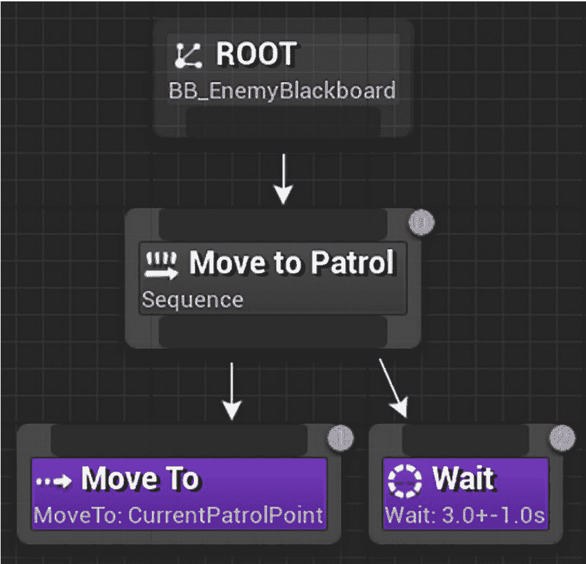

图 9.42 – 我们的第一个行为树

### 注意

注意节点右上角带有数字的小灰色圆圈。这些圆圈指示节点的执行顺序，顺序根据从左到右、从上到下的位置排列。第一个被评估的节点将标记为 0 徽章。

现在，我们已准备好一切来测试敌人巡逻。

### 在 BP_EnemyCharacter 实例中选择巡逻点

我们在 `BP_EnemyCharacter` 中将 **PatrolPoint1** 和 **PatrolPoint2** 变量创建为 **实例可编辑**，以便在关卡编辑器中设置它们。

选择巡逻点的步骤如下：

- 1. 在关卡编辑器中，选择我们放置在关卡上的 `BP_EnemyCharacter` 实例。

- 2. 在 **详情** 面板中，向下导航到 **默认** 类别，并将 **巡逻点 1** 设置为 **PatrolPoint1** 实例，将 **巡逻点 2** 设置为 **PatrolPoint2** 实例：

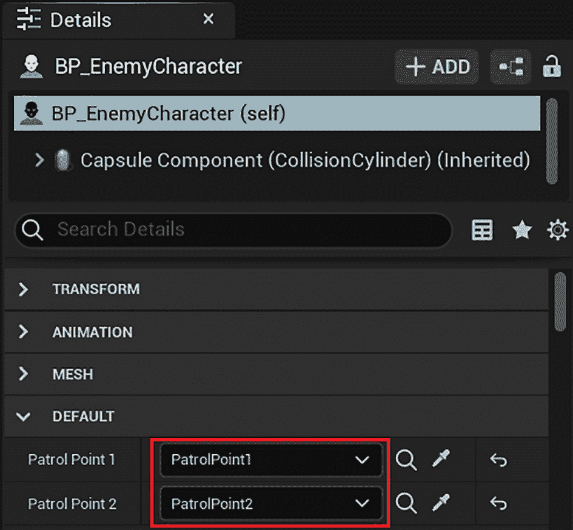

图 9.43 – 选择巡逻点

- 3. 保存关卡并单击播放按钮进行测试。

你应该会看到红色敌人角色开始导航到两个巡逻点中的第一个。当它到达第一个点时，将短暂暂停，然后开始走向第二个巡逻点。在游戏运行期间，这种往复模式将持续进行。

现在我们已建立巡逻行为，将赋予敌人看到玩家并追踪他们的能力。

### 让 AI 追逐玩家

有一个名为 Pawn 感知的组件，可用于为敌人添加视觉和听觉。我们将使用此组件并扩展我们的行为树，使敌人对玩家构成一定威胁。

### 使用 Pawn 感知赋予敌人视觉

为了授予敌人检测玩家的能力，我们需要将 Pawn 感知组件添加到 BP_EnemyController，并在敌人看到玩家时将 PlayerCharacter 引用存储在 BB_EnemyBlackboard 中。

使用 Pawn 感知组件的步骤如下：

- 1. 打开 `BP_EnemyController` 蓝图。

- 2. 在 **我的蓝图** 面板中创建一个变量。在 **详情** 面板中，将变量命名为 `PlayerKeyName`，并将 **变量类型** 更改为 **名称**。编译蓝图并将 **默认值** 设置为 `PlayerCharacter`。

- 3. 在 **组件** 面板中，单击 **添加** 按钮并搜索 `pawn`。选择 **Pawn 感知** 组件：

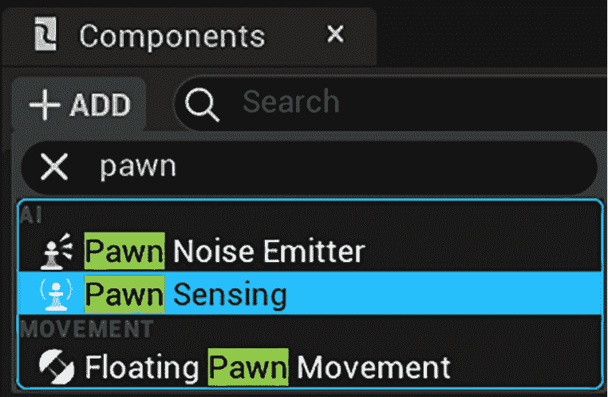

图 9.44 – 添加 Pawn 感知组件

- 4. 在 Pawn 感知组件的详情面板中，查看 **事件** 类别并单击 **看到 Pawn** 事件的绿色按钮，将其添加到事件图中：

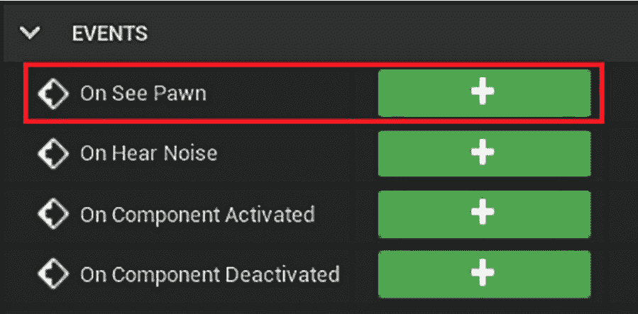

图 9.45 – 添加看到 Pawn 事件

- 5. **看到 Pawn** 事件在敌人沿视线看到 **Pawn** 类（或其子类 **角色**）的实例时触发。我们需要检查所看到的实例是否是玩家（**第一人称角色** 类）。如果是玩家，则将实例引用存储在黑板中：

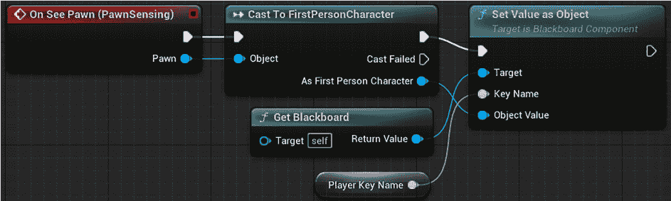

图 9.46 – 将第一人称角色引用存储在黑板中

- 6. 从 **看到 Pawn** 事件的 **Pawn** 输出引脚拖动一根线并添加一个 **转换为第一人称角色** 节点。

- 7. 在图表上右键单击并添加一个 **获取黑板** 节点。

- 8. 从 **获取黑板** 的 **返回值** 引脚拖动一根线并添加一个 **设置值为对象** 节点。

- 9. 从 **设置值为对象** 的 **键名称** 引脚拖动一根线并添加一个 **获取玩家键名称** 节点。

- 10. 从 **设置值为对象** 的 **对象值** 引脚拖动一根线并连接到 **作为第一人称角色** 输出引脚。

- 11. 连接 **转换为第一人称角色** 和 **设置值为对象** 节点的白色执行引脚。编译蓝图。

这些是使敌人能够看到玩家所需在 `BP_EnemyController` 蓝图中进行的更改。现在，让我们来处理我们的行为树。

### 创建行为树任务

我们可以创建新元素以在行为树中使用，例如 **任务**、**装饰器** 和 **服务**。这些元素是专门的蓝图类型。我们将创建一个简单的任务来清除黑板键。

创建任务的步骤如下：

- 1. 在内容浏览器中，双击 `BT_EnemyBehavior` 资产以打开行为树编辑器。

- 2. 单击工具栏上的 **新建任务** 按钮：

图 9.47 – 创建行为树任务

- 3. 如果项目中没有任务，蓝图编辑器将打开一个新蓝图，并使用 **BTTask_BlueprintBase** 作为父类。如果已有任务，则需要在出现的下拉菜单中选择 **BTTask_BlueprintBase** 类。

- 4. **详情** 面板显示类默认值。将 **节点名称** 字段更改为 `Clear BB Value`：

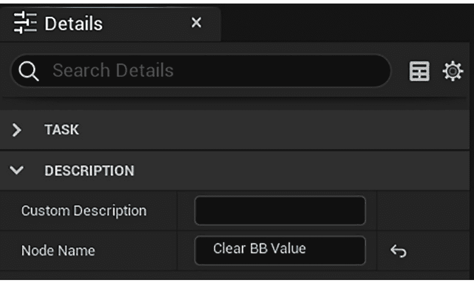

图 9.48 – 设置节点名称

- 5. 在 **我的蓝图** 面板的 **变量** 类别中，单击 + 按钮添加一个变量。在 **详情** 面板中，将变量命名为 **键**，将其类型更改为 **黑板键选择器**，并检查 **实例可编辑** 属性：

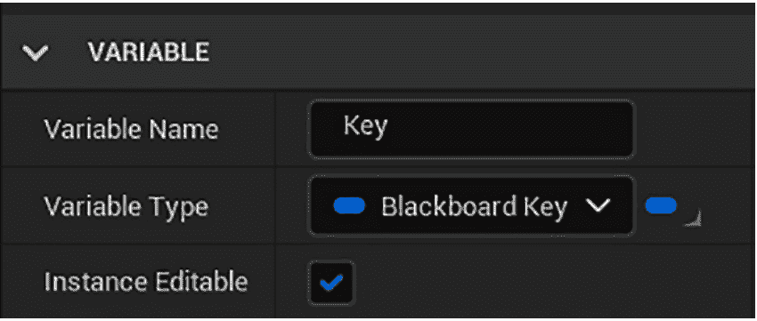

图 9.49 – 创建键变量

- 6. 我们将使用 **接收执行** 事件，该事件在任务在行为树中被激活时调用。我们将使用 **我的蓝图** 面板添加该事件以查看其他可用事件。将鼠标悬停在 **我的蓝图** 面板的 **函数** 类别上，单击 **覆盖** 下拉菜单，并选择 **接收执行**：

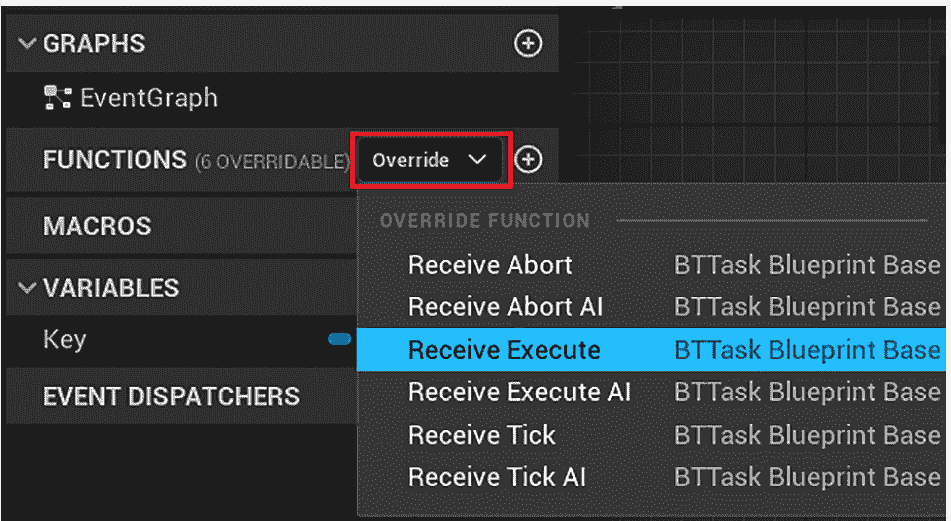

图 9.50 – 添加接收执行事件

- 7. 我们将使用 **键** 变量清除黑板值，并使用 **完成执行** 函数来完成任务：

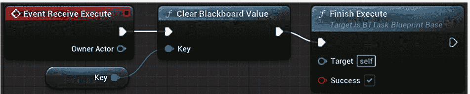

图 9.51 – 接收执行事件的操作

- 8. 从 **接收执行** 的白色输出引脚拖动一根线并添加一个 **清除黑板值** 节点。

- 9. 从 Clear Blackboard Value 的 Key 输入引脚拖动一根线并添加一个 Get Key 节点。

- 10. 从 Clear Blackboard Value 的白色输出引脚拖动一根线并添加一个 Finish Execute 节点。检查 Finish Execute 节点的 Success 参数。

- 11. 编译、保存并关闭蓝图编辑器。在内容浏览器中，将 BTTask 重命名为 BTTask_ClearBBValue。

我们将使用新的任务在敌人攻击后清除 PlayerCharacter 引用，以给玩家一个逃跑的机会。

### 为行为树添加条件

我们还需要一个 Sequence 节点，用于连接任务以让敌人追击玩家，以及一个 Selector 节点，用于运行两个 Sequence 节点中的一个。我们需要确保新任务仅在敌人看到玩家时才运行。为此，我们将添加一个 Decorator。Decorator 附加在节点顶部，并在执行任务之前提供必须满足的条件。

以下屏幕截图显示了本节更改后的行为树更新版本。Attack Player 序列的任务将在下一节中添加：

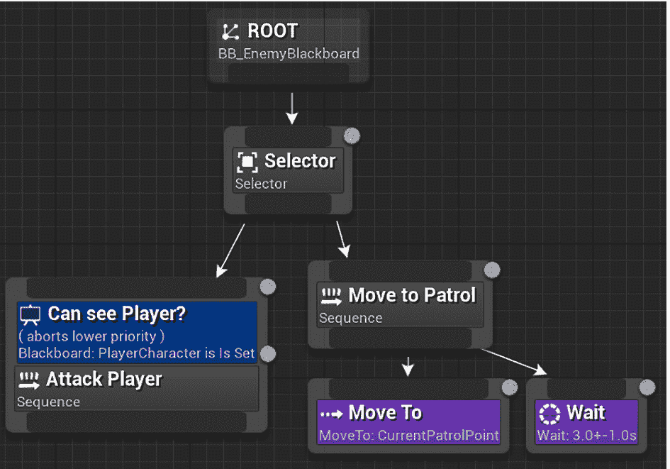

图 9.52 – Attack Player 序列节点带有一个 Decorator

按照以下步骤修改行为树：

- 1. 在内容浏览器中，双击 `BT_EnemyBehavior` 资产以打开行为树编辑器。

- 2. 右键单击 **ROOT** 节点的中间，并选择 **Break Node Link(s).**

- 3. 从 **ROOT** 节点底部的深色区域拖动一根线，并将其释放到空白图表区域以打开选择菜单弹出窗口。选择 **Selector** 选项。

- 4. 从 **Selector** 节点向下拖动一根线，并将其连接到 **Move To Patrol** 节点。

- 5. 从 **Selector** 节点再向下拖动一根线并添加一个 **Sequence** 节点。此新节点必须位于 **Move To Patrol** 节点的左侧，因为它优先于巡逻行为。

- 6. 在 **Details** 面板中，将 **Node Name** 更改为 *Attack Player*。

- 7. 现在，我们将使用 Decorator 来验证敌人是否看到玩家。右键单击 *Attack Player* 节点，将鼠标悬停在 **Add Decorator** 上以展开菜单，并选择 **Blackboard** 以添加 Decorator。

- 8. 单击 Decorator，并在 **Details** 面板中，将 **Observer aborts** 设置为 **Lower Priority**，**Blackboard Key** 设置为 **PlayerCharacter**，**Node Name** 设置为 **Can see Player?**:

图 9.53 – Decorator 设置

- 9. 保存行为树。Decorator 仅在 `PlayerCharacter` 键具有引用时才允许节点运行。它还将中止 Move to Patrol 序列以执行 Attack Player 序列。

让敌人追击玩家所缺少的唯一部分是 Attack Player 序列的任务节点。

### 创建追击行为

为了让敌人追击玩家，我们将使用 **Move To Task** 节点，并将 **PlayerCharacter** 引用作为目标。我们将使用 **Wait** 节点在攻击之间创建暂停，并使用我们的 **BTTask_ClearBBValue** 任务来清除 **PlayerCharacter** 引用：

图 9.54 – Attack Player 序列的任务节点

在下一章中，我们将让敌人对玩家造成伤害。

按照以下步骤添加任务节点：

- 1. 从 **Attack Player** 序列节点拖动一根线并添加一个 **Move To** 任务节点。在 **Details** 面板中，将 **Blackboard Key** 更改为 **PlayerCharacter**。

- 2. 从 **Attack Player** 序列节点拖动一根线并添加一个 **Wait** 任务节点。在 **Details** 面板中，将 **Wait Time** 设置为 2.0 秒。

- 3. 从 **Attack Player** 序列节点再拖动一根线并添加一个 **BTTask_ClearBBValue** 任务节点。在 **Details** 面板中，将 **Key** 更改为 **PlayerCharacter** 并将 **Node Name** 更改为 `Reset Player seen`:

图 9.55 – 在黑板中清除 PlayerCharacter 值

- 4. 保存行为树并关闭行为树编辑器。在关卡编辑器中按 **Play** 按钮来测试敌人行为。

当你在巡逻敌人面前导航玩家角色时，敌人将停止巡逻并追击玩家。当敌人到达玩家处时，它将停留 2 秒，然后返回其巡逻路径。如果它与玩家重新建立视线，则它将中断巡逻并再次开始追击玩家。

### 总结

在本章中，我们开始将简单的移动目标转变为能够挑战玩家的完整游戏敌人的过程。在此过程中，你学习了如何将 AIControllers、行为树和黑板结合使用的基础知识，以创建能够感知周围世界并基于该信息做出决策的敌人。

在我们继续开发 AI 以对玩家构成严峻挑战的过程中，你可以运用所学技能来考虑可以赋予敌人的其他行为类型。对 AI 机制的持续探索将使你不断回到我们在此开始实现的感知、决策和行动核心循环。

在下一章中，我们将扩展 AI 行为来创建一个能够真正挑战玩家的敌人。我们将添加敌人倾听玩家并调查声音的能力，以及在玩家靠近时对玩家造成伤害的攻击能力。为了围绕这一新威胁平衡游戏，我们还将赋予玩家反击敌人的能力。

### 测验

- 1. 运行行为树函数属于哪个类？
  - a. Actor
  - b. Pawn
  - c. AIController
  - d. PlayerController

- 2. 黑板是一种可以包含事件和操作的特殊蓝图类型。
  - a. 正确
  - b. 错误

- 3. 行为树图可以包含控制流节点和任务节点。
  - a. 正确
  - b. 错误

- 4. 哪个控制流节点会在一个子节点成功运行后立即成功并停止运行？
  - a. Selector
  - b. Sequence

- 5. 我们可以向节点添加哪个元素来提供运行它所必须满足的条件？
  - a. Task
  - b. Decorator
  - c. Service
