## 第 10 章：升级 AI 敌人

在本章中，我们将为 AI 敌人添加更多功能，以引入玩家可能失败的潜力并创造更大的游戏性多样性。此时，我们将开始确定想要提供给玩家的挑战类型。我们将创建类似僵尸的敌人，它们将不懈地追击玩家，创造一个以动作为重点的体验，玩家必须试图在大量敌人中生存。我们将首先赋予 AI 更多能力，包括造成伤害和使用漫游模式来增加玩家生存难度。然后，我们将关注玩家，赋予他们反击这些危险敌人的能力。最后，我们将通过在游戏世界中逐渐生成新敌人的系统来完成难度增加的平衡。

在此过程中，我们将涵盖以下目标：

- 引入会伤害玩家生命值的敌人近战攻击
- 赋予 AI 听到玩家脚步声和枪声的能力
- 让敌人根据声音调查玩家最后已知位置
- 允许玩家使用枪械摧毁敌人
- 在世界中生成新敌人
- 设置 AI 敌人在关卡中随机漫游

到本章结束时，我们将拥有一个敌人生成器，它将生成会攻击玩家、能够听到玩家脚步声和枪声并在关卡中随机漫游的 AI 敌人。

### 创建敌人攻击

如果我们创建的敌人将成为玩家实现我们为其设定目标的真正障碍，那么我们首先需要赋予敌人对玩家造成伤害的能力。在 *第 9 章：使用人工智能构建智能敌人* 中，我们设置了敌人攻击模式的基本结构。当玩家进入敌人的视线时会触发该模式。我们现在将为该攻击引入一个伤害元素，以确保敌人进入玩家近战距离后会有后果。

### 创建攻击任务

我们将创建一个名为 `BTTask_DoAttack` 的攻击任务来造成伤害，并扩展我们在敌人行为树中创建的 **Attack Player** 序列。该任务将包含两个变量——一个用于存储伤害目标，另一个用于存储要应用的伤害数值。

按照以下步骤创建攻击任务：

- 1. 在内容浏览器中，访问 `Content/FirstPersonBP/Enemy` 文件夹并双击 `BT_EnemyBehavior` 资产以打开行为树编辑器。

- 2. 单击工具栏上的 **New Task** 按钮，并从出现的下拉菜单中选择 **BTTask_BlueprintBase** 选项。该任务将与行为树在同一文件夹中创建 – `Content/FirstPersonBP/Enemy`。

- 3. 在内容浏览器中，将新创建的 `BTTask_BlueprintBase_New` 资产重命名为 `BTTask_DoAttack`。双击 `BTTask_DoAttack` 以返回蓝图编辑器。

- 4. **Details** 面板显示类默认值。将 Node Name 字段更改为 `DoAttack`。

- 5. 在 **My Blueprint** 面板中，单击 **Variables** 类别的 + 按钮。在 **Details** 面板中，将变量命名为 `TargetActorKey`，将其类型更改为 **BlackboardKeySelector**，并选中 **Instance Editable** 属性：

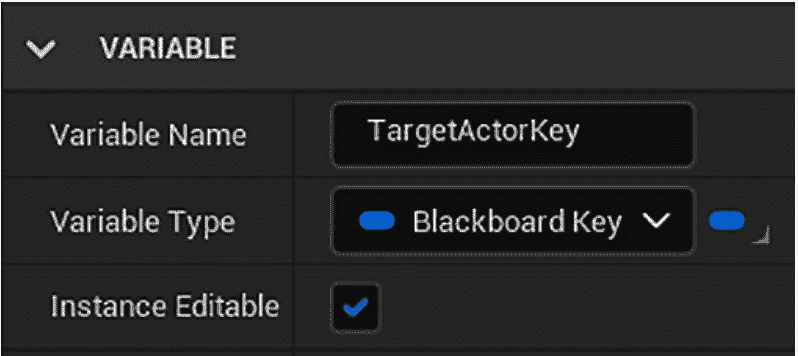

图 10.1 – 创建 TargetActorKey 变量

- 6. 在我的蓝图面板中创建另一个变量。在详情面板中，将变量命名为 `Damage`，将变量类型更改为 Float，并勾选实例可编辑属性。编译蓝图并将默认值设置为 `0.25`，这意味着攻击将扣除玩家 25% 的生命值：

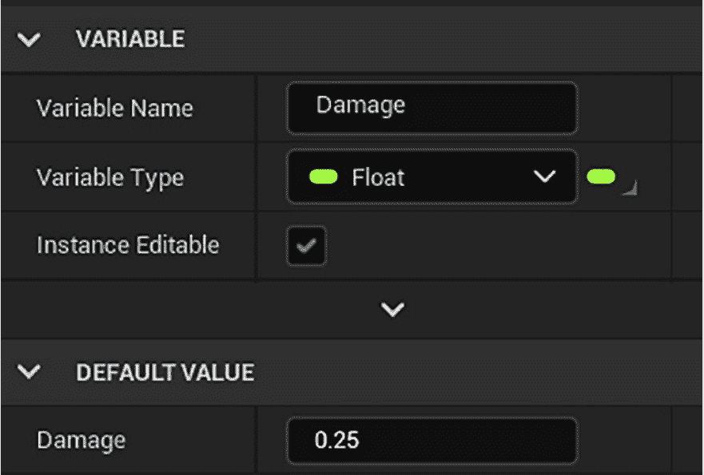

图 10.2 – Damage 变量的默认值为 0.25

- 7. 将鼠标悬停在我的蓝图面板的 **函数** 类别上，单击 **覆盖** 下拉列表，并选择 **接收执行** 以添加事件。

- 8. 在 **接收执行** 事件中，我们将确保 **目标角色** 有效，然后对其造成伤害。该事件将从黑板中获取 **目标角色** 引用，并在调用 **应用伤害** 函数之前检查其是否有效：

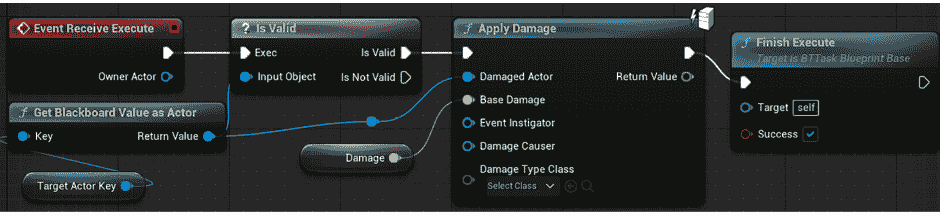

图 10.3 – 接收执行事件的操作

- 9. 步骤 9–12 的节点用于从黑板获取 **目标角色** 引用并检查其是否有效。从 **接收执行** 事件的白色引脚拖出一根线，并添加一个 **是否有效** 宏节点。

- 10. 将 **目标角色键** 变量从 **我的蓝图** 面板拖入 **事件图** 中，并选择 **获取目标角色键**。

- 11. 从 **目标角色键** 节点拖出一根线，并添加 **从黑板获取演员值** 节点。

- 12. 从 **从黑板获取演员值** 节点的 **返回值** 拖出一根线，并连接到 **是否有效** 节点的 **输入对象** 引脚。

- 13. 步骤 13–15 的节点用于使用 **目标角色** 引用调用 **应用伤害** 函数。从 **从黑板获取演员值** 节点的 **返回值** 再拖出一根线，并添加一个 **应用伤害** 节点。将 **是否有效** 输出引脚连接到 **应用伤害** 节点的白色输入引脚。

- 14. 从 **应用伤害** 节点的 **基础伤害** 输入引脚拖出一根线，并添加一个 **获取伤害** 节点。

- 15. 从 **应用伤害** 节点的白色输出引脚拖出一根线，并添加一个 **完成执行** 节点。检查 **完成执行** 节点的 **成功** 参数。

- 16. 编译、保存并关闭蓝图编辑器。

现在，我们需要将攻击任务添加到 BT_EnemyBehavior 中的攻击序列中。

### 在行为树中使用攻击任务

敌人的攻击是近战攻击，因此敌人只有在到达玩家后才会执行攻击。

按照以下步骤使用 DoAttack 任务：

- 1. 在行为树编辑器中，从攻击玩家序列节点向下拖出一根线，在移动到和等待任务节点之间添加一个 BTTask_DoAttack 任务节点。

- 2. 在详情面板中，将目标角色键选择更改为 PlayerCharacter。将节点名称更改为伤害玩家，以描述我们如何使用 BTTask_DoAttack：

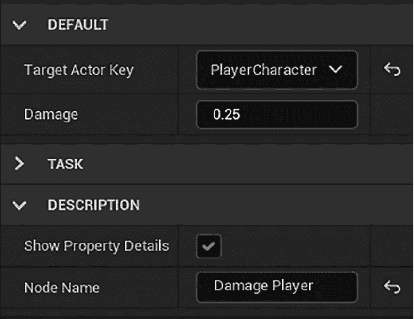

图 10.4 – BTTask_DoAttack 属性

- 3. 保存行为树。攻击玩家序列应如下所示：

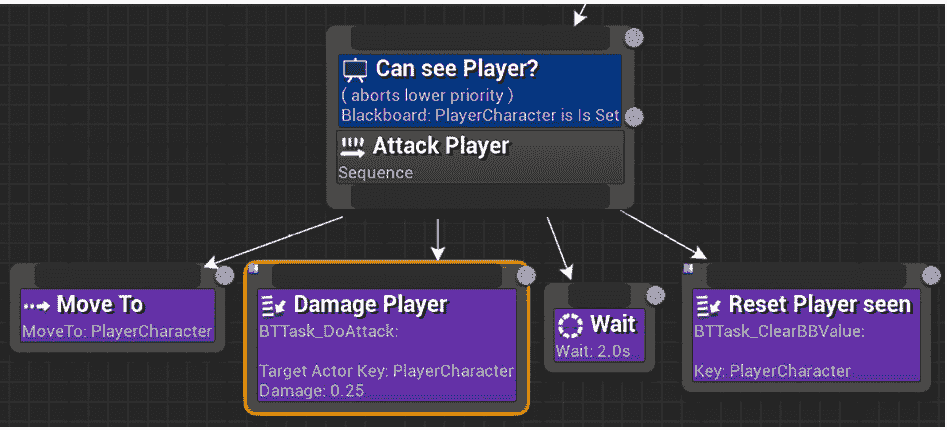

图 10.5 – 带有 BTTask_DoAttack 节点的攻击玩家序列

**攻击玩家** 序列已完成。现在，我们需要更新 `FirstPersonCharacter` 蓝图，以便在造成伤害时降低生命值显示。

### 更新生命值显示

生命值显示条链接到 `FirstPersonCharacter` 蓝图的 **玩家生命值** 变量。我们将使用 **任何伤害事件** 来降低 **玩家生命值** 变量的值。

创建 **任何伤害事件** 的步骤如下：

- 1. 在内容浏览器中，打开 `Content/FirstPersonBP/Blueprints` 文件夹，然后双击 `FirstPersonCharacter` 蓝图。

- 2. 在 **事件图** 的空白处右键单击，并添加 **任何伤害事件** 节点。我们将向该事件添加以下节点：

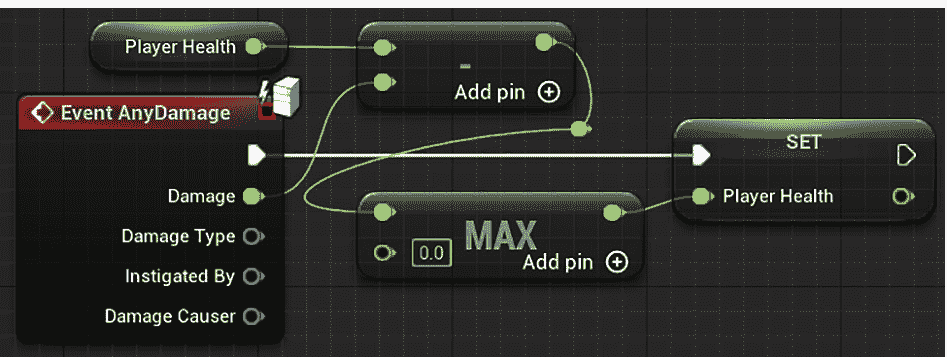

图 10.6 – 任何伤害事件的操作

- 3. 从 **任何伤害事件** 节点的白色输出引脚拖出一根线，并添加一个 **设置玩家生命值** 节点。

- 4. 从设置玩家生命值节点的输入引脚拖出一根线，并添加一个 MAX (float) 节点。我们使用此节点来确保玩家生命值永远不会小于 0.0。

- 5. 从 Max (float) 节点的顶部输入引脚拖出一根线，并创建一个减法节点。

- 6. 从减法节点的顶部输入引脚拖出一根线，并添加一个获取玩家生命值节点。

- 7. 从减法节点的底部输入引脚拖出一根线，并连接到任何伤害事件节点的伤害输出引脚。

- 8. 编译并保存蓝图，然后点击播放按钮进行测试。

请注意，当敌人进入玩家攻击范围并攻击时，玩家的生命值显示会减少。

既然我们的敌人正在攻击玩家，我们希望提供更多敌人可以发现玩家的选项。

### 让敌人听到并调查声音

只能追击直接在其前方行走的玩家的敌人很容易被避开。为解决此问题，我们将利用 PawnSensing 组件让敌人检测玩家发出的附近声音。如果玩家在敌人的检测范围内发出声音，则敌人将走到该声音的位置进行调查。如果他们在视野中看到玩家，则会尝试攻击；否则，他们会在声音位置等待片刻，然后返回巡逻路线。

### 向行为树添加听觉

我们将添加一系列在敌人听到声音时执行的任务。我们希望敌人一旦看到玩家就继续攻击，因此在行为树中调查声音的优先级较低。

为了让敌人调查它听到声音的位置，我们需要在黑板中创建两个键。`HasHeardSound` 键是布尔类型，用于存储是否听到了声音。`LocationOfSound` 键是 `Vector` 类型，用于存储声音来源的位置——即敌人 AI 应该调查的位置。

按照以下步骤创建黑板键并将 **调查声音** 序列节点添加到行为树中：

- 1. 在内容浏览器中，打开 `Content/FirstPersonBP/Enemy` 文件夹，然后双击 `BT_EnemyBehavior` 资产以打开行为树编辑器。

- 2. 单击 **黑板** 选项卡：

图 10.7 – 将行为树编辑器切换到黑板模式

- 3. 单击 **新建键** 按钮，并选择 **Bool** 作为键类型。将此新键命名为 `HasHeardSound`：

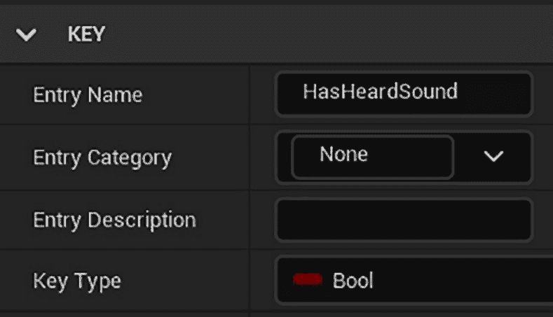

图 10.8 – HasHeardSound 布尔键

- 4. 再次单击新建键按钮，并选择 Vector 作为键类型。将此新键命名为 LocationOfSound：

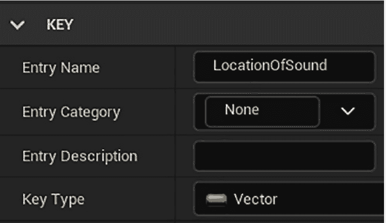

图 10.9 – LocationOfSound 矢量键

- 5. 保存黑板并单击行为树选项卡。

- 6. 将攻击玩家序列及其所有任务节点在行为树中进一步向左移动，在攻击玩家和移动到巡逻之间留出空间。我们将在此处添加听觉序列。

- 7. 从 **选择器** 节点向下拖出一根线，并添加一个 **序列** 节点。将此节点重命名为 `Investigate Sound`。

- 8. 在 **调查声音** 节点上右键单击，将鼠标悬停在 **添加装饰器** 上以展开菜单，并选择 **黑板** 以添加装饰器。

- 9. 单击该装饰器，并在 **详情** 面板中，将 **中止观察** 设置为 **较低优先级**，将 **黑板键** 设置为 **是否听到声音**，将 **节点名称** 设置为 **听到了声音？**：

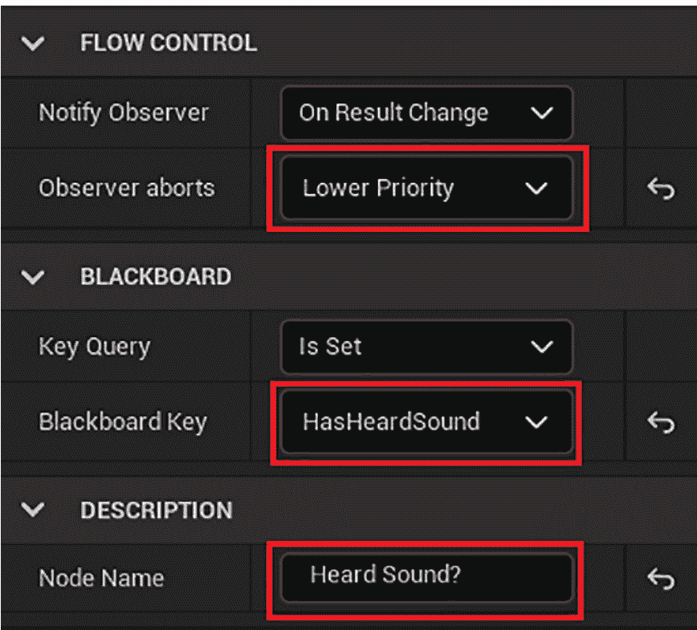

图 10.10 – 装饰器设置

以下屏幕截图显示了带有装饰器的 **调查声音** 序列节点。请注意，行为树中节点的优先级是从左到右：

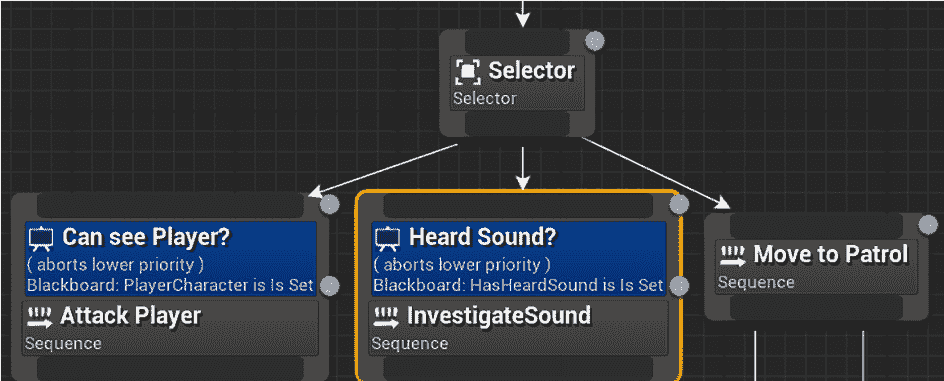

图 10.11 – 调查声音序列节点

我们已创建黑板键、序列节点和装饰器。下一步是创建 **调查声音** 序列的任务节点。

### 设置调查任务

**调查声音** 序列将类似于 **攻击玩家** 序列。如果敌人正在巡逻并听到声音，他们将移动到声音的位置：

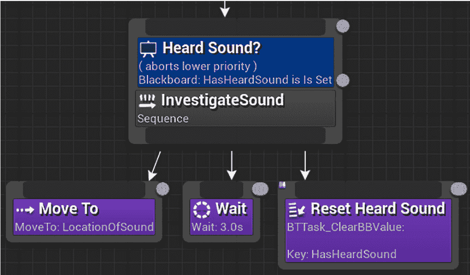

图 10.12 – Investigate Sound 序列的任务节点

按照以下步骤添加任务节点：

- 1. 从 Investigate Sound 序列节点拖出一条线并添加一个 Move To 任务节点。在 **详情** 面板中，将 Blackboard Key 更改为 LocationOfSound。
- 2. 从 Investigate Sound 序列节点拖出一条线并添加一个 Wait 任务节点。在 **详情** 面板中，将 Wait Time 设置为 3.0 秒。
- 3. 从 Investigate Sound 序列节点拖出另一条线并添加一个 BTTask_ClearBBValue 任务节点。在 **详情** 面板中，将 Key 更改为 HasHeardSound 并将 Node Name 更改为 Reset Heard Sound。
- 4. 保存行为树并关闭行为树编辑器。

现在，我们需要返回到 BP_EnemyController 蓝图并添加一些操作，以指示我们的 AI 如何响应游戏中的声音。

### 创建变量和宏以更新黑板

我们将在 BP_EnemyController 蓝图中创建变量和宏，以更新与声音相关的 BB_EnemyBlackboard 键。

这些是步骤：

- 1. 在内容浏览器中，访问 Content|FirstPersonBP|Enemy 文件夹并双击 BP_EnemyController 蓝图。
- 2. 在 **我的蓝图** 面板的 **变量** 类别中，单击 + 按钮添加一个变量。在 **详情** 面板中，将变量命名为 `HearingDistance` 并将 **变量类型** 更改为 **浮点数**。编译蓝图并将 **默认值** 设置为 `1600.0`。
- 3. 在 **我的蓝图** 面板中创建另一个变量。在 **详情** 面板中，将变量命名为 `HasHeardSoundKey` 并将 **变量类型** 更改为 **名称**。编译蓝图并将 **默认值** 设置为 `HasHeardSound`。
- 4. 创建另一个名为 `LocationOfSoundKey` 的 **名称** 变量。编译蓝图并将 **默认值** 设置为 `LocationOfSound`。
- 5. 在 **我的蓝图** 面板中，单击 **宏** 类别中的 + 按钮创建一个宏。将宏的名称更改为 `UpdateSoundBB`。
- 6. 在宏的 **详情** 面板中，创建一个名为 `In` 的 **执行** 类型输入参数，一个名为 `Location` 的 **向量** 类型输入参数，以及一个名为 `Out` 的 **执行** 类型输出参数：

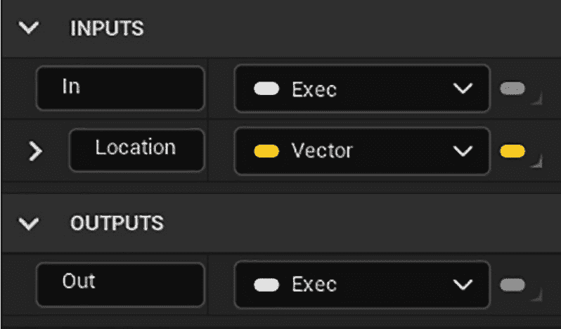

图 10.13 – 创建宏参数

- 7. 以下屏幕截图显示了我们将在以下步骤中为 **UpdateSoundBB** 宏创建的节点：

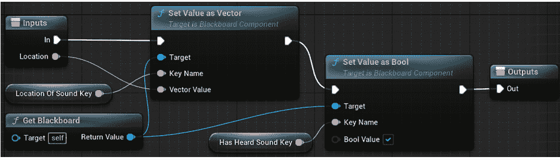

图 10.14 – UpdateSoundBB 宏

- 8. *步骤 8–11* 的节点用于使用 **声音位置键** 节点将声音位置存储在黑板中。在 **UpdateSoundBB** 宏的选项卡上，右键单击图形并添加一个 **获取黑板** 函数节点。
- 9. 从 **获取黑板** 的 **返回值** 引脚拖出一条线并添加一个 **设置为向量** 节点。
- 10. 从 **设置为向量** 节点的 **键名** 引脚拖出一条线并添加一个 **获取声音位置键** 节点。
- 11. 将 **输入** 节点的 **位置** 引脚连接到 **设置为向量** 的 **向量值** 引脚，并连接 **输入** 和 **设置为向量** 节点的白色执行引脚。
- 12. *步骤 12–14* 的节点用于在黑板的 **已听到声音键** 中设置 **真** 值。从 **获取黑板** 的 **返回值** 引脚拖出另一条线并添加一个 **设置为布尔值** 节点。选中 **布尔值** 参数。
- 13. 从 **设置为布尔值** 节点的 **键名** 引脚拖出一条线并添加一个 **获取已听到声音键** 节点。
- 14. 连接 **设置为向量**、**设置为布尔值** 和 **输出** 节点的白色执行引脚。关闭 **UpdateSoundBB** 宏选项卡并编译蓝图。

创建 **UpdateSoundBB** 宏后，我们将使用 **PawnSensing** 组件的另一个事件来检测声音。

### 解释和存储噪声事件数据

我们添加到 `BP_EnemyController` 的 **PawnSensing** 组件为构建敌 AI 的视觉和听觉感知奠定了基础。我们将使用 **On Hear Noise** 事件，每当 **PawnSensing** 组件检测到由 Pawn 噪声发射器广播的特殊类型声音时，该事件都会激活。

我们必须设置蓝图，使敌人仅检测短距离内发出的噪音；否则，玩家从地图另一端开枪却让每个敌人立即知道其位置，会感觉不公平。

按照以下步骤创建 **On Hear Noise** 事件：

- 1. 在 **组件** 面板中，选择 **PawnSensing** 组件。在 **详情** 面板中，查看 **事件** 类别并单击 **On Hear Noise** 事件的绿色按钮将其添加到 **事件图表**：

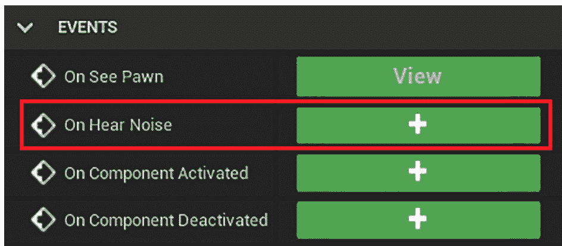

图 10.15 – 添加 On Hear Noise 事件

- 2. 在 **On Hear Noise** 中，如果声音位置与敌人之间的距离小于 **HearingDistance** 的值，我们将调用 **更新声音黑板** 宏：

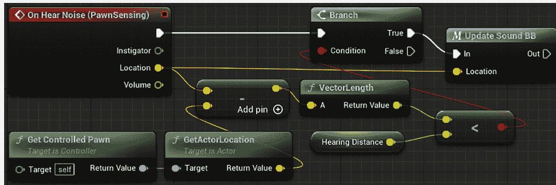

图 10.16 – On Hear Noise 操作

- 3. 从 **On Hear Noise (PawnSensing)** 节点的白色引脚拖出一条线并添加一个 **分支** 节点。接下来的步骤将创建一个使用 **VectorLength** 函数来计算声音位置与敌人位置之间距离的表达式。如果该表达式的结果小于 Hearing Distance 的值，则 **分支** 节点的 True 输出引脚将被执行。
- 4. 从 **分支** 节点的 True 引脚拖出一条线并添加 Update Sound BB 宏节点。将 On Hear Noise (PawnSensing) 节点的 Location 引脚连接到 Update Sound BB 宏的 Location 引脚。
- 5. 从 **分支** 节点的 Condition 输入引脚拖出一条线并添加一个 **小于** 节点。
- 6. 从 **小于** 节点的底部输入引脚拖出一条线并添加一个 **获取听觉距离** 节点。
- 7. 在 **事件图表** 的空白处右键单击并添加一个 **获取受控 Pawn** 节点，以获取由该 BP_EnemyController 控制的敌人实例。
- 8. 从 **获取受控 Pawn** 节点的 **返回值** 引脚拖出一条线并添加一个 **获取 Actor 位置** 节点以获取敌人位置。
- 9. 从 On Hear Noise (PawnSensing) 节点的 Location 引脚拖出一条线并添加一个 **减法** 节点。
- 10. 将 **减法** 节点的底部输入引脚连接到 **获取 Actor 位置** 节点的 **返回值** 引脚。
- 11. 从 **减法** 节点的输出引脚拖出一条线并添加一个 **向量长度** 节点。
- 12. 将 **向量长度** 节点的 **返回值** 连接到 **小于** 节点的顶部输入引脚。**向量长度** 节点的 **返回值** 是声音位置与敌人位置之间的距离。
- 13. 编译并保存蓝图。

现在我们已修改敌 AI 以能够检测广播到侦听器的声音，我们需要在 FirstPersonCharacter 蓝图中创建节点以触发听觉响应，并将它们附加到玩家操作。

### 为玩家操作添加噪音

**EnemyController** 的 **Pawn 感知** 组件仅能检测由 **Pawn 噪声发射器** 创建的噪音。当玩家开枪时播放的现有音效不会触发敌人的 **Pawn 感知** 组件。需要知道的是，为 Pawn 感知产生噪音的节点与玩家听到的声音没有直接关系。噪音仅在产生 AI 可以听到并响应的事件方面存在。

**Pawn 噪声发射器** 组件必须添加到 Actor 中，其广播的噪音才能被 Pawn 传感器检测到。我们将更改两个玩家能力，即 sprinting 和 shooting，以利用此组件产生可检测的噪音。

使用 **Pawn 噪声发射器** 的步骤如下：

- 1. 在内容浏览器中，访问 Content > FirstPersonBP > Blueprints 文件夹并双击 FirstPersonCharacter 蓝图。
- 2. 在 **组件** 面板中，单击 **添加** 按钮并搜索 `pawn`。选择 **Pawn 噪声发射器** 组件：

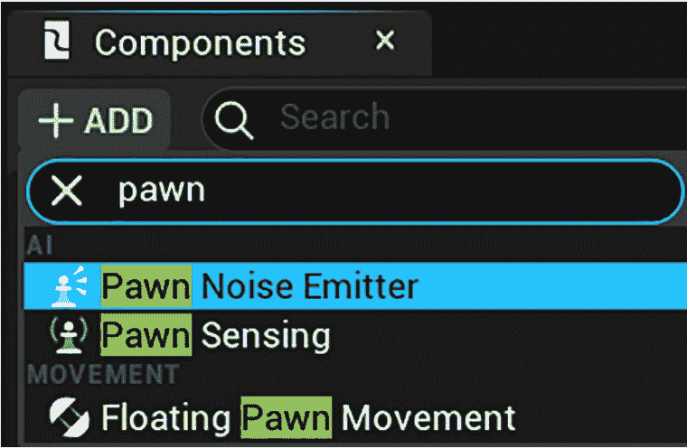

图 10.17 – 添加 Pawn Noise Emitter 组件

- 3. 我们将从为冲刺添加噪音开始。在我的蓝图面板中，双击 ManageStaminaDrain 宏以打开宏选项卡。我们将在 SET Player Stamina 节点之后添加 Make Noise 节点：

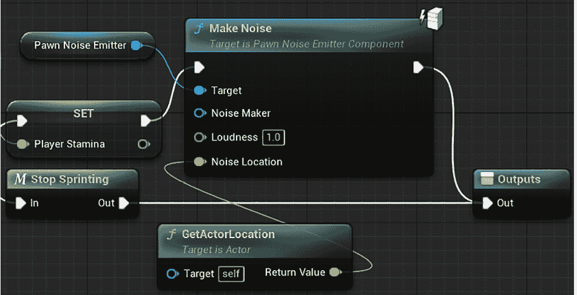

图 10.18 – 修改 ManageStaminaDrain 宏以发出噪音

- 4. 将 Outputs 节点向右拖动，为另一个函数节点腾出空间。

- 5. 从 SET Player Stamina 节点的白色输出引脚拖出一条线，搜索 make noise，并添加 Make Noise (PawnNoiseEmitter) 函数：

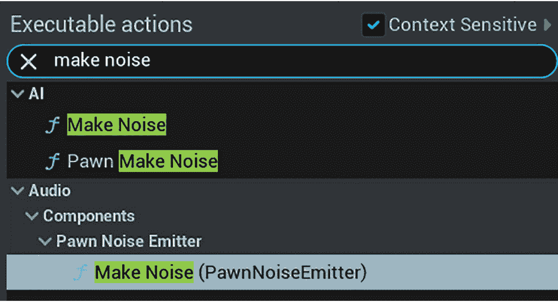

图 10.19 – 添加 PawnNoiseEmitter 组件的 Make Noise 函数

- 6. 将 Make Noise 节点的 Loudness 输入更改为 1.0。

- 7. 从 Make Noise 节点的 Noise Location 输入拖出一条线，并添加 GetActorLocation 节点。

- 8. 我们将添加 Make Noise 节点的下一个位置是在 InputAction Fire 事件中，在减少弹药之后。你可以在我的蓝图面板的 Graphs 类别中找到 InputAction Fire 事件：

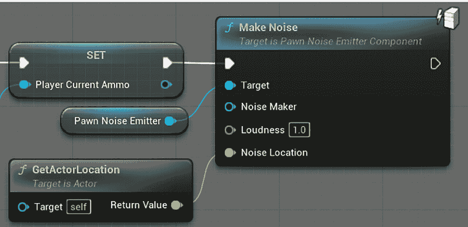

图 10.20 – 修改 InputAction Fire 事件以发出噪音

- 9. 从 SET Player Current Ammo 节点的白色输出引脚拖出一条线，搜索 `make noise`，并添加 Make Noise (PawnNoiseEmitter) 函数。
- 10. 将 Make Noise 节点的 Loudness 输入更改为 `1.0`。
- 11. 从 Make Noise 节点的 Noise Location 输入拖出一条线，并添加 GetActorLocation 节点。
- 12. 编译，保存，然后单击 Play 来测试游戏。

当你位于敌人身后，或否则处于其视线之外时，冲刺或开枪射击应会导致敌人靠近你发出噪音时所处的位置。如果它们在调查过程中与你建立了视线，那么它们将开始直接朝你移动。

既然视觉和听觉都可能被发现，你可能会发现很难避免被敌人发现。我们现在将注意力转向游戏平衡的另一面，为玩家提供对抗敌人的手段。

### 使敌人可被摧毁

还记得在早期章节中，我们创建了敌人目标，玩家可以用一个弹丸击中几次将其摧毁。我们想给玩家类似的能力来减轻新敌人带来的威胁。为此，我们将在 BP_EnemyCharacter 中添加蓝图节点来处理受伤和摧毁。玩家需要击中敌人角色三次才能将其摧毁。

按照以下步骤处理被击中的情况：

- 1. 在内容浏览器中，访问 Content > FirstPersonBP > Enemy 文件夹，然后双击 BP_EnemyCharacter 蓝图。

- 2. 在我的蓝图面板的变量类别中，单击 + 按钮添加一个变量，并将变量命名为 EnemyHealth。

- 3. 在详情面板中，将变量类型设置为整数。编译蓝图并将默认值设置为 3：

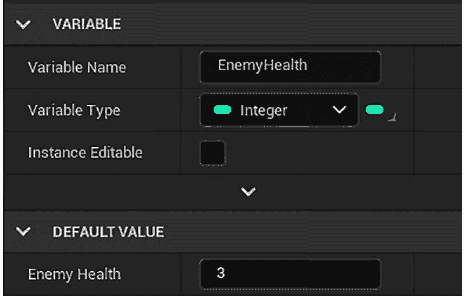

图 10.21 – EnemyHealth 初始值为 3 点

- 4. 在事件图表的空白处右键单击，添加 **事件命中** 节点。以下截图显示了 **事件命中** 动作的第一部分：

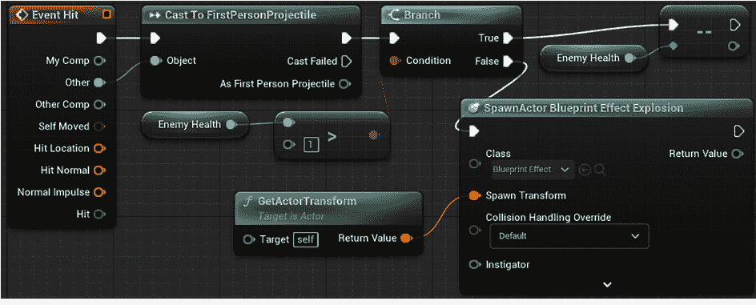

图 10.22 – 事件命中动作的第一部分

- 5. 从 **事件命中** 节点的 **其他** 输出引脚拖出一条线，添加 **转换为 FirstPersonProjectile** 节点。连接 **事件命中** 和 **转换为 FirstPersonProjectile** 的白色引脚。

- 6. 从 **转换为 FirstPersonProjectile** 节点的白色输出引脚拖出一条线，添加 **分支** 节点。

- 7. 从 **分支** 节点的 **条件** 引脚拖出一条线，添加 **大于** 节点。

- 8. 从 **大于** 节点的顶部输入引脚拖出一条线，添加 **获取敌人健康** 节点。在 **大于** 节点的底部输入中设置值 `1`。

- 9. 从 **分支** 节点的 **真** 输出引脚拖出一条线，添加 **递减整数** 节点。

- 10. 从 **递减整数** 节点的输入引脚拖出一条线，添加 **获取敌人健康** 节点。

- 11. 从 **分支** 节点的 **假** 输出引脚拖出一条线，添加 **从类生成角色** 节点。在 **类** 参数中，选择 Blueprint_Effect_Explosion 类，它是入门内容中的一个蓝图。

- 12. 从 **生成变换** 参数拖出一条线，添加 **GetActorTransform** 节点。

- 13. 事件命中动作的第二部分节点与 `BP_CylinderTarget` 蓝图中使用的相同：

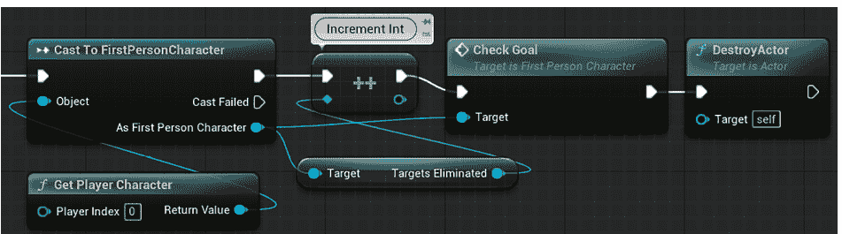

图 10.23 – 事件命中动作的第二部分

- 14. 打开位于 `Content > FirstPersonBP > Blueprints` 文件夹中的 `BP_CylinderTarget` 蓝图。

- 15. 选择并复制 *图 10.23* 中显示的节点，然后将节点粘贴到 `BP_EnemyCharacter` 蓝图中。

- 16. 将 **生成角色** 节点的白色输出引脚连接到 **转换为 FirstPersonCharacter** 节点的白色输入。

- 17. 编译，保存，然后按 **开始游戏** 进行测试。

从现在开始，当玩家击中敌人三次时，敌人将爆炸并被摧毁，方式与圆柱体目标的行为类似。

既然我们可以摧毁敌人了，就需要再次通过生成更多敌人来为玩家增加难度。

### 在游戏过程中生成更多敌人

我们将定期在关卡中生成新敌人，这样如果玩家摧毁了最初的几个敌人，游戏可以继续；如果他们击败敌人太慢，难度将逐渐增加。

### 创建 BP_EnemySpawner 蓝图

我们将创建一个蓝图，在关卡的随机位置生成敌人。生成之间的时间由名为 `SpawnTime` 的变量决定。还有一个名为 `MaxEnemies` 的变量限制敌人的生成。

按照以下步骤创建蓝图：

- 1. 在内容浏览器中，访问 `Content > FirstPersonBP > Enemy` 文件夹。单击 **添加** 按钮并选择 **蓝图类** 选项。

- 2. 在下一个屏幕上，选择 **角色** 作为父类。将蓝图命名为 `BP_EnemySpawner`，然后双击它打开蓝图编辑器。

- 3. 在 **我的蓝图** 面板的 **变量** 类别中，单击 **+** 按钮添加一个变量，并将其命名为 `SpawnTime`。在 **详情** 面板中，将 **变量类型** 更改为 **浮点数**，并检查 **实例可编辑** 属性。编译蓝图并将 **默认值** 设置为 `10.0`：

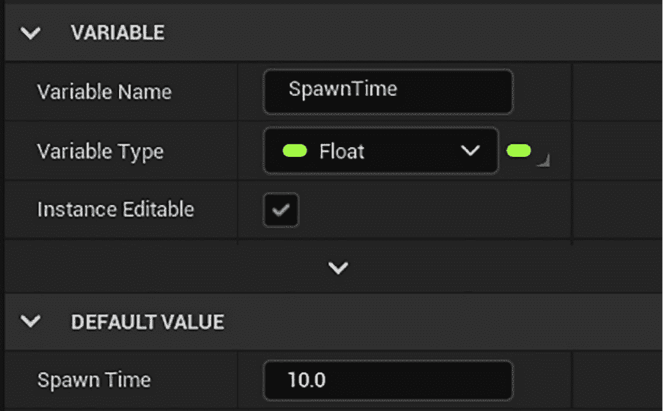

图 10.24 – 创建 SpawnTime 浮点数变量

- 4. 在我的蓝图面板中创建另一个变量，并将其命名为 MaxEnemies。在详情面板中，将变量类型更改为整数，并检查实例可编辑属性。编译蓝图并将默认值设置为 5：

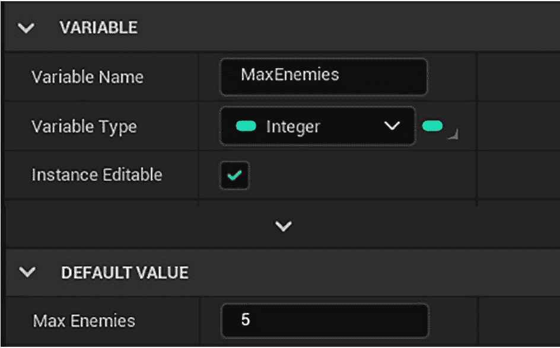

图 10.25 – 创建 MaxEnemies 整数变量

- 5. 在 **我的蓝图** 面板中，单击 **宏** 类别中的 + 按钮创建一个宏。将宏的名称更改为 `SpawnEnemy`。

- 6. 在宏的 **详情** 面板中，创建名为 `In` 的输入参数和名为 `Out` 的输出参数，两者均为 **执行** 类型：

- 7. 在为 **SpawnEnemy** 宏创建的选项卡中，添加这些节点以在关卡的随机位置生成 **BP_EnemyCharacter** 实例：

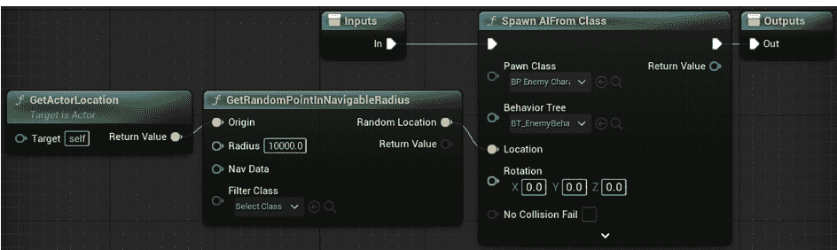

图 10.26 – SpawnEnemy 宏

- 8. 在图表上右键单击并添加 **从类生成 AI** 节点。连接 **输入**、**从类生成 AI** 和 **输出** 节点的白色执行引脚。

- 9. 在 **兵种类** 参数中，选择 **BP_EnemyCharacter**。在 **行为树** 参数中，选择 **BT_EnemyBehavior**。

- 10. 从 **位置** 参数拖出一条线，添加 **GetRandomPointInNavigableRadius** 节点。将 **半径** 设置为 `10000.0`。此节点基于导航网格返回一个随机位置。

- 11. 从 **原点** 参数拖出一条线，添加 **GetActorLocation** 节点：

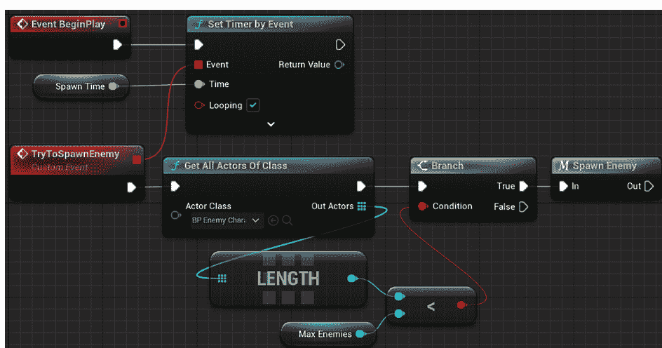

图 10.27 – 设置生成敌人的定时器

- 12. 在 **BP_EnemySpawner** 的事件图表中，从 **游戏开始** 的白色执行引脚拖出一条线，添加 **按事件设置定时器** 节点。

- 13. 检查 **循环** 参数。从 **时间** 参数拖出一条线，添加 **获取生成时间** 节点。

- 14. 从 Event 参数拖出一根线并添加自定义事件。将其命名为 TryToSpawnEnemy。
- 15. 从 TryToSpawnEnemy 的白色引脚拖出一根线并添加 Get All Actors Of Class 节点。在 Actor Class 参数中，选择 BP_EnemyCharacter。
- 16. 从 Get All Actors Of Class 的白色输出引脚拖出一根线并添加 Branch 节点。
- 17. 从 Branch 节点的 True 引脚拖出一根线并添加 Spawn Enemy 宏节点。
- 18. 从 Get All Actors Of Class 的 Out Actors 引脚拖出一根线并添加 Length 节点。Length 节点的返回值将是关卡中敌人的数量。
- 19. 从 Length 节点的输出引脚拖出一根线并添加 Less 节点。将 Less 节点的输出引脚连接到 Branch 节点的 Condition 参数。
- 20. 从 Less 节点的底部引脚拖出一根线并添加 Get Max Enemies 节点。
- 21. 编译、保存并关闭蓝图编辑器。从内容浏览器中拖动 BP_EnemySpawner 并将其放置在关卡中的任意位置以创建实例。单击 Play 按钮测试敌人生成。

运行游戏时，您会定期看到新敌人出现。不过请注意，生成后的敌人不会移动，除非它们听到或看到玩家。这是因为它们在创建时没有设定要追踪的巡逻点。我们不是为生成的敌人添加巡逻点，而是要为敌人的导航行为增加随机性。

### 创建敌人漫游行为

在 `Chapter 9`，`Building Smart Enemies with Artificial Intelligence` 中，我们将敌人的默认行为设定为在两点之间进行巡逻移动。虽然这作为听觉和视觉组件的测试平台效果不错，并且适合潜行类游戏，但我们将通过用随机漫游取代此行为来提升游戏体验的挑战性和动作感。这将使躲避敌人变得困难得多，并鼓励更直接的对抗。为此，我们将返回到 `BT_EnemyBehavior` 行为树。

### 使用自定义任务识别漫游点

我们需要在 `BB_EnemyBlackboard` 中创建一个键，用于存储敌人下一个漫游目的地的位置。与 `PatrolPoint` 键不同，我们的目的地不会由游戏内的角色表示，而是由向量坐标表示。然后，我们将创建一个任务来确定敌人应该在关卡的哪个位置漫游。

创建键和任务的步骤如下：

- 1. 在内容浏览器中，双击 `BT_EnemyBehavior` 资产以打开行为树编辑器。
- 2. 单击 **Blackboard** 选项卡以编辑 `BB_EnemyBlackboard`。
- 3. 单击 **New Key** 按钮，并选择 **Vector** 作为键类型。将此新键命名为 `WanderPoint`:

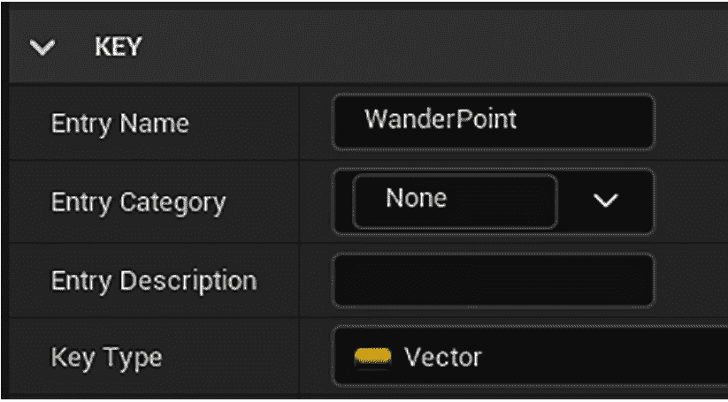

图 10.28 – 在黑板中创建 WanderPoint 键

- 4. 保存黑板并单击 **Behavior Tree** 选项卡以返回行为树。
- 5. 单击工具栏上的 **New Task** 按钮，并在出现的下拉菜单中选择 **BTTask_BlueprintBase** 选项。
- 6. 在内容浏览器中，将新创建的 **BTTask_BlueprintBase_New** 资产重命名为 **BTTask_FindWanderPoint**。双击 **BTTask_FindWanderPoint** 以返回蓝图编辑器。
- 7. **Details** 面板显示类默认值。将 **Node Name** 字段更改为 `FindWanderPoint`。
- 8. 在 **My Blueprint** 面板中，单击 **Variables** 类别的 + 按钮。在 **Details** 面板中，将变量命名为 `WanderKey`，将其类型更改为 **Blackboard KeySelector**，并选中 **Instance Editable** 属性:

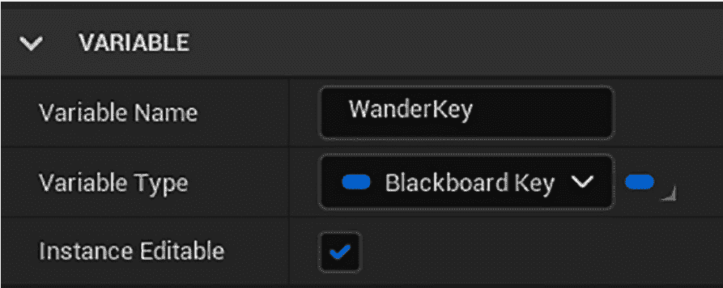

图 10.29 – 创建 WanderKey 变量

- 9. 将鼠标悬停在 **My Blueprint** 面板的 **Functions** 类别上，单击 **Override** 下拉菜单，并选择 **Receive Execute** 以添加事件。
- 10. 在 **Event Receive Execute** 中，我们将获取关卡的随机位置并将其存储在黑板中:

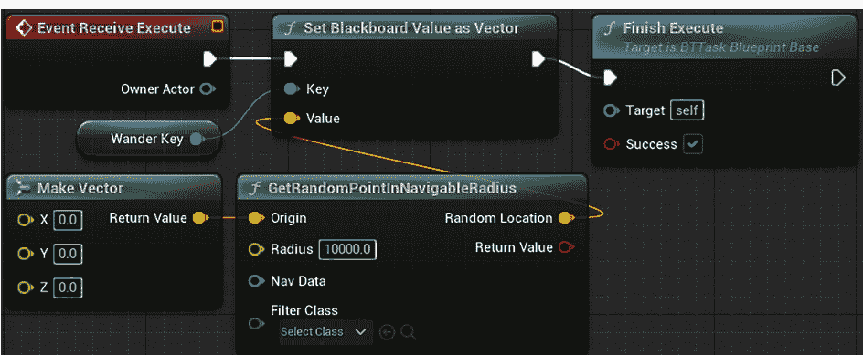

图 10.30 – Event Receive Execute 动作

- 11. 从 **Event Receive Execute** 的白色引脚拖出一根线并添加 **Set Blackboard Value as Vector** 节点。
- 12. 从 **Set Blackboard Value as Vector** 的白色输出引脚拖出一根线并添加 **Finish Execute** 节点。选中 Finish Execute 节点的 **Success** 参数。
- 13. 从 Set Blackboard Value as Vector 的 Key 参数拖出一根线并添加 Get Wander Key 节点。
- 14. 从 Set Blackboard Value as Vector 的 Value 参数拖出一根线并添加 GetRandomPointInNavigableRadius 节点。将 Radius 设置为 10000.0。
- 15. 从 Origin 参数拖出一根线并添加 Make Vector 节点。
- 16. 编译并保存蓝图。

现在我们有了自定义任务，可以修改 `BT_EnemyBehavior` 来让敌人找到并移动到 `WanderPoint`。

### 将漫游添加到行为树中

我们将把 Move To Patrol 序列转换为 Wander 序列。行为树中的新 Wander 序列由以下节点表示:

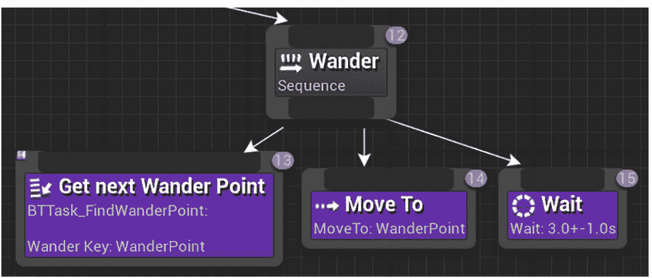

图 10.31 – 新的 Wander 序列

修改行为树的步骤如下：

- 1. 在内容浏览器中，双击 BT_EnemyBehavior 资产以打开行为树编辑器。
- 2. 选择 **Move To Patrol** 序列节点。在 **Details** 面板中，将 **Node Name** 更改为 `Wander`。
- 3. 选择 Move To 任务节点，并将 **Blackboard Key** 更改为 `WanderPoint`。
- 4. 从 **Wander** 序列节点向其他节点左侧拖出一根线并添加 BTTask_FindWanderPoint 节点。
- 5. 在 **Details** 面板中，将 **Wander Key** 设置为 `WanderPoint`。同时，将 **Node Name** 更改为 `Get Next Wander Point`。
- 6. 保存并关闭行为树编辑器。

这是我们在行为树中需要更改的所有内容，以包含敌人漫游行为。我们需要在两个蓝图中进行一些调整。

### 最后调整和测试

我们将删除 BP_EnemyCharacter 中用于设置 `Patrol Point` 的 **Event BeginPlay**。我们不再需要它，因为我们使用的是随机 `WanderPoint`。

我们需要做的另一项更改是修改 `FirstPersonCharacter` 的 **Target Goal** 值，使其更高，以便游戏可以持续更长时间。我们将此值设置为 `20`，因此玩家必须消灭 20 个敌人才能获胜。

调整蓝图的步骤如下：

- 1. 打开 BP_EnemyCharacter 蓝图。
- 2. 在事件图中，删除 **Event BeginPlay** 及其连接的所有节点。
- 3. 编译、保存并关闭蓝图编辑器。
- 4. 打开 `FirstPersonCharacter` 蓝图。
- 5. 在 **My Blueprint** 面板中，选择 **TargetGoal** 变量。在 **Details** 面板中，将 **DEFAULT VALUE** 更改为 `20`:

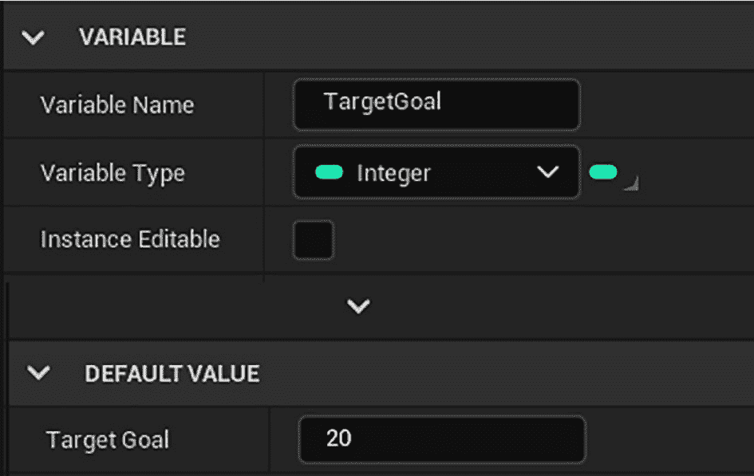

图 10.32 – 更改 TargetGoal 的默认值

- 6. 编译、保存并关闭蓝图编辑器。
- 7. 要测试敌人的漫游行为，最好使用菜单中的 **Simulate** 选项，该选项可以通过单击 **Play** 按钮旁边的三个点来访问:

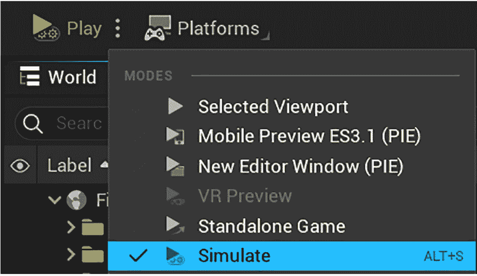

图 10.33 – 使用 Simulate 在关卡中自由移动

按住右键并使用 W、A、S、D 键和鼠标在关卡中自由移动。您将看到敌人生成并移动到关卡中的随机位置。

我们创建了一个自定义任务来查找随机漫游点，并修改了行为树以使用此新任务。现在，由 `BP_EnemySpawner` 生成的敌人知道如何在关卡中移动。

### 摘要

本章中，我们通过增强 AI 驱动敌人的能力，开始着手创造既具挑战性又平衡的游戏体验。我们赋予敌人类似僵尸的行为，让它们在关卡中无目的地漫游，直到通过视觉或听觉注意到玩家。我们还赋予它们在发现玩家时向前冲锋并发动近战攻击的能力，从而降低玩家的生命值。接着，我们给予玩家通过攻击敌人来反击的机会，最终在敌人生命值耗尽时将其消灭。最后，我们给予新

### 测验

- 1. 行为树任务中使用的事件名称是什么？
  - a. Tick
  - b. Event Receive Execute
  - c. Event Begin Play

- 2. 用于为 AI 添加视觉和听觉的组件名称是什么？
  - a. Pawn Sensing
  - b. AI Sensing
  - c. AI Perception

- 3. 黑板可以具有 Vector 类型的键。
  - a. 正确
  - b. 错误

- 4. Set Timer by Event 节点具有 Function Name 参数。
  - a. 正确
  - b. 错误

- 5. GetRandomPointInNavigableRadius 节点根据导航网格返回随机位置。
  - a. 正确
  - b. 错误
