## 第 11 章：游戏状态与最终润色

在本章中，我们将迈出最后一步，将我们的游戏发展成一个完整且充满乐趣、能够给玩家带来挑战的体验。首先，我们将引入玩家死亡，当玩家的生命值完全耗尽时将触发该机制。然后，我们将引入回合系统，要求玩家在推进回合的过程中击败越来越多的敌人，从而提升挑战难度。最后，我们将引入保存和加载系统，以便玩家可以离开游戏，稍后返回他们上次游玩的回合。在本章中，我们将涵盖以下主题：

- 根据玩家条件显示不同的菜单
- 使用游戏修饰符创建渐进式难度
- 支持游戏状态的保存与稍后重新加载
- 根据保存的数据进行分支关卡初始化
- 创建显示游戏数据的过渡屏幕

到本章结束时，我们将拥有一款街机风格的第一人称射击游戏，玩家可以不断回归，迎接越来越困难的挑战。

### 让危险变得真实：玩家死亡

在第 10 章「升级 AI 敌人」中，我们朝着平衡的游戏取得了重大进展，在该游戏中敌人威胁玩家，但玩家可以运用技巧克服这一挑战。仍有一个元素显著缺失。如果玩家生命值耗尽，则不应能继续游戏。因此，我们将运用在 _第 8 章：创建约束和游戏目标_ 中创建的胜利画面的知识，将其应用于失败画面。此画面将允许玩家以满弹药和全新填充的生命条重新开始关卡，但也会抵消他们为达成目标所取得的任何进度。

### 设置失败画面

当玩家生命值耗尽时，将显示失败画面。我们将向他们提供重新开始上一回合或退出游戏的选项。你可能记得我们创建的胜利画面；我们在那里提供了类似的选项。与其从头重新制作 UI 画面，不如使用我们的 **WinMenu** 资产作为模板来节省一些时间。

Follow these steps to create **LoseMenu**:

- 1. 在 **内容浏览器** 中，访问 `Content|FirstPersonBP|UI` 文件夹。右键单击 **WinMenu** 并选择 **复制** 选项。
- 2. 将此新蓝图小部件命名为 `LoseMenu`：

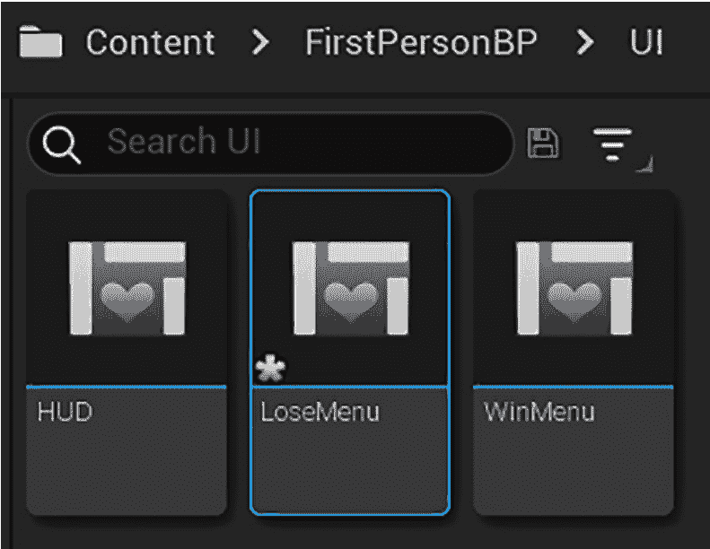

图 11.1 – 复制并重命名 WinMenu

- 3. 双击 **LoseMenu** 资产以打开 UMG 编辑器。选择显示 **你赢了！** 的文本对象。在 **详情** 面板中，将文本元素重命名为 `Lose msg`，将 **内容** 下的 **文本** 字段更改为 `You Lose!`，并将 **颜色和不透明度** 更改为深红色：

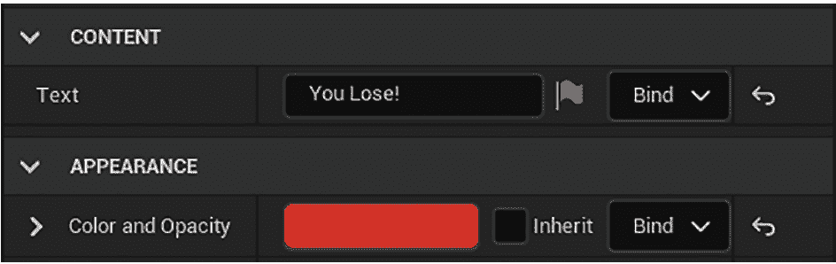

图 11.2 – 设置 LoseMenu 的消息

- 4. 编译并保存。目前，**重启** 和 **退出** 两个按钮在外观和功能上可以与 `WinMenu` 中的对应项保持相同。

现在我们需要修改 `FirstPersonCharacter` 蓝图以显示失败画面。

### 显示失败画面

我们将创建一个名为 **LostGame** 的自定义事件，当玩家生命值耗尽时将调用该事件。

创建自定义事件的步骤如下：

- 1. 在 **内容浏览器** 中，访问 `Content > FirstPersonBP > Blueprints` 文件夹并双击 `FirstPersonCharacter` 蓝图。
- 2. 右键单击 **事件图表** 并添加 **自定义事件**。将其重命名为 `LostGame`。我们将在 **LostGame** 事件中添加以下节点：

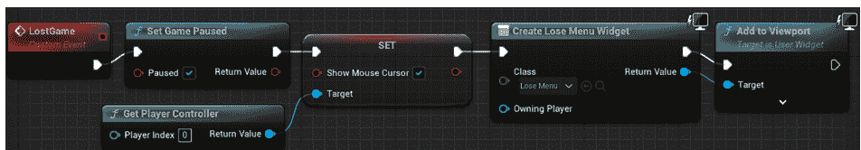

图 11.3 – LostGame 操作

- 3. 从 **LostGame** 的输出执行引脚拖出一条线，添加 **设置游戏暂停** 节点，并选中 **暂停** 复选框。
- 4. 右键单击 **事件图表** 并添加 **获取玩家控制器** 节点。从 **返回值** 输出引脚拖出一条线并添加 **设置显示鼠标光标** 节点。选中 **显示鼠标光标** 旁边的复选框，并将此节点附加到 **设置游戏暂停** 的输出执行引脚。
- 5. 从 **设置显示鼠标光标** 节点的输出执行引脚拖出一条线，添加 **创建小部件** 节点。在 **类** 参数中，选择 **LoseMenu**。
- 6. 将 **创建小部件** 节点的 **返回值** 输出引脚拖出一条线，添加 **添加到视图端** 节点。
- 7. 我们将修改 **事件任何伤害**，如果 **玩家生命值** 与 `0 0` **近似相等**，则调用 **LostGame** 事件：

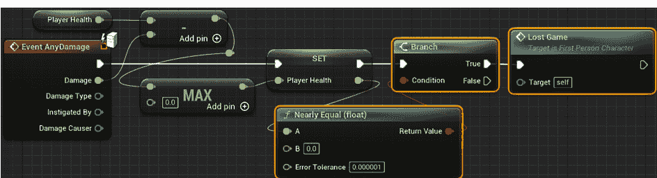

图 11.4 – 修改事件任何伤害

- 8. 从 **设置玩家生命值** 节点的白色输出引脚拖出一条线，添加 **分支** 节点。
- 9. 从 **设置玩家生命值** 节点的输出引脚拖出一条线，添加 **近似相等（浮点）** 节点。将 **返回值** 引脚连接到 **分支** 节点的 **条件** 输入引脚。
- 10. 从 **分支** 节点的 **真** 输出引脚拖出一条线，添加 **LostGame** 节点。
- 11. 编译、保存，然后单击 **开始游戏** 来测试你的工作。如果你站在敌人旁边足够长的时间，使其将你的生命值耗尽至零，那么你应该会看到我们创建的 **LoseMenu**。

现在，玩家需要更加小心地对待敌人以免输掉游戏。使游戏更有趣的下一步是创建基于回合的体验。

### 使用保存游戏创建基于回合的动态难度

我们现在有一个支持完整游玩体验的游戏。然而，游戏体验受到我们设定为目标的敌人数量的限制。这导致游戏显得浅薄。为解决此问题，我们可以采用街机游戏使用的技术，即随着玩家通过一系列回合来增加游戏难度。这是使用现有资产为游戏增加深度和乐趣的一种方式，而无需花费数小时创建自定义内容。

我们创建的回合将作为玩家的得分。他们达到的回合越高，玩家被认为成就越大。为确保玩家达到的最大回合仅受其技能限制，而不受他们在一次游玩中投入时间的限制，我们将实现一个保存系统，以便玩家在离开游戏并稍后返回时可以从上次中断的地方继续。

### 使用 SaveGame 类存储游戏信息

创建保存系统的第一步是创建 `SaveGame` 类的蓝图子类，用于存储我们想要保存的游戏数据。我们想要跟踪玩家退出游戏前所处的回合。我们无需存储玩家击败了多少敌人的数据，因为让每个游戏会话从回合开始处开始对玩家来说更有意义。

按照以下步骤创建 `SaveGame` 类的子类：

- 1. 在 **内容浏览器** 中，访问 Content|FirstPersonBP|Blueprints 文件夹。单击 **添加** 按钮并选择 **蓝图类**。

- 2. 在下一屏幕中，搜索并选择 SaveGame 作为父类：

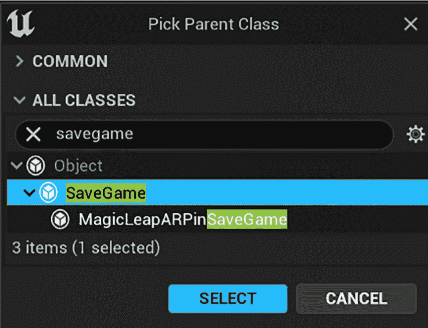

图 11.5 – 将 SaveGame 设为父类

- 3. 将蓝图命名为 BP_SaveInfo，并双击它以打开蓝图编辑器。

- 4. 在 **“我的蓝图”** 面板的 **变量** 类别中，单击 + 按钮以添加变量。在 **“详情”** 面板中，将其命名为 Round，并将 **变量类型** 更改为 **整数**。编译蓝图，然后将 **默认值** 设置为 1：

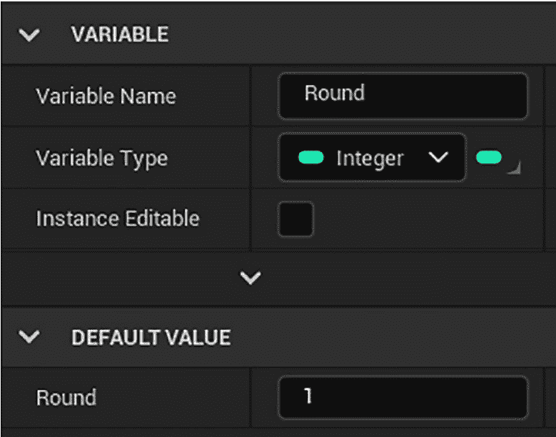

图 11.6 – 创建 Round 整数变量

- 5. 编译、保存并关闭蓝图编辑器。

在 BP_SaveInfo 蓝图中我们只需完成这些操作。下一步是学习如何使用 BP_SaveInfo 蓝图来保存和加载数据。

### 保存游戏信息

现在我们有了一个保存数据的容器，需要确保数据存储在玩家的机器上，并且在玩家返回游戏时能够检索。与其他游戏设置一样，我们将把此过程添加到 FirstPersonCharacter 蓝图中。我们将创建一些变量和一个宏来保存游戏信息。

按照以下步骤创建变量和宏：

- 1. 在内容浏览器中，打开 Content|FirstPersonBP|Blueprints 文件夹，并双击 FirstPersonCharacter 蓝图。

- 2. 在 **“我的蓝图”** 面板的 **变量** 类别中，单击 + 按钮以添加变量。在 **“详情”** 面板中，将其命名为 `CurrentRound`，并将 **变量类型** 更改为 **整数**。编译蓝图，然后将 **默认值** 设置为 `1`。

- 3. 在 **“我的蓝图”** 面板中创建一个变量，并将变量命名为 `SaveInfoRef`。

- 4. 在 **“详情”** 面板中，单击 **变量类型** 下拉菜单并搜索 `BP_SaveInfo`。将鼠标悬停在 `BP_SaveInfo` 上以显示子菜单，然后选择 **对象引用**：

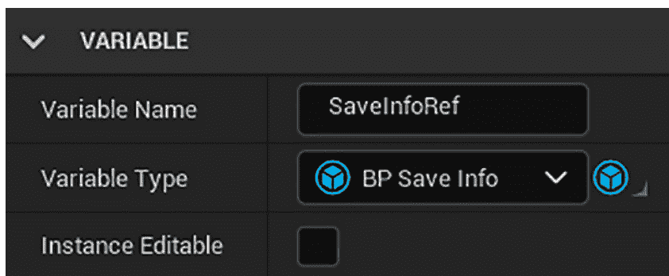

图 11.7 – SaveInfoRef 变量引用 BP_SaveInfo 的一个实例

- 5. 在 **“我的蓝图”** 面板中创建另一个变量。在 **“详情”** 面板中，将变量命名为 `saveSlotName` 并将 **变量类型** 更改为 **字符串**。编译蓝图并将 **默认值** 设置为 `SaveGameFile`。该变量存储文件名：

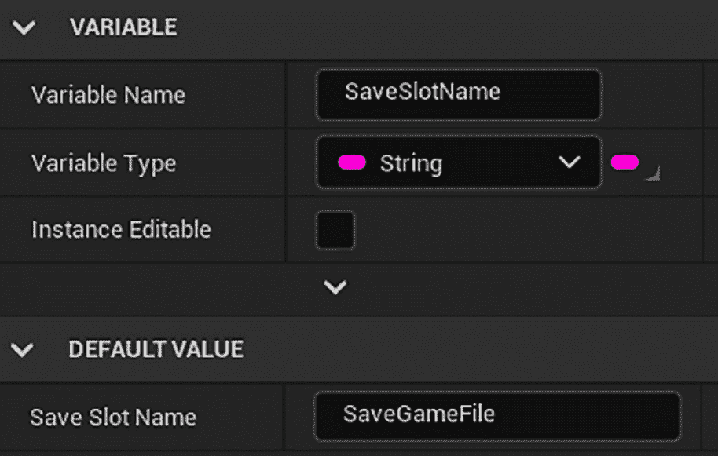

图 11.8 – saveSlotName 存储文件名

- 6. 在 **“我的蓝图”** 面板的 **宏** 类别中单击 + 按钮以创建宏。将宏命名为 SaveRound。在宏的 **详情** 面板中，创建一个名为 In 的输入参数（类型为 Exec）和一个名为 Out 的输出参数（类型为 Exec）。

- 7. 在为宏 SaveRound 创建的选项卡中，添加以下屏幕截图中显示的节点。我们检查 SaveInfoRef 是否有效。如果无效，则创建 BP_SaveInfo 的一个实例并将其存储在 SaveInfoRef 中。我们更新 SaveInfoRef 的 Round 变量，然后保存 SaveInfoRef 的内容：

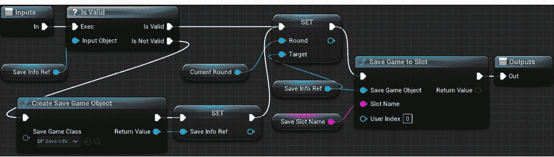

图 11.9 – SaveRound 宏

- 8. 从 **输入** 节点的 **In** 引脚拖动一根连线，并添加一个 **是否有效** 宏节点。

- 9. 从 **输入对象** 参数拖动一根连线，并添加一个 **获取 SaveInfoRef 引用** 节点。

- 10. 在 **事件图表** 上右键单击并添加另一个 **获取 SaveInfoRef 引用** 节点。从 **获取 SaveInfoRef 引用** 节点拖动一根连线，并添加一个 **设置 Round** 节点。

- 11. 将 **是否有效** 输出引脚连接到 **设置 Round** 节点的白色输入引脚。从 **Round** 输入引脚拖动一根连线，并添加一个 **获取当前 Round** 节点。

- 12. 从 **设置 Round** 节点的白色输出引脚拖动一根连线，并添加一个 **保存游戏到插槽** 节点。将 **保存游戏到插槽** 的白色输出引脚连接到 **输出** 节点的 **Out** 引脚。

- 13. 将 **游戏保存对象** 引脚连接到 **获取 SaveInfoRef 引用** 节点。从 **插槽名称** 引脚拖动一根连线，并添加一个 **获取保存插槽名称** 节点。

- 14. 从 **无效** 输出引脚拖动一根连线，并添加一个 **创建游戏保存对象** 节点。在 **游戏保存类** 中，选择 **BP_SaveInfo**。

- 15. 从 **创建游戏保存对象** 节点的 **返回值** 引脚拖动一根连线，并添加一个 **设置 SaveInfoRef 引用** 节点。将 **设置 SaveInfoRef 引用** 节点的白色输出引脚连接到 **设置 Round** 节点的白色输入引脚。

- 16. 编译并保存蓝图。

我们的下一步是创建宏，以加载使用 **SaveRound** 宏保存的内容。

### 加载游戏信息

我们将创建一个名为 **LoadRound** 的宏，用于检索保存的 **Round** 并将其存储在 **CurrentRound** 变量中。

创建宏的步骤如下：

- 1. 在 FirstPersonCharacter 蓝图的 **我的蓝图** 面板的 **宏** 类别中单击 + 按钮以创建宏。将宏命名为 LoadRound。在宏的 **详情** 面板中，创建一个名为 In 的输入参数（类型为 Exec）和一个名为 Out 的输出参数（类型为 Exec）。

- 2. 在为宏 LoadRound 创建的选项卡中，添加以下节点：

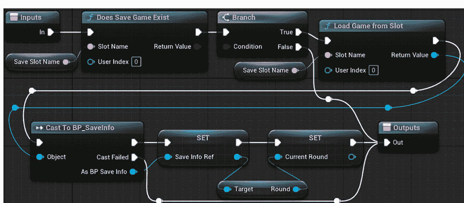

图 11.10 – LoadRound 宏

- 3. 从 **输入** 节点的 In 引脚拖动一根连线，并添加一个 **游戏保存是否存在** 节点。从 **插槽名称** 引脚拖动一根连线，并添加一个 **获取保存插槽名称** 节点。

- 4. 从 **返回值** 引脚拖动一根连线，并添加一个 **分支** 节点。将 **游戏保存是否存在** 的白色输出引脚连接到 **分支** 节点的白色输入引脚。

- 5. 将 **分支** 节点的 False 引脚连接到 **输出** 节点的 Out 引脚。你可以双击连线来添加一个中继节点，并修改连线的形状和位置。

- 6. 从 **分支** 节点的 True 引脚拖动一根连线，并添加一个 **从插槽加载游戏** 节点。从 **插槽名称** 引脚拖动一根连线，并添加一个 **获取保存插槽名称** 节点。

- 7. 从 **从插槽加载游戏** 节点的 **返回值** 引脚拖动一根连线，并添加一个 **转换为 BP_SaveInfo** 节点。将 **从插槽加载游戏** 的白色输出引脚连接到 **转换为 BP_SaveInfo** 节点的白色输入引脚。

- 8. 将 **转换为 BP_SaveInfo** 节点的 **转换失败** 引脚连接到 **输出** 节点的 **Out** 引脚。如果需要，添加一个中继节点。

- 9. 从 **转换为 BP_SaveInfo** 的 **作为 BP Save Info** 拖动一根连线，并添加一个 **设置 SaveInfoRef 引用** 节点。连接 **转换为 BP_SaveInfo** 和 **设置 SaveInfoRef 引用** 的白色引脚。

- 10. 从 **设置 SaveInfoRef 引用** 的蓝色输出引脚拖动一根连线，并添加一个 **获取 Round** 节点。

- 11. 从 **Round** 引脚拖动一根连线，并添加一个 **设置当前 Round** 节点。我们正在获取已保存的 **Round** 变量的值，并将其存储在 `FirstPersonCharacter` 蓝图的 **当前 Round** 变量中。

- 12. 连接 **设置 SaveInfoRef 引用**、**设置当前 Round** 和 **输出** 节点的白色引脚。

- 13. 编译并保存蓝图。

使用 **SaveRound** 和 **LoadRound** 宏，我们可以让玩家从停止的回合继续游戏。为了增加挑战性，让我们根据回合设置 **目标值**。

### 提高目标值

我们将利用保存文件中存储的数据，随着玩家进度的推进来改变游戏玩法。我们将通过创建一个 **RoundScaleMultiplier** 变量来实现这一点，该变量将 **当前 Round** 乘以某个系数以找到新的 **目标值**。

按照以下步骤提高 **目标值**：

- 1. 在 **“我的蓝图”** 面板的 **变量** 类别中，单击 + 按钮以添加变量。在 **“详情”** 面板中，将其命名为 RoundScaleMultiplier，然后将变量类型更改为整数。编译蓝图，然后将默认值设置为 2：

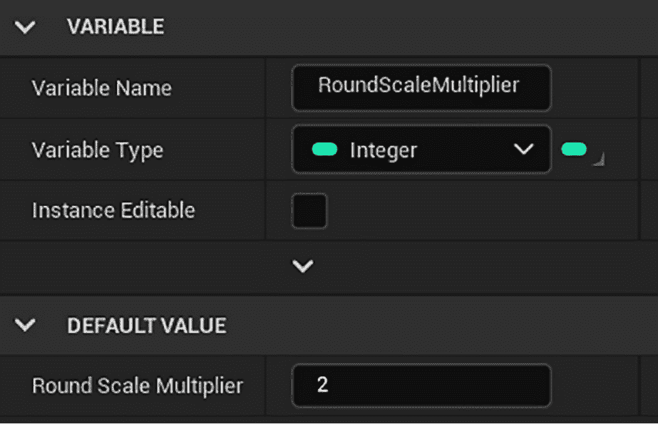

图 11.11 – RoundScaleMultiplier 变量

- 2. 在 **“我的蓝图”** 面板的 **宏** 类别中单击 + 按钮以创建宏。将宏命名为 SetRoundTargetGoal。在宏的 **详情** 面板中，创建一个名为 In 的输入参数（类型为 Exec）和一个名为 Out 的输出参数（类型为 Exec）。

- 3. 在为宏 SetRoundTargetGoal 创建的选项卡中，添加以下节点：

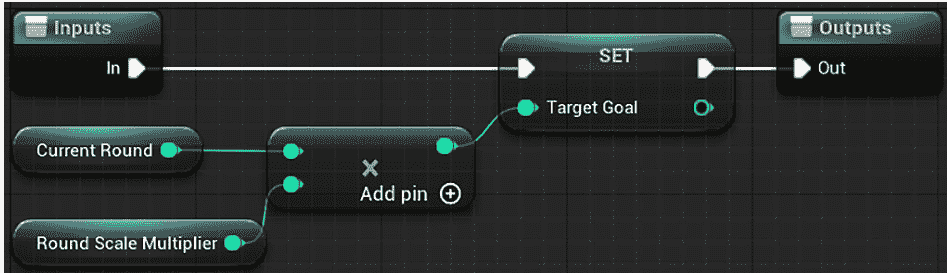

图 11.12 – SetRoundTargetGoal 宏

- 4. 从 Inputs 节点的 In 引脚拖出一根线并添加 SET Target Goal 节点。将 SET Target Goal 的白色输出引脚连接到 Outputs 节点的 Out 引脚。
- 5. 从 Target Goal 引脚拖出一根线并添加 Multiply 节点。
- 6. 从 Multiply 节点的顶部输入引脚拖出一根线并添加 Get Current Round 节点。
- 7. 从 Multiply 节点的底部输入引脚拖出一根线并添加 Get Round Scale Multiplier 节点。
- 8. 编译，保存蓝图，然后返回到 Event Graph 选项卡。
- 9. 在 My Blueprint 面板的 Graphs 类别中访问 Event BeginPlay 事件，并添加 Load Round 和 Set Round Target Goal 宏节点：

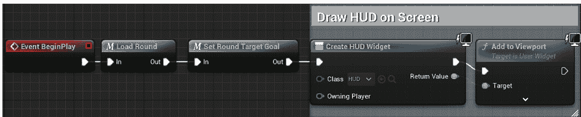

图 11.13 – 修改 Event BeginPlay

当一轮开始时，我们使用 Load Round 宏来加载保存的文件（如果存在）。然后我们使用 Set Round Target Goal 宏来设置 TargetGoal。

当玩家到达 TargetGoal 时，我们需要显示过渡屏幕。

### 在回合之间显示过渡屏幕

目前，当玩家击败足够多的敌人以满足 TargetGoal 显示的要求时，会显示 WinMenu。它会祝贺玩家，并为他们提供重新开始游戏或退出应用程序的机会。现在，既然我们正在采用基于回合的游戏玩法，我们将把这个 WinMenu 屏幕改造为过渡屏幕，它将把玩家带入下一轮游戏。

按照以下步骤创建过渡屏幕：

- 1. 在内容浏览器中，访问 /Content/FirstPersonBP/UI 文件夹，并将 WinMenu Widget Blueprint 重命名为 RoundTransition，以便更准确地反映其新用途。

- 2. 双击 RoundTransition Widget Blueprint 打开 UMG 编辑器。新的 RoundTransition 屏幕将包含以下元素：

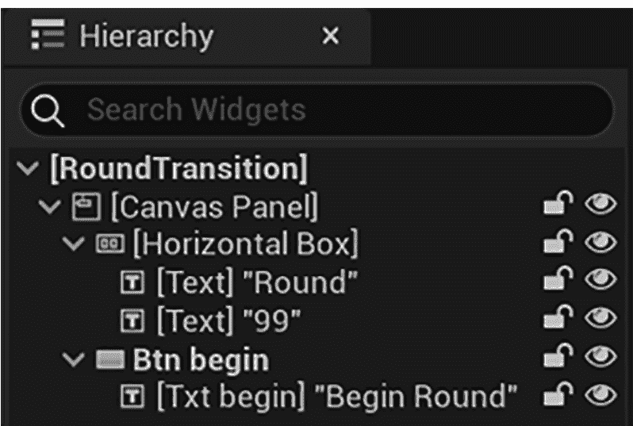

图 11.14 – RoundTransition 层级面板

- 3. 在 **层级** 面板中，删除 **你赢了！** 文本元素，并删除 **Btn quit** 按钮，因为在回合转换期间我们不需要显示退出选项。

- 4. 单击 **图表** 选项卡。在 **事件图表** 中，删除 **On Clicked (Btn quit)** 事件。单击 **设计器** 选项卡以返回 UMG 编辑器。

- 5. 选择 **Txt restart** 元素并将其重命名为 `Txt begin`。在 **详情** 面板中，将文本从 `Restart` 更改为 `Begin Round`。将 **Btn restart** 重命名为 `Btn begin`。重新加载关卡的功能将保持不变。

- 6. 从 **调色板** 面板拖动一个 **水平盒** 到 **层级** 面板中 **Btn restart** 按钮上方。

- 7. 在 **详情** 面板中，单击 **锚点** 下拉菜单并选择顶部居中选项。将 **Position X** 设置为 `-300.0`，并将 **Position Y** 设置为 `200.0`。勾选 **适应内容** 属性，因此我们不需要更改 **Size X** 和 **Size Y** 的值。此水平盒的大小将根据其子元素的大小自动调整：

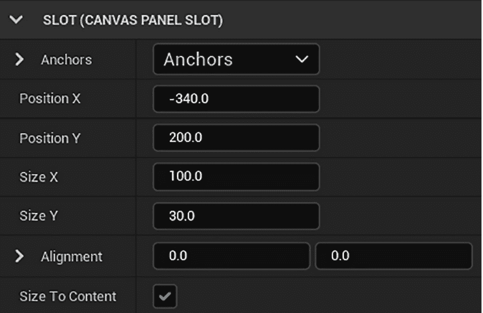

图 11.15 – 水平盒属性

- 8. 将一个文本对象拖到水平盒上。在详情面板中，将 内容 类别下的 文本 字段更改为 Round。在 外观 类别中，将字体大小更改为 120。

- 9. 将另一个文本对象拖到水平盒上。在详情面板中，将 填充左侧 设置为 20.0，并将 内容 类别下的 文本 字段更改为 99 作为参考。在 外观 类别中，将字体大小更改为 120。RoundTransition 布局应如下所示：

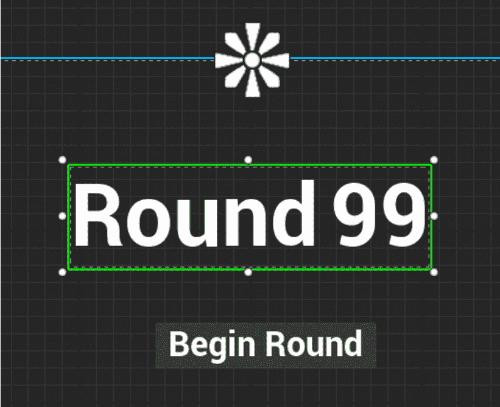

图 11.16 – RoundTransition 屏幕元素

- 10. 在 **详情** 面板中，找到 **文本** 字段旁的 **绑定** 按钮并创建一个新绑定，如下所示：

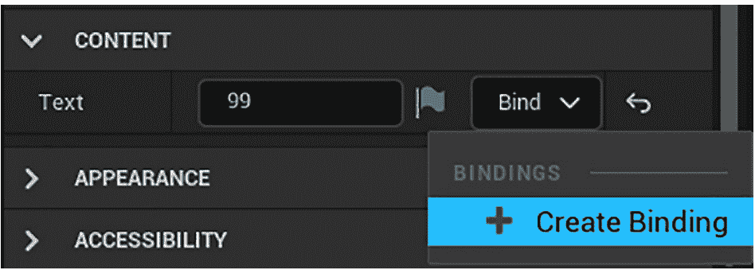

图 11.17 – 为回合创建绑定

- 11. 在出现的 **Get Text 0** 图表视图中，添加一个 **获取玩家角色** 节点，使用 **转换为 FirstPersonCharacter** 节点进行转换，然后从 **作为 First Person Character** 引脚拖出线来添加一个 **获取当前回合** 节点。

- 12. 将转换节点和 **当前回合** 节点连接到 **返回节点**。编辑器将创建一个 **转文本 (整数)** 节点，将数字转换为文本格式：

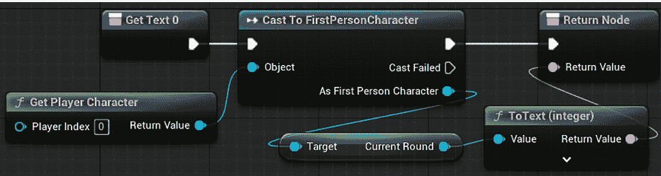

图 11.18 – 我们将在屏幕上显示当前回合变量的值

- 13. 编译，保存，并关闭 UMG 编辑器。

要完成基于回合的系统，我们只需要修改 **结束游戏事件**。

### 当当前回合获胜时过渡到新回合

在 `FirstPersonCharacter` 蓝图中对 **结束游戏** 事件的修改将很简单，因为将显示 **RoundTransition** 屏幕，因为它是 **WinMenu** 的修改版本。

当玩家赢得一回合时，我们将增加 **当前回合** 变量并保存。

按照以下步骤修改 **结束游戏** 事件：

- 1. 在 **内容浏览器** 中，访问 `Content > FirstPersonBP > Blueprints` 文件夹并双击 `FirstPersonCharacter` 蓝图。

- 2. 在 **事件图表** 中，选择 **结束游戏** 事件。在 **详情** 面板中，将事件名称更改为 `End Round`。

- 3. 将注释框标签更改为 `End Round: Shows Transition Menu`：

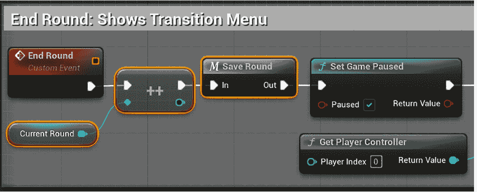

图 11.19 – 结束回合事件的新节点

- 4. 断开 **End Round** 和 **Set Game Paused** 节点之间的连线。将 **End Round** 节点向左移动，为更多节点腾出空间。

- 5. 在 **事件图表** 上右键单击并添加 **获取当前回合** 节点。

- 6. 从 **获取当前回合** 节点的输出引脚拖出一根线并添加 **整数增量** 节点。连接 **整数增量** 和 **End Round** 节点的白色引脚。

- 7. 从 **整数增量** 的输出白色引脚拖出一根线并添加 **保存回合** 宏节点。

- 8. 将 **保存回合** 的 **输出** 引脚连接到 **Set Game Paused** 节点的白色输入引脚。

- 9. 编译，保存，并单击 **播放** 按钮进行测试。

加载游戏时，您应该会注意到游戏顶部的目标计数器上显示的敌人数量较少。击败目标指示的敌人数量，您应该会看到回合转换屏幕出现，显示 **回合 2**。当您按下 **开始回合** 按钮时，您将重新加载关卡，生命值和弹药会恢复，但目标敌人数量会更高。如果您退出游戏，然后再次单击 **播放** 按钮，您会发现游戏加载的是您上次所在的回合。

既然我们可以追踪玩家的进度，就应该为他们提供重置存档文件的选项，以便他们想从头开始游戏时使用。

### 暂停游戏并重置存档文件

我们将创建 **PauseMenu**，它将为玩家提供恢复游戏、将游戏重置到第一回合或退出应用程序的选项。

### 创建暂停菜单

**PauseMenu** 类似于我们的 **LoseMenu**。因此，我们将使用它作为模板。以下屏幕截图显示了我们希望在 **PauseMenu** 中包含的元素：

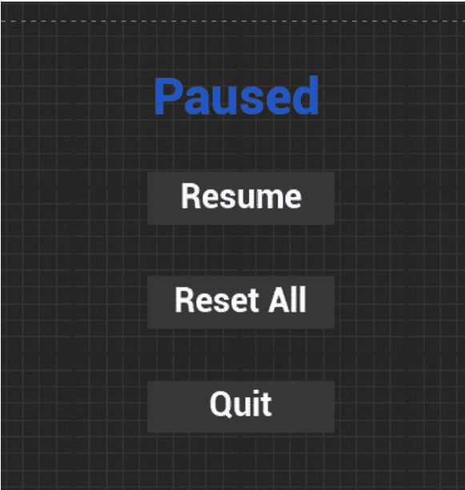

图 11.20 – 暂停菜单元素

### 按照以下步骤创建 PauseMenu：

- 1. 在 **内容浏览器** 中，访问 `Content > FirstPersonBP > UI` 文件夹。右键单击 **LoseMenu** 并选择 **复制** 选项。

- 2. 将这个新蓝图小部件命名为 **PauseMenu**。

- 3. 选择显示 **你输了！** 的文本，并在 **详情** 面板中将 **文本** 字段更改为 `Paused`，并将 **颜色和不透明度** 更改为蓝色：

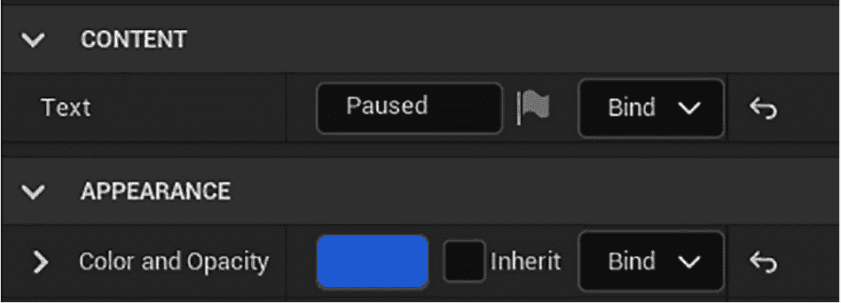

图 11.21 – 设置 PauseMenu 的消息

- 4. 我们将把 **暂停** 文本再向上移动，为另一个按钮腾出空间。在 **插槽** 类别中，将 **Position X** 设置为 `-170.0`，并将 **Position Y** 设置为 `-450.0`：

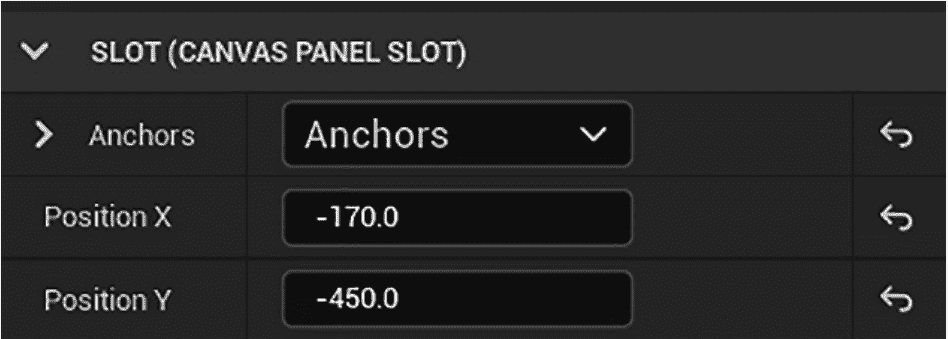

图 11.22 – 设置暂停文本的位置

- 5. 我们将添加一个按钮作为 **继续** 选项，并将 **重新开始** 按钮更改为 **全部重置** 选项。**PauseMenu** 的 **层级** 将如下所示：

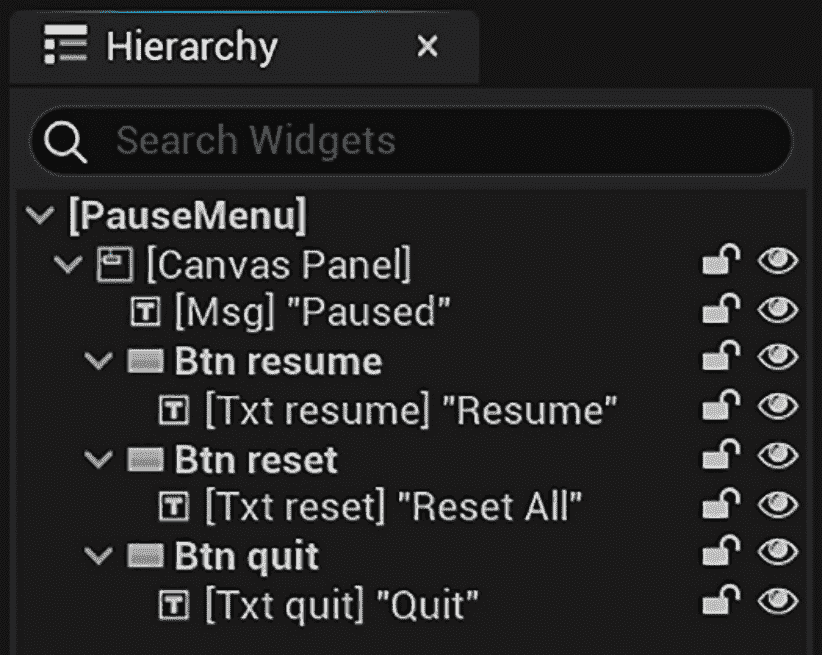

Figure 11.23 – PauseMenu 层级结构

- 6. 将 **Button** 元素从 **Palette** 面板拖放到 **Hierarchy** 面板中 **Paused** 消息下方的 **CanvasPanel** 对象上。在 **Details** 面板中，将名称更改为 `Btn resume`，单击 **Anchors** 下拉菜单，并选择屏幕中心带有锚点的选项。

- 7. 将 Position X 设置为 `-180.0`，Position Y 设置为 `-250.0`，Size X 设置为 `360.0`，Size Y 设置为 `100.0`。

- 8. 将 **Text** 对象从 **Palette** 面板拖放到 **Hierarchy** 面板中的 **Btn resume** 元素上。在 **Details** 面板中，将名称设置为 `Txt resume`，将 **Content** 类别下的 **Text** 字段更改为 `Resume`，并将字体 **Size** 设置为 `48`。

- 9. 现在，让我们将 **Restart** 按钮转换为 **Reset All** 按钮。将 **Btn restart** 按钮名称更改为 `Btn reset`，将 `Txt restart` 更改为 `Txt reset`，然后将 **Text** 字段更改为 `Reset All`。

- 10. 编译并保存。

我们已经添加了 **PauseMenu** 的视觉元素；现在让我们来处理功能部分。

### 恢复游戏

要恢复游戏，需要将 **PauseMenu** 从视口中移除，隐藏鼠标光标，并取消暂停游戏。

添加功能的步骤如下：

- 1. 单击 **Btn resume** 元素，向下滚动到 **Details** 面板底部，单击 **On Clicked** 事件旁边的 + 按钮。

- 2. 在 **Graph** 视图中，将这些节点添加到 **On Clicked (Btn resume)** 事件：

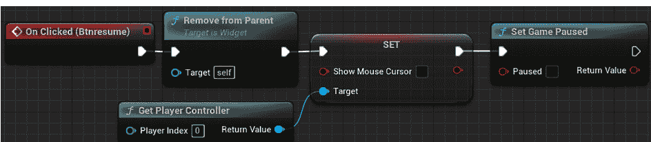

Figure 11.24 – 恢复按钮操作

- 3. 从 **On Clicked (Btn resume)** 节点拖出一条线，添加 **Remove from Parent** 节点。

- 4. 在 Event Graph 上右键单击，添加 **Get Player Controller** 节点。

- 5. 从 **Get Player Controller** 的 Return Value 拖出一条线，添加 **SET Show Mouse Cursor** 节点。将 **Remove from Parent** 的白色输出引脚连接到 **SET Show Mouse Cursor** 的白色输入引脚。保持 **Show Mouse Cursor** 参数未勾选。

- 6. 从 **SET Show Mouse Cursor** 的白色输出引脚拖出一条线，添加 **Set Game Paused** 节点。保持 **Paused** 参数未勾选。

这些是 **Resume** 按钮的操作。现在，让我们添加 **Reset All** 按钮的操作。

### 重置存档文件

**Reset All** 按钮会在存档存在时将其删除，然后重新加载游戏关卡。我们将创建一个包含删除存档操作的宏。

按照以下步骤创建宏：

- 1. 在 **My Blueprint** 面板中，单击 **Macros** 类别中的 + 按钮创建宏。将宏的名称更改为 `DeleteFile`。在宏的 **Details** 面板中，创建一个名为 `In` 的 **Exec** 类型输入参数和一个名为 `Out` 的 **Exec** 类型输出参数。

- 2. 在为 **DeleteFile** 宏创建的选项卡上，添加以下截图中显示的节点。我们获取 **FirstPersonCharacter** 实例的引用以检索 **Save Slot Name** 变量的值。

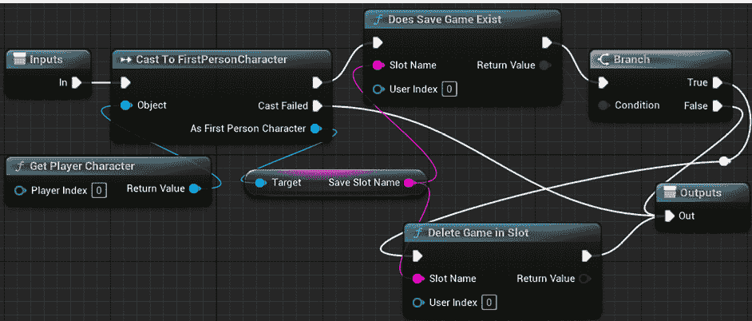

Figure 11.25 – DeleteFile 宏操作

- 3. 添加 **Get Player Character** 节点，使用 **Cast To FirstPersonCharacter** 节点进行转换，然后从 **As First Person Character** 引脚拖出线添加 **Get Save Slot Name** 节点。

- 4. 从 **Cast To FirstPersonCharacter** 的白色输出引脚拖出线，添加 **Does Save Game Exist** 节点。将 **Slot Name** 引脚连接到 **Get Save Slot Name** 节点。

- 5. 从 **Does Save Game Exist** 拖出线，添加 **Branch** 节点。将 **Return Value** 引脚连接到 **Condition** 引脚。

- 6. 从 **Branch** 节点的 **True** 输出拖出线，添加 **Delete Game in Slot** 节点。将 **Slot Name** 引脚连接到 **Get Save Slot Name** 节点。将白色输出引脚连接到 **Outputs** 节点的 **Out** 引脚。

- 7. 将 **Cast To FirstPersonCharacter** 的 **Cast Failed** 引脚和 **Branch** 节点的 **False** 引脚连接到 **Outputs** 节点的 **Out** 引脚。

- 8. 在 **Event Graph** 中，在 **On Clicked (Btn reset)** 事件后添加 **Delete File** 宏节点：

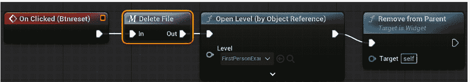

Figure 11.26 – 修改 On Clicked (Btn reset) 事件

- 9. 编译并保存 **PauseMenu**。

我们创建了 **PauseMenu** 屏幕。现在需要一种方法让玩家调出 **PauseMenu**。

### 触发暂停菜单

我们将使用 **Enter** 键暂停游戏并打开 **PauseMenu**。我们需要在 **Project Settings...** 中添加一个名为 **Pause** 的动作映射，并为 **Pause** 动作映射创建的 **InputAction** 事件添加操作。

按照以下步骤触发 **PauseMenu**：

- 1. 要更改游戏的输入设置，请单击工具栏最右侧的 **Settings** 按钮，并选择 **Project Settings...** 选项：

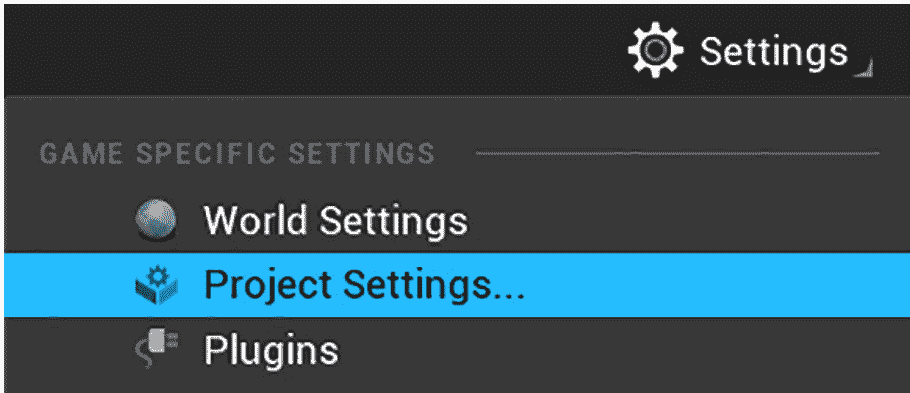

Figure 11.27 – 访问 Project Settings

- 2. 在出现的窗口左侧，查找 **Engine** 类别并选择 **Input** 选项。单击 **Action Mappings** 旁边的 + 号。将新操作命名为 **Pause**，并从下拉菜单中选择 **Enter** 键，将该键映射到 **Pause** 事件：

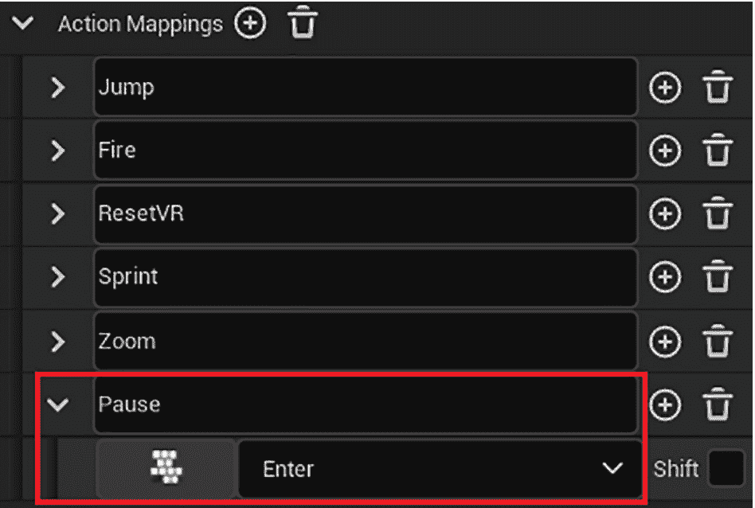

Figure 11.28 – 创建动作映射

- 3. 在内容浏览器中，访问 Content > FirstPersonBP > Blueprints 文件夹并双击 FirstPersonCharacter 蓝图。

- 4. 在 Event Graph 上右键单击，搜索 input_action_pause，添加 Pause Event 节点。复制 LostGame 自定义事件中的所有节点，并将它们粘贴到 InputAction Pause 节点附近：

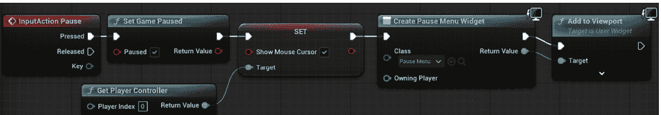

Figure 11.29 – InputAction Pause 事件操作

- 5. 将 **InputAction Pause** 节点的 **Pressed** 引脚连接到 **Set Game Paused** 节点的白色输入引脚。

- 6. 将 **Create Widget** 节点的 **Class** 参数更改为 **Pause Menu**。

- 7. 编译、保存，然后单击 **Play** 进行测试。

现在，在游戏过程中，你应该能够按下设置的 *Enter* 键来调出暂停菜单。单击 **Resume** 按钮应该关闭暂停菜单并返回游戏。如果你在游戏中推进几轮，然后从暂停菜单中按下 **Reset All** 按钮，则应该自动重新加载关卡，进度重置为游戏的第一轮。如果你看到的情况是这样，那么恭喜！你已经在创建一个能够在多轮游戏中存储、加载和重置进度的存档系统方面取得了重大成就。

### 摘要

在本章中，我们在将游戏打造为一种他人可以游玩和享受的完整体验方面取得了显著进展。你学习了如何根据玩家是否获胜或失败来显示不同屏幕。你还学习了如何实现存档系统，允许玩家在保留进度的情况下返回之前的游戏会话。然后，我们实现了一个回合系统，每当玩家推进到新回合时，该系统都会修改游戏目标。最后，我们实现了额外的菜单系统，这些系统会向玩家提供他们所处的回合信息，并让他们有机会暂停游戏甚至重置自己的存档文件。

在下一章中，我们将探讨如何为我们创建的游戏制作构建版本，以便与他人分享体验。

### 测验

- 1. **Create Widget** 节点创建参数中所选小部件类的实例。
  - a. 正确
  - b. 错误

- 2. 用于存储将要保存的数据的类名是什么？
  - a. `SaveData`
  - b. `SaveInfo`
  - c. `SaveGame`

- 3. **Save Game to Slot** 函数接收一个结构作为输入参数，其中包含将要保存的数据。
  - a. 正确
  - b. 错误

- 4. **Load Game from Slot** 函数返回 `SaveGame` 类的一个实例。我们需要使用 **Cast To** 节点来访问已保存的变量。
  - a. 正确
  - b. 错误

- 5. 名为 **Shoot** 的 **Action Mapping** 会触发名为 **InputAction Shoot** 的事件。
  - a. 正确
  - b. 错误

