## 第 13 章：数据结构和流程控制

In Part 3, we learned how to create a basic AI game using Behavior Trees, how to add game states, and how to package a game for distribution.

在第 3 部分中，我们学习了如何使用行为树创建基本 AI 游戏、如何添加游戏状态以及如何打包游戏以供分发。

Part 4 will teach you about advanced Blueprint concepts that will help when developing complex games. We will learn about data structures, flow control, math nodes, and Blueprint tips, and gain an understanding of virtual reality development.

第 4 部分将教你高级蓝图概念，这些概念在开发复杂游戏时将提供帮助。我们将学习数据结构、流程控制、数学节点和蓝图技巧，并了解虚拟现实开发。

This chapter will explain what data structures are and how they can be used to organize data in Blueprints. We will learn about the concept of containers and how to use arrays, sets, and maps to group multiple elements, as well as other ways to organize data using enumerations, structures, and data tables. In this chapter, we will also see how to control a Blueprint's flow of execution by using various types of flow control nodes.

本章将解释什么是数据结构以及如何在蓝图中使用它们来组织数据。我们将学习容器的概念，以及如何使用数组、集合和映射来分组多个元素，还有使用枚举、结构体和数据表组织数据的其他方法。在本章中，我们还将看到如何使用各种类型的流程控制节点来控制蓝图的执行流程。

We will cover the following topics in this chapter:

本章将涵盖以下主题：

- Exploring different types of containers

- 探索不同类型的容器

- Exploring other data structures

- 探索其他数据结构

- Flow control nodes

- 流程控制节点

By the end of the chapter, you will know about various data structures and flow control nodes that will increase your ability to solve problems in Blueprints.

到本章结束时，你将了解各种数据结构和流程控制节点，这些内容将提高你在蓝图中解决问题的能力。

### Exploring different types of containers

### 探索不同类型的容器

容器是一种数据结构，其实例可以存储值或实例的集合。容器中的值必须是同一类型。
容器中的元素可以稍后通过与该元素关联的标签来检索。

Blueprints 中可用的容器有数组、集合和映射。要将变量转换为容器，请单击 **变量类型** 旁边的图标，然后选择出现的容器之一，如以下截图所示：

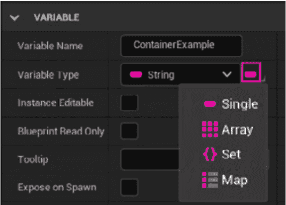

图 13.1 – 创建容器

我们将先学习最常用的容器类型——数组。

### 数组

一个 **数组** 是一种容器类型，用于存储一种特定数据类型的一个或多个值。因此，可以使用单个变量来存储多个值，而不是为每个值使用单独的变量。

数组提供对其元素的索引访问，因此用于检索元素的标签是该元素在容器中的顺序索引。除非在数组中间插入元素，否则每个元素都会保持其在数组中的位置。

创建数组的步骤如下：

- 1. 在 **我的蓝图** 面板中，创建一个变量并定义其类型。
- 2. 单击 **变量类型** 下拉菜单旁边的图标并选择数组图标，如本截图所示：

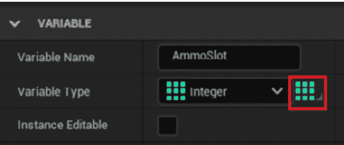

图 13.2 – 创建整数数组

- 3. 编译 Blueprint 以便能够添加数组的默认值。在变量的 **默认值** 面板中，单击 + 图标以向数组添加元素。

以下截图显示了一个名为 **弹药槽** 的 **整数** 数组示例，该数组有四个元素，用于存储玩家拥有的弹药数量。数组的每个元素存储一种武器的弹药数量：

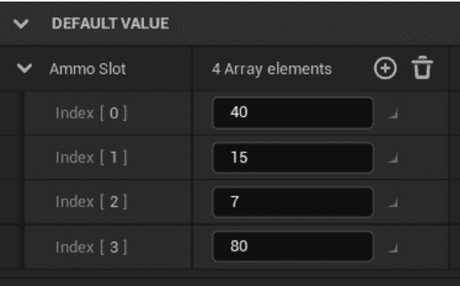

图 13.3 – 添加数组的默认值

### 注意

数组始终从索引 0 开始。因此，在前面有四个元素的示例中，第一个元素的索引是 0，最后一个元素的索引是 3。

要从数组中获取值，请使用 **获取（副本）** 节点。该节点有两个输入参数，分别是对数组的引用和元素的索引，如以下截图所示。**获取（副本）** 节点会创建数组中存储值的临时副本；因此，对检索到的值所做的任何更改都不会影响数组中存储的值：

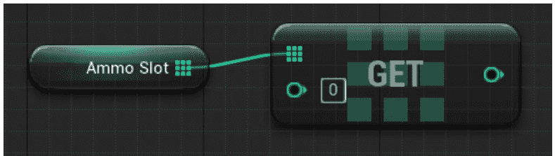

图 13.4 – 从数组中获取值

要修改数组的元素，请使用 **设置数组元素** 节点。以下截图中的示例将 **索引** 设置为 `2` 的元素的 **项** 值设置为 `10`：

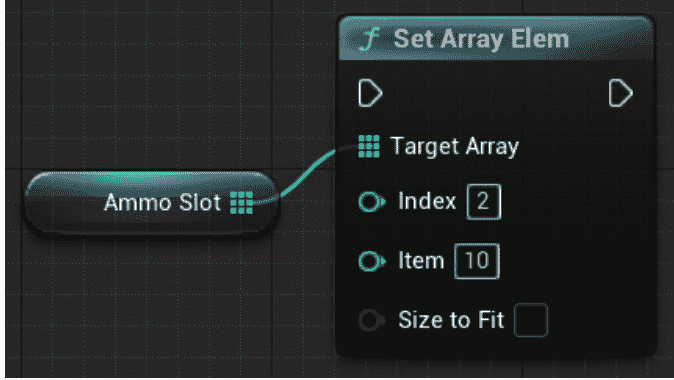

图 13.5 – 在数组元素中设置值

可使用两个节点向数组添加元素。**添加** 节点将元素添加到数组末尾。**插入** 节点在作为输入参数传递的索引处添加元素，而从此索引开始的所有原有元素将移动到下一个索引。例如，如果我们在索引 2 处插入元素，那么原先位于索引 2 的元素将移动到索引 3。原先位于索引 3 的元素将移动到索引 4，以此类推。使用这些节点时，数组长度会动态增加。这两个节点都接收作为参数的数组引用以及将添加到数组的元素引用：

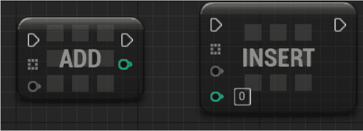

图 13.6 – 向数组添加元素

可以使用 **长度** 节点获取数组中的元素数量。由于数组索引从零开始，因此最后一个元素的索引将是 **长度** – 1。或者，可以使用 **最后索引** 节点，它返回数组最后一个元素的索引。以下截图显示了这两个节点：

图 13.7 – 获取数组的长度和最后索引

### 注意

注意不要访问数组中大于最后索引的索引。这可能会产生意外结果，并进而导致日后难以追踪的崩溃。

可以使用 **随机数组项** 节点获取数组的随机元素。**是否为空** 或 **是否不为空** 节点用于检查数组是否有元素：

图 13.8 – 获取随机数组元素和检查数组是否有元素的节点

**创建数组** 节点用于从事件图中的变量创建数组。单击 **添加引脚 +** 以添加输入引脚。截图中的示例来自关卡 Blueprint。关卡中有四个 **点光灯** 实例，**创建数组** 节点用于创建 **点光灯数组**：

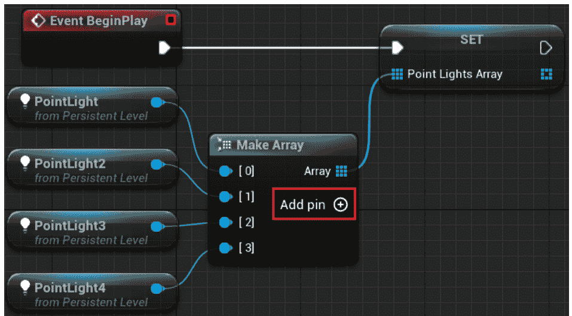

图 13.9 – 使用创建数组节点

让我们创建一个示例来检查存储对象引用的数组的用法。

### 数组示例 – 创建 BP_RandomSpawner

在此示例中，我们将创建名为 `BP_RandomSpawner` 的 Blueprint，它将具有一个 **目标点** 数组。目标点数组的元素可以在关卡编辑器中设置。当关卡开始时，`BP_RandomSpawner` Blueprint 将随机选择目标点的一个元素，并在所选目标点的同一位置生成指定 `角色` 类的实例。

创建此示例的步骤如下：

- 1. 基于带有入门内容的 *第三人称* 模板创建项目。
- 2. 在内容浏览器中，访问 *内容* 文件夹。在文件夹列表旁边的空白处右键单击并选择 **新建文件夹** 选项。将文件夹命名为 *BookUE5*。我们将使用此文件夹存储本章的资产。
- 3. 打开刚刚创建的 *BookUE5* 文件夹，然后单击内容浏览器中的 **添加** 按钮，并选择 **蓝图类** 选项。
- 4. 在下一屏幕上，选择 **角色** 作为父类。将 Blueprint 命名为 *BP_RandomSpawner* 并双击它以打开 *蓝图编辑器*。
- 5. 在 **我的蓝图** 面板中，创建一个名为 *TargetPoints* 的新变量。在 **详情** 面板中，单击 **变量类型** 下拉菜单并搜索 *target point*。将鼠标悬停在 **目标点** 上以显示子菜单，然后选择 **对象引用**。单击 **变量类型** 右侧的图标并选择 **数组** 图标。检查 **实例可编辑** 属性，如以下截图所示：

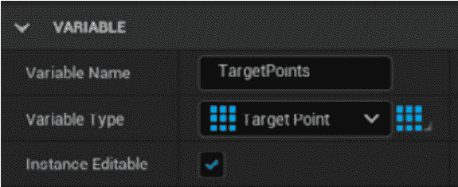

图 13.10 – 创建目标点数组

- 6. 创建另一个变量并将其命名为 `SpawnClass`。单击 **变量类型** 下拉菜单并搜索 `actor`。将鼠标悬停在 **角色** 上以显示子菜单，然后选择 **类引用**：

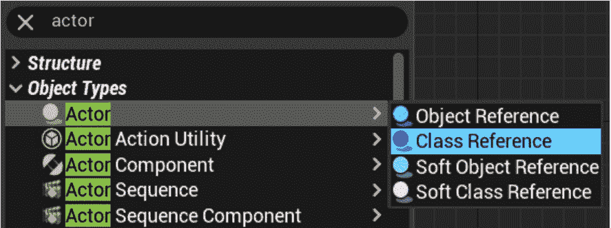

图 13.11 – 创建引用角色类的变量

- 7. 单击 **变量类型** 右侧的图标并选择单个变量图标。检查 **实例可编辑** 属性。我们将在生成角色时使用 **SpawnClass** 变量中指定的类：

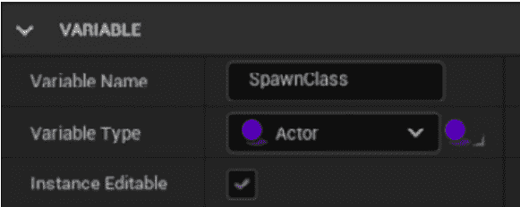

图 13.12 – SpawnClass 可在关卡实例中指定

在 **开始游戏事件** 中，我们将使用 **分支** 节点来验证 **生成类** 和 **目标点** 变量。任何存储引用的变量都应在使用前验证，以避免运行时错误。如果变量有效，那么我们将使用 **生成类** 变量中存储的类以及数组中随机选择的目标点的变换来生成角色：

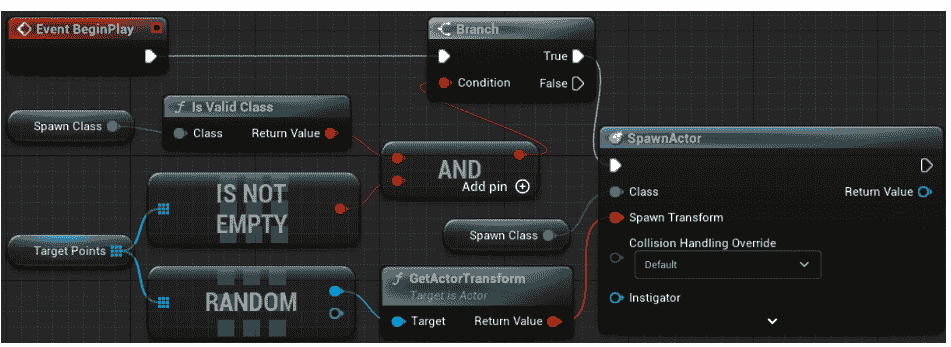

图 13.13 – 开始游戏事件操作

- 8. *步骤 8–13* 中的节点用于验证 **生成类** 和 **目标点** 变量。将 **生成类** 变量从 **我的蓝图** 面板拖出，放置在事件图中靠近 **开始游戏事件** 的位置，然后选择 **获取生成类**。
- 9. 从 **生成类** 节点拖出一条线并添加一个 **是否为有效类** 节点。
- 10. 从 **是否为有效类** 的 **返回值** 引脚拖出一条线并添加一个 **与** 节点。我们使用 **与** 节点是因为只有当两个变量都有效时才会生成角色。

- 11. 将 **目标点数组** 变量从 **我的蓝图** 面板拖入 **事件图** 中靠近 **生成类** 节点的位置，并选择 **获取目标点**。

- 12. 从 **目标点** 节点拖出一根线并添加一个 **非空** 节点。将 **非空** 节点的输出引脚连接到 **与** 节点的底部输入引脚。我们需要检查数组是否包含元素。

- 13. 从 **与** 节点的输出引脚拖出一根线并添加一个 **分支** 节点。将 **开始游戏时** 的白色引脚连接到 **分支** 节点的白色输入引脚。

- 14. *步骤 14–18* 中的节点用于使用 **生成类** 中存储的类生成演员。从 **分支** 节点的 **真** 输出引脚拖出一根线，然后从 **类** 节点添加一个 **生成角色** 节点。

- 15. 从 **生成角色** 节点的 **类** 输入引脚拖出一根线并添加一个 **获取生成类** 节点。

- 16. 从 **目标点** 节点拖出一根线并添加一个 **随机数组项** 节点。

- 17. 从 **随机数组项** 节点的顶部输出引脚拖出一根线并添加一个 **获取角色变换** 节点。

- 18. 将 **获取角色变换** 的 **返回值** 引脚连接到 **生成角色** 节点的 **生成变换** 输入引脚。

- 19. 编译并保存蓝图。

现在，我们需要准备关卡以便能够测试 **BP_随机生成器**。

### 测试 **BP_随机生成器**

我们将在关卡中添加一些 **目标点** 实例。**BP_随机生成器** 实例将使用其中一个目标点的变换：

- 1. 在关卡编辑器中，我们将使用 **放置角色面板** 轻松找到 **目标点** 类。单击工具栏上的 **创建** 按钮打开子菜单，然后单击 **放置角色面板**：

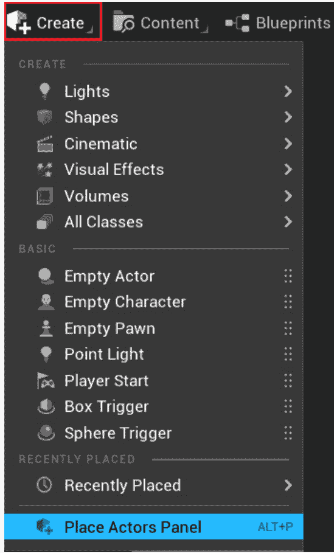

Figure 13.14 – 访问 **放置角色面板**

- 2. 在 **放置角色** 面板中搜索 `target`，如下图所示。拖动 **目标点** 并将实例放置在关卡的不同位置：

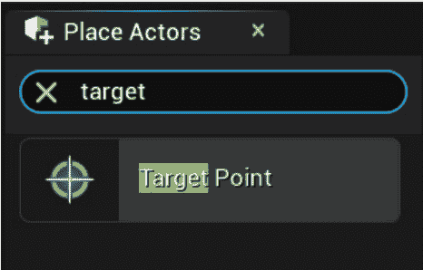

Figure 13.15 – 查找 **目标点** 类

- 3. 从内容浏览器拖动 **BP_随机生成器** 并将其放置在关卡上。**目标点** 和 **生成类** 变量出现在实例的详细信息面板中，因为我们勾选了 **可编辑实例** 属性。单击 + 图标向数组添加元素。展开每个元素的下拉菜单，并选择关卡中其中一个 **目标点** 实例。在 **生成类** 中，选择 **蓝图_效果_烟雾**：

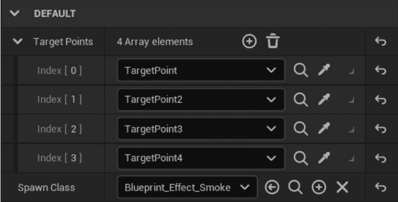

Figure 13.16 – 设置 **BP_随机生成器** 实例的变量

- 4. 单击关卡编辑器的 **播放** 按钮。**BP_随机生成器** 将在其中一个 **目标点** 实例处生成一个 **蓝图_效果_烟雾** 实例。退出并再次运行，即可看到 **蓝图_效果_烟雾** 在不同位置生成：

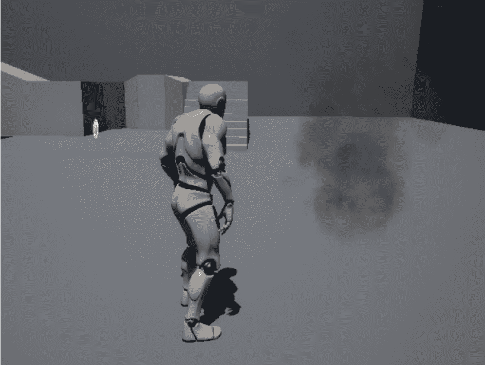

Figure 13.17 – 在关卡中生成的 **蓝图_效果_烟雾** 实例

数组在游戏开发中被广泛使用。现在，让我们看看其他类型的容器。

### 集合

集合是另一种容器类型。它是一组唯一元素的无序列表。查找集合中的元素是基于元素本身的值。没有索引。集合中的元素必须是相同类型，且不允许重复元素。

按照以下步骤创建集合：

- 1. 在 **我的蓝图** 面板中，创建一个变量并定义其类型。

- 2. 单击 **变量类型** 下拉菜单旁边的图标并选择集合图标，如本截图所示：

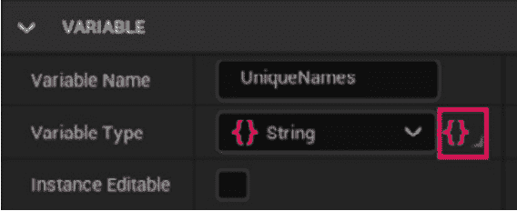

Figure 13.18 – 创建字符串集合

- 3. 编译蓝图以便可以向集合添加默认值。在变量的 **默认值** 面板中，单击 + 图标向集合添加元素。

- 4. 以下截图显示一个包含四个元素的字符串集合示例：

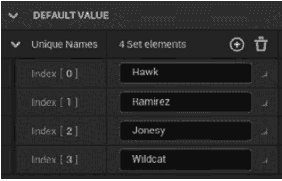

Figure 13.19 – 向集合添加默认值

下一个截图显示了集合容器的一些节点。以下是每个节点的简要说明：

- - **添加**: 向集合添加一个元素。
- - **添加项**: 从数组向集合添加元素。数组必须与集合的类型相同。
- - **包含**: 如果集合包含该元素，则返回 `true`。
- - **长度**: 返回集合中的元素数量：

Figure 13.20 – 集合容器的节点

集合没有 **获取** 元素节点，因此如果您需要遍历集合中的元素，可以将集合中的元素复制到数组中。下一个截图显示了 **转换为数组** 节点和其他用于移除元素的节点：

- - **转换为数组**: 将集合的元素复制到数组。请注意，复制大型对象的整个数组可能是一项非常昂贵的操作。
- - **清除**: 移除集合的所有元素。
- - **移除**: 移除集合的一个元素，如果移除了元素则返回 `true`，如果未找到该元素则返回 `False`。
- - **移除项**: 从集合中移除数组中指定的元素：

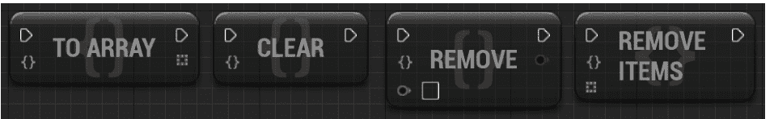

Figure 13.21 – 移除项并将集合转换为数组的节点

某些节点执行两个集合之间的操作并返回一个不同的集合。这些节点在下一个截图中显示：

- - **并集**: 生成的集合包含两个集合的所有元素。
  由于结果是一个集合，所有重复项都将被移除。
- - **差集**: 生成的集合包含第一个集合中不在第二个集合中的元素。
- - **交集**: 生成的集合仅包含同时存在于两个集合中的元素：

Figure 13.22 – 两个集合的操作

使用 **创建集合** 节点从 **事件图** 中的变量创建集合。单击 **添加引脚 +** 添加输入引脚：

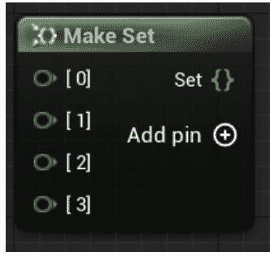

Figure 13.23 – 创建集合节点

以下截图显示了集合使用的一个简单示例。有一个名为 **唯一名称** 的集合，用于记录赢得一轮的玩家姓名。在此示例中，我们想知道至少赢过一轮的玩家；我们不需要知道玩家赢了多少轮：

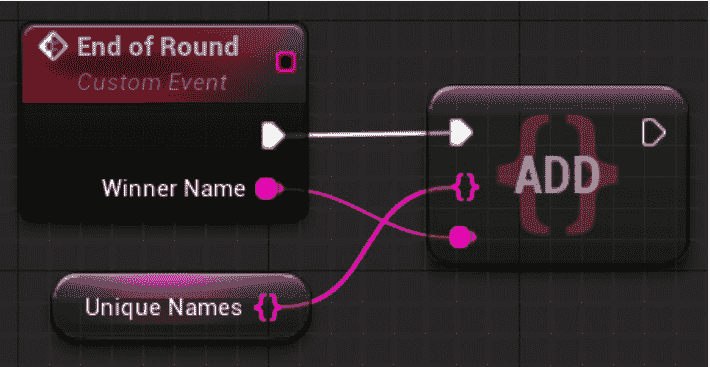

Figure 13.24 – 集合容器用法示例

集合容器的使用频率不如数组。现在，让我们来看看蓝图中可用的最后一种容器 – 映射。

### 映射

**映射** 容器使用键值对来定义每个元素。键类型可以与值类型不同。映射是无序的，并且通过键值进行搜索，因此不允许重复的键。但是，允许重复的值。

创建映射的步骤如下：

- 1. 创建一个变量，并在 **变量类型** 中选择将用作键类型的类型。

- 2. 单击 **变量类型** 下拉菜单旁边的图标，并选择映射图标，如下图所示。

- 3. 之后，您需要在弹出的第二个下拉菜单中选择值类型。下图中的示例使用 **字符串** 作为键类型和 **浮点数** 作为值类型：

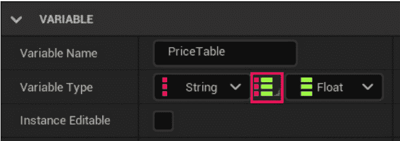

Figure 13.25 – 创建映射容器

- 4. 与蓝图中的任何其他新变量一样，在添加映射的默认值之前，有必要先编译蓝图。在变量的 **默认值** 面板中，单击 + 图标向映射添加元素。

- 5. 以下截图显示了一个包含四个元素的映射示例。每个元素都有一个字符串键和一个浮点数值：

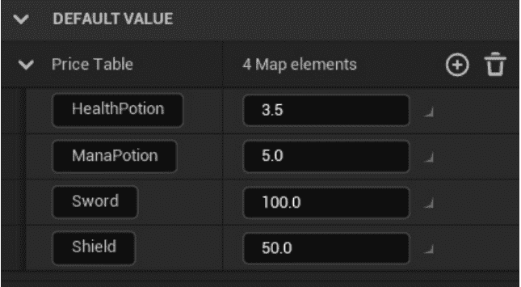

Figure 13.26 – 向映射添加默认值

以下截图显示了一些映射节点，用于添加元素、移除元素以及移除映射的所有元素：

> - **添加**: 向映射添加一个键值对。如果键已存在于映射中，则与该键关联的值将被覆盖。

- **移除**: 从映射中移除一个键值对。如果移除了键值对，则返回 `True`。如果未找到该键，则该节点返回 `False`。
- **清除**: 移除映射中的所有元素：

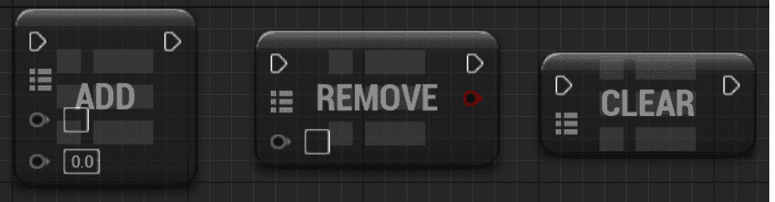

图 13.27 – 用于添加和移除元素的映射节点

用于获取映射长度、检查键是否存在以及获取映射中与键关联的值的以下节点：

- **长度**: 返回映射中的元素数量。
- **包含**: 接收一个键作为输入参数，如果映射包含使用该键的元素，则返回 `True`。
- **查找**: 查找节点类似于包含节点，但它还返回搜索中使用的键所关联的值：

图 13.28 – 用于获取长度和搜索键的映射节点

用于将映射的键和值复制到数组的以下节点：

- **键**: 将映射的所有键复制到一个数组中。
- **值**: 将映射的所有值复制到一个数组中：

图 13.29 – 用于将键和值复制到数组的映射节点

使用 Make Map 节点在事件图中从变量创建映射。单击 添加引脚 + 以添加输入引脚：

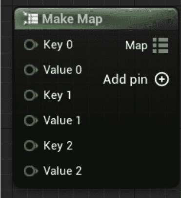

图 13.30 – Make Map 节点

以下屏幕截图显示了映射的示例用法。价格表是一个映射，它使用产品名称作为键，使用产品的价格作为值。有一个名为 Calculate Total Price 的函数，它接收产品名称和数量作为输入参数，数量统计正在购买的产品。在价格表映射中搜索产品名称以获取产品的价格。产品的价格乘以数量以找到总价：

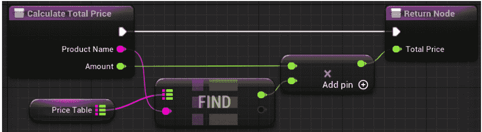

图 13.31 – 使用映射获取产品的价格

我们介绍了蓝图中可用的容器，即数组、集合和映射，并了解了何时应该使用每种容器。使用容器避免了创建多个单个变量来存储信息的需要。在下一节中，我们将看到其他有助于在游戏或应用程序中组织数据的数据结构。

### 探索其他数据结构

有一些数据结构不是在蓝图类中创建的。它们是可以在蓝图中使用的独立辅助资产。使用这些数据结构资产，您可以将自己的数据类型添加到项目中，并可以学习如何使用帮助您处理项目中大量数据的工具。

让我们学习如何创建和使用枚举、结构体和数据表。

### 枚举

一个 **枚举**，也称为 **枚举**，是一种包含固定命名常量集合的数据类型，可用于定义变量的类型。类型为枚举的变量的值被限制在枚举中定义的常量集合内。

按照以下步骤创建枚举：

1. 在内容浏览器中单击 **添加** 按钮，并在 **蓝图** 子菜单中选择 **枚举**，如下面的屏幕截图所示：

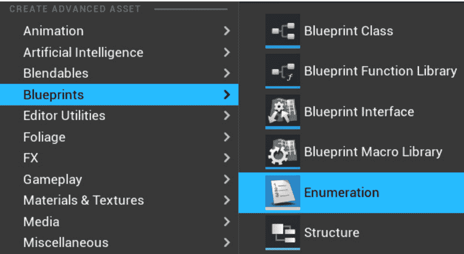

图 13.32 – 创建枚举

2. 存在一种命名约定，即枚举名称以大写 E 开头。为创建的枚举命名为 `EWeaponCategory` 并双击它以编辑其值。

3. 在枚举编辑器中，单击 **新建** 按钮向此枚举添加一个命名常量。添加下面屏幕截图中显示的五个命名常量。您可以为枚举和每个常量添加描述：

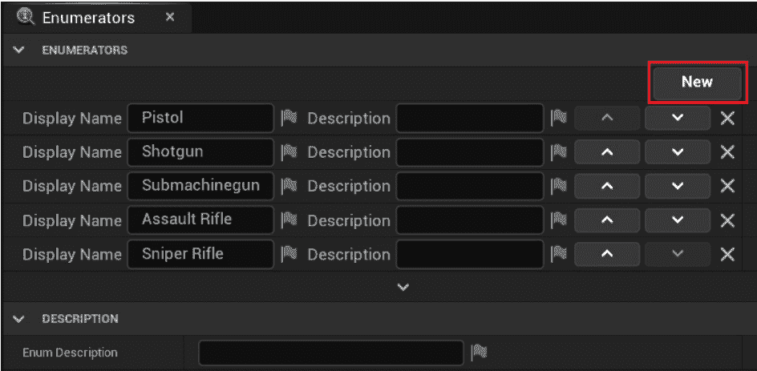

图 13.33 – 添加枚举的元素

4. 要使用枚举数据类型，在蓝图编辑器中创建一个变量，展开 **变量类型** 下拉菜单，并搜索枚举的名称，如下面的屏幕截图所示：

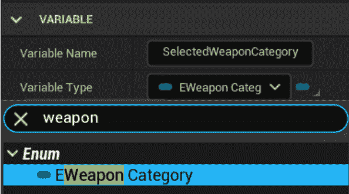

图 13.34 – 使用枚举数据类型

以下屏幕截图显示，使用枚举类型定义的变量被限制在枚举的常量中：

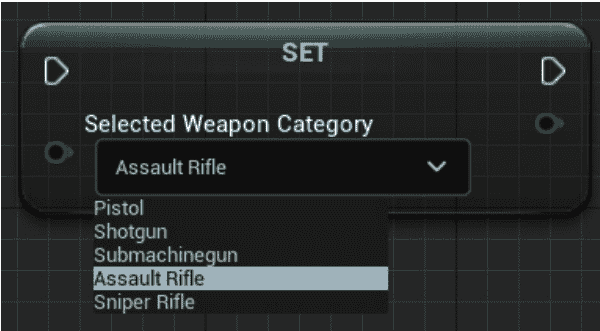

图 13.35 – 设置枚举变量的值

对于每种枚举类型，都有一个 **基于枚举的开关** 节点，用于根据枚举值更改执行流程，如下面的屏幕截图所示：

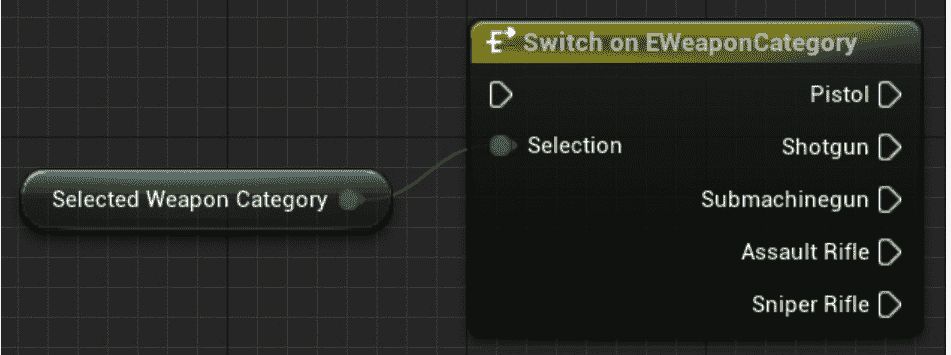

图 13.36 – 在枚举上使用基于枚举的开关节点

这就是我们需要知道的关于枚举的全部内容。我们将要查看的下一个数据资产是结构体。

### 结构体

一个 **结构体**，也称为 **结构**，是一种复合数据类型，可以将不同类型的变量分组为单一类型。结构体的一个元素可以是复杂类型，例如另一个结构体、数组、集合、映射或对象引用。

创建结构体的步骤如下：

1. 在内容浏览器中单击 **添加** 按钮，并在 **蓝图** 子菜单中选择 **结构体**，如下面的屏幕截图所示：

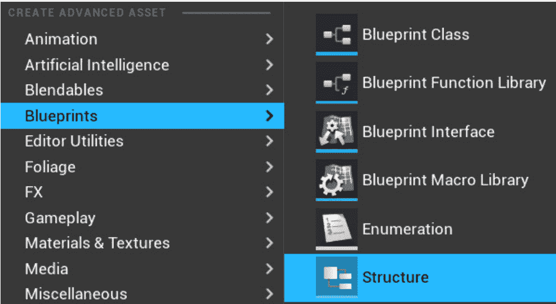

图 13.37 – 创建结构体

2. 将创建的结构体重命名为 *武器类型* 并双击它以定义其变量。

3. 在 **结构体** 编辑器中，单击 **新建变量** 按钮向结构体添加变量。每个变量可以是不同的类型，您可以单击容器图标将变量转换为容器，例如数组、集合或映射。

4. 添加以下屏幕截图中显示的变量。请注意，**类别** 变量是以前创建的 **EWeaponCategory** 枚举类型：

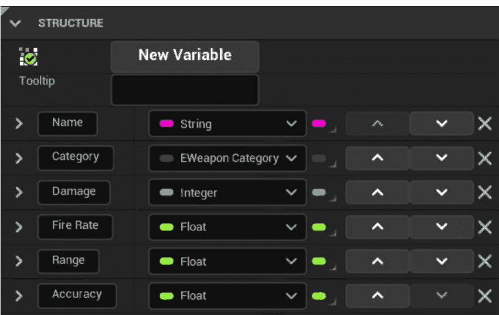

图 13.38 – 武器类型结构体的变量

5. 要使用 **结构体** 数据类型，在蓝图编辑器中创建一个变量，单击 **变量类型** 下拉菜单，并搜索结构体的名称，如下面的屏幕截图所示：

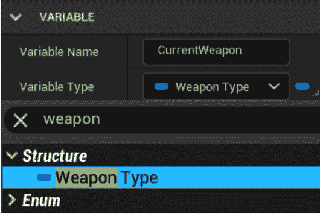

图 13.39 – 使用结构体数据类型

6. 编译蓝图以便您可以编辑 **默认值**。以下屏幕截图显示了填充了武器示例值的结构体：

| 属性 | 值 |
| :--- | :--- |
| 名称 | AK-47 |
| 类别 | 突击步枪 |
| 伤害 | 50 |
| 射速 | 0.6 |
| 射程 | 0.5 |
| 精度 | 0.8 |

图 13.40 – 向结构体类型变量添加默认值

### 注意

前面屏幕截图中的浮点变量使用表示百分比的相对值——例如，0.5 表示 50%，1.0 表示 100%。

对于每种结构体类型，都有 **制作** 和 **解析** 节点可在蓝图中使用。**制作** 节点接收单独的元素作为输入并创建一个结构体。**解析** 节点接收一个结构体作为输入并分离其元素。下一个屏幕截图显示了 **武器类型** 结构体的 **制作** 和 **解析** 节点：

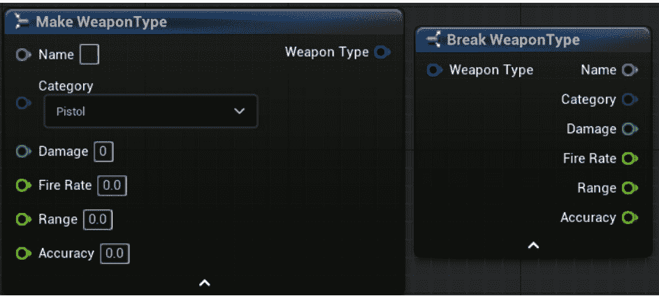

图 13.41 – 制作结构体并获取其元素的节点

结构体在蓝图中非常有用，可用于将多个变量组合成一种新类型。我们将要查看的最后一个数据结构是数据表。

### 数据表

一个 **数据表** 是基于结构体的值表。它可以用于表示电子表格文档。这对于数据驱动的游戏玩法很有用，在这种玩法中，游戏数据需要不断修改和平衡。在这些情况下，数据可以在电子表格编辑器中修改，然后导入到游戏中。

按照以下步骤创建数据表：

1. 在内容浏览器中单击 **添加** 按钮，并在 **杂项** 子菜单中选择 **数据表**，如下面的屏幕截图所示：

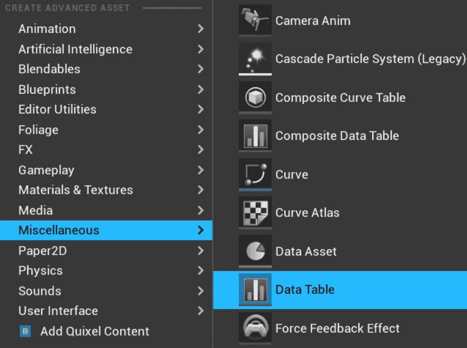

图 13.42 – 创建数据表

- 2. 选择 **数据表** 后，虚幻编辑器会要求您选择一个表示表格数据类型的结构。选择 **武器类型** 结构：

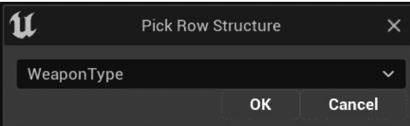

图 13.43 – 选择数据表使用的结构

- 3. 将创建的数据表重命名为 `WeaponTable`，双击它以打开数据表编辑器。

- 4. 单击 **添加** 按钮向表格中添加一行。每一行都有一个用于标识该行的行名，且行名必须唯一。要更改行名，需要右键单击一行并选择 **重命名**。在以下屏幕截图的示例中，行名是一个简单的索引。向数据表添加一些行，如以下屏幕截图所示：

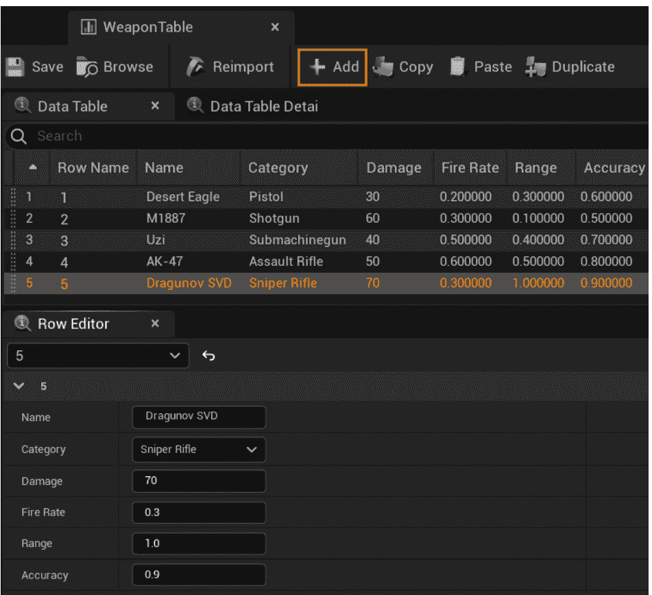

图 13.44 – 编辑数据表

数据表也可以从纯文本 **逗号分隔值 (CSV)** 文件导入。以下屏幕截图显示了一个 CSV 文件的示例。电子表格编辑器可以将电子表格导出为 CSV 格式：

| | 名称 | 类别 | 伤害 | 射速 | 射程 | 精度 |
|---|---|---|---|---|---|---|
| 1 | Desert Eagle | 手枪 | 30 | 0.200000 | 0.300000 | 0.600000 |
| 2 | M1887 | 霰弹枪 | 60 | 0.300000 | 0.100000 | 0.500000 |
| 3 | Uzi | 冲锋枪 | 40 | 0.500000 | 0.400000 | 0.700000 |
| 4 | AK-47 | 突击步枪 | 50 | 0.600000 | 0.500000 | 0.800000 |
| 5 | Dragunov SVD | 狙击步枪 | 70 | 0.300000 | 1.000000 | 0.900000 |

图 13.45 – CSV 格式中的 WeaponTable

- 5. 要导入 CSV 文件，请在内容浏览器中单击 **导入** 按钮并选择 CSV 文件。将出现一个对话框，要求您在 **选择数据表行类型** 字段中选择一个结构，如以下屏幕截图所示：

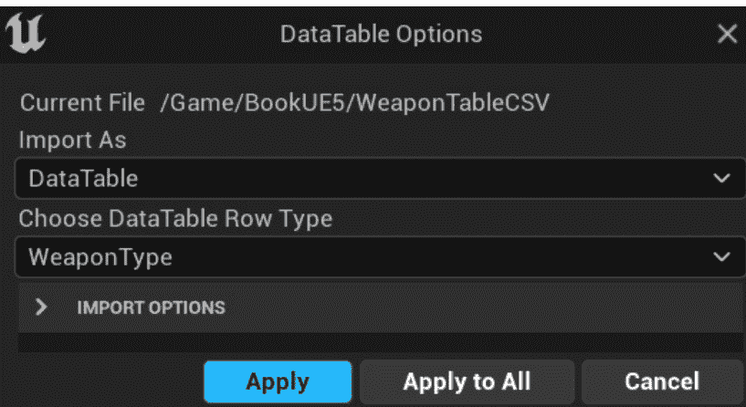

图 13.46 – 从 CSV 文件导入数据表

- 6. 要在蓝图中使用数据表，请在蓝图编辑器中创建一个变量，并选择 **数据表 > 对象引用** 作为 **变量类型**：

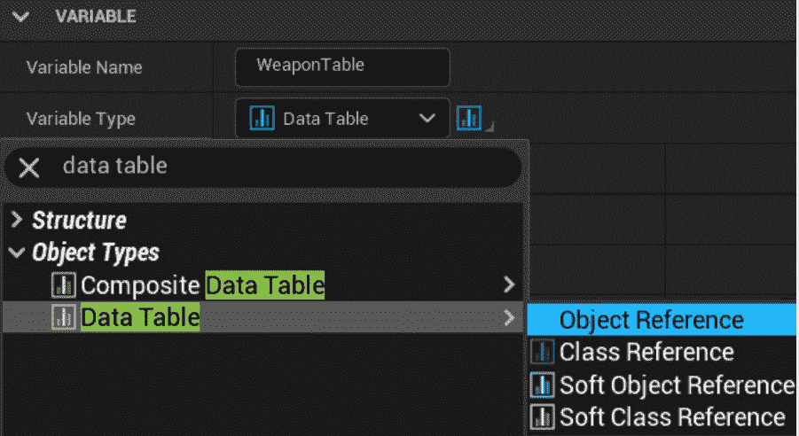

图 13.47 – 创建数据表引用

- 7. 编译蓝图，并在 **默认值** 中选择一个数据表，如以下屏幕截图所示：

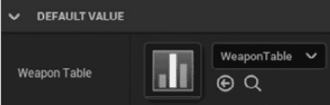

图 13.48 – 设置默认数据表

以下屏幕截图显示了一些从数据表获取数据的操作：

- **获取数据表行**：返回包含特定行数据的结构
- **获取数据表行名称**：将数据表的所有行名称复制到数组中
- **将数据表列作为字符串**：将列的所有值复制到字符串数组中：

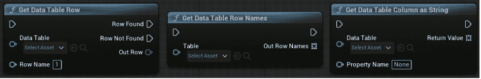

图 13.49 – 从数据表获取内容

以下屏幕截图显示了如何使用数据表的示例。
**选择武器** 是一个函数，它接收 **武器 ID** 作为输入参数，并在 **武器表** 中搜索行名等于 **武器 ID** 的武器。如果找到该武器，则将武器数据复制到 **当前武器** 变量中：

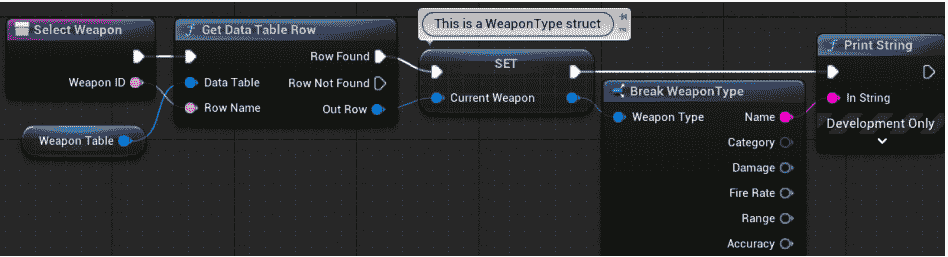

图 13.50 – 从数据表的一行获取数据

我们了解了一些可以创建的数据结构资产，用于在项目中组织数据。现在，我们将学习更多有助于组织脚本的蓝图节点。

### 流程控制节点

有一些节点用于控制蓝图执行的流程。这些节点根据条件确定执行路径。我们已经见过 **分支** 节点，它是一种常用的流程控制节点。让我们了解其他主要类型的流程控制节点。

### 开关节点

**开关节点** 根据输入变量的值确定执行流程。有不同类型的开关节点。以下屏幕截图显示了 **整数开关** 节点的示例：

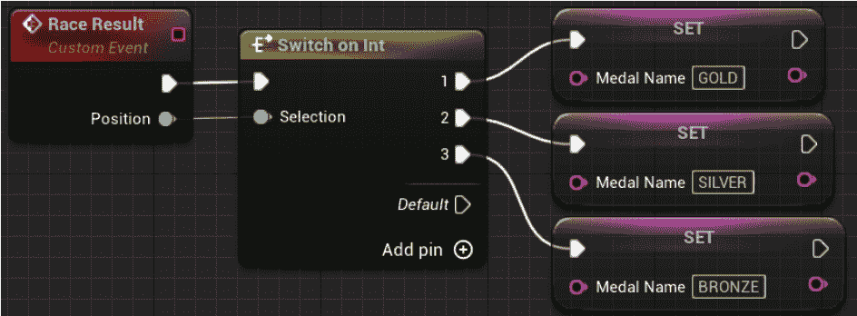

图 13.51 – 整数开关节点示例

**选择** 输入参数接收一个整数值，用于确定将执行的输出引脚。如果输入值没有对应的引脚，则将执行 **默认** 引脚。您可以在 **整数开关** 的 **详情** 面板中更改起始索引。输出引脚通过使用 **添加引脚 +** 选项添加。

另一种开关是 **字符串开关** 节点，如以下屏幕截图所示。输出值必须在 **字符串开关** 节点的 **详情** 面板的 **引脚选项 | 引脚名称** 下添加：

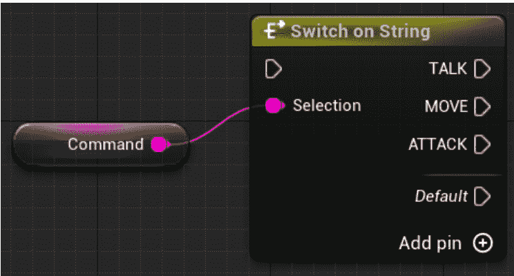

图 13.52 – 字符串开关节点示例

还有 **枚举开关**，它使用枚举的值作为可用的输出引脚。

### 翻转翻转

每次执行 **翻转翻转** 节点时，它会在两个输出引脚 **A** 和 **B** 之间切换。有一个名为 **是 A** 的布尔输出参数。如果 **是 A** 参数为 `True`，则表示引脚 **A** 正在运行。如果为 `False`，则引脚 **B** 正在运行。

注意

**翻转翻转** 节点在函数内部无法正常工作，因为 **翻转翻转** 有一个内部变量，该变量在函数结束时会被删除。因此，在函数内部每次都会执行 **A** 引脚。

以下屏幕截图显示了 **翻转翻转** 节点的示例：

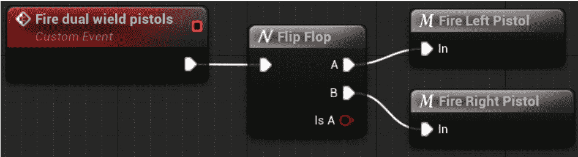

图 13.53 – 翻转翻转节点示例

如果玩家使用双持手枪，则开火时只有一把手枪射击。下一枪时，另一把手枪射击。**开火左手枪** 和 **开火右手枪** 是在此处用于简化示例的自定义宏。

### 序列

当 **序列** 节点被触发时，它会按顺序执行连接到输出引脚的所有操作。因此，它先执行一个引脚的所有操作，再执行下一个引脚的所有操作，依此类推。它很有助于组织操作组。

以下屏幕截图显示了 **序列** 节点的用法。**打印字符串** 函数用于显示执行顺序：

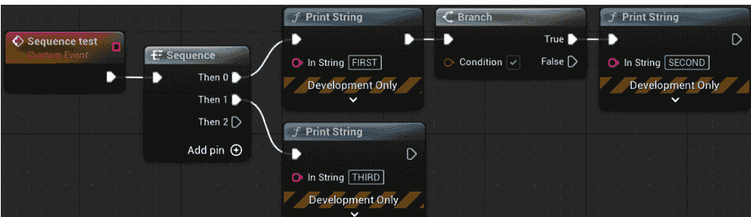

图 13.54 – 序列节点示例

**添加引脚 +** 选项添加输出引脚。要删除引脚，请右键单击引脚并选择 **删除执行引脚** 选项。

### 逐个遍历循环

**逐个遍历循环** 节点接收一个数组作为输入参数，并为数组中的每个元素执行 **循环体** 输出引脚的操作。当前的 **数组元素** 和 **数组索引** 可作为输出引脚使用。当 **逐个遍历循环** 完成执行时，将执行 **完成** 输出引脚。

在以下屏幕截图中，**逐个遍历循环** 节点用于遍历包含房间灯具的 **点光源** 引用数组：

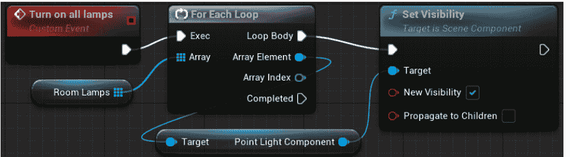

图 13.55 – 逐个遍历循环节点示例

通过使用 **点光源组件** 的 **设置可见性** 函数打开灯具，该函数位于 **点光源** 数组元素内部。

### 执行一次

**执行一次** 节点只执行一次输出引脚。如果再次触发，则其输出引脚将不再执行。**重置** 输入引脚需要被触发，以允许 **执行一次** 节点再次运行输出引脚。

以下屏幕截图显示了其用法示例：

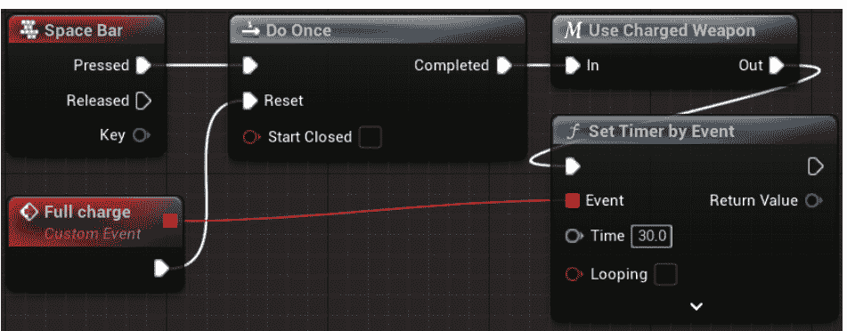

图 13.56 – 执行一次节点示例

当玩家按下 **空格键** 时，**执行一次** 节点会被触发，并使用一把蓄力武器。之后，会创建一个计时器来执行 **充满自定义事件**，该事件会在 `30.0` 秒后重置 **执行一次** 节点。如果在 30 秒内玩家再次按下 **空格键**，则 **执行一次** 节点将不执行其输出引脚。

### 执行 N 次

**执行 N 次** 节点允许您指定输出引脚可以执行多少次。在执行次数完成后，输出引脚的操作只有在 **重置** 引脚被触发时才会再次执行。

以下屏幕截图显示了 **执行 N 次** 节点的用法示例：

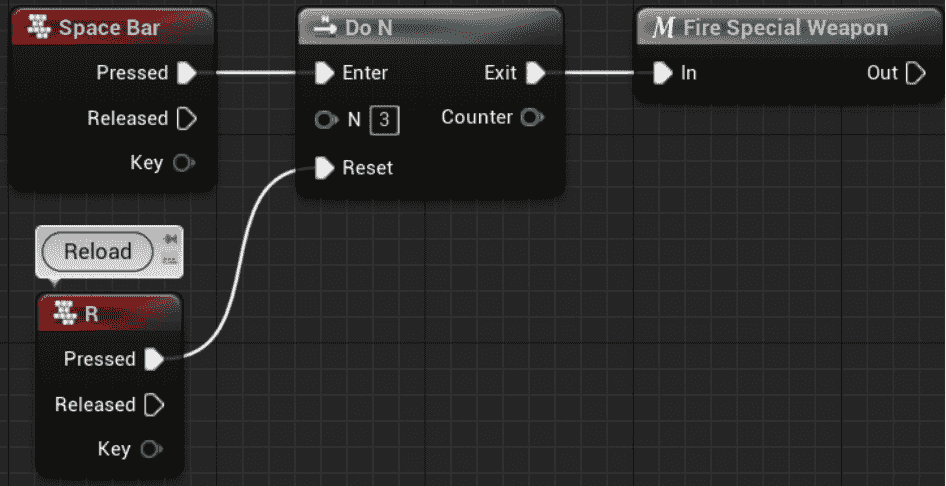

图 13.57 – Do N 节点示例

玩家可以按下 **空格键** 来发射特殊武器。第三次射击后，他们需要按下 *R* 键来重置 **Do N** 节点，以便能够再次发射三次。

### 门控

**门控** 节点具有内部状态；它可以打开或关闭。如果它处于打开状态，那么当 **门控** 节点被触发时，输出引脚将执行。如果它处于关闭状态，那么输出引脚将不会执行。

以下是 **门控** 节点的输入引脚：

- **入口**: 接收执行流的执行引脚
- **打开**: 将 **门控** 状态设置为打开的执行引脚
- **关闭**: 将 **门控** 状态设置为关闭的执行引脚
- **切换**: 切换 **门控** 节点状态的执行引脚
- **起始关闭**: 一个布尔变量，用于确定 **门控** 节点是否应以关闭状态开始

下一张截图中的示例是一个蓝图，它会对与其重叠的角色施加伤害：

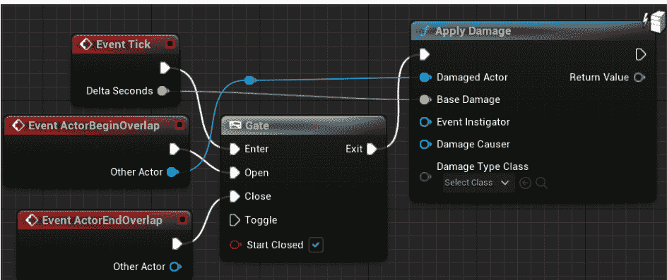

图 13.58 – **门控** 节点示例

当角色重叠时，门控节点保持打开状态，并且每帧都会对角色施加伤害。如果角色停止重叠，则门控节点将关闭，伤害将不再施加。

### 多门控

当多门控节点被触发时，将执行其中一个输出引脚。多门控节点可以有多个输出引脚。要添加另一个输出引脚，请使用“添加引脚 +”选项。

以下是多门控节点的输入引脚：

- **重置**: 用于重置多门控节点并允许重新执行输出引脚的执行引脚。
- **是否随机**: 一个布尔变量。如果值为 True，则输出引脚的执行顺序是随机的。
- **循环**: 这是一个布尔变量，指示多门控节点在最后一个输出引脚执行后的行为。如果值为 True，则多门控节点将继续执行输出引脚。如果为 False，则多门控节点将停止执行输出引脚。
- **起始索引**: 一个整数值，指示要执行的第一个输出引脚。

以下截图显示了多门控节点的示例：

图 13.59 – 多门控节点示例

当按下 Tab 键时，将使用多门控节点在每次执行时设置不同的静态网格体。已选中“循环”参数，因此多门控将在最后一个输出引脚执行后，从第一个输出引脚继续执行。

以下是蓝图中可用的流程控制节点。了解它们的存在很有好处，因为我们可以找到可以使用其中任何一个轻松解决的问题。

### 摘要

在本章中，我们学习了如何在蓝图中使用数据结构来组织数据。我们学习了如何在数组中存储各种元素以及如何检索其中的任何元素。我们学习了如何使用其他类型的容器（如集合和映射）来存储数据。

随后，我们学习了如何创建和使用枚举、结构体和数据表，并查看了它们之间关联的示例。还向我们介绍了几个流程控制节点，例如 Switch、Gate 和 For Each Loop。

本章展示了各种蓝图功能，可帮助我们有效地组织数据。流程控制节点可以简化事件图，因为在每种情况下，可能都有一个更合适的节点。

在下一章中，我们将学习世界坐标和本地坐标、向量运算，以及使用追踪来测试碰撞。

### 测验

- 1. 数组不允许重复元素。
- a. 正确
- b. 错误

- 2. 对于每种枚举类型，蓝图中都有一个可用的 Switch On 节点。
- a. 正确
- b. 错误

- 3. 结构体中的所有变量必须是相同的类型。
- a. 正确
- b. 错误

- 4. 数据表使用结构体来定义表的数据类型。
- a. 正确
- b. 错误

- 5. 哪个节点不是流程控制节点？
- a. For Each Loop
- b. 从类生成角色
- c. Do Once
- d. Gate
