## 第 14 章：数学和追踪节点

3D 世界的表示基于数学概念。如果不理解这些概念，那么理解 3D 游戏中执行的某些操作会更加困难。本章解释了 3D 游戏所需的一些数学概念。我们将学习世界变换和相对变换之间的区别，以及在使用组件时如何使用它们。我们将学习如何使用向量来表示位置、方向、速度和距离。解释了追踪的概念，并介绍了各种类型的追踪。本章还展示了如何在游戏中使用追踪来测试碰撞。

本章涵盖的主题如下：

- 世界变换和相对变换
- 点和向量
- 追踪和追踪函数简介

本章结束时，您将知道如何使用向量和追踪，使玩家能够与关卡中的其他角色进行交互。

### 世界变换和相对变换

`Actor` 类具有一个 **变换** 结构。该结构有三个变量，用于表示 **位置**、**旋转** 和 **缩放**。可使用 **详细信息** 面板修改关卡中角色的 **变换** 结构。

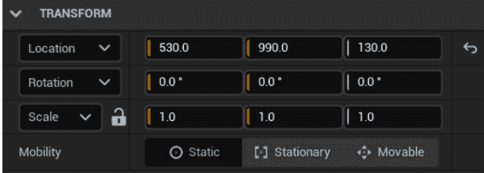

图 14.1 – 在 **详细信息** 面板中修改变换

在关卡编辑器中，您可以使用选择角色时出现的变换小部件。有按钮可用于选择小部件将应用于角色的变换类型，如下一张截图所示：

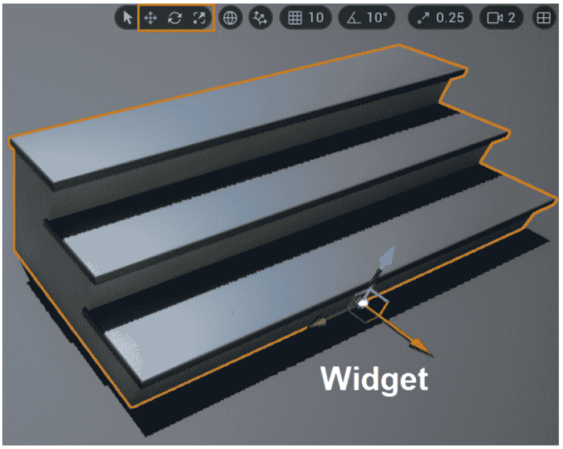

图 14.2 – 使用小部件修改变换

3D 空间由三个轴表示：x、y 和 z。这些轴由颜色表示：红色是 x 轴，绿色是 y 轴，蓝色是 z 轴。

**变换** 结构的 **位置** 变量具有一组 X、Y 和 Z 值，用于确定每个轴上的位置。这些值也称为角色的世界位置。以下截图显示了我们可用于获取和设置角色位置的一些操作：

- **GetActorLocation**: 返回角色的当前位置
- **SetActorLocation**: 为角色设置 **新位置**
- **AddActorWorldOffset**: 使用 **增量位置** 输入参数来修改角色的当前位置。

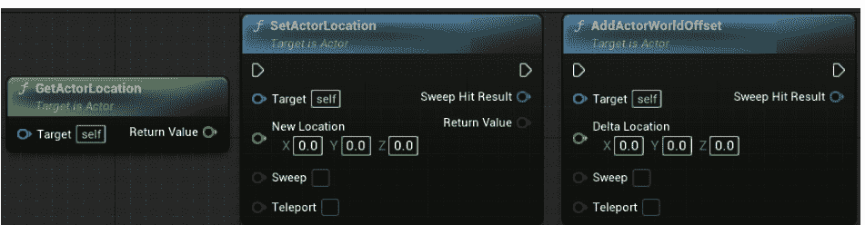

图 14.3 – 获取和设置角色位置

**变换** 结构的 **旋转** 变量具有一组以度为单位的 X、Y 和 Z 值，用于确定每个轴上的旋转。以下截图显示了以下旋转节点：

- **GetActorRotation**: 返回角色的当前旋转
- **SetActorRotation**: 为角色设置 **新旋转**
- **AddActorWorldRotation**: 将 **增量旋转** 输入参数添加到角色的当前旋转。

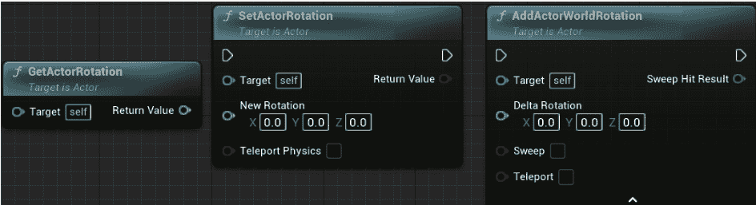

图 14.4 – 获取和设置角色旋转

Transform 结构的 Scale 变量具有一组 X、Y 和 Z 值，用于确定每个轴上的缩放。以下截图显示了用于获取和设置角色缩放的节点：

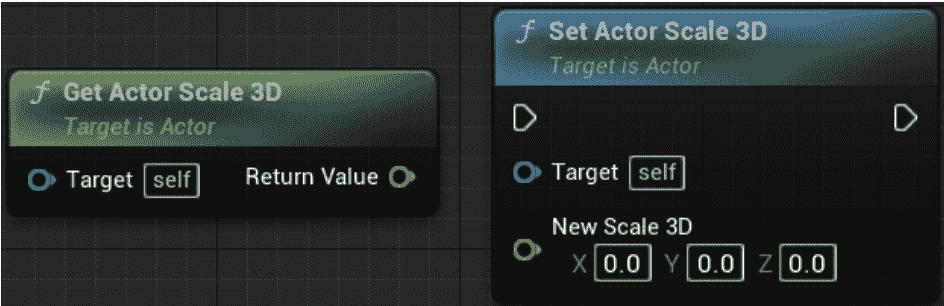

图 14.5 – 获取和设置角色缩放

当蓝图具有角色组件时，这些组件的变换称为相对变换，因为它们相对于组件的父级。以下截图显示了组件的示例。DefaultSceneRoot 是一个隐藏在游戏中的小白色球体，用于存储角色在世界中的位置。它可以替换为另一个场景组件。

在截图显示的组件层级结构中，其下方有一个名为 Table 的静态网格体组件，而在层级结构中 Table 组件下方，还有另一个名为 Statue 的静态网格体组件。Table 的变换相对于 DefaultSceneRoot 的变换，Statue 组件的变换相对于 Table 的变换。因此，如果


你在视口中移动 **表格** 组件时，**雕像** 组件也会移动，但如果你改为更改 **雕像** 组件的相对变换，那么 **表格** 组件将保持原位。

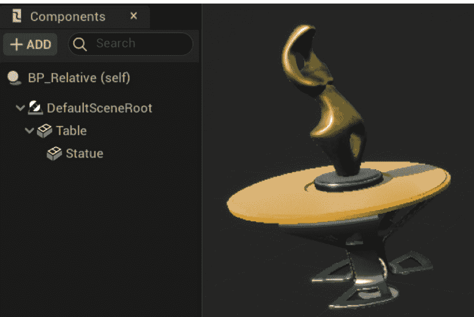

图 14.6 – 组件的层级

存在用于获取和设置组件相对位置的节点。你也可以获取组件的世界位置，如下面的截图所示：

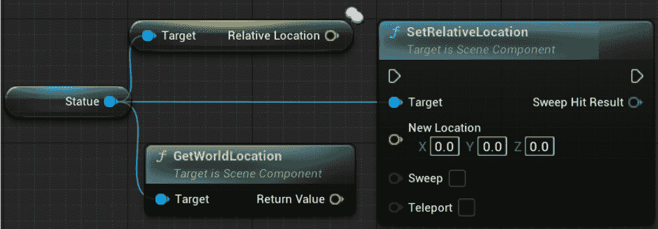

图 14.7 – 获取和设置组件的相对位置

**位置** 和 **缩放** 变量由 **向量** 结构体表示，这是我们下一个主题。

### 点和向量

Unreal Engine 中存在一个名为 **向量** 的结构体，它包含三个浮点类型的变量：**X**、**Y** 和 **Z**。与数学中的向量概念相同，这个 **向量** 可用于表示 3D 空间中的点（位置）或速度（指定方向上的速度）。

让我们先看一个将 **向量** 用作 3D 空间中点的示例。下面的截图中有两个角色。一个代表角色，另一个代表沙发。

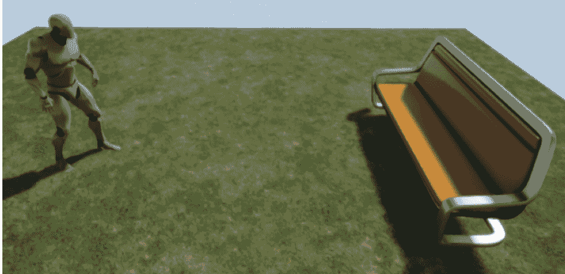

图 14.8 – 关卡中的两个角色

下面的截图显示了角色的位置。Transform 结构体的 Location 变量为向量类型（X、Y 和 Z），默认情况下，一个 Unreal 单位等于 1.0 厘米。

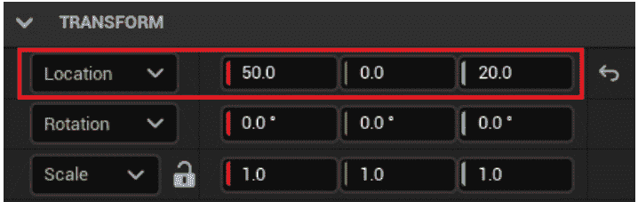

图 14.9 – 角色的位置

我们可以简单地将角色的位置表示为 (50.0, 0.0, 20.0)。沙发的位置是 (450.0, 0.0, 20.0)，如下面的截图所示：

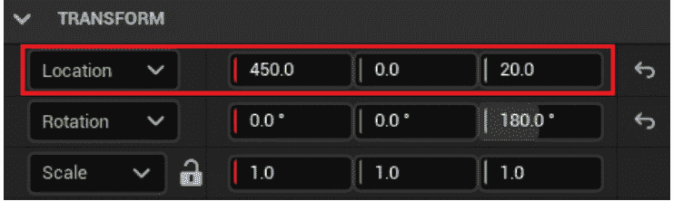

图 14.10 – 沙发的位置

现在，让我们看看如何使用向量来表示移动。我们将指示我们的角色如何到达沙发。他们需要知道必须移动的方向和距离。下面的截图显示，我们正在指示角色沿 x 轴移动 **400 厘米**：

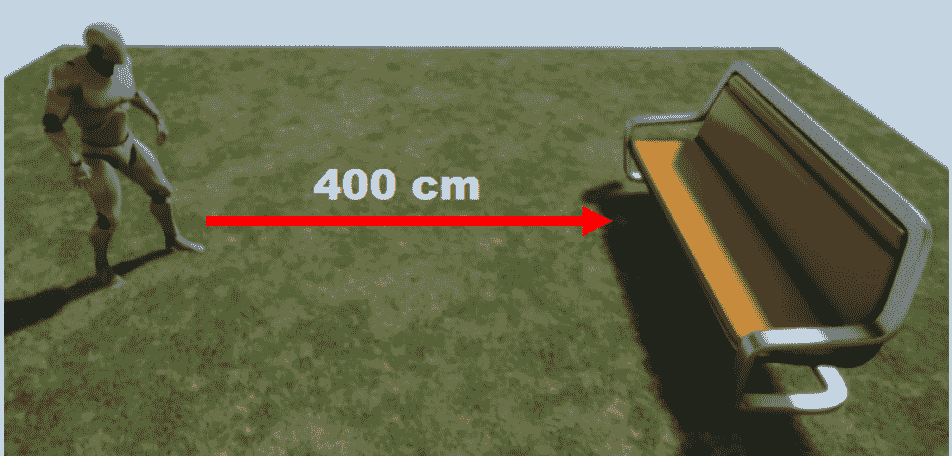

图 14.11 – 沿 x 轴移动 400 厘米

方向和距离都由单个向量表示，使用 X、Y 和 Z 值。在前面的截图中，描述移动的向量的值为 (400, 0, 0)。

如果我们获取角色位置向量并将其与表示此移动的向量相加，那么结果就是沙发位置向量。要添加两个向量，请将它们的每个元素相加：

```
couch_location = character_location + vector_movement
couch_location = (50, 0, 20) + (400, 0, 0)
couch_location = (50 + 400, 0 + 0, 20 + 0)
couch_location = (450, 0, 20)
```

如果我们有一个起点和一个终点，并想找出移动向量，那么只需获取终点并减去起点。

例如，如果我们想知道从起点 (25, 40, 55) 到终点 (75, 95, 130) 的向量，那么我们需要求解这个表达式：

```
vector_movement = destination_point - start_point
vector_movement = (75, 95, 130) - (25, 40, 55)
vector_movement = (75 - 25, 95 - 40, 130 - 55)
vector_movement = (50, 55, 75)
```

现在，让我们看看如何表示一个向量。

### 向量的表示

向量是一条有方向的线段，可以用箭头表示。

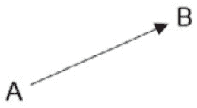

图 14.12 – 表示向量的箭头

点 A 是向量的起点，点 B 是向量的终点。所有世界位置的起点始终是 (0, 0, 0)，而所有相对位置的起点始终是组件父级的终点。

向量具有大小（或长度）和方向。如果两个向量具有相同的大小和方向，则它们是等价的。

### 向量运算

可以对向量执行多种数学运算。理解这些运算是操作 3D 空间中对象的基础：

向量加法：两个向量的和由每个元素相加确定。下面的示例显示了向量 (3, 5, 0) 和 (5, 2, 0) 的和：

```
v1 = (3, 5, 0)
v2 = (5, 2, 0)
v1 + v2 = (3 + 5, 5 + 2, 0 + 0)
v1 + v2 = (8, 7, 0)
```

下面是前面向量加法示例的图形表示。为了简化图形，我们只绘制 x 轴和 y 轴。v1 的起点是世界原点 (x=0, y=0, z=0)。v1 的终点是 (x=3, y=5, z=0)。v2 的起点是 v1 的终点，v2 的终点是和的结果 (x=8, y=7, z=0)。

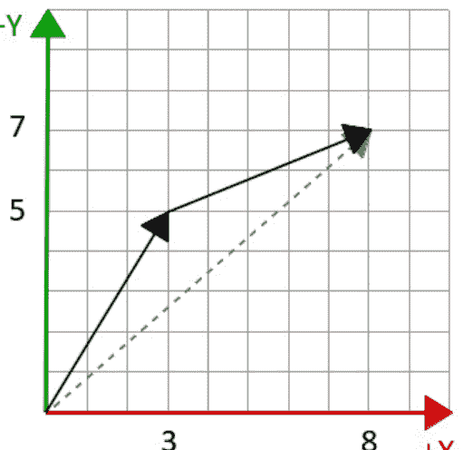

图 14.13 – 相加向量

例如，如果 v1 是角色的世界位置，而 v2 是角色武器的相对位置，那么 v1 + v2 将是武器的世界位置。

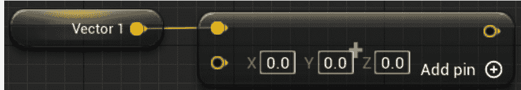

图 14.14 – 添加向量的节点

- 向量减法：用一个向量减去另一个向量，由每个元素相减确定。下面是使用向量 (6, 8, 0) 和 (1, 4, 0) 的向量减法示例：

```
v1 = (6, 8, 0)
v2 = (1, 4, 0)
v1 - v2 = (6 - 1, 8 - 4, 0 - 0)
v1 - v2 = (5, 4, 0)
```

下面是前面向量减法示例的图形表示。由于这是减法，v2 向量由其相反向量表示：

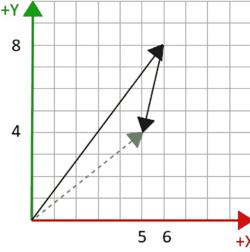

图 14.15 – 相减向量

例如，如果 v1 是角色武器的世界位置，而 v2 是角色武器的相对位置，那么 v1 - v2 将是角色的世界位置。

向量减法节点如下面的截图所示：

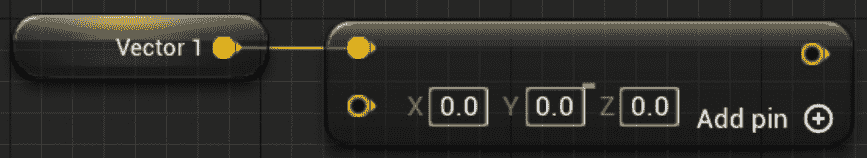

图 14.16 – 相减向量的节点

- 向量长度：向量的长度（或大小）是其起点和终点之间的距离。如果你有两个世界位置，两者之差的长度将是这些世界位置之间的距离。向量的长度使用下面的截图中显示的 Blueprint 节点计算：

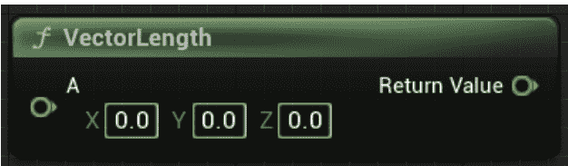

图 14.17 – 向量长度节点

- 向量归一化：我们使用向量归一化来查找单位向量。单位向量的长度等于 1。通常在需要指示方向时使用。有一个名为 Normalize 的节点，它接收向量作为输入并返回归一化的向量：

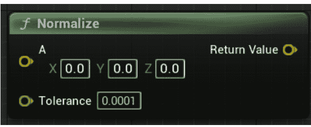

图 14.18 – 归一化向量节点

- 标量向量乘法：整数或浮点数也称为标量值。将向量乘以标量值，是将向量的每个元素乘以该标量值。此操作会更改向量的长度，但方向保持不变，除非标量为负数，在这种情况下，向量在乘法后将指向相反的方向。

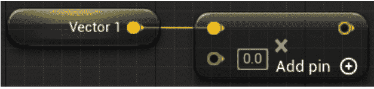

图 14.19 – 将向量乘以浮点数

### 注意

乘法节点是一个通用节点。这意味着当你将向量变量连接到该节点时，它将被转换为 **向量 x 向量** 节点。你需要右键单击第二个输入引脚，悬停在 **转换引脚...** 上方，并选择 **浮点**。

- **点积**：点积是一个向量在另一个向量上的投影。两个归一化向量的点积等于向量之间形成的角度的余弦值，范围可从 -1.0 到 1.0：

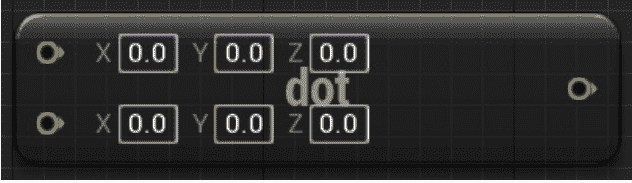

图 14.20 – 点积节点

点积可用于验证两个向量之间的关系，例如它们是否垂直或平行。下图显示了两个向量 **A** 和 **B** 之间点积的一些示例：


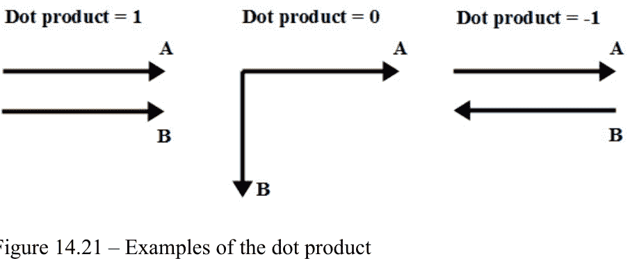

演员向量：有些函数可以返回演员的前向、右向和上向向量。返回的向量已归一化（长度 = 1）。以下截图展示了这些函数，这些函数常用于指示移动：

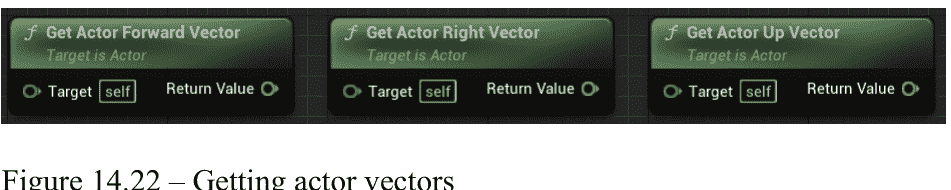

要查找相反向量，只需将向量乘以 -1。这样，你可以找到演员的后向、左向和下向向量。以下截图展示了如何查找后向向量：

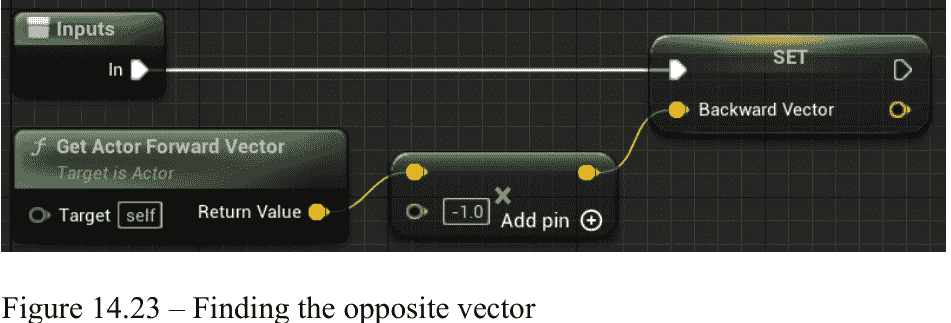

向量在游戏编程中广泛使用；它们可以用于指示方向，并表示速度、加速度以及作用于物体上的力。

在下一节中，我们将看到另一个用于与 3D 世界交互的重要概念，即描线。

### 描线和描线函数简介

描线用于测试沿定义线段是否存在碰撞。描线可以按通道或对象类型执行，并可返回被击中的单个或多个对象。

可用的描线通道为 Visibility 和 Camera。对象类型可以是 WorldStatic、WorldDynamic、Pawn、PhysicsBody、Vehicle、Destructible 或 Projectile。你可以在 项目设置 | 引擎 | 碰撞 中创建更多通道和对象类型。

演员和组件需要定义它们对每个描线通道和对象类型的响应方式。响应可以是 Ignore、Overlap 或 Block。

以下截图显示了静态网格演员的碰撞响应。可以选择的碰撞预设包括 BlockAll、OverlapAllDynamic 和 Pawn。或者，你可以为碰撞预设选择 Custom...，并单独定义碰撞响应属性。对象类型通过 对象类型 属性下拉菜单设置，而 Visibility 和 Camera 通道则在碰撞响应表的 描线响应 部分中定义。

| 碰撞预设 | 自定义... | ↻ |
| :--- | :--- | :--- |
| 碰撞启用 | 仅查询（无物理碰撞） | ↻ |
| 对象类型 | WorldDynamic | |
| | 忽略 | 重叠 | 阻挡 |
| 碰撞响应 | | [ ] | [x] | [ ] |
| 描线响应 | | | | |
| Visibility | | [ ] | [x] | [ ] | ↻ |
| Camera | | [ ] | [x] | [ ] | ↻ |
| 对象响应 | | | | |
| WorldStatic | | [ ] | [x] | [ ] | ↻ |
| WorldDynamic | | [ ] | [x] | [ ] | ↻ |
| Pawn | | [ ] | [x] | [ ] | ↻ |
| PhysicsBody | | [ ] | [x] | [ ] | ↻ |
| Vehicle | | [ ] | [x] | [ ] | ↻ |
| Destructible | | [ ] | [x] | [ ] | ↻ |

图 14.24 – 碰撞响应表

当描线函数与某物碰撞时，它将返回一个或多个**击中结果**结构。**击中结果拆分**节点可用于访问**击中结果**变量，如以下截图所示：

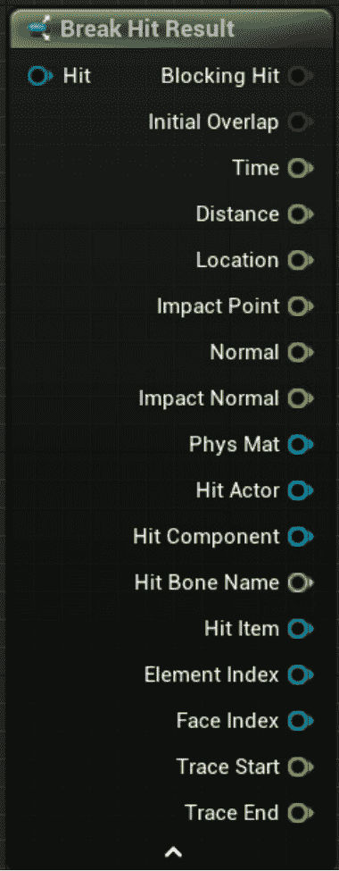

图 14.25 – 击中结果结构变量

以下是**击中结果**结构的一些变量：

- **阻塞击中**：一个布尔值，指示描线是否击中了某物
- **位置**：击中的位置
- **撞击法线**：与击中表面垂直的法向量
- **击中演员**：被描线击中的演员的引用

在接下来的章节中，我们将看到 Blueprint 中可用的描线函数。

### 对象描线

LineTraceForObjects 函数沿定义线测试碰撞，并返回一个击中结果结构，其中包含输入参数中指定的对象类型值所匹配的第一个被击中演员的数据。

MultiLineTraceForObjects 函数与 LineTraceForObjects 函数具有相同的输入参数。两个函数之间的区别在于，MultiLineTraceForObjects 函数返回一个击中结果结构数组，描述描线击中的所有演员，而不是单个结果，因此执行开销更大。以下截图显示了两个 TraceForObjects 函数：

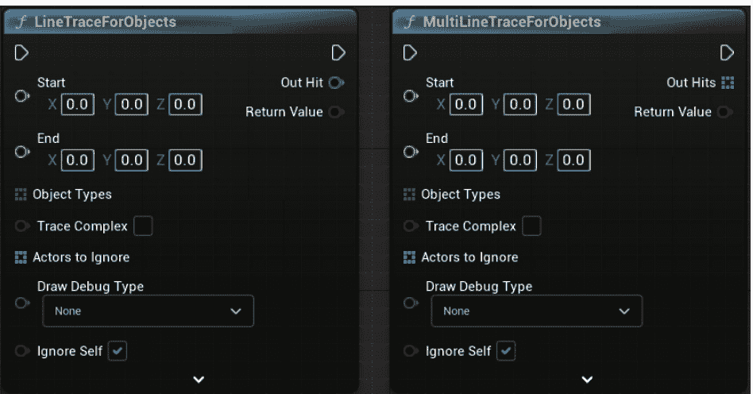

图 14.26 – TraceForObjects 函数

以下是两个 TraceForObjects 函数的输入参数：

- **起点**：定义用于碰撞测试的线段起点的位置向量。
- **终点**：定义碰撞测试线段终点的位置向量。
- **对象类型**：包含描线将搜索的对象类型的数组。描线将忽略任何其他类型的所有对象。
- **描线复杂度**：一个布尔值。如果为 True，则描线将针对实际网格进行测试。如果为 False，则描线将针对简化的碰撞形状进行测试。
- **忽略的演员**：包含在碰撞测试中应忽略的演员的数组。
- **绘制调试类型**：这允许绘制表示描线的 3D 线条。
- **忽略自身**：一个布尔值，指示调用该函数的 Blueprint 实例是否应在碰撞测试中被忽略。

还有其他使用描线通道而非对象类型的线性描线函数，我们将在下一节中介绍。

### 按通道描线

LineTraceByChannel 函数使用描线通道沿定义线测试碰撞，该通道可以设置为 Visibility 或 Camera，并返回包含碰撞测试中第一个被击中演员数据的击中结果结构。还有 MultiLineTraceByChannel 函数，它返回一个击中结果结构数组，描述描线击中的所有演员。

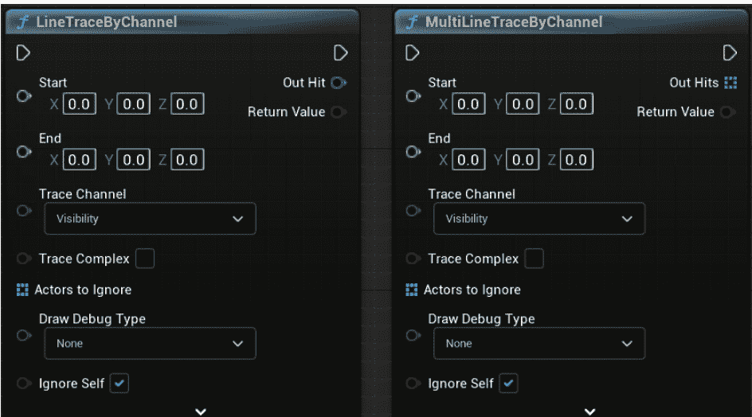

图 14.27 – TraceByChannel 函数

这些函数的输入参数如下：

- **起点**：定义用于碰撞测试的线段起点的位置向量。
- **终点**：定义碰撞测试线段终点的位置向量。
- **描线通道**：用于碰撞测试的通道。可以是 **Visibility** 或 **Camera**。描线将搜索与所选描线通道重叠或阻挡的对象。
- **描线复杂度**：一个布尔值。如果为 **True**，则描线将针对实际网格进行测试。如果为 **False**，则描线将针对简化的碰撞形状进行测试。
- **忽略的演员**：包含在碰撞测试中应忽略的演员的数组。
- **绘制调试类型**：这允许绘制表示描线的 3D 线条。
- **忽略自身**：一个布尔值，指示调用该函数的 Blueprint 实例是否应在碰撞测试中被忽略。

线性描线不是唯一的描线函数类型。你也可以使用形状来执行描线。

### 形状描线

存在用于球体、胶囊体和盒体形状的描线函数，但这些函数的执行开销比线性描线更大。

以下截图显示了 SphereTraceForObjects、CapsuleTraceForObjects 和 BoxTraceForObjects 函数：

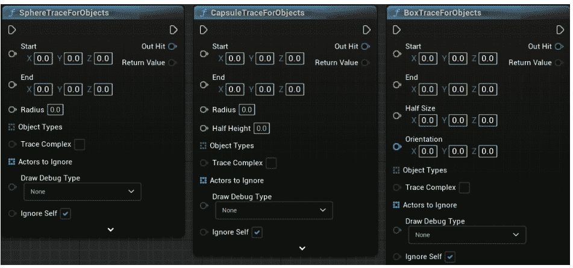

图 14.28 – 形状描线函数

对于所有这些形状，都有按通道和对象类型进行描线的函数。还有返回单个击中或多个击中的函数。

### 调试线条

描线函数具有绘制调试线条的选项，以便在测试描线时提供帮助。单击描线函数底部的小箭头，以显示 描线颜色、描线击中颜色 和 绘制时间 参数，如以下截图所示：

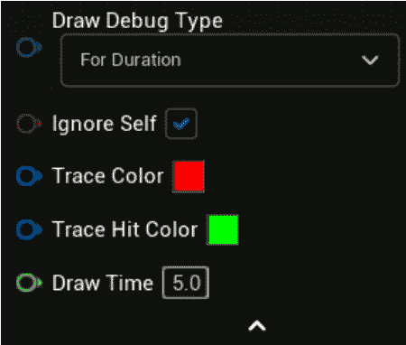

图 14.29 – 调试线条选项

绘制调试类型 参数可以设置为以下值之一：

- **无**：不绘制线条。
- **仅一帧**：线条仅出现一帧。
- **持续时间**：线条将保留 **绘制时间** 参数中指定的时间。
- **持久**：线条不会消失。

当描线行为不符合预期时，调试线条非常有助于查找问题。

### 向量和描线节点示例

让我们举一个示例来了解向量和描线节点的用法。我们将修改 `Player` 角色，以使用线性描线来查找并切换另一个 Blueprint 的灯光：


- 1. 使用 **第一人称** 模板和入门内容创建新项目。

- 2. 打开 `FirstPersonCharacter` 蓝图，它位于 `Content/FirstPersonBP/Blueprints` 文件夹中。

- 3. 在 **我的蓝图** 面板中，创建一个宏并将其命名为 `Trace Locations`。在 **详情** 面板中，添加两个 **向量** 类型的输出参数。将参数命名为 `Start Location` 和 `End Location`，如以下屏幕截图所示。我们不需要输入参数。

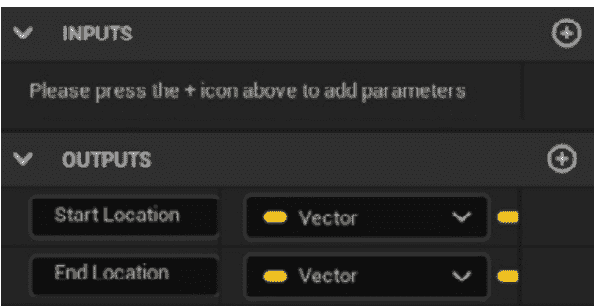

图 14.30 – 宏输出参数

- 4. 在 `Trace Locations` 宏的图表中，添加以下屏幕截图中所示的节点。该宏计算将由 **直线追踪** 使用的 **起点** 和 **终点** 位置。由于这是第一人称游戏，我们使用摄像机作为 **起始位置**，而 **结束位置** 在 **摄像机** 前方 `300 cm` 处。

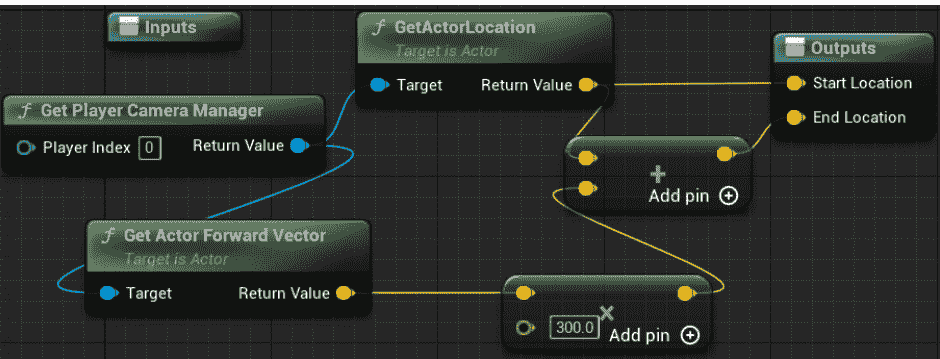

图 14.31 – Trace Locations 宏的节点

- 5. 单击事件图表选项卡，右键单击事件图表，并为 Enter 键添加输入事件。

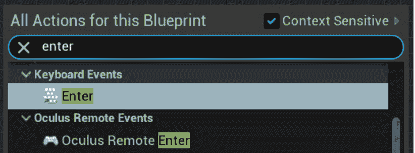

图 14.32 – 添加 Enter 键盘事件

- 6. 添加 LineTraceByChannel 节点，并将 Trace Locations 宏添加到事件图表。将 Enter 事件的 Pressed 引脚连接到 LineTraceByChannel 的白色引脚。将宏的输出连接到直线追踪的 Start 和 End 输入，如以下屏幕截图所示：

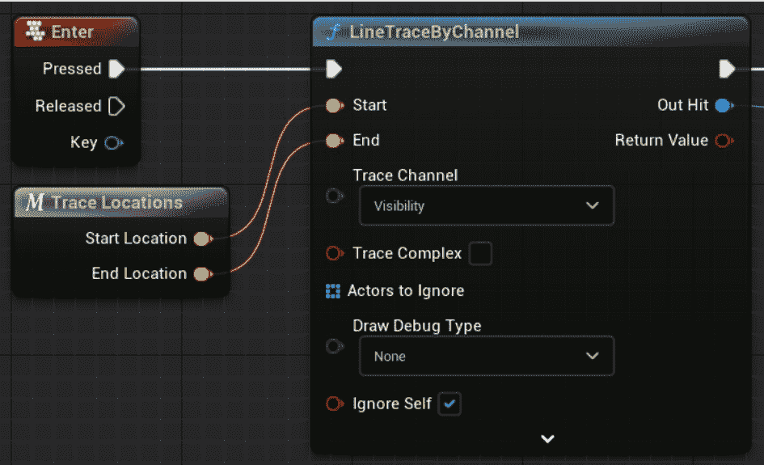

图 14.33 – 使用 LineTraceByChannel 节点

- 7. 将以下屏幕截图中所示的节点连接到 LineTraceByChannel 节点的输出。这些节点测试 Hit Actor 是否为 Blueprint_WallSconce 类型。如果是，则切换 Blueprint_WallSconce 的灯光。编译蓝图以应用更改。

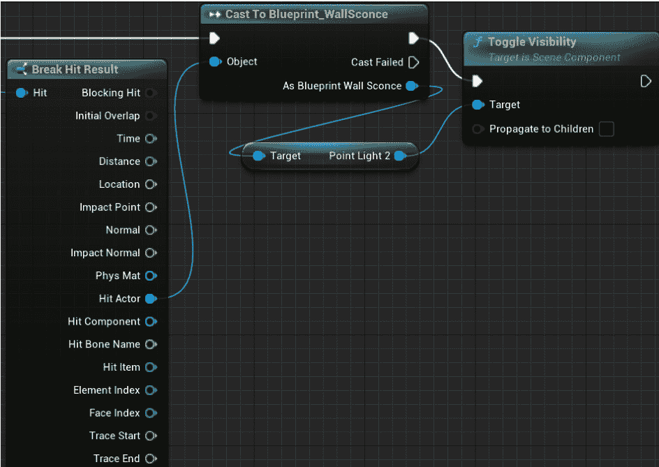

图 14.34 – 测试 Hit Actor 是否为 Blueprint_WallSconce 类型

- 8. 将 `Blueprint_WallSconce`（位于 `Content\StarterContent\Blueprints` 文件夹中）的实例添加到关卡，然后播放关卡。

- 9. 将您的角色移动到 `Blueprint_WallSconce` 实例附近，查看它，并按 `Enter` 键切换灯光。以下屏幕截图显示了玩家角色和 `Blueprint_WallSconce`：

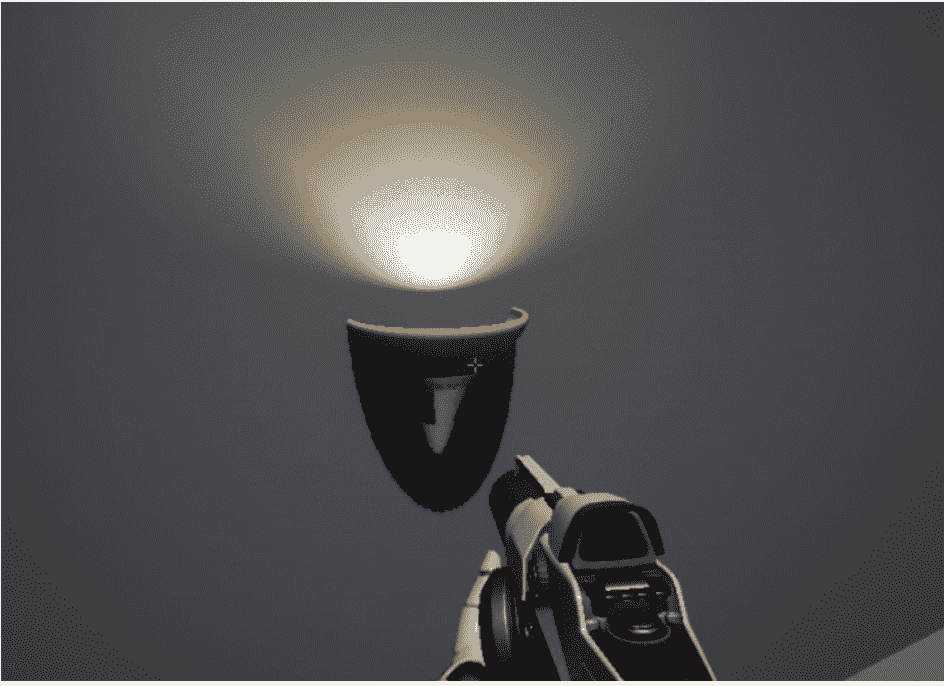

图 14.35 – 与 Blueprint_WallSconce 交互

本示例展示了向量和追踪节点的实际用途。理解这些概念很重要，因为它们将有助于解决3D游戏开发中的许多问题。

### 摘要

本章介绍了一些数学概念，并展示了如何使用世界变换和相对变换。我们了解到几个蓝图节点用于修改变换的元素，例如位置、旋转和缩放。

本章表明，向量结构可用于表示3D空间中的点或数学向量。我们学习了如何使用蓝图节点进行多种向量运算。

最后，我们了解了如何使用追踪节点测试碰撞。有多种追踪节点，它们基于碰撞响应类型、使用的形状以及追踪节点是返回单个命中还是多个命中。

在下一章中，我们将学习几个处理蓝图复杂性和提高蓝图质量的技巧。

### 测验

- 1. 在虚幻引擎中，**变换**是包含 **位置**、**旋转** 和 **缩放** 变量的结构。
  - a. 正确
  - b. 错误

- 2. **变换**结构的 **位置** 和 **缩放** 变量为 **向量** 类型。
  - a. 正确
  - b. 错误

- 3. 归一化向量可以是任意长度。
  - a. 正确
  - b. 错误

- 4. **可见性** 和 **摄像机** 是对象类型的示例。
  - a. 正确
  - b. 错误

- 5. **MultiLineTraceByChannel** 函数返回 **命中结果** 结构的数组。
  - a. 正确
  - b. 错误
