## 第 15 章：Blueprints 技巧

本章包含几个提高蓝图质量的技巧。我们将学习如何使用各种加速工作的编辑器快捷方式。我们还将了解一些蓝图最佳实践，这些实践将帮助您决定应该执行何种类型的实现以及在哪里执行。最后，我们将学习更多有用的杂项蓝图节点。

本章涵盖的主题如下：

- Blueprint Editor 快捷方式
- 蓝图最佳实践
- 使用杂项蓝图节点

本章结束时，您将熟悉快捷方式、最佳实践和蓝图节点，这些将在您开发更复杂的游戏时提供帮助。

### Blueprint Editor 快捷方式

在蓝图编辑器中，我们将大量使用变量，因此让我们从与变量相关的快捷方式开始。

当您从 **我的蓝图** 面板拖动变量并将其放置在 **事件图表** 中时，会出现一个子菜单供您选择 **获取** 或 **设置** 节点。但是，有创建 **获取** 和 **设置** 节点的快捷方式。如果按住 *Ctrl* 键并将变量拖动到图表中，则编辑器将创建 **获取** 节点。要创建 **设置** 节点，请按住 *Alt* 键并将变量拖动到图表中。以下屏幕截图显示了 **获取** 和 **设置** 节点：

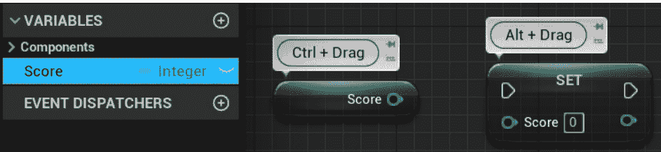

图 15.1 – 创建 GET 和 SET 节点的快捷方式

创建 **获取** 和 **设置** 节点还有另一种方法。如果将变量拖动并放置在另一个节点的兼容引脚上，则编辑器将根据参数类型创建 **获取** 或 **设置** 节点。

以下屏幕截图显示了将 **得分** 变量放置在输入参数引脚上的示例。如果引脚兼容，则编辑器将显示带有勾选图标和类似 **设置 B = 得分** 标签的提示。此表达式意味着节点的 **B** 引脚将获取 **得分** 变量的值。因此，编辑器将创建 **获取 得分** 节点：

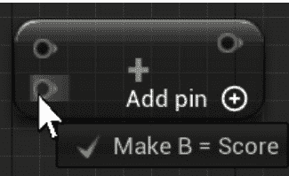

图 15.2 – 将变量拖动并放置在输入引脚上以创建 GET 节点

如果将 **得分** 变量放置在输出参数引脚上，如以下屏幕截图所示，则编辑器将显示 **设置 得分 = 返回值** 标签，并将使用其他节点的 **返回值** 标签作为输入参数来创建 **设置 得分** 节点：

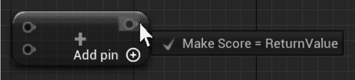

图 15.3 – 将变量拖动并放置在输出引脚上以创建 SET 节点

蓝图编辑器具有自动类型转换系统。要使用它，请从一个变量类型的引脚拖动一根导线并将其放置在另一个变量类型的引脚上。以下屏幕截图显示会出现提示以确认转换是可能的：

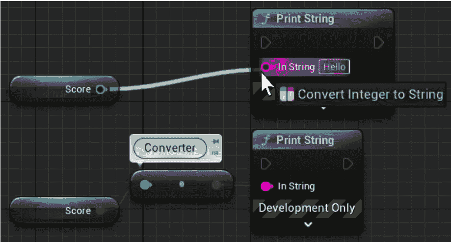

图 15.4 – 创建转换器节点

蓝图编辑器的另一个有用功能是，可以将现有节点更改为使用相同变量类型的另一个节点，而不会断开连接。

以下屏幕截图中有此示例。Player Health 和 PlayerStamina 是浮点变量。如果将 PlayerStamina 变量拖动并放置在 SET Player Health 节点上，则该节点将更改为 SET PlayerStamina 节点并保留所有连接。

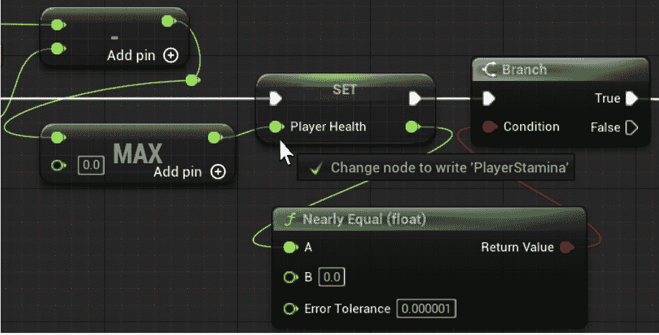

图 15.5 – 更改节点并保留所有连接

有一个基于节点输入或输出引脚类型创建变量的快捷方式。要执行此操作，请右键单击数据引脚并选择提升为变量选项，如以下屏幕截图所示。此选项创建一个变量并将其连接到引脚。

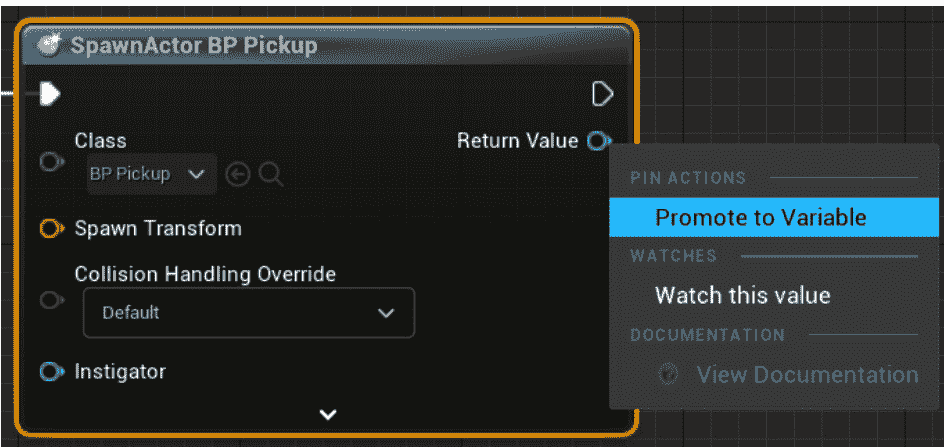

图 15.6 – 将返回值提升为变量

如果你需要断开引脚的所有连接，请按住 *Alt* 键并单击该引脚。你可以通过按住 *Ctrl* 键、拖动连接并将其放置在另一个兼容引脚上，将引脚的所有连接移动到另一个兼容引脚。这非常有用，因为你不需要逐一重新创建连接。在以下截图中，**第一人称角色** 引脚的所有连接都将移动到 **BP 玩家角色**。

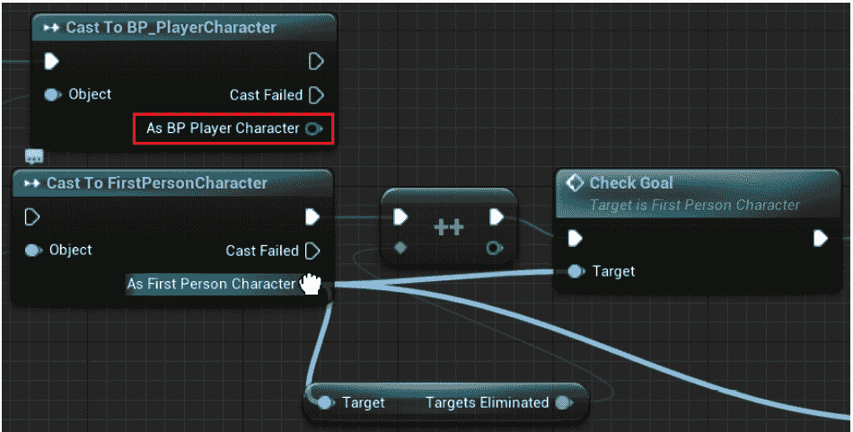

图 15.7 – 将所有连接拖动到另一个引脚

蓝图编辑器提供多个节点对齐选项。要使用它们，请选择一些蓝图节点并右键单击其中一个以打开菜单。**对齐** 是此菜单上的选项之一。以下截图显示了可用的 **对齐** 选项：

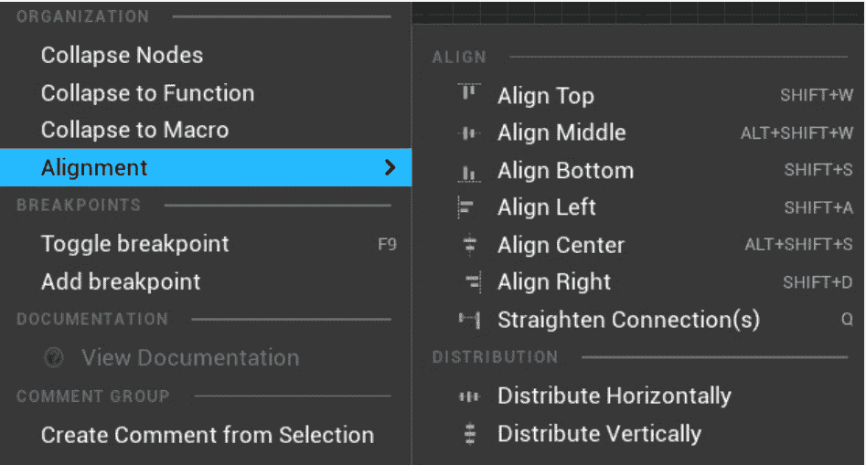

图 15.8 – 对齐选项

大多数 **对齐** 选项都不言自明，但让我们看一个示例：Straighten Connection(s)。以下截图显示了三个选定的节点：

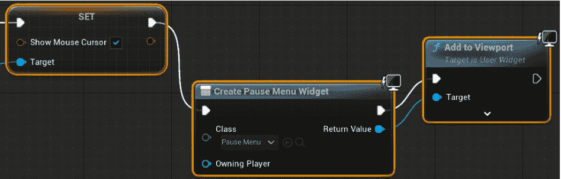

图 15.9 – 这些节点将被对齐

应用 Straighten Connection(s) 后，节点将被对齐，如以下截图所示：

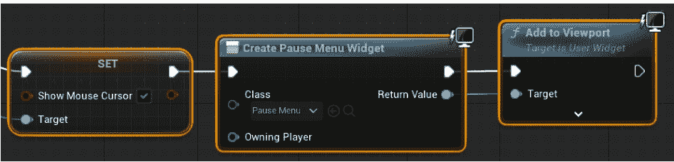

图 15.10 – 应用 Straighten Connection(s) 后的节点

在蓝图中创建某些常见节点有快捷键。如果要创建 **分支** 节点，请按住 *B* 键并在图表上左键单击。要创建 **序列** 节点，请按住 *S* 键并在图表上左键单击，如以下截图所示：

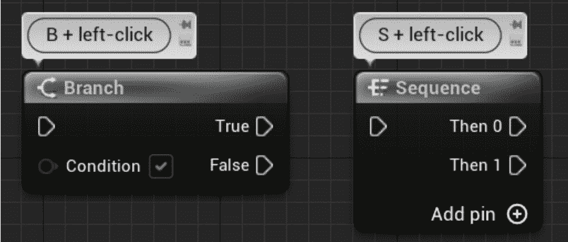

图 15.11 – 分支和序列节点的快捷键

其他快捷键是 *F + 左键单击*，用于创建 **For Each 循环** 节点，以及 *D + 左键单击*，用于创建 **延迟** 节点。这些可以在以下截图中看到：

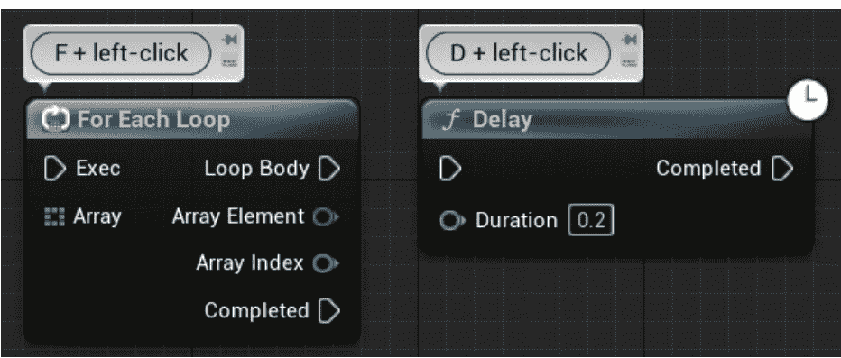

图 15.12 – For Each 循环和延迟节点的快捷键

要在某些节点周围创建注释框，请先选择节点，然后右键单击所选节点之一，并从 **选择** 中选择 **创建注释** 选项，或者直接按 C 键。以下截图显示了一个标记为 **更多快捷键** 的注释框。在注释框内，有更多用于创建流控制节点的快捷键示例。

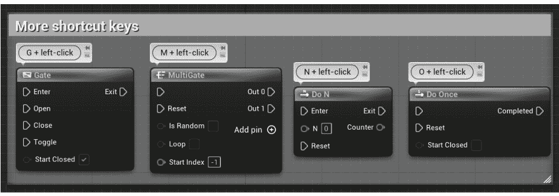

图 15.13 – 某些流控制节点的快捷键

当你习惯了一些快捷键后，你将看到它们如何加快你的工作。现在，让我们看看有助于构建更好蓝图的提示。

### 蓝图最佳实践

在项目中，你将处理多个蓝图类，其中一些蓝图类会很复杂，包含许多节点。本节中的提示将帮助你分析项目并执行一些实践，这些实践将使你的蓝图类更易于管理。我将这些提示分为两类：蓝图职责和蓝图复杂性。

### 蓝图职责

创建蓝图时，需要决定其职责是什么。这指的是它会做什么和不会做什么。你需要让蓝图尽可能独立。蓝图必须负责其内部状态。

为了说明蓝图职责的概念，让我们使用一个为教学目的创建的简单示例。在游戏中，玩家由 **第一人称角色** 蓝图表示。如果玩家与敌人蓝图发生碰撞，则玩家将死亡，并生成爆炸效果。以下截图显示了在敌人蓝图中实现的事件命中：

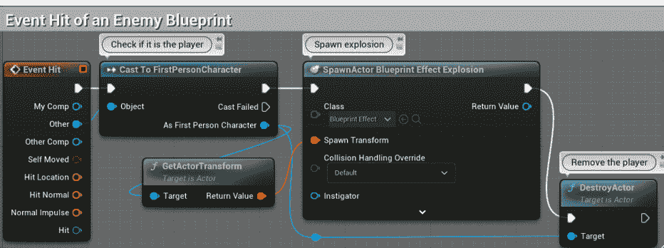

图 15.14 – 敌人蓝图的事件命中

之后，你将创建另一个也可以杀死玩家的蓝图。因此，你复制 **命中事件** 和上一张截图中的节点，并将其粘贴到新蓝图中。然后，你创建另一种类型的敌人蓝图，并再次复制粘贴 **命中事件**。但你决定更改玩家死亡的方式。玩家不再爆炸；相反，将执行死亡动画。然而，要在游戏中做出此更改，你需要查找所有可以杀死玩家的蓝图并修改它们全部的脚本。这是一个问题，因为你可能会遗漏其中一个蓝图，脚本可能会频繁更改。

有一种方法可以避免此类问题。定义玩家死亡方式的脚本必须在玩家蓝图中实现，在这个示例中，即 **第一人称角色** 蓝图。关键在于玩家蓝图负责玩家死亡的方式。让我们重新做我们的示例，但现在，我们将在 **第一人称角色** 蓝图中创建一个名为 **死亡** 的自定义事件，如此截图所示：

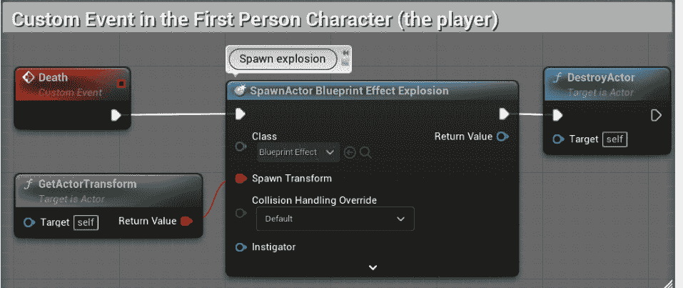

图 15.15 – 在第一人称角色蓝图中创建死亡事件

这样，如果玩家死亡方式发生更改，则只需在 **第一人称角色** 蓝图的 **死亡** 事件中进行更改。

发生碰撞时，其他可以杀死玩家的蓝图只需触发 **第一人称角色** 蓝图的 **死亡** 事件。以下截图显示了 **敌人** 蓝图的 **命中事件** 的新版本：

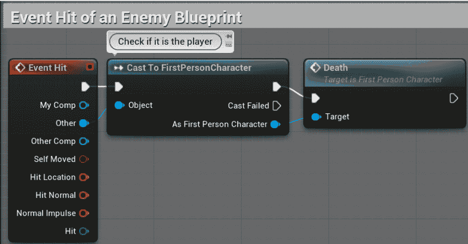

图 15.16 – 敌人蓝图命中事件的新版本

因此，你可以使用事件和函数来定义蓝图如何与其他蓝图通信。如果需要在蓝图之间发送数据，则可以通过输入或输出参数发送。

与蓝图职责相关的另一个主题是关卡蓝图。每个关卡都有一个关卡蓝图，因此如果你将游戏规则逻辑放在关卡蓝图中，那么当你添加另一个关卡时，你需要将所有蓝图节点复制粘贴到新关卡的关卡蓝图中。如果游戏规则逻辑发生更改，你需要修改所有关卡蓝图，这可能会变成维护噩梦。

关卡蓝图应仅用于特定于一个关卡的逻辑和情况。典型示例是在关卡上放置一个隐藏触发器。当玩家与其重叠时，在另一个房间生成一个敌人。

实现游戏规则逻辑的更好位置是 GameMode 蓝图类。其他参与者的逻辑应在蓝图类中实现，而不是实现在关卡蓝图中，因为蓝图类的实例可以添加到任何关卡，因此你不需要将蓝图节点复制粘贴到另一个关卡中即可使用相同的功能。

### 管理蓝图复杂性

蓝图 **事件图** 可能会变得非常复杂和令人生畏。当你打开由他人制作的这种蓝图时，你可能会想，*发生了什么？*

一些实践和蓝图工具将帮助你管理蓝图的复杂性并保持其可读性。

最重要的概念，可以帮助你处理复杂蓝图，是 **抽象**。抽象通过隐藏低级细节来处理复杂性，使开发者可以专注于高抽象级别的问题，而无需担心脚本其他部分的不必要细节。

在 **事件图** 中，应用抽象的简单方法是：选择一组节点并将其转换为折叠图、函数或宏。要转换节点，请右键单击所选节点。在出现的子菜单中，在 **组织** 类别下，你将看到以下截图中显示的选项：

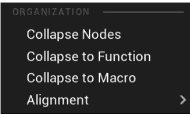

图 15.17 – 折叠选项

让我们看一个示例。以下截图显示了连接到 **输入动作** 暂停事件的一些节点。这些节点负责显示暂停菜单：

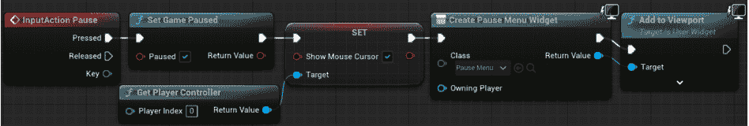

图 15.18 – 用于显示暂停菜单的节点

如果我们选中了节点，右键单击其中一个选中的节点并使用折叠节点选项，则编辑器将创建折叠图，它由单个节点表示。您可以为这个节点赋予有意义的名称。以下屏幕截图显示名为显示暂停菜单的节点，它代表折叠图。如果您想查看或编辑折叠图的节点，请双击折叠节点：

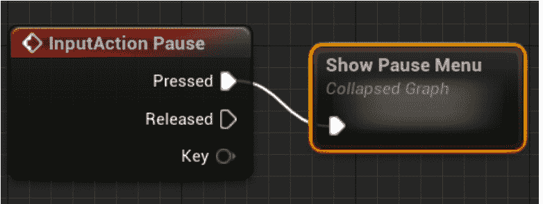

图 15.19 – 节点已转换为折叠图

仅在节点组不会在其他地方使用时才使用折叠节点。如果同一组节点在事件图表的其他位置使用，则您可以使用折叠为宏。如果您认为一组节点可以从另一个蓝图调用，则使用折叠为函数。

现在，让我们想象一下，您正在打开一个非常复杂的蓝图。但您看到的不是巨大的节点图，而是带有有意义名称的折叠图、宏和函数。至少您将了解蓝图的功能。复杂性依然存在，但它们被隐藏了，您可以在需要时查看特定部分的底层详细信息。

另一个可以提高复杂 **事件图表** 可读性的实用工具是注释框。注释框有助于识别逻辑块。当您缩小 **事件图表** 时，其标签仍然可见，您甚至可以更改注释框的颜色。以下屏幕截图显示了带有三个注释框的缩小后的 **事件图表**：

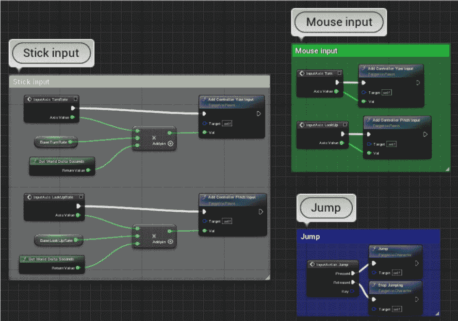

图 15.20 – 缩小 **事件图表** 时注释仍然可见

您可以在 **书签** 窗口中查看图表的注释框列表，该窗口可以通过顶部菜单依次选择 **窗口** | **书签** 访问。以下屏幕截图显示了 **书签** 窗口：

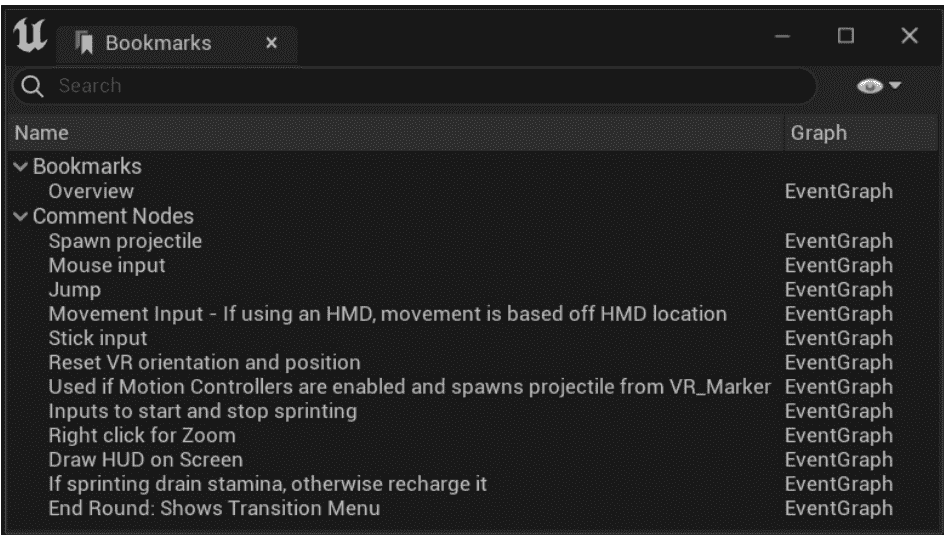

图 15.21 – 书签窗口

如果您在 **书签** 窗口中双击某个项目，则 **事件图表** 将定位到关联位置。您可以通过单击 **事件图表** 左上角的图标并为书签命名来创建书签以引用 **事件图表** 的位置，如以下屏幕截图所示：

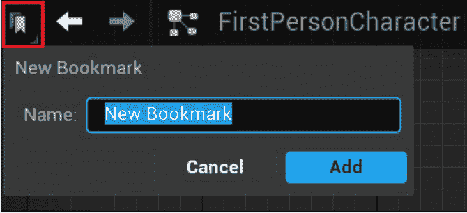

图 15.22 – 创建书签

在 **我的蓝图** 面板中，您可以看到 **事件图表** 中使用的事件列表，如以下屏幕截图所示。双击事件名称可将事件图表移动到事件的位置：

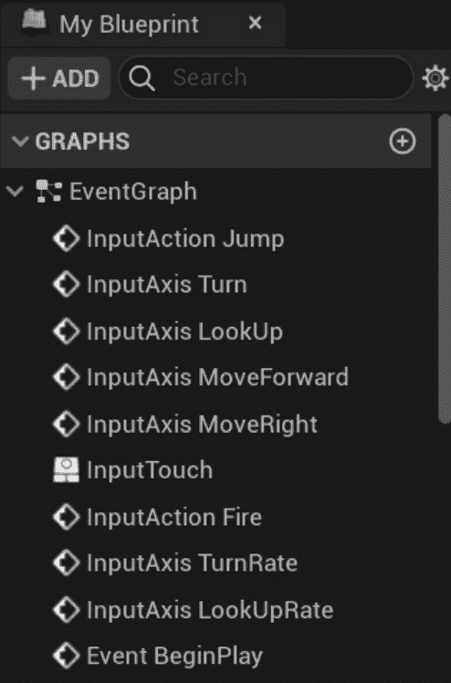

图 15.23 – 事件图表中的事件列表

复杂的蓝图可能有许多变量。有两个名为提示和类别的变量属性，可帮助您识别和组织变量。这些属性位于变量的详细信息面板中，如以下屏幕截图所示：

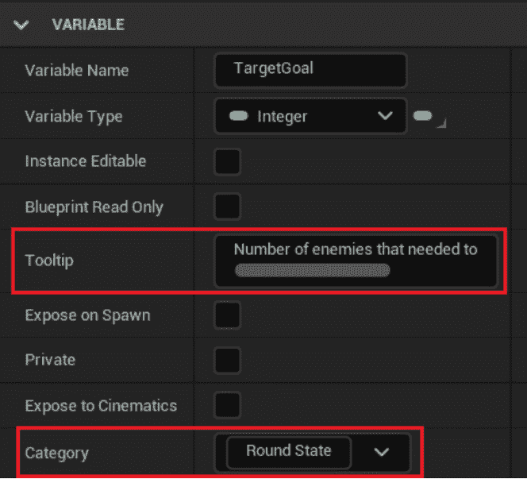

图 15.24 – 提示和类别属性

您可以在 **提示** 属性中描述变量的用途。当鼠标光标悬停在变量上时，将显示提示，如以下屏幕截图所示。如果变量设置为 **实例可编辑**，则它应该有一个提示，以便使用蓝图实例在关卡中工作的设计师清楚变量的用途。

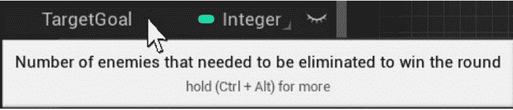

图 15.25 – 悬停在变量上时将出现提示

**类别** 属性用于对相关变量进行分组。您可以创建类别或在下拉菜单中选择现有类别。变量在 **我的蓝图** 选项卡中按类别分隔，您可以根据需要打开和关闭该选项卡。这种分隔使理解蓝图的变量变得更加容易。以下屏幕截图显示了名为 **回合状态** 的类别，它包含三个变量：

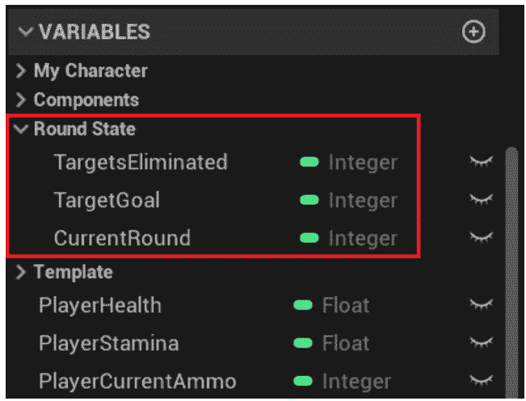

图 15.26 – 变量按类别分组

如果您需要创建保存临时值以帮助处理更复杂逻辑的变量，请考虑创建函数。函数允许创建局部变量，这些变量仅在函数内可见。在编辑函数时，**我的蓝图** 面板中会有一个用于局部变量的其他类别，如以下屏幕截图所示。只是提示；函数执行结束时，局部变量的值将被丢弃。

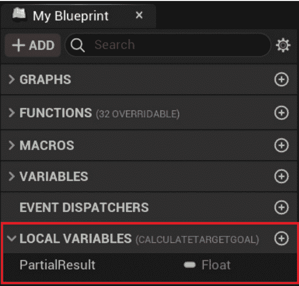

图 15.27 – 创建局部变量

本节介绍一些处理蓝图责任和复杂性的最佳实践。我们现在将了解如何使用一些有趣的杂项蓝图节点。

### 使用杂项蓝图节点

在本节中，我们将了解某些在特定情况下非常有用的蓝图节点。

本节将介绍以下节点：

- 选择
- 传送
- 格式文本
- 数学表达式
- 带混合效果设置视图目标
- 将 Actor 附加到组件
- 启用输入和禁用输入
- 设置输入模式节点

### 选择

**选择** 节点非常灵活。它可以使用多种类型的变量作为索引和选项的值。该节点返回与传递作为输入的索引对应的选项相关联的值。以下屏幕截图显示了 **选择** 节点：

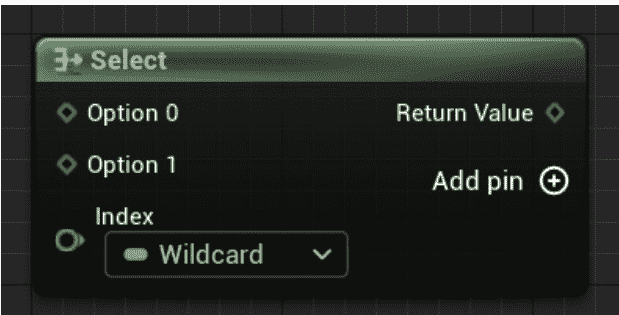

图 15.28 – **选择** 节点

要添加更多输入选项引脚，请单击 **添加引脚 +**。您可以通过将变量引用或线拖动到引脚上，将引脚类型设置为 **选项 0**、 **选项 1** 或 **索引**。 **选项 0** 和 **选项 1** 可以是任何类型，但 **索引** 类型必须是 **整数**、 **枚举**、 **布尔值** 或 **字节**。

以下屏幕截图显示了 **选择** 节点的使用示例：

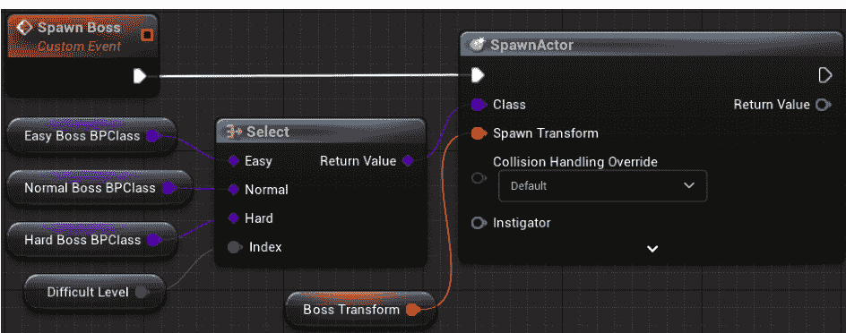

图 15.29 – **选择** 节点示例

有一个名为 **难度等级** 的枚举，其值为 **简单**、 **普通** 和 **困难**。 **生成 Boss** 自定义事件将根据 **难度等级** 枚举变量的值生成不同类的 **Boss 蓝图**。此示例中的选项类型是 `Actor Class Reference`。

### 传送

**传送** 节点将参与者移动到指定位置。与设置参与者位置相比，使用 **传送** 的优势在于，如果位置处有障碍物，则参与者将移动到附近无碰撞的位置。

以下屏幕截图显示了使用 **传送** 节点的示例：

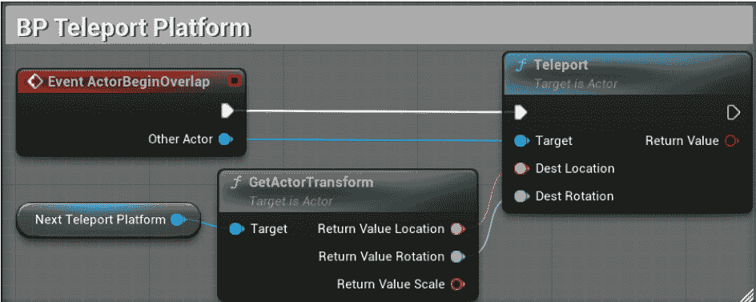

图 15.30 – **传送** 节点示例

有一个名为 **BP 传送平台** 的蓝图，它引用了 **下一个传送平台**。当玩家与 **BP 传送平台** 重叠时，他们将被传送到 **下一个传送平台**。

### 格式文本

**格式文本** 节点基于模板文本和在 **格式** 输入参数中指定的参数构建文本。要在 **文本** 中添加新参数，请使用与参数名一起的 `{}` 分隔符。 **格式** 参数中找到的每个 `{}` 分隔符都会创建一个输入参数。

以下屏幕截图显示了正在使用 **格式文本** 节点打印回合结果，并使用模板文本 `{Name} wins the round with {Score} points:`：

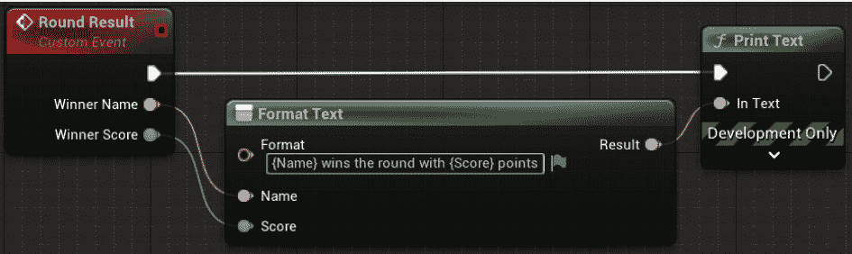

图 15.31 – **格式文本** 节点示例

示例输出为 `Serena wins the round with 17 points.`

### 数学表达式

**数学表达式** 节点是编辑器创建的折叠图，基于在节点名称中键入的表达式。表达式中找到的每个变量名都会创建一个输入参数引脚。 **返回值** 输出参数是表达式的结果。

以下屏幕截图显示了使用 **数学表达式** 节点的示例：

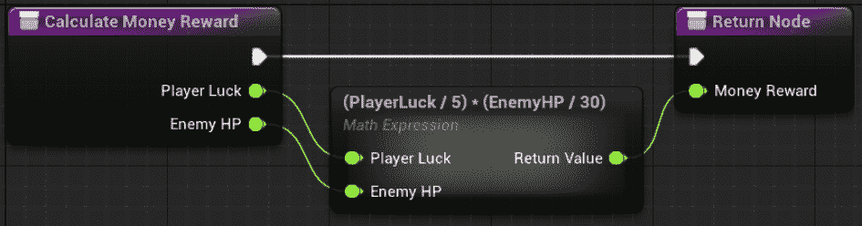

图 15.32 – **数学表达式** 节点示例

有一个名为 **计算金钱奖励** 的函数，它使用 **数学表达式** 节点。该节点的表达式为 `(PlayerLuck/5) * (EnemyHP/30)`。

### 设置带混合的视图目标

设置带混合的视图目标节点是 **玩家控制器** 类的一个函数。它用于在不同摄像机之间切换游戏视图。**新视图目标** 输入参数是要设置为视图目标的角色，通常是一个摄像机。

下面的屏幕截图显示了使用设置带混合的视图目标节点的示例：

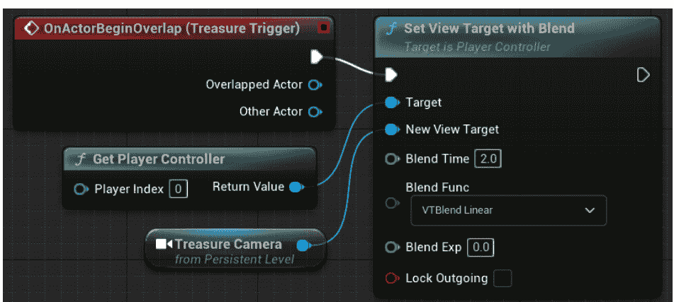

图 15.33 – 带有混合的设置视图目标节点示例

当玩家进入宝藏房间时，Level Blueprint 中有一个事件会被触发。**设置带混合的视图目标** 函数用于将游戏视图更改为宝藏房间中的摄像机。

### 附加角色到组件

**附加角色到组件** 节点将一个角色附加到 **父组件** 输入参数引用的组件上。**父组件** 的变换会影响附加的角色。可选地，**套接字名称** 可用于标识角色将被附加的位置。

下面的屏幕截图显示了使用附加角色到组件节点的示例：

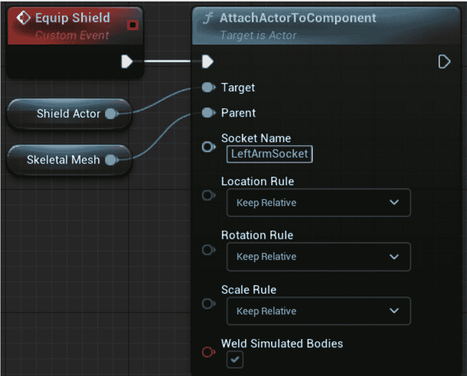

图 15.34 – 附加角色到组件节点示例

装备盾牌自定义事件使用附加角色到组件节点在骨骼网格体组件上装备一个盾牌角色组件。骨骼网格体组件有一个名为 LeftArmSocket 的套接字，用于将盾牌定位在手臂上。

### 启用输入和禁用输入

启用输入和禁用输入节点是用于定义角色是否应响应输入事件（例如来自键盘、鼠标或游戏手柄的输入事件）的函数。这些节点需要引用正在使用的 **玩家控制器** 类。

这些节点的常见用途是允许角色仅在玩家靠近角色时接收输入事件，如下面的屏幕截图所示：

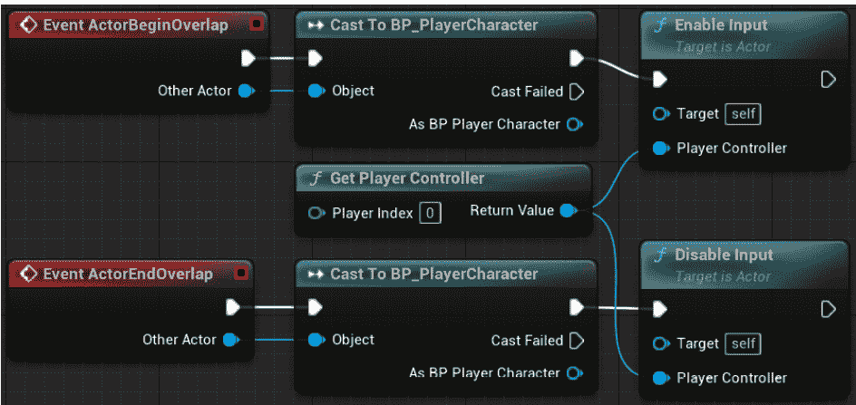

图 15.35 – 启用输入和禁用输入节点示例

当玩家开始与 Blueprint 重叠时，会调用 **启用输入** 节点。当玩家结束与 Blueprint 重叠时，会调用 **禁用输入** 节点。

### 设置输入模式节点

有三个 **设置输入模式** 节点，用于定义处理用户输入事件的优先级是在 UI 还是在玩家输入上。这些节点如下：

- **仅设置输入模式为游戏**：只有 **玩家控制器** 接收输入事件。
- **仅设置输入模式为 UI**：只有 UI 接收输入事件。
- **设置输入模式为游戏和 UI**：UI 在处理输入事件方面具有优先权，但如果 UI 未处理，则 Player Controller 接收输入事件。例如，当玩家与代表商店的 Blueprint 重叠时，会显示一个带有选项的 UI，供玩家选择使用鼠标，但玩家仍然可以使用箭头键远离商店。

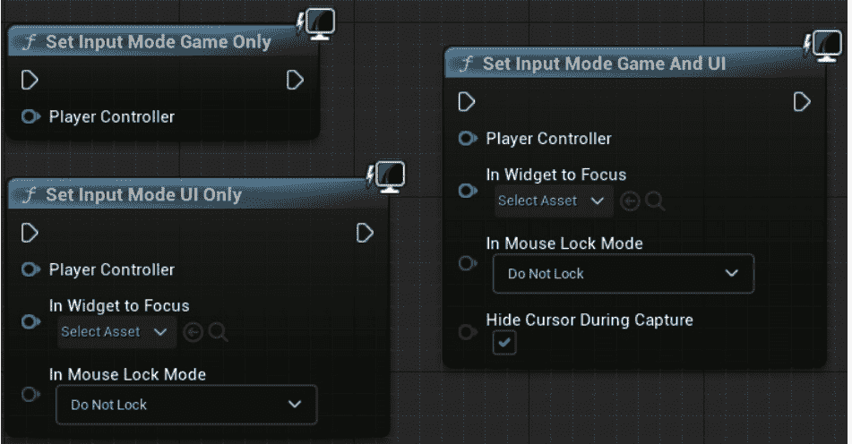

图 15.36 – 设置输入模式节点

我建议你熟悉这些杂项 Blueprint 节点。在处理项目时，你将不得不处理一些可以使用特定 Blueprint 轻松解决的问题。

### 摘要

在本章中，我们了解了如何使用编辑器快捷方式以各种方式创建变量，以及如何使用对齐工具组织 Blueprint 节点。我们还学习了用于创建特定 Blueprint 节点的一些快捷键。

接着，我们研究了一些 Blueprint 最佳实践，以定义 Blueprint 职责并管理 Blueprint 的复杂性。

最后，我们了解了一些更有用的 Blueprint 节点。所有这些技巧都将帮助你改进脚本并构建高质量的项目。

在下一章中，我们将探索 Unreal Engine 编辑器中可用的虚拟现实模板。

### 测验

- 1. 要创建一个 GET 节点，按住 Alt 键并将变量拖动到图表上。
  - a. 正确
  - b. 错误
- 2. Blueprint 必须对其内部状态负责，并尽可能独立。
  - a. 正确
  - b. 错误
- 3. 你可以选择一组节点并将它们转换为折叠图表、函数或宏。
  - a. 正确
  - b. 错误
- 4. Select 节点的 Index 参数可以是任何类型。
  - a. 正确
  - b. 错误
- 5. Math Expression 节点会为表达式中找到的每个变量名创建一个输入参数引脚。
  - a. 正确
  - b. 错误
