## 第 16 章：VR 开发简介

本章解释了几个 **虚拟现实（VR）** 概念并探索了 VR 模板。随着 VR 头显变得更加实惠，用户数量正在快速增加。因此，对 VR 游戏和商业应用的需求也在上升。我们将重点关注 VR 模板的 Blueprints。这将是另一个观察 Blueprint 节点在实践中使用的机会。你将能够使用本章中的一些 Blueprint 概念来开发多种其他类型的项目，因此即使你没有 VR 头显，本章也很有用。

在本章中，我们将分析 VR 模板的 **VRPawn** Blueprint 的功能。我们将解释如何使用运动控制器创建玩家可以抓取的对象，并了解用于实现瞬移的 Blueprint 函数以及如何使用接口进行 Blueprint 通信。我们还将看到 VR 模板中的菜单是如何工作的。

本章将涵盖以下主题：

- 探索 VR 模板
- **VRPawn** Blueprint
- 瞬移
- 对象抓取
- 使用接口进行 Blueprint 通信
- 与菜单交互

到本章结束时，你将了解 VR 模板的工作原理，并知道如何创建接口以允许不同的 Blueprint 相互共享数据。

### 探索 VR 模板

Unreal Engine 编辑器有一个 Blueprint VR 模板，使开始尝试 VR 开发变得容易。VR 模板使用 OpenXR 框架，这是 VR 和增强现实开发的开放标准。得益于 OpenXR，VR 模板可在多个设备上运行，无需任何特定平台的修改。

VR 模板位于 GAMES 类别中。下面的屏幕截图显示了使用 VR 模板创建项目：

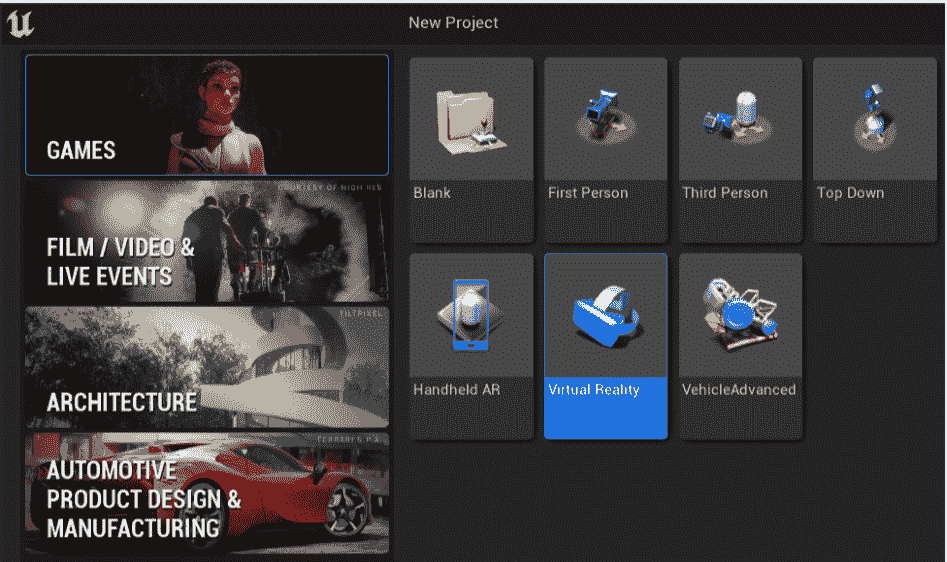

图 16.1 – 选择 VR 模板

下一个屏幕截图显示了 VR 模板地图，其中包含球体、武器和用户可以抓取的立方体：

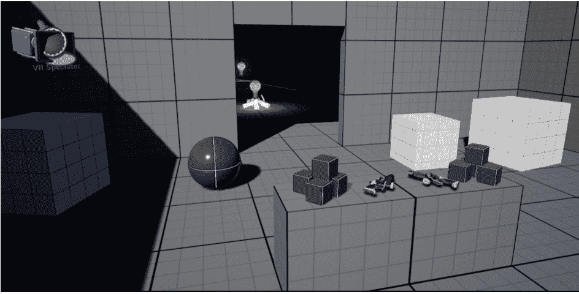

图 16.2 – VR 模板地图

如果你的计算机上安装了 VR 显示设备并设置为开发模式，则可以通过单击 **播放** 按钮的下拉菜单并选择 **VR 预览** 以 VR 模式启动关卡。如果你没有 VR 显示设备，可以使用 **播放** 按钮的 **新建编辑器窗口** 选项启动关卡，并按 *Tab* 键切换旁观者模式。你将能够使用 *W、A、S* 和 *D* 键以及鼠标在关卡中移动。

在 VR 模式下，你可以通过按下右侧运动控制器的摇杆向上来标记位置并释放摇杆以执行瞬移，从而在关卡的不同位置之间瞬移。关卡中的某些对象可以被抓取。要抓取一个对象，请将运动控制器靠近对象并按住抓握按钮。要释放对象，请松开抓握按钮。

模板中使用的 Blueprint 位于 **Content > VRTemplate > Blueprints** 文件夹中。让我们了解它们的工作原理，以便更轻松地将它们适应到我们的项目中。此外，这将是一个观察 Blueprint 实际示例的绝佳机会。

### VRPawn Blueprint

**VRPawn** Blueprint 代表关卡中的用户。该 Blueprint 包含来自运动控制器的输入事件的逻辑，运动控制器是用户手持以在 VR 中进行交互的物理设备。

下面的屏幕截图显示了 **VRPawn** Blueprint 的 **组件** 面板：

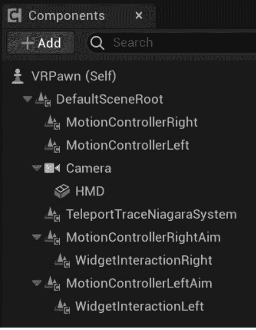

图 16.3 – VRPawn 组件

**MotionControllerRight** 和 **MotionControllerLeft** 是 *运动控制器* 组件，用于跟踪运动控制器设备。当你移动运动控制器设备时，运动数据会发送到 *运动控制器* 组件。

**Camera** 组件是用户视图。有一个名为 **HMD** 的 *静态网格体* 组件，用于在关卡中直观表示头戴式显示器。当使用旁观者摄像机时，我们可以看到用户的表示，这是因为 **HMD** 和 *运动控制器* 组件：

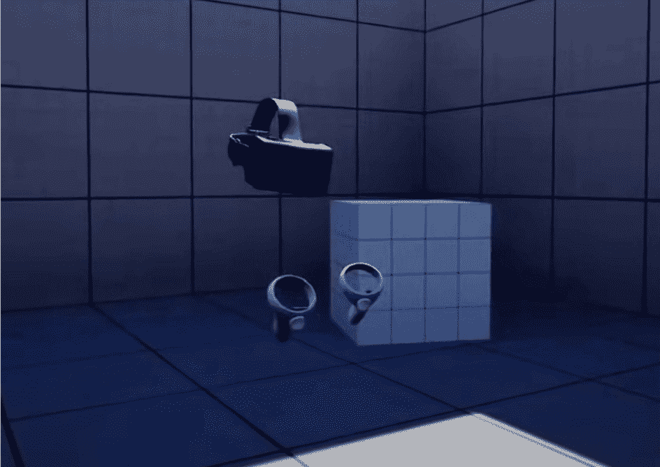

图 16.4 – VR 模板中的用户表示

VRPawn 中的另一个组件是 TeleportTraceNiagaraSystem，它是一个用于表示瞬移痕迹的 Niagara 粒子系统组件。

然后，我们还有一对运动控制器组件。VR 模板使用这些额外组件作为获取瞄准位置的简单方式。默认情况下，运动控制器组件使用握把位置，但您可以在详细信息面板中更改运动源。下一张截图显示了 MotionControllerRightAim 的属性。显示设备模型属性未被勾选，因此此运动控制器组件不会在关卡中显示：

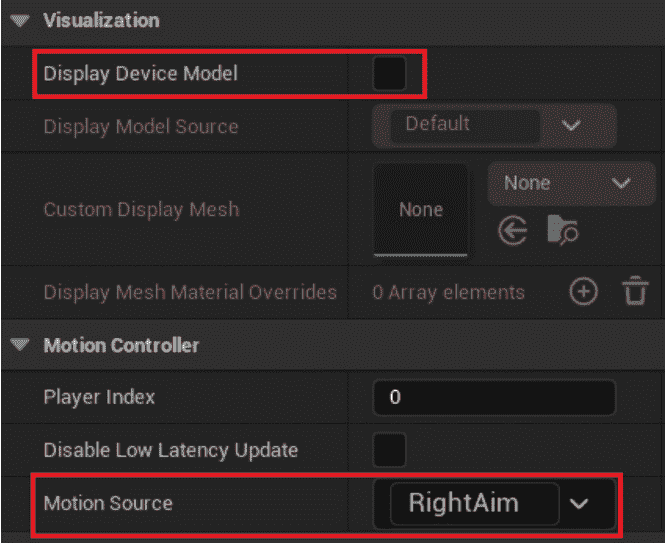

图 16.5 – MotionControllerRightAim 的属性

最后要提及的组件是小部件交互组件。它的工作方式类似于激光指针，用于与小部件菜单交互，该菜单通过按下运动控制器上的菜单按钮激活：

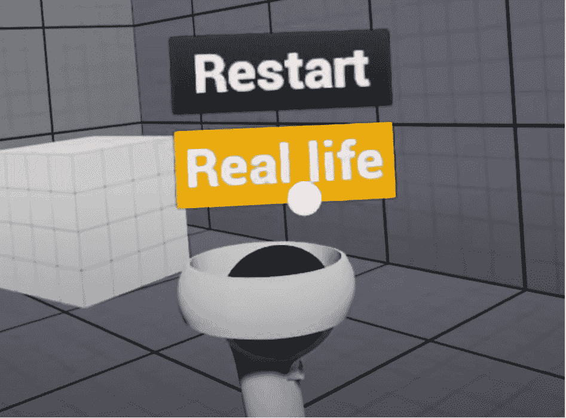

图 16.6 – 与小部件菜单交互

在 **VRPawn** 的 EventGraph 中，有来自运动控制器的多个输入事件，我们将在 _瞬移_ 和 _对象抓取_ 节中详细介绍。

### 瞬移

在本节中，我们将了解用于瞬移的事件和函数。

要开始瞬移，请向上按下右侧运动控制器的摇杆以标记一个位置。当您释放摇杆时，将瞬移到标记的位置。瞬移目标由 **VRTeleportVisualizer** 蓝图表示：

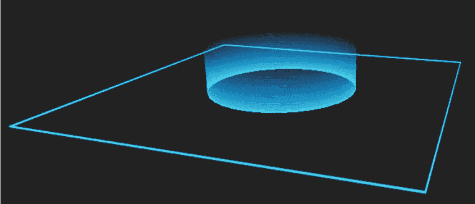

图 16.7 – VRTeleportVisualizer 蓝图

用于瞬移的输入事件是 **InputAxis MovementAxisRight_Y**。该事件的第一个节点检查 **Axis Value** 是否为正，这意味着摇杆已向上按下，并检查 **Axis Value** 是否大于死区，即启动瞬移所需的最小 **Axis Value**：

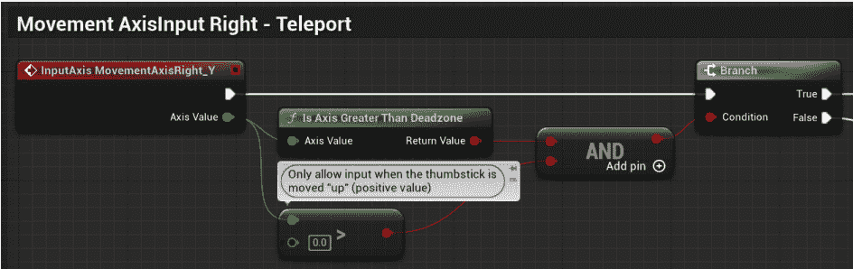

图 16.8 – InputAxis MovementAxisRight_Y 的第一个节点

下一张截图显示了连接到 *图 16.8* 中 **Branch** 节点的 **True** 输出的节点。**Do Once** 节点用于确保在瞬移痕迹激活期间，**Start Teleport Trace** 函数不会再次运行。**Teleport Trace** 函数会在用户向上按住摇杆时不断更新目标：

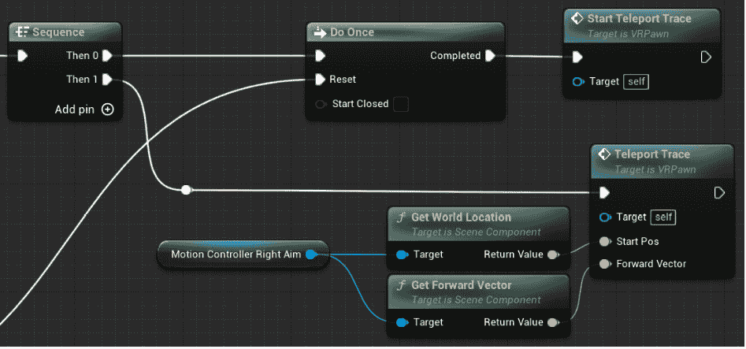

图 16.9 – 激活瞬移痕迹

下面的截图显示了连接到 *图 16.8* 中 **Branch** 节点的 **False** 输出的节点，这意味着用户没有向上按下右侧运动控制器的摇杆。如果瞬移痕迹处于活动状态，则该事件会结束瞬移痕迹并尝试瞬移到目标。**Try Teleport** 节点连接到 **Do Once** 节点的 **Reset** 引脚：

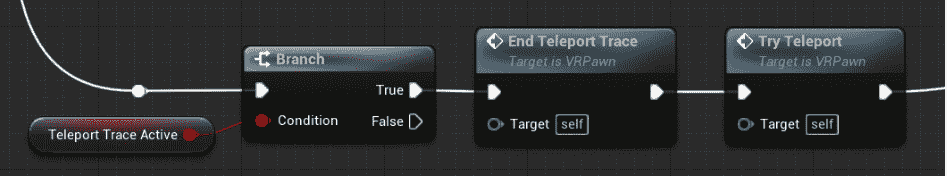

图 16.10 – 结束瞬移痕迹并瞬移

让我们分析用于瞬移的 **Start Teleport Trace**、**TeleportTrace**、**End Teleport Trace** 和 **Try Teleport** 函数。

**Start Teleport Trace** 函数在 **Teleport Trace Active** 布尔变量中设置 `True`，在 **Teleport Trace Niagara System** 组件中将可见性设置为 `True`，并生成 **VRTeleportVisualizer** 的一个实例：

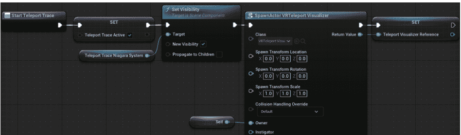

图 16.11 – Start Teleport Trace 函数

TeleportTrace 函数使用名为 Predict Projectile Path By Object Type 的函数来计算投射瞬移位置和瞬移痕迹路径位置。下面的截图显示了 TeleportTrace 函数的最后几个节点，这些节点会更新 TeleportVisualizer 位置，并设置 Niagara 粒子系统组件用于瞬移痕迹视觉效果的向量数组：

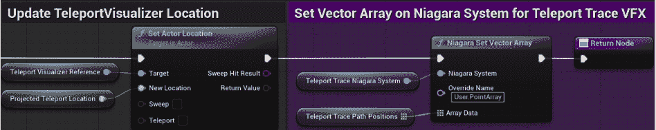

图 16.12 – Teleport Trace 函数的最后节点

End Teleport Trace 函数与 Start Teleport Trace 函数相反。它将 Teleport Trace Active 布尔变量设置为 False，销毁瞬移可视化器实例，并隐藏瞬移痕迹 Niagara 系统组件：

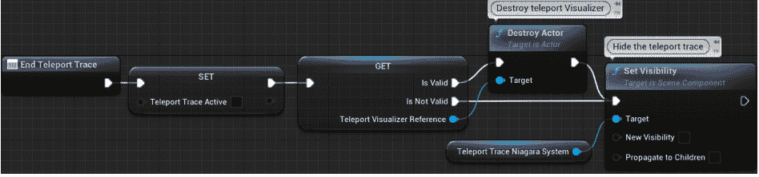

图 16.13 – End Teleport Trace 函数

End Teleport Trace 函数使用一个 **Validated Get** 节点。当您拥有一个 **Object Reference Get** 节点时，可以右键单击它并选择 **Convert to Validated Get**：

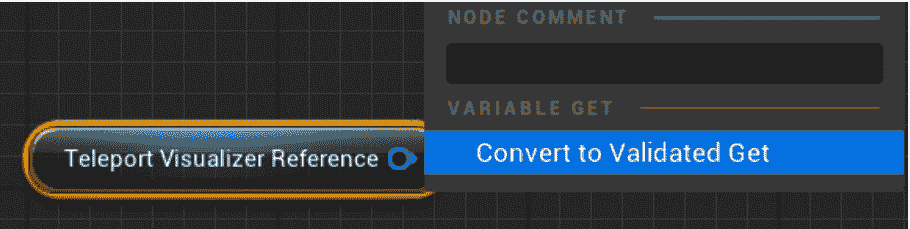

图 16.14 – 将 Get 节点转换为 Validated Get 节点

原始节点被转换为一个带有执行引脚的 **GET** 节点，可用于检查对象引用是否有效：

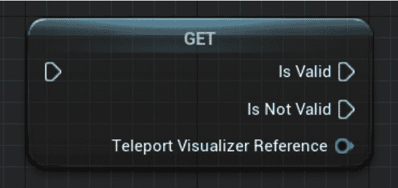

图 16.15 – 带有分支执行引脚的 GET 节点

Try Teleport 函数检查 **Valid Teleport Location** 是否为 **True**，然后使用 **Teleport** 函数将用户瞬移到目标位置：

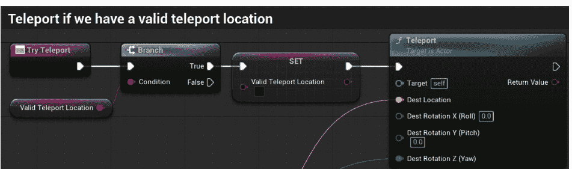

图 16.16 – Try Teleport 函数

VR 模板中还有另一种名为 **Snap Turn** 的运动类型。在这种运动中，您可以通过按下左侧运动控制器摇杆的左或右来旋转虚拟角色。Snap Turn 使用的输入事件是 **InputAxis MovementAxisLeft_X**。

我们了解了用于瞬移的事件和函数。在下一节中，我们将了解 VR 模板中对象抓取的工作原理。

### 对象抓取

对象抓取系统基于为 VR 模板创建的 **GrabComponent** 蓝图，该蓝图位于 `Content > VRTemplate > Blueprints` 文件夹中。

**GrabComponent** 是 **SceneComponent** 的子类。有关蓝图组件的更多信息，请参见 _第 18 章，创建蓝图库和组件_。

要使关卡中的任何 Actor 都可抓取，请将 **GrabComponent** 添加到 Actor 并将 **Mobility** 设置为 **Movable**：

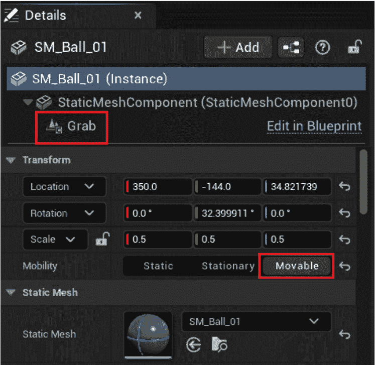

图 16.17 – 使 Actor 可抓取

有一个名为 **Grab Type** 的枚举，用于定义对象如何附加到运动控制器。有关枚举的更多信息，请参见 _第 13 章，数据结构和流程控制_。

您可以在 **GrabComponent** 的 **详细信息** 面板中设置 **Grab Type**：

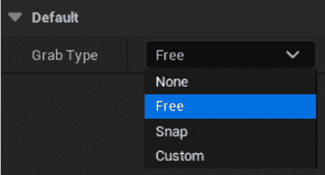

图 16.18 – Grab Type 枚举

可用的抓取类型如下：

- **None**：当您希望禁用抓取但又不移除 Actor 的 `Grab` 组件时，请使用此选项。
- **Free**：对象附加到运动控制器，同时保持与其相对的位置和方向。此类型最适合无需以特定方式握持即可使用的对象，例如 VR 模板中的立方体。
- **Snap**：拾取时，对象会附加到抓取它的运动控制器相对于的特定预定义位置和旋转。此抓取类型通常用于具有明确握把位置的对象，例如 VR 模板中的武器。
- **Custom**：此选项允许开发者创建自己的抓取类型。`Grab` 组件具有 `bIsHeld` 布尔变量以及 `OnGrabbed` 和 `OnDropped` 事件调度器，可用于创建自定义逻辑。

**VRPawn** 中处理抓取的事件是 **InputAction GrabLeft** 和 **InputAction GrabRight**，它们由运动控制器的握把按钮触发。要抓取关卡中的 Actor，请将运动控制器靠近 Actor 并按住握把按钮。要释放 Actor，请松开握把按钮。

让我们分析 **InputAction GrabLeft** 事件。下面的截图显示了该事件的第一个节点：

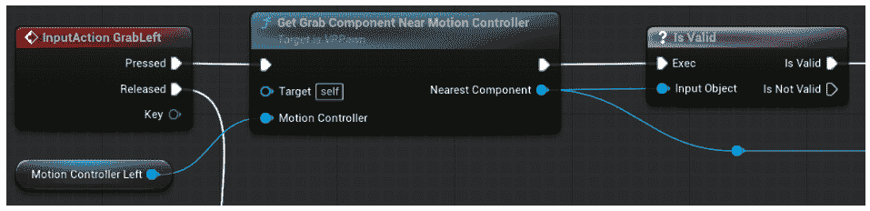

### 图 16.19 – InputAction GrabLeft 的第一个节点

**获取靠近运动控制器的抓取组件** 函数使用球形追踪来搜索附近的 Actor。如果找到 Actor，它会检查是否具有 **抓取组件**。如果有，则返回 **抓取组件** 的引用。

有关追踪的更多信息，请参见 *第 14 章，数学和追踪节点*。

如果未找到 Actor，或找到的 Actor 没有 **抓取组件** 类型的组件，则 **最近组件** 输出引脚将返回一个无效组件（因为没有任何组件）。因此，**是否有效** 节点会检查输出的有效性。如果输出有效，则执行 **抓取组件** 的 **尝试抓取** 函数。如果启用了物理，此函数会禁用 Actor 的物理，并将 Actor 附加到运动控制器。**抓取组件** 引用存储在 **左手持有组件** 变量中：

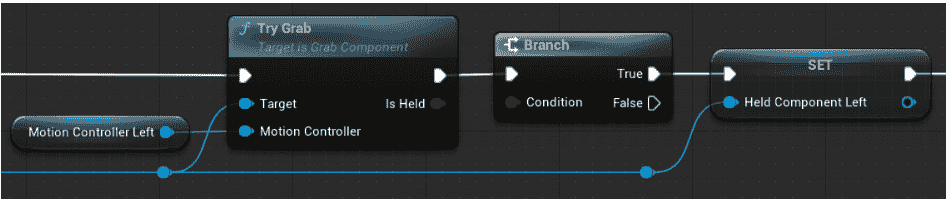

### 图 16.20 – 执行抓取组件的尝试抓取函数

如果被抓取的对象正被另一只手持有，则另一只手需要释放该对象。这是通过清除另一只手的 **持有组件** 变量中的引用来完成的：

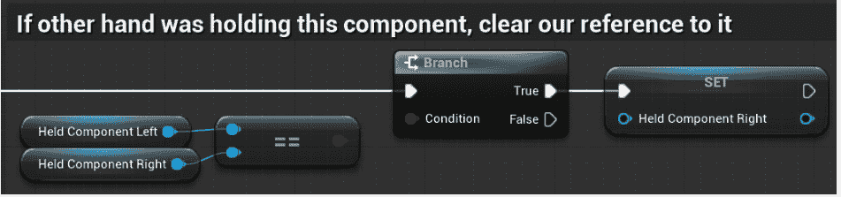

### 图 16.21 – 清除右手持有组件变量

下一个截图显示了连接到 InputAction GrabLeft 事件的 Release 引脚的节点。**尝试释放** 函数将 Actor 从运动控制器上分离。之后，左手持有组件变量会被清除：

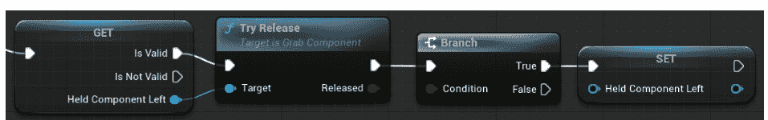

### 图 16.22 – 用户放下 Actor 时执行的节点

用户可以通过蓝图接口与一些被抓取的 Actor（例如手枪）进行交互。

### 使用接口进行蓝图通信

蓝图接口是一种特殊类型的蓝图，仅包含函数名称和参数。它用于允许不同类型的蓝图之间进行通信。

要创建蓝图接口，请执行以下步骤：

- 1. 在内容浏览器中单击添加按钮，并在蓝图子菜单中选择蓝图接口：

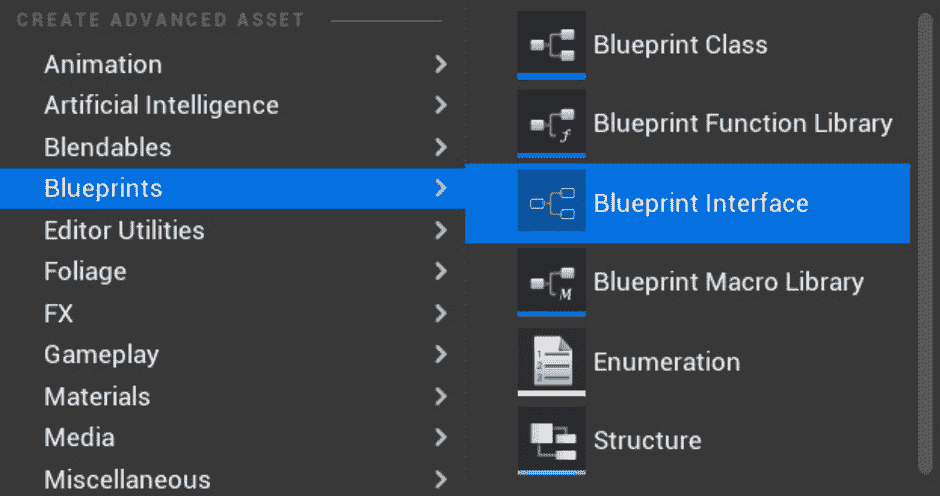

### 图 16.23 – 创建蓝图接口

- 2. VR 模板在 Content > VRTemplate > Blueprints 文件夹中有一个名为 VRInteraction BPI 的蓝图接口。双击它以打开蓝图接口编辑器。以下截图显示了 VRInteraction BPI 接口的函数：

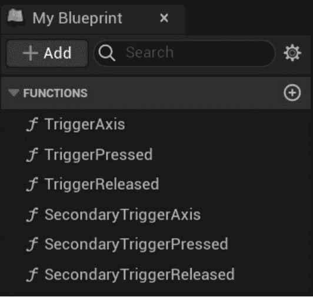

### 图 16.24 – VRInteractionBPI 接口函数

- 3. 打开 **手枪蓝图** 以查看接口实现示例。单击蓝图编辑器的 **类设置** 按钮。在 **详细信息** 面板中，转到 **接口** 类别，即可看到 **VRInteraction BPI** 接口已添加到 **手枪蓝图** 中：

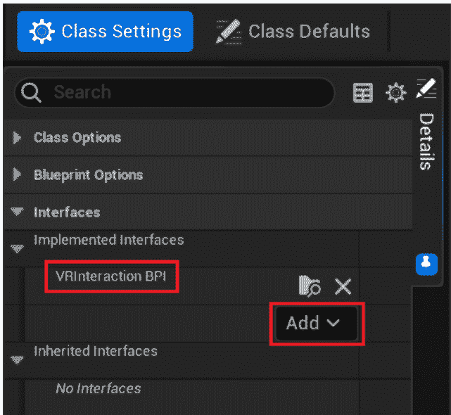

### 图 16.25 – 添加接口

**手枪蓝图** 实现了 **VRInteraction BPI** 接口的 **扳机按下** 函数。由于 **扳机按下** 函数没有输出参数，因此它作为事件实现：

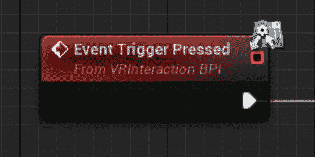

### 图 16.26 – 实现接口的函数

- 4. 在此事件中，手枪蓝图生成一个弹道蓝图的实例。**扳机按下** 函数由 VRPawn 蓝图在 InputAction TriggerLeft 和 InputAction TriggerRight 事件中调用：

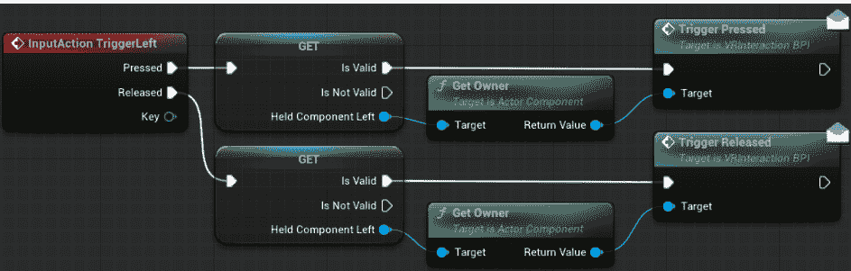

### 图 16.27 – VRPawn 蓝图调用接口的扳机按下函数

VRPawn 蓝图获取 GrabComponent 的 Actor 所有者，并使用 Actor 所有者引用调用扳机按下函数。如果 Actor 具有已实现的 VRInteraction BPI 接口，则执行扳机按下。如果 Actor 未实现 VRInteraction BPI 接口，则不执行任何操作。

在下一节中，我们将了解用户如何与虚拟世界中的菜单进行交互。

### 与菜单交互

VR 模板具有一个菜单系统，可通过按下运动控制器上的 **菜单** 按钮激活。菜单系统由 **菜单蓝图** 和 **小部件菜单蓝图** 实现。这两个蓝图都在 `Content > VRTemplate > Blueprints` 文件夹中。

VRPawn 处理菜单的事件是 **输入动作菜单切换左** 和 **输入动作菜单切换右**，由运动控制器的 **菜单** 按钮触发。**菜单** 按钮用于显示和隐藏菜单。

下一个截图显示了执行 VRPawn 的 **切换菜单** 函数的 **输入动作菜单切换右** 事件：

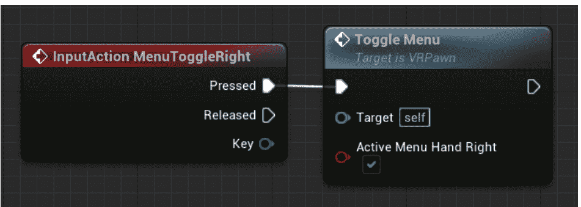

### 图 16.28 – 输入动作菜单切换右事件

**切换菜单** 函数检查菜单是否处于活动状态。如果是，则调用 **菜单蓝图** 的 **关闭菜单** 函数。如果菜单未处于活动状态，则生成 **菜单蓝图** 的一个实例：

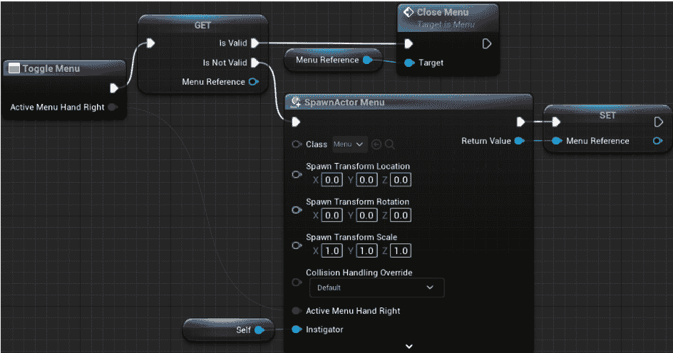

### 图 16.29 – 切换菜单函数

**菜单蓝图** 负责显示附加到运动控制器上的 **小部件菜单** 并定义它们之间的交互。

双击 **小部件菜单** 打开 UMG 编辑器：

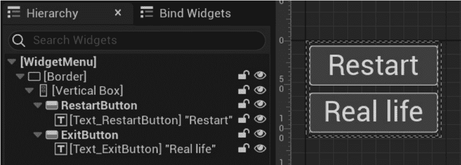

### 图 16.30 – UMG 编辑器中的小部件菜单

在 UMG 编辑器的 **图表** 选项卡中，我们可以看到按钮的 **点击** 事件。**点击（重启按钮）** 事件使用 **打开关卡** 函数来重新加载关卡：

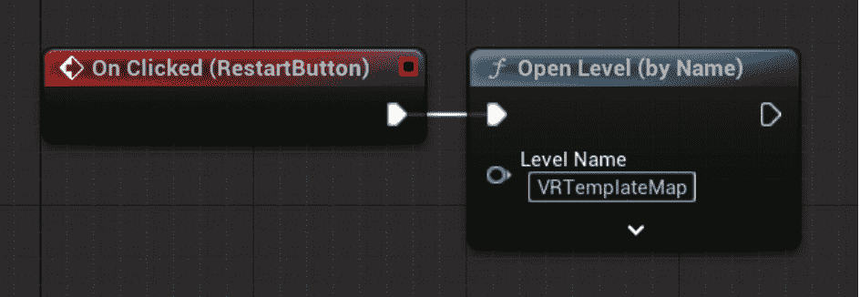

### 图 16.31 – 点击（重启按钮）事件

ExitButton 按钮具有现实生活标签。**点击（退出按钮）** 事件使用 **退出游戏** 函数退出应用程序：

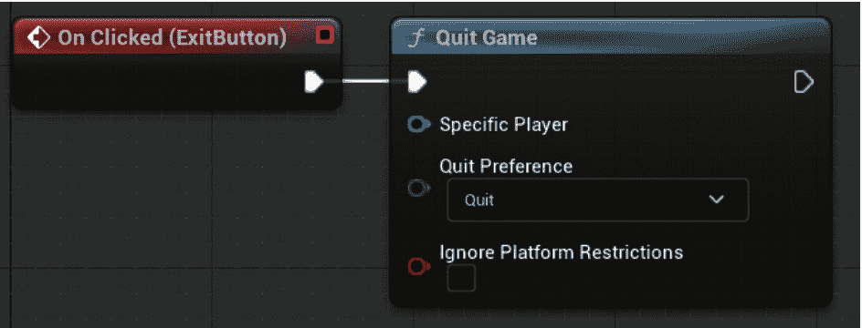

### 图 16.32 – 点击（退出按钮）事件

如果要向菜单添加命令按钮，只需修改 **小部件菜单** 蓝图。有关 UMG 的更多信息，请参见 _第 7 章，创建屏幕 UI 元素_。

我们已经分析了 VR 模板中使用的主要元素，因此现在更容易理解 VR 模板中更复杂的部分。

### 摘要

在本章中，我们探索了 VR 模板，它是开始尝试 VR 开发的一种简单方式。我们了解到 VR 模板的主要功能在 **VRPawn** 蓝图中。

我们分析了用于实现传送的蓝图函数，并了解了 **抓取组件** 如何用于制作可抓取对象。

我们学习了 **蓝图接口** 的概念，并了解了它们如何用于允许用户使用 **手枪** 蓝图射击。我们还了解了如何修改 VR 模板使用的 UMG 菜单。

本章总结了 _第 4 部分，高级蓝图_，介绍了高级蓝图概念。_第 5 部分，额外工具_ 将介绍 Unreal Engine 中可用的一些额外工具。在下一章中，我们将学习关于动画蓝图的内容。

### 测验

- 1. VR 模板不使用 OpenXR 框架。
  - a. 正确
  - b. 错误

- 2. **VRPawn** 蓝图具有 *运动控制器* 组件来跟踪运动控制器设备。
  - a. 正确
  - b. 错误

- 3. 您可以右键单击 **对象引用获取** 节点，并将其转换为带有可用于检查引用是否有效的执行引脚的 **验证获取** 节点。
  - a. 正确
  - b. 错误

- 4. 要创建可抓取 Actor，您需要创建 **抓取组件** 蓝图的子蓝图类。
  - a. 正确
  - b. 错误

- 5. 当接口函数没有输出参数时，它作为事件实现。
  - a. 正确
  - b. 错误
