## 第 17 章：动画蓝图

第 4 部分介绍了数据结构、流程控制、数学节点、蓝图技巧以及虚拟现实开发简介。

在第 5 部分中，我们将探讨动画蓝图、蓝图库和组件、程序化生成以及产品配置器模板。

本章介绍了虚幻引擎动画系统的主要元素，例如骨骼、骨骼网格、动画序列和混合空间。它展示了如何使用 EventGraph 和 AnimGraph 脚本化动画蓝图。它还解释了状态机在动画中的使用方法以及如何为动画创建新状态。

本章涵盖的主题如下：

- 动画概述
- 创建动画蓝图
- 探索状态机
- 导入动画入门包
- 添加动画状态

读完本章后，你将知道如何使用动画蓝图以及如何添加动画状态。

### 动画概述

虚幻引擎的动画系统非常灵活且强大。它由许多协同工作的工具和编辑器组成。在本章中，我们将重点介绍动画蓝图，了解虚幻引擎中动画的主要概念。

我们将从使用第三人称模板的项目开始，以了解动画概念并探索动画编辑器。

按照以下步骤创建项目：

- 1. 使用带有起始内容的 **第三人称** 模板创建项目：

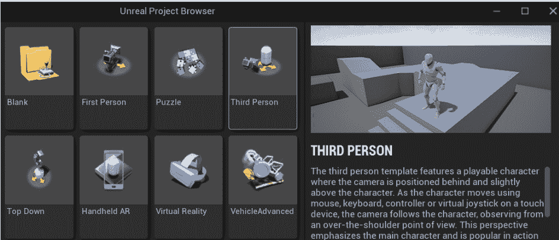

图 17.1 – 使用第三人称模板创建项目

- 2. 按 **播放** 按钮尝试第三人称模板内置的默认游戏玩法。你可以使用 *WASD* 键移动玩家角色，并通过移动鼠标环顾四周。按 *spacebar* 键可使角色跳跃。

现在我们有了示例项目，让我们来探索动画编辑器。

### 动画编辑器

有五种用于处理骨骼动画的动画工具。这些工具可以通过打开关联资产来访问。每个动画工具右上角都有五个按钮，如下面的屏幕截图所示，用于在不同工具之间切换：

图 17.2 – 使用按钮在动画工具之间切换

按钮访问的动画工具从左到右如下：

- 骨骼编辑器：用于管理骨骼
- 骨骼网格编辑器：用于修改与骨骼链接并直观表示角色的骨骼网格
- 动画编辑器：允许创建和修改动画资产
- 动画蓝图编辑器：允许创建脚本和状态机，以根据角色当前状态控制角色必须使用的动画
- 物理资产编辑器：用于创建将在模拟中使用的物理体

让我们来看看骨骼和骨骼网格之间的关系。

### 骨骼和骨骼网格

骨骼网格链接到骨骼。骨骼是互连骨骼的层次结构，用于动画化骨骼网格的多边形顶点。

在虚幻引擎中，骨骼是与骨骼网格分离的资产。由于动画在骨骼中完成，因此动画可以由多个使用同一骨骼的其他骨骼网格共享。

让我们可视化第三人称模板使用的骨骼。访问 Content > Mannequin > Character > Mesh 文件夹，双击 UE4_Mannequin_Skeleton 资产以打开骨骼编辑器，如下面的屏幕截图所示：

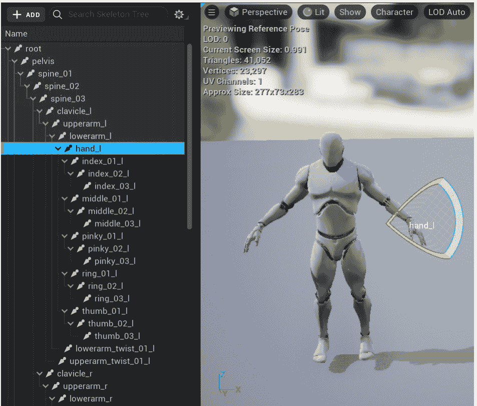

图 17.3 – 骨骼编辑器

左侧面板包含骨骼树，其中包含该骨骼的一部分骨骼层次结构。你可以选择一个骨骼并调整其相对于骨骼的位置和旋转。

### 动画序列

动画序列资产包含关键帧，用于指定特定时间的骨骼变换。它用于在骨骼网格上播放单一动画。

可以在动画编辑器的资产浏览器中查看可供骨骼使用的动画序列。下面的屏幕截图显示了第三人称模板的动画序列：

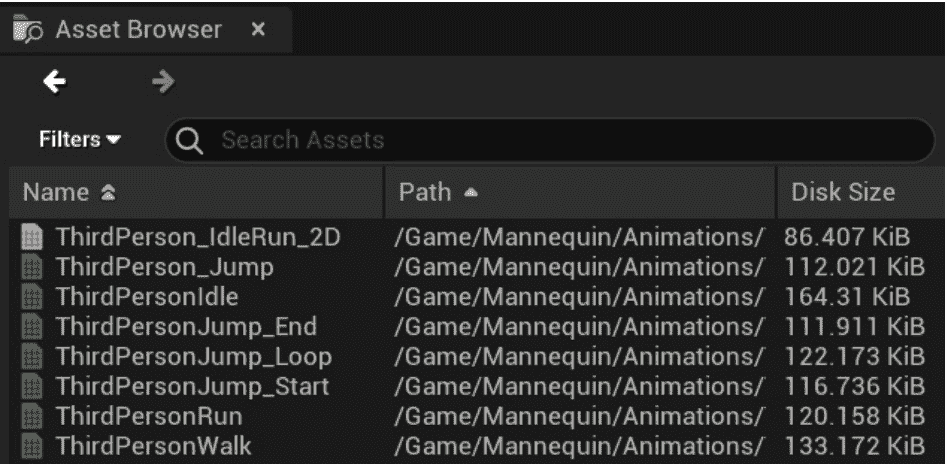

图 17.4 – 动画序列

双击动画序列即可在视口中播放它。下面的屏幕截图中正在播放 ThirdPersonRun 动画序列：

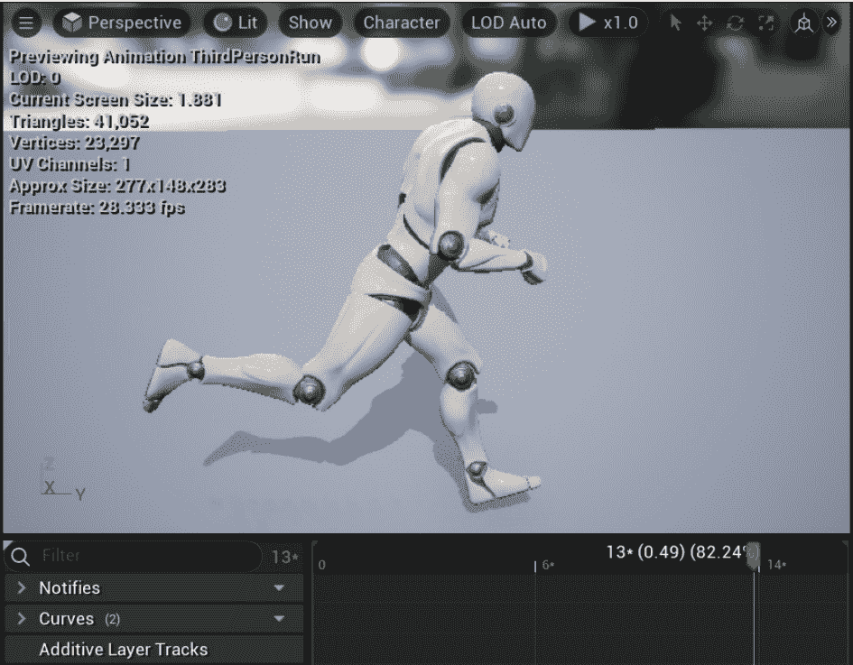

图 17.5 – 预览 ThirdPersonRun 动画序列

动画编辑器的 **资产浏览器** 除了动画序列之外，还列出了其他类型的动画资产。例如，在 *图 17.4* 中，**ThirdPerson_IdleRun_2D** 资产带有不同颜色的图标，因为它是一个 **混合空间**，我们将在下一节中介绍。

### 混合空间

混合空间是一种资产类型，允许根据一个或两个参数值混合动画。为了便于理解，让我们分析 **ThirdPerson_IdleRun_2D** 资产，它是一个基于单个参数的混合空间。

在 **资产浏览器** 中双击 **ThirdPerson_IdleRun_2D** 资产以在视口中打开它。此混合空间具有一个名为 **Speed** 的参数，并使用三个动画序列，即 **ThirdPersonIdle**、**ThirdPersonWalk** 和 **ThirdPersonRun**。按住 *Shift* 键以移动 **Speed** 参数的预览值，该值由绿色加号图标表示：

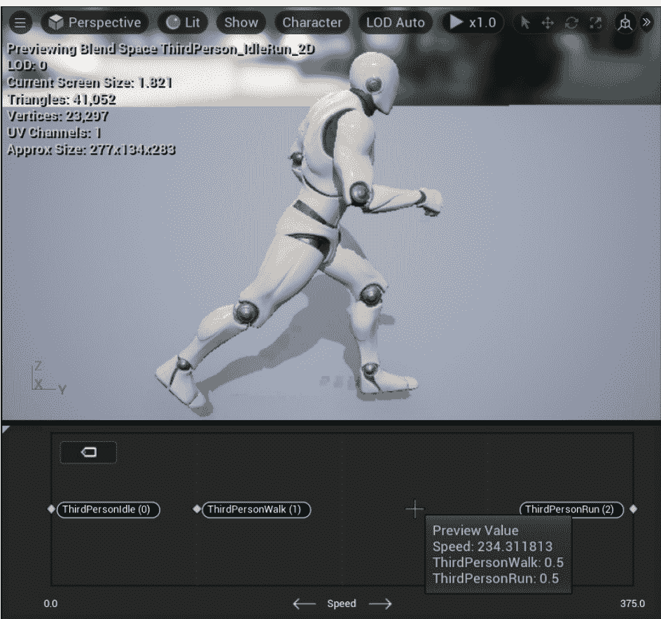

图 17.6 – 混合行走和跑步动画序列

**ThirdPerson_IdleRun_2D** 混合空间为每个动画序列映射了以下 **Speed** 值：

- ThirdPersonIdle: 0.0
- ThirdPersonWalk: 93.75
- ThirdPersonRun: 375.0

在 *图 17.6* 的示例中，**Speed** 使用的值约为 234.3，那么生成的动画将同时使用 50% 的 **ThirdPersonWalk** 和 50% 的 **ThirdPersonRun**。

虚幻引擎中的动画是一个广泛的主题，需要研究面向动画师的特定文档。本动画概述部分的目的是介绍主要动画概念，以便你可以使用 **动画蓝图**，我们将在下一节中介绍。

### 创建动画蓝图

动画蓝图是一种专用蓝图，带有用于角色动画脚本编写的工具。动画蓝图编辑器类似于蓝图编辑器，但它有一些用于动画的特定面板。

按照以下步骤创建动画蓝图：

- 1. 单击 **内容浏览器** 中的 **添加** 按钮，并在 **动画** 子菜单中选择 **动画蓝图**，如下面的屏幕截图所示：

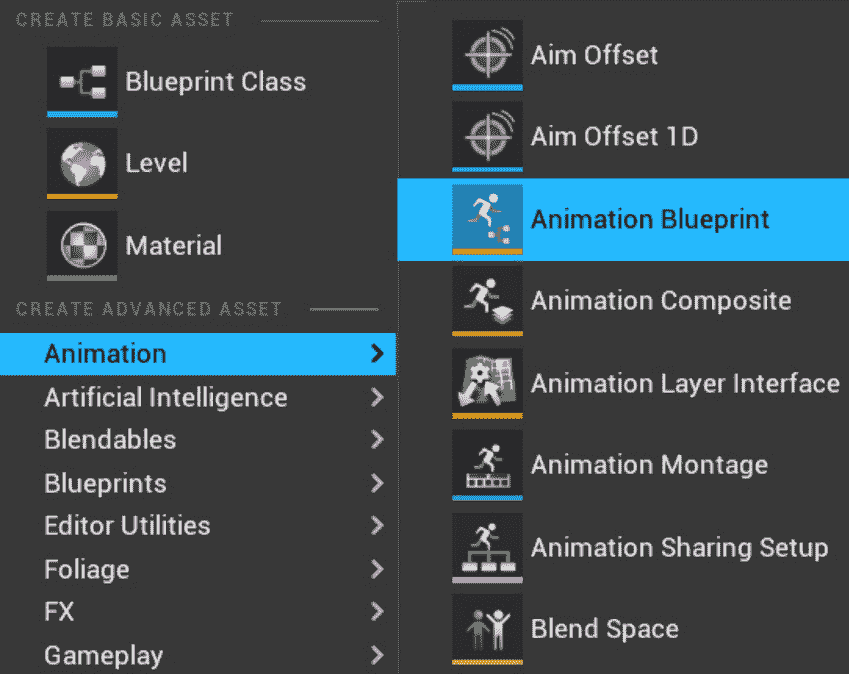

图 17.7 – 创建动画蓝图

- 2. 在下一个窗口中，你需要选择目标骨骼。动画资产和动画蓝图链接到特定的骨骼。可选地，你可以选择不同的父类而不是默认类。对于此示例，请勿选择父类，而是选择 UE4_Mannequin_Skeleton，它位于 /Game/Mannequin/Character/ 路径中：

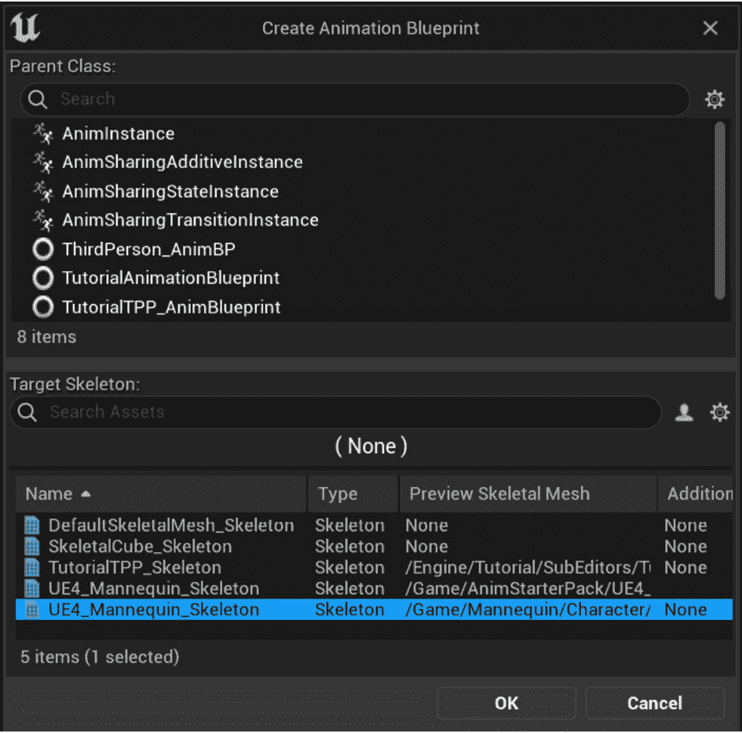

图 17.8 – 选择目标骨骼

- 3. 为在 **内容浏览器** 中创建的动画蓝图命名，并双击它以打开动画蓝图编辑器。

动画蓝图编辑器有两种共同创建动画的图表。**事件图** 与蓝图编辑器中的相同，但带有一些用于动画的特定节点。在 **动画图** 中，我们可以创建状态机并使用节点播放动画序列和混合空间。

让我们先从分析事件图开始。

### 事件图

我们使用动画蓝图的事件图来获取使用动画蓝图实例的兵丁/角色的数据，并更新动画蓝图的变量。事件图中已添加两个节点：

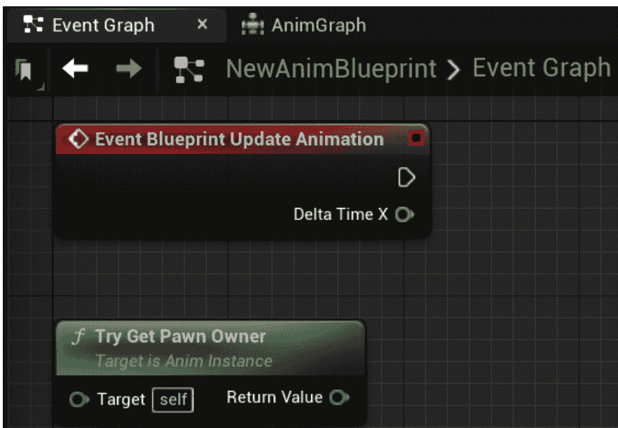

图 17.9 – 动画蓝图编辑器事件图

以下是节点描述：

- 事件蓝图更新动画：此事件在每一帧执行，允许更新动画使用的变量。Delta Time X 参数是自上一帧以来经过的时间量。

尝试获取拥有者：此函数尝试获取正在使用动画蓝图实例的子体或角色的引用。我们需要此函数，以便获取角色数据以用于动画。

如果你需要对动画进行一些初始化，可以使用 **事件蓝图初始化动画**：

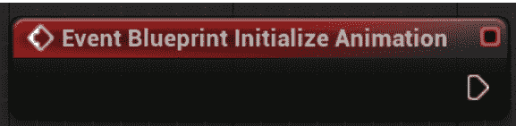

图 17.10 – 用于初始化动画的事件

作为使用 **事件图** 的示例，让我们创建 `Speed` 变量，并使用动画蓝图实例所使用的子体/角色中的数据来更新其值。

创建示例的步骤如下：

- 1. 在动画蓝图编辑器的 **我的蓝图** 面板中，创建名为 `Speed` 的变量，并将 **变量类型** 设置为 **浮点数**：

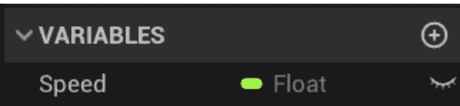

图 17.11 – 创建 Speed 变量

- 2. 在 **事件图** 中，我们将添加以下截图中显示的节点。如果 **子体拥有者** 引用有效，则我们将获取子体的速度向量并计算其长度，以找到 **Speed** 的标量值：

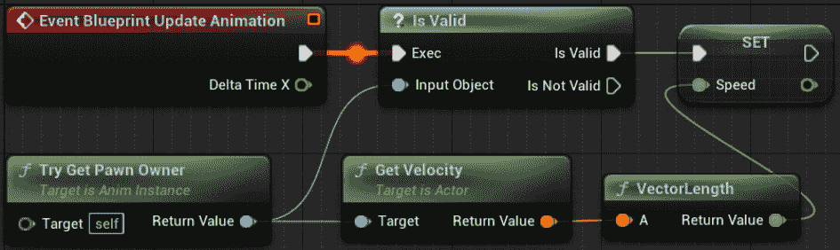

图 17.12 – 更新 Speed 变量

- 3. 从 **事件蓝图更新动画** 节点的白色输出引脚拖出一条线，并添加一个 **是否有效** 宏节点。将 **输入对象** 引脚连接到 **尝试获取拥有者** 节点的 **返回值** 引脚。

- 4. 从 **是否有效** 输出引脚拖出一条线，并添加一个 **设置 Speed** 节点。

- 5. 从 **尝试获取拥有者** 节点的 **返回值** 引脚拖出一条线，并添加一个 **获取速度** 节点。

- 6. 从 **获取速度** 节点的 **返回值** 引脚拖出一条线，并添加一个 **矢量长度** 节点。

- 7. 将 **矢量长度** 节点的 **返回值** 引脚连接到 **Speed** 输入引脚。

- 8. 编译并保存动画蓝图。

现在 **Speed** 变量已更新，我们可以在 **动画图** 中使用它。

### 动画图

在 **动画图** 中，我们使用节点来播放动画序列和混合空间。我们还可以创建状态机来将动画组织为各个状态。

**动画图** 只能访问动画蓝图中的变量，因此我们使用 **事件图** 从子体获取更新后的值。

动画图的最终节点是 **输出姿态** 节点，它将接收每一帧的结果姿态以应用于骨骼网格：

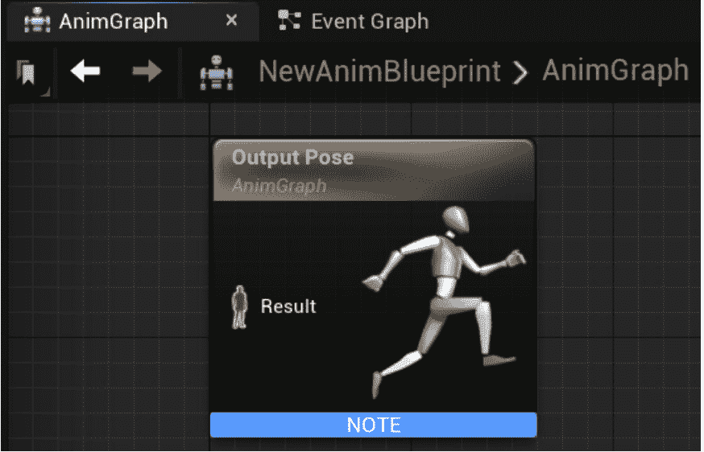

图 17.13 – 带有输出姿态的动画图

动画蓝图编辑器右下角提供了 **资产浏览器**：

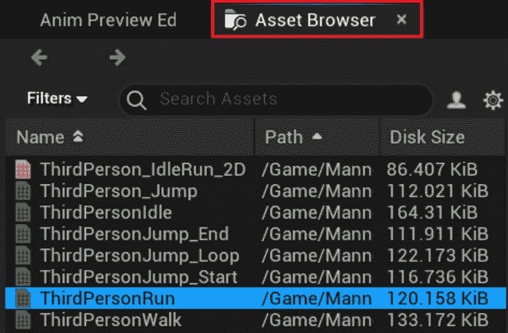

图 17.14 – 动画蓝图编辑器中的资产浏览器

你可以从 **资产浏览器** 拖动一个动画资产，并将其放置到 **动画图** 中以创建等效节点。在以下截图中显示的示例中，**ThirdPersonRun** 动画序列被放置到 **动画图** 中以创建 **播放 ThirdPersonRun** 节点。你需要将 **播放 ThirdPersonRun** 节点的白色角色图标连接到 **输出姿态** 节点的白色角色图标，并编译动画蓝图以在视口中预览动画：

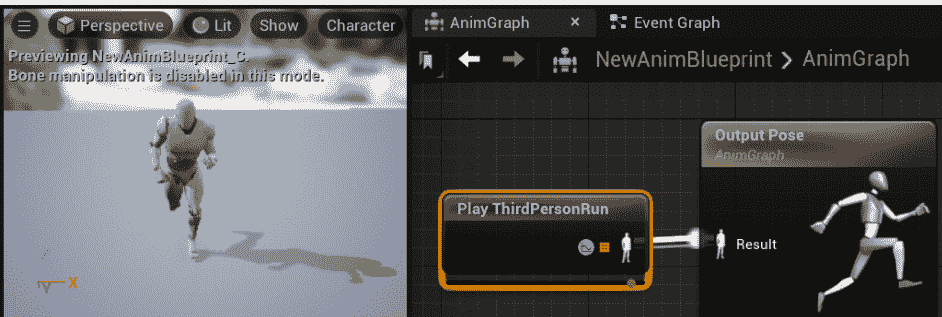

图 17.15 – 在动画蓝图编辑器中播放 ThirdPersonRun 动画

要创建 **混合空间播放器** 节点，只需拖动一个混合空间资产，例如 **ThirdPerson_IdleRun_2D**，并将其放置到 **动画图** 中。在以下截图中，**Speed** 变量的值正在被用作混合空间的参数：

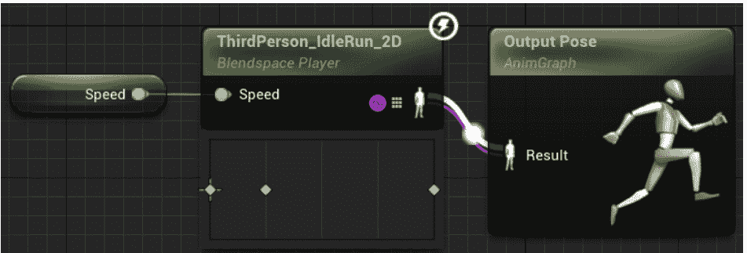

图 17.16 – 在动画蓝图编辑器中播放混合空间

编译动画蓝图后，你可以修改位于动画蓝图编辑器右下角的 **动画预览编辑器** 中 **Speed** 变量的值：

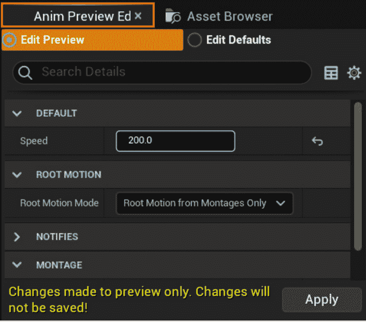

图 17.17 – 动画预览编辑器

将 **Speed** 变量分配为 0 到 375 之间的不同值，并在视口中查看生成的动画。

我们了解了如何将动画节点直接连接到 **输出姿态** 节点，但 **动画图** 是以状态机为设计目标创建的。我们将在以下部分讨论状态机。

### 探索状态机

**动画图** 中的状态机允许你将动画组织为一系列状态。为举例说明，我们将创建一个包含两个状态的状态机：待机和移动。

我们需要定义 **转换规则** 来控制从一个状态到另一个状态的转换。

按照以下步骤创建状态机：

- 1. 移除其他动画节点，仅在 **动画图** 中保留 **输出姿态** 节点。

- 2. 在 AnimGraph 上右键单击，搜索 `state machine`，并选择 **添加新状态机**：

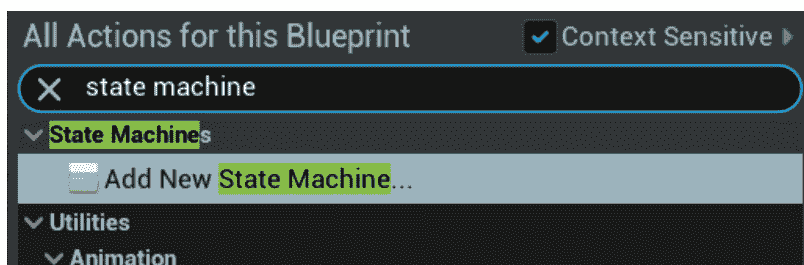

图 17.18 – 添加状态机

- 3. 将状态机重命名为 `Char States`。你可以在 **详细信息** 面板中对其进行重命名。将状态机的白色图标连接到 **输出姿态** 节点的白色图标：

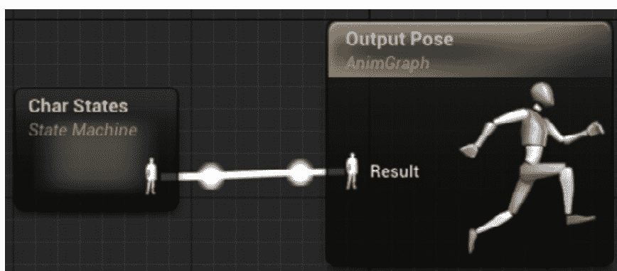

图 17.19 – 将状态机连接到输出姿态节点

- 4. 双击 **Char States** 节点以编辑状态机。然后，在图表上右键单击并选择 **添加状态**。将状态重命名为 `Idle`，并从 **入口** 拖出一条线到 `Idle` 状态节点：

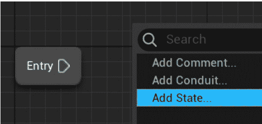

图 17.20 – 添加状态

- 5. 添加另一个状态并将其重命名为 `Moving`。从 `Idle` 状态节点的外部边框拖出一条线并将其连接到 `Moving` 状态节点的外部边框。从 `Moving` 状态节点拖出另一条线到 `Idle` 状态节点。箭头表示状态之间可以进行转换：

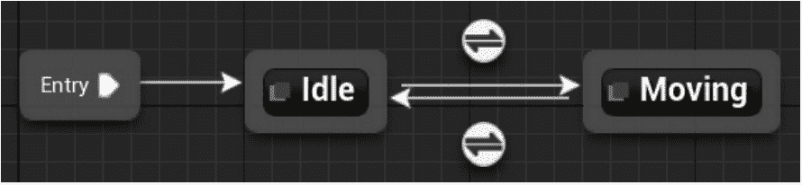

图 17.21 – 状态及其转换

- 6. 双击 `Idle` 状态节点以编辑该状态。从 **资产浏览器** 将 **ThirdPersonIdle** 动画序列拖动到 **动画图** 中。连接 **播放 ThirdPersonIdle** 和 **输出动画姿态** 节点的白色图标：

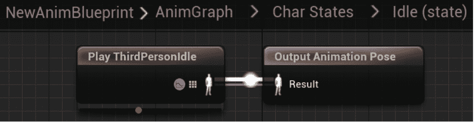

图 17.22 – 待机状态

- 7. 你可以通过单击图表顶部路径中屏幕的名称来在 AnimGraph 状态屏幕之间切换。此路径称为面包屑。在面包屑中单击 Char States，然后双击 Moving 状态。

- 8. 从资产浏览器将 ThirdPerson_IdleRun_2D 混合空间拖动到 **动画图** 中。从 Speed 输入引脚拖出一条线并添加一个 **获取 Speed** 节点。连接 ThirdPerson_IdleRun_2D 和 **输出动画姿态** 节点的白色图标：

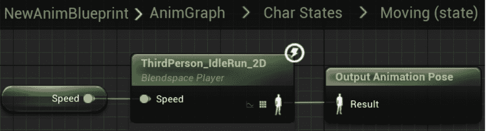

图 17.23 – 移动状态

- 9. 我们的下一步是指定转换规则。返回到 Char States 图表。转换规则图标与转换箭头一起创建：

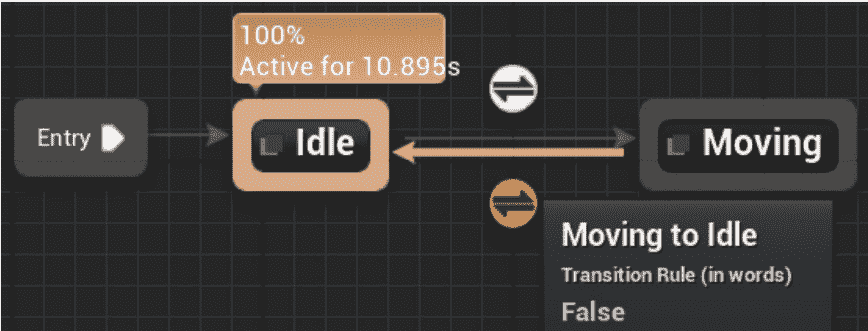

图 17.24 – 转换规则图标

- 10. 双击顶部的 **待机到移动转换规则**。当结果节点接收到 True 值时，将发生转换。在我们的示例，如果 Speed 大于 5.0，则动画将从 待机 状态更改为 移动 状态。向图表添加这些节点：

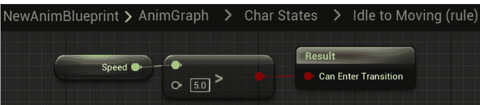

图 17.25 – 待机到移动规则

- 11. 返回到 Char States 图表并双击 **移动到待机转换规则**。添加节点以检查 Speed 是否小于 5.0。如果为 True，则动画将从 移动 状态更改为 待机 状态：

图 17.26 – 移动到空闲规则

- 12. 编译动画蓝图并返回到 Char States 图表。你可以在 Anim Preview Editor 中修改 Speed 变量的值，以查看状态之间的转换。

- 13. 保存并关闭动画蓝图编辑器。

对状态机的介绍到此结束，现在我们可以使用更复杂的状态机了。

### 导入动画入门包

在接下来的章节中，我们将使用动画入门包，因为它提供了更多可用的动画。

按照以下步骤导入动画入门包：

- 1. 打开 Epic Games 启动器，进入 Unreal Engine | 库 | 资源库。搜索动画入门包并单击添加到项目按钮：

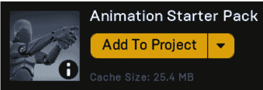

图 17.27 – 将动画入门包添加到项目中

注意

如果您未安装动画入门包，请按照第 9 章《利用人工智能构建智能敌人》中的说明进行安装。

- 2. 选择您为本章创建的项目。名为 `AnimStarterPack` 的文件夹将添加到项目的 `Content` 文件夹中。

- 3. 在关卡编辑器的视口中查找并删除关卡中的 **第三人称角色** 实例。我们将使用动画入门包中的角色。

- 4. 打开位于 `Content > ThirdPersonBP > Blueprints` 文件夹中的 `ThirdPersonGameMode` 蓝图。该蓝图将作为仅数据蓝图打开。

- 5. 在 **类** 中，将 **默认 Pawn 类** 更改为 **Ue4ASP_Character**，它是动画入门包的角色蓝图：

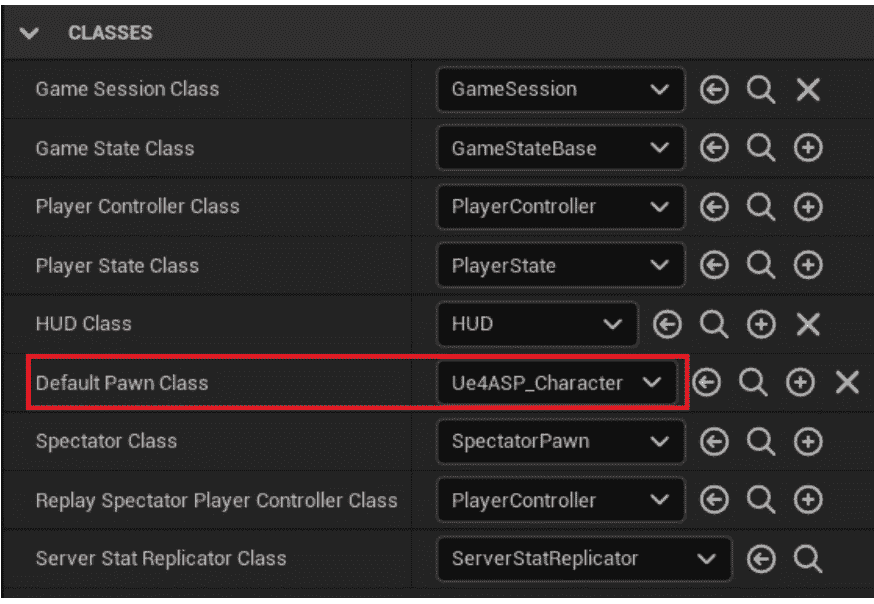

图 17.28 – 在游戏模式蓝图中更改默认 Pawn 类

- 6. 编译、保存并关闭 `ThirdPersonGameMode` 蓝图。

- 7. 打开位于 `Content > AnimStarterPack` 文件夹中的 `Ue4ASP_Character` 蓝图。

- 8. 我们需要在游戏中隐藏胶囊体组件。在 **组件** 面板中，单击 **胶囊体组件** **(碰撞圆柱体) (继承)**。在 **详细信息** 面板中，在 **渲染** 类别下，勾选 **游戏中隐藏** 属性：

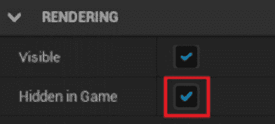

图 17.29 – 隐藏胶囊体组件

- 9. 编译、保存并关闭 `Ue4ASP_Character` 蓝图。

现在，我们的项目正在使用动画入门包中的角色，我们将开始修改其使用的动画。

### 添加动画状态

在本节中，我们将修改动画入门包中包含的角色蓝图和动画蓝图。我们将向状态机添加以下状态：

- 俯卧
- 从俯卧到站立
- 从站立到俯卧

我们将使用章节开始时创建的项目，该项目正在使用动画入门包中的角色。

首先，让我们创建将在示例中使用的输入映射。我们将创建两个输入动作：**蹲伏** 和 **俯卧**。

注意

**蹲伏** 输入动作的动作和状态已在动画入门包中存在。要使 **蹲伏** 工作，我们只需在 **项目设置** 中添加一个名为 **蹲伏** 的动作映射。

按照以下步骤创建输入映射：

- 1. 单击工具栏最右侧的 **设置** 按钮，然后选择 **项目设置...** 选项：

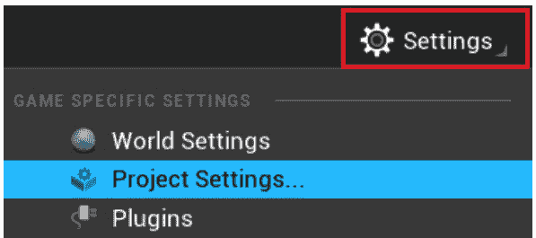

图 17.30 – 访问项目设置

- 2. 在弹出窗口的左侧，查找 **引擎** 类别并选择 **输入** 选项。

- 3. 在 **引擎** 类别的 **输入设置** 菜单中，您将在 **绑定** 类别下看到名为 **动作映射** 和 **轴映射** 的两个部分。单击 **动作映射** 部分中的 > 符号以显示现有映射。

- 4. 单击 **动作映射** 旁边的 + 号两次以添加两个动作映射：

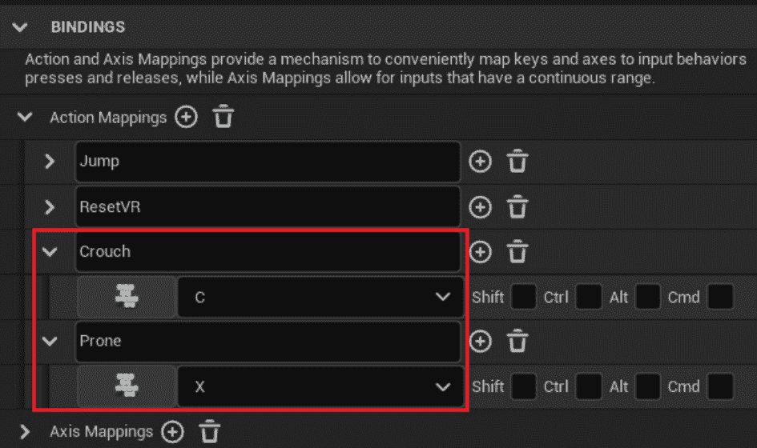

图 17.31 – 添加动作映射

- 5. 将第一个动作命名为 `Crouch`。单击键盘图标并按 C 键，将该键映射到您的 **蹲伏** 事件。

- 6. 将第二个动作命名为 `Prone`。单击键盘图标并按 X 键，将该键映射到您的 **俯卧** 事件。

关闭窗口时会保存更改。我们现在可以在角色蓝图中实现 **俯卧** 事件了。

### 修改角色蓝图

我们将向动画入门包的角色蓝图添加一个名为 **俯卧中** 的布尔变量。该变量将指示角色是否处于俯卧状态。**俯卧** 事件将切换 **俯卧中** 变量的值。

我们还将在角色俯卧时禁用其移动。

按照以下步骤修改角色蓝图：

- 1. 打开位于 Content > AnimStarterPack 文件夹中的 Ue4ASP_Character 蓝图。

- 2. 在 **我的蓝图** 面板中，创建名为 **俯卧中** 的布尔类型变量：

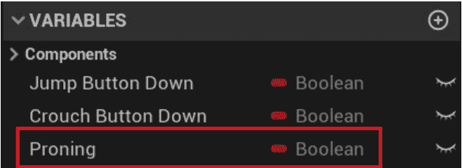

图 17.32 – 创建俯卧中布尔变量

- 3. 在 EventGraph 的空白处右键单击并搜索 prone。选择 Prone 事件以放置节点：

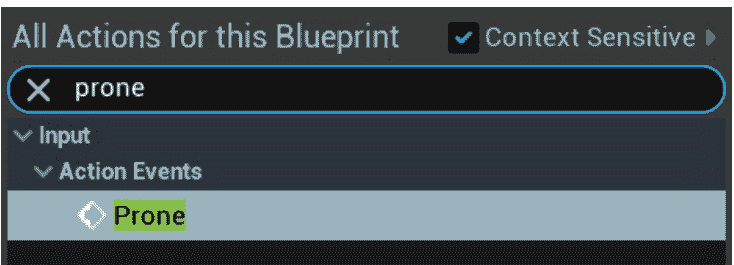

图 17.33 – 添加输入动作俯卧事件

- 4. 在 Prone 事件附近添加 Set Proning 节点和 Get Proning 节点。另外，添加 Not 布尔节点并连接它们，如下图所示。Not 布尔节点将在每次执行 Prone 事件时切换 Proning 变量的布尔值 (true/false)：

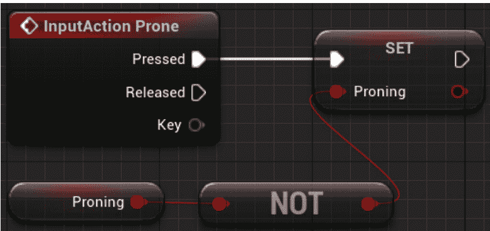

图 17.34 – 输入动作俯卧事件的节点

- 5. 现在，我们将在角色俯卧时禁用其移动。在 **事件图** 中查找 **输入轴 移动前方** 事件。按住 *Alt* 键并单击 **输入轴 移动前方** 的白色执行引脚以断开连接。

- 6. 添加 **分支** 节点和 **获取 俯卧中** 节点并连接它们，如下图所示。**添加移动输入** 节点仅当 **俯卧中** 变量的值为 **假** 时才会执行：

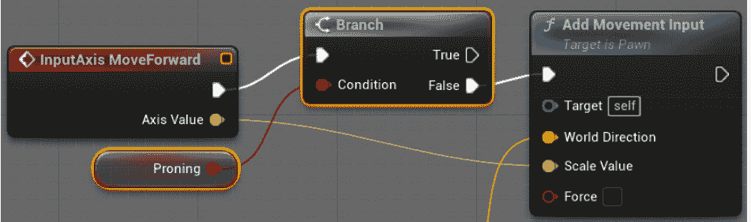

图 17.35 – 俯卧时禁用前后移动

- 7. 在 **输入轴 移动右侧** 事件中重复 *步骤 5* 和 *步骤 6*：

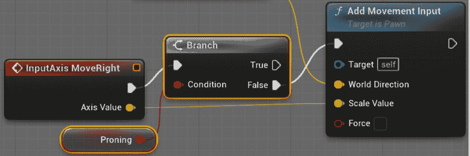

图 17.36 – 俯卧时禁用左右移动

- 8. 在关闭蓝图之前，让我们来看看在哪里将角色蓝图与动画蓝图关联。在 Components 面板中，选择 Mesh (CharacterMesh0) (Inherited)。在 Details 面板中，在 ANIMATION 类别下，Animation Mode 必须设置为 Use Animation Blueprint，且 Anim Class 必须指定正在使用的动画蓝图：

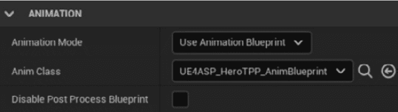

图 17.37 – 指定角色使用的动画蓝图

- 9. 编译、保存并关闭蓝图。

我们已完成角色蓝图的调整。现在，可以向动画蓝图添加俯卧动画状态了。

### 修改动画蓝图

我们还将向动画蓝图添加 **俯卧中** 布尔变量，以便在转换规则中使用它。然后，我们将向状态机添加三个状态。

按照以下步骤修改动画蓝图：

- 1. 双击位于 `Content > AnimStarterPack` 文件夹中的 **UE4ASP_HeroTPP_动画蓝图** 资产以打开动画蓝图编辑器。

- 2. 在 **我的蓝图** 面板中，创建名为 `Proning` 的 **布尔** 类型变量。我们需要在动画蓝图中创建此变量，因为它将在状态转换规则中使用：

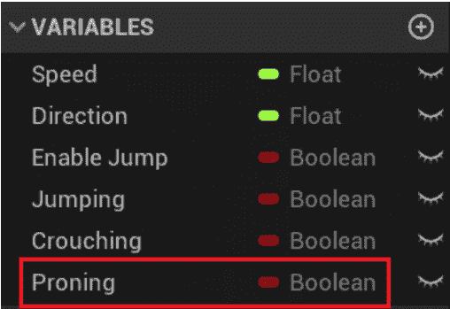

图 17.38 – 在动画蓝图中创建俯卧中变量

- 3. 在 **事件图** 中查找 **事件蓝图更新动画**。在事件结束处，从 **设置 蹲伏** 节点的白色输出引脚拖出一根线并添加 **设置 俯卧中** 节点。

- 4. 从 **转换为 Ue4ASP_Character** 节点的蓝色输出引脚拖出一根线并添加 **获取 俯卧中** 节点。将 **获取 俯卧中** 的输出引脚连接到 **设置 俯卧中** 的输入引脚：

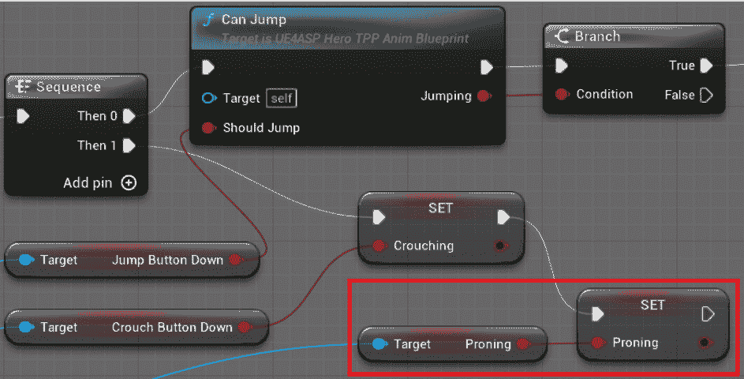

图 17.39 – 更新动画蓝图中的俯卧变量

- 5. 在 My Blueprint 面板中，双击 Locomotion 以打开状态机：

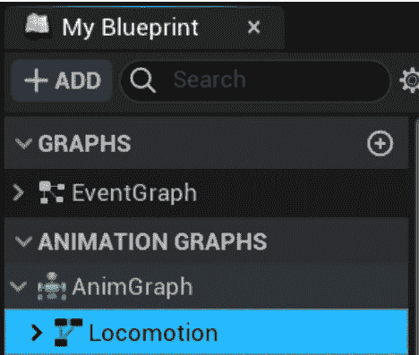

图 17.40 – 打开 Locomotion 状态机

- 6. 以下屏幕截图显示了当前的 Locomotion 状态：

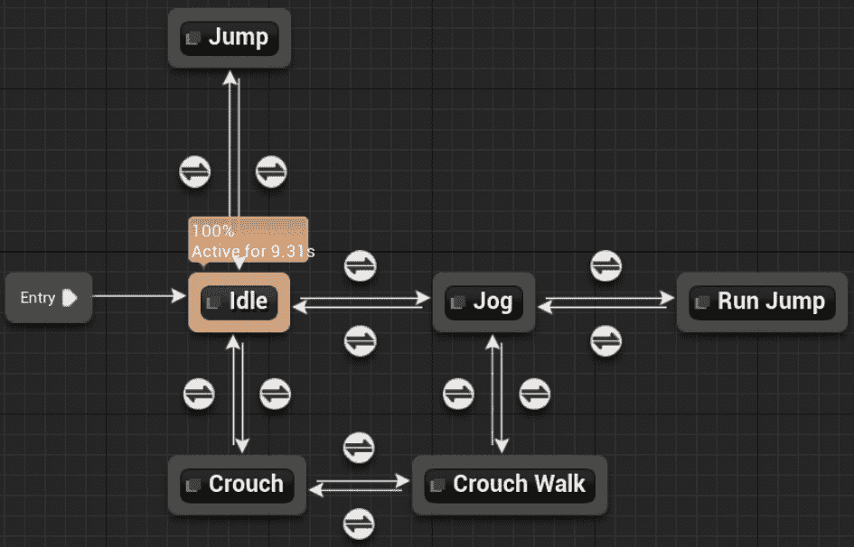

图 17.41 – Locomotion 状态

- 7. 我们将添加与俯卧动作相关的三个状态：

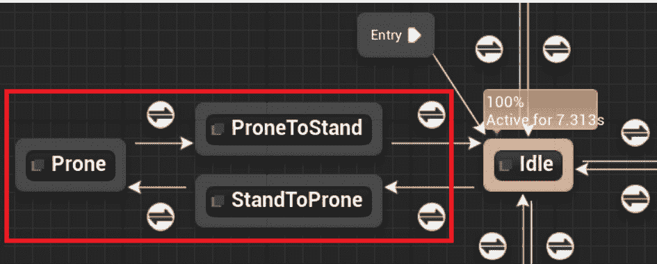

图 17.42 – 新建的状态

- 8. 我们将开始创建这三个状态。在图表上右键单击并选择 **添加状态**。将状态重命名为 `standToProne`。再创建两个状态，名称为 `Prone` 和 `ProneToStand`。

- 9. 从 **空闲** 状态节点的外边框拖出一条线并连接到 **站立到俯卧** 状态节点的外边框。从 **站立到俯卧** 的外边框再拖出一条线并连接到 **俯卧** 状态节点的外边框。

- 10. 从 **俯卧** 状态节点的外边框拖出一条线并连接到 **俯卧到站立** 状态节点的外边框。从 **俯卧到站立** 的外边框再拖出一条线并连接到 **空闲** 状态节点的外边框。

- 11. 双击 **俯卧** 状态节点以编辑该状态。将 **资产浏览器** 中的 **俯卧待机** 动画序列拖放到 **动画图** 中：

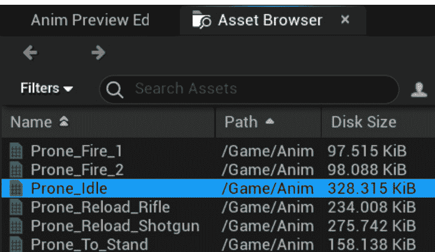

图 17.43 – 使用 `Prone_Idle` 动画序列

- 12. 连接 **播放俯卧待机** 和 **输出动画姿势** 节点的白色图标：

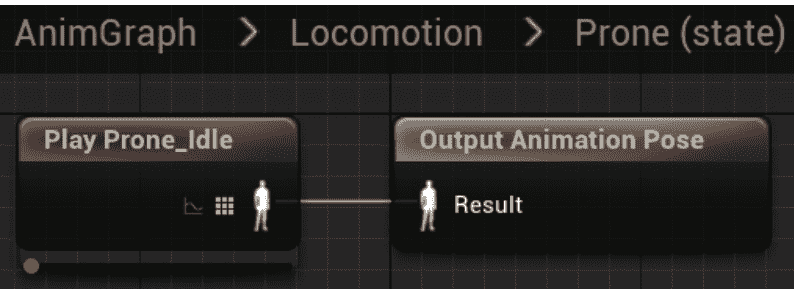

图 17.44 – 俯卧状态

- 13. 单击导航路径中的 Locomotion 以返回上一个图表，并双击 ProneToStand 状态。

- 14. 将 Prone_To_Stand 动画序列从资产浏览器拖放到动画图中。连接播放 Prone_To_Stand 和输出动画姿势节点的白色图标：

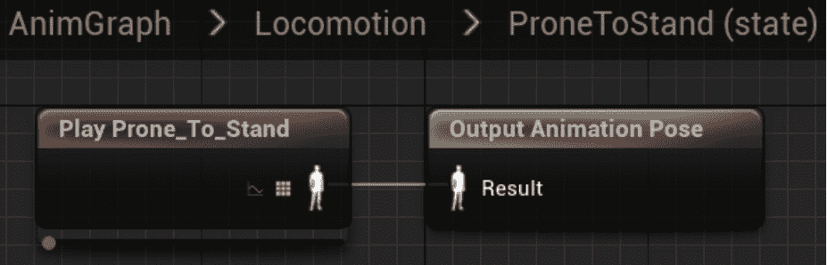

图 17.45 – 俯卧到站立状态

- 15. 选择播放 Prone_To_Stand 节点。在详情面板中，取消勾选循环动画属性，因为此动画应仅运行一次：

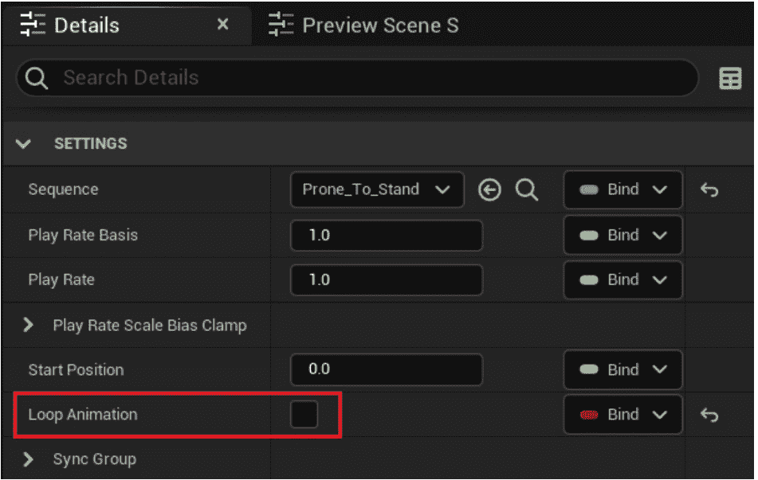

图 17.46 – 取消勾选循环动画属性

- 16. 单击导航路径中的 **移动** 以返回上一个图表，并双击 **站立到俯卧** 状态。

- 17. 将 **站立到俯卧** 动画序列从 **资产浏览器** 拖放到 **动画图** 中。连接 **播放站立到俯卧** 和 **输出动画姿势** 节点的白色图标：

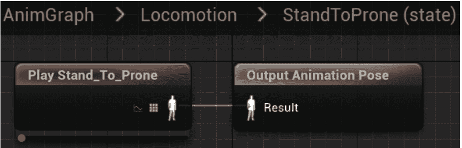

图 17.47 – 站立到俯卧状态

- 18. 选择 **播放站立到俯卧** 节点。在 **详情** 面板中，取消勾选 **循环动画** 属性。

- 19. 单击导航路径中的 **移动** 以返回 **移动** 图表。

我们已完成每个状态内容的定义。现在，只需定义各状态的过渡规则即可。

### 定义过渡规则

在新状态中，我们将使用两种类型的过渡规则。在从 **空闲** 和 **俯卧** 状态出发的过渡规则中，我们将检查 **俯卧** 变量的值。在从 **站立到俯卧** 和 **俯卧到站立** 出发的过渡规则中，当动画结束时发生过渡。

定义过渡规则的步骤如下：

- 1. 双击 **空闲到站立到俯卧** 过渡规则图标。添加 **获取俯卧状态** 节点并连接到 **结果** 节点：

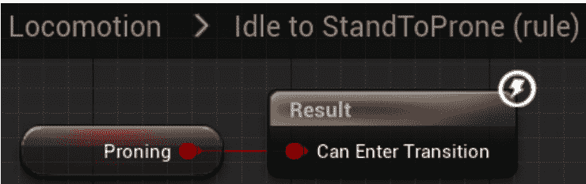

图 17.48 – 空闲到站立到俯卧规则

- 2. 返回 **移动** 图表并双击 **站立到俯卧到俯卧** 过渡规则图标。在图表上右键单击并添加 **剩余时间（比例）**（**站立到俯卧**）节点。

- 3. 从 **返回值** 拖出一条线并添加 **小于** 节点。在 **小于** 节点的底部参数中输入 `0.1`。将 **小于** 节点的输出连接到 **结果** 节点：

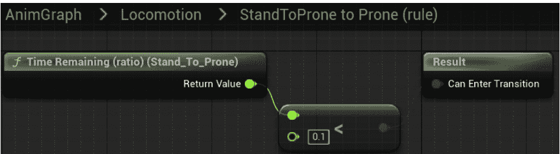

图 17.49 – 站立到俯卧到俯卧规则

- 4. 返回 **移动** 图表并双击 **俯卧到俯卧到站立** 过渡规则图标。添加 **获取俯卧状态** 节点和 **非布尔值** 节点。按以下屏幕截图所示连接节点：

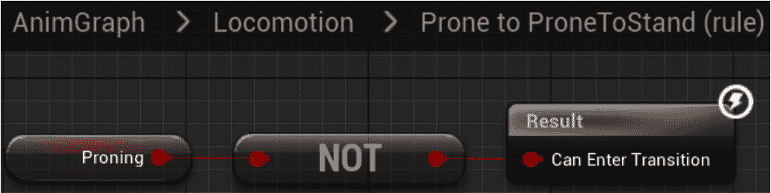

图 17.50 – 俯卧到俯卧到站立规则

- 5. 返回 **移动** 图表并双击 **俯卧到站立到空闲** 过渡规则图标。在图表上右键单击并添加 **剩余时间（比例）（俯卧到站立）** 节点。

- 6. 从 **返回值** 拖出一条线并添加 **小于** 节点。在 **小于** 节点的底部参数中输入 `0.1`。将 **小于** 节点的输出连接到 **结果** 节点：

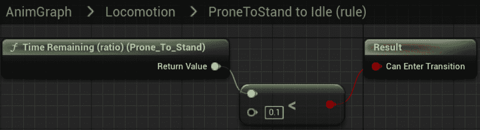

图 17.51 – 俯卧到站立到空闲规则

- 7. 编译、保存并关闭动画蓝图。

- 8. 单击关卡编辑器的 **播放** 按钮。使用 *C* 键蹲下和 *X* 键俯卧：

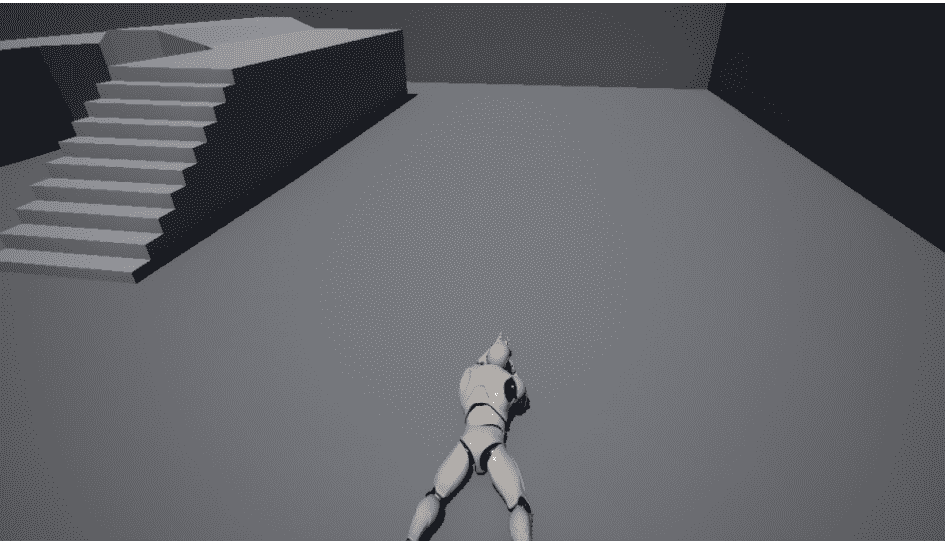

图 17.52 – 按 X 键俯卧

动画蓝图具有特定工具，允许您通过将动画拆分为状态来控制复杂动画。动画蓝图的一大优势是将项目中的动画逻辑与游戏逻辑分离。

### 摘要

本章介绍了一些动画概念，重点介绍了动画蓝图。我们查看了动画编辑器、骨架、骨骼网格、动画序列和混合空间。

本章展示了如何使用动画蓝图的 **事件图** 和 **动画图**。我们还学习了如何在 **动画图** 中创建状态机。

我们还看到了一个将状态添加到动画入门包中的角色的实际示例。

在下一章，我们将学习如何创建可在整个项目中使用的蓝图库和组件。

### 测验

- 1. 混合空间允许基于参数混合动画。

- a. 正确

- b. 错误

- 2. 动画蓝图具有 **动画图** 但没有 **事件图**。

- a. 正确

- b. 错误

- 3. **输出姿势** 节点需要是动画图的最终节点。

- a. 正确

- b. 错误

- 4. 状态机是一个独立的辅助资产，包含一组固定的命名常量。

- a. 正确

- b. 错误

- 5. 从一个状态到另一个状态的转换由过渡规则控制。

- a. 正确

- b. 错误
