## 第 18 章：创建蓝图库和组件

在本章中，您将学习如何创建具有通用功能的蓝图宏和函数库，这些功能可在整个项目中使用。本章将更详细地介绍组件的概念。我们还将学习如何创建具有封装行为的 Actor 组件和具有基于位置行为的 Scene 组件。

本章涵盖的主题：

- 蓝图宏和函数库
- 创建 Actor 组件
- 创建 Scene 组件

在本章结束时，您将创建一个用于模拟掷骰子的蓝图函数库、一个用于管理经验点数和升级的 Actor 组件，以及一个围绕 Actor 旋转的 Scene 组件。

### 蓝图宏和函数库

有时，在项目中，您会发现某个宏或函数可以在多个蓝图中使用。虚幻编辑器允许您创建蓝图宏库来收集您希望在所有蓝图之间共享的宏。同样，您可以创建蓝图函数库来在所有蓝图之间共享实用函数。

创建蓝图函数库和蓝图宏库的菜单选项位于创建时出现的蓝图子菜单中。


一个资产：

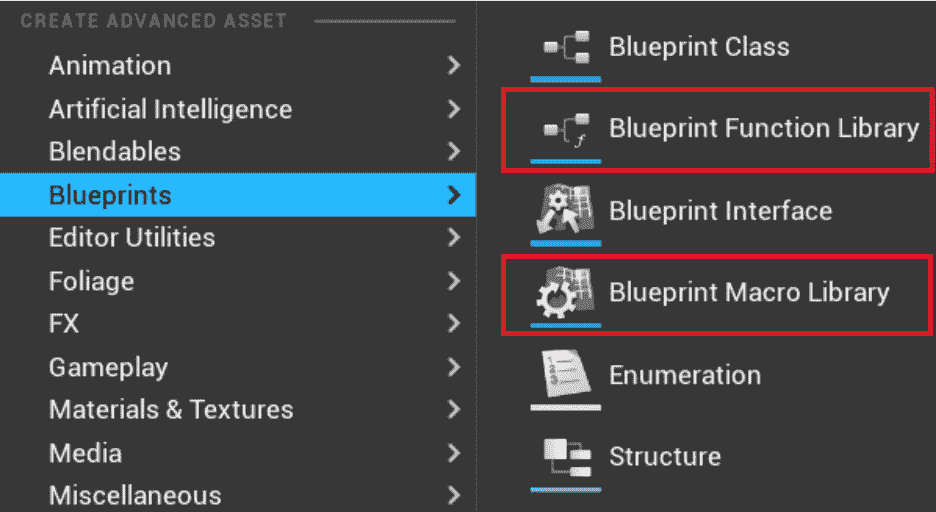

图 18.1 – 创建蓝图宏和函数库的菜单选项

创建蓝图宏库时，需要选择一个父类。该库中的宏将可以访问所选父类的变量和函数，但宏库只能由所选父类的子类使用。在大多数情况下，选择 Actor 类将是最佳选项。

让我们创建一个蓝图函数库，以实际了解如何在所有蓝图之间共享函数。

### 蓝图函数库示例

我们将创建一个名为 BP_DiceLibrary 的蓝图函数库，用于骰子掷骰，包含三个函数 – RollOneDie、RollTwoDice 和 RollThreeDie。所有函数都具有名为 NumberOfFaces 的相同输入参数，并返回每个骰子的结果及其总和。

此蓝图函数库可用于创建数字桌游或基于掷骰子的 **RPG（角色扮演游戏）**。

按照以下步骤创建蓝图函数库：

- 1. 基于 **第三人称** 模板和启动内容创建项目。
- 2. 在内容浏览器中，访问 `Content` 文件夹。在文件夹列表旁边的空白处右键单击，并选择 **新建文件夹** 选项。将文件夹命名为 `Chapter18`。我们将使用此文件夹存储本章的资产。
- 3. 打开刚才创建的 **Chapter18** 文件夹，然后单击内容浏览器中的 **添加** 按钮，将鼠标悬停在 **蓝图** 上方，并选择 **蓝图函数库** 选项：

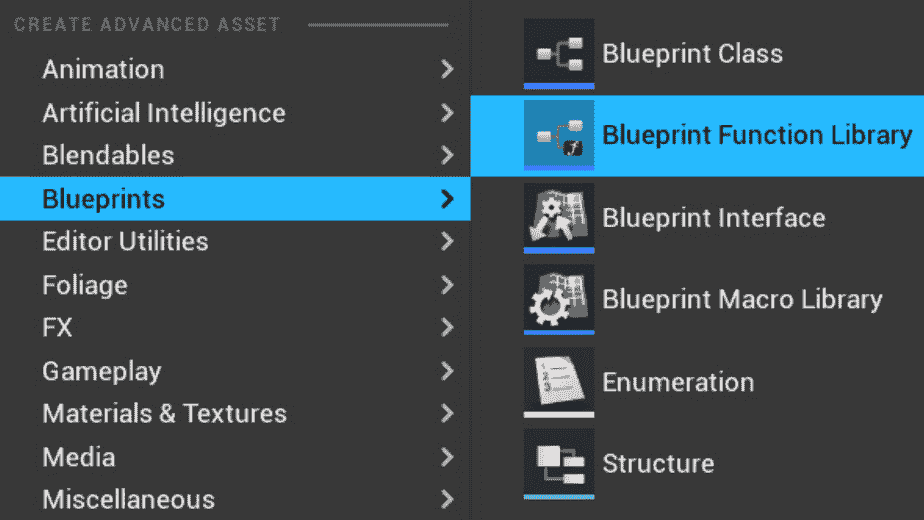

图 18.2 – 创建蓝图函数库

- 4. 将蓝图命名为 `BP_DiceLibrary`，并双击它打开蓝图编辑器。
- 5. 蓝图编辑器将打开一个默认函数。将函数重命名为 `RollOneDie`。
- 6. 在 **详情** 面板中，添加一个名为 `NumberOfFaces` 的 **整数** 类型输入参数。单击 > 符号以展开选项，并将 **默认值** 设置为 6：

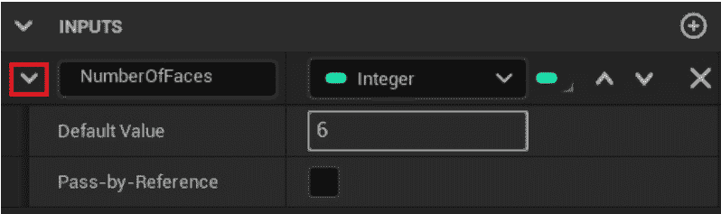

图 18.3 – 创建输入参数并设置默认值

- 7. 在 **详情** 面板中，添加一个名为 `Result` 的 **整数** 类型输出参数：

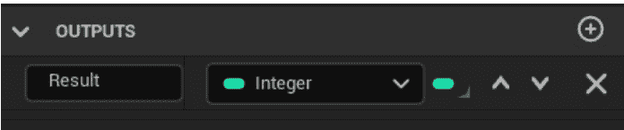

图 18.4 – 创建输出参数

- 8. 在事件图中，添加以下屏幕截图中的节点。这些节点用于检查 **骰子面数** 是否大于 1。验证输入参数是良好的做法，可避免出现难以查找的意外错误：

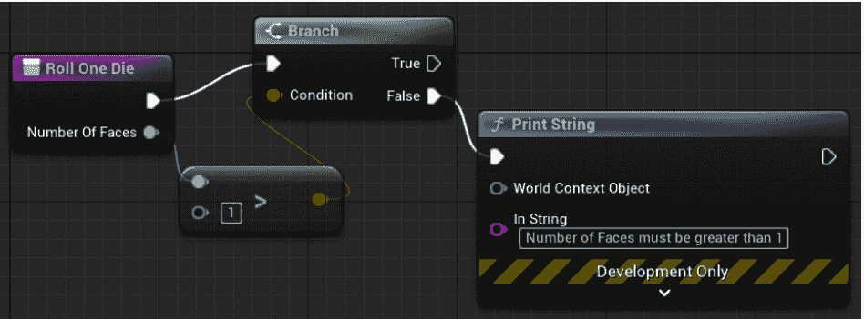

图 18.5 – 检查骰子面数是否大于 1

### 注意

可以通过将面数设置为 2 来模拟抛硬币。

- 9. 在事件图中右键单击并添加一个范围内随机整数节点。该节点返回大于或等于 Min 且小于或等于 Max 的随机整数值。在 Min 输入参数中输入 1：

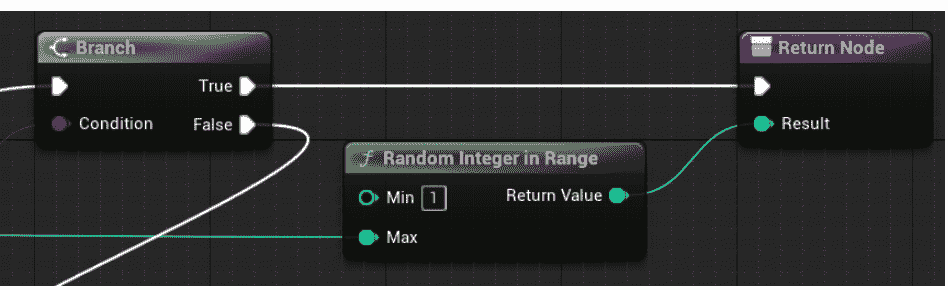

图 18.6 – 使用范围内随机整数节点

- 10. 从骰子面数参数拖出一条线并连接到 Max 输入引脚。将返回值输出引脚连接到结果引脚。将分支节点的 真 引脚连接到返回节点的空白引脚。

- 11. 让我们创建蓝图函数库的第二个函数。在 **我的蓝图** 面板中，单击 **函数** 右侧的 + 图标：

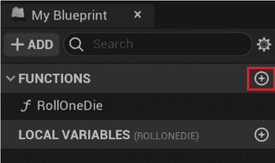

图 18.7 – 创建另一个函数

- 12. 将函数命名为 `RollTwoDice`。创建一个名为 `NumberOfFaces` 的 **整数** 类型输入参数。单击 > 符号以展开选项，并将 **默认值** 设置为 6。

- 13. 创建名为 `Sum`、`Die1` 和 `Die2` 的输出参数，全部为 **整数** 类型：

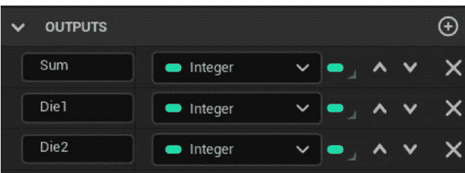

图 18.8 – 创建输出参数

- 14. 在事件图中，我们将对 **RollOneDie** 函数执行相同的验证，以检查 **骰子面数** 是否大于 1。添加图 18.5 中的节点。您也可以访问 **RollOneDie** 函数，选择并复制验证节点，然后粘贴到 **RollTwoDice** 函数中。

- 15. 向事件图中添加两个 **范围内随机整数** 节点。在两个节点的 **Min** 输入参数中输入 `1`：

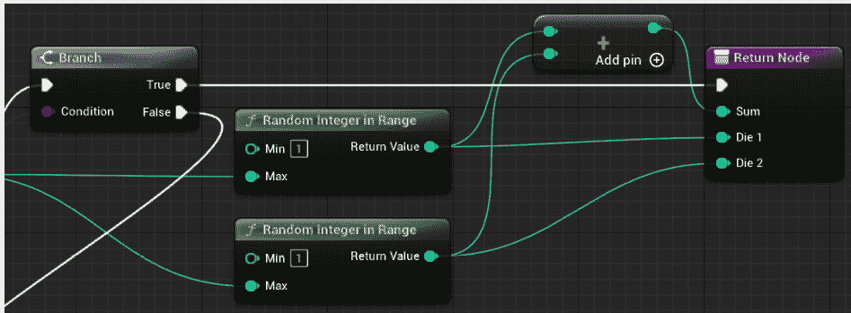

图 18.9 – 生成两个随机整数

- 16. 从 **骰子面数** 参数拖出线并连接到两个节点的 **Max** 输入引脚。

- 17. 将第一个 **范围内随机整数** 节点的 **返回值** 输出引脚连接到 **Die1** 引脚。将第二个 **范围内随机整数** 节点的 **返回值** 输出引脚连接到 **Die2** 引脚。

- 18. 在事件图中右键单击并创建一个 **添加** 节点。将第一个 **范围内随机整数** 节点的 **返回值** 输出引脚连接到 **添加** 节点的顶部输入引脚。将第二个 **范围内随机整数** 节点的 **返回值** 输出引脚连接到 **添加** 节点的底部输入引脚。

- 19. 将 **添加** 节点的输出引脚连接到 **返回节点** 的 **总和** 引脚。将 **分支** 节点的 **真** 引脚连接到 **返回节点** 的空白引脚。

- 20. 编译并保存蓝图。

按照这些步骤，我们已完成库中第二个函数的创建。在下一节中，我们将创建第三个函数，其做法与第二个函数不同，以展示另一种示例。然后，我们将测试我们的蓝图函数库。

### 创建第三个函数并进行测试

在第三个函数中，我们将使用局部变量来存储临时值。局部变量仅在定义它们的函数内可见。局部变量的值将在函数执行结束时丢弃。

另一个需要注意的重要点是，我们将仅使用一个范围内随机整数节点来生成三个骰子的值。

以下是创建第三个函数并进行测试的步骤：

- 1. 在我的蓝图 面板中，单击 函数 右侧的 + 图标。将函数命名为 RollThreeDice：

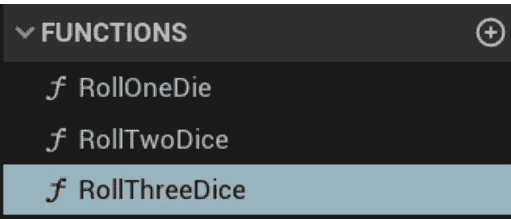

图 18.10 – 创建库的第三个函数

- 2. 创建一个名为 NumberOfFaces 的整数 类型输入参数。单击 > 符号以展开选项，并将 默认值 设置为 6。

- 3. 创建名为 Sum、Die1、Die2 和 Die3 的输出参数，全部为整数类型：

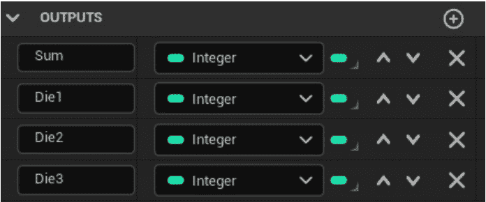

图 18.11 – 创建输出参数

- 4. 我的蓝图 面板显示正在编辑的函数的局部变量。单击 局部变量 右侧的 + 图标，以创建 Die1Var、Die2Var 和 Die3Var 的 整数 类型局部变量。局部变量的名称必须与函数的输入参数和输出参数的名称不同：

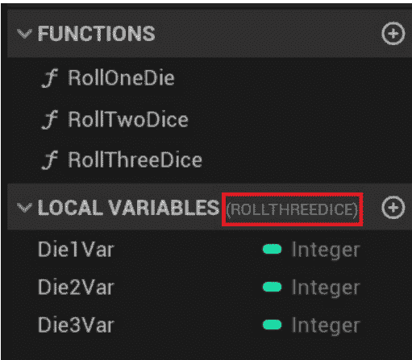

图 18.12 – 创建局部变量

- 5. 在事件图中，我们将对 RollOneDie 函数执行相同的验证，以检查 骰子面数 是否大于 1。添加图 18.5 中的节点。

- 6. 向事件图中添加一个范围内随机整数节点。在 Min 输入参数中输入 1。添加 SET Die1Var、SET Die2Var 和 SET Die3Var 节点，并按照以下屏幕截图所示将它们连接起来：

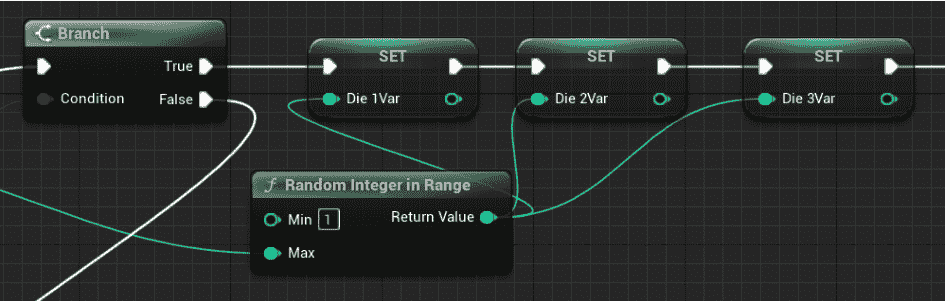

图 18.13 – 生成三个随机整数

### 注意

执行每个 SET 节点时，范围内随机整数节点都会再次执行以生成一个新随机数。

- 7. 将 SET Die3Var 节点的空白输出引脚连接到返回节点的空白引脚。添加 GET Die1Var、GET Die2Var、GET Die3Var 和 添加 节点。单击 添加引脚 + 以添加 添加 节点的第三个引脚。按照以下屏幕截图所示将节点连接起来：

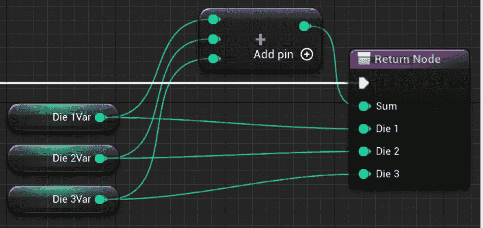


Figure 18.14 – 返回局部变量的值

- 8. 编译并保存蓝图。关闭蓝图编辑器。

- 9. 我们将使用关卡蓝图来测试我们的 **BP_DiceLibrary** 函数库。单击工具栏上的 **Blueprints** 按钮并选择 **Open Level Blueprint**:

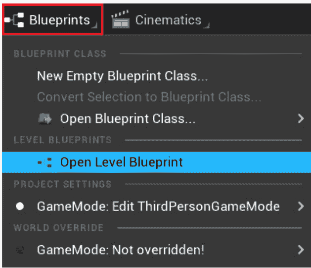

Figure 18.15 – 打开关卡蓝图

- 10. 在靠近 **Event BeginPlay** 节点的 EventGraph 上单击右键。搜索 `roll`。我们的蓝图库函数将在 **BP Dice Library** 类别中提供:

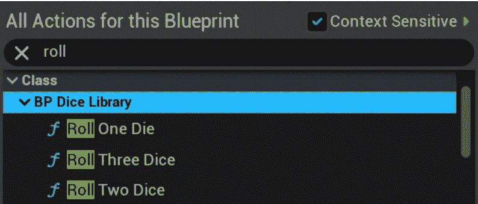

Figure 18.16 – BP Dice Library 函数可用于项目中的所有蓝图

- 11. 选择 **Roll Three Dice** 函数，并将 **Event BeginPlay** 的白色引脚连接到 **Roll Three Dice** 节点的白色输入引脚。在 EventGraph 上单击右键并添加 **Format Text** 和 **Print Text** 节点:

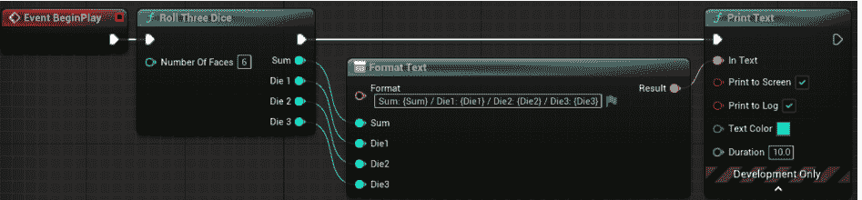

Figure 18.17 – 测试 Roll Three Dice 函数

- 12. 在 **Format Text** 节点的 **Format** 参数中添加以下表达式:

```
Sum: {Sum} / Die1: {Die1} / Die2: {Die2} / Die3: {Die3}
```

- 13. { } 之间的名称将转换为 **Format Text** 节点的输入参数。有关此节点的更多信息，请参见 _第15章，蓝图技巧_。

- 14. 将 **Roll Three Dice** 节点的输出白色引脚连接到 **Print Text** 的输入白色引脚。将 **Roll Three Dice** 的其他输出引脚连接到 **Format Text** 的等效输入引脚。

- 15. 将 **Format Text** 的 **Result** 引脚连接到 **Print Text** 的 **In Text** 引脚。单击 **Print Text** 节点底部的小箭头以展开可选参数。将 **Duration** 设置为 10.0 秒。

- 16. 编译、保存并关闭关卡蓝图编辑器。

- 17. 单击关卡编辑器的 **Play** 按钮。掷三个骰子的结果将在屏幕上打印：

```
Sum: 8 / Die1: 4 / Die2: 1 / Die3: 3
```

Figure 18.18 – 掷三个骰子的结果

`BP_DiceLibrary` 的函数可用于任何蓝图。同样的理念也适用于蓝图宏库，但我们不是创建函数，而是创建宏。有关宏和函数之间差异的更多信息，请参见 [第2章，使用蓝图进行编程]。

在下一节中，我们将看到通过创建 Actor 组件来共享常见功能的另一种方法。

### 创建 Actor 组件

创建 Actor 蓝图时，我们通常会添加带有封装功能的组件，这些组件即开即用，例如 **Projectile Movement**、**Static Mesh** 和 **Collision** 组件。我们也可以使用蓝图创建自己的 Actor 组件。

创建蓝图时，在 **Pick Parent Class** 面板中，有两个 **COMMON** 类可用于创建组件，即 **Actor Component** 和 **Scene Component**:

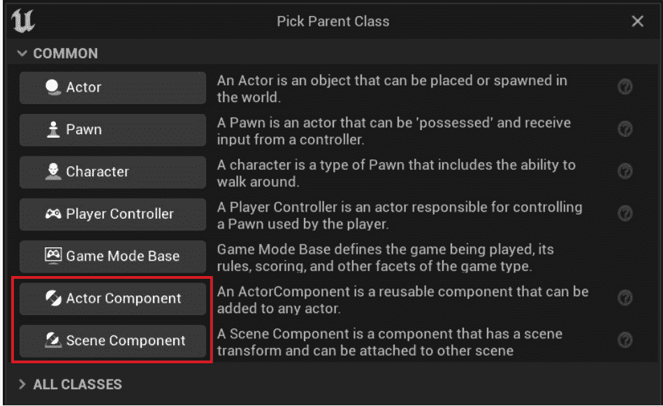

Figure 18.19 – 创建 Actor 组件和 Scene 组件

Scene Component 是 Actor Component 的子类，具有 Transform 结构（位置、旋转和缩放）。由于有 Transform，Scene Component 可以附加到另一个 Scene Component。我们将在下一节中探讨 Scene Component。

在 EventGraph 中脚本化组件时，可以使用 **Get Owner** 节点获取正在使用该组件的 Actor 的引用:

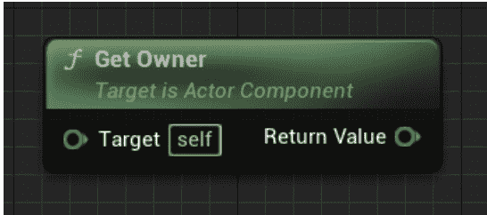

Figure 18.20 – 获取正在使用该组件的 Actor 的引用

我们将创建一个名为 `BP_ExpLevelComp` 的 Actor 组件，它具有一个整数数组，用于存储升级所需的每个级别的经验点数。该组件将具有一个名为 `IncreaseExperience` 的函数，用于增加经验点数并检查 Actor 是否应该升级。

如果要为 Actor 添加升级管理器，只需将 `BP_ExpLevelComp` 组件添加到 Actor，调整升级所需经验点数的数组，并使用组件的函数即可。

以下是创建我们 Actor 组件的步骤：

- 1. 在内容浏览器中单击 **Add** 按钮，然后选择 **Blueprint Class** 选项。

- 2. 在下一屏幕中，选择 **Actor Component** 作为父类。将蓝图命名为 `BP_ExpLevelComp` 并双击它打开蓝图编辑器。请注意，**Components** 选项卡未显示，因为我们不能在组件内添加组件。

- 3. 在 **My Blueprint** 面板中，创建 **Integer** 类型的 **CurrentLevel** 和 **CurrentXP** 变量:

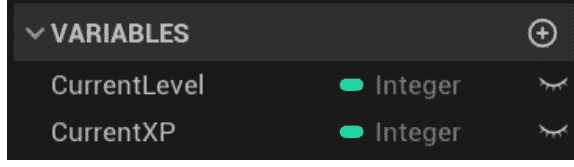

Figure 18.21 – 创建组件的变量

### 注意

缩略语 **XP** 表示 **经验点数**。

- 4. 创建另一个名为 `ExpLevel` 的 **Integer** 类型变量。在 **Details** 面板中，单击 **Variable Type** 右侧的图标并选择 **Array**:

| 变量名称 | ExpLevel |
| 变量类型 | Integer |
| 实例可编辑 | |

Figure 18.22 – 创建一个数组以存储每个级别所需的经验点数

- 5. 编译蓝图。在 Default Value 中，向 ExpLevel 数组添加 10 个元素。在 BP_ExpLevelComp 中，CurrentLevel 变量将用作 ExpLevel 数组的索引。为每个元素键入以下屏幕截图中的值:

| 索引 | 值 |
|---|---|
| [ 0 ] | 0 |
| [ 1 ] | 100 |
| [ 2 ] | 200 |
| [ 3 ] | 400 |
| [ 4 ] | 800 |
| [ 5 ] | 1200 |
| [ 6 ] | 1600 |
| [ 7 ] | 2000 |
| [ 8 ] | 2500 |
| [ 9 ] | 3000 |

Figure 18.23 – 每个级别所需的经验点数

- 6. 我们将创建一个名为 **IncreaseExperience** 的函数来增加经验并升级。但首先，我们将创建两个宏来简化函数图表。

- 7. 在 **My Blueprint** 面板中，创建一个名为 `CanLevelUp` 的宏:


Figure 18.24 – 创建 CanLevelUp 宏

- 8. 在 **Details** 面板中，创建宏的输入和输出参数:

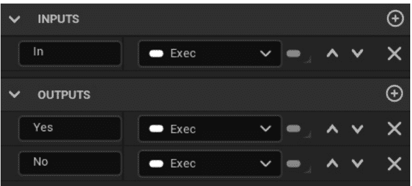

Figure 18.25 – 创建 CanLevelUp 宏的输入和输出参数

- 9. 将以下屏幕截图中的节点添加到 **CanLevelUp** 宏。此宏通过将 **Current Level** 变量与 **Exp Level** 数组的 **LAST INDEX** 进行比较，来检查 Actor 是否处于最大级别:

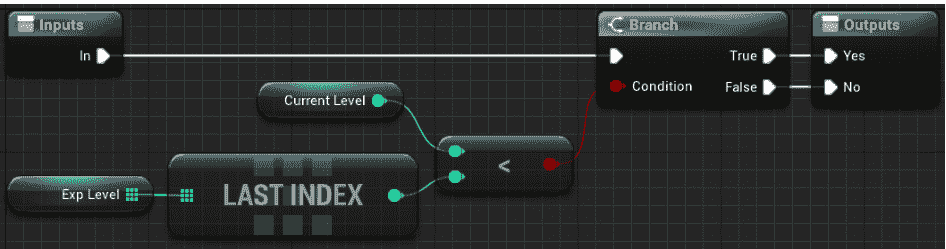

Figure 18.26 – CanLevelUp 宏的节点

- 10. 在 **My Blueprint** 面板中，创建另一个名为 **XpReachesNewLevel** 的宏。在 **Details** 面板中，创建与 *Figure 18.25* 中显示的 **CanLevelUp** 宏相同的输入和输出参数。

- 11. 将以下屏幕截图中的节点添加到 **XpReachesNewLevel** 宏。我们需要使用 **Exp Level** 数组的 **Get (a copy)** 节点，因为我们只需要读取数组中存储的值。此宏检查 **Current XP** 是否等于或大于 **Exp Level** 数组中下一个索引存储的经验点数:

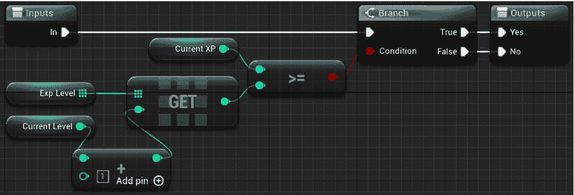

Figure 18.27 – XpReachesNewLevel 宏的节点

- 12. 编译蓝图。在 **My Blueprint** 面板中，创建一个名为 `IncreaseExperience` 的函数:

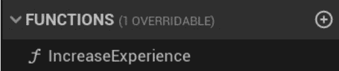

Figure 18.28 – 创建 IncreaseExperience 函数

- 13. 在 **Details** 面板中，创建函数的输入和输出参数:

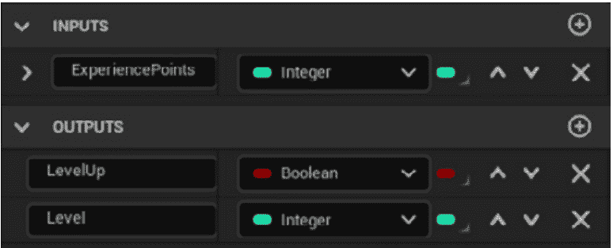

Figure 18.29 – 创建输入和输出参数

- 14. 在 **My Blueprint** 面板中，创建一个名为 `LevelUpVar` 的 **Boolean** 类型局部变量。此局部变量将存储函数返回的值，指示 **Actor** 是否已升级。Boolean 变量的默认值为 `False`:

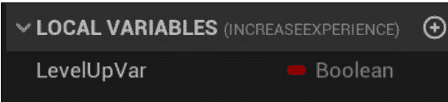

Figure 18.30 – 创建局部变量

- 15. 下一个屏幕截图显示了 **Increase Experience** 函数的第一部分。该函数正在使用我们创建的两个宏。添加屏幕截图中的节点，并将 **Can Level Up** 的 **No** 输出引脚连接到 **Return Node** 的白色输入引脚:


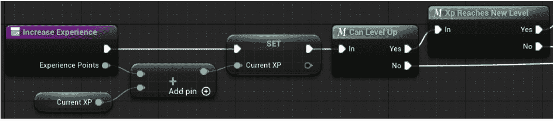

图 18.31 – IncreaseExperience 函数的第一部分

- 16. 下一个截图显示 IncreaseExperience 函数的第二部分。如果 Xp Reaches New Level 宏的 Yes 引脚被执行，则我们将 Current Level 变量加 1，并将 Level Up Var 变量设置为 True。添加截图中的节点并编译蓝图：

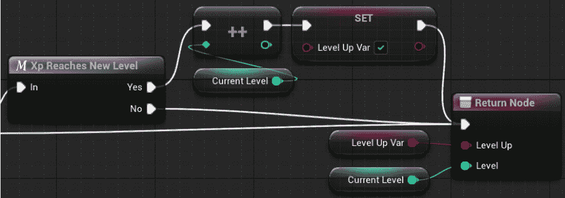

图 18.32 – IncreaseExperience 函数的第二部分

- 17. 编译蓝图并关闭蓝图编辑器。

我们已完成 BP_ExpLevelComp 组件。要测试它，需要将该组件添加到角色。

### 测试角色组件

我们将 BP_ExpLevelComp 组件添加到 ThirdPersonCharacter，并使用定时器每秒增加经验值。每次 ThirdPersonCharacter 升级时，会在屏幕上打印一条消息。

按照以下步骤测试 `BP_ExpLevelComp` 组件：

- 1. 打开位于 `Content > ThirdPersonBP > Blueprints` 文件夹中的 `ThirdPersonCharacter` 蓝图。

- 2. 在 **组件** 面板中，单击 **添加** 按钮并搜索 `level`。选择 **BP 经验等级组件**：

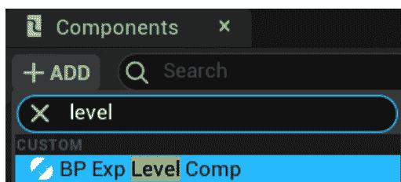

图 18.33 – 添加 BP 经验等级组件

- 3. 在 **详情** 面板中，可以修改 **经验等级** 数组的默认值或添加更多数组元素：

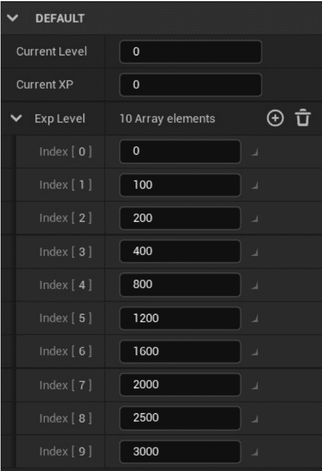

图 18.34 – 经验等级数组可编辑

- 4. 在事件图表中，添加 **开始游戏** 节点和 **通过事件设置定时器** 节点。我们将使用定时器每秒调用一次事件，以增加经验值。将 Time 参数设置为 1.0 并勾选 Looping 参数：

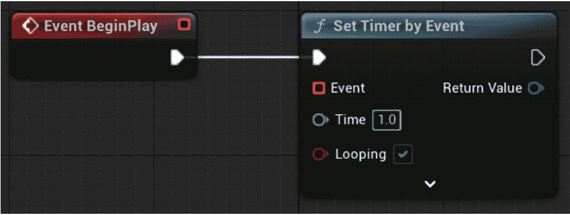

图 18.35 – 创建每秒运行一次事件的定时器

- 5. 从 **通过事件设置定时器** 节点的 Event 引脚拖出一条线，并在上下文菜单中选择 **添加自定义事件**。将自定义事件重命名为 GainXP。此事件将运行 BP 经验等级组件的 **增加经验值** 函数，并将 100 作为输入参数传递。这些是我们要添加到 GainXP 事件的节点：

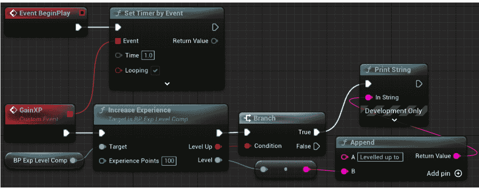

图 18.36 – GainXP 自定义事件的节点

- 6. 从组件面板中拖动 BP 经验等级组件并将其放置到事件图表中以创建 **获取** 节点。

- 7. 从 **获取 BP 经验等级组件** 节点拖出一条线并添加 **增加经验值** 函数节点。在 Experience Points 参数中输入 100。

- 8. 添加一个 **分支** 节点以检查角色是否升级。向事件图表添加 **打印字符串** 和 **追加** 节点，并按照 *图 18.36* 所示连接它们。当连接不同类型的引脚时，转换节点会自动创建。

- 9. 在 **追加** 节点的 **A** 引脚中，输入 `Leveled up`（末尾带一个空格）。此节点将使用 **A** 和 **B** 引脚的值创建一个 `String`。

- 10. 编译蓝图并单击关卡编辑器的 **开始游戏** 按钮。每次 `ThirdPersonCharacter` 升级时，屏幕上都会打印一条消息：


图 18.37 – 角色升级时在屏幕上打印消息

如果需要在屏幕上显示角色的经验值和等级，可以使用 BP 经验等级组件的 **获取当前经验值** 和 **获取当前等级** 节点获取这些值：

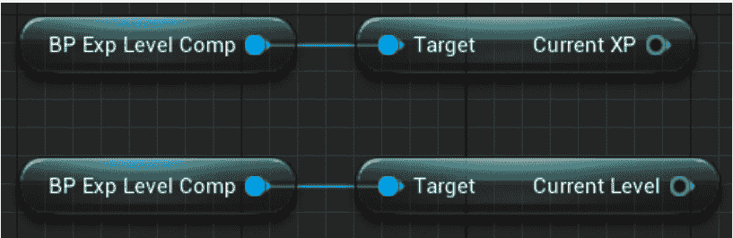

图 18.38 – 获取当前经验值和当前等级变量

我们已学习如何创建角色组件。下一步是创建场景组件以将其他组件附加到它。

### 创建场景组件

我们将创建一个名为 BP_CircularMovComp 的场景组件，它将围绕角色旋转。然后，我们将静态网格组件附加到 BP_CircularMovComp 组件以模拟旋转护盾。

按照以下步骤创建场景组件：

- 1. 访问本章第一个示例中创建的 Chapter18 文件夹。

- 2. 在内容浏览器中单击 **添加** 按钮，然后选择 **蓝图类** 选项。

- 3. 在下一屏幕中，选择 **场景组件** 作为父类。将蓝图命名为 BP_CircularMovComp 并双击它以打开蓝图编辑器。

- 4. 在 **我的蓝图** 面板中，创建 Float 类型的 RotationPerSecond 和 DeltaAngle 变量：

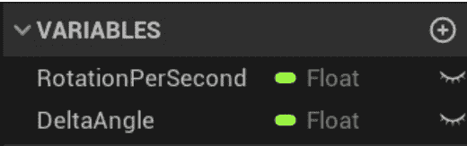

图 18.39 – 创建组件的变量

- 5. 编译蓝图并选择 RotationPerSecond 变量。在 **详情** 面板中，将 **默认值** 设置为 180.0。该值为角度单位，因此该组件将在 2 秒内围绕角色完成一次旋转：

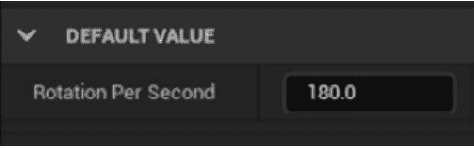

图 18.40 – 设置每秒旋转度数变量的默认值

- 6. 我们将使用 **每帧更新** 为组件创建平滑移动。**每帧更新** 每帧执行一次。它具有 Delta Seconds 参数，用于存储自上次执行 **每帧更新** 以来的时间。我们将用 Delta Seconds 乘以每秒旋转度数来计算 DeltaAngle，即当前帧将旋转的角度值。在事件图表中添加截图中的节点：

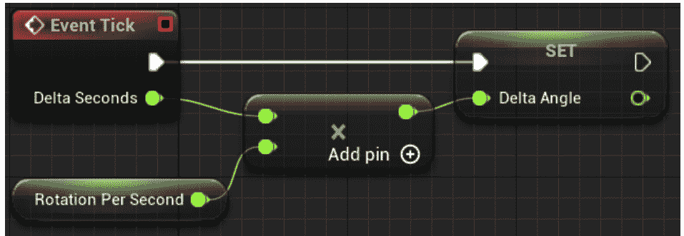

图 18.41 – 计算 Delta Angle 的值

- 7. 下一个截图显示我们将添加到 **每帧更新** 的其他节点。这些节点用于计算并设置场景组件的新相对位置，以及修改局部旋转，使场景组件始终指向旋转中心。需要右键单击 AddLocalRotation 的 Delta Rotation 参数，并选择 **拆分结构体引脚** 以访问 Delta Rotation Z (Yaw) 引脚：

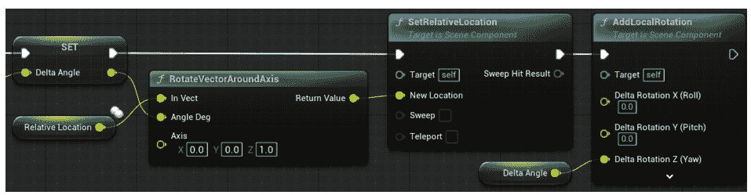

图 18.42 – **每帧更新** 的其他节点

- 8. 编译蓝图。这就是 `BP_CircularMovComp` 的全部功能。下一步是将此组件添加到角色，然后向其附加一个静态网格组件。

- 9. 打开位于 `Content > ThirdPersonBP > Blueprints` 文件夹中的 `ThirdPersonCharacter` 蓝图。

- 10. 在 **组件** 面板中，选择 **胶囊体组件** 以确保我们的场景组件将附加到根组件。单击 **添加** 按钮并搜索 `circular`。选择 **BP_CircularMovComp**：

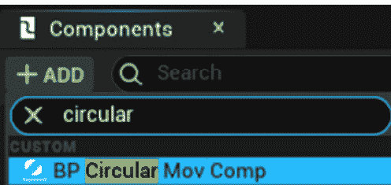

图 18.43 – 添加 BP_CircularMovComp

- 11. 在 **组件** 面板中，选择已添加的 **BP_CircularMovComp** 并单击 **添加** 按钮。选择 **静态网格** 组件将其附加到 **BP_CircularMovComp**。应用于 **BP_CircularMovComp** 的移动和旋转将影响 **静态网格**：

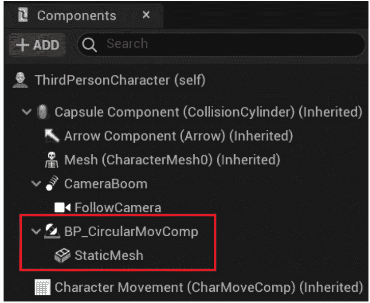

图 18.44 – 将静态网格组件附加到我们的场景组件

- 12. 现在，我们需要配置组件。访问 **视口** 选项卡以便查看下一个更改的结果。在 **组件** 面板中选择 **BP_CircularMovComp**。在 **详情** 面板中，将 **位置** 的 *x*（红色）值设置为 70.0。可以在 **默认** 类别中修改 **每秒旋转度数** 的值：

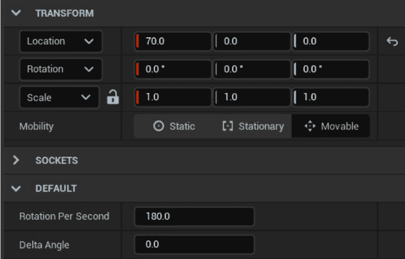

图 18.45 – 设置 BP_CircularMovComp 的相对位置

- 13. 在组件面板中选择静态网格组件。在 **详情** 面板中，将静态网格设置为 Shape_Cube，材质设置为 M_Tech_Hex_Tile_Pulse。可以在 **视口** 选项卡中查看组件。将 **位置** 的 *z*（蓝色）值设置为 -80.0，缩放设置为 x = 0.1、y = 1.0、z = 1.5：

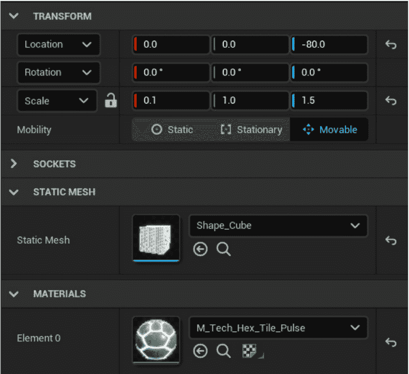

图 18.46 – 设置静态网格组件

- 14. 编译蓝图并单击关卡编辑器的 **开始游戏** 按钮。**BP_CircularMovComp** 将使护盾围绕角色旋转：


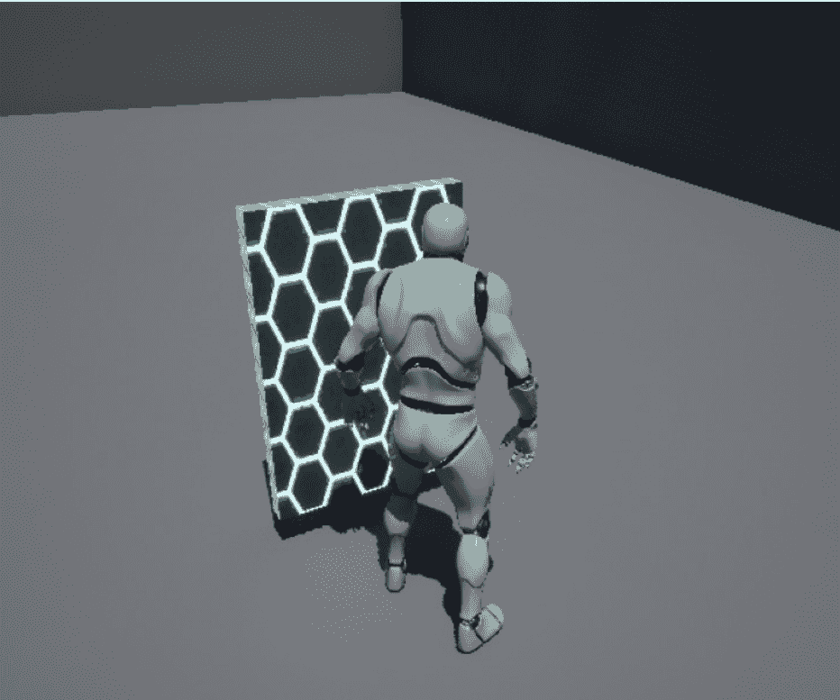

图 18.47 – 角色带有一个旋转盾牌

场景组件用作其他组件的参考位置。你可以通过将场景组件相互附加来创建层次结构。角色需要有一个被指定为 **根** 组件的场景组件。角色的变换由根组件获得。

### 总结

在本章中，我们学习了如何创建可在整个项目中使用的蓝图宏库和函数库。我们创建了一个蓝图函数库来模拟掷骰子。

本章解释了角色组件和场景组件之间的区别。我们学习了如何创建角色组件来管理经验值和升级。

我们还创建了一个围绕角色旋转的场景组件，并向其附加了一个静态网格组件来模拟旋转盾牌。

在下一章中，我们将学习如何使用蓝图的构造脚本来编写程序化生成脚本。我们还将学习如何使用样条工具以及如何创建编辑器实用蓝图。

### 测验

- 1. 蓝图宏库中的宏可以访问父类的变量和函数。
  - a. 正确
  - b. 错误

- 2. 蓝图函数库可以包含函数和宏。
  - a. 正确
  - b. 错误

- 3. 角色组件是场景组件的子类。
  - a. 正确
  - b. 错误

- 4. 在角色组件中，你可以使用 **获取所有者** 节点来获取使用该组件的角色的引用。
  - a. 正确
  - b. 错误

- 5. 场景组件可以直接放置在关卡中。
  - a. 正确
  - b. 错误
