## 第 19 章：程序化生成

在本章中，我们将探讨几种自动生成关卡内容的方法。你可以使用蓝图的构造脚本来编写程序化生成，并使用样条工具定义一条路径，该路径将作为定位实例的参考。此外，你还可以创建编辑器实用蓝图来在编辑模式下操作资产和角色。

在本章中，我们将涵盖以下主题：

- 使用构造脚本进行程序化生成
- 创建蓝图样条
- 编辑器实用蓝图

本章结束时，你将知道如何使用构造脚本生成关卡内容，以及如何创建蓝图样条在预定义路径上放置角色。你还将能够创建在编辑器中运行的蓝图函数。

### 使用构造脚本进行程序化生成

程序化生成是一种使用脚本而不是手动操作来创建关卡内容的方法。它可以用于避免关卡编辑中的重复性工作。我们在蓝图中用于程序化生成的主要工具是构造脚本。

我们在第3章“面向对象编程与游戏性框架”中了解了如何使用构造脚本，以允许关卡设计器在关卡编辑器中更改蓝图的静态网格。

一个用于程序化生成的有用组件是 **实例化静态网格** 组件。该组件经过优化，可在关卡中渲染多个相同网格的副本。

### 注意

还有 **分层实例化静态网格** 组件，它与 **实例化静态网格** 类似，但在网格具有 **细节层次 (LOD)** 时很有用。

我们在组件中设置静态网格，并使用 **添加实例** 函数使用 **实例变换** 在关卡上添加实例：

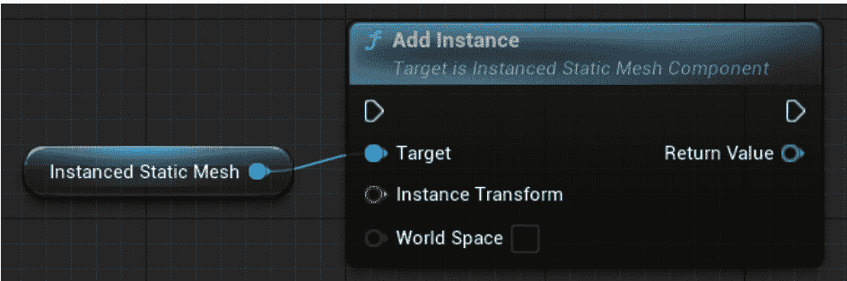

图 19.1 – 添加实例函数

我们将创建一个名为 `BP_ProceduralMeshes` 的蓝图来查看程序化生成的实际效果。该蓝图将在关卡上添加静态网格实例行。关卡设计器将能够指定使用的静态网格、行数以及每行的实例数量。

我们将使用 **空白** 项目，因为我们将能够在本章蓝图的关卡编辑器中看到结果。

按照以下步骤创建程序化生成蓝图：

- 1. 创建带有入门内容的 **空白** 项目：

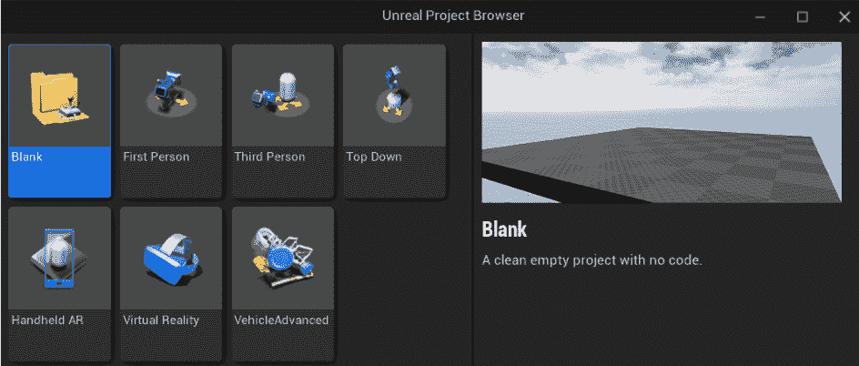

图 19.2 – 创建空白项目

- 2. 在内容浏览器中，访问 `Content` 文件夹。在文件夹列表旁边的空白处右键单击并选择 **新建文件夹** 选项。将文件夹命名为 `Chapter19`。我们将使用此文件夹存储本章的资产。

- 3. 打开你刚创建的 **Chapter19** 文件夹，然后单击内容浏览器中的 **添加** 按钮，并选择 **蓝图类** 选项。

- 4. 在下一屏幕中，选择 **角色** 作为父类。将蓝图命名为 `BP_ProceduralMeshes` 并双击它以打开蓝图编辑器。

- 5. 在 **我的蓝图** 面板中，创建一个名为 `StaticMeshVar` 的变量。单击 **变量类型** 并搜索 `static mesh`。将鼠标悬停在 **静态网格** 上并选择 **对象引用**：

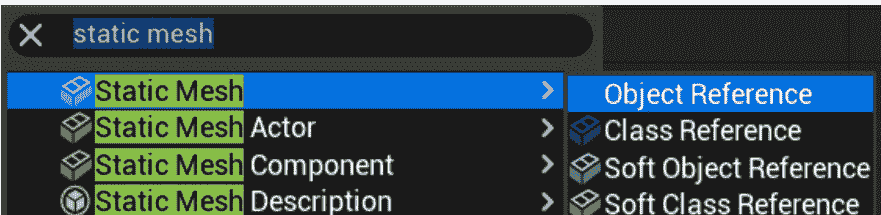

图 19.3 – 创建引用静态网格的变量

- 6. 在 **详情** 面板中，检查 **实例可编辑** 属性，以便我们可以在关卡编辑器中更改实例使用的静态网格：

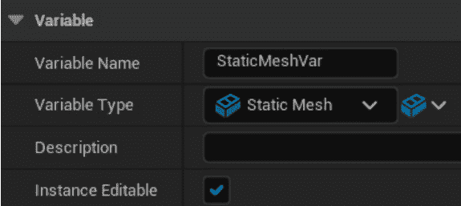

图 19.4 – StaticMeshVar 变量

- 7. 编译蓝图。在 **静态网格变量** 的默认值中，选择 SM_Chair 静态网格：

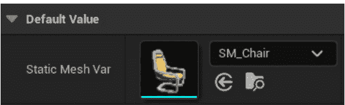

图 19.5 – 选择生成中使用的默认静态网格

- 8. 在 **我的蓝图** 面板中，创建以下屏幕截图中显示的变量。它们都必须设置为 **实例可编辑**。你可以单击眼睛图标使变量可实例编辑：

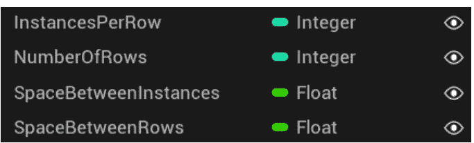

图 19.6 – 生成脚本中使用的变量

- 9. 编译蓝图，并为变量设置以下默认值：
  - InstancesPerRow: 1
  - NumberOfRows: 1
  - SpaceBetweenInstances: 100.0
  - SpaceBetweenRows: 150.0

- 10. 在组件面板中，单击 + 添加按钮并搜索 instance。选择实例化静态网格：

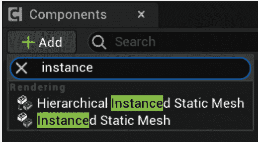

图 19.7 – 添加实例化静态网格组件

我们有这个蓝图所需的变量和组件。现在，让我们来处理脚本。

#### 创建向关卡添加实例的脚本

此蓝图的脚本将全部在构造脚本中完成。按照以下步骤创建程序化生成脚本：

- 1. 单击构造脚本选项卡：

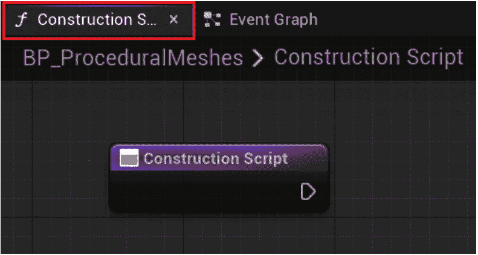

图 19.8 – 访问构造脚本

- 2. 在 **我的蓝图** 面板中，创建一个名为 *实例位置 X* 的 **浮点** 类型局部变量：

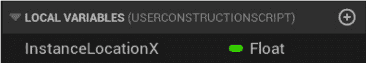

图 19.9 – 创建局部变量

- 3. 下一张屏幕截图显示了我们将添加到 **构造脚本** 的节点的第一部分。我们获取 **静态网格变量** 变量中存储的 **静态网格**，并将其设置为由 **实例化静态网格** 组件使用。**For 循环** 将根据 **行数** 重复。我们通过将 **For 循环** 的当前 **索引** 乘以 **行间距** 来计算每行的 **实例位置 X**：

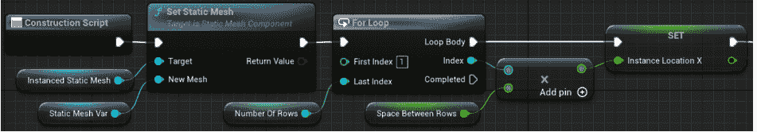

图 19.10 – 构造脚本的第一部分

- 4. 在构造脚本节点附近添加获取实例化静态网格和获取静态网格变量节点。

- 5. 从获取实例化静态网格节点拖出一条线并添加设置静态网格节点。从获取静态网格变量节点拖出一条线并将其连接到新网格参数。

- 6. 从设置静态网格节点的白色输出引脚拖出一条线并添加一个 For 循环节点。在第一个索引参数中输入 1。从最后一个索引参数拖出一条线并添加一个获取行数节点。

- 7. 添加一个获取行间距节点。从索引输出节点拖出一条线并添加一个乘法节点。从获取行间距拖出一条线并将其连接到乘法节点的底部引脚。该引脚将从整数转换为浮点数。

- 8. 从循环体输出引脚拖出一条线并添加一个设置实例位置 X 节点。将乘法节点的输出引脚连接到实例位置 X 的输入引脚。

- 9. 下一张屏幕截图显示了我们将添加到构造脚本的节点的第二部分。第二个 For 循环节点将根据每行实例数重复。添加实例节点将在关卡上添加一个静态网格实例。当前行中所有实例的相对位置 X 将相同。相对位置 Y 是通过将第二个 For 循环节点的当前索引乘以实例间距来计算的：

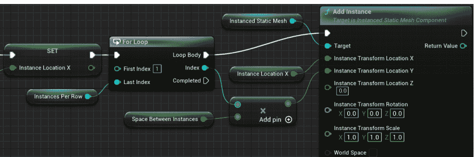

图 19.11 – 构造脚本的第二部分

- 10. 从 Set Instance Location X 的白色输出引脚拖出一条线，并添加 For Loop 节点。在 First Index 参数中输入 1。从 Last Index 参数拖出一条线，并添加 Get Instances Per Row 节点。

- 11. 添加 Get Space Between Instances 节点。从 Index 输出节点拖出一条线，并添加 Multiply 节点。从 Get Space Between Instances 拖出一条线，并将其连接到 Multiply 节点的底部引脚。该引脚将从整数转换为浮点数。

- 12. 添加 Get Instanced Static Mesh 节点。从其输出引脚拖出一条线，并添加 Add Instance 节点。将 Loop Body 输出引脚连接到 Add Instance 节点的白色输入引脚。

- 13. 右键单击 Instance Transform 参数并选择 Split Struct Pin。右键单击 Instance Transform Location 参数并再次选择 Split Struct Pin。

- 14. 从 Instance Transform Location X 拖出一条线，并添加 Get Instance Location X 节点。

- 15. 将 Multiply 节点的输出引脚连接到 Instance Transform Location Y 的输入引脚。

- 16. 编译蓝图并关闭蓝图编辑器。从内容浏览器中拖动 **BP_ProceduralMeshes** 并将其放置在关卡中。

- 17. 在关卡编辑器的 **详情** 面板中，将每行实例数设置为 10，将行数设置为 10：

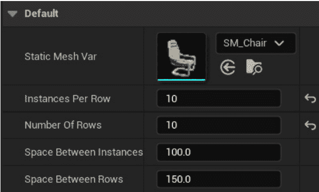

图 19.12 – 在关卡上设置 BP_ProceduralMeshes 属性

- 18. 程序化生成的结果可以在下一个截图中看到：

图 19.13 – 生成 10 行 10 列的椅子

- 19. 我们可以使用同一个 **BP_ProceduralMeshes** 实例生成种植园。在关卡编辑器的 **详情** 面板中，将 **静态网格变量** 更改为 `SM_Bush`，并将 **实例间距** 设置为 `300.0`，将 **行间距** 设置为 `300.0`：

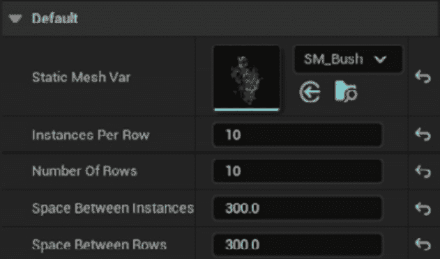

图 19.14 – 修改关卡上的 BP_ProceduralMeshes 属性

- 20. 这是使用新参数的程序化生成结果：

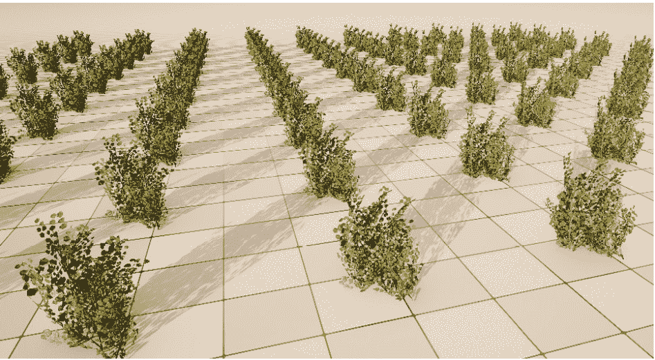

图 19.15 – 生成种植园

可以看出，参数的微小变化会产生非常不同的结果。这个示例只是可用程序化生成功能的冰山一角。

在下一节中，我们将学习如何沿路径生成实例。

### 创建蓝图样条

样条是一种用于定义曲线的特殊数学函数。蓝图样条组件可用于定义路径以在关卡中移动 Actor。我们还可以获取路径沿线的位置来放置实例。我们可以通过添加、平移和旋转样条点，在关卡编辑器中编辑样条。

下一个截图显示了样条组件的三个常用函数：

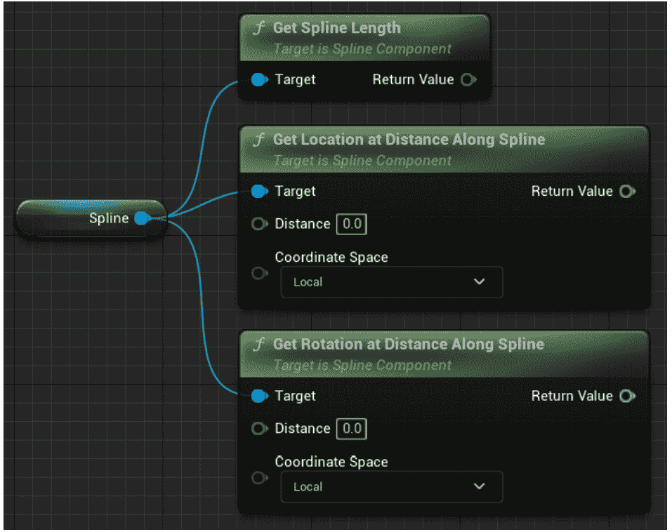

图 19.16 – 样条组件的一些函数

### 函数描述如下：

- Get Spline Length：此函数返回一个浮点数值，表示样条的长度。
- Get Location at Distance Along Spline：此函数将距离作为输入参数，并返回样条中找到的位置。坐标空间可以是本地（相对）或世界。
- Get Rotation at Distance Along Spline：与前一个函数的思路相同，但它返回旋转。

我们将创建一个名为 BP_SplinePlacement 的蓝图，用于沿样条添加静态网格实例。关卡设计师可以在关卡编辑器中编辑样条，并指定实例之间的间距。

### 创建蓝图的步骤如下：

- 1. 在内容浏览器中单击添加按钮，并选择蓝图类选项。在下一个屏幕上，选择 Actor 作为父类。为蓝图命名 BP_SplinePlacement 并双击它以打开蓝图编辑器。
- 2. 在 **我的蓝图** 面板中，创建一个名为 StaticMeshVar 的变量。单击变量类型并搜索静态网格。将鼠标悬停在静态网格上并选择对象引用。单击眼图标以使变量可实例编辑。
- 3. 编译蓝图。在静态网格变量的 **默认值** 中，选择 SM_FieldArrow 静态网格：

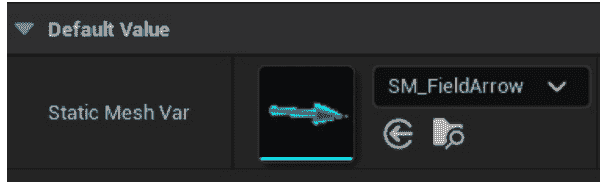

图 19.17 – 选择生成中使用的默认静态网格

### 注意

如果 `SM_FieldArrow` 静态网格未出现，请单击内容浏览器的设置图标，并选择 **显示引擎内容**。

- 4. 在 **我的蓝图** 面板中，创建一个名为 `SpaceBetweenInstances` 的 **浮点数** 类型变量。单击眼图标，将该变量设置为 **实例可编辑**。

- 5. 编译蓝图，并将 `SpaceBetweenInstances` 的 **默认值** 设置为 `100.0`。

- 6. 在 **组件** 面板中，单击 + **添加** 按钮并搜索 `spline`。选择 **样条** 组件：

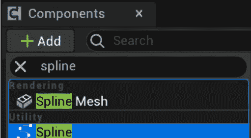

图 19.18 – 添加样条组件

- 7. 在 **组件** 面板中选择 DefaultSceneRoot 并添加一个 InstancedStaticMesh 组件：

图 19.19 – BP_SplinePlacement 使用的组件

- 8. 我们将创建一个宏来简化构建脚本图表。在 **我的蓝图** 面板中，创建一个名为 `CalculateNumberOfInstances` 的宏：

图 19.20 – 创建宏

- 9. 在 **详情** 面板中，创建一个名为 `Number Of Instances` 的 **输出** 参数，类型为 **整数**：

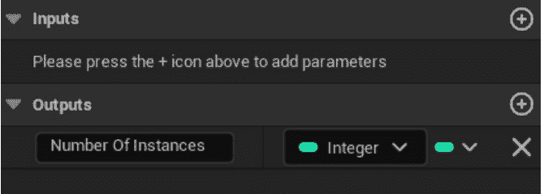

图 19.21 – 创建输出参数

- 10. 在 `CalculateNumberOfInstances` 宏中添加以下截图所示的节点。该宏获取样条长度，并将其除以 **实例间距** 以查找沿样条将创建的实例数量。**向下取整** 节点用于将除法结果向下取整：

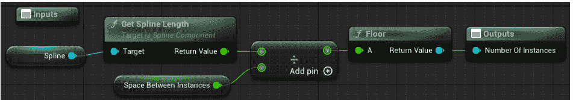

图 19.22 – CalculateNumberOfInstances 宏的节点

### 注意

如果除法的分母为零，将生成除以零的运行时错误。蓝图中有一个名为 Safe Divide 的节点，如果分母为零，它将返回零，但不会生成错误。

- 11. 单击构建脚本选项卡。下一个截图显示了要添加到构建脚本的第一部分节点。我们获取存储在静态网格变量中的静态网格，并将其设置为实例化静态网格组件将使用的静态网格。For Loop 将根据实例数量重复。我们通过将 For Loop 的当前索引乘以实例间距来计算沿样条的距离：

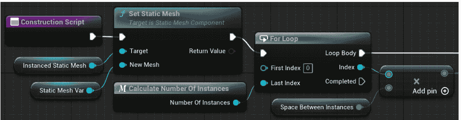

图 19.23 – 构建脚本的第一部分

- 12. 以下截图显示了要添加到构建脚本的第二部分节点。Add Instance 节点将使用从样条接收到的位置和旋转在关卡中添加静态网格实例。请注意，坐标空间必须为本地，并且需要右键单击 Instance Transform 参数并选择 Split Struct Pin：

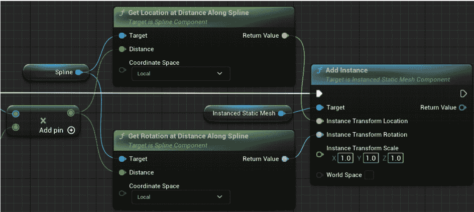

图 19.24 – 构建脚本的第二部分

- 13. 编译蓝图并关闭蓝图编辑器。从内容浏览器中拖动 **BP_SplinePlacement** 并将其放置在关卡中。
- 14. 样条在关卡编辑器中由白色点表示的样条点组成。您可以选择一个样条点对其进行平移和旋转。要添加样条点，请右键单击样条并选择 **在此处添加样条点**：

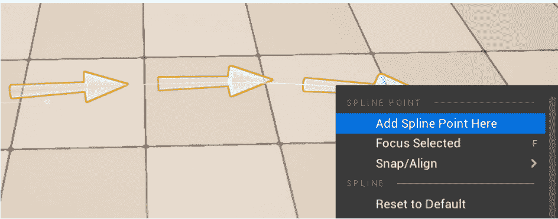

图 19.25 – 添加样条点

- 15. 您可以通过添加、平移和旋转样条点来创建路径。静态网格实例将沿样条添加：

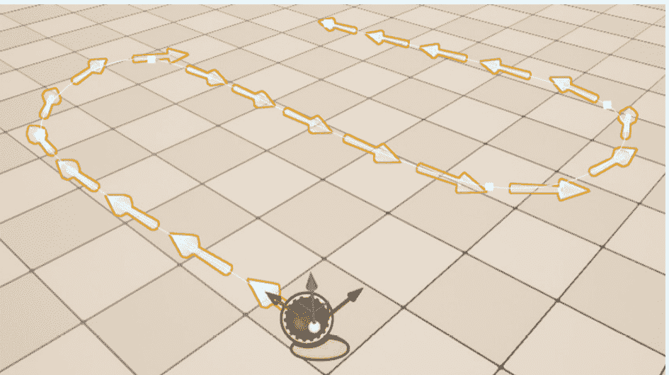

图 19.26 – 静态网格实例沿样条排列

关卡设计师将能够灵活地围绕关卡内容定义样条路径。

样条还可用于变形静态网格，如下一节所示。

### 样条网格组件

还有一个名为 **样条网格** 的组件使用样条。此组件用于沿双点样条变形静态网格。我们可以在关卡编辑器中编辑样条点，或使用蓝图函数设置它们。

**设置起点和终点** 函数可用于构建脚本中以定义样条网格：

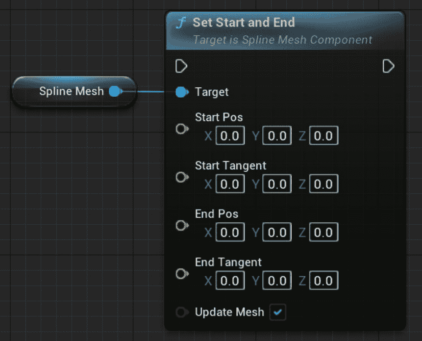

图 19.27 – 用于定义样条网格的函数

下一张截图显示了由样条线变形的静态网格示例：

图 19.28 – 由样条线变形的静态网格

我们可以修改上一节的示例，添加 Spline Mesh 组件而不是静态网格实例，以在关卡中创建弯曲管道。不幸的是，计算样条线实例的切线将需要超出本书范围的数学概念。

在下一节中，我们将学习扩展虚幻编辑器的一些方法。

## 编辑器实用蓝图

**编辑器实用蓝图**是一种仅在虚幻编辑器中执行的蓝图类型。你可以使用它们来操作内容浏览器中的资源和关卡中的行动者。

还有 **编辑器实用小部件**，这是一种 UMG 小部件，我们可以使用它为虚幻编辑器创建具有新功能的面板。

我们可以通过在资源创建菜单中访问 **编辑器实用工具** 子菜单来创建 **编辑器实用蓝图** 和 **编辑器实用小部件**：

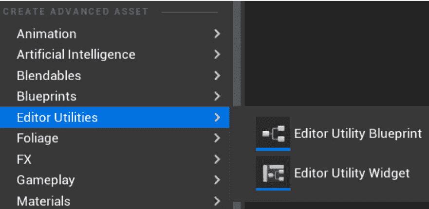

图 19.29 – 创建编辑器实用蓝图的菜单选项

右键单击编辑器实用蓝图的事件图，并查看 **编辑器脚本** 类别，以了解可用于编写编辑器脚本的功能：

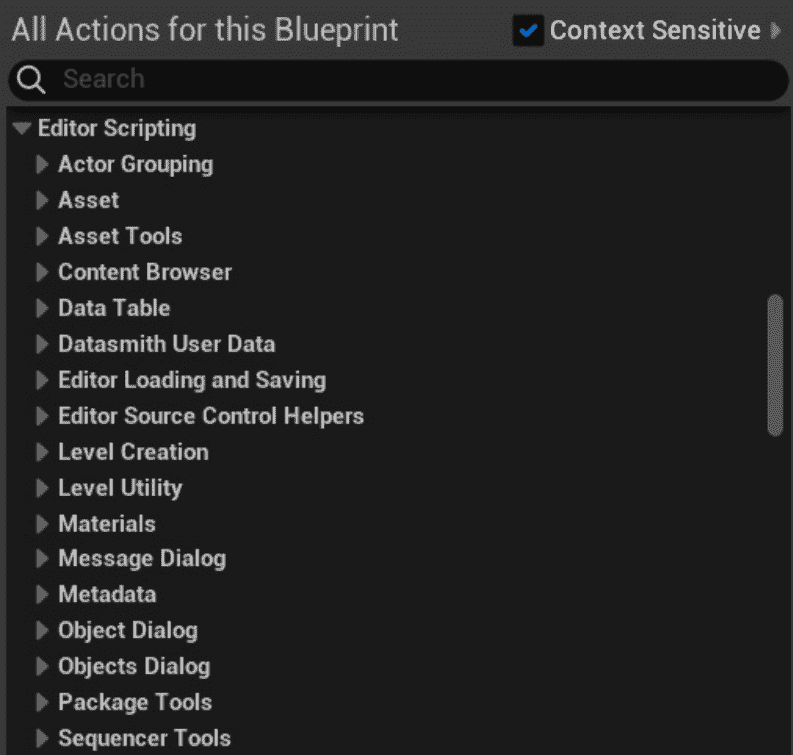

图 19.30 – 编辑器脚本类别及其子类别

在编辑器实用蓝图中创建的函数将在 **脚本操作** 子菜单中出现，当你右键单击关卡中的资源或行动者时。要创建将操作内容浏览器中资源的函数，需要选择 **资源操作实用工具** 作为父类。要操作关卡中的行动者，请使用 **行动者操作实用工具** 作为父类。

## 创建行动者操作实用工具

我们将创建一个名为 `BPU_ActorAction` 的编辑器实用蓝图，并使用 **行动者操作实用工具** 作为父类。这个蓝图将有一个名为 `AlignOnXAxis` 的函数，它将获取所选第一个行动者的位置 X，并将相同的值设置到其他所选行动者中。

创建蓝图的步骤如下：

- 1. 在内容浏览器中单击 **添加** 按钮，将鼠标悬停在 **编辑器实用工具** 上方，并选择 **编辑器实用蓝图** 选项：

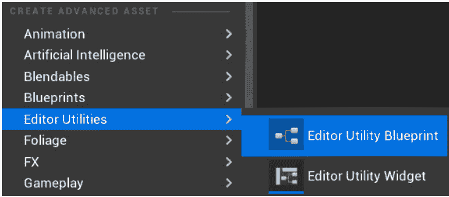

图 19.31 – 创建编辑器实用蓝图

图 19.32 – 选择父类

- 3. 将蓝图命名为 `BPU_ActorAction` 并双击它以打开蓝图编辑器。

- 4. 在 **我的蓝图** 面板中，创建一个名为 `AlignOnXAxis` 的函数：

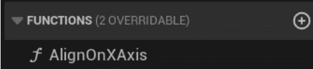

图 19.33 – 创建将在编辑器中调用的函数

- 5. 在 **我的蓝图** 面板的 **局部变量** 类别中，创建一个名为 `LocationX` 的 **浮点数** 类型局部变量。此变量将存储所选第一个行动者的 **位置 X**，以便设置到其他所选行动者中：

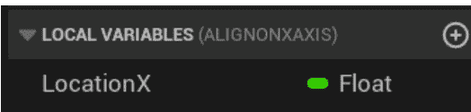

图 19.34 – 创建局部变量

- 6. 添加以下截图中显示的节点，该截图显示了 **沿 X 轴对齐** 函数的第一部分。**获取选择集** 节点返回关卡编辑器中所选行动者的数组。我们获取数组中的第一个行动者（索引 0）并存储其 **位置 X**：

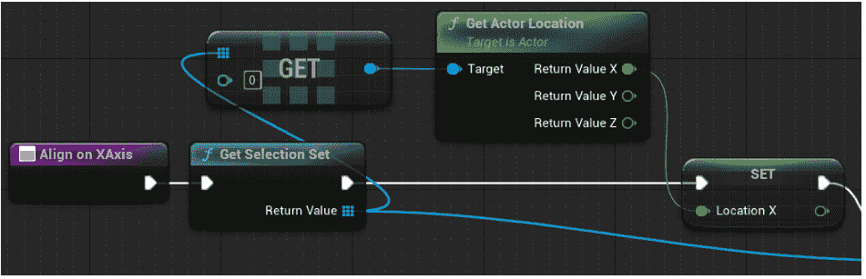

图 19.35 – 沿 X 轴对齐函数的第一部分

- 7. 添加沿 X 轴对齐函数第二部分的节点。For Each 循环遍历由 获取选择集 返回的数组。对于每个行动者，我们更新位置 X。我们需要右键单击位置参数并使用拆分结构体引脚来查看 X、Y 和 Z 引脚：

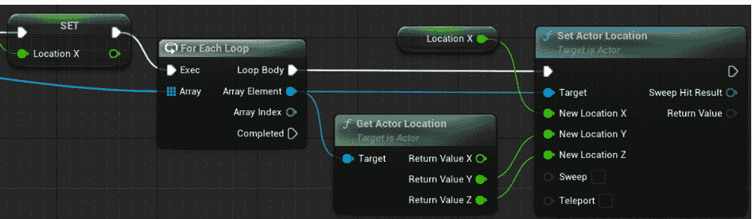

图 19.36 – 沿 X 轴对齐函数的第二部分

- 8. 编译蓝图并关闭蓝图编辑器。在关卡中拖放三次 SM_TableRound 资源，该资源位于 内容 > StarterContent > 道具 文件夹中：

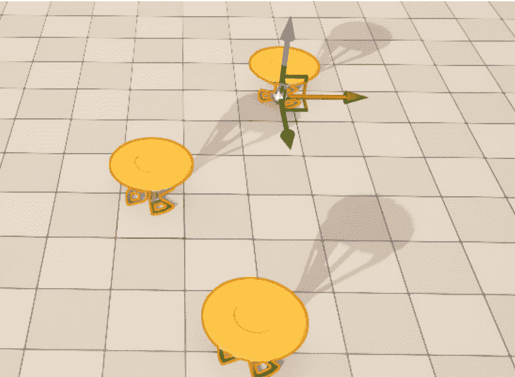

图 19.37 – 添加三个 SM_TableRound 实例

- 9. 按住 *Ctrl* 键并单击 **SM_TableRound** 实例将其添加到选择中。在选择三个实例后，右键单击其中一个，将鼠标悬停在 **脚本行动者操作** 上方，并选择 **沿 X 轴对齐** 函数：

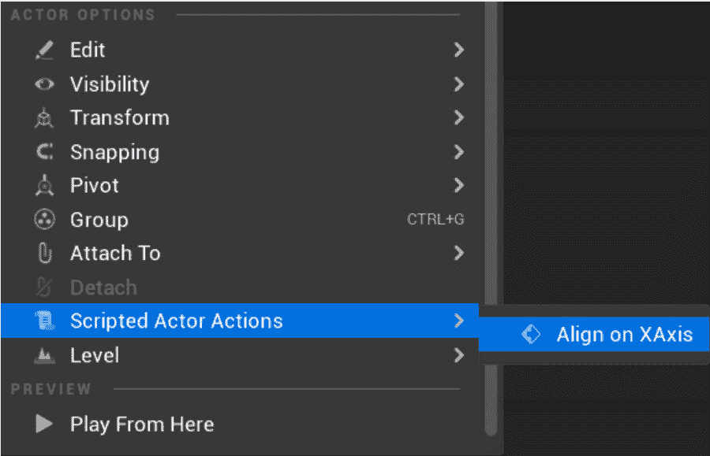

图 19.38 – 在编辑器中运行实用函数

- 10. 函数执行后，所有所选实例将具有相同的位置 X：

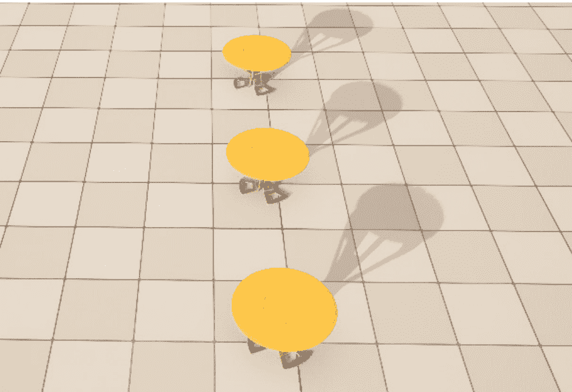

图 19.39 – 所有具有相同位置 X 的实例

通过使用编辑器实用蓝图和编辑器实用小部件，我们可以用新功能扩展虚幻编辑器，这些功能可以加速具有特定特性的项目开发。

## 摘要

本章展示了如何使用构造脚本进行过程生成。我们创建了一个蓝图，用于在关卡中添加静态网格实例行。静态网格、行数以及每行的实例数量都可以在关卡中更改。

我们还学习了如何创建蓝图样条线以沿路径生成实例，并了解到有一个样条网格组件可用于变形静态网格。

我们还研究了编辑器实用蓝图，它用于创建在编辑器中运行并可在编辑模式下操作资源和行动者的函数。我们创建了一个具有对齐所选行动者功能的编辑器实用蓝图。

下一章将解释什么是产品配置器。我们将学习如何使用变体管理器面板和关卡变体集来定义产品配置器。

## 测验

- 1. 编写过程生成脚本的最佳位置是 **事件开始**。
- a. 正确
- b. 错误

- 2. 我们只能在蓝图编辑器的视口中编辑样条线。
- a. 正确
- b. 错误

- 3. 我们可以使用 **样条网格** 组件来变形静态网格。
- a. 正确
- b. 错误

- 4. 编辑器实用蓝图的函数只能操作内容浏览器中的资源。
- a. 正确
- b. 错误

- 5. 我们可以使用编辑器实用小部件为虚幻编辑器创建面板。
- a. 正确
- b. 错误
